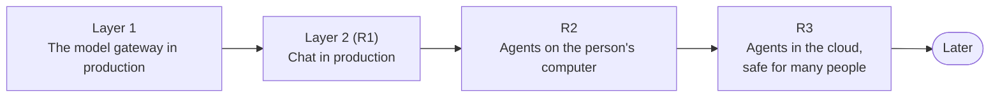
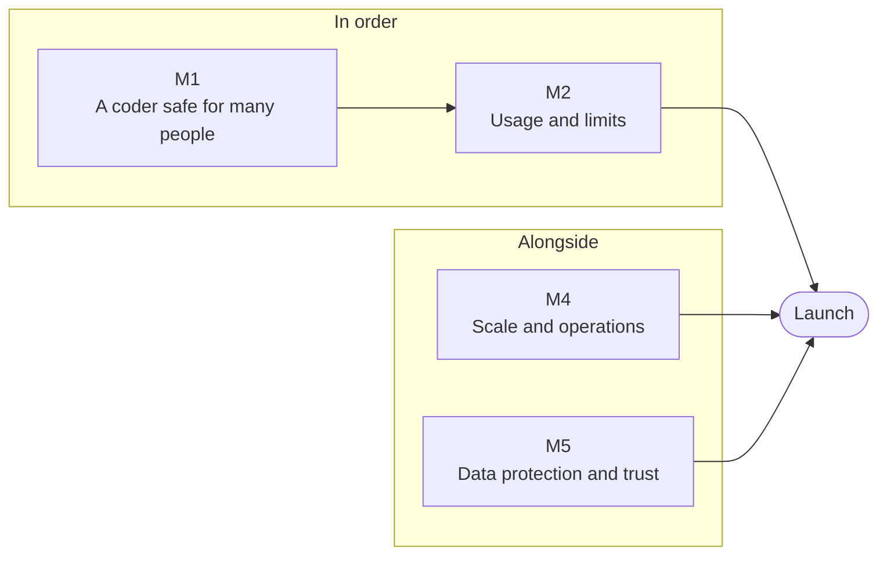

# Roadmap to launch

The front door for all four repositories of the another-agentic family: where the project is going, what is left,
and where you can help. *Checked 2026-11-21.*

## What this is

Four repositories make one product. Each name below is short for the repository in the same row.

| Short name | Repository | Role |
|---|---|---|
| **sys** | [another-agentic-system](https://github.com/vymalo/another-agentic-system) | The orchestrator (Rust, one Postgres event log) and the chat surface (Next.js). It also holds this roadmap and the epics. |
| **adam** | [another-adam-rs](https://github.com/vymalo/another-adam-rs) | The durable agent framework, and the coder: an agent that takes a coding task to a verified pull request. |
| **plat** | [another-agentic-platform](https://github.com/vymalo/another-agentic-platform) | The Kubernetes operator and the Platform API that run agents as services. |
| **img** | [another-agentic-images](https://github.com/vymalo/another-agentic-images) | The toolchain container images that agents work in. |

The goal is a coder that an operator can offer to many people at once. In these repositories that needs four things,
and each is a milestone below: isolation between people (M1), a record and a limit of what each person uses (M2), a
platform that holds the load (M4), and data protection and trust (M5). Six further milestones, M6 to M11, take
their goals from the feature list of a durable-actor platform ([below](#milestones-from-rivets-feature-list)).

Running a service on these building blocks, and everything about it beyond the code, is the business of whoever runs
it. That part is not open source; it left this roadmap on 2026-11-15, and M3 keeps its number and nothing else.

**adam-rs is the coder** (the owner, 2026-11-19). OpenCode is no longer used, except as the baseline the benchmark
measures adam against.

## Where we are, honestly

- **The MVP is complete against its build order, and proven on mocks only.** Scripted models, WireMock agents, a mock
  GitHub, a mock sign-in. No live model, GitHub.com or live web page was used in any proof. Complete is not
  accepted: the owner, who judged the first build not ready on 2026-10-01, has not tried this state. See
  [`docs/vision.md`](docs/vision.md) and [`docs/mvp.md`](docs/mvp.md).
- **The first isolation step is merged:** [adam#117](https://github.com/vymalo/another-adam-rs/pull/117) makes a run pod
  see only its own run (adam ADR 0041). Its known limits are the first tickets of M1.
- **Nothing has been measured live.** No load test, no cost per person.
- **There is no launch date.** The order below is the order of dependencies, not a schedule.

## Progress

*Measured 2026-11-21.* **"Done" means built and proven on mocks, scripted models, kind or CI. Nothing runs live yet:** layer
2's exit criteria are met 0 of 11, and R2's 0 of 3. A share is a count of merged items against the items of a plan, not
effort. A row marked *estimate* is the maintainers' judgement, with no count behind it. Each count is read again from `main` and
from the issues whenever this page is checked.

### The goals

| Goal | Progress | Basis |
|---|---|---|
| **adam against OpenCode** | about 50% (estimate) | A pilot of 5 tasks, 40 runs and one model put adam's quality ahead of OpenCode's. adam's reliability was fixed ([adam#273](https://github.com/vymalo/another-adam-rs/pull/273)) and has not been measured again. Its cost per run is about 4× OpenCode's. The lean first request is planned, not built. Parity gaps: 5 of 22 resolved ([the parity matrix](https://github.com/vymalo/another-adam-rs/blob/main/docs/reference/parity.md#gaps)) |
| **LibreChat-grade** | 37% | 13 of the 35 slices of [sys ADR 0067](docs/decisions/0067-the-plan-to-librechat-grade-and-the-client-agnostic-rule.md). The chat slices that are not about agents are paused |
| **Platform, kagent-grade** | 81% | 13 of the 16 increments of [plat §59c](https://github.com/vymalo/another-agentic-platform/blob/main/docs/architecture/10-control-plane-and-crds.md#59c-operator-increments-kagent-grade-minimum) |
| **Client-agnostic APIs** | about 25% (estimate) | The Platform API is about 80%: a generated OpenAPI document and the `aapctl` client. The chat API is about 15%: 0 of the 8 gaps of [sys#336](https://github.com/vymalo/another-agentic-system/issues/336) are closed, and there is no reference client |

### The steps

| Step | Progress | Basis |
|---|---|---|
| **Layer 1** | n/a | The deployment's own, outside these repositories |
| **Layer 2 (R1)** | about 11% | 2.0 of the 18 must rows of [Layer 2](#layer-2-r1-chat-in-production): A2UI v1.0 is 7 of 7 slices ([sys#380](https://github.com/vymalo/another-agentic-system/issues/380); S4, the final pin, merged in [sys#418](https://github.com/vymalo/another-agentic-system/pull/418)), and the chat and browser agents run a current adam (one row). Agent-team is 0 of 9 slices ([sys#377](https://github.com/vymalo/another-agentic-system/issues/377)), push 0 of 9 ([sys#384](https://github.com/vymalo/another-agentic-system/issues/384)). Exit criteria: 0 of 11 |
| **R2** | about 45% | 4 of the 11 rows of [R2](#r2-agents-on-the-persons-computer) are built and 2 are partial: [adam ADR 0047](https://github.com/vymalo/another-adam-rs/blob/main/docs/decisions/0047-adam-rs-can-be-embedded-in-an-application.md) slices 1 to 4 (the embedded feature set, `SecretSource`, the SQLite store, the engine with kill and resume); the tools as a library and the benchmark are partial. Exit criteria: 0 of 3 |
| **R3** | about 29% | 10 of 34 sub-issues of the epics [R3](#r3-agents-in-the-cloud-safe-for-many-people) names are closed |
| **M1** | 38% | 5 of 13 tickets of [sys#273](https://github.com/vymalo/another-agentic-system/issues/273) are closed |
| **M2** | 80% | 4 of 5 tickets of [sys#274](https://github.com/vymalo/another-agentic-system/issues/274) are closed |
| **M4** | 25% | 1 of 4 tickets of [sys#276](https://github.com/vymalo/another-agentic-system/issues/276) is closed |
| **M5** | 0% of its work | [sys#277](https://github.com/vymalo/another-agentic-system/issues/277) has 4 tickets and 2 are closed, but both were closed as not planned here, being an operator's own. Neither of its 2 pieces of work, "Delete my account" and the abuse controls, is done |
| **M6** | 50% | 3 of 6 gaps of [sys#402](https://github.com/vymalo/another-agentic-system/issues/402) are ticked: race, retries per step and schedules |
| **M7 to M11** | none ticked | Many gaps are partial; no gap of [sys#403](https://github.com/vymalo/another-agentic-system/issues/403) to [sys#407](https://github.com/vymalo/another-agentic-system/issues/407) is ticked |

M3 is not in these repositories. A closed ticket is built and proven on mocks, kind or CI; none of it has run live.

**Merged since 2026-11-19**

- **A2UI v1.0:** the orchestrator, the web and the dev stack ([sys#410](https://github.com/vymalo/another-agentic-system/pull/410), S1 to S3) and adam's side ([adam#251](https://github.com/vymalo/another-adam-rs/pull/251)). S4, the pin to the coder `sha-8501494`, is merged ([sys#418](https://github.com/vymalo/another-agentic-system/pull/418)).
- **Child sessions:** a person drives a child session ([sys#395](https://github.com/vymalo/another-agentic-system/pull/395)), and the web draws it ([sys#411](https://github.com/vymalo/another-agentic-system/pull/411)).
- **adam, embedded:** the SQLite store ([adam#245](https://github.com/vymalo/another-adam-rs/pull/245)) and the engine, with kill and resume ([adam#286](https://github.com/vymalo/another-adam-rs/pull/286), [#290](https://github.com/vymalo/another-adam-rs/pull/290), [#295](https://github.com/vymalo/another-adam-rs/pull/295)); the parity matrix ([adam#271](https://github.com/vymalo/another-adam-rs/pull/271), [#285](https://github.com/vymalo/another-adam-rs/pull/285)).
- **adam decisions:** [adam ADR 0060](https://github.com/vymalo/another-adam-rs/blob/main/docs/decisions/0060-schedules-are-parked-runs.md) (schedules), [0061](https://github.com/vymalo/another-adam-rs/blob/main/docs/decisions/0061-a-step-names-its-retry-policy.md) (a step names its retry policy), [0062](https://github.com/vymalo/another-adam-rs/blob/main/docs/decisions/0062-a-race-of-steps-records-its-winner.md) (a race records its winner), [0063](https://github.com/vymalo/another-adam-rs/blob/main/docs/decisions/0063-a-reasoning-effort-is-one-setting.md) (a reasoning effort per model, no default) and [0064](https://github.com/vymalo/another-adam-rs/blob/main/docs/decisions/0064-model-profiles-reasoning-effort-and-output-cap-follow-the-model.md) (the output cap and presets per model, a fallback of 128,000 tokens).
- **plat:** the tool catalogue's kind end-to-end (K10, [plat#70](https://github.com/vymalo/another-agentic-platform/pull/70)) and the model's extra body, echo and context window as form fields ([plat#77](https://github.com/vymalo/another-agentic-platform/pull/77)).

## Production in two layers, then two releases

*Agreed with the owner on 2026-11-19, and restructured into two production layers the same evening.* The milestones
below say what launch needs. This section says what goes to production first, what each step must hold, and what
waits. **The rules:** a new feature is started when it is on a step's list; work already started keeps going to its
end, with no gate. Layer 2's build starts on the owner's go once layer 1 is in production, and its decision records and
designs may merge before. There are no dates; the order is the order of dependencies.

**Where the work of these repositories centres** (the owner, 2026-11-19): **agents, on the person's computer (R2) and in
the cloud (R3), with their features, and A2UI.** That is background sessions, hooks and approvals, credentials, adam
embedded in an application, the stores, run pods, gVisor and the platform, and A2UI v1.0 with its catalog, which starts
now. Layers 1 and 2 are run and built by the deployment's own team; what layer 2 needs from these repositories stays
listed in [its section](#layer-2-r1-chat-in-production). The chat slices of LibreChat-grade that are not about agents
are paused.

| Step | Its goal | Milestones it closes | First used by a real person? |
|---|---|---|---|
| **Layer 1** | The model gateway in production: people sign in, every model call goes through the gateway with their credential, and their usage is metered per person | None. The gateway is the deployment's own, outside these repositories | Yes, but none of the code of these repositories |
| **Layer 2 (R1)** | Chat in production: people sign in and chat on the web and the desktop; answers stream; history follows them across devices; usage is counted per person; several agents work together in one chat (agent-team); a push tells the person when a run waits for them or ends | M2's usage record is used; M4's backups; M5's "Delete my account" | **Yes:** the first release of these repositories meant for people outside the maintainers |
| **R2** | An adam agent runs on the person's own computer, inside a desktop application, in a folder the person chooses, asking before what it may not do | None. adam is measured against OpenCode as a baseline (the quality goal) | Yes |
| **R3** | The same agent runs in the cloud, keeps working when the person's computer is closed, and is safe for many people at once | All of M1, the rest of M2, M4, the rest of M5 | Yes |

### Layer 1: the model gateway in production

People sign in, every model call goes through the gateway with their credential, and their usage is metered per
person. The gateway and the sign-in are the deployment's own and are not in these repositories, so **layer 1 needs no
ticket here**. What these repositories do meanwhile:

- **Smoke tests run.** Smoke test 4 runs adam's coder on six of our own tasks, with OpenCode as the baseline. The two
  blockers are fixed: the benchmark's doctor no longer passes the model key to its children
  ([sys#389](https://github.com/vymalo/another-agentic-system/issues/389), closed by [adam#207](https://github.com/vymalo/another-adam-rs/pull/207)),
  and two slots no longer race on one agent folder ([sys#390](https://github.com/vymalo/another-agentic-system/issues/390), closed by
  [adam#216](https://github.com/vymalo/another-adam-rs/pull/216)). A first pilot has run ([Progress](#progress)). It measures; it decides nothing.
- **Open tickets are finished or closed**: the started and exempt epics keep going
  ([below](#work-that-keeps-going-with-no-release-gate)), and every open ticket has its step in
  [Every open ticket, by step](#every-open-ticket-by-step).
- Layer 2's decision records and designs may merge.

### Layer 2 (R1): chat in production

The chat is built: the orchestrator, its chat API and AG-UI stream, and the `chat` agent served by `adam-agent`. R1 is
what it lacks to run for real people, often behind a gateway of the deployment's own in front of the orchestrator, and
one new feature: agent-team.

| Must | Repo | Ticket | Done when |
|---|---|---|---|
| The chart runs the orchestrator without its own web and edge: `web` and `edge` can be turned off, and the network policy admits only the named peer in front of it | sys | new ticket | `deploy/chart/tests/render-check.sh` asserts both renders, each check broken on purpose |
| A person's token forwarded by that peer is accepted by configuration of `auth.jwt` alone: `userClaim: sub` on a fresh deployment, the audiences, the roles claim | sys | none expected (configuration); a new ticket if a gap appears | a scenario where a stand-in peer forwards two people's tokens and each reads only their own threads |
| **The credential broker's first part** ([sys#334](https://github.com/vymalo/another-agentic-system/issues/334) slice B1, depending on no hook): the broker as a service of this system with its store (a vault, OpenBao, or the broker's own sealed store for small and development deployments) and the lease contract; the orchestrator binds run, agent and person at the broker; an internal lease lookup, absent from the edge, that answers the orchestrator and the injector and **never an agent** (its own run included: amended 2026-11-24, ANR-Q31). **The run id is not a secret and is never sufficient alone**; a leased value is scrubbed from every log | sys | sys#334 B1 (new ticket) | the broker's conformance suite over both stores; a lookup with a bound run id but another agent's identity is refused; the lookup is absent from the chart's ingress (`render-check.sh`); no leased value in any log |
| **The injector: [Agent Router](https://github.com/theagentrouter/agent-router) with [Authorino](https://github.com/Kuadrant/authorino) in front** ([sys#334](https://github.com/vymalo/another-agentic-system/issues/334) S9). Agent Router is the former Envoy AI Gateway (Apache-2.0; v1.3.0 is its latest stable release, *verified 2026-11-19* on its GitHub releases page), self-hosted and internal only, with TLS on the internal path from a cert-manager CA. Envoy Gateway's external authorization (gRPC) calls Authorino in front of its routes. Authorino authenticates the agent pod (its service-account token through TokenReview, or a client certificate), fetches the lease from the broker (never the vault directly) by `X-Run-Id` and the caller's identity, adds `Authorization` to the upstream request only, caches it per run for no longer than the lease, and strips any `Authorization` the client sent. Authorino's `metadata.http`, evaluator `cache` and `response.success.headers` are *verified 2026-11-19* in its documentation. **A spike comes first**: that the added header reaches the model endpoint through Agent Router's generated routes is *unverified* | sys | sys#334 S9 (new ticket, spike first) | a kind test: a call from the bound agent with its run id reaches a mock model endpoint with that run's bearer; the same run id from another service account is refused; a client-sent `Authorization` never reaches the endpoint; the agent trusts only the cert-manager CA on that path |
| The system chart's `chat` and `browser` agents reach the model endpoint only through Agent Router (network policies) | sys | sys#334 S10 | `render-check.sh`; the scenario below |
| **A model credential per run, held by no one but the vault.** The orchestrator tells the broker which person each run is for, through a new port with a testkit (a `static` adapter that is today's behaviour, and a `broker` adapter). No credential is in a message, the log, an export, a fork or a frame; the orchestrator's own model calls go through Agent Router too. ADR first | sys | new ticket | the port's conformance suite; a new `dev/` scenario whose mock model endpoint records the bearer of every call: each call carries the person's; no credential in any A2A message |
| **The agent holds no model key** ([sys#334](https://github.com/vymalo/another-agentic-system/issues/334) S8). Configured for it, adam sends every model call of a run, local subagents and child sessions included, to Agent Router, tagged with the run id (not a secret), with no key of its own; it fails closed: a refusal or an unreachable gateway parks the run, never a fallback to a deployment key | adam | sys#334 S8 (new ticket) | a scripted model behind a test gateway: every call carries the run id and arrives with the injected bearer; the agent's environment holds no key; the gateway down parks the run |
| **Over the limit pauses, never fails.** When the model endpoint answers that the person is over their limit, the run parks with the reason `over-limit` instead of ending as an invalid request; the person's next message after the limit is lifted resumes the same run at the same step | adam | new ticket | a scripted model refuses, then answers: the run parks, then resumes with its journal unchanged |
| The orchestrator shows the pause: a thread state and an AG-UI event with the typed reason; the dispatcher does not retry it on its own | sys | new ticket | the new `dev/` scenario: the thread shows the reason, a new message resumes |
| The orchestrator's own model calls (thread titles, descriptions) go through Agent Router with the person's credential and are lines of their own in the person's usage | sys | [sys#338](https://github.com/vymalo/another-agentic-system/issues/338) slice 4 | `dev/usage-ledger-e2e.sh` extended |
| A second client forks, edits and regenerates safely: a message's `seq` is a field of the API, and the server refuses a regenerate or an edit while a question waits and on a steered message | sys | [sys#336](https://github.com/vymalo/another-agentic-system/issues/336) slices 1, 2 | the server tests; the web's mock contract test |
| The chat contract cannot break silently: CI fails on an incompatible change to `docs/api/chat-api.yaml` or the AG-UI goldens without a version note | sys | new ticket | the check fails on a removed field in a test branch |
| **Built:** the `chat` and `browser` agents run a current adam, pinned by tag and digest: coder `sha-7418467` since 2026-11-19 ([sys#397](https://github.com/vymalo/another-agentic-system/pull/397)) and `sha-e2bfda9` since 2026-11-21, then `sha-8501494` ([sys#418](https://github.com/vymalo/another-agentic-system/pull/418)), then `sha-7ac3281`, the commit the crates of `agent-local` name too (sys#382 E1) | sys | new ticket (`bump-adam`) | `dev/agents-e2e.sh`, `dev/usage-e2e.sh` and `dev/child-sessions-e2e.sh` green on the new pin |
| Delete my account | sys | [sys#294](https://github.com/vymalo/another-agentic-system/issues/294) | a `dev/` scenario; another person's data untouched |
| Backups that restore: one restore of a live database into a new cluster returns a seeded thread | sys | [sys#151](https://github.com/vymalo/another-agentic-system/issues/151) | the restore drill's log on a real cluster |
| **Agent-team** ([ADR 0074](https://github.com/vymalo/another-agentic-system/pull/378), proposed): several primary agents in one chat; hand-offs by `@name` with fan-out and fan-in, where a fanned-out member cannot hand off and its hand-off goes to the fan-in; at most 6 hand-offs per message of the person; every member reads the whole thread (`read_thread`); the person's approval asked by default for a hand-off and a risky action, by a gate in the orchestrator; declared checkpoints; the person interrupts at any time; saved presets, each person's own; the web UI | sys | [sys#377](https://github.com/vymalo/another-agentic-system/issues/377) | the epic's end-to-end: a fan-out to two mock agents and their fan-in, a fanned-out member's hand-off delivered to the fan-in, the seventh hand-off refused with a reason, a hand-off and a risky action waiting for the yes, a checkpoint, an interrupt, a preset reused by its owner and invisible to another person; the web's Playwright specs |
| **A2UI v1.0, a hard cutover, built now** ([ADR 0075](docs/decisions/0075-a2ui-v1-0-cutover.md), with [adam ADR 0056](https://github.com/vymalo/another-adam-rs/blob/main/docs/decisions/0056-a2ui-v1-0-only-a-hard-cutover.md); `ui-catalog/v2`): no dual support; old threads keep their v0.9.1 surfaces, shown as made by an earlier version, with actions on them refused; one merge per repository, adam-rs first. **Built, on mocks (2026-11-21), 7 of 7 slices:** the contract C0 ([sys#396](https://github.com/vymalo/another-agentic-system/pull/396)), adam's side A1 and A2 ([adam#251](https://github.com/vymalo/another-adam-rs/pull/251)), the orchestrator, the web and the dev stack S1 to S3 ([sys#410](https://github.com/vymalo/another-agentic-system/pull/410)), and S4, the pin to coder `sha-8501494` ([sys#418](https://github.com/vymalo/another-agentic-system/pull/418)). **Left:** catalog 10 and up, and exit criterion 10, which counts only on a live deployment | sys, adam | [sys#380](https://github.com/vymalo/another-agentic-system/issues/380) | the epic's proofs |
| **Push notifications** ([ADR 0077](docs/decisions/0077-push-notifications-for-a-persons-runs.md), the owner's decision of 2026-11-19: in R1, self-hosted delivery): a person's device is told, with no word of the thread, when a run waits for them (a hand-off approval, a checkpoint, a form, a gate, an over-limit park) or ends; Web Push and UnifiedPush, the deployment's ntfy, APNs for iOS only with an opaque id; no Firebase | sys | [sys#384](https://github.com/vymalo/another-agentic-system/issues/384) | `dev/notify-e2e.sh` on a mock push service: a waiting form makes one push with no text of the thread, a thread open on the device makes none, a `410` drops the device, an expired hand-off is not sent; the web's Playwright specs |

**Exit criteria**, measured on a real deployment with a real model:

1. For 7 days, the owner and at least 3 people outside the maintainers chat on it.
2. No model call is made without a person's credential, in the model endpoint's own record, and no agent holds a model key.
3. The person's usage record and the model endpoint's own record agree, call for call, 7 days running.
4. A person over their limit sees the pause, and the same run continues once the limit is lifted.
5. `dev/rbac-e2e.sh` passes against the deployment, and the restore drill has passed.
6. The human tests [sys#202](https://github.com/vymalo/another-agentic-system/issues/202) and
   [sys#205](https://github.com/vymalo/another-agentic-system/issues/205) pass on the deployment.
7. The orchestrator adds at most 1 s at p95 between a message accepted and the agent's first model request.
8. Agent-team's end-to-end is green, and one live hand-off between two agents, approved by a person, is recorded.
9. The owner tries the chat and accepts it ([ADR 0037](docs/decisions/0037-the-mvp-is-complete-against-its-build-order.md)).
10. A2UI v1.0 is the only dialect: [sys#380](https://github.com/vymalo/another-agentic-system/issues/380)'s proofs are
    green, and nothing writes or relays v0.9.1. (Built on mocks, 7 of 7 slices; the criterion counts only on a live deployment.)
11. Push works: `dev/notify-e2e.sh` is green, and a real device receives one push with no word of the thread.

All three of agent-team, A2UI v1.0 and push hold this exit (the owner, 2026-11-19). Layer 2's chat runs on this
orchestrator (the owner, 2026-11-19).

**Not in layer 2:** sharing an agent-team preset by role (later); the coder in the cloud and all of M1 (R3); attachments (R2); memory (after R2); a person's own
MCP servers and the other API gaps of [sys#336](https://github.com/vymalo/another-agentic-system/issues/336) (later);
the limit check before dispatch, [sys#282](https://github.com/vymalo/another-agentic-system/issues/282) (R3); thread
sharing (later); web search for the chat (later).

### R2: agents on the person's computer

adam is embedded in a desktop application as a library ([adam ADR 0047](https://github.com/vymalo/another-adam-rs/blob/main/docs/decisions/0047-adam-rs-can-be-embedded-in-an-application.md),
accepted, not built). The application brings the model client. **Its slices start now** (the owner, 2026-11-19): adam is
wanted in the first versions of the applications, so the embedding work below keeps going with no release gate, as the
work in [Work that keeps going](#work-that-keeps-going-with-no-release-gate) does; R2 is when it is used by people.

| Must | Repo | Ticket | Done when |
|---|---|---|---|
| **Built** ([adam#205](https://github.com/vymalo/another-adam-rs/pull/205), [#226](https://github.com/vymalo/another-adam-rs/pull/226)). The embedded feature set (adam ADR 0047 slice 1): no HTTP server or client, database driver, Kubernetes client, second TLS provider or MCP client in `adam-engine`'s tree | adam | new ticket | the dependency job fails on a planted crate |
| **Built** ([adam#211](https://github.com/vymalo/another-adam-rs/pull/211), [#215](https://github.com/vymalo/another-adam-rs/pull/215)). `SecretSource` (slice 2): the engine's default refuses every name | adam | new ticket | the slice's test |
| **Built** ([adam#245](https://github.com/vymalo/another-adam-rs/pull/245); the ticket still open). One SQLite store (slice 3) | adam | [sys#362](https://github.com/vymalo/another-agentic-system/issues/362) | `store_conformance!` on SQLite; a second process refused |
| **Built** ([adam#240](https://github.com/vymalo/another-adam-rs/pull/240), [#242](https://github.com/vymalo/another-adam-rs/pull/242), [#244](https://github.com/vymalo/another-adam-rs/pull/244), [#252](https://github.com/vymalo/another-adam-rs/pull/252), [#286](https://github.com/vymalo/another-adam-rs/pull/286): a killed process resumes its run on SQLite). `adam-engine` and an example embedder (slice 4), with each model call's usage and the run's total in its events, so the application shows what a run used | adam | new ticket | a killed process resumes its run; a slow reader keeps memory bounded |
| Approvals: hooks H1 and H8 ([adam ADR 0050](https://github.com/vymalo/another-adam-rs/blob/main/docs/decisions/0050-hooks-around-the-agent-loop-compiled-first-and-programs-second.md)) and adam ADR 0047 slice 5 over them; the access tiers decide what is asked | adam | [sys#333](https://github.com/vymalo/another-agentic-system/issues/333) slices 2, 12; new ticket for slice 5 | yes runs the same call once; a replay never asks twice |
| **Partly built:** the file and command tools moved into a crate over a port ([adam#212](https://github.com/vymalo/another-adam-rs/pull/212) to [#239](https://github.com/vymalo/another-adam-rs/pull/239)) and a host gives its own tools ([adam#295](https://github.com/vymalo/another-adam-rs/pull/295)); the local sandbox (slice 9) is not built. The tools as a library (slice 6), the person's directory and a local agent (slice 7), the local sandbox (slice 9) | adam | new tickets | each slice's proof in adam ADR 0047 |
| macOS (slice 8, the macOS half), on a self-hosted Mac runner | adam | new ticket | the same tests on that runner |
| Attachments: files and images in a message, kept by hash in the artifact store, at most 10 MiB | sys | [sys#335](https://github.com/vymalo/another-agentic-system/issues/335) slice 10 | the slice's server and web tests |
| **The orchestrator as a library** in an application, beside an in-process adam ([ADR 0076](docs/decisions/0076-the-orchestrator-as-a-library-in-an-application.md), merged (`e2ebb09`); epic [sys#382](https://github.com/vymalo/another-agentic-system/issues/382)): `orch-store-sqlite` with its testkits (E2); a library composition root and its dependency check (E3); `agent-local` revived, on adam's SQLite store (E4); a compile check of the embedded set for its targets (E5); a minimum application version, so a deployment can refuse an application too old for a hard cutover (E6). The move off `sqlx` (E1) may land earlier | sys | sys#382 E2 to E6 | each slice's proof in the epic; a killed example resumes its run on SQLite |
| Over the limit pauses in the engine too (R1's adam change, reused) | adam | covered by R1 | an engine test with a scripted refusal |
| **Partly built:** the bench runs on the host's container runtime ([adam#206](https://github.com/vymalo/another-adam-rs/pull/206)), has six tasks of our own ([adam#193](https://github.com/vymalo/another-adam-rs/pull/193)), agent variants and a blind quality review ([adam#254](https://github.com/vymalo/another-adam-rs/pull/254)), and a first pilot has run; the comparison with intervals is not reported. The benchmark measures adam, with OpenCode as the baseline: the bench on the host's container runtime (merged, adam#206), smoke test 4 on six of our own tasks, then the comparison of [sys#345](https://github.com/vymalo/another-agentic-system/issues/345) slice 8 and the [ADR 0048](https://github.com/vymalo/another-adam-rs/blob/main/docs/decisions/0048-a-benchmark-harness-for-adam-coder-and-opencode.md) run. No gate: adam is the coder whatever the result | adam `bench/` | sys#345 slice 8, [sys#389](https://github.com/vymalo/another-agentic-system/issues/389), [sys#390](https://github.com/vymalo/another-agentic-system/issues/390) | the bench reports, with intervals |

**Exit criteria:**

1. The bench has reported adam's pass rate, model cost and time per solved task against OpenCode's as the baseline,
   with intervals. adam is the coder on a person's computer; the report is its baseline, not a gate (the owner,
   2026-11-19: the parity gate is gone).
2. The engine's suites are green on Linux and macOS: kill and resume, approve once across a crash, the sandbox's
   refusal, the dependency check.
3. A person outside the maintainers runs a local agent in a folder of their own, approves one command, kills the
   application mid-run, sees the run resume, and reads what it used.

**Not in R2:** the orchestrator on a phone (later); Windows (not planned); adam as an ACP agent (later); the other hooks and hook programs (no release gate, below); the store service of
[adam ADR 0053](https://github.com/vymalo/another-adam-rs/pull/196) (R3, only if the load test asks for it); memory
(after R2).

### R3: agents in the cloud, safe for many people

| Must | Repo | Ticket | Done when |
|---|---|---|---|
| All of [M1](#m1-a-coder-that-is-safe-for-many-people): [sys ADR 0064](docs/decisions/0064-the-person-reaches-the-agent-and-links-their-github.md) agreed, the person assertion and GitHub linking, the coder's access check, the chain on mocks, a mirror per person, the package cache, no model key in run pods (the per-run credential of R1 never reaches one), gVisor (K14b to K14d) | sys, adam, plat | [sys#278](https://github.com/vymalo/another-agentic-system/issues/278), [#279](https://github.com/vymalo/another-agentic-system/issues/279), [adam#121](https://github.com/vymalo/another-adam-rs/issues/121), [sys#280](https://github.com/vymalo/another-agentic-system/issues/280), [adam#122](https://github.com/vymalo/another-adam-rs/issues/122), [#123](https://github.com/vymalo/another-adam-rs/issues/123), [#119](https://github.com/vymalo/another-adam-rs/issues/119), [plat#54](https://github.com/vymalo/another-agentic-platform/issues/54) | M1's "Done when", true on a real cluster |
| The first real agent on a real cluster (K13), and the operator's default agent image moved to a current coder (today's is of 2026-10-05) | plat | K13; new ticket for the image | the coder answers through the Platform API on a real cluster |
| Sandbox time is limited before a run starts: `usage/v1` reports a run pod's size class with its seconds (a new ticket if it does not), and a run is refused before dispatch when the person is at their limit | adam, sys | [sys#282](https://github.com/vymalo/another-agentic-system/issues/282); new ticket for the size class | a `dev/` scenario: a person at the limit is refused before any pod starts |
| All of [M4](#m4-scale-and-operations): three instances and the pooler on, the coder's database and pruning, the load test, capacity metrics and alerts | sys, adam | [sys#290](https://github.com/vymalo/another-agentic-system/issues/290), [adam#127](https://github.com/vymalo/another-adam-rs/issues/127), [sys#291](https://github.com/vymalo/another-agentic-system/issues/291), [sys#292](https://github.com/vymalo/another-agentic-system/issues/292) | the load test's report names the first bottleneck |
| Abuse controls: CPU mining detected on run pods, a kill switch per person | sys | [sys#295](https://github.com/vymalo/another-agentic-system/issues/295) | a scripted miner is flagged; a switched-off person's runs stop |
| A conversation keeps its repository checkouts between jobs | adam | [sys#341](https://github.com/vymalo/another-agentic-system/issues/341) slices 1 to 4 | a second job continues a dirty tree and says so |
| A repository's own environment is a run pod of its image, and Podman is gone | adam, plat | [sys#368](https://github.com/vymalo/another-agentic-system/issues/368), [#370](https://github.com/vymalo/another-agentic-system/issues/370), [#371](https://github.com/vymalo/another-agentic-system/issues/371) | the proofs of [sys#359](https://github.com/vymalo/another-agentic-system/issues/359) |

**Exit criteria:** M1's "Done when" holds on a real cluster; the load test reports its limit, and the cluster holds 200 runs
at once until a measured number replaces it; a person starts a cloud run, closes their
computer, and reads the result on another device; a person at their limit is refused before a pod starts.

**Not in R3:** everything in the next table.

### Work that keeps going, with no release gate

An epic with at least one merged slice is finished, whatever release it serves, and merges as it is built; so are the two epics the owner exempted. It must not
delay a release. An epic with only a decision record or a plan waits for its release.

| Epic | Note |
|---|---|
| A subagent in the background, as a session ([sys#332](https://github.com/vymalo/another-agentic-system/issues/332)), with a child session's options ([adam ADR 0054](https://github.com/vymalo/another-adam-rs/pull/195)) | adam's slices 7 and 8 (slices 3 to 6 are built); the system's S1 to S4 are built on mocks ([sys#395](https://github.com/vymalo/another-agentic-system/pull/395), [sys#411](https://github.com/vymalo/another-agentic-system/pull/411)), S5 is left |
| LibreChat-grade ([sys#335](https://github.com/vymalo/another-agentic-system/issues/335)), the slices about agents | its other chat slices are paused (2026-11-19); an agent's own `/` commands finish; attachments are an R2 must |
| A2UI v1.0 ([sys#380](https://github.com/vymalo/another-agentic-system/issues/380)) | 7 of 7 slices built on mocks (2026-11-21): adam-rs's half first ([adam#251](https://github.com/vymalo/another-adam-rs/pull/251)), then the orchestrator, web and dev stack ([sys#410](https://github.com/vymalo/another-agentic-system/pull/410)); S4, the pin, is merged ([sys#418](https://github.com/vymalo/another-agentic-system/pull/418)); catalog 10 and up is left; still on layer 2's list |
| The rest of the kagent-grade minimum ([sys#344](https://github.com/vymalo/another-agentic-system/issues/344)) | K13 and K14 are R3 musts; K12 waits for adam's approval hooks |
| A faster coder ([sys#345](https://github.com/vymalo/another-agentic-system/issues/345)) | on-demand skills and MCP tools (slice 7) are now built, the owner's choice of 2026-11-19, after a two-call run that measures the cache first; its comparison (slice 8) is smoke test 4, then the bench |
| Hooks around the agent loop ([sys#333](https://github.com/vymalo/another-agentic-system/issues/333)), hook programs included | H1 and H8 are also R2 musts |
| The orchestrator off `sqlx`, onto tokio-postgres and a pool, a hard cutover, crate by crate ([sys#382](https://github.com/vymalo/another-agentic-system/issues/382) E1) | E1 built on 2026-11-21: no crate of the orchestrator uses `sqlx` and the lockfile holds none (`tools/sqlx-out-check.sh` in CI), adam-rs's store under `agent-local` at `7ac3281` included; the rest of the epic is R2 |
| adam embedded in an application ([adam ADR 0047](https://github.com/vymalo/another-adam-rs/blob/main/docs/decisions/0047-adam-rs-can-be-embedded-in-an-application.md) slices 1 to 9), with the model's credentials asked of the host for each call ([adam#200](https://github.com/vymalo/another-adam-rs/pull/200), adam ADR 0058, merged) | the owner exempted it on 2026-11-19; R2 is when people use it |
| No Podman ([sys#359](https://github.com/vymalo/another-agentic-system/issues/359)), decided on 2026-11-19 | the store service of [adam ADR 0053](https://github.com/vymalo/another-adam-rs/pull/196) only if R3's load test names database connections as the first bottleneck; the bench uses SQLite. Built so far: the static coder ([sys#360](https://github.com/vymalo/another-agentic-system/issues/360)), the Postgres store off `sqlx` ([adam#232](https://github.com/vymalo/another-adam-rs/pull/232)), the SQLite store ([adam#245](https://github.com/vymalo/another-adam-rs/pull/245)), the bench on the host's runtime ([sys#365](https://github.com/vymalo/another-agentic-system/issues/365)), adam's dev stack and CI without Podman ([adam#208](https://github.com/vymalo/another-adam-rs/pull/208)), a repository's own image in a run pod ([adam#235](https://github.com/vymalo/another-adam-rs/pull/235)) and this system's dev stack ([sys#375](https://github.com/vymalo/another-agentic-system/pull/375)); the store service and the code's own sweep are left |

This repository's web and desktop app are the open-source
project's clients and keep evolving.

### Waits for a later release, or not planned

| Work | Verdict | Why |
|---|---|---|
| Missions, then federation ([sys#342](https://github.com/vymalo/another-agentic-system/issues/342)) | After R3 | They need cloud agents, limits and sys ADR 0064 first |
| Windows: browser frames, web and phone previews ([sys#339](https://github.com/vymalo/another-agentic-system/issues/339)) | After R3 | No release needs them |
| The app factory ([ADR 0073](docs/decisions/0073-app-factory-board-and-model-selection.md)) | After R3, after memory and its refinement | Its agents need R3's coder in the cloud |
| Memory, then its refinement ([sys#337](https://github.com/vymalo/another-agentic-system/issues/337)) | Memory after R2; refinement after R3 | Not needed to run R1 or R2 |
| An agent asks the person for a credential ([sys#334](https://github.com/vymalo/another-agentic-system/issues/334) S1 to S7, S11, S12) | After hooks | The broker's first part and the injector are in R1 |
| The API gaps 3 to 8 and the reference client ([sys#336](https://github.com/vymalo/another-agentic-system/issues/336)) | Later | A person's own MCP servers are not in R1 |
| Diagrams as a UI catalog component ([sys#340](https://github.com/vymalo/another-agentic-system/issues/340)) | Not planned | Mermaid and charts exist; no release needs more |
| Search by meaning ([sys#343](https://github.com/vymalo/another-agentic-system/issues/343)) | Not planned | Word search is built |
| A folder agent in the coder chart; a settings file for adam | Not planned | The system chart and the operator run folders; the engine takes settings in code |

## Every open ticket, by step

*Read on 2026-11-19: 99 open issues across the four repositories; 96 on 2026-11-21, after the closings in the last row.* Each ticket is in one row, at its earliest step; an
epic that spans steps says the rest in its note. The epics and their tickets stay the live lists.

| Step | Tickets | Note |
|---|---|---|
| **Layer 1** | none | the gateway and the sign-in are the deployment's own |
| **Layer 2 (R1)** | epics sys#334 (B1, S8 to S10), sys#336 (slices 1, 2), sys#338 (slice 4), sys#377, sys#384; sys#294, sys#151, sys#149; the human tests sys#202, sys#205, sys#204 and adam#102, re-run on the new deployment; the milestone epics sys#274, sys#276, sys#277 for their layer 2 parts | the musts of [Layer 2](#layer-2-r1-chat-in-production) |
| **Now, no gate** | sys#380 (A2UI v1.0, starts now); sys#389 and sys#390 (the benchmark, before smoke test 4); the started and exempt epics sys#332, sys#333, sys#335 (its slices about agents), sys#344, sys#345, sys#359, sys#387; of sys#359, sys#361, sys#362, sys#368, sys#369, sys#370, sys#371, sys#373, sys#374; the good first issues sys#297, adam#129, plat#37, img#13 | [Work that keeps going](#work-that-keeps-going-with-no-release-gate) |
| **R2** | sys#382 (E2 to E6; E1 may land earlier) | most of R2's musts are adam ADR 0047's slices under sys#387 |
| **R3** | sys#273, sys#278, sys#279, adam#121, sys#280, adam#122, adam#123, adam#119, plat#54 (M1); sys#282 and sys#170 (limits before a run); sys#291, sys#292, adam#127 (M4); sys#295 (M5); sys#341 (step 1); sys#363, sys#364, sys#367 (only if the load test asks); sys#203 (the coder from chat to a pull request, live) | the musts of [R3](#r3-agents-in-the-cloud-safe-for-many-people) |
| **Later** | sys#337, sys#339, sys#342, sys#144, sys#155, sys#157, sys#208 | [Waits for a later release](#waits-for-a-later-release-or-not-planned) |
| **Closed** (were proposed to close; all closed by 2026-11-21) | done: sys#360 (adam#201), sys#365 (adam#206), adam#52, adam#53, adam#54 (after a check); dropped or cut: sys#366, sys#340, sys#343, the post-MVP epic sys#146 with sys#160 to sys#169 and sys#171 (sys#170 moves to R3); superseded: sys#162 (by sys#384), sys#167 (by sys#359), sys#145 (by M5, sys#277), sys#159 (a fresh deployment keys people by `sub` by configuration), sys#222 to sys#226 (by the A2UI v1.0 cutover, sys#380); the first test deployment, which is down: sys#143, sys#148, sys#158, sys#206, sys#207, sys#209, adam#101 | read from the issues on 2026-11-21: every ticket named in the row is closed |

## Three quality goals, alongside the milestones

On 2026-11-14 the owner set three goals that run beside M1 to M5 and are not launch milestones: the coder, this
system "LibreChat-grade" with every feature usable by a second client, and the platform at a "kagent-grade minimum".
The first was "a coder as good as OpenCode, and above"; since 2026-11-19 it is **adam-rs, measured against OpenCode as a
baseline**: adam is the coder, and the benchmark measures it with no gate. Each has a plan of its own, and the plan is where its slices
and their state live. The [Progress](#progress) section above gives each goal's share, with its basis. *Checked 2026-11-21.* The share is the slices merged to `main` against the slices of the plan:
a count, not a measure of effort. As everywhere in this roadmap, all of it is proven on tests and mocks, none on a
live model or a real cluster.

| Goal | Plan | Merged | Share | Left |
|---|---|---|---|---|
| **adam**: adam-rs, measured against OpenCode as a baseline | [adam ADR 0044](https://github.com/vymalo/another-adam-rs/blob/main/docs/decisions/0044-paged-tools-a-stable-prompt-prefix-a-plan-skills-commands-and-project-context.md), 17 slices | The loop survives bad model output (1), paged reads (2), command output kept whole and read back by page (3), OpenCode removed (5), a prompt prefix that holds across turns and a cache key (4), a plan every agent has (6), a repository's own instructions shown to the coder (7), skills on by default with a repository's own skills (8), the repeated-call rule, time limits and a cancel that reaches children (10), compaction (9), more kinds of question and forms read back (11), commands served by the agent and announced by an A2A extension (12), references a run reads and never writes (13), MCP timeouts, server instructions and prompts as commands (14), commands that keep running (16), images in, off by default (15a), diagnostics, a definition and references from a language server (17, [adam#169](https://github.com/vymalo/another-adam-rs/pull/169)) | 17 of 17, 100 % | The plan is complete. Deferred by the owner, and not counted: images made inline by a model (15b). Next for this goal, a faster coder ([sys#345](https://github.com/vymalo/another-agentic-system/issues/345)): its code is merged (tool calls that run at the same time, [adam ADR 0049](https://github.com/vymalo/another-adam-rs/blob/main/docs/decisions/0049-the-tool-calls-of-a-turn-run-at-the-same-time.md), and a call that starts when its arguments are complete; one call that commits, pushes and opens the pull request; `read_files`; an `edit_file` that tolerates line endings; a failed check not run again on an unchanged tree; a static image); what is left is its comparison (smoke test 4, then the bench), and on-demand skills and MCP tools (slice 7), now to build |
| **adam**: a subagent in the background, as a session | [adam ADR 0045](https://github.com/vymalo/another-adam-rs/blob/main/docs/decisions/0045-a-subagent-can-run-in-the-background-as-a-session.md), 8 slices | The runtime (1), the five `subagent_*` tools (2), reports during a turn (3), limits as settings and idle sessions closed (4), remote sessions (5); the `child-sessions/v1` extension (6a, 6b, and 6c, [adam#198](https://github.com/vymalo/another-adam-rs/pull/198)) | 6 of 8, 75 % | In progress ([sys#332](https://github.com/vymalo/another-agentic-system/issues/332)): the coder's own sessions (7), asking from a child (8). This system's side, child threads ([ADR 0072](docs/decisions/0072-child-sessions-are-nested-threads-followed-through-child-sessions-v1.md)): the core, the store, the agent side, following a child session, its AG-UI frames and the scenario on mocks (S2a to S2f), the person starting, sending to and closing a session ([S3, sys#395](https://github.com/vymalo/another-agentic-system/pull/395)) and the web ([S4, sys#411](https://github.com/vymalo/another-agentic-system/pull/411)) are merged on mocks; S5, the chat's `planner` kept open, is left |
| **sys**: LibreChat-grade, client-agnostic | [ADR 0067](docs/decisions/0067-the-plan-to-librechat-grade-and-the-client-agnostic-rule.md), 35 slices | The usage page, highlighted code and math, regenerate, "My tool servers", UI catalog version 7 (more kinds of question), a theme, quote, copy and export as Markdown, questions that show what they ask about and the agent's plan (UI catalog version 8); search, the API and the box in the web ([ADR 0068](docs/decisions/0068-a-person-searches-their-own-threads.md)); the page "My prompts" (P1: list, create, edit, delete, copy a shared prompt); the `/` menu of prompts and the form that fills one (P2); sharing a prompt with roles (P4, [ADR 0070](docs/decisions/0070-a-persons-prompt-library.md)) | 13 of 35, 37 %: a slice counts when a person can use it in the web | Read aloud and speech; artifact versions, the panel and live previews; P3's `/` commands; MCP prompts (P5); memory; import; `/` commands; attachments; tags; temporary chats; French. The eight API gaps a second client meets are listed in ADR 0067 |
| **plat**: a kagent-grade minimum | [plat §59c](https://github.com/vymalo/another-agentic-platform/blob/main/docs/architecture/10-control-plane-and-crds.md#59c-operator-increments-kagent-grade-minimum), 16 increments | The plan (K0), the CRDs read what adam-rs's former operator accepted (K1), status on shared objects (K2), metrics (K4), an OpenAPI document and an agent's events (K8), `aapctl validate` and `render` (K9); K9b, `aapctl` over the API, with a pasted token and with its browser sign-in; traces of the operator and the Platform API (K5); tool discovery, an MCP server's reachability and tools in a `ToolProvider`'s status (K3); several namespaces, one `Role` in each (K6); two replicas with a leader, proven in kind by killing it (K7); a bring-your-own A2A image as a second harness (K11); the tool catalogue, its Kubernetes, Prometheus and GitHub servers and its kind end-to-end (K10, [plat#70](https://github.com/vymalo/another-agentic-platform/pull/70)) | 13 of 16, 81 % | In progress ([sys#344](https://github.com/vymalo/another-agentic-system/issues/344), the owner's decisions AD-052 to AD-056): run pods and agents under gVisor (K14: the chart, the operator and the admission policy merged; the proof on a node with gVisor left). Wait for adam: approvals per tool (K12). On hold with no cluster: the first real agent (K13) |

## Tracks, one epic each

Beside the milestones, the work is split into tracks so that several people or agents can work at once without
editing the same files. Each track is one epic in sys: its slices, each one pull request; its source of truth; and a
section *Working on this epic without colliding* that names the paths it owns. *Filed 2026-11-18.*

| Track | Repo | Epic | Step | Note |
|---|---|---|---|---|
| A subagent in the background, as a session | adam, sys | [sys#332](https://github.com/vymalo/another-agentic-system/issues/332) | No gate (started); R3 | adam ADR 0045, slices 3 to 8, then the chat's side |
| Hooks around the agent loop | adam | [sys#333](https://github.com/vymalo/another-agentic-system/issues/333) | No gate (exempt); H1, H8 in R2 | Exempt from the release rule (the owner, 2026-11-19): merges as built |
| An agent asks the person for a credential | adam, sys | [sys#334](https://github.com/vymalo/another-agentic-system/issues/334) | Layer 2 (B1, S8 to S10); later | The owner's choices are made: the broker's first part and the injector are R1; asking the person comes after hooks |
| LibreChat-grade, what is left of ADR 0067 | sys | [sys#335](https://github.com/vymalo/another-agentic-system/issues/335) | No gate (started), the slices about agents; attachments R2 | Its other chat slices are paused (2026-11-19) |
| The API a second client needs | sys | [sys#336](https://github.com/vymalo/another-agentic-system/issues/336) | Layer 2 (slices 1, 2); later | The eight gaps of ADR 0067 |
| Memory, then its refinement | sys | [sys#337](https://github.com/vymalo/another-agentic-system/issues/337) | Later | |
| What used what, in the app | sys | [sys#338](https://github.com/vymalo/another-agentic-system/issues/338) | Layer 2 (slice 4); R3 | Builds on M2 ([sys#274](https://github.com/vymalo/another-agentic-system/issues/274)) |
| Windows: browser, web and app previews | sys, adam | [sys#339](https://github.com/vymalo/another-agentic-system/issues/339) | Later | |
| Diagrams as a UI catalog component | sys | [sys#340](https://github.com/vymalo/another-agentic-system/issues/340) | Not planned | |
| Workspaces that last | sys, adam | [sys#341](https://github.com/vymalo/another-agentic-system/issues/341) | R3 (step 1) | Step 1: a conversation keeps its repository checkouts |
| Missions, then federation | sys | [sys#342](https://github.com/vymalo/another-agentic-system/issues/342) | Later | |
| Agent-team: several primary agents in one chat | sys | [sys#377](https://github.com/vymalo/another-agentic-system/issues/377) | Layer 2 | **R1, layer 2** (not deferred to R2's hooks: the approval gate is the orchestrator's). [ADR 0074](docs/decisions/0074-agent-team.md), accepted 2026-11-19; distinct from missions |
| A2UI v1.0 cutover | sys, adam | [sys#380](https://github.com/vymalo/another-agentic-system/issues/380) | Now; on layer 2's list | **Starts now** (the owner, 2026-11-19: a hard cutover, no dual support). [ADR 0075](docs/decisions/0075-a2ui-v1-0-cutover.md), with [adam ADR 0056](https://github.com/vymalo/another-adam-rs/blob/main/docs/decisions/0056-a2ui-v1-0-only-a-hard-cutover.md); `ui-catalog/v2`; one merge per repository, adam-rs first |
| Push notifications for a person's runs | sys | [sys#384](https://github.com/vymalo/another-agentic-system/issues/384) | Layer 2 | **R1, layer 2** (the owner, 2026-11-19: self-hosted delivery). [ADR 0077](docs/decisions/0077-push-notifications-for-a-persons-runs.md); slices N1 to N9; APNs is the one exception to self-hosting, for iOS only |
| No Podman | adam, sys, plat, img | [sys#359](https://github.com/vymalo/another-agentic-system/issues/359) | No gate (exempt); R3 | Exempt from the release rule (the owner, 2026-11-19); [adam ADR 0052](https://github.com/vymalo/another-adam-rs/blob/main/docs/decisions/0052-no-podman-a-repositorys-own-environment-is-a-run-pod-of-its-image.md) and [0053](https://github.com/vymalo/another-adam-rs/blob/main/docs/decisions/0053-sqlite-a-store-service-a-database-per-agent-and-a-static-coder.md) |
| The orchestrator as a library in an application | sys | [sys#382](https://github.com/vymalo/another-agentic-system/issues/382) | R2; E1 now | R2; E1 (off `sqlx`) may start early. [ADR 0076](docs/decisions/0076-the-orchestrator-as-a-library-in-an-application.md) |
| Search by meaning and relations | sys | [sys#343](https://github.com/vymalo/another-agentic-system/issues/343) | Not planned | sys ADR 0071 |
| The rest of the kagent-grade minimum | plat | [sys#344](https://github.com/vymalo/another-agentic-system/issues/344) | No gate (started); K13, K14 in R3 | AD-052 to AD-056 |
| A faster coder | adam | [sys#345](https://github.com/vymalo/another-agentic-system/issues/345) | No gate (started); R2 | Worked by one session already: do not start it elsewhere |
| adam embedded in an application | adam | [sys#387](https://github.com/vymalo/another-agentic-system/issues/387) | No gate (exempt); R2 | [adam ADR 0047](https://github.com/vymalo/another-adam-rs/blob/main/docs/decisions/0047-adam-rs-can-be-embedded-in-an-application.md) slices 1 to 9; the owner exempted it on 2026-11-19 |

## How the work is organised

Milestones, then epics, then tickets.

- A **milestone** is a step to launch: M1, M2, M4 and M5 (M3 is not in these repositories). Its label is `launch-m1` to `launch-m5`.
  M6 to M11 are milestones of capability, not of launch; they have no label, and each has an epic ([sys#402](https://github.com/vymalo/another-agentic-system/issues/402) to [sys#407](https://github.com/vymalo/another-agentic-system/issues/407)).
- An **epic** is the parent issue of a milestone. All are in sys, and each holds the live list of its tickets.
- A **ticket** is one piece of work: a GitHub issue in the repository that owns the code, and a sub-issue of its epic.
  Size is S, M or L, a rough guide to the effort.
- A **decision** is an ADR: `docs/decisions/` in [sys](docs/decisions) and in
  [adam](https://github.com/vymalo/another-adam-rs/tree/main/docs/decisions), and `AD-NNN` entries in
  [plat](https://github.com/vymalo/another-agentic-platform/blob/main/docs/architecture/11-decisions.md). img keeps
  its rules in its README and CLAUDE.md.
- An **open question** lives in [`docs/open-questions.md`](docs/open-questions.md) until an experiment or an ADR
  closes it.

| Label | Meaning |
|---|---|
| `launch-m1` to `launch-m5` | The milestone the issue belongs to. |
| `epic` | The parent issue of a milestone (sys only). |
| `ticket` | One piece of work, owned by the repository it is in. |
| `roadmap` | Part of this roadmap. |
| `good first issue` | Small, self-contained, and explained in the issue. A good way in. |
| `help wanted` | The maintainers would like outside hands on it. |
| `owner-decision` | The owner decides something before it is built, or while it is built. Comments are welcome. |
| `security` | Hardening or abuse control. These are already-public work items, not vulnerability reports: report a vulnerability privately ([SECURITY.md](SECURITY.md)). |

## How the milestones depend on each other

M1 comes before M2. M4 and M5 run alongside and can start now. Launch needs all four. M3 is an operator's own and is
not in these repositories. In the steps above: layer 2 uses M2's usage record, M4's backups and M5's "Delete my
account"; R3 closes the rest of all four.

## M1: A coder that is safe for many people

**Step:** R3, all of it.

**Goal.** In production, one person's run cannot read, change or act on another person's work, or reach the coder's
secrets. The coder knows who the person is and checks their GitHub access before it touches a repository.

**Done when**

- Commands run only in run pods that hold no secret and see one run, and production is configured that way.
- No command that git can be told to run (filters, hooks, embedded repositories) runs where a secret is readable.
- The orchestrator sends a signed assertion of the person, the person links their GitHub account, and the coder
  checks read and push access before it adds, clones, fetches or pushes a repository, failing closed.
- Each person's git mirror and package cache are apart from everyone else's.
- Run pods reach the network only through a proxy with an allow-list.
- Where the cluster offers a sandboxed runtime, run pods start under gVisor, and a run pod outside it is refused.

**Epic:** [M1: A coder that is safe for many people](https://github.com/vymalo/another-agentic-system/issues/273).
Related: [sys#159](https://github.com/vymalo/another-agentic-system/issues/159) (the token's `sub` as the user key).
Not in this milestone: limits (M2). gVisor, which the owner had left out on 2026-10-17, is back in
it by the owner's decision of 2026-11-15: the last ticket below.

**Done already.** [adam#117](https://github.com/vymalo/another-adam-rs/pull/117), merged 2026-10-18: a run pod mounts
only its own run. Still true today: run pods are off by default (`runPods.enabled`), so the live deployment runs
commands in the coder's own container, next to the GitHub App key file.

**Closed since** (checked 2026-11-21 in the epic's sub-issues; built and proven on mocks and kind, none of it live): [adam#118](https://github.com/vymalo/another-adam-rs/issues/118) (the coder's own git apart from its secrets), [adam#120](https://github.com/vymalo/another-adam-rs/issues/120) (production runs commands only in run pods), [adam#124](https://github.com/vymalo/another-adam-rs/issues/124) (run-pod egress through a proxy), [adam#125](https://github.com/vymalo/another-adam-rs/issues/125) (the slot-directory race) and [plat#36](https://github.com/vymalo/another-agentic-platform/issues/36) (run pods through the operator): 5 of the 13 tickets below.

| Ticket | Repo | Size | Labels | Who and when |
|---|---|---|---|---|
| [Run the coder's own git apart from its secrets](https://github.com/vymalo/another-adam-rs/issues/118) | adam | L | security, help wanted | Anyone with Linux and git depth, after agreeing the approach in the issue |
| [Build adam ADR 0038: no model key in run pods](https://github.com/vymalo/another-adam-rs/issues/119) | adam | L | security, owner-decision | Needs the owner's decision first |
| [Production runs commands only in run pods](https://github.com/vymalo/another-adam-rs/issues/120) | adam | M | security | Anyone |
| [Discuss and agree sys ADR 0064: the person reaches the agent and links their GitHub](https://github.com/vymalo/another-agentic-system/issues/278) | sys | M | owner-decision, help wanted | Everyone may comment, the owner decides |
| [B1b: the person assertion, GitHub linking and the token lease](https://github.com/vymalo/another-agentic-system/issues/279) | sys | L | | Anyone, after the sys ADR 0064 ticket |
| [B1c: the coder verifies the person and checks their access to each repository](https://github.com/vymalo/another-adam-rs/issues/121) | adam | L | | Anyone, after the sys ADR 0064 ticket |
| [B1d: bump adam and prove the whole chain on mocks](https://github.com/vymalo/another-agentic-system/issues/280) | sys | M | | Anyone, after B1b and B1c |
| [A git mirror per person](https://github.com/vymalo/another-adam-rs/issues/122) | adam | M | | Anyone, after B1c |
| [The package cache: per person, or read-only in run pods](https://github.com/vymalo/another-adam-rs/issues/123) | adam | M | owner-decision | Needs the owner's decision first |
| [Run-pod egress: deny by default, allow through a proxy](https://github.com/vymalo/another-adam-rs/issues/124) | adam | L | security, help wanted | Anyone with Kubernetes networking experience |
| [Close the slot-directory race in the coder](https://github.com/vymalo/another-adam-rs/issues/125) | adam | M | security, help wanted | Anyone with Linux filesystem and Rust experience |
| [D15: run pods through the operator](https://github.com/vymalo/another-agentic-platform/issues/36) | plat | M | | Anyone, after "Production runs commands only in run pods" |
| [K14: run pods under gVisor, a sandboxed runtime class](https://github.com/vymalo/another-agentic-platform/issues/54) | plat | L | security, owner-decision | Needs the owner's decision first (plat P-040); then anyone with Kubernetes and container-runtime experience |

## M2: Usage and limits per person

**Step:** the usage record is used in layer 2; the check before a run starts is R3.

**Goal.** Know what each person uses, in model tokens and sandbox time, and refuse a run before it starts when the
person is over their limit or has too many runs at once.

**Done when**

- Each person's model tokens (by model) and sandbox seconds are recorded, and the person can read them.
- A run is refused before dispatch, with a reason the person can act on.
- One person cannot fill the dispatcher.
- The edge limits requests, and the orchestrator can tell clients apart behind the ingress.

**Epic:** [M2: Usage and limits per person](https://github.com/vymalo/another-agentic-system/issues/274).
Related: [sys#170](https://github.com/vymalo/another-agentic-system/issues/170) (token budgets).

**Done already** (2026-10-28):

- **A usage ledger per person.** It is written in the commit of each usage event, keeps a task's totals with the call
  reported twice counted once, and outlives an erased thread ([ADR 0065](docs/decisions/0065-a-usage-ledger-per-person.md),
  proposed).
  - `GET /api/me/usage?month=YYYY-MM` answers the caller's own month, valued by the `usage.prices` table of the
    configuration. Amounts are integers, and a model with no entry is said so, never counted as zero.
  - A retention sweep removes old months (`usage.retentionMonths`, 24 by default).
  - Proven by `dev/usage-ledger-e2e.sh` on the mocks. [sys#281](https://github.com/vymalo/another-agentic-system/issues/281)
    is closed.
- **Sandbox time per run** is reported by the coder and kept in the ledger (`sandbox` of `usage/v1`,
  [adam#126](https://github.com/vymalo/another-adam-rs/issues/126) closed).
- **The dispatcher gives each person a fair share of its slots.** The person with the fewest jobs running gets the
  next free slot, across replicas ([ADR 0066](docs/decisions/0066-a-fair-share-of-the-dispatcher.md), proposed).
  `dispatcher.order: fifo` brings the old order back. [sys#283](https://github.com/vymalo/another-agentic-system/issues/283)
  is closed.
- **The chart can limit each client address at the Ingress** (`ingress.rateLimit`, a Traefik `RateLimit` middleware).
  - It is proven on kind (`ratelimit-e2e.yml`, run 40695070844, 2026-10-28).
  - It is **off by default**: whether the netcup ingress shows each client's real address is still
    [open question 51](docs/open-questions.md), and turning the limit on waits for that check.
  - [sys#284](https://github.com/vymalo/another-agentic-system/issues/284) is closed.
- **Left:** refusing a run before dispatch ([sys#282](https://github.com/vymalo/another-agentic-system/issues/282)), which
  waits on the owner's decision on the limits. Nothing of M2 has run on the live deployment.

| Ticket | Repo | Size | Labels | Who and when |
|---|---|---|---|---|
| [A usage record per person, by model](https://github.com/vymalo/another-agentic-system/issues/281) | sys | L | | Anyone. Design first: the pull request starts with an ADR |
| [Report sandbox time per run as usage](https://github.com/vymalo/another-adam-rs/issues/126) | adam | M | | Anyone |
| [Check limits before a run starts](https://github.com/vymalo/another-agentic-system/issues/282) | sys | L | owner-decision | After the usage record and the owner's decision on the limits |
| [A fair share of the dispatcher for each person](https://github.com/vymalo/another-agentic-system/issues/283) | sys | M | help wanted | Anyone |
| [A rate limit at the edge, and the client address behind the ingress](https://github.com/vymalo/another-agentic-system/issues/284) | sys | M | security, help wanted | Anyone. The live check of the ingress needs access to a deployment |

## M3: Not in these repositories

M3 belongs to the operator of a service, not to the open-source building blocks. It left the roadmap on 2026-11-15
and keeps its number so that M4 and M5 keep theirs. What it needs from these repositories is M2: a usage record per
person
([ADR 0065](docs/decisions/0065-a-usage-ledger-per-person.md)) and a check of a person's limit before a run starts
([sys#282](https://github.com/vymalo/another-agentic-system/issues/282)).

## M4: Scale and operations

**Step:** backups that restore are layer 2; the rest is R3.

**Goal.** The databases, the dispatcher and the run pods hold about 200 runs at once at peak, and someone is told
before they run out.

**Done when**

- The orchestrator's and the coder's databases run three instances with resources, and the orchestrator's has a
  pooler.
- The coder prunes finished runs.
- A load test on the mocks reports the limits and the first bottleneck.
- Capacity metrics exist, and the chart ships alert rules as examples.

**Epic:** [M4: Scale and operations](https://github.com/vymalo/another-agentic-system/issues/276).
Related: [sys#151](https://github.com/vymalo/another-agentic-system/issues/151) (backups),
[sys#149](https://github.com/vymalo/another-agentic-system/issues/149) (live verification of the deployment),
[sys#157](https://github.com/vymalo/another-agentic-system/issues/157) (retention).

**Done already.** Continuous backups of the orchestrator's database to S3 are built and passed a kind end-to-end in CI.
They were not run on the live deployment, and [sys#151](https://github.com/vymalo/another-agentic-system/issues/151)
is still open. The orchestrator can use a pooler (`database.directUrl`, [sys#309](https://github.com/vymalo/another-agentic-system/pull/309)),
and the chart can run its database as three instances with resources and put a CloudNativePG pooler in front of it
([sys#290](https://github.com/vymalo/another-agentic-system/issues/290), `database.instances`, `database.resources` and
`database.pooler`, all off by default). That is proven on renders and by a kind end-to-end that CI had not run when this was
written; it has not run on the live deployment. The coder's database has not changed: one instance with no pooler. Nothing
is pruned, and nothing has been load-tested.

| Ticket | Repo | Size | Labels | Who and when |
|---|---|---|---|---|
| [CNPG for scale: three instances, resources and a pooler](https://github.com/vymalo/another-agentic-system/issues/290) | sys | M | help wanted | Anyone. CloudNativePG experience helps |
| [The coder's database for scale, and pruning finished runs](https://github.com/vymalo/another-adam-rs/issues/127) | adam | M | help wanted | Anyone. The default retention needs the owner's agreement |
| [Load test on the mocks: 200 runs at once](https://github.com/vymalo/another-agentic-system/issues/291) | sys | L | help wanted | Anyone |
| [Capacity metrics and alerts](https://github.com/vymalo/another-agentic-system/issues/292) | sys | M | help wanted | Anyone. Prometheus experience helps |

## M5: Data protection and trust

**Step:** "Delete my account" is layer 2; the abuse controls are R3.

**Goal.** Let people delete their data, and keep a deployment that is open to many people from being abused. Which
law applies, and what it asks of an operator, depends on where the service runs: legal advice, terms of service and
a privacy policy are the operator's and are not in these repositories.

**Done when**

- A person can delete their account and everything of theirs: threads, their own MCP servers and sealed secrets,
  their GitHub link and files. Usage records are kept only as long as the operator configures.
- There are abuse controls: a sign-up gate, detection of CPU mining on run pods, and a kill switch per person.

**Epic:** [M5: Data protection and trust](https://github.com/vymalo/another-agentic-system/issues/277).
Related: [sys#145](https://github.com/vymalo/another-agentic-system/issues/145) (personal data, GDPR),
[sys#158](https://github.com/vymalo/another-agentic-system/issues/158) (a privacy note for testers).

**Done already.** Deleting one thread erases it, with its files and its link ([ADR 0043](docs/decisions/0043-deleting-a-thread-erases-it.md)).
Nothing deletes a person.

| Ticket | Repo | Size | Labels | Who and when |
|---|---|---|---|---|
| [Delete my account](https://github.com/vymalo/another-agentic-system/issues/294) | sys | M | | Anyone |
| [Abuse controls](https://github.com/vymalo/another-agentic-system/issues/295) | sys | M | security, help wanted | Anyone. The sign-up gate needs the owner's choice between the options |

## Milestones from Rivet's feature list

The owner had [Rivet](https://rivet.dev), a durable-actor platform, evaluated and asked for its feature list to be used
as milestones for this stack (2026-11-20). Each row below was checked against the code, the ADRs and the open issues of
the four repositories on 2026-11-20; what is already built is left out. *Source: Rivet's docs, read 2026-11-20.*

**The order is M6, M7, M8, M9, M10, M11: the recommended priority.** None is on a release's list yet, so by
[the rules above](#production-in-two-layers-then-two-releases) none is started until the owner puts it on one. Where no
open issue covers a gap, the epic's checklist holds it until a ticket is opened.

| Status | Meaning |
|---|---|
| **Built** | Built and tested on mocks, kind or CI; nothing of it runs live |
| **Partial** | Some of it is built and tested; the row says what is missing |
| **Planned** | Named in an ADR, a plan or an issue; not built |
| **Missing** | Not built and not planned |

## M6: Durable work primitives

**Goal.** adam's runtime offers the building blocks of a durable workflow: timers, combinators, retries, versions and
schedules that survive a restart.

**Epic:** [M6: Durable work primitives](https://github.com/vymalo/another-agentic-system/issues/402).

| Gap | Status | Repo | Ticket |
|---|---|---|---|
| Timers and waits. A run parks on a durable timer or a message, whichever comes first (`Transition::Park { wake_at }`), and a child has a deadline. Missing: a sleep that a folder agent's model can call, and named queues (a run has one inbox) | Partial | adam | no ticket yet, tracked by [sys#402](https://github.com/vymalo/another-agentic-system/issues/402) |
| Combinators. Join (`Ctx::step_all`), loops (`Transition::Continue`) and try (a recorded `Err` is replayed) and race ([adam ADR 0062](https://github.com/vymalo/another-adam-rs/blob/main/docs/decisions/0062-a-race-of-steps-records-its-winner.md), [adam#267](https://github.com/vymalo/another-adam-rs/pull/267): a race records its winner) are built. Missing: a rollback to a checkpoint (the coder's `snapshot` and `revert_to`, [adam ADR 0050](https://github.com/vymalo/another-adam-rs/blob/main/docs/decisions/0050-hooks-around-the-agent-loop-compiled-first-and-programs-second.md) slice H11, planned) | Partial | adam | [sys#333](https://github.com/vymalo/another-agentic-system/issues/333) (H11) |
| Retries with backoff. A failed transition is retried with exponential backoff and a `Retry-After` hint, under one policy per runtime, and a step, a tool and a folder name a policy of their own ([adam ADR 0061](https://github.com/vymalo/another-adam-rs/blob/main/docs/decisions/0061-a-step-names-its-retry-policy.md), [adam#264](https://github.com/vymalo/another-adam-rs/pull/264), [#265](https://github.com/vymalo/another-adam-rs/pull/265), [#266](https://github.com/vymalo/another-adam-rs/pull/266)) | Built | adam | [sys#402](https://github.com/vymalo/another-agentic-system/issues/402) |
| Versions, so code can change while runs are in flight. A deploy that changes which steps run fails those runs with `NonDeterminism` ([adam ADR 0004](https://github.com/vymalo/another-adam-rs/blob/main/docs/decisions/0004-agent-folders-at-run-time.md), decision 4). The state envelope is versioned for a mixed fleet; the steps are not | Missing | adam | no ticket yet, tracked by [sys#402](https://github.com/vymalo/another-agentic-system/issues/402) |
| Schedules (after, at, five-field cron) that survive restarts. An agent folder's `schedules/*.md` (cron, time zone, prompt) is read and validated, a schedule is a parked run, and `adam-agent`, the coder and the engine run a folder's schedules ([adam ADR 0060](https://github.com/vymalo/another-adam-rs/blob/main/docs/decisions/0060-schedules-are-parked-runs.md), [adam#256](https://github.com/vymalo/another-adam-rs/pull/256) to [#262](https://github.com/vymalo/another-adam-rs/pull/262), [#288](https://github.com/vymalo/another-adam-rs/pull/288)) | Built | adam | [adam#255](https://github.com/vymalo/another-adam-rs/issues/255), [sys#402](https://github.com/vymalo/another-agentic-system/issues/402) |

## M7: Sleep and wake

**Goal.** An agent with nothing to do costs nothing, and the next request wakes it with its state, on any machine.

**Epic:** [M7: Sleep and wake](https://github.com/vymalo/another-agentic-system/issues/403).

| Gap | Status | Repo | Ticket |
|---|---|---|---|
| Sleep when idle. A parked run holds no process, and any worker resumes it from the store. The workload does not scale to zero: the operator has only `spec.suspend` ([plat AD-023](https://github.com/vymalo/another-agentic-platform/blob/main/docs/architecture/11-decisions.md)), and the lease-based design ([plat §21](https://github.com/vymalo/another-agentic-platform/blob/main/docs/architecture/05-runtime.md), AD-010) is not built | Partial | plat, adam | no ticket yet, tracked by [sys#403](https://github.com/vymalo/another-agentic-system/issues/403) |
| Lifecycle hooks. An agent has `init`, `init_continuing` and `on_cancelled`. Missing: a hook when a run parks, wakes or moves to another worker (the events `run.parked` and `run.ended` are adam ADR 0050 slice H4) | Partial | adam | [sys#333](https://github.com/vymalo/another-agentic-system/issues/333) (H4) |
| Live connections that survive sleep. A dropped stream resumes: A2A `SubscribeToTask`, else `GetTask`, and AG-UI's `Last-Event-ID`. Missing: a stream held open while the agent's workload is at zero, which needs the first row | Partial | sys, adam | no ticket yet, tracked by [sys#403](https://github.com/vymalo/another-agentic-system/issues/403) |

## M8: Inspector and developer tools

**Goal.** A developer sees inside a run, its state, its journal and its store, and can replay it.

**Epic:** [M8: Inspector and developer tools](https://github.com/vymalo/another-agentic-system/issues/404).

| Gap | Status | Repo | Ticket |
|---|---|---|---|
| An inspector. The web shows the tree of steps with each step's input and output ([ADR 0025](docs/decisions/0025-nested-steps-events-carry-their-source-path.md), [ADR 0030](docs/decisions/0030-a-step-carries-its-input-and-output-bounded-and-redacted.md)), and a thread exports as JSON (`dev/export-thread.sh`). Missing: a run's state, its journal and inbox, its connections, a replay from a step, and a view of the store | Partial | sys, adam | no ticket yet, tracked by [sys#404](https://github.com/vymalo/another-agentic-system/issues/404) |
| An MCP server to search and act on the system. Six tools start, follow, answer and cancel jobs ([ADR 0019](docs/decisions/0019-mcp-server-over-streamable-http.md)). Missing: search, which is HTTP only ([ADR 0068](docs/decisions/0068-a-person-searches-their-own-threads.md)) | Partial | sys | no ticket yet, tracked by [sys#404](https://github.com/vymalo/another-agentic-system/issues/404) |

## M9: Agent conversations

**Goal.** A conversation with an agent is durable end to end: checkpoints, hooks, teams, approvals, schedules and
traces.

**Epic:** [M9: Agent conversations](https://github.com/vymalo/another-agentic-system/issues/405).

| Gap | Status | Repo | Ticket |
|---|---|---|---|
| Durable tasks with checkpoints, and a hook on each answer. Tasks are durable (the journal). Missing: a hook on each answer (adam ADR 0050 slices H1c and H2) and declared checkpoints ([ADR 0074](docs/decisions/0074-agent-team.md)) | Partial | adam, sys | [sys#333](https://github.com/vymalo/another-agentic-system/issues/333), [sys#377](https://github.com/vymalo/another-agentic-system/issues/377) |
| Subagents, swarms and forks. Subagents, child sessions, with a person driving them and the web drawing them ([sys#395](https://github.com/vymalo/another-agentic-system/pull/395), [sys#411](https://github.com/vymalo/another-agentic-system/pull/411); 6 of 8 slices of [adam ADR 0045](https://github.com/vymalo/another-adam-rs/blob/main/docs/decisions/0045-a-subagent-can-run-in-the-background-as-a-session.md); [ADR 0072](docs/decisions/0072-child-sessions-are-nested-threads-followed-through-child-sessions-v1.md)) and forks (`dev/fork-e2e.sh`) are built. Left: the coder's own sessions and asking from a child; agent-team is decided and nothing of it is built | Partial | adam, sys | [sys#332](https://github.com/vymalo/another-agentic-system/issues/332), [sys#377](https://github.com/vymalo/another-agentic-system/issues/377) |
| Approvals. Questions and forms (`ask_user`) are built. Missing: an approval of a tool call (adam ADR 0050 slice H8) and the orchestrator's gate for a hand-off | Partial | adam, sys | [sys#333](https://github.com/vymalo/another-agentic-system/issues/333) (H8), [sys#377](https://github.com/vymalo/another-agentic-system/issues/377) |
| Scheduled agents. adam runs a folder's schedules (M6); no API of the orchestrator makes or lists one, and a scheduled run's thread in the chat is not designed ([sys#414](https://github.com/vymalo/another-agentic-system/issues/414)) | Partial | adam, sys | no ticket yet, tracked by [sys#405](https://github.com/vymalo/another-agentic-system/issues/405) |
| OpenTelemetry traces of agents. The platform's operator and API export OTLP (plat K5). adam and the orchestrator export no traces, and the outbox carries no trace context | Partial | adam, sys | [sys#170](https://github.com/vymalo/another-agentic-system/issues/170) (trace context); adam: no ticket yet, tracked by [sys#405](https://github.com/vymalo/another-agentic-system/issues/405) |

## M10: Sandboxed execution

**Goal.** Every agent's commands run in a sandbox of the deployment's choice.

**Epic:** [M10: Sandboxed execution](https://github.com/vymalo/another-agentic-system/issues/406).

| Gap | Status | Repo | Ticket |
|---|---|---|---|
| A sandbox per agent. Run pods that see one run, the egress proxy and the git sandbox are built ([adam ADR 0041](https://github.com/vymalo/another-adam-rs/blob/main/docs/decisions/0041-a-run-pod-sees-only-its-own-run.md), [0042](https://github.com/vymalo/another-adam-rs/blob/main/docs/decisions/0042-run-pods-reach-the-internet-through-an-egress-proxy.md); plat D15a to D15d). gVisor's runtime class in the operator's chart, the operator and the admission policy are merged (K14a, [plat#64](https://github.com/vymalo/another-agentic-platform/pull/64)). Left: the proof on a node with gVisor (K14b to K14d). The tool catalogue's kind end-to-end is merged ([plat#70](https://github.com/vymalo/another-agentic-platform/pull/70)) | Partial | plat | [plat#54](https://github.com/vymalo/another-agentic-platform/issues/54), [sys#344](https://github.com/vymalo/another-agentic-system/issues/344) |
| Pluggable sandboxes (E2B, Daytona, Docker). adam's `Environment` port has three adapters: the process itself, a devcontainer on Podman (which [adam ADR 0052](https://github.com/vymalo/another-adam-rs/blob/main/docs/decisions/0052-no-podman-a-repositorys-own-environment-is-a-run-pod-of-its-image.md) removes) and run pods. Missing: E2B, Daytona or a Docker host. The local sandbox of adam ADR 0047 slice 9 is planned | Partial | adam | [sys#387](https://github.com/vymalo/another-agentic-system/issues/387) (slice 9), [sys#359](https://github.com/vymalo/another-agentic-system/issues/359); E2B, Daytona, Docker: no ticket yet, tracked by [sys#406](https://github.com/vymalo/another-agentic-system/issues/406) |

## M11: Operations

**Goal.** A deployment replicates, upgrades, observes and spreads itself like a managed one.

**Epic:** [M11: Operations](https://github.com/vymalo/another-agentic-system/issues/407).

| Gap | Status | Repo | Ticket |
|---|---|---|---|
| Replicated writes. The chart self-hosts with files in S3; three database instances and a pooler are values, off by default, proven on renders. The coder's database is one instance | Partial | sys, adam | [sys#290](https://github.com/vymalo/another-agentic-system/issues/290), [adam#127](https://github.com/vymalo/another-adam-rs/issues/127) |
| Metrics and traces. The platform has both (K4, K5). The orchestrator's `/metrics` is its outbox queue, with no traces; adam has neither | Partial | sys, adam | [sys#292](https://github.com/vymalo/another-agentic-system/issues/292), [sys#170](https://github.com/vymalo/another-agentic-system/issues/170); adam: no ticket yet, tracked by [sys#407](https://github.com/vymalo/another-agentic-system/issues/407) |
| Rolling upgrades with versions. A mixed fleet steps a run safely, the card says which build answers ([adam ADR 0028](https://github.com/vymalo/another-adam-rs/blob/main/docs/decisions/0028-the-card-says-which-build-answers.md)), and the orchestrator reads release channels. Missing: an agent that serves them (the platform's v0 has none), and a run kept on the version that started it (M6's versions) | Partial | adam, plat | no ticket yet, tracked by [sys#407](https://github.com/vymalo/another-agentic-system/issues/407) |
| An embedded SQLite per agent, replicated on every commit. adam's SQLite store ([adam ADR 0053](https://github.com/vymalo/another-adam-rs/blob/main/docs/decisions/0053-sqlite-a-store-service-a-database-per-agent-and-a-static-coder.md)) is built ([adam#245](https://github.com/vymalo/another-adam-rs/pull/245)); the orchestrator on SQLite ([ADR 0076](docs/decisions/0076-the-orchestrator-as-a-library-in-an-application.md), accepted) is planned; nothing replicates a SQLite store | Partial | adam, sys | [sys#362](https://github.com/vymalo/another-agentic-system/issues/362), [sys#382](https://github.com/vymalo/another-agentic-system/issues/382); replication: no ticket yet, tracked by [sys#407](https://github.com/vymalo/another-agentic-system/issues/407) |
| Several regions | Missing | sys, plat | no ticket yet, tracked by [sys#407](https://github.com/vymalo/another-agentic-system/issues/407) |
| Clients in TypeScript, React, Rust and Swift. The web and the desktop app have their own client; Rust has clients of A2A (adam) and of the Platform API (plat). Missing: a published client of the chat API, and Swift | Partial | sys | [sys#336](https://github.com/vymalo/another-agentic-system/issues/336) (the reference client) |

## Good first issues

Small, outside any epic, and explained in the issue. Each also carries `help wanted`.

| Issue | Repo | Size | What it takes |
|---|---|---|---|
| [The coder reads a repository's package.json without following links](https://github.com/vymalo/another-adam-rs/issues/128) | adam | S | Rust. Use `safe_fs` and add a test |
| [Move GitHub Actions off Node 20](https://github.com/vymalo/another-adam-rs/issues/129) | adam | S | Update the `actions/*` majors |
| [Move GitHub Actions off Node 20](https://github.com/vymalo/another-agentic-system/issues/297) | sys | S | The same, in this repository |
| [Move GitHub Actions off Node 20](https://github.com/vymalo/another-agentic-platform/issues/37) | plat | S | The same, in this repository |
| [Move GitHub Actions off Node 20](https://github.com/vymalo/another-agentic-images/issues/13) | img | S | The same, in this repository |

## Decisions waiting on the owner

Anyone may comment on these in the issue or the pull request. The owner decides.

**Tickets labelled `owner-decision`**

| Ticket | Milestone | What is to decide |
|---|---|---|
| [adam#119](https://github.com/vymalo/another-adam-rs/issues/119) | M1 | Build adam ADR 0038: no model key in run pods |
| [sys#278](https://github.com/vymalo/another-agentic-system/issues/278) | M1 | Agree sys ADR 0064: the person reaches the agent and links their GitHub |
| [adam#123](https://github.com/vymalo/another-adam-rs/issues/123) | M1 | The package cache: per person, or read-only in run pods |
| [plat#54](https://github.com/vymalo/another-agentic-platform/issues/54) | M1 | gVisor for run pods: run pods only at first, required when set, BuildKit and Podman refused with it until proven (plat P-040) |
| [sys#282](https://github.com/vymalo/another-agentic-system/issues/282) | M2 | The limits that the check enforces |

**Proposed decisions.** Their ADRs say *proposed*: the owner has not confirmed them. Status as written in each ADR on
2026-10-18.

| Decision | Where it stands |
|---|---|
| [sys ADR 0064](docs/decisions/0064-the-person-reaches-the-agent-and-links-their-github.md): the person reaches the agent and links their GitHub | Proposed 2026-10-18. Nothing is built. Fifteen decisions for the owner to confirm, and open questions 85 to 89 |
| [adam ADR 0041](https://github.com/vymalo/another-adam-rs/blob/main/docs/decisions/0041-a-run-pod-sees-only-its-own-run.md#decisions-for-the-owner-to-confirm): a run pod sees only its own run | Proposed, and built in [adam#117](https://github.com/vymalo/another-adam-rs/pull/117). Eight decisions for the owner to confirm, and [known limits](https://github.com/vymalo/another-adam-rs/blob/main/docs/decisions/0041-a-run-pod-sees-only-its-own-run.md#known-limits-not-built) that M1 closes |
| [plat §60a](https://github.com/vymalo/another-agentic-platform/blob/main/docs/architecture/10-control-plane-and-crds.md#60a-admin-dashboard-v0): the admin dashboard v0 | Each slice lists its decisions "for the owner to confirm" in the section. They are not copied here |
| [sys ADR 0037](docs/decisions/0037-the-mvp-is-complete-against-its-build-order.md): the MVP is complete against its build order | Proposed until the owner has tried the stack and agrees |
| [sys ADR 0042](docs/decisions/0042-the-thread-list-is-the-owners.md): the thread list is the owner's | Proposed. Built on mocks, with drag and drop outstanding |
| [sys ADR 0043](docs/decisions/0043-deleting-a-thread-erases-it.md): deleting a thread erases it | Proposed. Built on mocks, backend and web |
| [sys ADR 0047](docs/decisions/0047-one-ui-for-web-desktop-and-mobile-each-signs-in-as-a-public-oauth-client.md): one UI for web, desktop and mobile | The direction is accepted. The rest is proposed. Token storage on the desktop is the owner's to confirm |
| [sys ADR 0059](docs/decisions/0059-a-thread-opens-at-its-end-and-older-turns-load-on-scroll-up.md): a thread opens at its end | Proposed and built. The owner has not tried it |
| [sys ADR 0060](docs/decisions/0060-the-client-keeps-a-bounded-copy-of-recent-threads-behind-a-chatstore-port.md): a bounded copy of recent threads on the client | Proposed. Design only |
| [sys ADR 0061](docs/decisions/0061-the-person-picks-an-access-tier-for-each-message-the-agent-keeps-to-it.md): the access tier | Proposed. The orchestrator and the web are built against mocks |
| [sys ADR 0062](docs/decisions/0062-the-person-picks-a-network-tier-for-each-message-the-agent-keeps-to-it.md): the network tier | Proposed. Nothing is built |
| [sys ADR 0063](docs/decisions/0063-an-openai-compatible-model-endpoint-per-thread-on-the-orchestrator.md): a model endpoint per thread | Proposed. Nothing is built |

## How to help

1. **Pick an issue.** Start with a [good first issue](#good-first-issues) or a `help wanted` ticket of a milestone.
   The "Who and when" column says what an issue needs first.
2. **Claim it** by commenting on the issue. One person per ticket at a time. If you stop, say so, so someone else can
   take it.
3. **Agree the approach first** on tickets that ask for it: the large ones, the security ones, and any marked
   "design first". Write the approach in the issue before you write code.
4. **Follow the repository's contributing guide:**
   [sys](CONTRIBUTING.md),
   [adam](https://github.com/vymalo/another-adam-rs/blob/main/CONTRIBUTING.md),
   [plat](https://github.com/vymalo/another-agentic-platform/blob/main/CONTRIBUTING.md),
   [img](https://github.com/vymalo/another-agentic-images/blob/main/CONTRIBUTING.md).
   Open a pull request against `main`. A maintainer merges it when CI is green. AI-assisted work is welcome and is
   declared in the pull request.
5. **Report a security problem privately,** never in a public issue: [SECURITY.md](SECURITY.md).

## Keeping this current

The epics hold the live ticket lists, so this page does not repeat what they track. Change `ROADMAP.md` when a
milestone, an epic or the order changes. A pull request that finishes a milestone updates this file in the same pull
request.
