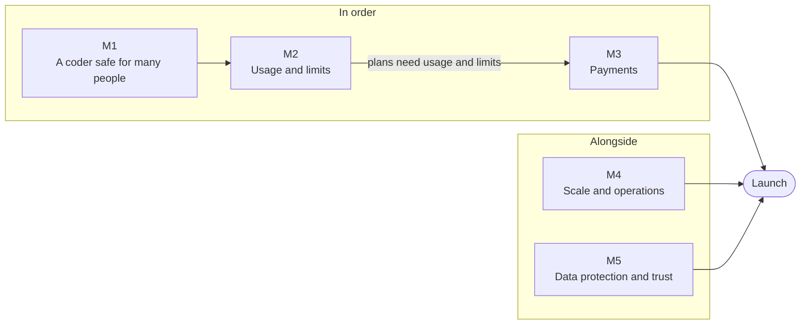

# Roadmap to launch

The front door for all four repositories of the another-agentic family: where the project is going, what is left,
and where you can help. *Checked 2026-10-18.*

## What this is

Four repositories make one product. Each name below is short for the repository in the same row.

| Short name | Repository | Role |
|---|---|---|
| **sys** | [another-agentic-system](https://github.com/vymalo/another-agentic-system) | The orchestrator (Rust, one Postgres event log) and the chat surface (Next.js). It also holds this roadmap and the epics. |
| **adam** | [another-adam-rs](https://github.com/vymalo/another-adam-rs) | The durable agent framework, and the coder: an agent that takes a coding task to a verified pull request. |
| **plat** | [another-agentic-platform](https://github.com/vymalo/another-agentic-platform) | The Kubernetes operator and the Platform API that run agents as services. |
| **img** | [another-agentic-images](https://github.com/vymalo/another-agentic-images) | The toolchain container images that agents work in. |

The goal is to offer the coder to about 10,000 people, starting in Cameroon and then the other FCFA countries of
Central Africa. That needs five things, and each is a milestone below: isolation between people (M1), a record and a
limit of what each person uses (M2), payment by mobile money (M3), a platform that holds the load (M4), and data
protection that fits local law (M5).

## Where we are, honestly

- **The MVP is complete against its build order, and proven on mocks only.** Scripted models, WireMock agents, a mock
  GitHub, a mock sign-in. No live model, GitHub.com or live web page was used in any proof. Complete is not
  accepted: the owner, who judged the first build not ready on 2026-10-01, has not tried this state. See
  [`docs/vision.md`](docs/vision.md) and [`docs/mvp.md`](docs/mvp.md).
- **The first isolation step is merged:** [adam#117](https://github.com/vymalo/another-adam-rs/pull/117) makes a run pod
  see only its own run (adam ADR 0041). Its known limits are the first tickets of M1.
- **Nothing has been measured live.** No load test, no cost per person, no payment of any kind, no payment code.
- **There is no launch date.** The order below is the order of dependencies, not a schedule.

## How the work is organised

Milestones, then epics, then tickets.

- A **milestone** is a step to launch, M1 to M5. Its label is `launch-m1` to `launch-m5`.
- An **epic** is the parent issue of a milestone. All five are in sys, and each holds the live list of its tickets.
- A **ticket** is one piece of work: a GitHub issue in the repository that owns the code, and a sub-issue of its epic.
  Size is S, M or L, a rough guide to the effort.
- A **decision** is an ADR: `docs/decisions/` in [sys](docs/decisions) and in
  [adam](https://github.com/vymalo/another-adam-rs/tree/main/docs/decisions), and `AD-NNN` entries in
  [plat](https://github.com/vymalo/another-agentic-platform/blob/main/docs/architecture/11-decisions.md). img keeps
  its rules in its README and CLAUDE.md.
- An **open question** lives in [`docs/open-questions.md`](docs/open-questions.md) until an experiment or an ADR
  closes it.

| Label | Meaning |
|---|---|
| `launch-m1` to `launch-m5` | The milestone the issue belongs to. |
| `epic` | The parent issue of a milestone (sys only). |
| `ticket` | One piece of work, owned by the repository it is in. |
| `roadmap` | Part of this roadmap. |
| `good first issue` | Small, self-contained, and explained in the issue. A good way in. |
| `help wanted` | The maintainers would like outside hands on it. |
| `owner-decision` | The owner decides something before it is built, or while it is built. Comments are welcome. |
| `security` | Hardening or abuse control. These are already-public work items, not vulnerability reports: report a vulnerability privately ([SECURITY.md](SECURITY.md)). |

## How the milestones depend on each other

M1 comes before M2. M2 comes before M3, because plans need usage and limits. M4 and M5 run alongside and can start
now. Launch needs all five.

## M1: A coder that is safe for many people

**Goal.** In production, one person's run cannot read, change or act on another person's work, or reach the coder's
secrets. The coder knows who the person is and checks their GitHub access before it touches a repository.

**Done when**

- Commands run only in run pods that hold no secret and see one run, and production is configured that way.
- No command that git can be told to run (filters, hooks, embedded repositories) runs where a secret is readable.
- The orchestrator sends a signed assertion of the person, the person links their GitHub account, and the coder
  checks read and push access before it adds, clones, fetches or pushes a repository, failing closed.
- Each person's git mirror and package cache are apart from everyone else's.
- Run pods reach the network only through a proxy with an allow-list.

**Epic:** [M1: A coder that is safe for many people](https://github.com/vymalo/another-agentic-system/issues/273).
Related: [sys#159](https://github.com/vymalo/another-agentic-system/issues/159) (the token's `sub` as the user key).
Not in this milestone: payments and limits (M2, M3), and gVisor (the owner decided against it on 2026-10-17).

**Done already.** [adam#117](https://github.com/vymalo/another-adam-rs/pull/117), merged 2026-10-18: a run pod mounts
only its own run. Still true today: run pods are off by default (`runPods.enabled`), so the live deployment runs
commands in the coder's own container, next to the GitHub App key file.

| Ticket | Repo | Size | Labels | Who and when |
|---|---|---|---|---|
| [Run the coder's own git apart from its secrets](https://github.com/vymalo/another-adam-rs/issues/118) | adam | L | security, help wanted | Anyone with Linux and git depth, after agreeing the approach in the issue |
| [Build ADR 0038: no model key in run pods](https://github.com/vymalo/another-adam-rs/issues/119) | adam | L | security, owner-decision | Needs the owner's decision first |
| [Production runs commands only in run pods](https://github.com/vymalo/another-adam-rs/issues/120) | adam | M | security | Anyone |
| [Discuss and agree ADR 0064: the person reaches the agent and links their GitHub](https://github.com/vymalo/another-agentic-system/issues/278) | sys | M | owner-decision, help wanted | Everyone may comment, the owner decides |
| [B1b: the person assertion, GitHub linking and the token lease](https://github.com/vymalo/another-agentic-system/issues/279) | sys | L | | Anyone, after the ADR 0064 ticket |
| [B1c: the coder verifies the person and checks their access to each repository](https://github.com/vymalo/another-adam-rs/issues/121) | adam | L | | Anyone, after the ADR 0064 ticket |
| [B1d: bump adam and prove the whole chain on mocks](https://github.com/vymalo/another-agentic-system/issues/280) | sys | M | | Anyone, after B1b and B1c |
| [A git mirror per person](https://github.com/vymalo/another-adam-rs/issues/122) | adam | M | | Anyone, after B1c |
| [The package cache: per person, or read-only in run pods](https://github.com/vymalo/another-adam-rs/issues/123) | adam | M | owner-decision | Needs the owner's decision first |
| [Run-pod egress: deny by default, allow through a proxy](https://github.com/vymalo/another-adam-rs/issues/124) | adam | L | security, help wanted | Anyone with Kubernetes networking experience |
| [Close the slot-directory race in the coder](https://github.com/vymalo/another-adam-rs/issues/125) | adam | M | security, help wanted | Anyone with Linux filesystem and Rust experience |
| [D15: run pods through the operator](https://github.com/vymalo/another-agentic-platform/issues/36) | plat | M | | Anyone, after "Production runs commands only in run pods" |

## M2: Usage and limits per person

**Goal.** Know what each person uses, in model tokens and sandbox time, and refuse a run before it starts when the
person has no credit, no pass, or too many runs at once.

**Done when**

- Each person's model tokens (priced by model) and sandbox seconds are recorded, and the person can read them.
- A run is refused before dispatch, with a reason the person can act on.
- One person cannot fill the dispatcher.
- The edge limits requests, and the orchestrator can tell clients apart behind the ingress.

**Epic:** [M2: Usage and limits per person](https://github.com/vymalo/another-agentic-system/issues/274).
Related: [sys#170](https://github.com/vymalo/another-agentic-system/issues/170) (token budgets).

**Done already** (2026-10-28):

- **A usage ledger per person.** It is written in the commit of each usage event, keeps a task's totals with the call
  reported twice counted once, and outlives an erased thread ([ADR 0065](docs/decisions/0065-a-usage-ledger-per-person.md),
  proposed).
  - `GET /api/me/usage?month=YYYY-MM` answers the caller's own month, priced by the `usage.prices` table of the
    configuration. Prices are in integers, and a model with no price is said so, never counted as free.
  - A retention sweep removes old months (`usage.retentionMonths`, 24 by default).
  - Proven by `dev/usage-ledger-e2e.sh` on the mocks. [sys#281](https://github.com/vymalo/another-agentic-system/issues/281)
    is closed.
- **Sandbox time per run** is reported by the coder and kept in the ledger (`sandbox` of `usage/v1`,
  [adam#126](https://github.com/vymalo/another-adam-rs/issues/126) closed).
- **The dispatcher gives each person a fair share of its slots.** The person with the fewest jobs running gets the
  next free slot, across replicas ([ADR 0066](docs/decisions/0066-a-fair-share-of-the-dispatcher.md), proposed).
  `dispatcher.order: fifo` brings the old order back. [sys#283](https://github.com/vymalo/another-agentic-system/issues/283)
  is closed.
- **The chart can limit each client address at the Ingress** (`ingress.rateLimit`, a Traefik `RateLimit` middleware).
  - It is proven on kind (`ratelimit-e2e.yml`, run 40695070844, 2026-10-28).
  - It is **off by default**: whether the netcup ingress shows each client's real address is still
    [open question 51](docs/open-questions.md), and turning the limit on waits for that check.
  - [sys#284](https://github.com/vymalo/another-agentic-system/issues/284) is closed.
- **Left:** refusing a run before dispatch ([sys#282](https://github.com/vymalo/another-agentic-system/issues/282)), which
  waits on the owner's plan decisions. Nothing of M2 has run on the live deployment.

| Ticket | Repo | Size | Labels | Who and when |
|---|---|---|---|---|
| [A usage record per person, priced by model](https://github.com/vymalo/another-agentic-system/issues/281) | sys | L | | Anyone. Design first: the pull request starts with an ADR |
| [Report sandbox time per run as usage](https://github.com/vymalo/another-adam-rs/issues/126) | adam | M | | Anyone |
| [Check limits before a run starts](https://github.com/vymalo/another-agentic-system/issues/282) | sys | L | owner-decision | After the usage record and the owner's plan decisions |
| [A fair share of the dispatcher for each person](https://github.com/vymalo/another-agentic-system/issues/283) | sys | M | help wanted | Anyone |
| [A rate limit at the edge, and the client address behind the ingress](https://github.com/vymalo/another-agentic-system/issues/284) | sys | M | security, help wanted | Anyone. The live check of the ingress needs access to a deployment |

## M3: Payments by mobile money, Cameroon first

**Goal.** People in Cameroon pay by mobile money (MTN MoMo, Orange Money) in FCFA, often by the day or the week. The
system needs plans, passes and credits, a payment provider, and receipts with Cameroon VAT (19.25%).

**Done when**

- A provider is chosen, with each fact sourced and dated.
- A `Payments` port with a testkit, a mock adapter for development and the first real adapter. Webhooks are verified
  and a person's balance is credited once.
- Plans, passes and credits are configuration, and a run spends credit at its actual cost.
- A receipt per payment and a monthly invoice for teams show the VAT.
- The owner has settled the billing entity, VAT registration and payments abroad.

**Epic:** [M3: Payments by mobile money, Cameroon first](https://github.com/vymalo/another-agentic-system/issues/275).
Depends on M2. Not in this milestone: card payments beyond what the chosen provider offers, and other currencies.

**Done already.** Nothing. There is no payment code in the repository.

| Ticket | Repo | Size | Labels | Who and when |
|---|---|---|---|---|
| [Spike: choose a mobile-money provider](https://github.com/vymalo/another-agentic-system/issues/285) | sys | S | good first issue, help wanted | Anyone. Local experience is very welcome |
| [A payments port and the first mobile-money adapter](https://github.com/vymalo/another-agentic-system/issues/286) | sys | L | | Anyone, after the spike |
| [Plans, passes and credits](https://github.com/vymalo/another-agentic-system/issues/287) | sys | M | owner-decision | Needs the owner's decision on plans, and the M2 limit check |
| [Receipts and invoices with Cameroon VAT](https://github.com/vymalo/another-agentic-system/issues/288) | sys | M | owner-decision | Needs the owner's decision first |
| [Owner: billing entity, VAT registration and payments abroad](https://github.com/vymalo/another-agentic-system/issues/289) | sys | S | owner-decision | Owner only |

## M4: Scale and operations for 10k people

**Goal.** The databases, the dispatcher and the run pods hold about 200 runs at once at peak, and someone is told
before they run out.

**Done when**

- The orchestrator's and the coder's databases run three instances with resources, and the orchestrator's has a
  pooler.
- The coder prunes finished runs.
- A load test on the mocks reports the limits and the first bottleneck.
- Capacity metrics exist, and the chart ships alert rules as examples.

**Epic:** [M4: Scale and operations for 10k people](https://github.com/vymalo/another-agentic-system/issues/276).
Related: [sys#151](https://github.com/vymalo/another-agentic-system/issues/151) (backups),
[sys#149](https://github.com/vymalo/another-agentic-system/issues/149) (live verification of the deployment),
[sys#157](https://github.com/vymalo/another-agentic-system/issues/157) (retention).

**Done already.** Continuous backups of the orchestrator's database to S3 are built and passed a kind end-to-end in CI.
They were not run on the live deployment, and [sys#151](https://github.com/vymalo/another-agentic-system/issues/151)
is still open. The orchestrator can use a pooler (`database.directUrl`, [sys#309](https://github.com/vymalo/another-agentic-system/pull/309)),
and the chart can run its database as three instances with resources and put a CloudNativePG pooler in front of it
([sys#290](https://github.com/vymalo/another-agentic-system/issues/290), `database.instances`, `database.resources` and
`database.pooler`, all off by default). That is proven on renders and by a kind end-to-end that CI had not run when this was
written; it has not run on the live deployment. The coder's database has not changed: one instance with no pooler. Nothing
is pruned, and nothing has been load-tested.

| Ticket | Repo | Size | Labels | Who and when |
|---|---|---|---|---|
| [CNPG for scale: three instances, resources and a pooler](https://github.com/vymalo/another-agentic-system/issues/290) | sys | M | help wanted | Anyone. CloudNativePG experience helps |
| [The coder's database for scale, and pruning finished runs](https://github.com/vymalo/another-adam-rs/issues/127) | adam | M | help wanted | Anyone. The default retention needs the owner's agreement |
| [Load test on the mocks: 10k people, 200 runs at once](https://github.com/vymalo/another-agentic-system/issues/291) | sys | L | help wanted | Anyone |
| [Capacity metrics and alerts](https://github.com/vymalo/another-agentic-system/issues/292) | sys | M | help wanted | Anyone. Prometheus experience helps |

## M5: Data protection and trust for Cameroon

**Goal.** Meet Cameroon's data protection law, let people delete their data, and keep a free tier from being abused.
Cameroon's Law No. 2024/017 may require approval to send personal data abroad (our servers are in Germany) and sets
fines up to 1 billion FCFA. *Unverified: we have no legal advice yet, and that is the first ticket.*

**Done when**

- The owner has advice on whether transfers to Germany need approval, or a plan to host user data in the region.
- A person can delete their account and everything of theirs: threads, their own MCP servers and sealed secrets,
  their GitHub link and files. Usage is kept only as far as the law requires for invoices.
- The free tier has abuse controls: a sign-up gate, detection of CPU mining on run pods, and a kill switch per person.
- Terms of service and a privacy policy for Cameroon are published.

**Epic:** [M5: Data protection and trust for Cameroon](https://github.com/vymalo/another-agentic-system/issues/277).
Related: [sys#145](https://github.com/vymalo/another-agentic-system/issues/145) (personal data, GDPR),
[sys#158](https://github.com/vymalo/another-agentic-system/issues/158) (a privacy note for testers).

**Done already.** Deleting one thread erases it, with its files and its link ([ADR 0043](docs/decisions/0043-deleting-a-thread-erases-it.md)).
Nothing deletes a person.

| Ticket | Repo | Size | Labels | Who and when |
|---|---|---|---|---|
| [Owner: legal advice on Law 2024/017, or user data hosted in the region](https://github.com/vymalo/another-agentic-system/issues/293) | sys | M | owner-decision | Owner only |
| [Delete my account](https://github.com/vymalo/another-agentic-system/issues/294) | sys | M | | Anyone |
| [Free-tier abuse controls](https://github.com/vymalo/another-agentic-system/issues/295) | sys | M | security, help wanted | Anyone. The sign-up gate needs the owner's choice between the options |
| [Owner: terms of service and privacy policy for Cameroon](https://github.com/vymalo/another-agentic-system/issues/296) | sys | S | owner-decision | Owner only |

## Good first issues

Small, outside any epic, and explained in the issue. Each also carries `help wanted`.

| Issue | Repo | Size | What it takes |
|---|---|---|---|
| [Spike: choose a mobile-money provider](https://github.com/vymalo/another-agentic-system/issues/285) | sys | S | Research. Compare providers, source and date each fact. Local experience helps |
| [The coder reads a repository's package.json without following links](https://github.com/vymalo/another-adam-rs/issues/128) | adam | S | Rust. Use `safe_fs` and add a test |
| [Move GitHub Actions off Node 20](https://github.com/vymalo/another-adam-rs/issues/129) | adam | S | Update the `actions/*` majors |
| [Move GitHub Actions off Node 20](https://github.com/vymalo/another-agentic-system/issues/297) | sys | S | The same, in this repository |
| [Move GitHub Actions off Node 20](https://github.com/vymalo/another-agentic-platform/issues/37) | plat | S | The same, in this repository |
| [Move GitHub Actions off Node 20](https://github.com/vymalo/another-agentic-images/issues/13) | img | S | The same, in this repository |

## Decisions waiting on the owner

Anyone may comment on these in the issue or the pull request. The owner decides.

**Tickets labelled `owner-decision`**

| Ticket | Milestone | What is to decide |
|---|---|---|
| [adam#119](https://github.com/vymalo/another-adam-rs/issues/119) | M1 | Build ADR 0038: no model key in run pods |
| [sys#278](https://github.com/vymalo/another-agentic-system/issues/278) | M1 | Agree ADR 0064: the person reaches the agent and links their GitHub |
| [adam#123](https://github.com/vymalo/another-adam-rs/issues/123) | M1 | The package cache: per person, or read-only in run pods |
| [sys#282](https://github.com/vymalo/another-agentic-system/issues/282) | M2 | The plans that the limit check enforces |
| [sys#287](https://github.com/vymalo/another-agentic-system/issues/287) | M3 | Plans, passes and credits |
| [sys#288](https://github.com/vymalo/another-agentic-system/issues/288) | M3 | Receipts and invoices with Cameroon VAT |
| [sys#289](https://github.com/vymalo/another-agentic-system/issues/289) | M3 | Billing entity, VAT registration and payments abroad |
| [sys#293](https://github.com/vymalo/another-agentic-system/issues/293) | M5 | Legal advice on Law 2024/017, or hosting in the region |
| [sys#296](https://github.com/vymalo/another-agentic-system/issues/296) | M5 | Terms of service and privacy policy for Cameroon |

**Proposed decisions.** Their ADRs say *proposed*: the owner has not confirmed them. Status as written in each ADR on
2026-10-18.

| Decision | Where it stands |
|---|---|
| [sys ADR 0064](docs/decisions/0064-the-person-reaches-the-agent-and-links-their-github.md): the person reaches the agent and links their GitHub | Proposed 2026-10-18. Nothing is built. Fifteen decisions for the owner to confirm, and open questions 85 to 89 |
| [adam ADR 0041](https://github.com/vymalo/another-adam-rs/blob/main/docs/decisions/0041-a-run-pod-sees-only-its-own-run.md#decisions-for-the-owner-to-confirm): a run pod sees only its own run | Proposed, and built in [adam#117](https://github.com/vymalo/another-adam-rs/pull/117). Eight decisions for the owner to confirm, and [known limits](https://github.com/vymalo/another-adam-rs/blob/main/docs/decisions/0041-a-run-pod-sees-only-its-own-run.md#known-limits-not-built) that M1 closes |
| [plat §60a](https://github.com/vymalo/another-agentic-platform/blob/main/docs/architecture/10-control-plane-and-crds.md#60a-admin-dashboard-v0): the admin dashboard v0 | Each slice lists its decisions "for the owner to confirm" in the section. They are not copied here |
| [sys ADR 0037](docs/decisions/0037-the-mvp-is-complete-against-its-build-order.md): the MVP is complete against its build order | Proposed until the owner has tried the stack and agrees |
| [sys ADR 0042](docs/decisions/0042-the-thread-list-is-the-owners.md): the thread list is the owner's | Proposed. Built on mocks, with drag and drop outstanding |
| [sys ADR 0043](docs/decisions/0043-deleting-a-thread-erases-it.md): deleting a thread erases it | Proposed. Built on mocks, backend and web |
| [sys ADR 0047](docs/decisions/0047-one-ui-for-web-desktop-and-mobile-each-signs-in-as-a-public-oauth-client.md): one UI for web, desktop and mobile | The direction is accepted. The rest is proposed. Token storage on the desktop is the owner's to confirm |
| [sys ADR 0059](docs/decisions/0059-a-thread-opens-at-its-end-and-older-turns-load-on-scroll-up.md): a thread opens at its end | Proposed and built. The owner has not tried it |
| [sys ADR 0060](docs/decisions/0060-the-client-keeps-a-bounded-copy-of-recent-threads-behind-a-chatstore-port.md): a bounded copy of recent threads on the client | Proposed. Design only |
| [sys ADR 0061](docs/decisions/0061-the-person-picks-an-access-tier-for-each-message-the-agent-keeps-to-it.md): the access tier | Proposed. The orchestrator and the web are built against mocks |
| [sys ADR 0062](docs/decisions/0062-the-person-picks-a-network-tier-for-each-message-the-agent-keeps-to-it.md): the network tier | Proposed. Nothing is built |
| [sys ADR 0063](docs/decisions/0063-an-openai-compatible-model-endpoint-per-thread-on-the-orchestrator.md): a model endpoint per thread | Proposed. Nothing is built |

## How to help

1. **Pick an issue.** Start with a [good first issue](#good-first-issues) or a `help wanted` ticket of a milestone.
   The "Who and when" column says what an issue needs first.
2. **Claim it** by commenting on the issue. One person per ticket at a time. If you stop, say so, so someone else can
   take it.
3. **Agree the approach first** on tickets that ask for it: the large ones, the security ones, and any marked
   "design first". Write the approach in the issue before you write code.
4. **Follow the repository's contributing guide:**
   [sys](CONTRIBUTING.md),
   [adam](https://github.com/vymalo/another-adam-rs/blob/main/CONTRIBUTING.md),
   [plat](https://github.com/vymalo/another-agentic-platform/blob/main/CONTRIBUTING.md),
   [img](https://github.com/vymalo/another-agentic-images/blob/main/CONTRIBUTING.md).
   Open a pull request against `main`. A maintainer merges it when CI is green. AI-assisted work is welcome and is
   declared in the pull request.
5. **Report a security problem privately,** never in a public issue: [SECURITY.md](SECURITY.md).

## Keeping this current

The epics hold the live ticket lists, so this page does not repeat what they track. Change `ROADMAP.md` when a
milestone, an epic or the order changes. A pull request that finishes a milestone updates this file in the same pull
request.
