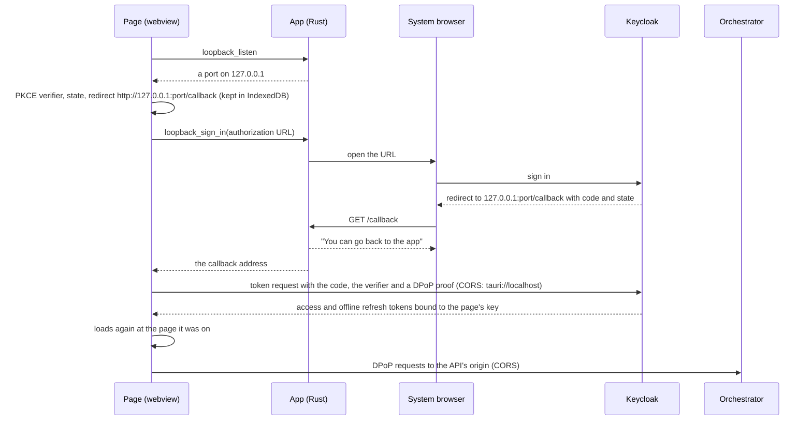

# Desktop app

The chat in a window of its own ([ADR 0047](../../docs/decisions/0047-one-ui-for-web-desktop-and-mobile-each-signs-in-as-a-public-oauth-client.md)):
the web's static export ([`web/README.md`, "Static export"](../../web/README.md#static-export)) packed into a [Tauri 2](https://v2.tauri.app/)
app. It is the same UI, the same API and the same tokens as the browser web in browser mode
([ADR 0054](../../docs/decisions/0054-the-web-holds-its-own-tokens-dpop-bound-in-indexeddb.md)); only the sign-in and the address
of the API differ. The release pipeline builds macOS (Apple Silicon and Intel) and Linux (x86_64 and arm64); Windows is deliberately not distributed.

| Path | What |
|---|---|
| `deployment.json` | the deployment the app is built for, in one place: `apiOrigin` (`https://agentic.servers.segning.pro`) and `issuerOrigin` (`https://auth.verif.fyi`); `AGENTIC_API_ORIGIN` and `AGENTIC_ISSUER_ORIGIN` override them |
| `scripts/build-web.mjs` | builds the web's export into `web/out-tauri`, writes its `config.json` (`apiOrigin`, `clientId`: `AGENTIC_CLIENT_ID`, default `another-agentic-desktop`; `signIn`: `AGENTIC_SIGN_IN`, default `loopback`). Desktop uses loopback; Android and iOS set `claimed` with `another-agentic-android` and `another-agentic-ios`. It also writes the policy's `connect-src` for those two origins (`src-tauri/tauri.deployment.json`, passed to `tauri build --config`) |
| `src-tauri/build.rs` | the issuer's origin from the same file (or variable), compiled in: the one address the app opens in the browser |
| `src-tauri/tauri.conf.json` | the window, the bundle, and the content security policy without a remote origin (the build adds the two) |
| `src-tauri/src/assets.rs` | `/threads/<id>` and `/s/<token>` answered with their shells, as the web image's Caddy does (Tauri would fall back to `index.html`) |
| `src-tauri/src/loopback.rs` | the sign-in's listener on `127.0.0.1` and the system browser (below) |
| `src-tauri/icons/` | made from `web/public/brand/icon-512.png` with `pnpm tauri icon` |

## Build

```sh
sudo apt-get install libwebkit2gtk-4.1-dev librsvg2-dev libxdo-dev libssl-dev   # Linux, once (Tauri's prerequisites)
cd apps/tauri
pnpm install
pnpm build:debug        # the web for the app, then a debug .deb: src-tauri/target/debug/bundle/deb/
pnpm build              # release .deb and AppImage (what CI keeps: .github/workflows/desktop.yml)
pnpm check:release      # structural checks for the release-please and release workflows
cd src-tauri && cargo test --locked
```

For another deployment, edit `deployment.json`, or: `AGENTIC_API_ORIGIN=https://chat.example.com AGENTIC_ISSUER_ORIGIN=https://id.example.com pnpm build`.
Build with `pnpm build` (or `build:debug`): a bare `tauri build` has no `connect-src` for the API.

## What the deployment needs

1. The Keycloak client [`deploy/keycloak/client-another-agentic-desktop.json`](../../deploy/keycloak/client-another-agentic-desktop.json): public, PKCE S256,
   DPoP-bound tokens, the redirect `http://127.0.0.1/callback` (Keycloak matches it with any port: RFC 8252 section 7.3) and the web origins
   `tauri://localhost`, `http://tauri.localhost` and `https://tauri.localhost` (what lets the page call the token endpoint).
2. The chart in browser mode, with `orchestrator.cors.allowedOrigins: [tauri://localhost, http://tauri.localhost]`
   ([`deploy/chart/README.md`, "Calls from the desktop app"](../../deploy/chart/README.md#calls-from-the-desktop-app)), and an orchestrator image
   that has `server.cors`.

## Signing in

```mermaid
stateDiagram-v2
  [*] --> signed_out
  signed_out --> listening: Sign in (loopback_listen)
  listening --> in_browser: loopback_sign_in opens the browser
  in_browser --> signed_in: callback, state checked, code exchanged
  in_browser --> signed_out: refused, abandoned (5 minutes) or a state the page did not make
  signed_in --> signed_in: refresh (rotated), once, under a Web Lock
  signed_in --> signed_out: Sign out (revoked; the issuer's page opens in the browser)
```





Once signed in, the page loads itself again where it was, as a browser's page does after the callback (what asked for a session before there was
one waits for that load); a sign-in from the banner of a session that ended keeps the page, as the browser's popup does. While the browser is open, the sign-in screen says so and has **Cancel** (`loopback_cancel`): the listener closes and the page is as before, with no
error, so an abandoned browser tab does not hold the button for five minutes. The page keeps what it keeps in a browser: a non-extractable DPoP key and the tokens in IndexedDB, in the webview's own profile. The app's
process makes no request to the issuer and never sees a token; it only listens on the loopback address for one `GET /callback`, which it
refuses for any other path or method (a connection that sends nothing for 5 seconds, fails or asks for something else is dropped and the listener
goes on), and opens in the browser only an address of the issuer's origin it was built with. The `state` and PKCE stop a forged
callback from another local process. Signing out revokes the refresh token from the page and opens the issuer's end-session page in the browser,
never in the app. Why the webview's IndexedDB and not the OS keychain: [ADR 0047, Amendment (2026-10-09): the desktop app](../../docs/decisions/0047-one-ui-for-web-desktop-and-mobile-each-signs-in-as-a-public-oauth-client.md#amendment-2026-10-09-the-desktop-app).

## Tests

`cargo test --locked` in `src-tauri`: the shells' mapping (`assets.rs`: a thread, its data and its segment files to `/threads/_`, a share link to
`/s/_`, everything else itself), and the listener's (`loopback.rs`: only a `GET /callback` is the callback; only an address of the build's issuer is
opened, never another host, port or scheme; a silent, closed or other connection does not hold up the callback; the first of two futures wins, as
a cancel does). The page's side is `web/src/lib/auth/desktop.test.ts` (the loopback redirect, the code exchanged with a proof, the page loaded again or
kept, the issuer's `access_denied` and a state the page did not make each storing nothing and exchanging nothing, signing out in the browser) and
`web/src/features/session/components/sign-in-screen.dom.test.tsx` (Cancel while the browser is open, and no error after it).

**The app against the web's mock**, by hand (run 2026-10-09 on Linux under Xvfb, with `curl` as the browser): the mock is the issuer and the API
(`web/README.md`, the mock's browser mode) with the loopback redirect and the webview's CORS switched on, and the app is built for it:

```sh
cd web && MOCK_BROWSER_AUTH=1 MOCK_LOOPBACK=1 MOCK_PUBLIC_ORIGINS=tauri://localhost,http://127.0.0.1:4010 \
  MOCK_CORS_ORIGINS=tauri://localhost pnpm mock &
cd apps/tauri && AGENTIC_API_ORIGIN=http://127.0.0.1:4010 AGENTIC_ISSUER_ORIGIN=http://127.0.0.1:4010 AGENTIC_CLIENT_ID=another-agentic-web \
  sh -c 'pnpm build:web && pnpm tauri build --debug --no-bundle --config src-tauri/tauri.deployment.json'
src-tauri/target/debug/another-agentic
```

The app shows the sign-in screen; **Sign in** opens the browser at the mock's authorization endpoint, which sends it back to the app's listener;
the app then shows the chat, and `GET /__mock/issuer?session=default` counts one code grant and the API's requests, none refused. With a browser
that never comes back, the screen says to finish in the browser and **Cancel** brings it back with no error (run again 2026-10-09 with these commands).

## Release and installation

Conventional Commits on `main` are collected by `.github/workflows/release-please.yml`. It uses the narrowly scoped GitHub App
secrets `RELEASE_PLEASE_APP_CLIENT_ID` and `RELEASE_PLEASE_APP_PRIVATE_KEY` so it can create or update one release PR; its merge
creates `vX.Y.Z`. The app must be installed on this repository with only **Contents: read and write** and **Pull requests: read and
write**. Set the repository variable `RELEASE_PLEASE_APP_SLUG` to the app slug: desktop and mobile delivery accept a published release
only when its author is that app's bot. The default `GITHUB_TOKEN` is intentionally not used, because tags it creates do not start the asset workflow.

`.github/workflows/desktop-release.yml` runs when release-please publishes the `vX.Y.Z` GitHub Release. It tests and attaches unsigned `.dmg` assets for Apple Silicon and
Intel macOS, plus a `.deb` for Linux x86_64, architecture-specific `.AppImage` assets, and `SHA256SUMS`, to the GitHub Release release-please already created. Only
after that upload succeeds, it mints the same GitHub App's narrowly scoped token for `vymalo/another-agentic-system` and
`vymalo/homebrew-tap`, regenerates the macOS Cask and Linux Formula from those checksums, and opens or updates one
`bot/another-agentic-desktop` pull request in the tap. The App must be installed on both repositories with only **Contents: read and
write** and **Pull requests: read and write**. There is no Windows job or asset. Releases are unsigned for now: macOS users must
still satisfy Gatekeeper according to their local policy, and there is no updater or store channel yet.

The version is one release-please source of truth: `.release-please-manifest.json`, `apps/tauri/package.json`,
`apps/tauri/src-tauri/tauri.conf.json`, and the annotated Cargo package version. The manifest is seeded at `0.1.0`, so the first
release PR is the next Conventional-Commit version. To publish the existing `0.1.0` build exactly, merge a Conventional Commit
with the footer `Release-As: 0.1.0`; remove that footer after the release PR has been proposed.

## Not yet

- **Signing and updater**: GitHub Releases and Homebrew distribution are automated, but bundles are unsigned and there is no updater or store.
- **Mobile device and store proof**: Android and iOS use claimed HTTPS callbacks, their distinct public clients, and the association
  documents described in `MOBILE.md`; their release workflow submits only after a published release-please `vX.Y.Z` release exists.
  Real App Links/Universal Links validation on devices, streaming `fetch` in mobile webviews, and signed delivery to the live stores
  remain *unverified*.
- **Choosing the deployment** at the first start: the API's origin is fixed when the app is built.
