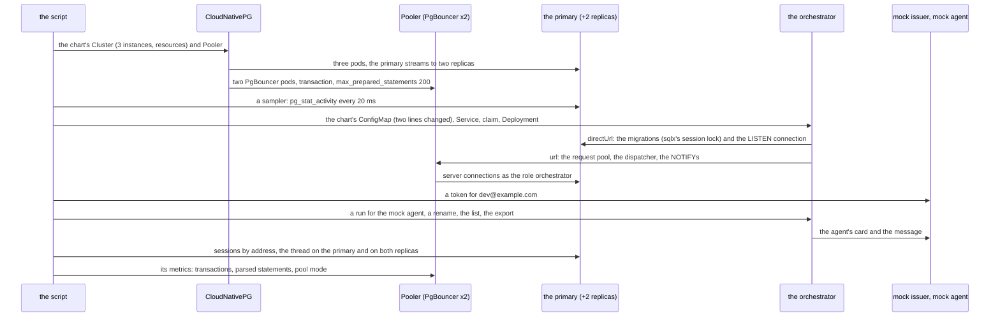

# The database scaled out and behind a pooler, on kind

Does what the chart renders for `database.instances: 3` and `database.pooler.enabled` run, and does the orchestrator, started with the chart's own configuration, migrate and
listen on the database itself and carry its requests through the pooler? This directory answers it on a throwaway [kind](https://kind.sigs.k8s.io/) cluster. What the values
are, what each connection does and why the URLs are built as they are: the chart's [README](../../README.md#scaling-the-database-issue-290); the orchestrator's side:
[`docs/api/config.md`](../../../../docs/api/config.md#database-behind-a-pooler).

```sh
sh deploy/chart/tests/pooler-e2e/pooler-e2e.sh render   # helm only: the objects the script would apply, checked
sh deploy/chart/tests/pooler-e2e/pooler-e2e.sh          # from the repository root, kubectl pointed at a kind cluster
```

CI is [`pooler-e2e.yml`](../../../../.github/workflows/pooler-e2e.yml): when the database or orchestrator templates, the helpers, the validation, `values.yaml`, the mock issuer, the mock agent or this
directory change, weekly, and on demand. It is not part of `deploy.yml` (nothing there touches a cluster) and nothing requires it. **It had not run when this was written**: no kind and
no container daemon were where it was written. What was run is `shellcheck`, `dash -n`, `helm template` of every object it applies, the script's render mode, and the orchestrator binary
(built at the commit that has `database.directUrl`) against the chart's rendered configuration with a mock issuer, a mock agent and a Postgres: the token, the run, the thread's state, the
rename, the list and the export of the script's request step answered as the script expects.

| File | What |
|---|---|
| `pooler-e2e.sh` | the scenario; its header says what each step asserts and what the run does not prove |
| `values.yaml` | layered over the chart's `values.yaml` (not the netcup values): three instances with resources, a pooler of two pods, one mock agent, no chat, no model |
| `UPSTREAM` | the facts the assertions rest on and where each was verified (the `Pooler` fields, the app Secret's keys, the password's alphabet, the kubelet's expansion, the PgBouncer image), and the WireMock pin; the CloudNativePG chart and the kind node image are read from [`backup-e2e/UPSTREAM`](../backup-e2e/UPSTREAM), the `curl` image from [`ratelimit-e2e/UPSTREAM`](../ratelimit-e2e/UPSTREAM), the mock issuer's node image from `dev/mock-oidc/Dockerfile` |

## The scenario

The orchestrator image is the one `orchestrator.image` pins in `values.yaml`, and it must be at or after the commit that introduced `database.directUrl`: the script says so
(with git) and stops before it spends ten minutes if it is not. The orchestrator's configuration is the chart's rendered ConfigMap with **two lines changed**, `server.environment`
(`development`) and `auth.jwt.issuer` (the mock issuer's `http://oidc:8080`), because a production orchestrator takes an https issuer only and a kind cluster has no certificate
authority for one; the script asserts that those two lines are the whole difference.

```mermaid
stateDiagram-v2
  [*] --> Rendered: 0. the pins, the render, the image knows directUrl
  Rendered --> Operator: 1. a StorageClass, the operator (chart pinned by SHA-256)
  Operator --> Database: 2. Cluster Ready with 3 instances, 2 streaming replicas, the Pooler's 2 pods, its configuration
  Database --> StandIns: 3. a mock issuer, a mock agent, a curl pod, the orchestrator's Secret
  StandIns --> Orchestrator: 4. ready, /healthz and /readyz 200, "database.directUrl is set"
  Orchestrator --> Requests: 5. a thread written, done, renamed, listed, on the primary and the replicas
  Requests --> Sessions: 6. who connected, and what the pooler counted
  Sessions --> [*]: 7. the password and the secrets are in no object and no log; the cleanup
```





What the assertions rest on: the sessions of the database, by the client address the primary sees (a pod keeps its address through a Service), and the pooler's own counters.

* every session from the orchestrator pod's address is the wakeup's `LISTEN`: it is direct, as `directUrl` says, and the orchestrator opens no other connection of its own to the database;
* the sessions from the two pooler pods' addresses are the requests, and none is a `LISTEN`;
* while the orchestrator booted, no session of a pooler pod ran sqlx's lock, `_sqlx_migrations` or DDL, and (when a sample fell in the half-second of a migration) a session from the orchestrator's own address did;
* the pooler's transactions and parsed prepared statements for the database `orchestrator` rose, and its pool mode for it is transaction (metric value 2).

## What it does not prove

The netcup cluster, a failover (the primary is never killed), a load, a count of connections under one, the agents' own databases (this deployment has none), the production
check of the issuer (two lines are changed), PgBouncer versions other than the operator's default (1.25.2 in CloudNativePG 1.30.1), and the migration as more than evidence when the
sampler misses it: a migration of an empty database is a fraction of a second, and the script then says so and relies on the orchestrator's log line and on the listener.
