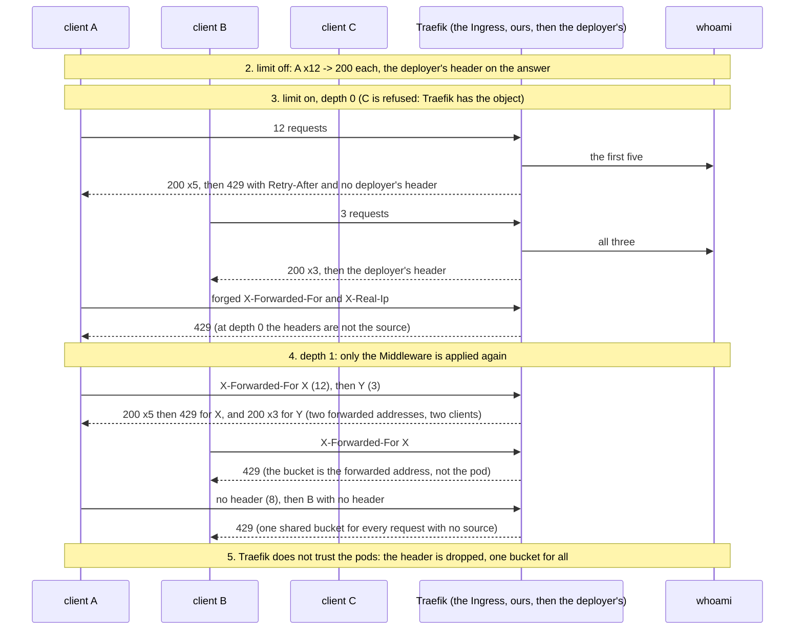
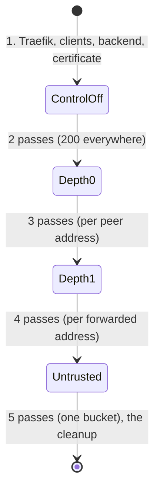

# The limit per client address, on kind

Does the `Middleware` that `ingress.rateLimit` renders, named on the chart's own `Ingress`, limit each client address in a real Traefik, and only that address?
This directory answers it on a throwaway [kind](https://kind.sigs.k8s.io/) cluster. What the limit is and why it is off: the chart's
[README](../../README.md#a-limit-per-client-at-the-edge).

```sh
sh deploy/chart/tests/ratelimit-e2e/ratelimit-e2e.sh render   # helm only: the objects the script would apply, checked
sh deploy/chart/tests/ratelimit-e2e/ratelimit-e2e.sh          # from the repository root, kubectl pointed at a kind cluster
```

CI is [`ratelimit-e2e.yml`](../../../../.github/workflows/ratelimit-e2e.yml): when the Ingress templates, the helpers, the validation, `values.yaml` or this
directory change, weekly, and on demand. It is not part of `deploy.yml` (nothing there touches a cluster) and nothing requires it.

| File | What |
|---|---|
| `ratelimit-e2e.sh` | the scenario; its header says what each step asserts and what the run does not prove |
| `values.yaml` | layered over `examples/netcup.values.yaml`: the host (`ratelimit.e2e.test`, resolved by `curl --resolve`) and the mobile links off |
| `UPSTREAM` | the pins and where each was verified: the Traefik chart by version and SHA-256, the Traefik image, `traefik/whoami` and `curlimages/curl` by digest, the kind node image |

## The scenario

The bucket of the test is small, one request per ten seconds with a burst of five, so that a few requests fill it. Three client pods (A, B, C) each have an
address of their own; Traefik's Service is a `ClusterIP`, so a pod's address reaches Traefik unchanged.





## What it does not prove

The netcup Traefik: its version, whether it has `providers.kubernetesCRD.safeNaming` (which changes the name the annotation must carry), its
`forwardedHeaders.trustedIPs`, and what `X-Forwarded-For` holds behind its load balancer (open question 51). The rate of the documented starting point under real
traffic. Two Traefik replicas (each keeps its own buckets). An SSE stream (a request is counted when it arrives, by Traefik's design, read in its source and not
run here). The Ingress's TLS through cert-manager (the certificate here is self-signed and `curl` does not verify it).

## Safety

The script installs a Helm release, applies CRDs and deletes namespaces. It runs only on a context named `kind-*` (`RATELIMIT_E2E_ALLOW_ANY_CONTEXT=1` says another
cluster is a throwaway one), refuses a cluster that has Traefik's CRDs or a namespace of its names already, and undoes only what it made. Nothing else is touched.

## Status

**Unverified in a cluster until the job has run.** No kind and no `kubectl` existed where this was written. What was run, on 2026-10-28: `shellcheck`, `dash`
(`sh -n`), `ratelimit-e2e.sh render`, `actionlint`; and the assertions of steps 2 to 4, unchanged, against the pinned Traefik image itself run by Docker with
the same Middleware fields in Traefik's file configuration, beside the pinned whoami and three pinned curl containers on one bridge network (the first pass
green, and a changed depth, and a limit that was never applied, each made the run fail where it should). Step 5's mechanism (an entrypoint that does not trust the
peer drops the header, and every client is then one address) was run the same way. Traefik's Kubernetes providers, the annotation and the Ingress were not.
