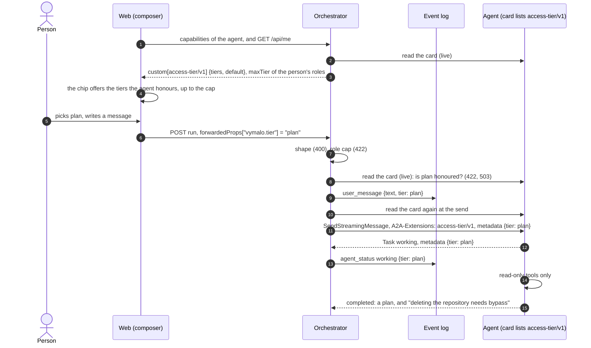
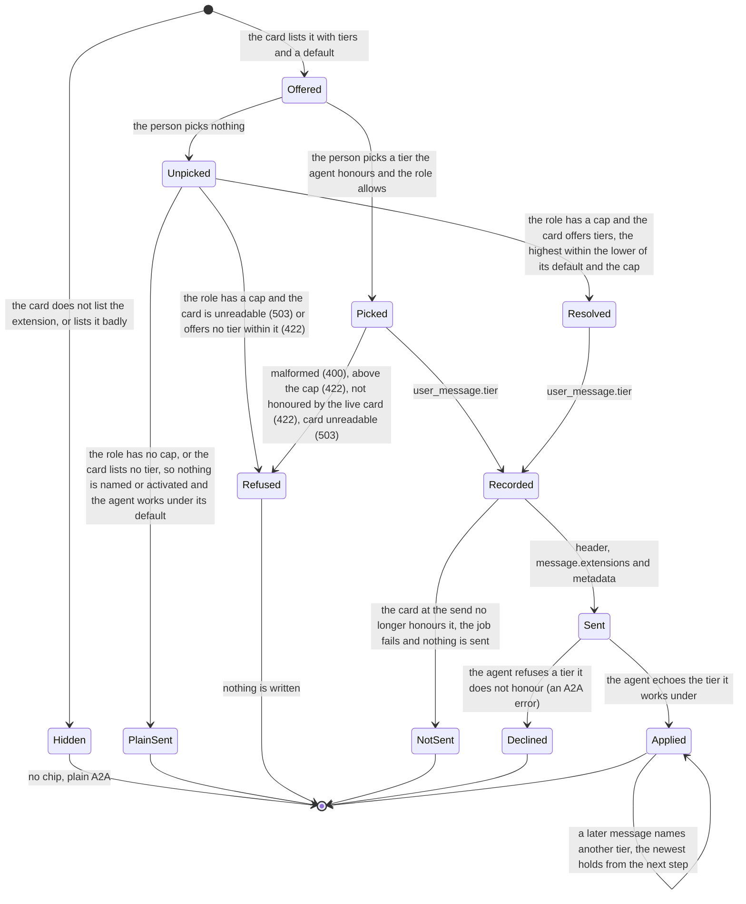

# A2A extension: access tier (v1)

- **URI:** `https://agents.vymalo.com/a2a/extensions/access-tier/v1`
- **Status:** **proposed (2026-10-11), at the owner's request; the orchestrator's and the web's sides are built (2026-10-11, on
  mocks: [As built](#as-built-2026-10-11)); adam's side is not.** The owner has chosen how adam's coder maps its
  tools onto the tiers (2026-10-11, [below](#example-adams-coder)). The six open questions of the ADR were settled the same day on the
  owner's direction, as the task brief recorded it, and **await the owner's own confirmation**
  ([ADR 0061](../decisions/0061-the-person-picks-an-access-tier-for-each-message-the-agent-keeps-to-it.md#questions-settled)), notably
  that a role has no cap by default. Every other name, status code and default here is proposed, for the owner to confirm.
- **Decided in:** [ADR 0061](../decisions/0061-the-person-picks-an-access-tier-for-each-message-the-agent-keeps-to-it.md); the
  optional-extension pattern is [ADR 0008](../decisions/0008-platform-integration-via-a2a-extension.md).
- **Defined by:** the orchestrator. **Used by:** agents that can work under a limit the person sets (adam-coder and `adam-agent`
  first; their side is a pull request in adam-rs).

## Purpose

The owner, 2026-10-11:

> "we're managing with a2a. So if we're passing down permissions from parents to children too heavily, it might impact too much
> what remains from the core protocol a2a gives us, making it difficult to switch from one vendor (adam-rs) to another one (e.g
> kagent). So the agent should be fully autonomous, and its permissions should be as easy as eating chips. Bon, if we can
> implement a way for the user to control the access control tier (edits only, plan, auto, bypass all) and let the agent adapt to
> that, then it's better again."

So the contract is small. A person says, **for one message**, how much the agent may do on its own: one of four words. The agent
keeps to it. Nothing is passed to the agent's children.

An agent whose card does not list the extension is unchanged. kagent and every other plain A2A agent get the same request as
before, with no header and no metadata, and the web shows no control for them. The rest of this page is for agents that list it.

## Who does what

| Part | Does |
|---|---|
| **Agent** | Lists the extension with the tiers it honours and its default. Works under the tier a message names, never above it, says which tier it worked under, and says so when a request needs more. Decides alone what its own children may do. |
| **Orchestrator** | Reads the card live. Checks the shape of the choice, the person's role cap and that the live card honours it. Logs the choice on the message. Activates the extension and sends the choice on that message, and the job's last choice on the messages it sends on the thread's behalf (a rework, an answer). For a person whose role caps the tier, a message that names none is sent under the highest tier the agent offers within the cap, never at the agent's own default ([section 7](#7-the-orchestrator)). Sends nothing to a child's task. Enforces no tier. |
| **Web** | Shows a chip in the composer, only for an agent whose card lists the extension: what runs without a pick, or the pick. Sends the choice with each message, and with an edit, once the person has picked one. |

## The flow



One message's tier goes through these states:



## 1. The card

The agent lists the extension in `capabilities.extensions`:

```json
{"uri": "https://agents.vymalo.com/a2a/extensions/access-tier/v1",
 "description": "Works under the access tier the person picks for each message.",
 "required": false,
 "params": {"tiers": ["plan", "edits", "auto", "bypass"], "default": "auto"}}
```

| Param | Meaning |
|---|---|
| `tiers` | Required. A non-empty list of the tiers the agent honours, each of the four at most once. An agent may honour fewer than four (a read-only agent lists `["plan"]`). |
| `default` | Required. One of `tiers`: what the agent works under when no message names a tier. adam's is `auto`. |

`required` stays `false`: a client that does not know the extension must still be able to talk to the agent.

The orchestrator reads the card on **every send** (never cached) and fails closed: the extension is used when the URI is listed
exactly (no other version, no trailing slash, no other case) **and** `params` are well-formed. A card with bad `params` is a card
that does not list it. The AG-UI capabilities document carries `custom[<uri>] = {tiers, default}`, so the web can draw the chip
before anything is sent ([`agui.md`](agui.md#capabilities-document), updated by the pull request that builds this).

## 2. Activation

The orchestrator names the URI in the `A2A-Extensions` header and in `message.extensions` of a `SendStreamingMessage`
**only when** both hold:

- the message is sent under a tier: the one the person named, or the one the orchestrator decided for it
  ([section 6](#6-the-orchestrators-own-messages-and-sub-agents), [section 7](#7-the-orchestrator));
- the live card lists the URI and its `tiers` contain that tier.

A message sent under no tier does not activate the extension: it is the plain A2A message it is today. An agent MUST NOT read a
tier from a message that did not activate the extension.

## 3. The four tiers

The tiers are a closed list, ordered by how much the agent does alone: `plan` < `edits` < `auto` < `bypass`. "Higher" means later
in the list.

| Tier | Means |
|---|---|
| `plan` | Read and propose. No change to a repository or to any external system. The answer is a plan the person can approve by sending the next message under a higher tier. |
| `edits` | Change files, commit, push branches, open pull requests. Nothing that merges, creates, renames or deletes, and no settings. |
| `auto` | Everything the agent does as the normal course of its work, alone, merging and creating included. What cannot be undone (deleting or renaming a repository) is outside it. |
| `bypass` | Never asks for permission. Does anything the agent is able to do with the credentials it has. |

What is outside a tier, the agent does **not** do on its own. It either asks the person, in a question the person answers, or
declines and says which tier the act needs. It never does the act because its model decided it should. `bypass` skips every
question whose only purpose is permission; the agent may still ask for information it needs.

A tier says what the agent may do, not what it can do. The agent's own tools, its credentials and the deployment's limits
apply under every tier ([section 9](#9-security)).

## 4. The message

An ordinary A2A user message, with the tier in its metadata under the URI:

```json
{"message": {
  "role": "user",
  "messageId": "msg-01927a4e-9c10-7000-8000-00000000002f",
  "contextId": "01927a4e-3b00-7000-8000-000000000001",
  "parts": [{"text": "add a health endpoint and open a pull request"}],
  "extensions": ["https://agents.vymalo.com/a2a/extensions/access-tier/v1"],
  "metadata": {"https://agents.vymalo.com/a2a/extensions/access-tier/v1": {"tier": "edits"}}
}}
```

| Member | Meaning |
|---|---|
| `tier` | Required once the extension is activated: `plan`, `edits`, `auto` or `bypass`, lower case. Unknown members are ignored. |

It rides on the message because a message is where A2A puts a client's data for an extension, and because the choice is the
person's, made again for each message: no setting of the thread, no new route. The orchestrator remembers only the tier of the
person's newest message of the job (`Job.tier`), so that the messages it sends on the thread's behalf can continue it
([section 6](#6-the-orchestrators-own-messages-and-sub-agents)); it is not a choice the thread keeps. The
`A2A-Extensions` header says the extension is on; the tier is the message's own. It rides with whatever the other extensions put
on the same message ([`thread-tools/v1`](thread-tools-v1.md), [`mentions/v1`](mentions-v1.md)), and on a message sent while the
agent works ([`steer/v1`](steer-v1.md)).

**What the agent does with it.**

1. **From its next step.** A tier governs the work from the agent's next step: never in the middle of a tool call it has
   started, and at once for the next one. A lower tier holds as soon as the call in flight is over.
2. **The newest message wins.** A message that names a tier sets the task's tier. A message that names none leaves it as it is.
   A task that has none works under `default`.
3. **A task never inherits.** A new task in the same context starts from `default`, not from the tier of the task before it.
   The person's next message names its own.
4. **Only a message sets it.** The model, a tool result, a file, an asked agent or text inside a message never raises the tier.
5. **An activated message with no valid `tier`**, or a tier outside the agent's `tiers`, is refused with an A2A error. The agent
   never works under another tier than the one named, and never rounds up.

## 5. The agent's duties

1. **Never exceed the tier.** Work done through a child counts as the agent's own. An agent under `plan` does not ask a
   sub-agent, or another agent, to change anything.
2. **Say which tier it worked under.** When the request activated the extension, the task's `metadata` carries
   `{"tier": "<tier>"}` under the URI: on the first `Task` of the stream (the one every `SendStreamingMessage` stream begins
   with), and again whenever the tier changes. It is never higher
   than the one named. When the tier mattered to an answer, the answer says so in words.
3. **Refuse clearly when a request needs more.** The agent does not do the act. It says what it did not do, why, and which tier
   the act needs, then does the rest of the work. This is an ordinary answer, not an A2A error, and it does not fail the task.

For example, under `auto`: "I did not delete `acme/old-widgets`. Deleting a repository needs the bypass tier and I am working
under auto. Pick bypass and send it again if you want it deleted. The other changes are done: ..."

| Situation | What the agent answers |
|---|---|
| The named tier is one it does not honour | an A2A error (its choice which: the orchestrator does not read it) |
| The extension is activated and `tier` is missing or not one of the four | an A2A error |
| A request needs a higher tier than the one in force | an answer that declines the act and names the tier |
| The extension is not activated | it reads no tier and works under `default` |

## 6. The orchestrator's own messages, and sub-agents

**On the thread's behalf: the tier of the person's last message.** Some messages the orchestrator sends to the thread's agent
continue the person's work without the person writing them. Each is sent under the tier the person's last message of the job was
sent under (the job's last chosen tier), so that the agent does not work on it at its own `default`, which may be wider than what
the person chose. A rework of a job the person ran at `edits` is sent at `edits`, not at `auto`:

| The message | Its tier |
|---|---|
| the rework of the verification gate: a failed check, a CI report from a webhook, a verifier's findings, a timer that ends a wait | the job's last chosen tier |
| the delegation of an A2UI action the person took | the job's last chosen tier, **capped by the role's `maxTier`** of the person who takes it and checked against the live card, like an answer |
| an **answer** to a blocked job, and a message that comes through a surface that cannot name a tier (the MCP surface: `answer` and the messages it posts to a thread) **while the job is unfinished** | the job's last chosen tier, **capped by the role's `maxTier` of whoever gives it** (the lower of the two) and **rounded down to the highest tier the live card still honours**, never raised |
| a message the person writes in the web | the one it names. When it names none, the web sent no pick, and the orchestrator decides ([section 7](#7-the-orchestrator)): none for a person with no cap, else the highest tier the agent offers within the cap |
| the **first message** of a thread that names none, and an MCP `start_job` | decided as above: none for a person with no cap, else the highest tier within the cap. There is no choice to continue |
| a message from the MCP surface to a thread whose job is **finished** | it starts a new job: decided as a first message, never the tier of the job before |
| an **edit** that names none | the tier of the message it replaces, capped and rounded down as an answer is |
| a **fork's first message** that names none | decided as a first message |

"The job's last chosen tier" is the tier of the person's newest message of the job (a message that names none sets none). A Stop &
send starts the next job under the tier of the newest of its messages that named one. A tier is never carried from one job to
the next: the message that starts a job sets it.

**When a cap applies and no tier could be decided, the cap is what travels.** A message of a capped person whose agent's card
offered no tier when the message was written has no tier to pin ([section 7](#7-the-orchestrator)), but the cap is still a fact
about it. It is logged on the `user_message` (`tierCap`, omitted otherwise), kept on the job (`Job.tier_cap`) and carried by every
row the job writes for that message and on its behalf: the delegation, a steer and the delegation it may become, the held text of a
Stop & send, a cancel the agent refused, a redelivered message, the delegation of an action, and every rework (a `tierCap` beside
`tier` on the `delegate`, `steer` and action outbox rows). When it sends, the dispatcher reads the live card ([section 7](#7-the-orchestrator)):
a card that still lists no tier gets the plain message; one that lists tiers by then gets the highest one within the lower of its
`default` and the cap. So a coder redeployed with `access-tier/v1` while a job of a capped person is queued, retried or reworked is
never run at its own `auto`. The action on a surface is logged with the tier and cap it went out under (`ui_action.tier`,
`ui_action.tierCap`), so the log rebuilds the job's tier after a lowered action and its reworks.

If the card no longer honours that tier when the orchestrator sends, it sends nothing and the job fails, as for any tier
([section 7](#7-the-orchestrator)): the person's limit is never replaced by the agent's default. A tier that an answer, an MCP
message, an action or an edit inherits is **rounded down** to the highest tier the live card still honours (never raised); a card
that no longer lists the extension, or lists no tier that low, is refused (**422**: "start a new chat", the chat's choice cannot be
kept) before anything is written.

The role's cap is checked each time the orchestrator writes a message: for a tier the person names, for one that is inherited (a cap
lowered since lowers it, and the job continues under the lower tier, which is also what a later rework is sent under) and for one it
decides. The dispatcher that sends a rework has no principal, so the rework goes under the tier already pinned on the job, or under
the cap pinned on it when there was no tier to pin. An agent the registry cannot place when an answer is written keeps the cap the
same way (it is not given the job's uncapped tier).

**The tier of a parent is not passed to children; the person's cap is.** The orchestrator sends no tier on:

- a verifier's task, or any other task the orchestrator starts for **another** agent;
- an [`ask_agent`](thread-tools-v1.md#ask_agent) child task **when no role of the person caps the mentioned agent**: an asked agent
  works under its own default.

A **mention** is the one place where one agent's work reaches another that the person did not open a thread with, so it must not be a
way round the person's role. When a message mentions an agent, the orchestrator pins on the mention the cap of the person's roles on
**that** agent (`mentions[].tierCap`, written by the application, never read from a client; none when no role of theirs caps it). The
`ask_agent` row carries it, and the dispatcher sends the ask under the highest tier the asked agent's live card offers within the
lower of its `default` and the cap. This is not the parent's tier passed down: a thread at `bypass` whose person is capped at `plan`
on the mentioned coder asks it at `plan`, and a thread at `plan` whose person has no cap on the coder asks it at none. An asked agent
that offers no tier within the cap, or lists the extension badly, is **not asked**: the ask fails (no task is started) and
`ask_finished` says why. A card that lists no tier is asked as it always was, and the cap waits for the day it does.

Each agent decides what its own children may do: its sub-agents ([ADR 0050](../decisions/0050-the-chat-has-sub-agents.md)), a
process it starts, an agent it asks. How it limits them is its business and its vendor's. A2A delegation stays plain.

Why: a permission that flows down a delegation needs every agent on the way to understand it, and the first one that does not
makes the model false or the delegation impossible. It would tie what the orchestrator sends to one vendor's idea of a permission,
and make it hard to swap adam-rs for kagent or any other A2A agent. The orchestrator cannot see inside a task either, so it could
not enforce it. The price is real: a person who picks `plan` trusts the agent they talk to to keep its helpers to it
([duty 1](#5-the-agents-duties)). The log shows what each agent did. The thread's own agent is different: it is the one the person
talks to, and what the orchestrator sends it on the person's behalf continues the person's choice.

## 7. The orchestrator

The web sends the choice on the run that carries the message, like the mentions:
`forwardedProps["vymalo.tier"] = "plan"` ([`agui.md`](agui.md#inbound-ag-ui--core-input)). `null` or no member: no choice, nothing is
written or activated. Before **anything** is written the orchestrator checks:

| Check | Refused as |
|---|---|
| The member is a string, one of the four | **400** |
| The person's roles allow the tier ([section 8](#8-roles-and-the-web)) | **422** "the tier 'bypass' is above what your role allows" |
| The thread's agent: its live card lists the extension and its `tiers` contain it | **422** "this agent does not take the tier 'plan'" |
| The card cannot be read | **503**, retryable; nothing is written |

A tier is **never silently dropped**. The web only offers what the card honours, so the second refusal happens through the API,
or when a card changed between the list and the send. Ignoring the choice would run the agent under its default, perhaps `auto`,
for a person who asked for `plan`. A run that has no message to put it on (a cancel, an attach) is checked for its
shape (400) and the member is ignored with a warning; an A2UI action names no tier and continues the job's.

**A message that names none.** One place decides what a message is sent under (`App::resolve_tier`), for a first message, a
follow-up, a fork's first message, an edit and an action:

| The message names none, and | It is sent under |
|---|---|
| the person's roles hold no cap for this agent, and it continues nothing | **none**: no card is read, and the request is the plain A2A request it always was |
| a cap holds for this agent, and the live card lists the extension | the highest tier `t` in the card's `tiers` with `t <= min(default, cap)`. It is sent, activates the extension and is logged on the message, so the job's tier is pinned and every later message that names none (and every rework) keeps to it. **422** "this agent has no access tier at or below 'edits', the most your role allows" when no tier qualifies |
| a cap holds, and the card does not list the extension | **no tier, and the cap is pinned**: the plain message is sent while the card lists no tier, because the cap cannot be said to an agent that has none. The cap is logged (`tierCap`) and kept on the job and the rows, and the dispatcher decides again from the live card each time it sends (see below) |
| a cap holds, and the card lists the extension with parameters that cannot be read | **422** "the agent lists access-tier/v1 with parameters that cannot be read, so the tier your role allows ('edits' at most) cannot be given to it" (fail closed: an agent that says it has tiers and cannot say which is not run above the cap by guessing); nothing is written |
| a cap holds, and the card cannot be read | **503**, retryable; nothing is written |
| it continues a job (an answer, an MCP message to an unfinished job, an action) or replaces a message (an edit) | the tier it continues, lowered to the cap and rounded down to the highest tier the card still honours ([section 6](#6-the-orchestrators-own-messages-and-sub-agents)) |

This closes the gap the first version had: a role capped at `edits` that left the chip alone (or came in over MCP) was run at the
agent's own `auto`, above its cap.

A tier that passes is stored **as sent** in the `user_message` event (`tier`, omitted when none), so an export shows it, and
projected as `TEXT_MESSAGE_START.metadata["vymalo.tier"]` so a reload and another tab show it. It is the tier the message was sent
under: the one named, the one decided for a message that named none, or the one inherited. A fork's first message and a message
sent while the agent works carry their own. The body of `POST /api/threads/{id}/fork` has `tier` for the first message and for an
edit, checked as a run's is (an edit that names none keeps the replaced message's).

**At the send**, the dispatcher reads the card again (`App::tier_for_send`), for a delegation, a steer, the delegation of an action,
a rework and an ask. If the row has a tier and the card still honours it, the message is activated and sent as in
[section 4](#4-the-message). If the card cannot be read, the row is retried by the dispatcher's backoff. If it is read and no longer
honours the tier, the job **fails** with "the agent no longer takes the access tier 'plan'" and nothing is sent. The orchestrator
never sends the message without its tier. It never falls back to the default, the rule of
[ADR 0008](../decisions/0008-platform-integration-via-a2a-extension.md).

If the row has **no tier but a cap**, the card decides the tier: a card that lists none gets the plain message; one that lists tiers
gets the highest within `min(default, cap)`; one that has none that low, or lists the extension badly, fails the job (classified
`unsupported`, a message that says why, nothing sent). A steer that cannot be given a tier is not sent into the task: it becomes the
delegation it stands for, which fails the same way. A row with neither tier nor cap is the plain message and reads no card for a tier.

The orchestrator reads the echo (`tier` in the task's metadata under the URI) and records it on the job's `agent_status` event
(`data.tier`, settled 2026-10-11), so the log holds what was asked and what the agent said. It compares nothing. An agent that lists the
extension and works above its tier has a defect, as in [`steer/v1`](steer-v1.md#4-refusals): the orchestrator cannot see inside a task.

## 8. Roles and the web

**One optional line caps the highest tier a role may pick:**

```yaml
auth:
  roles:
    chat-only: { permissions: [agent.read, agent.invoke, thread.read, thread.write], agents: [chat], maxTier: auto }
```

`auth.roles.<role>.maxTier` is one of the four. Absent: no cap, so the built-in `user` and `admin` can pick any tier the agent
honours. The cap of a person for an agent is the highest cap of **the roles that let them invoke that agent**, and none when one of
those has none ([`config.md`](config.md#roles-and-permissions) unions roles the same way): a role that cannot invoke the agent
neither lifts nor sets it. `maxTier` on a role that holds no `agent.invoke` is refused at startup, as `scope` and `agents` are: it
would do nothing. A value outside the four is exit 78, naming the key. It is not a permission: it is a ceiling, so it is
not in the `permissions` list. `GET /api/me` gains `maxTier`, a hint for the screen and never a check, over the roles that let the
person invoke any agent and absent when there is no cap ([`chat-api.yaml`](chat-api.yaml)); for a person whose roles differ by agent it
can be higher than their cap for one agent, so **the web does not draw its chip from it**: the capabilities document of the selected
agent carries the cap **for that agent** beside its offer, `custom[<uri>] = {tiers, default, maxTier?}` (`maxTier` is the highest tier
the person asking may use of this agent, absent when no role of theirs caps it), and the orchestrator decides. It checks the cap each time it writes a message
([section 6](#6-the-orchestrators-own-messages-and-sub-agents)); it keeps no default cap: a role without `maxTier` has none
(settled 2026-10-11 on the owner's direction, awaiting their confirmation).

**The web** draws a chip beside the tools picker in the composer's toolbar, and only when the selected agent's capabilities
document has `custom[<uri>]`. Hidden otherwise: no disabled control, no placeholder, no fake setting. Its rules:

- It offers the agent's `tiers` up to the person's `maxTier` **for the selected agent** (the member of the capabilities document), each
  with its one-line meaning ([section 3](#3-the-four-tiers)). A person capped on one agent and not on another sees a chip that
  follows the agent.
- Until the person picks, it shows what the message runs under without a pick, marked as the default, and sends **no** tier. For a
  person with no cap that is the agent's `default`; for one whose cap is lower it is the tier the orchestrator will run the message
  under (the highest within the lower of the default and the cap), so the chip never shows a tier the message does not get.
- Once the person picks, it sends that tier with every message of the thread, and with an edit. A fork continues with the pick of the
  thread it came from. The choice is a per-person convenience kept in the browser. The orchestrator keeps no choice of the thread.
- A remembered tier the agent no longer honours, or the cap no longer allows, is forgotten and the chip says so. While the card
  cannot be read at all (no chip is drawn), the remembered tier is still sent: the orchestrator reads the card, and decides.
- A thread the person may read and not change has no chip, as it has no tools picker.
- A message shows the tier it was sent under: at once for a tier the person picked, and for one the orchestrator decided when the
  page next reads the log.

The chip is built; its screens are the web's own (`pnpm screens`), under [As built](#as-built-2026-10-11).

## 9. Security

- **The tier is a promise, not a boundary.** The orchestrator cannot see inside a task. A deployment that needs a boundary gives
  the agent a credential that cannot do the thing: a read-only token for a `plan`-only agent.
- **A tier only narrows.** It never grants what the deployment withheld: the credential, a GitHub App's granted permissions,
  branch protection and the coder's `CREATE_REPO_OWNERS` apply at every tier.
- **Only the person's message sets it** ([section 4](#4-the-message), rule 4). The messages the orchestrator sends on the thread's behalf carry the tier of the person's last message and never a higher one ([section 6](#6-the-orchestrators-own-messages-and-sub-agents)); the MCP surface, webhooks and timers cannot choose one, and a person with a cap who names none is not run above it ([section 7](#7-the-orchestrator)).
- **`bypass` is the person's explicit choice,** per message, and a role can forbid it.
- **The echo is read as one of four words.** Anything else is dropped and counted, and never fails a task.

## Example: adam's coder

The owner's choice of 2026-10-11 for how adam's coder maps its tools onto the tiers. It is an example of an agent's own mapping,
not part of the contract: another agent maps its tools its own way. On renaming and deleting repositories: *"Even renaming or
deleting repos should be allowed, but only via bypass tier."*

| Tier | The coder |
|---|---|
| `plan` | Read-only tools only, and a plan as the answer |
| `edits` | Edit files, commit, push branches, open pull requests. No merge, no repository creation, no rename, no delete. The consent form for a repository the person did not name stays |
| `auto` (adam's default) | Everything in `edits`, plus `merge_pull_request` and `create_repository`. A bare repository name the person writes counts as named, so no form. No rename, no delete |
| `bypass` | Everything in `auto`, plus `rename_repository` and `delete_repository`, and no consent form at all |

GitHub's own branch protection and the App's granted permissions still apply at every tier.

## What the build changes

| Place | Change |
|---|---|
| Orchestrator | the closed `AccessTier` enum, the checks of [section 7](#7-the-orchestrator), the `tier` of `user_message` and of `agent_status`, the adapter that activates the extension, the dispatcher's second read of the card, `maxTier` on a role |
| [`chat-api.yaml`](chat-api.yaml), [`agui.md`](agui.md), [`config.md`](config.md), [`config.schema.json`](config.schema.json) | the event member, the inbound row and the projected metadata, `custom[<uri>]` with its params, `Me.maxTier`, `auth.roles.<role>.maxTier` |
| Web | the chip, `Me.maxTier`, the tier on a message |
| adam-rs | [ADR 0061](../decisions/0061-the-person-picks-an-access-tier-for-each-message-the-agent-keeps-to-it.md#what-adam-rs-implements) |

## As built (2026-10-11)

What the orchestrator and the web do beyond the words above, where this page left a choice. Everything here was proved on mocks
(the scripted agent of `orch-ports`, the in-process `FakeAgent` of `orch-testsupport`, the web's own mock server): no live model, no
real GitHub and no adam-rs build was involved.

| Place | As built |
|---|---|
| The key | `forwardedProps["vymalo.tier"]`, read on every run (400 for anything but one of the four words or `null`), applied to the run's one new message: a first message, a follow-up, a Stop & send and a fork's first message. A run with no message to carry it (a cancel, an attach, an A2UI action) ignores it with a warning. The MCP surface cannot name a tier: its `start_job` has none to continue, and its `answer` and messages continue the job's last choice ([section 6](#6-the-orchestrators-own-messages-and-sub-agents)) |
| Order of the checks | shape (400), then the person's cap (422), then the thread's agent: the live card is read **once** for the check, `422 "this agent does not take the tier 'plan'"` when it does not honour it, `503 "the card of the agent <id> could not be read"` (`Retry-After: 5`) when it cannot be read. A message that names no tier reads no card for it |
| The log | `user_message.tier`, as sent (an inherited or decided tier is logged as the tier the message was sent under). The job's ledger holds the tier the person's newest message was sent under (`Job.tier`; a redelivery, a refused cancel and an action set it too), and the outbox row carries the tier, so a delegation, a steer, the delegation a refused steer becomes and the delegation of an A2UI action all send it |
| Stop & send | each message is logged with its own tier; the next job starts with the tier of the **newest** message that named one, and with none when none did (a message that names none leaves the held one, as for a task: rule 2 of [section 4](#4-the-message)) |
| The send | the dispatcher reads the card again; the adapter reads it a third time for the call itself and **sends nothing** when it does not honour the tier (`Unsupported`: "the agent no longer takes the access tier '<tier>'", which fails the job). A card that cannot be read is retried by the backoff. An in-process agent lists no tier, so it is never sent one |
| The decision | `App::resolve_tier` (`crates/app/src/tier.rs`) is the one place: `create_thread_as` (AG-UI, MCP `start_job`), `submit`, a fork's first message and an edit call it with the tier named and the tier to continue, and it answers with the tier the message is written and sent under ([section 7](#7-the-orchestrator)) |
| The orchestrator's own messages | the **rework** of the gate (a failed check, a CI report, a verifier's findings, a timer), the delegation of an **A2UI action**, and an **answer** to a blocked job or a message from the MCP surface to an unfinished job are sent under the job's last chosen tier (`Job.tier`): `App::submit` passes it to the resolver for an answer, an MCP message and an action (`crates/app/src/app.rs`), which caps it by the role of whoever gives it, rounds it down to what the live card honours and refuses (422) when it cannot be kept; the core puts it on the rework and the action (`crates/core/src/verify.rs`, `transition.rs`). A job whose person had no cap and chose no tier has none to carry, and the agent works on its rework under its own default. A job under a cap has its tier pinned, so its rework keeps to the cap. The dispatcher has no principal: a rework goes under the tier already pinned |
| An edit and a fork | `ForkAt::Replace` and `FirstMessage` carry `tier`; an edit that names none continues the tier of the message it replaces, resolved as an answer's. `POST /api/threads/{id}/fork` has `tier` (400 without `text`) |
| Not sent | an `ask_agent` child and the verifier ([section 6](#6-the-orchestrators-own-messages-and-sub-agents)) |
| The echo | the mapper reads `{tier}` under the URI in the metadata of a `Task` or a status update, and remembers it. The first status that is not `submitted` after the agent said it, and any status after it changed, carries it as `agent_status.data.tier`; the status that carries it has a key of its own, with the count of the stream's reports from the second on, so a change is not taken for a repeat, and a change back to an earlier tier is logged. A poll reads it from the task. An echo that is not one of the four words is dropped, never fails a task and is counted: `access_tier_echoes_dropped_total` of `/metrics` |
| `GET /api/me` | `maxTier`, absent when the person has no cap (any of their roles that let them invoke an agent has none) |
| The capabilities document | `custom[<uri>] = {tiers, default}`, `tiers` lowest first, while the live card lists the URI with well-formed `params`; a card that lists it badly has no key |
| The web | the chip in the composer, `Me.maxTier`, the pick per thread in the browser, the badge on a message and the screens: [`web/README.md`](../../web/README.md#access-tier) |
| Local stack | the mock agent `mock-tiered`, whose card lists the extension and whose scripted answers echo the tier it was told: [`dev/README.md`](../../dev/README.md) |

*Unverified:* that adam-rs reads the metadata and echoes the tier on its first `Task` (its own pull request tests it); a plain A2A
agent's reaction to the extension's metadata does not matter, since none is sent to an agent that does not list the URI.

## Conformance

What a build is tested for (the orchestrator's `FakeAgent` word `tiered` plays the agent side, and the adam-rs pull request tests
the real one):

- a card without the URI, or with bad `params`: no header, no `message.extensions`, no metadata, and the request is byte for byte
  what it is today; a message with a tier for such an agent is 422;
- a message that names no tier does not activate the extension, on an agent that lists it;
- a tier above the cap is 422, a tier the card does not honour is 422, a card that cannot be read is 503, and nothing is written
  in any of them;
- the dispatcher refuses to send when the card stopped honouring the tier, and fails the job;
- the rework of a gate, the delegation of an A2UI action, an answer to a blocked job and an MCP message to an unfinished job are
  sent under the job's last chosen tier (a rework of an `edits` job carries `edits`), capped by the role of whoever gives it and
  rounded down to what the card honours; a message from MCP to a finished thread starts a new job and continues nothing;
- a role with a cap that names no tier is run at the highest tier within it (AG-UI, MCP `start_job`, a fork's first message, an
  edit, and the rework that follows), never at the agent's default; none when the card lists no extension; 422 when no tier
  qualifies; 503 when the card cannot be read;
- an edit that names none keeps the tier of the message it replaces, lowered to the cap and the card; one that cannot be kept is 422;
- the cap of a person is over the roles that let them invoke the agent, and a `maxTier` on a role that cannot invoke is refused;
- no tier on an `ask_agent` child task or a verifier task;
- the agent echoes the tier, refuses an unhonoured one, never inherits one across tasks, and declines an act above its tier in an
  answer;
- `dev/kagent-e2e.sh` passes unchanged.

## Verified and unverified (2026-10-11)

*Verified 2026-10-01* against the A2A specification, as recorded in
[`steps-v1.md`](steps-v1.md#verified-and-unverified-2026-10-01) and not re-read for this page:

- Extensions are declared in the card's `AgentCapabilities` as objects with `uri`, `description`, `required` and optional
  `params`.
- A client activates an extension with the `A2A-Extensions` request header, "a comma-separated list of extension URIs";
  `Message.extensions` lists the URIs "present or contributed to this Message".
- Extension data goes in the `metadata` map of the core structures.
- A `SendStreamingMessage` stream that returns a task "MUST begin with the Task object"
  ([`steer-v1.md`](steer-v1.md#verified-and-unverified-2026-10-02)), so the first event carries the echo.

*Verified 2026-10-11 in this repository:* the coder at the pin (`dev/coder/UPSTREAM`, adam-rs `5581d40`) has
`create_repository`, asked each time, for the owners in `CREATE_REPO_OWNERS`
([ADR 0014](../decisions/0014-adam-coder-default-agent-over-a2a.md)); its vendored GitHub tools are read-only
(`dev/coder/agent/mcp.json`); `merge_pull_request`, `rename_repository` and `delete_repository` appear nowhere in this repository.

*Unverified:* whether adam-rs has those three tools yet (its code is not in this repository); which A2A error an agent should
answer with for a tier it does not honour (the specification's names are not tabulated for this page); whether a plain agent
such as kagent ignores or rejects a metadata key it did not ask for, which does not matter here because nothing is sent to an
agent whose card does not list the URI.
