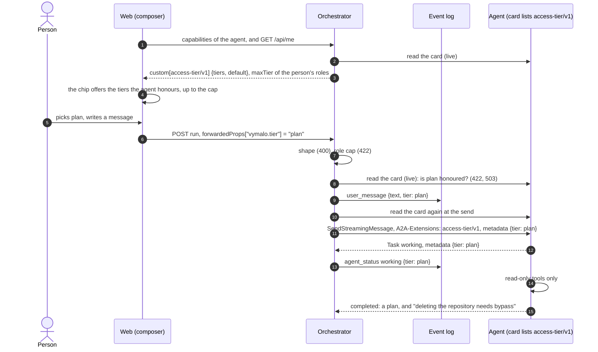
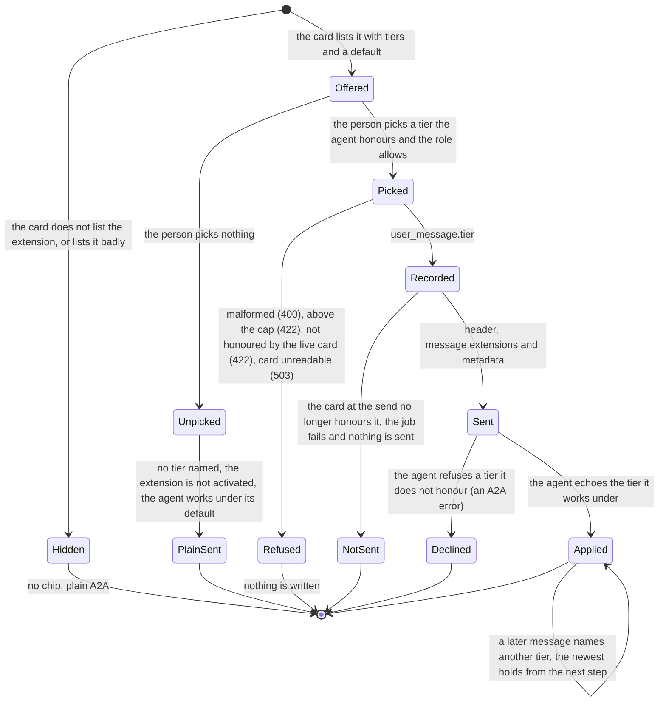

# A2A extension: access tier (v1)

- **URI:** `https://agents.vymalo.com/a2a/extensions/access-tier/v1`
- **Status:** **proposed (2026-10-11), at the owner's request; nothing is built.** The owner has chosen how adam's coder maps its
  tools onto the tiers (2026-10-11, [below](#example-adams-coder)). Every other name, status code and default here is proposed, for
  the owner to confirm.
- **Decided in:** [ADR 0061](../decisions/0061-the-person-picks-an-access-tier-for-each-message-the-agent-keeps-to-it.md); the
  optional-extension pattern is [ADR 0008](../decisions/0008-platform-integration-via-a2a-extension.md).
- **Defined by:** the orchestrator. **Used by:** agents that can work under a limit the person sets (adam-coder and `adam-agent`
  first; their side is a pull request in adam-rs).

## Purpose

The owner, 2026-10-11:

> "we're managing with a2a. So if we're passing down permissions from parents to children too heavily, it might impact too much
> what remains from the core protocol a2a gives us, making it difficult to switch from one vendor (adam-rs) to another one (e.g
> kagent). So the agent should be fully autonomous, and its permissions should be as easy as eating chips. Bon, if we can
> implement a way for the user to control the access control tier (edits only, plan, auto, bypass all) and let the agent adapt to
> that, then it's better again."

So the contract is small. A person says, **for one message**, how much the agent may do on its own: one of four words. The agent
keeps to it. Nothing is passed to the agent's children.

An agent whose card does not list the extension is unchanged. kagent and every other plain A2A agent get the same request as
before, with no header and no metadata, and the web shows no control for them. The rest of this page is for agents that list it.

## Who does what

| Part | Does |
|---|---|
| **Agent** | Lists the extension with the tiers it honours and its default. Works under the tier a message names, never above it, says which tier it worked under, and says so when a request needs more. Decides alone what its own children may do. |
| **Orchestrator** | Reads the card live. Checks the shape of the choice, the person's role cap and that the live card honours it. Logs the choice on the message. Activates the extension and sends the choice on that message. Sends nothing to any other task. Enforces no tier. |
| **Web** | Shows a chip in the composer, only for an agent whose card lists the extension. Sends the choice with each message once the person has picked one. |

## The flow



One message's tier goes through these states:



## 1. The card

The agent lists the extension in `capabilities.extensions`:

```json
{"uri": "https://agents.vymalo.com/a2a/extensions/access-tier/v1",
 "description": "Works under the access tier the person picks for each message.",
 "required": false,
 "params": {"tiers": ["plan", "edits", "auto", "bypass"], "default": "auto"}}
```

| Param | Meaning |
|---|---|
| `tiers` | Required. A non-empty list of the tiers the agent honours, each of the four at most once. An agent may honour fewer than four (a read-only agent lists `["plan"]`). |
| `default` | Required. One of `tiers`: what the agent works under when no message names a tier. adam's is `auto`. |

`required` stays `false`: a client that does not know the extension must still be able to talk to the agent.

The orchestrator reads the card on **every send** (never cached) and fails closed: the extension is used when the URI is listed
exactly (no other version, no trailing slash, no other case) **and** `params` are well-formed. A card with bad `params` is a card
that does not list it. The AG-UI capabilities document carries `custom[<uri>] = {tiers, default}`, so the web can draw the chip
before anything is sent ([`agui.md`](agui.md#capabilities-document), updated by the pull request that builds this).

## 2. Activation

The orchestrator names the URI in the `A2A-Extensions` header and in `message.extensions` of a `SendStreamingMessage`
**only when** both hold:

- the person's message names a tier;
- the live card lists the URI and its `tiers` contain that tier.

A message that names no tier does not activate the extension: it is the plain A2A message it is today. An agent MUST NOT read a
tier from a message that did not activate the extension.

## 3. The four tiers

The tiers are a closed list, ordered by how much the agent does alone: `plan` < `edits` < `auto` < `bypass`. "Higher" means later
in the list.

| Tier | Means |
|---|---|
| `plan` | Read and propose. No change to a repository or to any external system. The answer is a plan the person can approve by sending the next message under a higher tier. |
| `edits` | Change files, commit, push branches, open pull requests. Nothing that merges, creates, renames or deletes, and no settings. |
| `auto` | Everything the agent does as the normal course of its work, alone, merging and creating included. What cannot be undone (deleting or renaming a repository) is outside it. |
| `bypass` | Never asks for permission. Does anything the agent is able to do with the credentials it has. |

What is outside a tier, the agent does **not** do on its own. It either asks the person, in a question the person answers, or
declines and says which tier the act needs. It never does the act because its model decided it should. `bypass` skips every
question whose only purpose is permission; the agent may still ask for information it needs.

A tier says what the agent may do, not what it can do. The agent's own tools, its credentials and the deployment's limits
apply under every tier ([section 9](#9-security)).

## 4. The message

An ordinary A2A user message, with the tier in its metadata under the URI:

```json
{"message": {
  "role": "user",
  "messageId": "msg-01927a4e-9c10-7000-8000-00000000002f",
  "contextId": "01927a4e-3b00-7000-8000-000000000001",
  "parts": [{"text": "add a health endpoint and open a pull request"}],
  "extensions": ["https://agents.vymalo.com/a2a/extensions/access-tier/v1"],
  "metadata": {"https://agents.vymalo.com/a2a/extensions/access-tier/v1": {"tier": "edits"}}
}}
```

| Member | Meaning |
|---|---|
| `tier` | Required once the extension is activated: `plan`, `edits`, `auto` or `bypass`, lower case. Unknown members are ignored. |

It rides on the message because a message is where A2A puts a client's data for an extension, and because the choice is the
person's, made again for each message: no thread state, no new route, nothing for the orchestrator to remember. The
`A2A-Extensions` header says the extension is on; the tier is the message's own. It rides with whatever the other extensions put
on the same message ([`thread-tools/v1`](thread-tools-v1.md), [`mentions/v1`](mentions-v1.md)), and on a message sent while the
agent works ([`steer/v1`](steer-v1.md)).

**What the agent does with it.**

1. **From its next step.** A tier governs the work from the agent's next step: never in the middle of a tool call it has
   started, and at once for the next one. A lower tier holds as soon as the call in flight is over.
2. **The newest message wins.** A message that names a tier sets the task's tier. A message that names none leaves it as it is.
   A task that has none works under `default`.
3. **A task never inherits.** A new task in the same context starts from `default`, not from the tier of the task before it.
   The person's next message names its own.
4. **Only a message sets it.** The model, a tool result, a file, an asked agent or text inside a message never raises the tier.
5. **An activated message with no valid `tier`**, or a tier outside the agent's `tiers`, is refused with an A2A error. The agent
   never works under another tier than the one named, and never rounds up.

## 5. The agent's duties

1. **Never exceed the tier.** Work done through a child counts as the agent's own. An agent under `plan` does not ask a
   sub-agent, or another agent, to change anything.
2. **Say which tier it worked under.** When the request activated the extension, the task's `metadata` carries
   `{"tier": "<tier>"}` under the URI: on the first `Task` of the stream (the one every `SendStreamingMessage` stream begins
   with), and again whenever the tier changes. It is never higher
   than the one named. When the tier mattered to an answer, the answer says so in words.
3. **Refuse clearly when a request needs more.** The agent does not do the act. It says what it did not do, why, and which tier
   the act needs, then does the rest of the work. This is an ordinary answer, not an A2A error, and it does not fail the task.

For example, under `auto`: "I did not delete `acme/old-widgets`. Deleting a repository needs the bypass tier and I am working
under auto. Pick bypass and send it again if you want it deleted. The other changes are done: ..."

| Situation | What the agent answers |
|---|---|
| The named tier is one it does not honour | an A2A error (its choice which: the orchestrator does not read it) |
| The extension is activated and `tier` is missing or not one of the four | an A2A error |
| A request needs a higher tier than the one in force | an answer that declines the act and names the tier |
| The extension is not activated | it reads no tier and works under `default` |

## 6. Sub-agents: nothing is passed down

The orchestrator sends a tier only on **the person's message to the thread's agent**. It sends none on:

- an [`ask_agent`](thread-tools-v1.md#ask_agent) child task: an asked agent works under its own default;
- a verifier's task, or any other task the orchestrator starts for an agent;
- a message that comes through the MCP surface, a webhook or a timer.

Each agent decides what its own children may do: its sub-agents ([ADR 0050](../decisions/0050-the-chat-has-sub-agents.md)), a
process it starts, an agent it asks. How it limits them is its business and its vendor's. A2A delegation stays plain.

Why: a permission that flows down a delegation needs every agent on the way to understand it, and the first one that does not
makes the model false or the delegation impossible. It would tie what the orchestrator sends to one vendor's idea of a permission,
and make it hard to swap adam-rs for kagent or any other A2A agent. The orchestrator cannot see inside a task either, so it could
not enforce it. The price is real: a person who picks `plan` trusts the agent they talk to to keep its helpers to it
([duty 1](#5-the-agents-duties)). The log shows what each agent did.

## 7. The orchestrator

The web sends the choice on the run that carries the message, like the mentions:
`forwardedProps["vymalo.tier"] = "plan"` ([`agui.md`](agui.md#inbound-ag-ui--core-input)). `null` or no member: no choice, nothing is
written or activated. Before **anything** is written the orchestrator checks:

| Check | Refused as |
|---|---|
| The member is a string, one of the four | **400** |
| The person's roles allow the tier ([section 8](#8-roles-and-the-web)) | **422** "the tier 'bypass' is above what your role allows" |
| The thread's agent: its live card lists the extension and its `tiers` contain it | **422** "this agent does not take the tier 'plan'" |
| The card cannot be read | **503**, retryable; nothing is written |

A tier is **never silently dropped**. The web only offers what the card honours, so the second refusal happens through the API,
or when a card changed between the list and the send. Ignoring the choice would run the agent under its default, perhaps `auto`,
for a person who asked for `plan`. A run that has no message to put it on (a cancel, an A2UI action, an attach) is checked for its
shape (400) and the member is ignored with a warning.

A tier that passes is stored **as sent** in the `user_message` event (`tier`, omitted when none), so an export shows it, and
projected as `TEXT_MESSAGE_START.metadata["vymalo.tier"]` so a reload and another tab show it. A fork's first message and a
message sent while the agent works carry their own.

**At the send**, the dispatcher reads the card again. If it still honours the tier, the message is activated and sent as in
[section 4](#4-the-message). If the card cannot be read, the row is retried by the dispatcher's backoff. If it is read and no longer
honours the tier, the job **fails** with "the agent no longer takes the access tier 'plan'" and nothing is sent. The orchestrator
never sends the message without its tier. It never falls back to the default, the rule of
[ADR 0008](../decisions/0008-platform-integration-via-a2a-extension.md).

The orchestrator reads the echo (`tier` in the task's metadata under the URI) and records it on the job's `agent_status` event
(`data.tier`, proposed), so the log holds what was asked and what the agent said. It compares nothing. An agent that lists the
extension and works above its tier has a defect, as in [`steer/v1`](steer-v1.md#4-refusals): the orchestrator cannot see inside a task.

## 8. Roles and the web

**One optional line caps the highest tier a role may pick:**

```yaml
auth:
  roles:
    chat-only: { permissions: [agent.read, agent.invoke, thread.read, thread.write], agents: [chat], maxTier: auto }
```

`auth.roles.<role>.maxTier` is one of the four. Absent: no cap, so the built-in `user` and `admin` can pick any tier the agent
honours. A person with several roles has the highest cap of them, and a role without one has none ([`config.md`](config.md#roles-and-permissions)
unions roles the same way). A value outside the four is exit 78, naming the key. It is not a permission: it is a ceiling, so it is
not in the `permissions` list. `GET /api/me` gains `maxTier`, a hint for the screen and never a check, absent when there is no cap
([`chat-api.yaml`](chat-api.yaml)). The orchestrator checks the cap once, when the message is written.

**The web** draws a chip beside the tools picker in the composer's toolbar, and only when the selected agent's capabilities
document has `custom[<uri>]`. Hidden otherwise: no disabled control, no placeholder, no fake setting. Its rules:

- It offers the agent's `tiers` up to the person's `maxTier`, each with its one-line meaning ([section 3](#3-the-four-tiers)).
- Until the person picks, it shows the agent's `default`, marked as the default, and sends **no** tier.
- Once the person picks, it sends that tier with every message of the thread. The choice is a per-person convenience kept in the
  browser. The orchestrator stores nothing.
- A remembered tier the agent no longer honours, or the cap no longer allows, is forgotten and the chip says so.
- A thread the person may read and not change has no chip, as it has no tools picker.
- A message shows the tier it was sent under.

No screenshot yet: the web's own screens (`pnpm screens`) come with the pull request that builds the chip.

## 9. Security

- **The tier is a promise, not a boundary.** The orchestrator cannot see inside a task. A deployment that needs a boundary gives
  the agent a credential that cannot do the thing: a read-only token for a `plan`-only agent.
- **A tier only narrows.** It never grants what the deployment withheld: the credential, a GitHub App's granted permissions,
  branch protection and the coder's `CREATE_REPO_OWNERS` apply at every tier.
- **Only the person's message sets it** ([section 4](#4-the-message), rule 4). The MCP surface, webhooks and timers send none.
- **`bypass` is the person's explicit choice,** per message, and a role can forbid it.
- **The echo is read as one of four words.** Anything else is dropped and counted, and never fails a task.

## Example: adam's coder

The owner's choice of 2026-10-11 for how adam's coder maps its tools onto the tiers. It is an example of an agent's own mapping,
not part of the contract: another agent maps its tools its own way. On renaming and deleting repositories: *"Even renaming or
deleting repos should be allowed, but only via bypass tier."*

| Tier | The coder |
|---|---|
| `plan` | Read-only tools only, and a plan as the answer |
| `edits` | Edit files, commit, push branches, open pull requests. No merge, no repository creation, no rename, no delete. The consent form for a repository the person did not name stays |
| `auto` (adam's default) | Everything in `edits`, plus `merge_pull_request` and `create_repository`. A bare repository name the person writes counts as named, so no form. No rename, no delete |
| `bypass` | Everything in `auto`, plus `rename_repository` and `delete_repository`, and no consent form at all |

GitHub's own branch protection and the App's granted permissions still apply at every tier.

## What the build changes

| Place | Change |
|---|---|
| Orchestrator | the closed `AccessTier` enum, the checks of [section 7](#7-the-orchestrator), the `tier` of `user_message` and of `agent_status`, the adapter that activates the extension, the dispatcher's second read of the card, `maxTier` on a role |
| [`chat-api.yaml`](chat-api.yaml), [`agui.md`](agui.md), [`config.md`](config.md), [`config.schema.json`](config.schema.json) | the event member, the inbound row and the projected metadata, `custom[<uri>]` with its params, `Me.maxTier`, `auth.roles.<role>.maxTier` |
| Web | the chip, `Me.maxTier`, the tier on a message |
| adam-rs | [ADR 0061](../decisions/0061-the-person-picks-an-access-tier-for-each-message-the-agent-keeps-to-it.md#what-adam-rs-implements) |

## Conformance

What a build is tested for (the orchestrator's `FakeAgent` word `tiered` plays the agent side, and the adam-rs pull request tests
the real one):

- a card without the URI, or with bad `params`: no header, no `message.extensions`, no metadata, and the request is byte for byte
  what it is today; a message with a tier for such an agent is 422;
- a message that names no tier does not activate the extension, on an agent that lists it;
- a tier above the cap is 422, a tier the card does not honour is 422, a card that cannot be read is 503, and nothing is written
  in any of them;
- the dispatcher refuses to send when the card stopped honouring the tier, and fails the job;
- no tier on an `ask_agent` child task, a verifier task, an MCP, webhook or timer message;
- the agent echoes the tier, refuses an unhonoured one, never inherits one across tasks, and declines an act above its tier in an
  answer;
- `dev/kagent-e2e.sh` passes unchanged.

## Verified and unverified (2026-10-11)

*Verified 2026-10-01* against the A2A specification, as recorded in
[`steps-v1.md`](steps-v1.md#verified-and-unverified-2026-10-01) and not re-read for this page:

- Extensions are declared in the card's `AgentCapabilities` as objects with `uri`, `description`, `required` and optional
  `params`.
- A client activates an extension with the `A2A-Extensions` request header, "a comma-separated list of extension URIs";
  `Message.extensions` lists the URIs "present or contributed to this Message".
- Extension data goes in the `metadata` map of the core structures.
- A `SendStreamingMessage` stream that returns a task "MUST begin with the Task object"
  ([`steer-v1.md`](steer-v1.md#verified-and-unverified-2026-10-02)), so the first event carries the echo.

*Verified 2026-10-11 in this repository:* the coder at the pin (`dev/coder/UPSTREAM`, adam-rs `5581d40`) has
`create_repository`, asked each time, for the owners in `CREATE_REPO_OWNERS`
([ADR 0014](../decisions/0014-adam-coder-default-agent-over-a2a.md)); its vendored GitHub tools are read-only
(`dev/coder/agent/mcp.json`); `merge_pull_request`, `rename_repository` and `delete_repository` appear nowhere in this repository.

*Unverified:* whether adam-rs has those three tools yet (its code is not in this repository); which A2A error an agent should
answer with for a tier it does not honour (the specification's names are not tabulated for this page); whether a plain agent
such as kagent ignores or rejects a metadata key it did not ask for, which does not matter here because nothing is sent to an
agent whose card does not list the URI.
