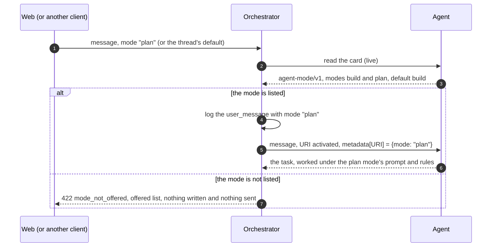
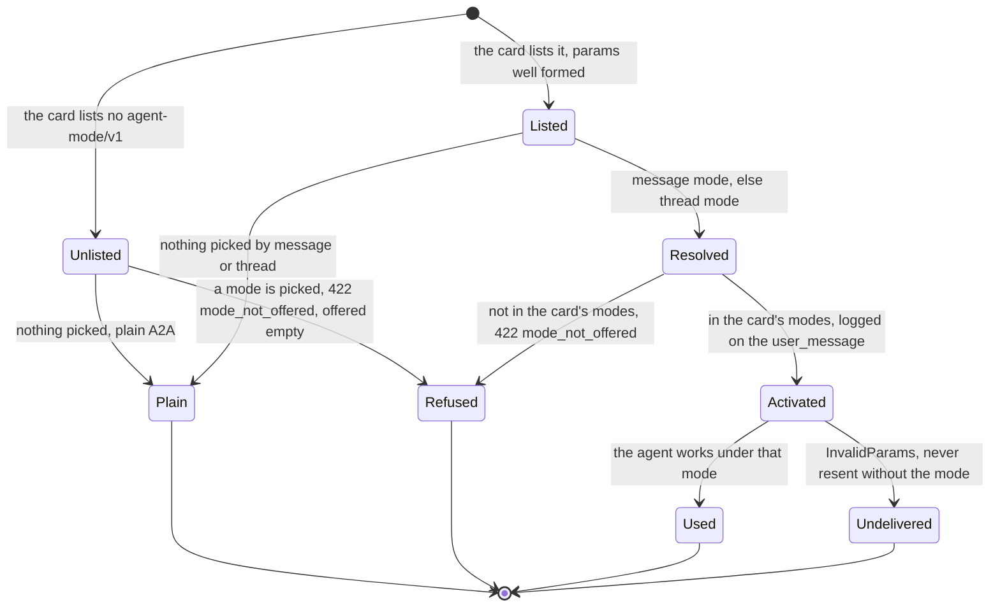

# A2A extension: agent mode (v1)

- **URI:** `https://agents.vymalo.com/a2a/extensions/agent-mode/v1`
- **Status:** 🚧 planned · **adam built, the orchestrator's side not yet** (proposed 2026-11-27, card ANR-979). adam serves it since adam-rs `2c2b551d` (2026-11-27, "feat(a2a): agent-mode/v1 — folder modes, the extension, activation (#465)"): `crates/adam-a2a/src/modes.rs`, `crates/adam-a2a-runtime/src/mode.rs`, and a coder card with `build` and `plan` (`bin/adam-coder/tests/fixtures/agent/card.json`). The orchestrator reads no card entry for it, activates nothing, checks nothing and logs nothing; no `dev/` scenario has run it. The coder pin here (`dev/coder/UPSTREAM`, `9f90f1e`) predates that commit. Decided in [ADR 0109](../decisions/0109-a-person-picks-an-agents-mode-for-a-thread-or-a-message.md); the wire is adam's ([adam-rs ADR 0039](#verified-and-unverified), answer 3).
- **Defined by:** adam-rs writes the wire; this system writes the orchestrator's side. **Used by:** agents that work in more than one way (adam's coder: `build`, `plan`), the orchestrator and the web.
- **Not this:** the access tier ([`access-tier-v1.md`](access-tier-v1.md)) is a limit on what the agent may do; a mode is a way of working the agent defines. The tier caps every mode. The model and the effort are [`model-pick-v1.md`](model-pick-v1.md).

## Purpose

An agent may declare **modes** (a prompt, tools and rules of its own, over the agent's), one of them the default. A person picks one for a message, or for a thread. An agent that lists none is a plain A2A agent and works as before.

## The card

```json
{"uri": "https://agents.vymalo.com/a2a/extensions/agent-mode/v1",
 "required": false,
 "params": {"modes": [{"name": "build", "title": "Build", "description": "Make the change."},
                      {"name": "plan", "title": "Plan", "description": "Read and plan, change nothing."}],
            "default": "build"}}
```

`name` is the word that travels. `title` and `description` are for the person. `default` is one of the names. The orchestrator reads the card live on every send and never caches it; a card whose `params` do not have this shape is read as "not listed".

## The message

The URI is activated in `A2A-Extensions` and `message.extensions`; `message.metadata[URI] = {"mode": "<name>"}`. A message that picks nothing activates nothing and has no member: the orchestrator never sends the agent's own `default` for it.

`vymalo.mode` is also adam's run-context key (`CONTEXT_MODE`), the same pattern as `vymalo.model`; it lives in adam's run and never meets the AG-UI `forwardedProps` key of the same name, so there is no collision.

## The client

`forwardedProps["vymalo.mode"]` on an AG-UI run. `PATCH /api/threads/{id}` takes `mode` as the thread's default (additive; `null` clears it). **The message wins, then the thread, then the agent's own default** when a new task starts. The key names `vymalo.mode` and `mode` on the thread are the orchestrator's; adam decided the URI, the card and the message.

**The name.** On `PATCH` and `forwardedProps` a mode name is any non-blank string of at most 64 bytes with no control characters (else `400`). It differs from model pick's alphabet (`a-z0-9._-`) because adam requires only a non-blank name and a folder's `modes/<name>.md` file names vary; whether the card offers it is the `422`'s job.

## The hold rule

The mode holds until another is picked, as the tier does ([`access-tier-v1.md`](access-tier-v1.md)): the **newest message that names one wins** from the agent's next step, and a message that names none leaves it as it is (adam's behaviour, *verified 2026-11-27*, `crates/adam-a2a-runtime/README.md`). The ladder above applies **when a new task starts**. Within a task an unpicked message keeps the task's mode, and clearing the thread default cannot bring a running task back to the agent's default. *Unverified:* that a new task never inherits the last one's mode: adam's docs and tests cover only holding within a task, so this page makes no claim about adam there; the orchestrator never carries a mode from one job to the next.

Like the tier ([`access-tier-v1.md`](access-tier-v1.md), its table of the orchestrator's own messages), the job's last mode choice is carried on:

- the verification gate's reworks (a failed check, a CI report, a verifier's findings, a timer that ends a wait);
- the delegation of an A2UI action;
- an answer to a blocked job;
- an MCP `answer`, and an MCP post to a thread while the job is unfinished.

These resolve the mode as a first message (the message's own, then the thread's default, then nothing sent): an MCP `start_job`, and an MCP message to a finished job, which starts a new job. A mode is never carried from one job to the next. Nothing goes to a child's task: a child run starts in its parent's mode, which is adam's doing.

## What the orchestrator checks

| Case | Answer |
|---|---|
| the live card lists no `agent-mode/v1`, or the name is not in `modes` | `422 mode_not_offered` with `offered: [names]` (empty when not listed); **nothing is written and nothing is sent** |
| the thread's default names a mode the card has since dropped | the same `422`, for the message that resolves to it, naming the mode; never a silent fallback |
| the card cannot be read to check it | `503` + `Retry-After`; nothing is written |
| the agent answers `InvalidParams`, or its card no longer offers the mode at the send | the message is undelivered, with the agent's reason; never sent without the mode |

A person's choice is never dropped: an unlisted mode is not replaced by the default. The tier is independent: both members go, and the agent keeps to the narrower. The code `mode_not_offered` is adam's own name for its `InvalidParams` (`MODE_NOT_OFFERED`), and the orchestrator's `422` is aligned with it.





## Stored

The `user_message` holds the resolved mode as `mode: "<name>"` (omitted when none); the thread row holds its default (one column, no event). The mode is its own member and column, not an axis of `pick` (ADR 0109, alternatives). A redelivery, a fork's first message (a `mode` member on the fork body, beside model pick's `model` and `reasoningEffort`) and an edit that names none carry the recorded mode. A thread's default is not copied into a fork or an export. Only the name is stored, never the mode's prompt.

**No echo.** Unlike the tier, adam does not write the mode into a task's metadata: it is not echoed, so there is no `agent_status.mode` and nothing to log from the agent. What the orchestrator records is what it sent.

## The capabilities document

The agent's entry (`GET /api/agents`, and the AG-UI capabilities) will list the modes the live card lists, each `{name, title, description}`, and which is the `default`; nothing when it lists none. A client draws a switch only for an agent that offers one.

## Security notes

A mode only narrows what the agent does; the access tier still caps every mode. adam refuses a mode file's `permission:` at folder load and narrows a mode by its `tools:` alone (adam-rs ADR 0039, amended 2026-11-27), so the person's pick cannot widen anything. Only the mode's name is stored and sent, never its prompt. The name is checked (shape on the way in, the live card for the `422`), so a made-up name writes nothing and reaches nobody.

## What the build changes

- `docs/api/chat-api.yaml`, additive only (names checked against the file): `mode` on `ThreadPatch` (`additionalProperties: false`, so it must be added) and on `ForkRequest` (also `additionalProperties: false`, served by `forkThread`), beside `model` and `reasoningEffort`; `mode` in `EventData` for the `user_message`, beside `pick`; the modes the live card lists on `Agent` (and so `AgentList`), beside its `pick` member; the descriptions of `patchThread`, `forkThread` and the AG-UI run (its 400 and 422 answers) gain `mode_not_offered`, and the run gains the `forwardedProps` key `vymalo.mode`. The thread's default is the stored column; as with model pick it is **not a member of the `Thread` schema**: only the answer of `patchThread` carries it. (`AgentInfo` is the web's own type name, not a schema here.)
- The core: a validated mode name, `user_message.mode`, a `threads.mode` column in each store (no event), the card read and the activation in the A2A client.
- The web: a switch beside the tier's, drawn only from a live card that lists modes.

## Conformance

*Unbuilt* (card ANR-913): `dev/mode-real-e2e.sh`, in `dev/e2e-all.sh`. The real `chat` (a folder with two modes) is sent a message with the second mode, and its model request, read from `mock-model`'s journal, carries that mode's instructions. A mode the card does not list is a `422`, and "nothing sent" is asserted on `mock-model`'s journal and the agent's request journal, both unchanged.

Prerequisites: the coder pin (`compose.yaml` about line 196, `dev/coder/UPSTREAM` `9f90f1e`) predates adam-rs `2c2b551d`, so a `bump-adam` comes first; and `dev/agents/chat/agent/` needs a `modes/` folder with two modes that narrow by `tools:` only (a `permission:` in a mode file is refused at load).

The mock-agent checks, each red before its fix: the mode arrives in the metadata with the URI activated; an unlisted mode is `422` and writes nothing; no pick sends no member and activates nothing; the message's mode beats the thread's; an unpicked message in a task keeps the task's mode; a redelivery carries the recorded mode; a rework carries the job's last mode.

## Verified and unverified

- *Verified 2026-11-27* (adam-rs `origin/main` `e8809b4d`, `docs/decisions/0039-the-agent-loop-takes-opencodes-structure-and-agents-get-plugins.md`, last commit `2c2b551d`, "The owner's answers (2026-10-11)", answer 3, and its "Amended 2026-11-27" note): the URI, the card `params {modes: [{name, title, description}], default}`, `metadata[URI] = {"mode": "<name>"}`, an unknown mode is `InvalidParams` with `mode_not_offered`, the tier caps every mode, a mode file's `permission:` is refused at load, the mode is not echoed.
- *Verified 2026-11-27*: the coder's card lists the extension with `build` (default) and `plan` (adam-rs `bin/adam-coder/tests/fixtures/agent/card.json`, `e8809b4d`); the hold rule and `CONTEXT_MODE` are in `crates/adam-a2a-runtime/README.md`; adam-rs built it in `2c2b551d` (#465).
- *Unverified:* that the coder image this stack pins serves it (the pin predates `2c2b551d`); the names `vymalo.mode`, `mode` on the thread and the capabilities shape are this system's.
