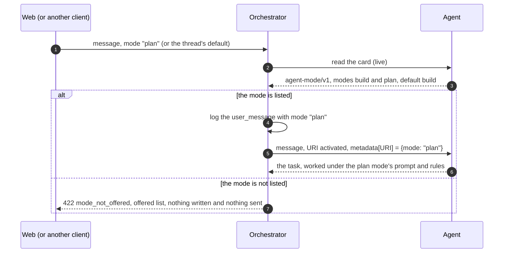
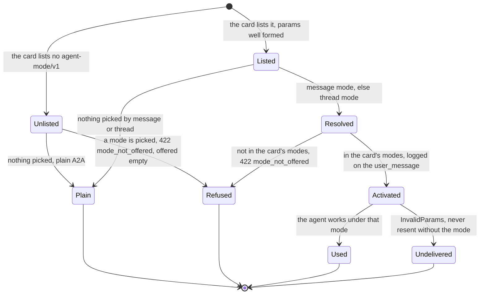

# A2A extension: agent mode (v1)

- **URI:** `https://agents.vymalo.com/a2a/extensions/agent-mode/v1`
- **Status:** **decided, not built** (proposed 2026-11-27, card ANR-979). The orchestrator reads no card entry, activates nothing, checks nothing and logs nothing for it; adam's side is not built either (*verified 2026-11-27*: adam-rs `origin/main` `50824c1` has the decision and no code). Decided in [ADR 0109](../decisions/0109-a-person-picks-an-agents-mode-for-a-thread-or-a-message.md); the wire is adam's ([adam-rs ADR 0039](#verified-and-unverified), answer 3).
- **Defined by:** adam-rs writes the wire; this system writes the orchestrator's side. **Used by:** agents that work in more than one way (adam's coder: `build`, `plan`), the orchestrator and the web.
- **Not this:** the access tier ([`access-tier-v1.md`](access-tier-v1.md)) is a limit on what the agent may do; a mode is a way of working the agent defines. The tier caps every mode. The model and the effort are [`model-pick-v1.md`](model-pick-v1.md).

## Purpose

An agent may declare **modes** (a prompt, tools and rules of its own, over the agent's), one of them the default. A person picks one for a message, or for a thread. An agent that lists none is a plain A2A agent and works as before.

## The card

```json
{"uri": "https://agents.vymalo.com/a2a/extensions/agent-mode/v1",
 "required": false,
 "params": {"modes": [{"name": "build", "title": "Build", "description": "Make the change."},
                      {"name": "plan", "title": "Plan", "description": "Read and plan, change nothing."}],
            "default": "build"}}
```

`name` is the word that travels. `title` and `description` are for the person. `default` is one of the names. The orchestrator reads the card live on every send and never caches it; a card whose `params` do not have this shape is read as "not listed".

## The message

The URI is activated in `A2A-Extensions` and `message.extensions`; `message.metadata[URI] = {"mode": "<name>"}`. A message that picks nothing activates nothing and has no member: the orchestrator never sends the agent's own `default` for it.

## The client

`forwardedProps["vymalo.mode"]` on an AG-UI run. `PATCH /api/threads/{id}` takes `mode` as the thread's default (additive; `null` clears it). **The message wins, then the thread, then the agent's own default.** These key names are the orchestrator's proposal; adam decided only the URI, the card and the message.

## What the orchestrator checks

| Case | Answer |
|---|---|
| the live card lists no `agent-mode/v1`, or the name is not in `modes` | `422 mode_not_offered` with `offered: [names]` (empty when not listed); **nothing is written and nothing is sent** |
| the thread's default names a mode the card has since dropped | the same `422`, for the message that resolves to it, naming the mode; never a silent fallback |
| the card cannot be read to check it | `503` + `Retry-After`; nothing is written |
| the agent answers `InvalidParams`, or its card no longer offers the mode at the send | the message is undelivered, with the agent's reason; never sent without the mode |

A person's choice is never dropped: an unlisted mode is not replaced by the default. The tier is independent: both members go, and the agent keeps to the narrower.





## Stored

The `user_message` holds the resolved mode as `mode: "<name>"` (omitted when none); the thread row holds its default (one column, no event). A redelivery, a fork's first message and an edit that names none carry the recorded mode. A thread's default is not copied into a fork or an export. Only the name is stored, never the mode's prompt.

## The capabilities document

The agent's entry (`GET /api/agents`, and the AG-UI capabilities) will list the modes the live card lists, each `{name, title, description}`, and which is the `default`; nothing when it lists none. A client draws a switch only for an agent that offers one.

## Conformance

*Unbuilt* (card ANR-913), a scenario in `dev/e2e-all.sh`: the real `chat` (a folder with two modes) is sent a message with the second mode, and its model request, read from `mock-model`'s journal, carries that mode's instructions. A mode the card does not list is a `422` with nothing sent. The mock-agent checks, each red before its fix: the mode arrives in the metadata with the URI activated; an unlisted mode is `422` and writes nothing; no pick sends no member and activates nothing; the message's mode beats the thread's; a redelivery carries the recorded mode.

## Verified and unverified

- *Verified 2026-11-27* (adam-rs `origin/main` `50824c1`, `docs/decisions/0039-the-agent-loop-takes-opencodes-structure-and-agents-get-plugins.md`, "The owner's answers (2026-10-11)", answer 3): the URI, the card `params {modes: [{name, title, description}], default}`, `metadata[URI] = {"mode": "<name>"}`, an unknown mode is `InvalidParams`, the tier caps every mode.
- *Verified 2026-11-27*: adam-rs has no code for it (a search of `crates/` and `bin/` for `agent-mode` and `modes/` finds none).
- *Unverified:* that adam's final card shape matches the decision when it is built; the names `vymalo.mode`, `mode` on the thread and `mode_not_offered` are this system's.
