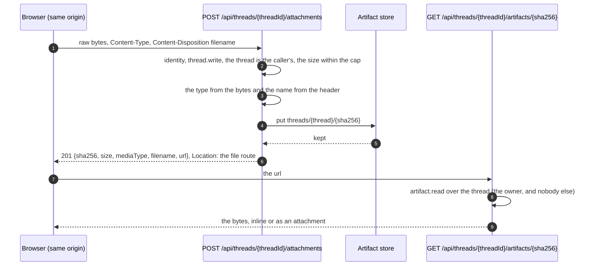
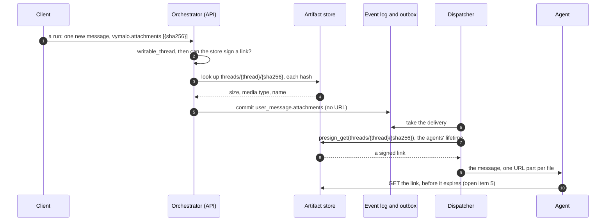
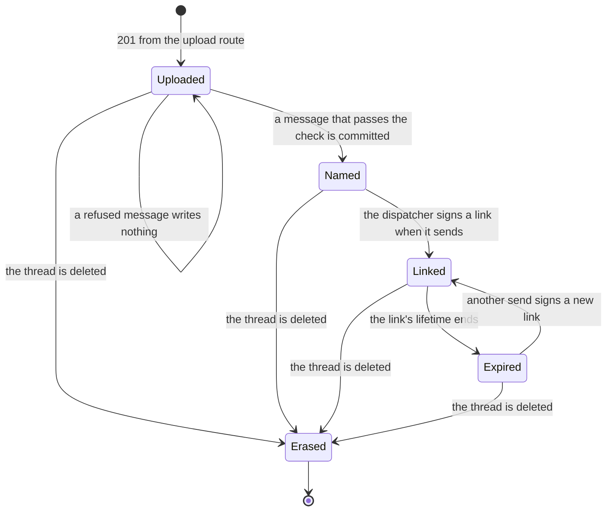

# Attachments (v1): a person's file, from the browser

- **Status:** **the server half of the upload is built** (2026-11-24): the route, its checks and its tests. **The
  message side is not**: no message names an uploaded file. Its decisions and contract are written under
  [*The message side*](#the-message-side-planned) (2026-11-28), and nothing of them is built. The web has no control
  (see [*What is not built*](#what-is-not-built)).
- **The decision is not taken.** Question 9 of
  [ADR 0067](../decisions/0067-the-plan-to-librechat-grade-and-the-client-agnostic-rule.md) — "may a browser send
  files to the orchestrator?" — is **open**. This page is that question's **recommendation**: yes, same origin, at
  most 10 MiB, kept in the artifact store by hash, and **no presigned upload from the browser**. ADR 0067 says the
  work proceeds on its recommendations until the owner says otherwise, so the route exists on the recommendation and
  not on a decision. Nothing here claims the owner answered.
- **A different contract for the same store:** a file an **agent** hands over is
  [`uploads-v1.md`](uploads-v1.md) (a presigned `PUT` minted for the agent) and the agent ingest. A person's browser
  never receives a presigned URL, and never holds a store credential.
- **Decided in:** no ADR. The decisions of the message side are recorded
  [on this page](#five-decisions); they do not answer question 9. The store is
  [ADR 0032](../decisions/0032-files-from-agents-live-in-an-artifact-store.md); the plan and the recipe rule are
  [ADR 0067](../decisions/0067-the-plan-to-librechat-grade-and-the-client-agnostic-rule.md).

## The rule

The **orchestrator enforces every rule of this page** (ADR 0067, rule 1). A client that checks the size, the type or
the owner is offering, not enforcing.

A file is sent to the orchestrator in the **same origin**: no CORS rule, no cross-origin request and no credential in
a URL. The orchestrator checks the size **before** it writes anything, reads the type from the bytes, hashes the
content, and puts it in the artifact store under the thread's prefix
([ADR 0032](../decisions/0032-files-from-agents-live-in-an-artifact-store.md), decision 2). The one thing it hands back
is the content's hash: the file is read through the artifact route every file of a thread already has, with the rule
that route already keeps.



## The request

```
POST /api/threads/{threadId}/attachments
Content-Type: <the media type the client declares>            (optional)
Content-Disposition: attachment; filename="<the file name>"  (optional)
<the bytes, and nothing else>
```

| Part | Rule |
|---|---|
| `{threadId}` | A thread of the caller's. Another person's thread and an id that does not parse are both `404` (ADR 0039: a foreign thread does not exist). |
| body | The bytes, exactly as the file is. **At most 10 MiB (`10 485 760` bytes), a hard ceiling.** A deployment may lower it with `artifacts.maxFileBytes` and never raise it; this route never reads a body over it. |
| `Content-Type` | Optional. When it is there it must be one media type, `type/subtype`, parameters such as `; charset=utf-8` dropped and the name lower-cased; anything else is `400 bad_media_type`. The type the file is **kept and served as** is read from the bytes first: a declared image must agree with its magic bytes, else the file is kept as `application/octet-stream`; a generic declared type (`application/octet-stream`) gives way to the bytes' type and then to the name's extension. |
| `Content-Disposition` | Optional. Its `filename` member, quoted or a token, is the name the file is served with; it is cleaned as every file name is (the last path segment, no control or direction characters, trimmed, at most 255 bytes). A header whose quoted name never closes, or whose name cleans to nothing, is `400 bad_filename`. Without the header the file is served as `artifact-<8 hex digits>`. |
| authentication | The caller's identity, like every route of the API. Without one: `401`. |

## The answer

`201 Created`, `Location: /api/threads/{threadId}/artifacts/{sha256}`, and:

```json
{"sha256": "1f0f…64 lower-case hex…",
 "size": 1234,
 "mediaType": "image/png",
 "filename": "dot.png",
 "url": "/api/threads/6a1c…/artifacts/1f0f…"}
```

| Member | Meaning |
|---|---|
| `sha256` | The content's hash: the same bytes always have this name in this thread. |
| `size` | The bytes stored. |
| `mediaType` | The type the file is kept and served as. |
| `filename` | The cleaned name, or absent when none was given. |
| `url` | The artifact route of the file, on this origin. The client reads the file there. |

**The same bytes are stored once.** The key is the content's hash
([ADR 0032](../decisions/0032-files-from-agents-live-in-an-artifact-store.md), decision 2), so sending the same content
twice writes the same object and answers the same `sha256`; a retry after a lost answer is safe. Two threads keep two
objects, each under its own prefix.

## The refusals

Every refusal is an RFC 9457 problem (`application/problem+json`); a client acts on `code`.

| Status | `code` | When |
|---|---|---|
| `400` | `empty_body` | The body is empty: an empty file is not kept. |
| `400` | `bad_media_type` | `Content-Type` is there and is not one `type/subtype`. |
| `400` | `bad_filename` | `Content-Disposition`'s name never closes, or cleans to nothing. |
| `400` | `bad_request` | A query that is not one. |
| `403` | `forbidden` | The caller's roles do not hold `thread.write` (ADR 0033). |
| `404` | — | No such thread, or not the caller's (ADR 0039). |
| `413` | `too_large` | The body is over 10 MiB or the deployment's lower `artifacts.maxFileBytes`. **The store was not asked to keep anything.** |
| `503` | `attachments_unavailable` | This deployment has no artifact store (`artifacts.store` unset). |
| `503` | — | The store failed (`storage is unavailable`, with `Retry-After`): send the bytes again. |

The size is held to in this order, and **nothing is stored before every check passes**:

1. a `Content-Length` over the cap is a `413` before the body is read;
2. a body without a length is read up to the cap, and the chunk that would pass it is a `413` (a body that lies about
   its length is cut at the cap, never buffered whole);
3. the bytes are checked again in the application before the store is called.

## Who can read it

The file is read through the route a thread's files are served on:

```
GET /api/threads/{threadId}/artifacts/{sha256}[?download=1]
```

That route is unchanged ([ADR 0032](../decisions/0032-files-from-agents-live-in-an-artifact-store.md), decision 8):
`artifact.read` over the thread, which the thread's owner holds and nobody else does. Another person gets the same
`404` as for a file that does not exist — **uploading does not widen who can read it**. The `?download=1` form, the
inline types and the safety headers are in [`uploads-v1.md`](uploads-v1.md#downloads-a1) and
[`chat-api.yaml`](chat-api.yaml). Deleting the thread erases its prefix, this upload included (ADR 0043). The key is
per thread and content: one thread can never read another's file by its hash.

## Client recipe

Same origin, no CORS, no presigned URL. The name goes in `Content-Disposition`, so it is never in the request line and
never in the orchestrator's log; a client that has no name sends no header.

```ts [uploadAttachment.ts]
async function uploadAttachment(threadId: string, file: File) {
  const headers: Record<string, string> = {
    "content-type": file.type || "application/octet-stream",
  };
  // A browser `File` has a name; sending it is optional. Quote it and escape a quote.
  if (file.name) {
    headers["content-disposition"] = `attachment; filename="${file.name.replace(/"/g, '\\"')}"`;
  }
  const response = await fetch(`/api/threads/${threadId}/attachments`, {
    method: "POST",
    headers,
    body: file,
    credentials: "same-origin",
  });
  if (!response.ok) {
    const problem = await response.json(); // {status, title, detail, code?}
    throw new Error(problem.code ?? problem.title);
  }
  return (await response.json()) as {
    sha256: string;
    size: number;
    mediaType: string;
    filename?: string;
    url: string;
  };
}
```

Check the size on the client only to spare the upload (`file.size > 10 * 1024 * 1024`); the server refuses it anyway,
with the deployment's own cap.

## The message side (planned)

**Nothing in this section is built.** It is what the code that lets a message carry an uploaded file has to do. It
builds on the artifact store of [ADR 0032](../decisions/0032-files-from-agents-live-in-an-artifact-store.md), the
presigned `GET` of [ADR 0058](../decisions/0058-large-files-go-up-through-a-presigned-url-the-orchestrator-gives-the-agent.md)
(the port's `presign_get`), forks as [ADR 0029](../decisions/0029-forking-a-thread-copies-its-log.md) and
[ADR 0043](../decisions/0043-deleting-a-thread-erases-it.md) have them, and share links as
[ADR 0040](../decisions/0040-thread-sharing-by-revocable-link.md) has them. What the code does today, as said here, was
read in this repository on 2026-11-28.





### Five decisions

Recorded 2026-11-28. The fifth is not a decision: it is an open item.

#### 1. How an agent fetches a file

- **Question:** how does the agent, which has no login of the person's, get the bytes?
- **Decision:** by a **signed link the dispatcher mints when it sends** (`presign_get`, ADR 0058). **The log and the
  outbox keep only the hash and the file's details, never the URL.** **If the store cannot sign a link, a message with
  attachments is refused `422` before anything is written.**
- **Reason:** the link is a credential for as long as it lives, so it is made as late as it can be and the
  orchestrator keeps it nowhere; the log keeps a reference (ADR 0032, decision 1). The store already signs a `GET`
  (ADR 0058). A message that could never be delivered is not written.
- **Rules out:** a new signed-link route that would also work with the directory store. It adds a way in without a
  login, and needs an ADR and a security review of its own.

So a deployment can accept the upload and refuse the message: the route above keeps a file in any artifact store,
and only a store that can presign (`can_presign`: today S3 with `artifacts.s3.publicEndpoint` set,
[`config.md`](config.md)) can sign. Signing does not depend on `artifacts.s3.downloads: redirect`. The agent must
reach the host the link names.

#### 2. How long the link lasts

- **Question:** does the agent's link last as long as a download's?
- **Decision:** no. The agents' links have **their own setting**, apart from `artifacts.s3.presignTtlSecs` and its
  default of 300 seconds. Its key, default and bounds are not decided here; the port refuses a lifetime over seven
  days.
- **Reason:** a browser follows a download's redirect at once. An agent may fetch later, or retry.
- **Rules out:** reusing the download's 300 seconds, and a link that never expires.

**A link already in an agent's history expires.** An agent that reads an old message again holds a link that may no
longer work. Another send by the dispatcher signs a new link for what it sends; it does not change what the agent
already keeps.

#### 3. A new thread's first message

- **Question:** can the message that creates a thread carry attachments?
- **Decision:** **no. This is a documented limit**, and it is handled before the web's upload control ships.
- **Reason:** an upload goes to a thread, and an upload to a thread that does not exist is `404`. No call creates a
  thread ahead of its first message: `/api/threads` is `GET` only, and the run that carries the first message creates
  the thread.
- **Rules out:** attachments on that run, and an upload that belongs to no thread. It does not say how the limit will
  be handled.

The same holds for a run that creates a fork with its first message (`forwardedProps["vymalo.fork"]`): the fork has
no files of its own to name before that run.

#### 4. Share links and forks

- **Question:** who else can open a person's attachment?
- **Decision:** **a reader of a share link cannot**: attachments are the owner's alone for now. **A fork always copies
  them.**
- **Reason:** widening who can read a file is an explicit choice the owner makes, not a side effect of a message. A
  fork is a new thread of the person who forks, which has the copied messages, and a file's key holds the thread that
  is read (ADR 0043, decision 8).
- **Rules out:** serving an attachment through either link route because a user message names it, and a fork whose
  copied messages name files it cannot open.

A link route decides by hash: it serves a file that an `artifact` event of the thread names. If an agent hands over
**the same bytes** a person attached, the two have one hash and one key, and today's rule serves that file through
the link as the agent's.

#### 5. Whether an agent opts in (open)

**Open, to be checked before the pull request that sends a file.** Two things: is a card's input modes read to decide
whether an agent is sent a file, and does the pinned adam fetch a URL part? What was read on 2026-11-28:

- *Verified (this repository's source):* the orchestrator reads no card's `defaultInputModes` and no skill's
  `inputModes`.
- *Verified (adam-rs source at the pinned `9f90f1e`, `orchestrator/Cargo.toml`: `adam-a2a-runtime/src/files_in.rs`,
  `convert.rs`, `vymalo.rs`; `adam-a2a/src/card.rs`):* **it does not fetch a URL part.** Both of its inbound
  functions turn one into the line `[linked: <url>]` in the message's text, with control characters removed and the
  URL **cut at 512 characters**. Only a `raw` part of PNG, JPEG, GIF or WebP bytes is read as an image, so
  `image/*` on a URL part does not give the model an image. Its card says `defaultInputModes: ["text/plain"]`.
- *Unverified:* the running image (the source was read, nothing was run); whether one of the agent's tools would
  fetch a link from the text; how long a signed link of a given deployment is, and so whether the cut breaks it; any
  agent that is not adam.

So, as the source reads, a signed link sent to the pinned adam would be part of the text its model reads. That is
also a way for the URL to come back: the rule that the log keeps no URL covers what the orchestrator writes for the
message, and nothing here stops an agent from quoting a link in its reply.

### The request

The run that carries the message names the files in `forwardedProps`, as the other members of a message do
([`agui.md`](agui.md#inbound-ag-ui--core-input)):

```json
{"vymalo.attachments": [{"sha256": "<64 lower-case hex digits>"}]}
```

**At most 10 distinct entries.** Ten is a starting limit. A client names a file by its hash only: **the server takes
the size, the type and the name from the store and ignores any type or name the client sends.**

### The check

After `writable_thread` (`thread.write`, and the thread is the caller's), each hash is looked up **under that
thread's prefix**, `threads/<thread>/<sha256>`, **before anything is committed**. A hash that is not there **refuses
the whole message**, and the refusal **does not reveal whether the file exists elsewhere**: the orchestrator does not
look elsewhere. With it comes decision 1: a store that cannot sign refuses the message `422`. The other refusals'
statuses and the codes are not decided here.

**What "the sender's file" means.** A file is stored only as `threads/<thread>/<sha256>`. No upload is recorded
against a person. So the check can say one thing: the file is **in this thread, which the sender can write to**. It
cannot say the sender uploaded it, and a file an agent handed over to the same thread passes it too. The key holds
the content once, so two uploads of the same bytes in a thread are one file; what the store says of its type and
name is what the object holds.

### The log

```json
{"text": "What is in this picture?",
 "attachments": [{"sha256": "<64 lower-case hex digits>", "size": 1234, "mediaType": "image/png",
                  "filename": "dot.png"}]}
```

`user_message.attachments` is `[{sha256, size, mediaType, filename?}]`, **filled by the server from the store**. It
holds no URL and no bytes (ADR 0032, decision 1), and neither does the outbox.

### What the agent gets

**One A2A URL part per file**, with `mediaType` and `filename` (when the file has one); the URL is the link of
decision 1. **An `image/*` media type is what marks an image**: there is no second field. What the pinned adam does
with such a part is open item 5.

### Two readers that must learn the new reference

`core::file_refs` and the share links' `log_names_file` read **only `artifact` events** today. Once a user message
names a file:

- **a fork would miss it**: the message is copied and the file is not. `file_refs` is taught to read
  `user_message.attachments` **in the same pull request that lets a message carry a file** (decision 4);
- **a share link would miss it**: `log_names_file` does not look at user messages. For attachments that is what
  decision 4 asks for now, so it stays; opening them to a link's reader is a later choice, made on purpose.

## What is not built

- **The message side: no file is attached to a message yet.** The upload route stores a file and hands back its hash;
  no request member, event, agent part or log entry names it. [*The message side*](#the-message-side-planned) is the
  plan, and open item 5 comes before the pull request that sends a file.
- **A file nothing references is left in the store.** The orphan sweep of open question 46 is not built, and nothing
  here changes that: an upload the person never sends is bytes with no reference, like an agent's unused upload.
- **No web control, and no second client.** The composer's attachment control and its previews are not built, and
  the limit on a new thread's first message (decision 3) is not handled.
- **No `chat-api.yaml` entry.** The route is not in the OpenAPI document yet: adding an operation to it goes through
  the API epic's process (ADR 0067, rule 2), not through this page.
