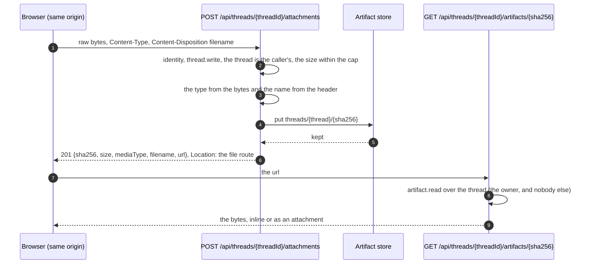

# Attachments (v1): a person's file, from the browser

- **Status:** **the server half is built** (2026-11-24): the route, its checks and its tests. The web has no control
  for it yet, and an uploaded file is not yet named by a message (see [*What is not built*](#what-is-not-built)).
- **The decision is not taken.** Question 9 of
  [ADR 0067](../decisions/0067-the-plan-to-librechat-grade-and-the-client-agnostic-rule.md) — "may a browser send
  files to the orchestrator?" — is **open**. This page is that question's **recommendation**: yes, same origin, at
  most 10 MiB, kept in the artifact store by hash, and **no presigned upload from the browser**. ADR 0067 says the
  work proceeds on its recommendations until the owner says otherwise, so the route exists on the recommendation and
  not on a decision. Nothing here claims the owner answered.
- **A different contract for the same store:** a file an **agent** hands over is
  [`uploads-v1.md`](uploads-v1.md) (a presigned `PUT` minted for the agent) and the agent ingest. A person's browser
  never receives a presigned URL, and never holds a store credential.
- **Decided in:** none yet. The store is
  [ADR 0032](../decisions/0032-files-from-agents-live-in-an-artifact-store.md); the plan and the recipe rule are
  [ADR 0067](../decisions/0067-the-plan-to-librechat-grade-and-the-client-agnostic-rule.md).

## The rule

The **orchestrator enforces every rule of this page** (ADR 0067, rule 1). A client that checks the size, the type or
the owner is offering, not enforcing.

A file is sent to the orchestrator in the **same origin**: no CORS rule, no cross-origin request and no credential in
a URL. The orchestrator checks the size **before** it writes anything, reads the type from the bytes, hashes the
content, and puts it in the artifact store under the thread's prefix
([ADR 0032](../decisions/0032-files-from-agents-live-in-an-artifact-store.md), decision 2). The one thing it hands back
is the content's hash: the file is read through the artifact route every file of a thread already has, with the rule
that route already keeps.



## The request

```
POST /api/threads/{threadId}/attachments
Content-Type: <the media type the client declares>            (optional)
Content-Disposition: attachment; filename="<the file name>"  (optional)
<the bytes, and nothing else>
```

| Part | Rule |
|---|---|
| `{threadId}` | A thread of the caller's. Another person's thread and an id that does not parse are both `404` (ADR 0039: a foreign thread does not exist). |
| body | The bytes, exactly as the file is. **At most 10 MiB (`10 485 760` bytes), a hard ceiling.** A deployment may lower it with `artifacts.maxFileBytes` and never raise it; this route never reads a body over it. |
| `Content-Type` | Optional. When it is there it must be one media type, `type/subtype`, parameters such as `; charset=utf-8` dropped and the name lower-cased; anything else is `400 bad_media_type`. The type the file is **kept and served as** is read from the bytes first: a declared image must agree with its magic bytes, else the file is kept as `application/octet-stream`; a generic declared type (`application/octet-stream`) gives way to the bytes' type and then to the name's extension. |
| `Content-Disposition` | Optional. Its `filename` member, quoted or a token, is the name the file is served with; it is cleaned as every file name is (the last path segment, no control or direction characters, trimmed, at most 255 bytes). A header whose quoted name never closes, or whose name cleans to nothing, is `400 bad_filename`. Without the header the file is served as `artifact-<8 hex digits>`. |
| authentication | The caller's identity, like every route of the API. Without one: `401`. |

## The answer

`201 Created`, `Location: /api/threads/{threadId}/artifacts/{sha256}`, and:

```json
{"sha256": "1f0f…64 lower-case hex…",
 "size": 1234,
 "mediaType": "image/png",
 "filename": "dot.png",
 "url": "/api/threads/6a1c…/artifacts/1f0f…"}
```

| Member | Meaning |
|---|---|
| `sha256` | The content's hash: the same bytes always have this name in this thread. |
| `size` | The bytes stored. |
| `mediaType` | The type the file is kept and served as. |
| `filename` | The cleaned name, or absent when none was given. |
| `url` | The artifact route of the file, on this origin. The client reads the file there. |

**The same bytes are stored once.** The key is the content's hash
([ADR 0032](../decisions/0032-files-from-agents-live-in-an-artifact-store.md), decision 2), so sending the same content
twice writes the same object and answers the same `sha256`; a retry after a lost answer is safe. Two threads keep two
objects, each under its own prefix.

## The refusals

Every refusal is an RFC 9457 problem (`application/problem+json`); a client acts on `code`.

| Status | `code` | When |
|---|---|---|
| `400` | `empty_body` | The body is empty: an empty file is not kept. |
| `400` | `bad_media_type` | `Content-Type` is there and is not one `type/subtype`. |
| `400` | `bad_filename` | `Content-Disposition`'s name never closes, or cleans to nothing. |
| `400` | `bad_request` | A query that is not one. |
| `403` | `forbidden` | The caller's roles do not hold `thread.write` (ADR 0033). |
| `404` | — | No such thread, or not the caller's (ADR 0039). |
| `413` | `too_large` | The body is over 10 MiB or the deployment's lower `artifacts.maxFileBytes`. **The store was not asked to keep anything.** |
| `503` | `attachments_unavailable` | This deployment has no artifact store (`artifacts.store` unset). |
| `503` | — | The store failed (`storage is unavailable`, with `Retry-After`): send the bytes again. |

The size is held to in this order, and **nothing is stored before every check passes**:

1. a `Content-Length` over the cap is a `413` before the body is read;
2. a body without a length is read up to the cap, and the chunk that would pass it is a `413` (a body that lies about
   its length is cut at the cap, never buffered whole);
3. the bytes are checked again in the application before the store is called.

## Who can read it

The file is read through the route a thread's files are served on:

```
GET /api/threads/{threadId}/artifacts/{sha256}[?download=1]
```

That route is unchanged ([ADR 0032](../decisions/0032-files-from-agents-live-in-an-artifact-store.md), decision 8):
`artifact.read` over the thread, which the thread's owner holds and nobody else does. Another person gets the same
`404` as for a file that does not exist — **uploading does not widen who can read it**. The `?download=1` form, the
inline types and the safety headers are in [`uploads-v1.md`](uploads-v1.md#downloads-a1) and
[`chat-api.yaml`](chat-api.yaml). Deleting the thread erases its prefix, this upload included (ADR 0043). The key is
per thread and content: one thread can never read another's file by its hash.

## Client recipe

Same origin, no CORS, no presigned URL. The name goes in `Content-Disposition`, so it is never in the request line and
never in the orchestrator's log; a client that has no name sends no header.

```ts
async function uploadAttachment(threadId: string, file: File) {
  const headers: Record<string, string> = {
    "content-type": file.type || "application/octet-stream",
  };
  // A browser `File` has a name; sending it is optional. Quote it and escape a quote.
  if (file.name) {
    headers["content-disposition"] = `attachment; filename="${file.name.replace(/"/g, '\\"')}"`;
  }
  const response = await fetch(`/api/threads/${threadId}/attachments`, {
    method: "POST",
    headers,
    body: file,
    credentials: "same-origin",
  });
  if (!response.ok) {
    const problem = await response.json(); // {status, title, detail, code?}
    throw new Error(problem.code ?? problem.title);
  }
  return (await response.json()) as {
    sha256: string;
    size: number;
    mediaType: string;
    filename?: string;
    url: string;
  };
}
```

Check the size on the client only to spare the upload (`file.size > 10 * 1024 * 1024`); the server refuses it anyway,
with the deployment's own cap.

## What is not built

- **The file is not attached to a message yet.** This route stores it and hands back the hash; no event, no message
  and no log entry names it. A message that carries the file is the next part of slice 12, and it will decide what a
  reference in a message looks like (the log keeps references, never bytes: ADR 0032, decision 1).
- **A file nothing references is left in the store.** The orphan sweep of open question 46 is not built, and nothing
  here changes that: an upload the person never sends is bytes with no reference, like an agent's unused upload.
- **No web control, and no second client.** The composer's attachment control, its previews and its message reference
  are not built.
- **No `chat-api.yaml` entry.** The route is not in the OpenAPI document yet: adding an operation to it goes through
  the API epic's process (ADR 0067, rule 2), not through this page.
