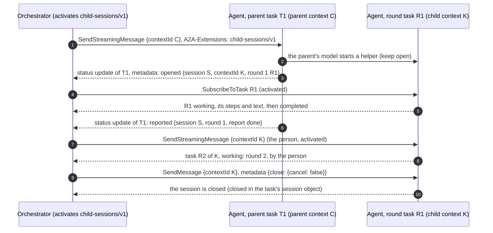
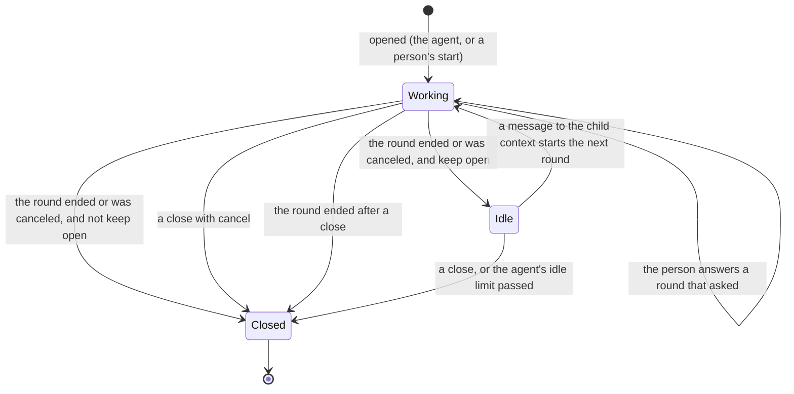

# A2A extension: child sessions (v1)

- **URI:** `https://agents.vymalo.com/a2a/extensions/child-sessions/v1`
- **Status:** **proposed (2026-11-18).** The feature is the owner's decision of 2026-11-14 (adam-rs
  [ADR 0045](https://github.com/vymalo/another-adam-rs/blob/main/docs/decisions/0045-a-subagent-can-run-in-the-background-as-a-session.md),
  decision 11, which puts this contract here); the shape of this page is proposed with
  [ADR 0072](../decisions/0072-child-sessions-are-nested-threads-followed-through-child-sessions-v1.md). **Built:** on the agent's side, adam-rs ADR 0045 slice 6 (adam-rs #173 and #174, merged); on the orchestrator's, the reading of the card (S1), its agent side, activation and the strict read of what an agent says (S2c), and the threads for sessions: a child thread for each session, the parent's three events and the rounds followed without sending anything (S2d; the AG-UI projection is S2e, the scenario on mocks S2f, a person's messages S3 and the web S4). Neither half has run against the other.
- **Decided in:** [ADR 0072](../decisions/0072-child-sessions-are-nested-threads-followed-through-child-sessions-v1.md); the
  optional-extension pattern is [ADR 0008](../decisions/0008-platform-integration-via-a2a-extension.md).
- **Defined by:** this system. **Served by:** agents that run their helpers as sessions (adam-rs agents with subagents). **Used
  by:** the orchestrator, for the person.

## Purpose

An agent starts a helper, keeps working while it runs, reads its report and sends it more messages. The helper is a **session**:
a conversation of its own, held open between messages when it was started "keep open". Without this extension a client sees the
helper only as a step of the parent's task. With it, a client learns that the session exists, follows each of its rounds as an
ordinary A2A task, talks to it, stops a round, closes it, and starts one itself, so that the person can open the helper as a
thread of its own.

An agent whose card does not list the extension is unchanged, and so is a client that does not activate it.

## Words

| Word | Meaning |
|---|---|
| **parent context** | The A2A context of the conversation that owns the sessions (a thread's context, [ADR 0055](../decisions/0055-the-agent-assigns-the-a2a-context.md)). |
| **session** | A helper's conversation. Its id is opaque. It lives in the parent context, not in one of its tasks, so a later task of the parent context still has it. |
| **child context** | The A2A context of a session. The agent assigns it; a client never builds one and treats it as opaque. An agent may reserve a shape for it (adam-rs: `<parent context, escaped>/s/<session>`) and refuse a root message whose context has that shape. |
| **round** | One task of the child context: the helper working on one message. Round 1 is the start; a message to an idle session starts the next. |
| **keep open** | Chosen when the session starts. `false` (the default, "close when done"): the session closes when its round ends. `true`: it goes idle after each round. |

## The flow



A session, as a client sees it:



## 1. The card

```json
{"uri": "https://agents.vymalo.com/a2a/extensions/child-sessions/v1",
 "description": "Runs its helpers as sessions a client can open, talk to and close.",
 "required": false,
 "params": {
   "agents": [
     {"name": "planner", "description": "Breaks a request into steps."},
     {"name": "researcher", "description": "Looks things up on the web."}
   ],
   "maxOpen": 16
 }}
```

| Member | Meaning |
|---|---|
| `agents` | The helpers a session can be started with, by name, each once, at least one. `name` is a string that is not blank; `description` a string, shown to the person (untrusted, as all card text). |
| `maxOpen` | The most sessions that may be open (working or idle) in one parent context: a whole number from 1 to 256 (a whole double such as `16.0` counts, as SDKs hand numbers back as doubles). The bound is the most sessions a parent thread notes in its life (a closed session keeps its note), so an offer above it, `257` or more, is an offer the orchestrator cannot honour and counts as no offer: a card that lists it is a card that does not list the extension. |

The orchestrator reads the card on **every send** (never cached, ADR 0008) and uses the extension only when the URI is listed
exactly **and** `params` is well formed as above; unknown members are ignored. A card that lists it with bad `params`, a `maxOpen` above 256 included, is a card
that does not list it.

## 2. Activation

A client activates the extension by naming the URI in the `A2A-Extensions` header and, on a message, in `message.extensions`:

- on a message to the **parent context**, so that the parent's task reports its sessions ([section 3](#3-what-the-parent-task-says))
  and so that the person may be asked by a kept-open helper (adam-rs ADR 0045 decision 9: only a client that shows the sessions
  can answer for one);
- on `GetTask`, `SubscribeToTask` and `ListTasks {contextId}` of a **parent task**, so that the tasks it returns carry the sessions
  object;
- on **every request about a child context**: a message to it, and `GetTask`, `ListTasks`, `SubscribeToTask` and `CancelTask` of
  one of its rounds.

**Without activation**, the agent emits none of section 3 and puts none of it on a parent task, a helper is an ordinary step of the parent ([`steps-v1.md`](steps-v1.md)),
and a request that names a child context or a round is refused with `InvalidParams` (`-32602`), before anything is written. Plain
`ListTasks` with no `contextId` lists root tasks only, activated or not.

## 3. What the parent task says

### Events

While a parent task runs, each change of one of its sessions is a `TaskStatusUpdateEvent` of that task whose `metadata` holds,
under the URI, one **event**:

```json
"metadata": {"https://agents.vymalo.com/a2a/extensions/child-sessions/v1": {
  "event": "opened",
  "session": "01936f1c-7a2e-7000-8000-00000000004b",
  "contextId": "ctx-k-01936f1c",
  "agent": "planner",
  "description": "Plan the migration",
  "keepOpen": true,
  "by": "agent",
  "round": {"number": 1, "taskId": "01936f1c-7a2e-7000-8000-00000000004b", "state": "TASK_STATE_WORKING"}
}}
```

| `event` | When | Also carries |
|---|---|---|
| `opened` | A session was started, by the parent's model or by a person ([section 4](#4-a-person-starts-a-session)). | `round` (round 1) |
| `round` | A round other than the first started (a message to an idle session, by the model or a person). | `round` |
| `reported` | A round ended. | `round` (its final state), `report`: `done`, `failed`, `canceled` or `blocked` (a round waiting for the person, `input-required`) |
| `closed` | The session closed: not kept open and its round ended, a close, or the agent's idle limit. | nothing more |

Every event carries `session`, `contextId`, `agent`, `description`, `keepOpen` and `by` (`agent` or `person`: who acted).
`round.state` is the round task's A2A state, spelled as the A2A JSON spells it (`TASK_STATE_WORKING`, `TASK_STATE_COMPLETED`, `TASK_STATE_INPUT_REQUIRED`, ...), and `null` when the agent could not read it; the orchestrator also reads the plain word (`completed`). An event carries **no report text**: the text is the round's own task, which the
client reads in the child context. Events of one session come in the order above; events of different sessions interleave.

An event is a latency optimisation: a client that missed one (a stream that broke) learns the same from the task's sessions object
below, which every `Task` the agent returns carries.

### The sessions object

Every `Task` of the parent context that the agent returns to an activated request (the answer to `SendMessage`, the first event of
a stream, `GetTask`, each task of `ListTasks {contextId}`; a stream's later events are status updates and carry the events above)
carries under the URI in `Task.metadata` the sessions of the **parent context**, open first, then the 16 most recently
closed (a fixed 16):

```json
"metadata": {"https://agents.vymalo.com/a2a/extensions/child-sessions/v1": {
  "sessions": [
    {"session": "01936f1c-…-04b", "contextId": "…", "agent": "planner", "description": "Plan the migration",
     "keepOpen": true, "state": "idle", "round": {"number": 2, "taskId": "…", "state": "TASK_STATE_COMPLETED"}}
  ]
}}
```

`state` is `working`, `idle` or `closed` (a round waiting for the person is `working`, its `round.state` `input-required`). This
object, read again, is the truth; the events only say when to read it. A session also says its own state on each of its rounds
([section 5](#5-talking-to-a-session)), so a client that follows a round needs no parent task to learn that it ended or that the
session closed.

## 4. A person starts a session

A message to the **parent context**, with no `taskId`, activated, whose `metadata` holds under the URI a `start`:

```json
{"message": {
  "role": "user",
  "messageId": "msg-…-031",
  "contextId": "ctx-parent",
  "parts": [{"text": "List every place that writes the session header."}],
  "metadata": {"https://agents.vymalo.com/a2a/extensions/child-sessions/v1": {
    "start": {"agent": "planner", "description": "Find the writers", "keepOpen": true}
  }},
  "extensions": ["https://agents.vymalo.com/a2a/extensions/child-sessions/v1"]
}}
```

- `agent` is one of the card's `agents`; `description` is at most 80 characters; `keepOpen` defaults to `false`.
- The message's text is round 1's prompt. **It is not a turn of the parent**: the parent's model does not read it, and no parent task
  starts.
- The answer is **round 1's task**, in the new child context (its `contextId` is the session's; the client adopts it, as
  [ADR 0055](../decisions/0055-the-agent-assigns-the-a2a-context.md) has a thread adopt its context). If a parent task is running, it
  also reports `opened` with `by: "person"`; if none runs, the round's own task is where the client follows the session (section 5).
  When the round ends, the parent agent learns its report, marked as the person's, at its
  next step, now or in its next task (adam-rs ADR 0045 decisions 3 and 7).
- Refused with an A2A error, nothing started: an unknown agent, a description too long, `maxOpen` sessions already open, or a
  `start` that is not an object of those members.

## 5. Talking to a session

A message to the **child context**, activated, is the person's words to the helper, as trusted as a message to the parent:

| The session is | A message with no `taskId` | A message naming the open round's `taskId` |
|---|---|---|
| `idle` | starts the next round; the answer is the new round's task | refused: that round is over |
| `working` | delivered into the open round, read at its next step (adam-rs ADR 0045 decision 1, as a message to a busy root context is); the answer is that round's task | a steer, under [`steer/v1`](steer-v1.md): when the card lists it and the request activates it; refused otherwise |
| `working`, its round `input-required` (the helper asked) | answers the round, as plain A2A answers a task | answers the round |
| `closed`, or idle past the agent's limit | refused: a closed session is never reopened | refused |

Every task of a child context carries under the URI in `Task.metadata` the session it belongs to:
`{session, parentContextId, agent, description, keepOpen, round, by, state, closing}`: `round` its number, `by` who started it,
`state` the session's state now (`working`, `idle` or `closed`, as in the sessions object) and `closing` whether a close waits for
the round to end. An activated stream of a round also carries this object on the status update that ends the round and on the
one where `closing` turns true. A round is an
ordinary A2A task: it streams its steps, text and usage as the parent does, and `GetTask`, `SubscribeToTask` and `ListTasks
{contextId}` read it. **`CancelTask` of a working round** stops it: a kept-open session goes idle, another closes.

A round the person starts runs under the access tier their message names ([`access-tier-v1.md`](access-tier-v1.md)), capped by
the helper's own rules; a round the parent's model starts runs under the parent's.

## 6. Closing a session

A message to the child context, activated, whose `metadata` holds under the URI a `close` (its parts are not read; a client sends
one text part, such as "close"):

```json
"metadata": {"https://agents.vymalo.com/a2a/extensions/child-sessions/v1": {"close": {"cancel": false}}}
```

- An idle session closes at once, by a task of its own in the child context (it calls no model and is reported only as `closed`).
  A working one closes when its round ends; with `"cancel": true` its round is canceled first.
- The answer is a task of the child context whose session says `closed` (it was idle) or the working round with `closing: true`.
  The parent task, if one runs, reports `closed` when it closes.
- A closed session is closed for the parent's model too: its next `subagent_send` is an error result.
- A `close` that names a `taskId`, or that is sent to a parent context, is `InvalidParams`.

**Also:** a `start` without a `contextId` starts a new parent context; unknown members of `start` and `close` are ignored; the
card's commands are not expanded in a child context (they are the parent agent's); `ListTasks {contextId}` of an unknown child
context, or another caller's, is an empty page, as for an unknown context.

## 7. Refusals

A refusal is an A2A error response; nothing is started or written.

| Situation | Error |
|---|---|
| A child context or round, not activated | `InvalidParams` |
| A `start` naming an unknown agent, a description over 80 characters, a malformed `start` or `close` | `InvalidParams` |
| A child context of another caller, or one that does not exist | `InvalidParams` for a message, `TaskNotFoundError` for a task |
| `maxOpen` sessions open | `UnsupportedOperationError` |
| A message to a closed session (or one idle past the agent's limit) | `UnsupportedOperationError`, as for a terminal task |
| A message naming a round that is over | `UnsupportedOperationError`, as for a terminal task |

## 8. What the orchestrator does

[ADR 0072](../decisions/0072-child-sessions-are-nested-threads-followed-through-child-sessions-v1.md) in full; in short:

- It activates the extension on every message to an agent whose live card lists it well formed, and the capabilities document says
  so: `custom[<URI>] = {agents, maxOpen}` ([`agui.md`](agui.md#capabilities-document)).
- On `opened`, on a session it finds in a sessions object, or on the answer to a person's `start`, it makes a **child thread** under the parent, bound to the child
  context the event names, and follows each round as an observed job: the round's steps, text and usage go to the child thread's
  log only.
- The parent's log records the session's opening, reports and closing; a fork of the parent does not take its sessions.
- The person's messages in a child thread are sent to the child context; Stop is `CancelTask` of the round; "Close" is section 6.

## 9. Security

- **The caller.** A child context belongs to the caller of its parent context, as the parent does: a request from another caller
  is refused as for an unknown context.
- **The words.** `description`, the card's `agents` and every event are the agent's text: untrusted, drawn as text, never an
  instruction. A report reaches the parent's model as data the agent's own loop appends, never as the person's words.
- **Asking.** A helper may ask the person only in a kept-open session whose parent context activated this extension, so that a
  client shows the question (adam-rs ADR 0045 decision 9). The round is then `input-required`, the parent's report `blocked`, and
  the person answers in the child context as plain A2A answers a task.
- **Tier.** A round never runs above what the message that started it may: the parent's tier for the model's rounds, the person's
  for theirs, each capped by the helper's own rules.

## Conformance

What a build of an agent that lists the extension is tested for: a card with the params; an activated parent reports `opened`,
`reported` and `closed` for a session its model starts, and its tasks carry the sessions object; a person's `start` answers with
round 1 in a new child context and reports `opened` by the person; a message to an idle session starts round 2, which continues
round 1's conversation; a message to a working session is delivered into its round, and one naming the round is a steer only under
`steer/v1`; a round that fails, asks (`blocked`) or is canceled is reported so; `CancelTask` of a round makes a kept-open session
idle; a close closes it and a later message is refused; without activation a child context is `InvalidParams` and the parent's
task carries nothing of this page. The orchestrator's side is tested on the fake agent's word `child-sessions` and, from S2, on a
WireMock agent.

## Verified and unverified (2026-11-18)

- *Verified 2026-11-18* by reading adam-rs at `351072b`: a session is a chain of child runs whose conversation is the parent's, escaped,
  with `/s/<session>` appended (`crates/adam-runtime/src/session.rs`; `Runtime::start_child_continuing` in `runtime.rs`), the session id is round 1's run
  id, `SessionState` is `Working`, `Idle` or `Closed` (`session.rs`), and the five session tools exist (`crates/adam-llm-agent/src/sessions.rs`);
  the A2A front encodes a context as `<subject>:<contextId>` (`crates/adam-a2a-runtime/src/convert.rs`, `encode_conversation`).
- *Verified* (as [`steer-v1.md`](steer-v1.md) and [`usage-v1.md`](usage-v1.md) say): `TaskStatusUpdateEvent` and `Task` each carry
  an optional `metadata` map, and extensions are activated by the `A2A-Extensions` header and `message.extensions`.
- *Unverified:* everything an agent does under this page against a real agent: adam's half is built (adam-rs #173 and #174, merged), and nothing here has run against it; the orchestrator's side is proven on the fake agent only.
- *Verified 2026-11-18* by reading adam-rs after its child-sessions slice merged (adam-rs #173): adam writes `round.state` with the protobuf JSON names (`TASK_STATE_COMPLETED`, and `null` when it cannot read the state), not the plain words (`crates/adam-a2a-runtime/src/child_sessions.rs`, `a2a_state_word`; `crates/adam-a2a/src/push/cursor.rs`). The examples above use that spelling; the orchestrator's reader accepts both.
- *Built (S2c):* the orchestrator's agent side: activation on a send, a resubscribe, a `GetTask` and a `CancelTask` only for a card that offers the extension well formed, a strict bounded read of the sessions object, the events and a round's own object, and a poll of the parent task every 5 seconds while it runs (the events are a latency optimisation, so until an agent sends them, a poll is how a session is learned). Proven against the fake agent only; a real agent is unverified.
- *Built (S2c, fix round):* the orchestrator activates the extension on a steer too (every request about a child context), on `ListTasks`, `GetTask`, `CancelTask`, a send and a resubscribe, each only for a card read for that very call that lists it well formed; what an agent says of sessions to a call that did not activate it is dropped, and a stream whose agent sends events is not polled (the read before its ending status still runs). A `reported` event's `report` word (`done`, `failed`, `canceled`, `blocked`) is read when `round.state` is `null`.
- *Built (S2c, fix round):* the orchestrator refuses a whole `sessions` object or event that breaks a bound: a session id, context id or helper name that is blank or holds a control or format character, a context id that two sessions share or that is the parent's own, a round whose `parentContextId` is its own context, or a description is cleaned instead (each such character becomes a space) and cut to 256 characters.
