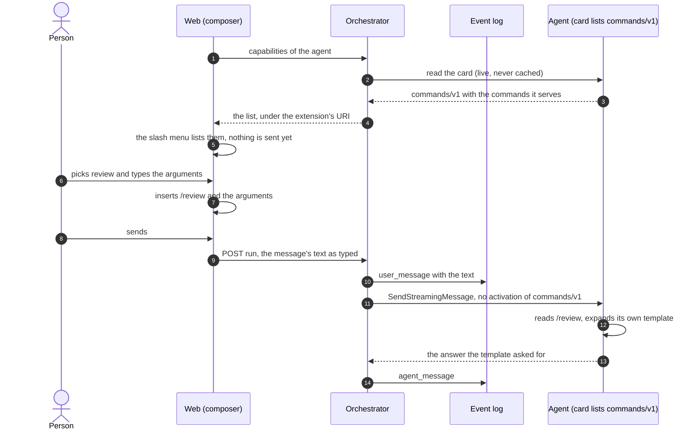
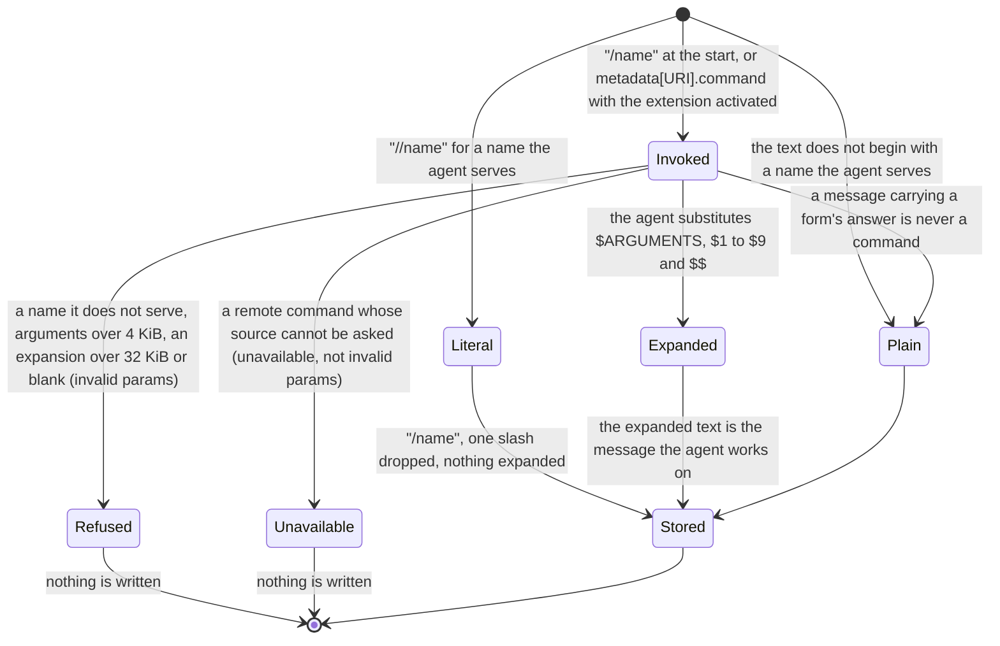

# A2A extension: commands (v1)

- **URI:** `https://agents.vymalo.com/a2a/extensions/commands/v1`
- **Status:** **proposed (2026-11-19).** The feature is the owner's decision of 2026-11-14 (adam-rs
  [ADR 0044](https://github.com/vymalo/another-adam-rs/blob/main/docs/decisions/0044-paged-tools-a-stable-prompt-prefix-a-plan-skills-commands-and-project-context.md), decision 9, which puts this contract here);
  the shape of this page is proposed with [ADR 0079](../decisions/0079-an-agents-own-commands-listed-from-its-card.md).
  **Built:** on the agent's side, adam-rs — the card entry
  (`crates/adam-a2a/src/extensions.rs`, `COMMANDS_EXTENSION`, `CommandInfo`, `ExtensionConfig::commands`) and the invocation
  and expansion (`crates/adam-a2a-runtime/src/commands.rs`); on the orchestrator's, the reading of the card into a typed
  offer and the AG-UI capabilities document (slice 11 of [ADR 0067](../decisions/0067-the-plan-to-librechat-grade-and-the-client-agnostic-rule.md),
  2026-11-19); the web's `/` menu is the next slice and is not built. Neither half has run against the other: nothing here was
  proved against a live agent.
- **Decided in:** [ADR 0079](../decisions/0079-an-agents-own-commands-listed-from-its-card.md), and adam-rs
  [ADR 0044](https://github.com/vymalo/another-adam-rs/blob/main/docs/decisions/0044-paged-tools-a-stable-prompt-prefix-a-plan-skills-commands-and-project-context.md) decision 9; the optional-extension pattern is
  [ADR 0008](../decisions/0008-platform-integration-via-a2a-extension.md).
- **Defined by:** this system. **Served by:** agents that hold prompt templates of their own (adam-rs agents, from their
  `commands/` folder). **Used by:** the orchestrator, to list them to the web; the web, to draw a `/` menu and insert the text.

## Purpose

An agent knows how it wants to be asked for some things: review a change, explain a file, run the tests. Those are its own
prompt templates, and a person should be able to pick one instead of remembering its wording. The extension is how the agent
says which ones it serves, and how a message invokes one.

It is deliberately small. The card lists names, descriptions and hints. A message invokes a command **as text** — `/<name>`
and the arguments — and the agent expands the template where the message arrives. Nothing is negotiated per message, nothing is
stored, and a client that does not know the extension talks to the agent exactly as before: a `/`-prefixed word it did not
offer is plain text.

An agent whose card does not list the extension is unchanged, and so is a client that never reads the card.

## Who does what

| Part | Does |
|---|---|
| **Agent** | Lists the extension with the commands it serves, sorted by name, each with a description and an optional argument hint. Reads `/<name>` at the start of a message (or the metadata form, when the request activated the extension), expands its own template, and refuses a name it does not serve or an expansion that does not fit. Says nothing about it in the answer beyond what the template says. |
| **Orchestrator** | Reads the card live and carries the offer in the AG-UI capabilities document, so the web can draw its menu before anything is sent. **Sends nothing for this extension**: no activation, no metadata, no expansion. The command is the person's text, which it logs and sends like any other message. |
| **Web** | Draws a `/` menu from the capabilities document when, and only when, the agent's card lists the extension with well-formed params. Inserts the text a person picks into the composer. Sends it as the message's text, as typed. |

## The flow



One message, as the agent reads it:



## 1. The card

The agent lists the extension in `capabilities.extensions`:

```json
{"uri": "https://agents.vymalo.com/a2a/extensions/commands/v1",
 "description": "Serves prompt templates a message can invoke by name.",
 "required": false,
 "params": {"commands": [
   {"name": "explain", "description": "Explains a file."},
   {"name": "review", "description": "Reviews a change.", "argumentHint": "<repo>"}
 ]}}
```

| Param | Meaning |
|---|---|
| `commands` | Required. A non-empty array of commands, each an object with `name`, `description` and an optional `argumentHint`. |
| `commands[].name` | Required. The word a message invokes: not empty, without whitespace, and never starting with the `/` that invokes it. `[a-z0-9_-]` is adam's own shape; the contract does not fix an alphabet beyond those rules. |
| `commands[].description` | Required. A string that is not blank: what the command does, for the person to read (untrusted card text, drawn as text). |
| `commands[].argumentHint` | Optional. A string shown after the name in the composer, so a person knows what to type (`<repo>`, a sentence). Absent when the command takes nothing. |

`required` stays `false`: a client that does not know the extension must still be able to talk to the agent.

The list is **sorted by name, each name once**. A card that lists them out of order, or a name twice, is still read: a client
sorts and keeps the **first** entry of a name. Unknown members of the entry and of the params are ignored.

The orchestrator reads the card on **every request for the capabilities document** (never cached, ADR 0008) and fails closed: the
extension is used when the URI is listed exactly (no other version, no trailing slash, no other case) **and** `params` are
well-formed as above. A card with bad `params` — no `commands`, an empty array, an entry that is not an object, a missing or
empty `name` or `description`, a name with whitespace or a leading `/`, an `argumentHint` that is not a string — is a card that
does not list it. The capabilities document then carries no key at all
([`agui.md`](agui.md#capabilities-document)), so the web draws no menu; it never guesses.

## 2. Activation

The extension is activated by naming its URI in the `A2A-Extensions` request header and, on a message, in
`message.extensions`, as for any extension (ADR 0008).

**The text form needs no activation.** A message whose text begins with `/<name>` for a name the agent serves is the invocation
whether or not the extension is activated, because the text is the person's own and is sent as it stands. That is why the
orchestrator activates nothing: it does not read the text as a command, so it has nothing to announce.

Activation buys the **metadata form** ([section 3](#3-the-invocation)) and nothing else: a request that did not activate the
extension has its `metadata[<uri>]` ignored, so a client cannot name a command without having said it understands one.

## 3. The invocation

A message invokes a command in one of two ways.

**The text form** — any message, activated or not:

| The text | The agent reads |
|---|---|
| `/review acme/widgets` | `review` with the arguments `acme/widgets` (the rest of the text, trimmed). |
| `/review` | `review` with no arguments. |
| `/review\nacme/widgets` | the same as the first line: the name ends at whitespace, the rest is the arguments, trimmed. |
| `/tmp is full` | plain text: `tmp` is not a command the agent serves, so nothing is invoked. |
| `//review` | the literal text `/review`: one slash is dropped and nothing is expanded. This is how a person writes a command's name without invoking it. |
| `please /review it` | plain text: the name is only read at the **start** of the message. |

A `/word` that is not a served name is plain text and reaches the agent as it was written. Only `//name`, for a **served**
name, is the literal escape; `//word` for anything else is plain text too.

**The metadata form** — only when the request activated the extension:

```json
{"message": {
  "role": "user",
  "messageId": "msg-01936f1c-7a2e-7000-8000-00000000004b",
  "contextId": "01936f1c-3b00-7000-8000-000000000001",
  "parts": [{"text": "acme/widgets"}],
  "extensions": ["https://agents.vymalo.com/a2a/extensions/commands/v1"],
  "metadata": {"https://agents.vymalo.com/a2a/extensions/commands/v1": {"command": "review", "arguments": "acme/widgets"}}
}}
```

| Member | Meaning |
|---|---|
| `command` | Required. A name the agent serves, matched exactly. Unknown members are ignored. |
| `arguments` | Optional. The argument text, as the person typed it. Absent or `null`: none. Not a string: refused. |

**A name the agent does not serve is refused** with an A2A `invalid params` error before anything is written, in both forms when
the message carries the metadata member. A `/word` in the text that is not served is not a refusal: it is plain text.

**A message that carries a form's answer is never a command.** An A2UI `action` part is a person's click on a form, and its text
is not read as `/name`; a metadata command beside it is `invalid params`. So a value a person typed into a form can never become
an invocation by accident.

The two forms expand the same template. **The metadata member wins**: a message that carries it is that command, whatever its
text begins with. A client uses one form; the orchestrator uses the text form only ([section 5](#5-the-orchestrator)).

## 4. The expansion

The agent substitutes into its own template, **once**, and never reads what it substituted again. Nothing is executed and nothing
is fetched (except a remote command's text, below).

| In the template | Becomes |
|---|---|
| `$ARGUMENTS` | the argument text, trimmed: what followed the name, not split. |
| `$1` … `$9` | the arguments split on whitespace, with double quotes respected: `"a b"` is one argument, the quotes are dropped, `""` is an empty argument, and a quote left open runs to the end. A missing argument is empty. A digit after the number is literal, so `$10` is `$1` followed by `0`. |
| `$$` | one literal `$`, so `$$1` is the text `$1`. |
| any other `$` | literal. |

Bounds, refused as `invalid params`:

| Bound | Value |
|---|---|
| the arguments | at most 4 KiB (4096 bytes, after trimming) |
| the expansion | at most 32 KiB (32768 bytes) |
| an expansion | never blank: a template that expands to no text is refused ("it needs arguments") |

Every line of the result that begins as a form's answer is marked `(typed)`, a template's own line included, so an argument can
never pass for a person's click on a form.

**Where it happens.** In the request, right after the agent reads the inbound message: the **expanded text** is what the agent
works on and what it stores as the message, with the invocation kept beside it. So a replay never expands again, and editing the
agent's folder later changes no old run.

**Remote commands.** A command's text may be asked of another party when the message arrives (an MCP server's prompt, say). The
party receives the argument text as typed, trimmed, and maps it itself; what it answers goes through the same size checks and the
`(typed)` marking. A party that cannot be asked is `unavailable`, not `invalid params`: asking later may work.

## 5. The orchestrator

The orchestrator's whole part is the card read and the capabilities document. It:

- reads the card on every `GET /agui/agents/{agentId}/capabilities`, never caches it, and matches the URI exactly
  (ADR 0008);
- puts `custom["https://agents.vymalo.com/a2a/extensions/commands/v1"] = {commands: [{name, description, argumentHint?}]}` in
  the document while the card lists the extension with well-formed params, and **no key** when it lists none, or lists it badly;
- **never sends a command**: no `A2A-Extensions` header for this URI, no metadata member, no expansion. The message the person
  wrote — `/review acme/widgets` — is logged and sent as it is, so the log and an export show the invocation, not the text the
  agent made of it;
- makes no decision about a command: it is not a permission, not a tier and not a tool. A command that the agent's own tools
  cannot carry out fails inside the task, like any other request.

The offer is per agent and read live: an agent redeployed with different commands shows the new list on the next request for its
capabilities, and the web redraws its menu from that. Nothing of the list is stored in a thread.

## 6. The web

The web draws a `/` menu in the composer, and only when the selected agent's capabilities document has `custom[<uri>]`. Its rules:

- It lists the commands in the order the document gives (sorted by name), each with its description, and its `argumentHint`
  beside the name when it has one.
- Picking one **inserts text**: `/name ` with a trailing space when the command takes arguments, `/name` when it does not. The
  person may then type the arguments, edit the text, or send it as it stands.
- **Nothing is sent as metadata today.** The inserted text is the message, and the text form is what invokes the command. A client
  that activates the extension and sends the metadata form is welcome to, but the web does not.
- It draws no menu for an agent that lists no command, or lists it badly: no disabled control, no placeholder.
- It stores nothing: the list is the live document's, and the composer's text is the person's.

## 7. Security

- **A name is not a boundary.** A command is a prompt template of the agent's; invoking one gives the person nothing their
  message would not. The agent's tools, its credentials, its access tier ([`access-tier-v1.md`](access-tier-v1.md)) and the
  deployment's limits apply to what the expansion asks for, exactly as to any other message.
- **The arguments are the person's words.** They are not instructions from the card, from another agent or from a tool result:
  what the template does with them is the agent's, and the orchestrator cannot see inside a task.
- **Card text is untrusted.** A name, a description and a hint are drawn as text and are never read as an instruction. A
  description is not a command.
- **The expansion happens on the agent.** The orchestrator logs what the person sent, not what the agent made of it, so an
  export shows the invocation. A command cannot raise a tier, reach a tool the person's role forbids, or speak for a form.

## What this does not do

- **No core event and no message field.** A command is the message's text; the core, the event log and the outbox know nothing of
  it. Nothing is added to `user_message`, and an export shows `/name <arguments>`.
- **No per-message choice and no setting.** There is no chip, no thread setting and no default command: the invocation is in the
  text, made again each time.
- **No new route and no server-side list.** The offer is the agent's card, relayed in the capabilities document; the orchestrator
  has no command of its own and expands none.
- **No menu of the person's prompts here.** The prompt library ([`prompts-v1.md`](prompts-v1.md)) is the person's, stored by the
  orchestrator; the one `/` menu that mixes both is a later slice (P3 of [ADR 0067](../decisions/0067-the-plan-to-librechat-grade-and-the-client-agnostic-rule.md)).
- **No remote commands in this contract's client half.** An agent may serve one by asking an MCP server; a client sees it as any
  other command, and the orchestrator is not told.

## Conformance

What a build is tested for (the orchestrator's tests are named; adam's own are its crate's):

- **The core** (`orch-core`, `src/commands.rs`): `well_formed_params_are_an_offer_sorted_by_name` (sorted, a hint only where the
  card has one, a name matched exactly); `it_serialises_as_the_capabilities_document_has_it` (`{commands: [...]}`);
  `a_name_listed_twice_keeps_its_first_entry_and_the_list_is_sorted`; `an_argument_hint_that_is_null_is_no_hint`;
  `params_that_are_not_well_formed_offer_nothing` (the malformed table: `null`, not an object, no `commands`, an empty list, an
  entry that is not an object, a missing, empty or non-string `name`, a name with a space, a name starting with `/`, a missing,
  empty or blank `description`, a non-string `argumentHint`); `a_listing_gives_the_offer_only_when_the_card_has_one`.
- **The A2A adapter** (`orch-agent-a2a`, `src/commands.rs`): `the_offer_is_read_from_the_exact_uri_with_well_formed_params`;
  `a_card_that_does_not_list_the_exact_uri_lists_nothing` (`commands/v2`, a trailing slash, `Commands/v1`, `command/v1`);
  `a_card_that_lists_it_badly_is_told_apart_from_one_that_does_not`; `a_card_that_carries_the_real_adam_shape_is_an_offer`.
- **The capabilities document** (`orch-agui-projection/tests/capabilities.rs`):
  `a_card_that_lists_commands_declares_them_sorted_under_the_uri`; and
  `a_card_that_lists_no_commands_or_an_unreadable_one_has_no_key_for_it`, which is also what keeps the e2e goldens
  (`docs/api/examples/agui/capabilities-*.json`, whose fake card lists no command) unchanged.
- **The agent side** (adam-rs): `card_lists_commands_sorted` and `a_card_without_commands_does_not_list_the_extension`
  (`crates/adam-a2a/src/extensions.rs`), and `crates/adam-a2a-runtime`'s command tests for the invocation, the `//name` literal,
  a form's answer never being a command, the `$` expansion with its bounds, and a remote command that cannot be asked.

## Verified and unverified (2026-11-19)

- *Verified 2026-11-19* by reading adam-rs at `main` (`vymalo/another-adam-rs`):
  `crates/adam-a2a/src/extensions.rs` holds `COMMANDS_EXTENSION`, `CommandInfo { name, description, argument_hint }`, and
  `ExtensionConfig::commands(&[CommandInfo]) -> Option<Self>`, which sorts by name, writes `argumentHint` only when the command has
  one, sets `required: false`, and returns `None` for an empty list (an agent without commands does not list the extension);
  `crates/adam-a2a-runtime/src/commands.rs` holds the invocation and expansion rules of sections 3 and 4 — the text form and its
  `//name` escape, the metadata form, the form-answer refusal, `$ARGUMENTS`, `$1`–`$9` with double quotes, `$$`, one pass,
  `MAX_COMMAND_ARGUMENTS` = 4 KiB and `MAX_COMMAND_EXPANSION` = 32 KiB, the `(typed)` marking, and remote commands that answer
  `unavailable` when their source cannot be asked.
- *Verified* (as [`access-tier-v1.md`](access-tier-v1.md) records and not re-read for this page): extensions are declared in the
  card's `capabilities.extensions` as objects with `uri`, `description`, `required` and optional `params`; a client activates one
  with the `A2A-Extensions` header and `Message.extensions`; extension data goes in the `metadata` map.
- *Built (orchestrator, 2026-11-19):* the card read into `CommandsListing`/`CommandsOffer`, and the capabilities key; proved on
  the unit and document tests named above and on no live agent.
- *Unverified:* that a real adam agent, pinned and deployed, lists the commands this page describes and expands them as
  section 4 says — nothing in this repository has run against one. The A2A error a refused invocation answers is adam's own
  choice (`invalid params`; `unavailable` for a remote command) and is not read by the orchestrator, which sends no command.
- *Unverified:* the web's `/` menu, which is the next slice.
