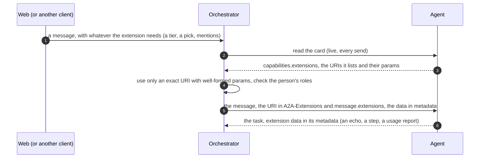
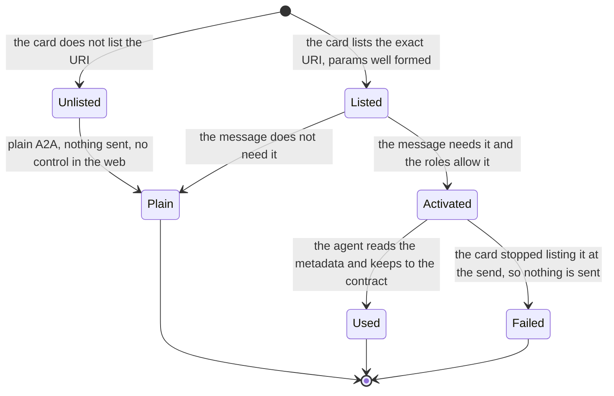

# A2A extensions: the index

Every A2A extension this system defines, in one table, and the rules they share. **Start here** to find out what an agent can list in its card and what the orchestrator then does for it. An agent that lists
none of them is a plain A2A agent and works, which is the point: kagent, or any other, is reached with none of these.

An extension is optional, capability-detected from the agent's live card, never cached, fail closed, and removable without breaking plain A2A
([ADR 0008](../decisions/0008-platform-integration-via-a2a-extension.md), invariant 2). Its URI is `https://agents.vymalo.com/a2a/extensions/<name>/v1`
(decided 2026-10-01); a breaking change is a `v2` URI and a new page, never an edit. The owner's own words for the next three on 2026-10-11:
"We should have more concepts like that [thread-tools/v1] too. E.g for the permission tier, the networking tier or even the raw model and OpenAI compatible server configuration."

## The table

"Defined by" is who writes the contract and serves what it needs; "used by" is who lists it in a card. Statuses are the pages' own: read the page before relying on one.

| Extension | URI suffix | Status | Defined by, served by | Used by | What it is for | Contract, decided in |
|---|---|---|---|---|---|---|
| **UI catalog** | `ui-catalog/v1` | accepted 2026-10-01; built (orchestrator, web) | the orchestrator | agents that draw forms and cards | Tells an agent which components the web can draw (the catalog and its digest), so it answers with surfaces the web accepts. | [`ui-catalog-v1.md`](ui-catalog-v1.md), [ADR 0023](../decisions/0023-ui-component-catalog-as-an-a2a-extension.md) |
| **Thread tools** | `thread-tools/v1` | accepted; built, `request_upload` proposed | the orchestrator (an MCP endpoint per thread) | adam agents | One MCP endpoint per thread, opened by a token: the UI catalog, the answer announcement, the servers a person attached (relayed), `ask_agent`. | [`thread-tools-v1.md`](thread-tools-v1.md), ADR 0023, [0024](../decisions/0024-mcp-tools-attached-per-conversation.md), [0026](../decisions/0026-agent-mentions-as-structured-references.md) |
| **Steps** | `steps/v1` | accepted 2026-10-01; built (orchestrator, web, adam-rs) | the orchestrator reads it | adam agents | An agent's tool calls and its sub-agents' work reported as a tree of steps, with bounded input and output. | [`steps-v1.md`](steps-v1.md), [ADR 0025](../decisions/0025-nested-steps-events-carry-their-source-path.md), [0030](../decisions/0030-a-step-carries-its-input-and-output-bounded-and-redacted.md) |
| **Mentions** | `mentions/v1` | accepted 2026-10-02; built | the orchestrator | agents that coordinate others | The agents a person mentioned, as structured references, so the addressed agent can ask them with `ask_agent`. | [`mentions-v1.md`](mentions-v1.md), ADR 0026 |
| **Steer** | `steer/v1` | accepted 2026-10-02; built (orchestrator, adam-rs) | the orchestrator | agents that can read a message while they work | A message sent to a running task, read at the agent's next step. | [`steer-v1.md`](steer-v1.md), [ADR 0036](../decisions/0036-sending-while-an-agent-works.md) |
| **Text stream** | `text-stream/v1` | accepted; built (orchestrator, web) | the orchestrator reads it | agents that stream their answer | An agent's reply as it is written (and its reasoning, marked), relayed live and logged once. | [`text-stream-v1.md`](text-stream-v1.md), [ADR 0027](../decisions/0027-live-text-relayed-not-stored.md), [0044](../decisions/0044-a-models-reasoning-is-shown-beside-the-answer-and-logged-once.md) |
| **Usage** | `usage/v1` | proposed 2026-10-08; built 2026-10-09 (orchestrator, web, adam-rs) | the orchestrator reads it | adam agents | The tokens of each model call and a task's totals, attributed to the agent and its sub-agents. | [`usage-v1.md`](usage-v1.md), [ADR 0056](../decisions/0056-token-usage-per-model-call.md) |
| **A2UI** (not ours) | `https://a2ui.org/a2a-extension/a2ui/v0.9.1` (v1.0 detected) | built | A2UI's own specification; the orchestrator relays it, the web draws it | agents that answer with generative UI | Declarative surfaces an agent sends and a person's gestures come back as actions. | [`agui.md`](agui.md#a2ui-generative-ui), [ADR 0013](../decisions/0013-a2ui-generative-ui.md) |
| **Access tier** | `access-tier/v1` | **proposed 2026-10-11; the orchestrator and the web are built against mocks, no live agent lists it yet** ([ADR 0061](../decisions/0061-the-person-picks-an-access-tier-for-each-message-the-agent-keeps-to-it.md)) | the orchestrator checks and sends it | agents that can work under a limit | What the agent may do on its own for one message, a word the person picks: `plan`, `edits`, `auto`, `bypass`. | [`access-tier-v1.md`](access-tier-v1.md) |
| **Uploads** | `uploads/v1` | accepted as a design 2026-10-11; **the orchestrator's side is built (6a, 2026-10-14) against mocks**: the tool, the card, the ingest, the S3 store's presigned `PUT`; downloads by redirect, the chart's files host, the web and adam-rs's client are not | the orchestrator (a thread tool, `request_upload`) and the bucket | agents that make large files | A presigned `PUT` for one file too large for the message, straight to the bucket, then a reference. | [`uploads-v1.md`](uploads-v1.md), [ADR 0058](../decisions/0058-large-files-go-up-through-a-presigned-url-the-orchestrator-gives-the-agent.md) |
| **Network tier** | `network-tier/v1` | proposed 2026-10-11; nothing built | the orchestrator checks and sends it | agents that run code or fetch | How much network what the agent runs may reach for one message: `offline`, `allow-list`, `open`. | [`network-tier-v1.md`](network-tier-v1.md), [ADR 0062](../decisions/0062-the-person-picks-a-network-tier-for-each-message-the-agent-keeps-to-it.md) |
| **Model relay** | `model-relay/v1` | proposed 2026-10-11; nothing built | the orchestrator (an OpenAI-compatible endpoint per thread) | agents that take their model from it | The agent's model calls go to the orchestrator, which forwards with its own key, records usage, enforces a budget and serves the person's pick. No model key in A2A. | [`model-relay-v1.md`](model-relay-v1.md), [ADR 0063](../decisions/0063-an-openai-compatible-model-endpoint-per-thread-on-the-orchestrator.md) |

The platform's `release-channels/v1` is another extension the orchestrator reads, and it is defined by another-agentic-platform (`docs/extensions/release-channels-v1.md` in that repository), not here. The agent
registry contract (`agent-registry/v1`) is not an A2A extension: it is a linkset the orchestrator reads ([ADR 0022](../decisions/0022-platform-provisions-agents-system-discovers-them.md)).

## How they all work

An extension that carries a choice of the person (the tiers, the model) is **never silently dropped**: when the card no longer honours it at the send, the job fails and nothing is sent.

## Writing one

A page in this directory, named `<name>-v1.md`, with: the URI, the status (with the date and whose words), where it was decided, who defines and who uses it; the purpose; who does what; a `sequenceDiagram` for the
interaction and a `stateDiagram-v2` for the lifecycle; the card; the activation; the message; what the orchestrator checks and what it only passes; the security notes; what the build changes; what a build is
tested for; and *verified* and *unverified* facts with their date and source. Add its row to the table above and to [`README.md`](README.md), decide it in an ADR (`write-adr`), and when an adam agent
supports it, that is said in adam-rs's skill `adam-a2a-extensions` (vendored here, updated through the skills CLI, never by hand).
