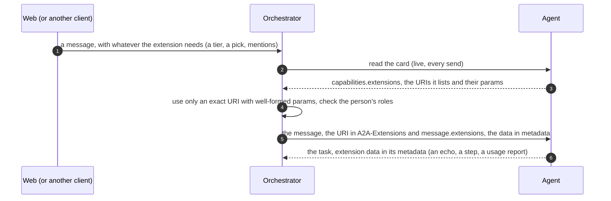
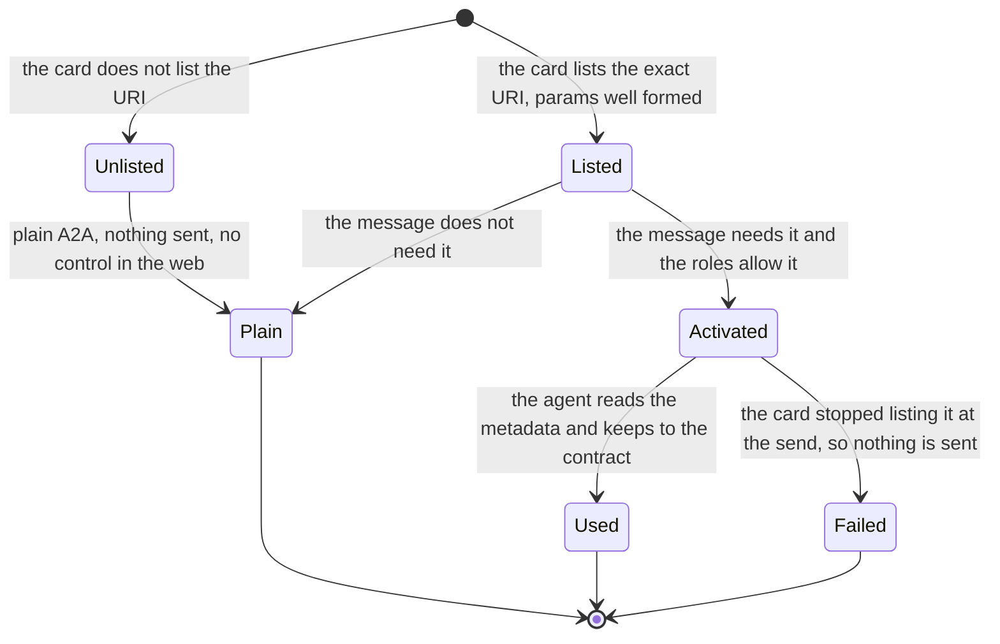

# A2A extensions: the index

Every A2A extension this system defines, in one table, and the rules they share. **Start here** to find out what an agent can list in its card and what the orchestrator then does for it. An agent that lists
none of them is a plain A2A agent and works, which is the point: kagent, or any other, is reached with none of these.

An extension is optional, capability-detected from the agent's live card, never cached, fail closed, and removable without breaking plain A2A
([ADR 0008](../decisions/0008-platform-integration-via-a2a-extension.md), invariant 2). Its URI is `https://agents.vymalo.com/a2a/extensions/<name>/v1`
(decided 2026-10-01); a breaking change is a `v2` URI and a new page, never an edit. The owner's own words for the next three on 2026-10-11:
"We should have more concepts like that [thread-tools/v1] too. E.g for the permission tier, the networking tier or even the raw model and OpenAI compatible server configuration."

## The table

"Defined by" is who writes the contract and serves what it needs; "used by" is who lists it in a card. Statuses are the pages' own: read the page before relying on one.

Each status starts with an icon and a word, as in [the legend](README.md#status-icons), and the text after it is unchanged. Here the three that carry a judgement mean:

- ✅ built: every side named is built, and a `dev/` scenario ran it against the pinned real agent image (a scripted model is fine);
- 🧪 experimental: every side is built, but the halves have met only mocks;
- ⚠️ partial: a side or part is missing.

🚧 planned is nothing built, or the orchestrator's side not yet wired (prompt statement: the orchestrator never activates the URI); ➖ retired is a contract that is no longer detected.

| Extension | URI suffix | Status | Defined by, served by | Used by | What it is for | Contract, decided in |
|---|---|---|---|---|---|---|
| **UI catalog** | `ui-catalog/v1` | ➖ retired · accepted 2026-10-01; built (orchestrator, web); **retired by `ui-catalog/v2` at the A2UI v1.0 cutover (2026-11-20)**, and no longer detected | the orchestrator | agents that draw forms and cards | Tells an agent which components the web can draw (the catalog and its digest), so it answers with surfaces the web accepts. | [`ui-catalog-v1.md`](ui-catalog-v1.md), [ADR 0023](../decisions/0023-ui-component-catalog-as-an-a2a-extension.md) |
| **UI catalog v2** | `ui-catalog/v2` | ✅ built · **built 2026-11-20** ([ADR 0075](../decisions/0075-a2ui-v1-0-cutover.md), epic [#380](https://github.com/vymalo/another-agentic-system/issues/380)); it replaces v1, which is no longer detected | the orchestrator | agents that speak A2UI v1.0 | v1 under A2UI v1.0: the document `{catalogId, protocolVersion: "1.0", components}`, the same `catalogId`, catalog version 9 onwards, a new digest vector. | [`ui-catalog-v2.md`](ui-catalog-v2.md), ADR 0075, ADR 0023 |
| **Thread tools** | `thread-tools/v1` | ⚠️ partial · accepted; built, `request_upload` proposed | the orchestrator (an MCP endpoint per thread) | adam agents | One MCP endpoint per thread, opened by a token: the UI catalog, the answer announcement, the servers a person attached (relayed), the person's own among them (ADR 0046), `ask_agent`. | [`thread-tools-v1.md`](thread-tools-v1.md), ADR 0023, [0024](../decisions/0024-mcp-tools-attached-per-conversation.md), [0026](../decisions/0026-agent-mentions-as-structured-references.md) |
| **Steps** | `steps/v1` | ✅ built · accepted 2026-10-01; built (orchestrator, web, adam-rs) | the orchestrator reads it | adam agents | An agent's tool calls and its sub-agents' work reported as a tree of steps, with bounded input and output. | [`steps-v1.md`](steps-v1.md), [ADR 0025](../decisions/0025-nested-steps-events-carry-their-source-path.md), [0030](../decisions/0030-a-step-carries-its-input-and-output-bounded-and-redacted.md) |
| **Mentions** | `mentions/v1` | ✅ built · accepted 2026-10-02; built | the orchestrator | agents that coordinate others | The agents a person mentioned, as structured references, so the addressed agent can ask them with `ask_agent`. | [`mentions-v1.md`](mentions-v1.md), ADR 0026 |
| **Steer** | `steer/v1` | ✅ built · accepted 2026-10-02; built (orchestrator, adam-rs) | the orchestrator | agents that can read a message while they work | A message sent to a running task, read at the agent's next step. | [`steer-v1.md`](steer-v1.md), [ADR 0036](../decisions/0036-sending-while-an-agent-works.md) |
| **Text stream** | `text-stream/v1` | ✅ built · accepted; built (orchestrator, web) | the orchestrator reads it | agents that stream their answer | An agent's reply as it is written (and its reasoning, marked), relayed live and logged once. | [`text-stream-v1.md`](text-stream-v1.md), [ADR 0027](../decisions/0027-live-text-relayed-not-stored.md), [0044](../decisions/0044-a-models-reasoning-is-shown-beside-the-answer-and-logged-once.md) |
| **Usage** | `usage/v1` | ✅ built · accepted 2026-10-08; built 2026-10-09 (orchestrator, web, adam-rs) | the orchestrator reads it | adam agents | The tokens of each model call and a task's totals, attributed to the agent and its sub-agents. | [`usage-v1.md`](usage-v1.md), [ADR 0056](../decisions/0056-token-usage-per-model-call.md) |
| **A2UI** (not ours) | `https://a2ui.org/a2a-extension/a2ui/v1.0` | ✅ built · built; **v1.0 only**, the hard cutover of [ADR 0075](../decisions/0075-a2ui-v1-0-cutover.md) (built 2026-11-20; its card entry, capabilities and actions are in [`ui-catalog-v2.md`](ui-catalog-v2.md#5-to-the-agent-the-extension)); `…/a2ui/v0.9.1` is not detected | A2UI's own specification; the orchestrator relays it, the web draws it | agents that answer with generative UI | Declarative surfaces an agent sends and a person's gestures come back as actions. | [`agui.md`](agui.md#a2ui-generative-ui), [ADR 0013](../decisions/0013-a2ui-generative-ui.md) |
| **Access tier** | `access-tier/v1` | 🧪 experimental · **proposed 2026-10-11; the orchestrator and the web are built (proven on mocks, `dev/tier-e2e.sh` against `mock-tiered`) and adam-coder lists it and keeps to it (adam-rs `bin/adam-coder/src/app.rs`, `crates/adam-a2a-runtime/src/tier.rs`, adam-rs #111); the two halves have not met in a scenario against the real coder** ([ADR 0061](../decisions/0061-the-person-picks-an-access-tier-for-each-message-the-agent-keeps-to-it.md)) | the orchestrator checks and sends it | agents that can work under a limit | What the agent may do on its own for one message, a word the person picks: `plan`, `edits`, `auto`, `bypass`. | [`access-tier-v1.md`](access-tier-v1.md) |
| **Uploads** | `uploads/v1` | ⚠️ partial · accepted as a design 2026-10-11; **the orchestrator's side is built (6a, 2026-10-14) against mocks**: the tool, the card, the ingest, the S3 store's presigned `PUT`; downloads by redirect (6b, off by default) are built too; the chart's files host and the web are not. **adam-rs lists `uploads/v1` on every card; what it serves depends on the revision** (adam-rs parity gap 10, *verified 2026-11-27*, source: the adam-rs repository at each revision). **At the stack's pin `9f90f1e`** (`compose.yaml` `x-adam-image`) it **serves nothing**: the card lists the extension and the coder's `share_file` has no by-reference path (`bin/adam-coder/src/tools/share.rs` there has no threshold), so an agent of the stack cannot be asked for an upload yet. **On adam-rs main (`59d36b96`)** it is **served in part**: the coder's `share_file` sends a file over the inline threshold by reference (`UPLOADS_INLINE_MAX_BYTES`, 10 MiB by default) when a message activated the extension (adam-rs `docs/reference/parity.md:98`, "gap 10, partly closed"; commit `e365ea83`, 2026-11-27, which is not an ancestor of `9f90f1e`); a folder agent has no such tool (adam-rs #282). The next bump of the pin brings it | the orchestrator (a thread tool, `request_upload`) and the bucket | agents that make large files | A presigned `PUT` for one file too large for the message, straight to the bucket, then a reference. | [`uploads-v1.md`](uploads-v1.md), [ADR 0058](../decisions/0058-large-files-go-up-through-a-presigned-url-the-orchestrator-gives-the-agent.md) |
| **Network tier** | `network-tier/v1` | 🚧 planned · proposed 2026-10-11; nothing built | the orchestrator checks and sends it | agents that run code or fetch | How much network what the agent runs may reach for one message: `offline`, `allow-list`, `open`. | [`network-tier-v1.md`](network-tier-v1.md), [ADR 0062](../decisions/0062-the-person-picks-a-network-tier-for-each-message-the-agent-keeps-to-it.md) |
| **Model relay** | `model-relay/v1` | 🚧 planned · proposed 2026-10-11; nothing built | the orchestrator (an OpenAI-compatible endpoint per thread) | agents that take their model from it | The agent's model calls go to the orchestrator, which forwards with its own key, records usage, enforces a budget and serves the person's pick. No model key in A2A. | [`model-relay-v1.md`](model-relay-v1.md), [ADR 0063](../decisions/0063-an-openai-compatible-model-endpoint-per-thread-on-the-orchestrator.md) |
| **Identity** | `identity/v1` | 🚧 planned · **accepted 2026-11-24; nothing built** ([ADR 0064](../decisions/0064-the-person-reaches-the-agent-and-links-their-github.md)); the contract page comes with the build | the orchestrator signs the assertion and serves its keys | agents that must know who the person is (the coder first) | A short-lived signed assertion of who the person is (a pseudonym, never the e-mail) and, when they linked it and the deployment allows, their GitHub account; the agent verifies it against the orchestrator's JWKS. A lease of the person's GitHub token (a plain route beside the thread-tools endpoint) lets the coder check the person's access before it touches a repository. Not the `person` member of `thread-tools/v1`, which is what the person said. | [ADR 0064](../decisions/0064-the-person-reaches-the-agent-and-links-their-github.md) |
| **Child sessions** | `child-sessions/v1` | 🧪 experimental · **proposed 2026-11-18**; built on both sides: the orchestrator reads the card, activates it and projects the child threads (S1 to S2e), the person's half is S3 and the web S4 (2026-11-20); proven by `dev/child-sessions-e2e.sh` against `mock-sessions`, a mock ([ADR 0072](../decisions/0072-child-sessions-are-nested-threads-followed-through-child-sessions-v1.md)) | this system writes the contract; the agent serves it | adam agents with subagents (adam-rs ADR 0045 slice 6) | A helper the agent runs as a session: the client learns it exists, follows its rounds, talks to it, stops and closes it, and starts one, so the person opens it as a thread nested under the parent. | [`child-sessions-v1.md`](child-sessions-v1.md), ADR 0072 |
| **Commands** | `commands/v1` | 🧪 experimental · **proposed 2026-11-19; the orchestrator reads the card and the capabilities document carries it, adam's side is built and the web's `/` menu is built (`web/src/features/commands`, `web/src/features/slash`); proven on the web's mock server, not against the real coder** ([ADR 0079](../decisions/0079-an-agents-own-commands-listed-from-its-card.md)) | this system writes the contract; the agent serves it | adam agents (their `commands/` folder); the web's composer | The agent's own prompt templates, listed on its card with a description and an argument hint, invoked as `/name` and expanded by the agent. | [`commands-v1.md`](commands-v1.md), ADR 0079 |
| **Locale** | `locale/v1` | ⚠️ partial · **proposed 2026-11-22; the orchestrator's side is built** (the tag and its checks, the card read, the activation) and adam lists it whenever `DEFAULT_LOCALE` is set, which the stack's `chat` does (`compose.yaml`, proven against the real chat by `dev/locale-real-e2e.sh`); **the web does not send the tag yet**, so no person gets the feature ([ADR 0085](../decisions/0085-the-interface-language-travels-with-the-message-as-a-hint.md)) | the orchestrator reads and sends it | agents that can write in more than one language | The BCP 47 tag of the interface the person reads, sent with each message as a **hint**: the agent answers in the person's language first, the interface's second. Never enforced; recorded on the `user_message` and shown in no frame. | [`locale-v1.md`](locale-v1.md), ADR 0085 |
| **Model pick** | `model-pick/v1` (the model) and adam's `reasoning/v1` (the effort) | ✅ built · **proposed 2026-11-23; both sides are built** (the orchestrator's card read, activation, checks, typed `422`s, log and thread default; adam's `model-pick/v1` and `reasoning/v1` since adam-rs `9f90f1e6`; the web's chips) and the local stack proves it on the real image (`dev/pick-real-e2e.sh`) ([ADR 0086](../decisions/0086-a-person-picks-a-model-or-a-reasoning-level-for-a-thread-or-a-message.md)) | the orchestrator reads and sends it | agents that offer a choice of model or take a reasoning level | A neutral model alias the agent offers (`fast`, `deep`) and a reasoning level, picked for a thread or a message. **Not a hint:** an unlisted pick is a `422` and nothing is written or sent; the message wins over the thread over the agent's default. Recorded on the `user_message`. | [`model-pick-v1.md`](model-pick-v1.md), ADR 0086 |
| **Reasoning** | `reasoning/v1` | ✅ built · adam's own extension, **built on both sides**: the orchestrator reads the levels and sends the pick (`orchestrator/crates/core/src/pick.rs`, `orchestrator/crates/agent-a2a/src/client.rs`), the web draws the chip (`web/src/features/pick`), and adam lists a model's levels (adam-rs `crates/adam-a2a-runtime/src/reasoning.rs`); proven on a mock (`dev/pick-e2e.sh`) and on the real image (`dev/pick-real-e2e.sh`) | adam-rs writes the contract; the orchestrator reads and sends it | agents whose model takes a reasoning level | The reasoning level of the model for one message, from the levels the card lists. Travels with `model-pick/v1`. | adam-rs ADR 0063, [`model-pick-v1.md`](model-pick-v1.md), [ADR 0086](../decisions/0086-a-person-picks-a-model-or-a-reasoning-level-for-a-thread-or-a-message.md) |
| **Agent mode** | `agent-mode/v1` | 🚧 planned · **proposed 2026-11-27; adam built (adam-rs `2c2b551d`), the orchestrator's side not yet** (the card read, activation, checks, `422`, log and web are not wired; adam lists `build` and `plan` on the coder's card) ([ADR 0109](../decisions/0109-a-person-picks-an-agents-mode-for-a-thread-or-a-message.md)) | adam-rs writes the wire; the orchestrator reads, checks and sends it | agents with modes (adam's coder: `build`, `plan`) | A way of working the agent defines (`build`, `plan`), picked for a thread or a message. **Not a hint:** an unlisted mode is a `422` and nothing is written or sent; the message wins over the thread over the agent's default. The tier caps every mode. | [`agent-mode-v1.md`](agent-mode-v1.md), ADR 0109 |
| **Prompt statement** | `prompt-statement/v1` | 🚧 planned · adam's own extension (adam-rs ADR 0077): **adam's side is built** (listed when `MODEL_AUTH=injector` or a turn key is set; the statement and the person's envelope go to every model call as headers); **the orchestrator does not send it yet**: it has the statement and a signer (`orchestrator/crates/prompt-statement`, `prompt-signer-static`; [ADR 0087](../decisions/0087-a-signing-app-signs-each-prompt-and-the-orchestrator-refuses-an-unsigned-one.md), proposed) but its A2A client never activates the URI; no contract page here yet | adam-rs writes the contract | agents whose model calls are signed or billed per person | The signed prompt statement and the person's envelope, carried in a message's metadata and forwarded on each model call. | adam-rs ADR 0077 |
| **Signed turns** | `signed-turns/v1` | 🚧 planned · **proposed 2026-11-27, card ANR-996; nothing built on either side** (adam's slice T4 of adam-rs ADR 0068 is not built, adam-rs `6fe56423`; the orchestrator reads no row) ([ADR 0111](../decisions/0111-the-orchestrator-verifies-the-rows-an-agent-signs-and-sends-them-back-on-a-fork.md)) | adam-rs writes the rows and signatures; this system writes what a client does with them | adam agents that sign their history (listed only when the deployment turns it on); the orchestrator | The assistant and tool rows a task committed, each with its detached JWS (`typ` `adam-turn/v1`) and its chain, handed to the client in the agent's message. The orchestrator verifies them against the card's turn-key set, refuses and logs a row that fails (never shown as the agent's), stores the rest, and sends them back on a fork. | [`signed-turns-v1.md`](signed-turns-v1.md), ADR 0111, adam-rs ADR 0068 |
| **Build** | `build/v1` | ✅ built · adam's own extension (adam-rs ADR 0028): information only; **built**: adam lists `{revision, folderDigest}` and the orchestrator reads it (`orchestrator/crates/agent-a2a/src/extensions.rs`) | adam-rs | adam agents | Which build and which agent files answer, so a run records what served it. Nothing to activate. | adam-rs ADR 0028 |
| **Credential request** | `credential-request/v1` | 🚧 planned · **planned; nothing written or built** | the orchestrator (to be) | agents that need a credential from the person | Reserved for an agent to ask the person for a credential without seeing it, beside `trusted-components/v1`. | none yet |
| **Trusted components** | `trusted-components/v1` | ⚠️ partial · **proposed 2026-11-21; both halves are built (the card, the request event, the `vymalo.trustedRequest` card and the web's interface), and the orchestrator accepts a receipt that names a trusted card; only `McpCredential`** ([ADR 0083](../decisions/0083-trusted-components-the-agent-names-and-the-client-draws.md)) | this system writes the contract; the agent asks, the client draws | agents that need a person to enter a secret | The agent names a component (`{component, hints}` in a message's metadata); the client draws its own interface and frame, and the agent receives only a receipt in the action's context, never a secret. | [`trusted-components-v1.md`](trusted-components-v1.md), ADR 0083 |

The platform's `release-channels/v1` is another extension the orchestrator reads, and it is defined by another-agentic-platform (`docs/extensions/release-channels-v1.md` in that repository), not here. The agent
registry contract (`agent-registry/v1`) is not an A2A extension: it is a linkset the orchestrator reads ([ADR 0022](../decisions/0022-platform-provisions-agents-system-discovers-them.md)).

## How they all work

An extension that carries a choice of the person (the tiers, the model) is **never silently dropped**: when the card no longer honours it at the send, the job fails and nothing is sent. An extension that carries a **hint**
(`locale/v1`) is the opposite: an agent that does not list it, or lists it badly, is sent the plain message, because a hint that cannot be delivered is dropped and is never a reason to hold a person's words back.

## Writing one

A page in this directory, named `<name>-v1.md`, with: the URI, the status (with the date and whose words), where it was decided, who defines and who uses it; the purpose; who does what; a `sequenceDiagram` for the
interaction and a `stateDiagram-v2` for the lifecycle; the card; the activation; the message; what the orchestrator checks and what it only passes; the security notes; what the build changes; what a build is
tested for; and *verified* and *unverified* facts with their date and source. Add its row to the table above and to [`README.md`](README.md), decide it in an ADR (`write-adr`), and when an adam agent
supports it, that is said in adam-rs's skill `adam-a2a-extensions` (vendored here, updated through the skills CLI, never by hand).
