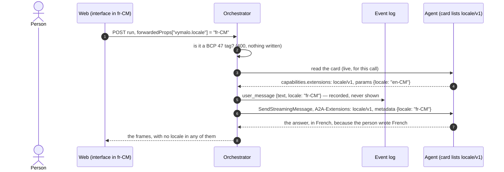
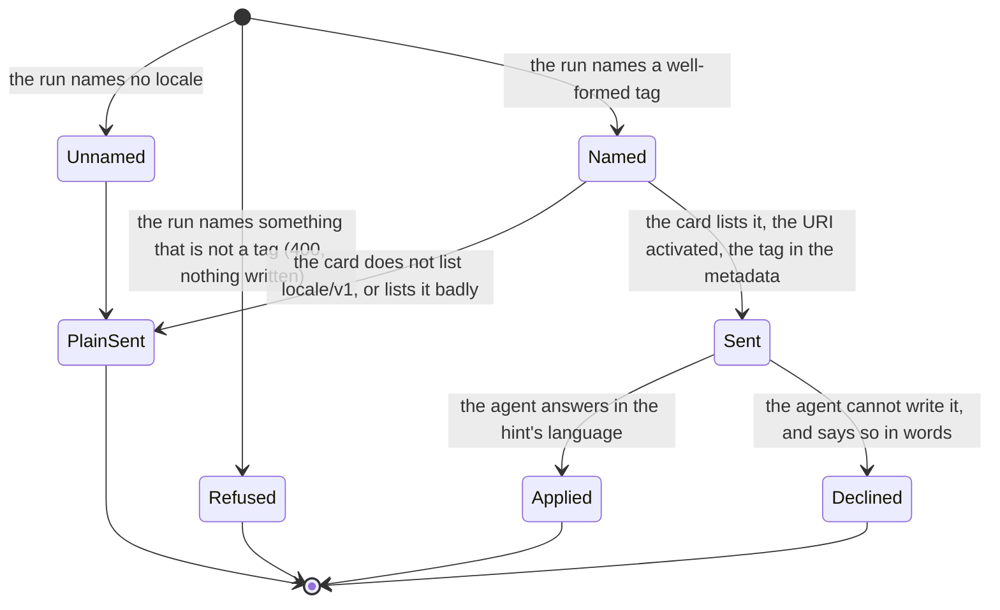

# A2A extension: locale (v1)

- **URI:** `https://agents.vymalo.com/a2a/extensions/locale/v1`
- **Status:** **proposed 2026-11-22**, on the owner's decisions of that day (another-context `plans/2026-11-22-languages.md`,
  decision rows 14–17): the interface offers `en-CM`, `fr-CM`, `wes-CM` and `ybb-CM` from day 0, and **the agent's language is
  the interface's language by default, then the person's**. **The orchestrator's side is built** (the tag and its checks, the
  card read, the activation, the local stack's scenario); **no agent lists it yet**, and the web does not send it yet.
- **Decided in:** [ADR 0085](../decisions/0085-the-interface-language-travels-with-the-message-as-a-hint.md); the
  optional-extension pattern is [ADR 0008](../decisions/0008-platform-integration-via-a2a-extension.md).
- **Defined by:** the orchestrator. **Used by:** agents that can write in more than one language and want to know which one
  the person is reading.

## Purpose

A person reads the interface in one language and writes to an agent in whatever language they like. Those are two different
facts, and the agent only ever saw the second. So the client tells it the first: **the BCP 47 tag of the interface the person
is looking at**, once per message.

It is a **hint**, and the whole contract follows from that word:

- the agent may ignore it, and an agent that cannot write the language says so in words;
- it is never enforced, never a reason to hold a message back, and **never a permission**;
- an agent whose card does not list it gets the plain A2A message it always got;
- a client that does not know it sends nothing, and the agent falls back to its own default.

The owner's rule for what the agent does with it: *the agent answers in the language of the interface by default, and then in
the person's* — the person's own words win over the screen, because a person who writes in Yemba in a French interface is
asking for Yemba.

## Who does what

| Part | Does |
|---|---|
| **Client** | Knows the interface's language, as a BCP 47 tag, and sends it with every message: `forwardedProps["vymalo.locale"]` on a run. Never sends one it invented. Draws the agent's answer as text and Markdown, and keeps **every high-risk string its own** ([section 7](#7-security)). |
| **Orchestrator** | Reads the tag on the run and checks that it is a tag (**400**). Carries it on the message the person's words become, and records it on the `user_message` — the log is the state, so the hint is replayable — while projecting nothing of it. Activates the extension and puts the tag in the metadata only to an agent whose live card, read for that very call, lists it well formed. |
| **Agent** | Lists the extension in its card, with the language it writes in by itself when it says one. Answers in the language the hint names when it can, in the person's language, else its own default. Says which one it used when it matters. |

## The flow



One message's hint goes through these states:



## 1. The card

The agent lists the extension in `capabilities.extensions`:

```json
{"uri": "https://agents.vymalo.com/a2a/extensions/locale/v1",
 "description": "Answers in the language of the interface the person reads.",
 "required": false,
 "params": {"locale": "en-CM"}}
```

| Param | Meaning |
|---|---|
| `locale` | Optional. The tag the agent writes in when a message names none: a BCP 47 tag, or the member is absent. |

`required` stays `false`: a client that does not know the extension must still be able to talk to the agent.

The orchestrator reads the card on **every send** (never cached) and fails closed: the extension is used when the URI is
listed exactly (no other version, no trailing slash, no other case) **and** `params`, when they carry a `locale`, carry a tag.
A card that lists the URI with a `locale` that is not a tag is a card that offers nothing, and a message to it is sent plain:
a hint that cannot be delivered is dropped, never guessed at.

The AG-UI capabilities document does not gain a key for it: nothing in the interface draws a locale control, and the tag comes
from the client's own state.

## 2. Activation

The orchestrator names the URI in the `A2A-Extensions` header and in `message.extensions` of a `SendStreamingMessage`
**only when** both hold:

- the message was given a locale (the run named one);
- the live card lists the URI with well-formed `params`.

A message sent with no locale does not activate the extension and carries no member at all, never an empty string. An agent
MUST NOT read a locale from a message that did not activate the extension.

## 3. The tag

The tag is a **BCP 47 language tag** ([RFC 5646](https://www.rfc-editor.org/rfc/rfc5646)), not a free string. The
orchestrator validates its **shape** and refuses anything that is not one, before anything is written (**400**).

**Accepted:** a language of 2 to 8 letters, up to three three-letter extlangs, an optional script, an optional region, variants,
extensions and a private-use part (`en-CM`, `fr-CM`, `wes-CM`, `ybb-CM`, `de-DE`, `es-419`, `zh-Hant-TW`, `sr-Latn-RS`,
`de-CH-1901`, `en-x-twain`), and a private-use-only tag (`x-twain`). Subtags are matched case-insensitively; the tag is carried
**as the client wrote it**.

**Refused:** an empty tag; a tag longer than 35 bytes; a non-ASCII letter; a separator other than `-` (`en_CM`, `en CM`); an
empty subtag (`en--CM`, `-en`, `en-`); a subtag longer than its production allows (`en-CM-abcdefghi`); a repeated variant or
extension singleton; a private-use part with no subtag (`en-CM-x`); a first subtag that is not a language; and the irregular
grandfathered tags (`i-klingon`, `en-GB-oed`), which no interface produces.

**The set of languages is not a list in the code.** Which ones an interface offers is the **deployment's configuration**
(ADR 0085): the orchestrator accepts any well-formed tag, and the four above are what the interface offers today. A tag the
agent cannot write is not refused here — the agent says so in words, which is what a hint is for.

## 4. The message

An ordinary A2A user message, with the tag in its metadata under the URI:

```json
{"message": {
  "role": "user",
  "messageId": "msg-01927a4e-9c10-7000-8000-00000000002f",
  "contextId": "01927a4e-3b00-7000-8000-000000000001",
  "parts": [{"text": "corrige la page de connexion"}],
  "extensions": ["https://agents.vymalo.com/a2a/extensions/locale/v1"],
  "metadata": {"https://agents.vymalo.com/a2a/extensions/locale/v1": {"locale": "fr-CM"}}
}}
```

| Member | Meaning |
|---|---|
| `locale` | Required once the extension is activated: the BCP 47 tag of the interface the person reads, as the client wrote it. Unknown members are ignored. |

It rides on the message because a message is where A2A puts a client's data for an extension, and because the interface's
language can change between two messages (a person switches the language of the screen, or writes from another device): no
setting of the thread, no new route. It rides with whatever the other extensions put on the same message
([`access-tier/v1`](access-tier-v1.md), [`mentions/v1`](mentions-v1.md)), and on a message sent while the agent works
([`steer/v1`](steer-v1.md)).

**What the agent does with it.**

1. **The person's words win.** A message whose text is in another language is answered in that language; the hint says what the
   interface reads in, not what the person wants to read. When the two agree, they agree.
2. **The newest message wins.** A message that names a locale sets the task's language. A message that names none leaves the
   task's as it is, and a task that has none works under the agent's `locale` of the card, then its own default.
3. **Only a message sets it.** The model, a tool result, a file, an asked agent or text inside a message never changes it.
4. **It never changes what the agent may do.** A locale is not a permission, not a scope, not a tenant.
5. **It is a hint, so a refusal is words.** An agent that cannot write the language answers anyway — in the person's language if
   it can read it, in its own otherwise — and says so if it matters. It never fails the task over a language.

## 5. The agent's duties

1. **Answer in the language the person reads.** The hint first, the person's own words over it, the agent's default last.
2. **Keep the interface's own strings out of it.** Every string the agent's model writes is *text the person reads*. No string
   the agent writes ever becomes a **high-risk string** of the client: the label of a trusted component, the words of a payment,
   the text of a consent. Those are the client's own, reviewed, static ([section 7](#7-security)).
3. **Say what you used, when it matters.** When the answer is not in the language the person wrote or the interface named, the
   answer says which one it is in, in words. There is no metadata member for it: a locale is a hint, and the orchestrator
   records no echo.

## 6. The orchestrator

The client sends the tag on the run that carries the message: `forwardedProps["vymalo.locale"] = "fr-CM"`. `null` or no
member: no hint, nothing activated. Before **anything** is written the orchestrator checks:

| Check | Refused as |
|---|---|
| The member is a string that is a BCP 47 tag | **400** "vymalo.locale must be a BCP 47 language tag, for example en-CM" |

That is the only check. There is no cap, no role, no card read at this point: a hint is never a reason to refuse a message, and
the card is read at the send, as it is for every other extension.

| The message is | Its locale |
|---|---|
| the person's message in the web: a first message, a follow-up, a Stop & send (the held text of it included) | the tag the run named |
| a **steer** into a running task, and the delegation a refused steer becomes | the tag the run named |
| a **fork's first message** (`POST /api/threads/{id}/fork`'s `locale`, or a run's `vymalo.locale` when the fork is made by it) | the tag the request names, as its `tier` is |
| an **edit** (`replace`) that names none | the tag of the message it replaces, as its `tier` is |
| a **redelivery** of a message that never reached the agent | the tag its `user_message` recorded: the log is the state |
| a message from the **MCP surface**, and a person's **start of a child session** | none: neither request has a member for one |
| the orchestrator's own: a rework of the gate, a verifier's task, an `ask_agent` child task | none: the screen's language is not the core's, and a child task is the agent's own business |
| an **A2UI action** | none: an action is a gesture on a surface, not a message of a screen |

**The log records it, and nothing else does.** The `user_message` carries `locale` (omitted when the message names none), so
an export shows what the agent was told and a replay sends the same message. **The projection adds nothing**: no
`vymalo.locale` on a frame, no activity, no badge. That is the one place this extension does not copy the tier, and
deliberately: the tier is shown in the interface, a locale need not be — but both are recorded, because **the log is the
state**, and a hint that changes the agent's words must be replayable. Everything that continues a message continues its
hint: a redelivery carries it, a fork's first message and an edit carry their own or the replaced one's, and a message that
names none carries none.

**At the send**, the dispatcher puts the row's tag on the request and the adapter reads the card again for that very call: a
card that lists the extension gets the tag, a card that does not list it — or lists it badly — gets the plain message. The
dispatcher does not fail the job for a locale, and the adapter never refuses a message over one.

**At the send**, the dispatcher puts the row's tag on the request and the adapter reads the card again for that very call: a
card that lists the extension gets the tag, a card that does not list it — or lists it badly — gets the plain message. The
dispatcher does not fail the job for a locale, and the adapter never refuses a message over one.

## 7. Security

- **A hint is not a boundary, and not a promise.** The agent may ignore it; the orchestrator cannot see inside a task and does
  not try. Nothing is enforced, so nothing can be enforced *wrongly*.
- **It never grants anything.** A locale changes no tool, no credential, no tier, no scope, no audience. An agent that reads
  it as a permission has a defect.
- **The agent's own words never fill a high-risk string.** This is the rule of this extension, and it is a **client rule, not a
  prompt**. A model that writes Yemba barely must not be able to produce the text of a consent screen, the label of a button
  that spends money, or the wording of a payment. So:
  - a **trusted component**'s label and its fields are the client's own reviewed strings, per language, and the agent names the
    component and never its words ([`trusted-components-v1.md`](trusted-components-v1.md));
  - **payments, consent and any legal text** are the client's static, reviewed strings, translated by people, never by the
    agent, whatever language the hint names;
  - everything the agent writes is drawn as the person's text — Markdown, sanitized — and never as interface chrome.
- **The tag is untrusted input.** It is validated (a length bound, ASCII only, the grammar's productions), refused rather than
  passed through, and never used to build a path, a key or a query. It travels in one metadata member and in one header.
- **What the log holds is the tag, and only the tag.** The `user_message` records it — a BCP 47 tag the validator bounded and
  checked, never a free string — so an export and a fork carry it, as they carry the tier. It is not shown in the interface,
  it is not a title, a description or a search word (the search index folds the messages' text, not their members), and it is
  never used to build a path, a key or a query.

## What the build changes

| Place | Change |
|---|---|
| Orchestrator | the closed, validated `LocaleHint` and `LocaleListing` (`crates/core/src/locale.rs`), the card read and the activation (`crates/agent-a2a/src/locale.rs`), `locale` on `SendRequest` and on the `delegate`/`steer` outbox rows, the `forwardedProps` key and its **400** (`crates/app/src/locale.rs`, `crates/surface-agui`), the scenario `dev/locale-e2e.sh` |
| [`agui.md`](agui.md) | the inbound key, and the statement that nothing of it is projected |
| [`extensions.md`](extensions.md), [`README.md`](README.md) | the row |
| Web | the tag from its own interface state, with each message (not built yet) |
| adam-rs | reads the tag and answers in it (not built yet; the agent's half is its own pull request) |

## Conformance

What a build is tested for (the orchestrator's `dev/locale-e2e.sh` plays the client and a WireMock agent plays the agent
side):

- a card that does not list the URI gets no header, no `message.extensions` and no metadata, and the request is what it is
  today, for a message that names a locale as for one that names none;
- a message that names no locale activates nothing, on an agent that lists it, and carries no member at all;
- a card that lists the URI with a `locale` that is not a tag offers nothing, and a message to it is sent plain;
- a tag that is not a BCP 47 tag is **400** and nothing is written; a tag is accepted whatever the case of its subtags;
- the tag reaches the agent in the metadata under the URI, with the URI in the header and in `message.extensions`;
- the log records it **once**, on the `user_message` (omitted when the message names none), an export of the thread holds it
  there and nowhere else, and the AG-UI stream has no `vymalo.locale` and no activity for it;
- a redelivery carries the tag its `user_message` recorded, a fork's first message carries the one its request names, and an
  edit that names none carries the replaced message's.

## Verified and unverified (2026-11-22)

*Verified 2026-10-01* against the A2A specification, as recorded in
[`steps-v1.md`](steps-v1.md#verified-and-unverified-2026-10-01) and not re-read for this page: extensions are declared in the
card's `AgentCapabilities` with `uri`, `description`, `required` and optional `params`; a client activates one with the
`A2A-Extensions` header, a comma-separated list of URIs; `Message.extensions` lists the URIs present or contributed to the
message; extension data goes in the `metadata` map.

*Verified 2026-11-22* against RFC 5646 (<https://www.rfc-editor.org/rfc/rfc5646.txt>, read that day): the grammar of this page's
section 3 is the `langtag` and `privateuse` productions of section 2.1 (a language of `2*3ALPHA` with up to three `3ALPHA` extlangs, `4ALPHA` or
`5*8ALPHA`; an optional `4ALPHA` script; an optional `2ALPHA` or `3DIGIT` region; variants of `5*8alphanum` or `DIGIT 3alphanum`, each
at most once; extensions of a singleton that is not `x` and one or more `2*8alphanum` subtags; a private-use part of `x` and one or
more `1*8alphanum` subtags), and every subtag is at most eight characters; subtags are case-insensitive and carry no meaning in their case
(section 2.1.1); and section 4.4.1 says "Protocols or specifications that specify limited buffer sizes for language tags MUST allow
for language tags of at least 35 characters", which is the bound `MAX_LOCALE_LEN` takes. *Verified in this repository the same day:*
the four tags of the deployment are well formed — `en-CM` and `fr-CM` are `language` + `region`, `wes-CM` and `ybb-CM` a three-letter
`language` + `region`.

*Unverified:* that any agent reads the member yet — none lists the extension, and the adam-rs side is a separate change. Whether
a plain A2A agent ignores or rejects a metadata key it did not ask for does not matter here: nothing is sent to an agent whose
card does not list the URI.
