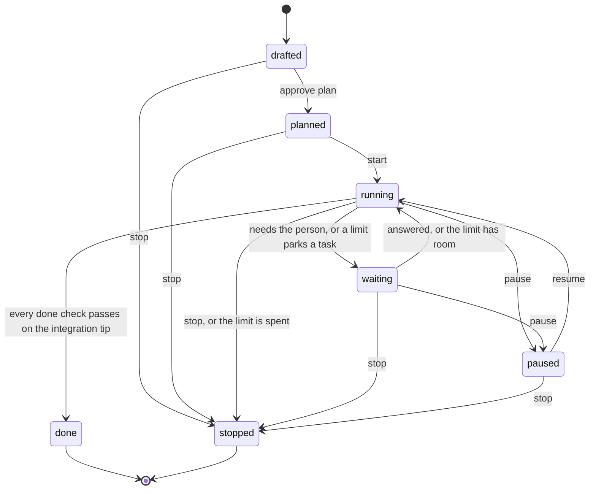

# Missions (v1)

A mission is a goal, a limit, one or more repositories, a team and a definition of done, with a plan the person approves, run as tasks on branches and accepted by
a verifier that did not write them. This page is the contract for any client; the decisions are in
[ADR 0095](../decisions/0095-a-mission-is-a-goal-a-limit-and-a-plan-run-as-tasks-and-accepted-by-a-verifier.md).

- **Status:** **proposed (2026-11-24).** Nothing is built (epic [#342](https://github.com/vymalo/another-agentic-system/issues/342), slice 2). Names and numbers
  may change by a dated note until slice 3 builds the routes.
- **Auth:** the same bearer and roles as the chat API ([`chat-api.yaml`](chat-api.yaml)). A mission belongs to its owner: another person, an administrator
  included, gets **404** on every route, and `?owner=` is **400** (as for threads, ADR 0039). `missions.enabled` off answers **404** on the whole group.

## The object

| Field | Type | Rules |
|---|---|---|
| `id` | `m-` and 12 base-36 characters | assigned by the server |
| `state` | `drafted`, `planned`, `running`, `waiting`, `paused`, `done`, `stopped` | a fold of the log; never set by a client |
| `goal` | text, 1 to 8,192 bytes | data, never an instruction to the orchestrator |
| `limit` | `{tokens, wall_clock_secs, tasks_at_once}` | all three required; the role's limits cap them (ADR 0081); `tokens` has no default |
| `repositories` | 1 to 5 of `{repo, base}` | the person's linked repositories; `base` is a branch |
| `team` | `{preset}` or `{members: [{name, agent, role}]}`, 2 to 8 members, one `lead` | a preset is **copied** at drafting |
| `done` | 1 to 8 checks | `{kind: ci, repo, checks[]}`, `{kind: command, argv[]}` or `{kind: verdict, agent}`; empty is refused at approval |
| `plan` | the approved plan, or `null` | see below |
| `plan_version` | integer | 0 until a plan is approved |
| `thread` | thread id | the mission thread, where the lead speaks to the person |
| `spent` | `{tokens, wall_clock_secs}` | read from the usage ledger and the log |
| `waiting_for` | `null` or `{reason, task?}` | `question`, `needs_person`, `limit_parked`, `verifier_down` |
| `stopped_reason` | `null`, `person`, `limit_spent` | only on `stopped` |

### The plan

A plan is **data**, read strictly (an unknown field is `422`). At most **16 tasks**.

```json
{
  "version": 1,
  "tasks": [
    {
      "id": "t1",
      "title": "Add the export route",
      "brief": "What to do, at most 4 KiB.",
      "repository": "app",
      "depends_on": [],
      "writer": "coder",
      "verifier": "reviewer",
      "weight": 3,
      "checks": ["cargo test -p export passes"]
    }
  ]
}
```

A task is `queued`, `ready`, `working`, `verifying`, `accepted`, `merged`, `needs_person`, `blocked` or `canceled`; it also has `thread` (its child thread),
`branch`, `sha`, `attempts` (at most 2), `reserved` and `spent`. The core refuses a plan with a cycle, an unknown dependency, an agent outside the team or one the
person may not use, a verifier that is its writer, more than 16 tasks or a `weight` outside 1 to 10 (`422`, naming the field).

## States



`done` and `stopped` are terminal. A route that asks for another transition answers **409** with `code: invalid_transition` and the current `state`.

## Routes

| Method and path | What it does | Answers |
|---|---|---|
| `POST /api/missions` | Draft a mission from `{goal, limit, repositories, team, done}` | `201` the object, state `drafted`; `422` with the field; `409 mission_limit` past `missions.max_per_person` |
| `GET /api/missions` | The person's missions, newest first, `?state=` and `?cursor=` | `200 {missions, next}` |
| `GET /api/missions/{id}` | One mission with its plan and tasks | `200`; `404` |
| `PATCH /api/missions/{id}` | Change `goal`, `limit`, `repositories`, `done` while `drafted`, or `limit` while `waiting` or `paused` | `200`; `409 invalid_transition`; `If-Match` required (`428`) |
| `GET /api/missions/{id}/plan` | The plan proposed by the lead, or the approved one | `200 {version, status, plan}`; `status` is `proposed` or `approved` |
| `POST /api/missions/{id}/plan/approve` | Approve the proposed plan, optionally edited: `{version, plan?}` | `200`; `409 plan_stale` if `version` is not the proposed one; `422` the refusals above |
| `POST /api/missions/{id}/plan/reject` | Send the plan back to the lead with a note | `200`; the lead proposes again |
| `POST /api/missions/{id}/start` | `planned` to `running`, after the limit check | `200`; `429` naming the limit and its value (ADR 0081) |
| `POST /api/missions/{id}/pause`, `/resume` | Pause, resume | `200`; `409 invalid_transition` |
| `POST /api/missions/{id}/stop` | Stop for good | `200`; `409 invalid_transition` |
| `POST /api/missions/{id}/tasks/{task}/retry`, `/skip` | The person's answer to a task that failed twice | `200`; `409` if the task is not `needs_person` |
| `GET /api/missions/{id}/events` | The mission's events after `?after=` | `200 {events, next}` |

A write needs `If-Match` with the mission's revision, as the prompt library's does; a stale one is `412`. An **idempotency key** header on `POST` makes a retry safe. A thread
that is a mission refuses a fork (`409 mission_not_forkable`) until the mission is terminal.

## Events (in the mission thread's log)

`mission_drafted`, `mission_plan_proposed`, `mission_plan_approved` (carries the plan's digest), `mission_started`, `mission_task_dispatched`,
`mission_task_reported` (branch and SHA), `mission_task_verified` (the verdict), `mission_budget_reserved`, `mission_budget_released`, `mission_waiting`,
`mission_resumed`, `mission_paused`, `mission_stopped`, `mission_done`. Each names the actor (the person, the lead, the core) and, for a task, its `task` and `thread`.
A client draws the mission from the log or from the AG-UI custom event `vymalo.mission` (the object above, replaced whole on each change).

## What a mission may do

- **Build in its own repositories**, at the access tier and network tier of the message that started it, and nothing else. Anything more is a **question to the person** (a form) and the
  mission is `waiting`; no text an agent or a page wrote grants it.
- **Spend** only its reservations: each task has a share of `limit.tokens`, recorded before it is dispatched; the lead's share is 10 % and the verification share 15 % (proposed).
  A task over its share is parked, never killed; the mission over its limit is stopped.
- **Be accepted** only by a verifier that is not the task's writer, on the pushed SHA, in a context of its own; `done` only when every check of the definition passes on the same
  integration tip.

## Errors

Problem details as in [`chat-api.yaml`](chat-api.yaml), with a `code`: `invalid_transition`, `plan_stale`, `plan_invalid` (with the `field`), `mission_limit`, `mission_depth`,
`mission_not_forkable`, `limit_exceeded` (the limit's name and value), `agent_not_allowed`. No error holds the goal, a brief or a token.
