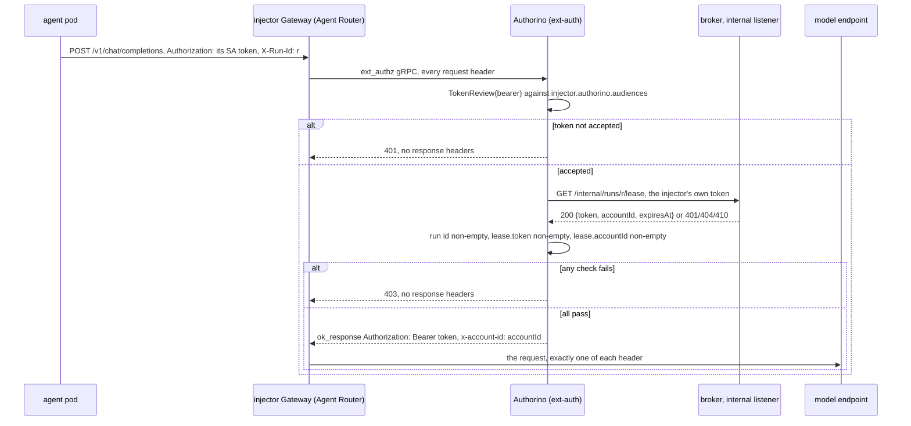

# The model-credential injector: the headers the model endpoint may trust

> **Status: built in the chart, off by default** (`deploy/chart`, values `injector`; [ADR 0084](../decisions/0084-the-run-lease-the-broker-binds-a-run-and-lends-its-model-credential.md)).
> The transport and the refusals are proven in kind by [`dev/agent-router-spike/`](../../dev/agent-router-spike/README.md)
> (*verified 2026-11-24/25*). The deployment's turn-on values and the object list are in
> [`deploy/chart/README.md`](../../deploy/chart/README.md#the-model-credential-injector-s9).

This page settles one thing: on the **internal** path from an agent to the model endpoint, `Authorization` and
`x-account-id` are the injector's statement, and nobody else's. A client — the agent, a sidecar, a person with a shell in
the pod — cannot choose the model credential or the account the call is charged to; its own copies of those headers are
replaced, not merged. A caller the injector does not accept as an agent pod, or a run with no live lease, is refused
before the model endpoint sees any request.

## Who the injector is

The injector is the objects [`deploy/chart/templates/injector.yaml`](../../deploy/chart/templates/injector.yaml)
renders, all of them optional:

| Object | Its part |
|---|---|
| `Gateway` + `EnvoyProxy`, `ClientTrafficPolicy` | Agent Router's Gateway on Envoy Gateway, `ClusterIP`, no Ingress and no edge route; the agents reach the Service it pins. |
| `Backend` (+ `BackendTLSPolicy` for `https`), `AIServiceBackend`, `AIGatewayRoute` | the deployment's model endpoint, selected by `injector.modelHeader: injector.model`; Agent Router generates the `HTTPRoute`. |
| `Authorino`, `AuthConfig` | the external authorizer: authenticate the calling pod, look up the run's lease, stamp the two headers. |
| `SecurityPolicy` (`extAuth.grpc`) | applies Authorino to the generated `HTTPRoute`, not to the whole Gateway. |
| `ExternalSecret` | the injector's own broker token, by AWS property name, never a value. |

**The caller is a pod, identified by its service-account token.** `authentication.agent` is a
`kubernetesTokenReview` of the bearer the caller presents, against the audiences in
`injector.authorino.audiences` (empty: Authorino's own default, the protected service's host name). A token from
another audience, an expired one, or no token at all is not an agent pod as far as the injector is concerned. No other
input is used for identity: not a source address, not a pod name, not a header.

## What is checked, in order

1. **Authentication.** The presented bearer is the calling pod's projected service-account token; a `TokenReview` must
   accept it for one of the configured audiences. Failure is `401` at the authorizer. The broker is not asked and the
   model endpoint receives nothing.
2. **A run id is present.** `X-Run-Id` must be non-empty (it is the root run's id, ADR 0067 decision 1). Absent or
   empty, the authorizer answers `403`; it does not call the broker with an empty run.
3. **The broker returns that run's live lease, for the injector's own identity.** Authorino calls
   `GET {broker}/internal/runs/{X-Run-Id}/lease` with the token in the injector's Secret, presents it as
   `Authorization: Bearer <token>`, and caches the answer per run id for at most `injector.broker.cacheTtlSecs`
   (`30` s, the lease's own ceiling). A refusal — `401 unauthenticated`, `404 run_not_bound`, `410 lease_expired`, or
   an unreachable broker — leaves the lease metadata unset.
4. **The lease carries a token and an account id.** Both must be non-empty: `authorization.lease` denies a lease with
   no token, and `authorization.account-id` denies one that names no account. A refusal is `403`; the model endpoint
   receives nothing.
5. **The headers are stamped from the lease only.** `response.success.headers` sets `Authorization` to
   `Bearer {auth.metadata.lease.token}` and `x-account-id` to `{auth.metadata.lease.accountId}` — both
   `plain.selector`s, never `plain.value` and never a literal (Authorino v0.26.4 emits a static `plain.value` as a Go
   struct dump, *verified 2026-11-24*).

| What went wrong | Answer at the injector | What the model endpoint sees |
|---|---|---|
| no bearer, or a token for another audience | `401` | nothing; the broker is not asked |
| no `X-Run-Id` | `403` | nothing |
| the broker refuses (401, 404 `run_not_bound`, 410 `lease_expired`) | `403` | nothing |
| a lease with no token | `403` | nothing |
| a lease with no account id | `403` | nothing |
| every check passes | the request goes on | one `Authorization`, one `x-account-id`, the lease's values |

## A client's own headers are replaced

Envoy Gateway applies the `ok_response` headers to the upstream request, and a header of the same name a client already
sent is **replaced**: exactly one of each arrives at the model endpoint. The spike's first case sends its own
`Authorization` and its own `x-account-id` and reads WireMock's request journal: it finds one `Authorization`, the leased
one, and one `x-account-id`, the lease's account — never the client's values
(*verified 2026-11-24/25*, `dev/agent-router-spike/spike.sh`).

## What this establishes, and what it does not

**It establishes** that `Authorization` and `x-account-id` at the model endpoint are the injector's, for a request that
passed the checks above: the model credential came from the broker's lease for that run, and the account id came from
the same lease. A caller cannot choose either by sending the header itself.

**It does not authorise a person's spend.** That is the broker's and the usage ledger's: the broker refuses a binding
that is expired or revoked, and the ledger is keyed by the account id the lease named (ADR 0065). The injector only
carries the answer; a trustworthy header is not a budget check.

**The account id is a person, not a provider account.** It is the run's person, a `UserId` — the key the usage ledger is
kept by (`usage_tasks.owner`, ADR 0065) — never a provider account, a ledger-service account number or an API key id
(ADR 0084).

**The run id is a capability, not a proof of ownership.** The injector checks that the caller is *an* agent pod it
accepts; it does not check that the caller is *the* pod the run was bound to. Any pod holding a service-account token of
the accepted audience and a live run id gets that run's lease. The NetworkPolicy that keeps other pods from reaching
the Gateway, and the broker's binding rules, are the walls around that — not this contract.

**Not covered yet.** TLS on the ext-auth hop and on the agent-to-Gateway hop is not rendered (Envoy Gateway v1.10's
`extAuth.grpc` has no TLS field, *verified 2026-11-24*); the broker's injector token is the seam
`SharedTokens::with_injector`, which the orchestrator binary does not yet pass, so until that wiring lands every lookup
answers `401` and every model call through the injector fails closed (see the chart README).
