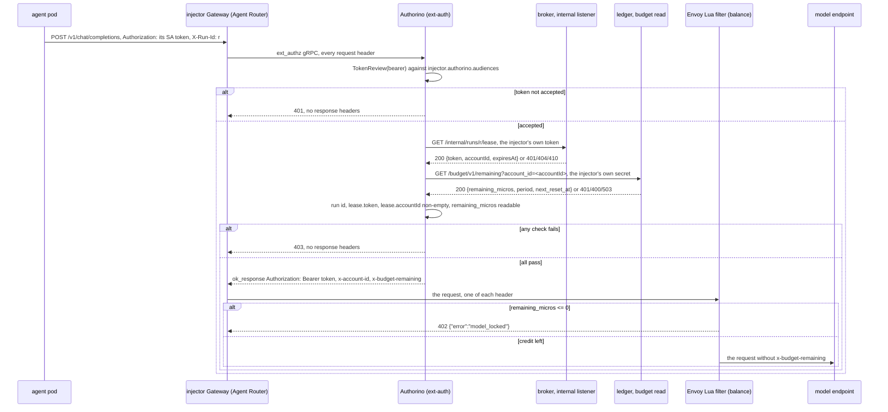

# The model-credential injector: the headers the model endpoint may trust, and the balance a call may spend

> **Status: built in the chart, off by default** (`deploy/chart`, values `injector`; [ADR 0084](../decisions/0084-the-run-lease-the-broker-binds-a-run-and-lends-its-model-credential.md)).
> The transport and the refusals are proven in kind by [`dev/agent-router-spike/`](../../dev/agent-router-spike/README.md)
> (*verified 2026-11-24/25*). The deployment's turn-on values and the object list are in
> [`deploy/chart/README.md`](../../deploy/chart/README.md#the-model-credential-injector-s9).

This page settles two things: on the **internal** path from an agent to the model endpoint, `Authorization` and
`x-account-id` are the injector's statement and nobody else's, and the **person's balance is read, never assumed**. A
client — the agent, a sidecar, a person with a shell in the pod — cannot choose the model credential, the account the
call is charged to, or the balance it is judged by; its own copies of those headers are replaced, not merged. A caller
the injector does not accept as an agent pod, a run with no live lease, and a person with nothing left to spend are
refused before the model endpoint sees any request.

## Who the injector is

The injector is the objects [`deploy/chart/templates/injector.yaml`](../../deploy/chart/templates/injector.yaml)
renders, all of them optional:

| Object | Its part |
|---|---|
| `Gateway` + `EnvoyProxy`, `ClientTrafficPolicy` | Agent Router's Gateway on Envoy Gateway, `ClusterIP`, no Ingress and no edge route; the agents reach the Service it pins. |
| `Backend` (+ `BackendTLSPolicy` for `https`), `AIServiceBackend`, `AIGatewayRoute` | the deployment's model endpoint, selected by `injector.modelHeader: injector.model`; Agent Router generates the `HTTPRoute`. |
| `Authorino`, `AuthConfig` | the external authorizer: authenticate the calling pod, look up the run's lease, read the person's balance, stamp the headers. |
| `SecurityPolicy` (`extAuth.grpc`) | applies Authorino to the generated `HTTPRoute`, not to the whole Gateway. |
| `EnvoyExtensionPolicy` (Lua) | refuses a **spent** balance with `402` — the one refusal Authorino cannot produce per rule — and removes the balance header before the model. |
| `ExternalSecret` ×2 | the injector's broker token and the ledger's shared secret, by AWS property name, never a value. |

**The caller is a pod, identified by its service-account token.** `authentication.agent` is a
`kubernetesTokenReview` of the bearer the caller presents, against the audiences in
`injector.authorino.audiences` (empty: Authorino's own default, the protected service's host name). A token from
another audience, an expired one, or no token at all is not an agent pod as far as the injector is concerned. No other
input is used for identity: not a source address, not a pod name, not a header.

**The balance is a read, never a debit.** At every model call the injector calls the usage ledger's budget read for the
lease's account id — `GET <injector.budget.url>/budget/v1/remaining?account_id=<accountId>`, in the ledger's own micro-USD,
behind the shared secret in `injector.budget.tokenProperty`. It never books an entry, never reserves credit and never
moves money: **the ledger is the source of truth and the injector can only refuse**. A call the injector refuses costs
nothing; a call it lets through is settled later by the ledger's own settlement, against the same account. The two
consequences worth saying: the balance a person sees is the ledger's, not the injector's, and an overshoot is possible
by what they spend inside the balance's cache TTL (below) until settlement books it.

## What is checked, in order

1. **Authentication.** The presented bearer is the calling pod's projected service-account token; a `TokenReview` must
   accept it for one of the configured audiences. Failure is `401` at the authorizer. The broker is not asked and the
   model endpoint receives nothing.
2. **A run id is present.** `X-Run-Id` must be non-empty (it is the root run's id, ADR 0067 decision 1). Absent or
   empty, the authorizer answers `403`; it does not call the broker with an empty run.
3. **The broker returns that run's live lease, for the injector's own identity.** Authorino calls
   `GET {broker}/internal/runs/{X-Run-Id}/lease` with the token in the injector's Secret, presents it as
   `Authorization: Bearer <token>`, and caches the answer per run id for at most `injector.broker.cacheTtlSecs`
   (`30` s, the lease's own ceiling). A refusal — `401 unauthenticated`, `404 run_not_bound`, `410 lease_expired`, or
   an unreachable broker — leaves the lease metadata unset.
4. **The lease carries a token and an account id.** Both must be non-empty: `authorization.lease` denies a lease with
   no token, and `authorization.account-id` denies one that names no account.
5. **The ledger's budget read answers for that account.** Authorino asks the ledger with the lease's `accountId` — a
   second metadata call, in a priority group **after** the lease, since it needs the account the lease named — and
   caches it per account for `injector.budget.cacheTtlSecs` (`10` s by default, 1 to 30).
   - **Why 10 s.** A balance moves slower than a lease, so caching it is worth something; but a stale balance lets a
     person overspend by whatever they spend inside the TTL. Ten seconds bounds that to a handful of model calls and
     still cuts the ledger's reads by an order of magnitude. A TTL above 30 s is refused: past that it is no longer a
     balance, it is a memory.
   - **An account the ledger has never seen is a zero balance** (`200`, `0`), not a 404 — the ledger's own rule
     (another-backend's ADR-0021). Zero credit is the fail-closed answer: the unknown person spends nothing, and the
     refusal is the same shape as a person who has spent everything, so there is one "you cannot spend" to document
     and one for a client to handle.
   - **A ledger that cannot answer** (`503 budget_unavailable`, a timeout, a wrong secret) leaves the metadata unset
     and `authorization.budget-readable` refuses with `403`. An outage is not a person's spending, so it is not
     reported as one; it is still a refusal, never a zero and never a pass.
6. **The headers are stamped from the lease and the ledger only.** `response.success.headers` sets `Authorization` to
   `Bearer {auth.metadata.lease.token}`, `x-account-id` to `{auth.metadata.lease.accountId}` and
   `x-budget-remaining` to `{auth.metadata.budget.remaining_micros}` — all `plain.selector`s, never `plain.value` and
   never a literal (Authorino v0.26.4 emits a static `plain.value` as a Go struct dump, *verified 2026-11-24*).
7. **A spent balance is refused with `402`.** `remaining_micros` is signed and unclamped: `0` or negative (an
   overshoot) means nothing left. The `EnvoyExtensionPolicy`'s Lua filter reads `x-budget-remaining` after ext-auth,
   answers `402` with `{"error":"model_locked"}` — the slug ADR 0084 gives a run parked for its person's balance — and
   removes the header so the person's balance never reaches the model endpoint.

| What went wrong | Answer at the injector | What the model endpoint sees |
|---|---|---|
| no bearer, or a token for another audience | `401` | nothing; the broker is not asked |
| no `X-Run-Id` | `403` | nothing |
| the broker refuses (401, 404 `run_not_bound`, 410 `lease_expired`) | `403` | nothing |
| a lease with no token | `403` | nothing |
| a lease with no account id | `403` | nothing |
| the ledger refuses or cannot answer (401, 503, timeout) | `403` | nothing |
| the person's balance is zero, negative, or the account is unknown | `402 {"error":"model_locked"}` | nothing |
| every check passes | the request goes on | one `Authorization`, one `x-account-id`, the lease's values; no balance header |

## Why the 402 is an Envoy filter and not an Authorino rule

Authorino's denial status is **one code per phase**, not per rule: `response.unauthenticated.code` and
`response.unauthorized.code` (300–599) apply to every failed authorization in the `AuthConfig`. Denying a spent balance
there would answer `402` for a run with no lease, no account id or no run id as well — *verified 2026-11-25 in
`dev/agent-router-spike/`*: with `response.unauthorized.code: 402` set on the live `AuthConfig`, a request with no
`X-Run-Id` and one whose lease the broker answers `410` both returned `402`. Envoy honours the code (it is not
hard-wired to 403), so the restriction is Authorino's, not the transport's.

The chart therefore splits the judgement: **Authorino refuses what it cannot know** (a balance that could not be read,
`403`), and **the gateway refuses what it knows is spent** (`402`). The channel between them is
`x-budget-remaining`, which Authorino sets from the ledger's answer and the Lua filter reads and removes. It is stamped
the same way as `Authorization`, so a client's own copy is replaced — *verified 2026-11-25*: a zero-balance run that
sent `x-budget-remaining: 42` was still `402`, and the funded run's request reached the gateway with no
`x-budget-remaining` at all. The Lua filter refuses a missing, blank or non-numeric header with
`503 {"error":"budget_unavailable"}` too, so it fails closed even if it ever runs without the authorizer's rule
(*verified 2026-11-25*: with the `SecurityPolicy` deleted, the request was `503`, not a pass).

**The deployment's prerequisite.** Envoy Gateway v1.10 ships Lua `EnvoyExtensionPolicy` **disabled**: its
`EnvoyGateway` resource needs `extensionApis.enableLua: true` (v1.10.0, `api/v1alpha1/envoygateway_types.go`,
`ExtensionAPISettings.EnableLua`; *verified 2026-11-25* on kind, where the policy reports `Lua: Skipping Lua
EnvoyExtensionPolicy as feature is disabled in the Gateway` until the flag is on). Without it the policy is not
accepted, no request is refused with `402`, and a person at zero is refused only if some other rule catches them — so
turn the flag on with the injector.

## A client's own headers are replaced

Envoy Gateway applies the `ok_response` headers to the upstream request, and a header of the same name a client already
sent is **replaced**: exactly one of each arrives at the model endpoint. The spike's first case sends its own
`Authorization` and its own `x-account-id` and reads WireMock's request journal: it finds one `Authorization`, the leased
one, and one `x-account-id`, the lease's account — never the client's values. A fourth case sends its own
`x-budget-remaining` and is refused with `402` anyway (*verified 2026-11-24/25*, `dev/agent-router-spike/spike.sh`).

## What this establishes, and what it does not

**It establishes** that `Authorization` and `x-account-id` at the model endpoint are the injector's, for a request that
passed the checks above: the model credential came from the broker's lease for that run, the account id came from the
same lease, and the call was let through only after the ledger answered a positive balance for that account.

**It does not authorise a person's spend in the ledger's books.** The ledger is the source of truth and settles what
was actually spent; the injector's read is a snapshot, cached for at most `injector.budget.cacheTtlSecs`. A person can
overshoot by what they spend inside that window, and an overshoot is settled as debt, not prevented. The injector cannot
move money: it has no route that debits, and the ledger's budget read is read-only by contract.

**The account id is a person, not a provider account.** It is the run's person, a `UserId` — the key the usage ledger is
kept by (`usage_tasks.owner`, ADR 0065) — never a provider account, a ledger-service account number or an API key id
(ADR 0084).

**The run id is a capability, not a proof of ownership.** The injector checks that the caller is *an* agent pod it
accepts; it does not check that the caller is *the* pod the run was bound to. Any pod holding a service-account token of
the accepted audience and a live run id gets that run's lease. The NetworkPolicy that keeps other pods from reaching
the Gateway, and the broker's binding rules, are the walls around that — not this contract.

**Not covered yet.** TLS on the ext-auth hop and on the agent-to-Gateway hop is not rendered (Envoy Gateway v1.10's
`extAuth.grpc` has no TLS field, *verified 2026-11-24*); the broker's injector token is the seam
`SharedTokens::with_injector`, which the orchestrator binary does not yet pass, so until that wiring lands every lookup
answers `401` and every model call through the injector fails closed (see the chart README). And the ledger side does not
match yet, stated plainly: another-backend's budget listener reads its secret from `x-lightbridge-budget-token`
(`crates/another-service/src/budget_remaining.rs`, *verified 2026-11-25*), while Authorino v0.26.4's `sharedSecretRef`
can only present it as `Authorization: Bearer`. The chart sends the bearer; the real listener needs to accept it, or a
rewriter has to stand between them, before this is wired in production.
