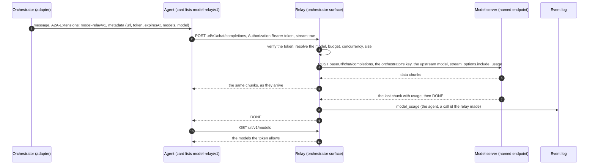
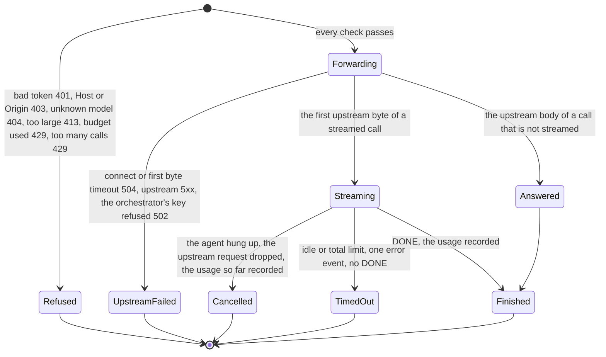

# A2A extension: model relay (v1)

- **URI:** `https://agents.vymalo.com/a2a/extensions/model-relay/v1`
- **Status:** **proposed (2026-10-11), at the owner's request; nothing is built.** The direction is the owner's (the quote below, and the shape he listed: an OpenAI-compatible endpoint per thread, the card
  declares it, the message metadata carries `{url, token, expiresAt, models}`, `POST {url}/v1/chat/completions` and `/v1/models`, the orchestrator forwards with its own key, records usage, enforces a
  budget, lets the person pick the model, passes SSE through, no key in A2A). Every other name, status code and default here is proposed.
- **Decided in:** [ADR 0063](../decisions/0063-an-openai-compatible-model-endpoint-per-thread-on-the-orchestrator.md); the optional-extension pattern is
  [ADR 0008](../decisions/0008-platform-integration-via-a2a-extension.md), the endpoint and token follow [`thread-tools/v1`](thread-tools-v1.md), the usage record is
  [`usage/v1`](usage-v1.md)'s event ([ADR 0056](../decisions/0056-token-usage-per-model-call.md)), the named model endpoints are [ADR 0005](../decisions/0005-openai-compatible-model-endpoint.md) and
  [ADR 0035](../decisions/0035-utility-model-tasks.md).
- **Served by:** the orchestrator (a surface). **Used by:** agents whose card lists the extension (adam-rs needs a client side: a model provider whose base URL and key come from the message).

## Purpose

The owner, 2026-10-11: "We should have more concepts like that [thread-tools/v1] too. E.g for the permission tier, the networking tier or even the raw model and OpenAI compatible server configuration."

An agent needs a model. Today it holds its own endpoint and key, so the orchestrator can neither choose the model for a thread, nor stop a thread that spends too much, nor see the spend of a call the agent
made. With this extension the agent asks the orchestrator for a model: **one OpenAI-compatible endpoint per thread**, opened by a token. The orchestrator forwards the call to the model server it is configured
with, using **its own key**, records the usage, enforces a budget and serves the model the person picked. **No model key ever travels in A2A.**

An agent whose card does not list the extension uses its own model, as today, and the web shows it no model chip.

## Who does what

| Part | Does |
|---|---|
| **Agent** | Lists the extension. When a message activated it: sends its model calls to `{url}/v1/chat/completions` with the token as its API key, takes the model list from `/v1/models`, and does not report those calls again through [`usage/v1`](usage-v1.md). |
| **Orchestrator** | Activates it only when the live card lists it and a relay is configured. Mints the token, serves the two routes, resolves the model, checks the budget, forwards with its own key, passes the stream through, records one `model_usage` per call. Never logs a prompt or an answer. |
| **Model server** | Any OpenAI-compatible endpoint named in the orchestrator's configuration ([`config.md`](config.md), `models.endpoints`). Knows nothing of threads or people. |
| **Web** | Shows a model chip in the composer, only for an agent whose card lists the extension. Sends the person's pick with each message. |

## The flow





## 1. The card

```json
{"uri": "https://agents.vymalo.com/a2a/extensions/model-relay/v1",
 "description": "Takes its model from the orchestrator's OpenAI-compatible endpoint for the thread.",
 "required": false}
```

Listed exactly (no other version, no trailing slash, no other case). No `params`. The orchestrator reads the card on **every send** and fails closed.

## 2. Activation and the message

The orchestrator names the URI in the `A2A-Extensions` header and in `message.extensions` of a `SendStreamingMessage` **only when** all hold: the live card (read for this very message) lists the URI; the request
belongs to a thread and carries the thread grant (not the verifier's); a relay is configured (`modelRelay.enabled`, a model list, and the thread-tools key); and `modelRelay.agents` names the agent (default: every
agent). The message metadata under the URI is:

```json
{"https://agents.vymalo.com/a2a/extensions/model-relay/v1": {
  "url": "https://orchestrator.example/model-relay/1b4e28ba-2fa1-11d2-883f-0016d3cca427",
  "token": "<the token of section 3>",
  "expiresAt": "2026-10-11T14:00:00Z",
  "models": [{"id": "fast", "label": "Fast", "contextWindow": 131072}, {"id": "deep", "label": "Deep"}],
  "model": "deep"
}}
```

| Member | Meaning |
|---|---|
| `url` | `modelRelay.publicUrl` plus `/model-relay/<threadId>`. An OpenAI client's base URL is `{url}/v1`. |
| `token` | The token below, **a secret**: the agent's API key for this endpoint, never in its model's context nor its logs. |
| `expiresAt` | The token's `exp`, RFC 3339. |
| `models` | The models this token allows, `id` (the name to send), optional `label` and `contextWindow`. Never an upstream name, endpoint or key. At most 16. |
| `model` | **Optional.** The person's pick for this message: an `id` in `models`. Absent: no pick (see section 5). |

**Every message gets its own token**; an agent keeps using the newest it was given (as for thread-tools). The orchestrator never writes the token to the log, the outbox, a log line or a frame. An agent MUST NOT call
the endpoint unless a message of its task activated the extension, and SHOULD NOT silently fall back to a model of its own when the relay refuses (a budget answer is the person's limit).

## 3. The token

A thread token, as [`thread-tools/v1`](thread-tools-v1.md#the-token) mints: a compact JWS, HS256, the same key (`THREAD_TOOLS_SECRET`, with its `kid` and rotation), minted by the A2A adapter at the moment it sends, verified by
any replica with no table. The differences are the audience and two claims:

| Claim | Value |
|---|---|
| `aud` | `"model-relay"`. A thread-tools token does not open the relay, and this one does not open thread-tools: the audience is checked. |
| `iss`, `sub`, `job`, `agt`, `caller`, `depth`, `jti`, `iat`, `exp` | As for thread-tools: one thread, one caller (`main` or `ask:<n>`), one message. |
| `mdls` | Required. The ids the token allows (1 to 16, each at most 64 bytes): the configured models the thread owner's roles may use. |
| `mdl` | Optional. The person's pick; always one of `mdls`; only on a `main` token. |

The token is at most 4 KiB (the list is in it). Lifetime `modelRelay.tokenTtlSecs`, default 7200, 60 to 86,400. Verification is thread-tools' list in the same order (size and shape, header, signature, claims,
`iss` and `aud`, time with 30 s of skew, `sub` equal to the thread in the path, the thread exists and the caller is its agent): any failure is `401`, `WWW-Authenticate: Bearer error="invalid_token"`, no detail,
nothing written, nothing forwarded.

## 4. The endpoint

- **Routes:** `POST {url}/v1/chat/completions` and `GET {url}/v1/models`, under `/model-relay/{threadId}`. Everything else is `404` `unsupported_endpoint` (embeddings, completions, the Responses API, files, images: not in v1).
- **A machine route,** outside the edge identity (no cookie), like the thread tools. The `Host` is checked against `modelRelay.allowedHosts` (default the host of `publicUrl`) after the token; a request with an `Origin`
  header is refused with 403 (an agent is not a browser). The surface is named `model-relay` in `server.surfaces`.
- **`Authorization: Bearer <token>`**, so an unmodified OpenAI client works with `api_key = token` and `base_url = {url}/v1`.
- **`GET /v1/models`** answers from the token's `mdls` (the OpenAI list shape: `{"object": "list", "data": [{"id", "object": "model", "owned_by": "orchestrator"}]}`), never from the upstream.

### The call

The body is a JSON object of at most `modelRelay.maxRequestBytes` (8 MiB, else `413` `request_too_large`). The relay **changes two things and nothing else**:

1. `model` becomes the upstream name of the resolved model ([section 5](#5-which-model)).
2. For `stream: true` it sets `stream_options.include_usage` to `true` (other `stream_options` are kept), so the last chunk carries the usage it must record.

Every other member passes untouched: `messages`, `tools`, `tool_choice`, `parallel_tool_calls`, `response_format`, `max_tokens` and `max_completion_tokens`, `temperature`, the provider's reasoning settings, and any
member this page does not know. **Tool calls and reasoning fields pass through both ways and are never read, rewritten, filtered or logged:** `tool_calls` and the `tool` role in a request, `tool_calls`,
`reasoning_content` or `reasoning` (the name varies by provider, *unverified*) in a response or a delta. The relay executes no tool: a tool call goes back to the agent. No person's identifier is added to the request.

The upstream request is `POST {baseUrl}/chat/completions` of the model's named endpoint ([ADR 0035](../decisions/0035-utility-model-tasks.md)), with the orchestrator's key, `Content-Type: application/json`,
the client's `Accept` and nothing else of the client's headers. No redirect is followed.

**The answer** is the upstream's status and body, byte for byte (a streamed answer chunk by chunk, no buffering beyond a chunk, `Content-Type: text/event-stream`, `Cache-Control: no-store`,
`X-Accel-Buffering: no`), with only these headers of the upstream's: `Content-Type`, `Retry-After`, and one `X-Request-Id` made by the relay. The `data: [DONE]` terminator passes. Statuses:

| Upstream or relay | The agent gets |
|---|---|
| 2xx | the same, a tee reads `usage` |
| 400, 404, 409, 413, 422, 429 from the upstream | the same status, body and `Retry-After` (a context that is too long, a rate limit: the agent must see them) |
| 401 or 403 from the upstream (the orchestrator's key was refused) | `502` `upstream_auth`, a generic message: **an upstream error body is never forwarded here**, it may echo part of a key |
| 5xx from the upstream | the same status, a generic `upstream_error` body |
| a redirect, a connect or first byte timeout | `502`, or `504` `upstream_timeout` |
| the relay's own refusals | the table below |

Errors the relay makes use the common envelope `{"error": {"message", "type", "code"}}` (*unverified* as the exact OpenAI shape, not re-read):

| Status | `code` | When |
|---|---|---|
| 400 | `invalid_request` | the body is not a JSON object, `model` is not a string |
| 401 | `invalid_token` | the token fails a check |
| 404 | `model_not_found` / `unsupported_endpoint` | the model is not in `mdls` / any other route |
| 413 | `request_too_large` | over `maxRequestBytes` |
| 429 | `budget_exhausted` | the thread's or the person's budget is used (`Retry-After` for a window) |
| 429 | `too_many_requests` | over `modelRelay.maxConcurrentPerThread` (8) calls at once |

### Timeouts, retries, hang-ups

Its own, not the utility tasks' short ones: `modelRelay.connectTimeoutSecs` 10; `firstByteTimeoutSecs` 120 (a reasoning model may think long before its first token; for a call that is not streamed it is the whole
body); `idleSecs` 60 between chunks; `maxCallSecs` 900 in all. Before any byte went to the agent a timeout is `504`. After, the relay ends the stream with one `data: {"error": {"type": "upstream_timeout", ...}}`
event and closes it, **no `[DONE]`**. **The relay retries nothing** (a half-sent stream cannot be retried; the agent decides). When the agent hangs up the upstream request is dropped and the usage known so far
is recorded as a cancelled call.

## 5. Which model

1. **The pick binds.** When the token has `mdl`, every call of that thread under that token is served by that model, **whatever `model` the call names** (the person chose it for the message, and an agent that
   hard-codes a name must not undo the choice or the budget). The answer's own `model` member is the upstream's.
2. **No pick:** the call's `model` if it is in `mdls`, else `404` `model_not_found`; a call with no `model` takes `modelRelay.default`.
3. **An asked agent's** token (`caller: ask:<n>`) has no `mdl`: it works from rule 2, so the person's pick is for the agent they talk to, and nothing is passed to its helpers (as the tiers).
4. The ids are ours. The configuration maps each to a named endpoint and the model's name there ([`config.md`](config.md), `modelRelay.models`); the agent never learns either.

The person's pick is made in the web, per thread, and sent per message: [section 8](#8-the-orchestrator-and-the-web).

## 6. Usage and the budget

**Usage.** The orchestrator sees the upstream's own `usage`, so the relay records each call itself as one `model_usage` event ([ADR 0056](../decisions/0056-token-usage-per-model-call.md)): the job, the agent, the
job's task for that agent (read from the ledger), a call id `relay-<jti>-<n>`, the path (empty for `main`, `["ask-<n>"]` for an asked agent), `model` (our id), `inputTokens`, `outputTokens`, `totalTokens`,
`reasoningTokens`, `cachedInputTokens` and `contextWindow` when known (the configured one). The usual names map as `prompt_tokens`, `completion_tokens`, `total_tokens`, `completion_tokens_details.reasoning_tokens`,
`prompt_tokens_details.cached_tokens` (*unverified*: the provider's API reference answered 403 on 2026-10-11, and a gateway may name them otherwise; a member that is absent is left out). The idempotency key is
`relay:<jti>:<n>`; the 10,000-calls-a-job bound and the drop-and-count rule of ADR 0056 apply. A call with no `usage` at all is recorded as nothing, counted
(`model_relay_calls_without_usage_total`), and charged against the budget as its request's `max_tokens` when it has one.
**The agent does not report a call it made through the relay** in `usage/v1` (neither a call report nor in its totals); the orchestrator cannot match them, so a report of both is counted twice.

**Budgets.** Tokens (input plus output), never money. Two optional scopes, each a count: `modelRelay.budgets.thread.tokens` (all callers of a thread, for its life) and `modelRelay.budgets.person.tokens` with
`windowHours` (all of a person's threads in a fixed window, default 24 hours aligned to the epoch). **Before** each call the relay refuses with `429` `budget_exhausted` when a scope is used up. A call that starts
under the budget may end over it, by at most one call. When a budget is used the relay also writes one `error` event for the job (retryable: false, "this thread's model budget is used up") so the person sees why.
The counters are derived from the `model_usage` events and kept in a small table written in the same transaction (a cache of the log, rebuildable from it); with no budget configured there is none.

## 7. What is logged

**Never a prompt, an answer, a tool argument or a reasoning text.** Per call the relay writes one structured line and one trace span with: the thread, the job, the agent, the caller, our model id, the name of the
upstream endpoint, the status, the duration, the request's size in bytes, the token counts and the outcome (`finished`, `failed`, `cancelled`, `timed_out` or `refused:<code>`). There is **no setting that logs
bodies**; if one is ever wanted it is its own decision. A test plants a sentinel in a prompt, a tool argument and a model answer and searches every thing the system keeps or says (the log, the export, every frame,
every log line and metric, every table), as `dev/tools-e2e.sh` does for a configured secret.

## 8. The orchestrator and the web

The web sends the pick on the run that carries the message: `forwardedProps["vymalo.model"] = "deep"` ([`agui.md`](agui.md#inbound-ag-ui--core-input)); `null` or no member means no pick. Before anything is written:

| Check | Refused as |
|---|---|
| The member is a string of at most 64 bytes | **400** |
| The person's roles allow the model (`auth.roles.<role>.models`, absent: every model) | **422** "the model 'deep' is not allowed for your role" |
| The thread's agent: its live card lists the extension, and a relay serves that id | **422** "this agent does not take a model from the orchestrator" |
| The card cannot be read | **503**, retryable; nothing is written |

A pick is **never silently dropped**: it is stored as sent in the `user_message` event (`model`, omitted when none) and projected as `TEXT_MESSAGE_START.metadata["vymalo.model"]`. At the send the dispatcher reads the card
again and, when it no longer lists the extension, the job **fails** and nothing is sent. A change of model takes effect with the next message's token; a task that keeps using an older token keeps the older model.

**The web** draws a model chip in the composer, **only when** the selected agent's capabilities document has `custom[<uri>] = {models: [{id, label, contextWindow?}], default}`, the list already cut to the person's
roles. Hidden otherwise: no disabled control, no placeholder. It shows the default until the person picks and then sends the pick with every message of the thread, kept in the browser (a per-person convenience; the
orchestrator stores the pick only on the messages), and forgets a pick that is no longer offered. A thread the person may read and not change has no chip. A message shows the model it was sent under.

## 9. Configuration (proposed keys)

| Key | Default | Meaning |
|---|---|---|
| `modelRelay.enabled` | `false` | The surface and the activation. Needs `threadTools` (the key) and at least one model; else exit 78. |
| `modelRelay.publicUrl` | `threadTools` URL | The base agents reach the orchestrator at. |
| `modelRelay.models[]` | none | `{id, label?, endpoint, upstream, contextWindow?}`; `endpoint` is a name in `models.endpoints` (an unknown one is exit 78); `id` a slug of at most 64 characters. |
| `modelRelay.default` | the first model | The id a call without `model` takes. |
| `modelRelay.agents` | `["*"]` | The agents that get the extension when their card lists it. |
| `modelRelay.budgets.thread.tokens`, `.person.tokens`, `.person.windowHours` | none, none, 24 | The budgets of section 6. |
| `modelRelay.maxRequestBytes`, `.maxConcurrentPerThread` | 8 MiB, 8 | Limits. |
| `modelRelay.connectTimeoutSecs`, `.firstByteTimeoutSecs`, `.idleSecs`, `.maxCallSecs` | 10, 120, 60, 900 | The relay's own timeouts. |
| `modelRelay.tokenTtlSecs`, `.allowedHosts` | 7200, the host of `publicUrl` | The token's life and the Host values accepted. |
| `auth.roles.<role>.models` | all | The model ids a role may use or pick (an id that does not exist is exit 78). |

## 10. Security

- **No model key in A2A.** The message holds a token that opens one thread's relay for hours and nothing else. The upstream key is in the orchestrator's configuration only, never in a response, a header or an error.
- **A leaked token spends the person's budget** until it expires: that is what the budget bounds. It names no model the person could not use.
- **The upstream is the deployment's.** The agent chooses neither the URL, the path nor the headers. The two routes are fixed, no redirect is followed, a query string is dropped.
- **The relay does not execute or inspect a tool call or a reasoning text.** It only counts tokens.
- **A relay is a point every call passes**: its pods carry the agents' streams, add a hop and are a dependency; the relay fails the call, never the thread.

## What the build changes

| Place | Change |
|---|---|
| Orchestrator | a port `ModelForwarder` (a streaming forward with a conformance testkit, no driver type in a signature, `orch-model-openai` implements it beside `ChatModel`), the surface crate `orch-surface-model-relay` (feature `surface-model-relay`), the token (`aud` `model-relay`, `mdls`, `mdl`), the adapter that activates the extension, the budget counters, `model` on `user_message`, `models` on a role |
| [`chat-api.yaml`](chat-api.yaml), [`agui.md`](agui.md), [`config.md`](config.md), [`config.schema.json`](config.schema.json) | the event member, the inbound row and the projected metadata, `custom[<uri>]` with its models, `modelRelay` and `auth.roles.<role>.models` |
| Web | the model chip and the model on a message |
| Chart | the `modelRelay` values, the models' endpoints; the agents' NetworkPolicy already admits the orchestrator |
| adam-rs | a model provider whose base URL and key are the message's, per message; not reporting relayed calls; not falling back silently (its own ADR) |

## Conformance

What a build is tested for (the orchestrator's fake agent and a WireMock model server play the other sides):

- a card without the URI, or no relay configured: no header, no metadata, the message is what it is today; a pick for such an agent is 422;
- a thread-tools token does not open the relay and this token does not open thread-tools; a bad, expired or foreign token is 401 and forwards nothing;
- the pick binds: a call that names another model is served by the pick; with no pick, a model outside `mdls` is 404;
- the upstream gets the orchestrator's key and never the agent's token; the agent never gets the key, nor an upstream 401 or 403 body;
- a streamed call is forwarded chunk by chunk (the first chunk arrives before the last is sent), `[DONE]` passes, and one `model_usage` is recorded from the last chunk; a hang-up drops the upstream request and records a cancelled call;
- tool calls and reasoning fields reach the agent unchanged;
- the budgets refuse with 429 before a call, once an `error` event is written per job, and a call that starts under the budget finishes;
- timeouts: before the first byte 504, after it an error event and no `[DONE]`; no retry;
- the sentinel test of section 7 finds nothing;
- `dev/kagent-e2e.sh` passes unchanged.

## Verified and unverified (2026-10-11)

*Verified 2026-10-11 in this repository:* the named endpoints and their `baseUrl` (up to and not including `/chat/completions`), key and timeout ([`config.md`](config.md), `orchestrator/crates/model-openai/README.md`); the thread token
and endpoint rules this page reuses ([`thread-tools-v1.md`](thread-tools-v1.md)); the `model_usage` event ([ADR 0056](../decisions/0056-token-usage-per-model-call.md)).

*Unverified:* the names of the usage members, the usage-bearing last chunk of `stream_options.include_usage` and the exact error envelope of OpenAI's API (its reference answered HTTP 403 to the fetch tool on 2026-10-11,
so nothing was re-read); that the gateways ADR 0005 names (EAIG, AISIX) pass `stream_options` and report usage the same way; the provider-specific names of the reasoning fields; and the adam-rs client side, which is
that repository's.
