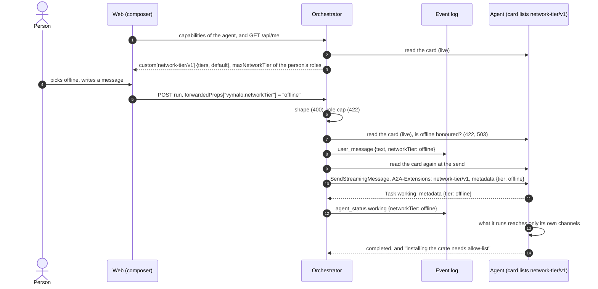
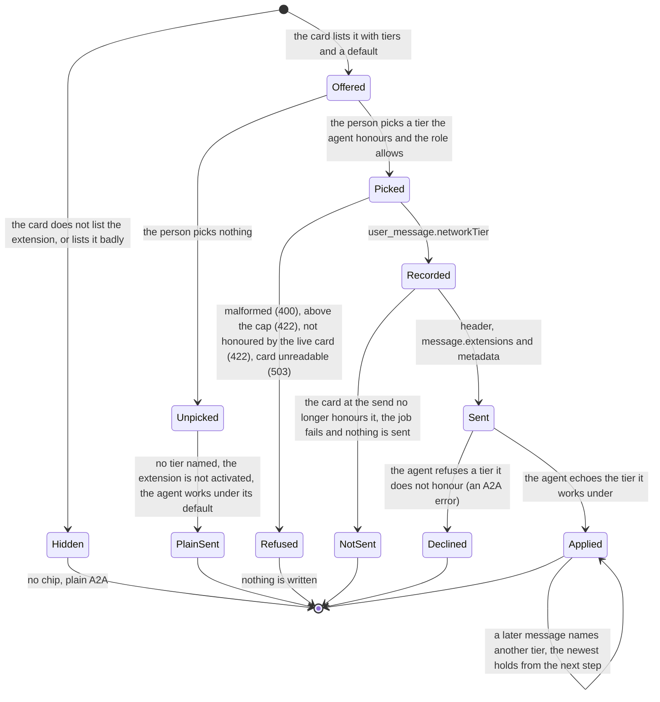
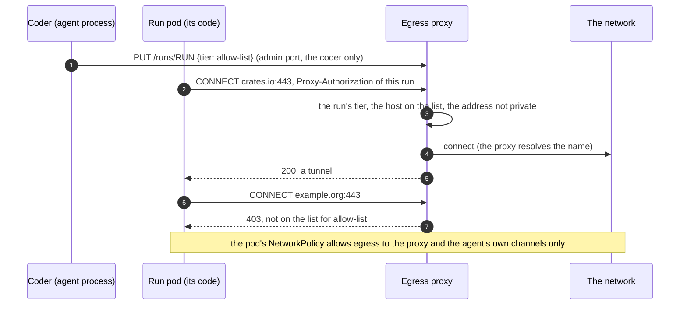

# A2A extension: network tier (v1)

- **URI:** `https://agents.vymalo.com/a2a/extensions/network-tier/v1`
- **Status:** **proposed (2026-10-11), at the owner's request; nothing is built.** The direction is the owner's (the quote below). Every name, status code and default
  here is proposed, for the owner to confirm.
- **Decided in:** [ADR 0062](../decisions/0062-the-person-picks-a-network-tier-for-each-message-the-agent-keeps-to-it.md); the optional-extension pattern is
  [ADR 0008](../decisions/0008-platform-integration-via-a2a-extension.md). It is the sibling of the access tier ([ADR 0061](../decisions/0061-the-person-picks-an-access-tier-for-each-message-the-agent-keeps-to-it.md), [`access-tier-v1.md`](access-tier-v1.md), *proposed; the
  orchestrator and the web are built against mocks*): the same shape, a different axis.
- **Defined by:** the orchestrator. **Used by:** agents that run code or fetch from a network they control (adam-coder and `adam-agent` first, whose run pods can be limited;
  their side is a pull request in adam-rs).

## Purpose

The owner, 2026-10-11: "We should have more concepts like that [thread-tools/v1] too. E.g for the permission tier, the networking tier or even the raw model and OpenAI
compatible server configuration."

A person says, **for one message**, how much network what the agent runs may reach: `offline`, `allow-list` or `open`. The agent keeps to it. Nothing is passed to its children.

The tier governs **what the agent runs and fetches** (a build, an install, a script, a fetch tool). It does **not** govern the agent's own channels: its model endpoint, the
orchestrator's thread-tools and [`model-relay/v1`](model-relay-v1.md) endpoints and the files host of [`uploads/v1`](uploads-v1.md). An agent without those channels cannot work, so `offline` leaves them.

An agent whose card does not list the extension is unchanged: the same request as before, no header, no metadata, no control in the web.

## Who does what

| Part | Does |
|---|---|
| **Agent** | Lists the extension with the tiers it honours and its default. Keeps what it runs to the tier a message names, says which tier it worked under, and says which tier a failed step needed. Decides alone what its own children may reach. |
| **Orchestrator** | Reads the card live. Checks the shape, the person's role cap and that the live card honours the tier. Logs the choice on the message, activates the extension and sends the choice on that message only. Sends nothing to any other task. Enforces nothing. |
| **Web** | Shows a chip in the composer, only for an agent whose card lists the extension. Sends the choice with each message once the person has picked one. |

## The flow





## 1. The card

```json
{"uri": "https://agents.vymalo.com/a2a/extensions/network-tier/v1",
 "description": "Keeps what it runs to the network tier the person picks for each message.",
 "required": false,
 "params": {"tiers": ["offline", "allow-list", "open"], "default": "open"}}
```

| Param | Meaning |
|---|---|
| `tiers` | Required. A non-empty list of the tiers the agent honours, each of the three at most once. An agent that cannot open the network lists `["offline", "allow-list"]`. |
| `default` | Required. One of `tiers`: what the agent works under when no message names a tier. adam's is `open`, which is what its run pods allow today. A deployment may set it lower. |

`required` stays `false`. The orchestrator reads the card on **every send**, never caches it, and fails closed: the extension is used when the URI is listed exactly **and** `params` are well-formed.
The AG-UI capabilities document carries `custom[<uri>] = {tiers, default}` so the web can draw the chip before anything is sent ([`agui.md`](agui.md#capabilities-document), updated by the pull request that builds this).

## 2. Activation

The orchestrator names the URI in the `A2A-Extensions` header and in `message.extensions` of a `SendStreamingMessage` **only when** the person's message names a tier **and** the live card lists
the URI and its `tiers` contain that tier. A message that names no tier does not activate it. An agent MUST NOT read a tier from a message that did not activate the extension.

## 3. The three tiers

A closed list ([ADR 0004](../decisions/0004-closed-enums-over-dyn-registry.md)), ordered by how much network: `offline` < `allow-list` < `open`.

| Tier | What the agent's code may reach |
|---|---|
| `offline` | Nothing but the agent's own channels. No package registry, no forge, no web. A step that needs one fails. Local work (reading, editing, building from what is already on disk, committing) is unaffected. |
| `allow-list` | `offline`, plus the hosts of **the deployment's list**: the package registries and the forge the work needs. The list is the agent's deployment's, not the orchestrator's and not the person's. For example (the deployment's choice, **not** a contract, hostnames *unverified*): `crates.io`, `registry.npmjs.org`, `pypi.org`, `github.com`. |
| `open` | The public internet, as the agent's deployment allows. **Private and link-local ranges and the cloud metadata address stay refused at every tier.** |

What is outside a tier, the agent does **not** reach by another route: no mirror it was not given, no tunnel, no tool that fetches for it. The step fails, and the agent says which tier it needed
([duty 3](#5-the-agents-duties)).

The tier is independent of the access tier: a person may pick `edits` and `offline`, or `plan` and `open`. Neither widens the other. The network tier never grants what the deployment's own network
policy withheld ([section 9](#9-security)).

## 4. The message

An ordinary A2A user message with the tier in its metadata under the URI:

```json
{"message": {
  "role": "user",
  "messageId": "msg-01927a4e-9c10-7000-8000-00000000002f",
  "contextId": "01927a4e-3b00-7000-8000-000000000001",
  "parts": [{"text": "update the lock file and open a pull request"}],
  "extensions": ["https://agents.vymalo.com/a2a/extensions/network-tier/v1"],
  "metadata": {"https://agents.vymalo.com/a2a/extensions/network-tier/v1": {"tier": "allow-list"}}
}}
```

| Member | Meaning |
|---|---|
| `tier` | Required once the extension is activated: `offline`, `allow-list` or `open`, lower case, a hyphen in the middle one. Unknown members are ignored. |

It rides on the message for the reason the access tier does: a message is where A2A puts a client's data for an extension, the choice is the person's and made again for each message, and the
orchestrator remembers nothing. It rides with whatever the other extensions put on the same message and on a message sent while the agent works ([`steer/v1`](steer-v1.md)).

**What the agent does with it:**

1. **From its next step**, never in the middle of a tool call it has started. A lower tier holds as soon as the call in flight is over, and applies to every connection opened after.
2. **The newest message wins.** A message that names a tier sets the task's tier; one that names none leaves it. A task that has none works under `default`.
3. **A task never inherits.** A new task in the same context starts from `default`.
4. **Only a message sets it.** The model, a tool result, a file or an asked agent never raises it.
5. **An activated message with no valid `tier`**, or a tier outside the agent's `tiers`, is refused with an A2A error. The agent never rounds up.

## 5. The agent's duties

1. **Never exceed the tier.** What a child process or sub-agent of the agent's own runs counts as the agent's own.
2. **Say which tier it worked under.** When the request activated the extension, the task's `metadata` carries `{"tier": "<tier>"}` under the URI on the first `Task` of the stream and whenever it changes.
3. **Say which tier a failed step needed.** A step that fails for lack of network under a tier below `open` is not retried by another route. The agent says what failed, why, and the lowest tier that would let it
   (`allow-list` for a registry on the list, `open` otherwise), then does the rest. An ordinary answer, not an A2A error.

| Situation | What the agent answers |
|---|---|
| The named tier is one it does not honour | an A2A error (its choice which: the orchestrator does not read it) |
| The extension is activated and `tier` is missing or not one of the three | an A2A error |
| A step needs more network than the tier gives | an answer that names the tier it needs |
| The extension is not activated | it reads no tier and works under `default` |

## 6. Sub-agents: nothing is passed down

The orchestrator sends a tier only on **the person's message to the thread's agent**. It sends none on an [`ask_agent`](thread-tools-v1.md#ask_agent) child task, a verifier's task or any other task it starts
for an agent, nor on a message that comes through the MCP surface, a webhook or a timer. An asked agent works under its own deployment's network and its own default. The reasons are the access tier's:
a restriction that flows down a delegation needs every agent on the way to understand it and ties the orchestrator to one vendor's idea of it.

## 7. The orchestrator

The web sends the choice on the run that carries the message: `forwardedProps["vymalo.networkTier"] = "offline"` ([`agui.md`](agui.md#inbound-ag-ui--core-input)); `null` or no member means no choice. Before
**anything** is written the orchestrator checks:

| Check | Refused as |
|---|---|
| The member is a string, one of the three | **400** |
| The person's roles allow the tier ([section 8](#8-roles-and-the-web)) | **422** "the network tier 'open' is above what your role allows" |
| The thread's agent: its live card lists the extension and its `tiers` contain it | **422** "this agent does not take the network tier 'offline'" |
| The card cannot be read | **503**, retryable; nothing is written |

A tier is **never silently dropped**: ignoring it would run the agent under its default, perhaps `open`, for a person who asked for `offline`. A run that has no message to put it on (a cancel, an A2UI action,
an attach) is checked for its shape and the member is ignored with a warning.

A tier that passes is stored **as sent** in the `user_message` event (`networkTier`, omitted when none), so an export shows it, and projected as `TEXT_MESSAGE_START.metadata["vymalo.networkTier"]`. **At the send**
the dispatcher reads the card again: if it no longer honours the tier, the job **fails** with "the agent no longer takes the network tier 'offline'" and nothing is sent, never the default. The orchestrator records the
echo on the job's `agent_status` event (`data.networkTier`, proposed) and compares nothing: an agent that lists the extension and works above its tier has a defect it cannot see.

## 8. Roles and the web

**One optional line caps the highest tier a role may pick:** `auth.roles.<role>.maxNetworkTier`, one of the three (absent: no cap; a person with several roles has the highest cap; a value outside the three is
exit 78 naming the key, as `maxTier` of the access tier would be). It is a ceiling, not a permission. `GET /api/me` gains `maxNetworkTier`, a hint for the screen, never a check; the cap is checked once, when the
message is written ([`config.md`](config.md#roles-and-permissions) for how roles are read).

**The web** draws a chip beside the access tier's in the composer's toolbar, **only when** the selected agent's capabilities document has `custom[<uri>]`. Hidden otherwise: no disabled
control, no placeholder. It offers the agent's `tiers` up to the person's cap, each with its one-line meaning, shows the agent's `default` until the person picks (and then sends **no** tier), and once picked sends
that tier with every message of the thread, kept in the browser, forgotten when the agent no longer honours it or the cap no longer allows it. A thread the person may read and not change has no chip. A message
shows the tier it was sent under. No screenshot yet: the web's own screens (`pnpm screens`) come with the pull request that builds the chip.

## 9. Security

- **A tier is a promise by the agent, not a boundary the orchestrator can check.** What makes it a boundary is where the agent runs: [adam's way](#adams-way-a-sketch) puts the network between the agent's code
  and the world. A deployment that needs a boundary gives the agent's pods no route.
- **A tier only narrows.** It never grants what the deployment's network policy, the credentials or the forge's own rules withheld. The metadata address and private ranges are refused at every tier.
- **Only the person's message sets it** ([section 4](#4-the-message), rule 4). The MCP surface, webhooks and timers send none.
- **The servers a person attached to the thread are not governed.** They are called by the orchestrator, by the person's explicit choice ([ADR 0024](../decisions/0024-mcp-tools-attached-per-conversation.md)),
  not by the agent's code. Open question 78 asks whether `offline` should hide them.
- **The echo is read as one of three words.** Anything else is dropped and counted, and never fails a task.

## Adam's way: a sketch

*Sketch only: adam-rs designs and builds its side in its own ADR. It is here so the contract can be seen to be implementable.* adam-rs's coder can run each active run in a pod of its own, whose NetworkPolicy
today allows DNS and the internet except private ranges, link-local and the pod and service CIDRs (*verified 2026-10-11*: `deploy/coder/templates/run-pods-networkpolicy.yaml` and `deploy/coder/README.md` of adam-rs at
the pin `5581d40`, read with `git show` in a local clone).



- The **run pod's NetworkPolicy** allows egress only to the **egress proxy** and to the agent's own channels (the model gateway, the orchestrator's thread-tools and relay), **no DNS**: the proxy resolves names, so
  the pod cannot tunnel through DNS. The pod gets `HTTPS_PROXY` with a credential of its own run.
- The **proxy applies the tier per run.** `offline`: every `CONNECT` refused. `allow-list`: the target must match the deployment's list. `open`: any target whose **resolved address** is not private (so a
  rebinding name gets no gap). The coder sets a run's tier on the proxy when a message names one, and the run reverts to `default` for a new task.
- Tools that do not read a proxy setting (raw TCP, git over ssh) fail at every tier, which is what the tiers want. That each tool in the image reads `HTTPS_PROXY` is *unverified*.
- Which proxy (a configured HTTP proxy with per-user rules, or a small one of adam's own) is adam-rs's choice. Nothing here needs the orchestrator.

## What the build changes

| Place | Change |
|---|---|
| Orchestrator | the closed `NetworkTier` enum, the checks of [section 7](#7-the-orchestrator), `networkTier` on `user_message` and `agent_status`, the adapter that activates the extension, the dispatcher's second read of the card, `maxNetworkTier` on a role |
| [`chat-api.yaml`](chat-api.yaml), [`agui.md`](agui.md), [`config.md`](config.md), [`config.schema.json`](config.schema.json) | the event member, the inbound row and the projected metadata, `custom[<uri>]` with its params, `Me.maxNetworkTier`, `auth.roles.<role>.maxNetworkTier` |
| Web | the chip, `Me.maxNetworkTier`, the tier on a message |
| adam-rs | the card, the message, the echo and, for its run pods, the proxy above (its ADR) |

## Conformance

What a build is tested for (the orchestrator's fake agent plays the agent side):

- a card without the URI, or with bad `params`: no header, no `message.extensions`, no metadata, the request is what it is today; a message with a tier for such an agent is 422;
- a message that names no tier does not activate the extension on an agent that lists it;
- a tier above the cap is 422, a tier the card does not honour is 422, a card that cannot be read is 503, and nothing is written in any of them;
- the dispatcher refuses to send when the card stopped honouring the tier, and fails the job;
- no tier on an `ask_agent` child task, a verifier task, an MCP, webhook or timer message;
- the agent echoes the tier, refuses an unhonoured one, never inherits one across tasks, and says which tier a failed step needed;
- `dev/kagent-e2e.sh` passes unchanged.

## Verified and unverified (2026-10-11)

*Verified 2026-10-01* against the A2A specification, as recorded in [`steps-v1.md`](steps-v1.md#verified-and-unverified-2026-10-01) and not re-read: extensions are objects of the card's
`AgentCapabilities` with `uri`, `description`, `required` and `params`; a client activates one with the `A2A-Extensions` header; extension data goes in `metadata`; a `SendStreamingMessage` stream that returns a task
begins with it ([`steer-v1.md`](steer-v1.md#verified-and-unverified-2026-10-02)).

*Verified 2026-10-11:* adam-rs's run-pod NetworkPolicy at the pin (above).

*Unverified:* the hostnames named as examples; that each tool the coder runs (cargo, npm, pip, git) honours a proxy setting, and for a registry the hosts it needs; a proxy product's per-user rules; which A2A error an
agent answers with for a tier it does not honour; whether the cluster's network plugin enforces the policy (adam-rs's own page says the same for its policy).
