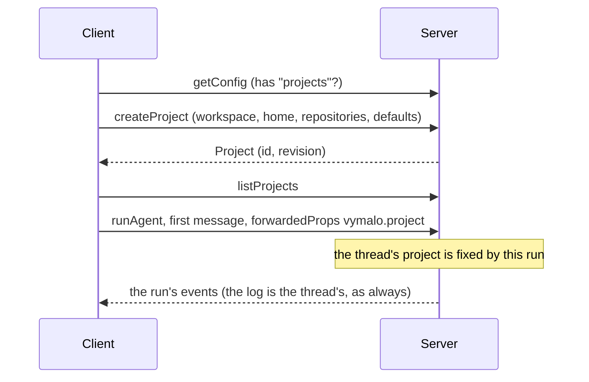
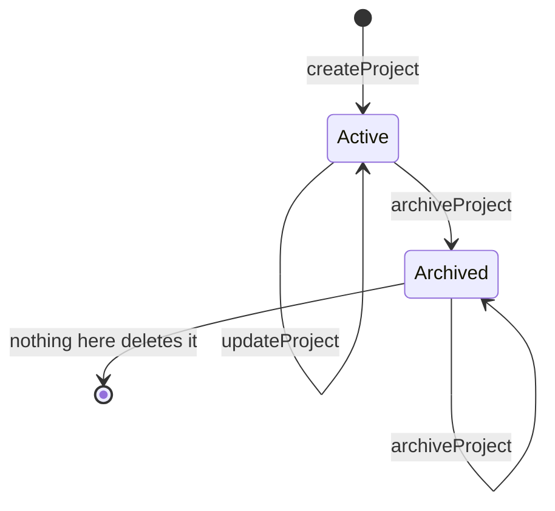
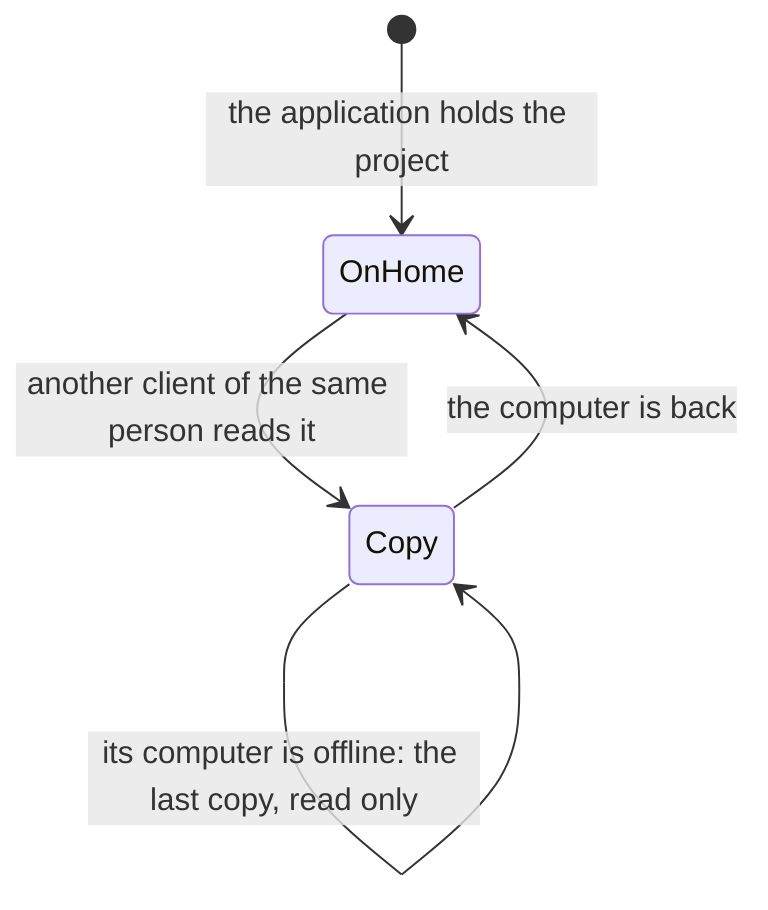

# Projects (v1)

- **Status:** **proposed 2026-11-24**, the contract of [ADR 0093](../decisions/0093-a-project-groups-repositories-instructions-and-defaults-for-chats.md). **Nothing is built:** no server, no
  store, no mock and no client serves a project today (*verified 2026-11-24*: no `projects` route in [`chat-api.yaml`](chat-api.yaml), no `projectId` on
  a thread, no `projects` key in `getConfig`). Every name, constant and code below is **proposed** unless a row says it is the owner's. The owner's
  answers of 2026-11-21 that this page follows are cited by row in the ADR.
- **What it covers:** what a **project** is (a workspace's repositories, with the instructions, members, tier defaults, default agent and model servers
  a chat of the project starts from), the routes that would serve it (`listProjects`, `createProject`, `getProject`, `updateProject`,
  `archiveProject`), and the rules a server follows so that every server and every client agree on **what a project holds, who sees it, which values
  are refused, and what a chat of the project is run with**. It writes no event and changes no thread's log.
- **Conformance vectors:** [`examples/projects/`](examples/projects/): `projects.json` (a whole save to `ok` or its error), `resolution.json` (the
  model server, the access tier, the instructions and the agent a chat starts from) and `requests.json` (raw requests and the status and `code` each is
  answered with). Nothing reads them yet: the slices of the ADR make a reader for each, and a test of each holds this page's constants to the code.
- **Words:** MUST, SHOULD and MAY are used as in RFC 2119.

A project is **its owner's**: its members read it and start chats in it, and nobody else sees that it exists. Only its owner changes it. The server
enforces this; a client only offers the screen. The **home** of a project, **cloud** or **local**, and its **workspace** are fixed when it is made.

## Constants

Every value is **proposed**, except the one the table says is the owner's.

| Name | Value | Meaning | Source |
|---|---|---|---|
| `MAX_PROJECTS` | 50 | the most projects one person owns | proposed |
| `MAX_NAME` | 80 | the longest `name`, in Unicode scalar values | proposed |
| `MAX_DESCRIPTION` | 500 | the longest `description`, in Unicode scalar values (as a prompt's) | proposed |
| `MAX_REPOSITORIES` | 16 | the most repositories of a project (as the most servers attached to a thread) | proposed |
| `MAX_REPO_NAME` | 32 | the longest repository `name` | proposed (as a prompt's `name`) |
| `MAX_URL` | 2048 | the longest repository `url`, in bytes | proposed |
| `MAX_PATH` | 4096 | the longest repository `path`, in bytes | proposed |
| `MAX_BRANCH` | 255 | the longest `defaultBranch`, in bytes | proposed |
| `MAX_INSTRUCTIONS_BYTES` | 16384 | the longest `instructions`, in UTF-8 bytes (as a prompt's body) | proposed |
| `MAX_MEMBERS` | 100 | the most members of a cloud project, its owner not counted | proposed |
| `MAX_EMAIL` | 254 | the longest member `email`, in bytes | proposed |
| `MAX_MODEL_SERVERS` | 8 | the most model servers of a project | proposed |
| `MAX_ID` | 64 | the longest `workspaceId`, `defaultAgent` or model server id, in bytes | proposed |
| `STALE_DAYS` | 7 | the default `cleanup.staleDays`: days a chat is idle before its worktree is stale | **the owner's** (row 20) |
| `MIN_STALE_DAYS`, `MAX_STALE_DAYS` | 1, 365 | the bounds of `cleanup.staleDays` | proposed |
| `MAX_REQUEST_BYTES` | 65536 | the largest request body | proposed (as a prompt's) |
| `PAGE` | 100 | the most projects one `listProjects` answer holds | proposed |

## Units

A **length** is counted in Unicode scalar values, **except** a URL, a path, a branch, an email and an id, which are counted in bytes, and
`instructions`, in UTF-8 bytes. An offset, where an error has one, is counted in UTF-16 code units (as in [`prompts-v1.md`](prompts-v1.md#units)); a
project has no reference syntax, so no error here has one yet. A JSON string with a lone surrogate is not text: the request is a 400 `bad_request`.
The server **never trims** what it is given: white space at either end of a name is an error.

## The recipe

[Diagram: a person makes a project and starts a chat in it. Every call is in the routes below, or in the run route of `chat-api.yaml`.]

1. If `getConfig` has no `projects`, offer no projects.
2. **Making one.** `createProject` with the `home` the person chose and the repositories. **A local project is made on the person's computer** by
   the application that embeds the orchestrator ([ADR 0076](../decisions/0076-the-orchestrator-as-a-library-in-an-application.md)), through the same
   operation in process. **A cloud project from a local one is not a move:** the client reads the local project's repositories and calls
   `createProject` with `home: "cloud"` and their git URLs. The result is a new project, with no chat; the local one stays (the owner's, row 14).
3. **Starting a chat.** The run that creates the thread names the project with `forwardedProps["vymalo.project"]`. **A chat with no project stays
   possible** (the owner's, row 23): it names none.
4. **A chat's project is fixed at its first message** (see [the chat](#the-chat-and-its-project)).
5. **Drawing.** A client draws a project's `name`, `description`, `instructions` and a repository's `name` as **plain text**, never as Markdown or
   HTML, and never runs anything in it.

[Diagram: the life of a project.]

An **archived** project: its chats stay readable, **no new chat can start in it**, and nothing changes in it any more. What happens to its clean
worktrees ("clean worktrees go", in the plan) is a thing of the agent's side and is not a field here ([Limitations](#limitations-what-this-is-not)).

## The fields of a project

[Vectors: `projects.json`](examples/projects/projects.json)

| Member | Rule | Error |
|---|---|---|
| `id` | made by the server: `pr-` and 12 characters of `[a-z0-9]`; global; a path id of another form is a 400 `bad_request` | |
| `name` | 1 to `MAX_NAME` scalar values; no control character (U+0000 to U+001F, U+007F to U+009F), no bidirectional control or separator ([as a prompt's title](prompts-v1.md#text-a-person-reads)); not starting or ending with U+0020, U+0009, U+000A or U+000D; **unique per owner and workspace** | 400 `bad_name`; 409 `name_taken` |
| `description` | 0 to `MAX_DESCRIPTION` scalar values (absent is empty); no control character except U+0009 and U+000A, no bidirectional control or separator | 400 `bad_description` |
| `workspaceId` | `^[A-Za-z0-9_.:-]{1,64}$`; **fixed**; the caller belongs to it, else 404 | 400 `bad_request`; 404; 422 `fixed_member` on a write |
| `home` | `cloud` or `local`; **fixed** (see [the home](#the-home)) | 400 `bad_request`; 422 `fixed_member` on a write |
| `repositories` | 0 to `MAX_REPOSITORIES` ([below](#a-repository)) | 400 `bad_repository` |
| `instructions` | 0 to `MAX_INSTRUCTIONS_BYTES` UTF-8 bytes (absent is empty); no control character except U+0009, U+000A and U+000D (so no U+0000) | 400 `bad_instructions` |
| `members` | `[]` for a local project; 0 to `MAX_MEMBERS` of `{email, role}` for a cloud one ([below](#the-members)) | 400 `bad_members`; 422 `local_project_members` |
| `tier` | `{default?, ceiling?}`, each one of `plan`, `edits`, `auto`, `bypass`; `default` not above `ceiling` ([below](#the-access-tier)) | 400 `bad_tier` |
| `defaultAgent` | an agent id of 1 to `MAX_ID` bytes the caller may invoke; absent is none | 400 `bad_request`; 422 `unknown_agent` |
| `modelServers` | 0 to `MAX_MODEL_SERVERS` distinct ids of the caller's model servers, in order ([below](#the-model-servers)) | 400 `bad_model_servers`; 422 `unknown_model_server` |
| `cleanup` | `{staleDays, mode}` ([below](#clean-up)); absent is `{7, "ask"}` | 400 `bad_cleanup` |
| `state` | `active` or `archived`; read only | |
| `owner` | the email of the person who made it (lower-cased); read only | |
| `own` | `true` for the owner; read only | |
| `revision`, `createdAt`, `updatedAt` | as a prompt's ([`prompts-v1.md`](prompts-v1.md#the-routes-in-short)): `revision` a string of decimal digits that grows with every write across all projects and is never given twice | |

A rule is tried in this order and **the first that fails is the error**: the shape (400 `bad_request`), then `name`, `description`, `repositories`
(each in order, a repository's members in the order of [its table](#a-repository)), `instructions`, `members`, `tier`, `defaultAgent` (422),
`modelServers`, `cleanup`.

### A repository

| Member | Rule | `at` on error |
|---|---|---|
| `name` | `^[a-z0-9][a-z0-9-]{0,31}$`; unique in the project (the alias a chat and an agent use) | `repositories.<i>.name` |
| `url` | **required for a cloud project, allowed for a local one**: an `https` URL with a host and a path and no user name or password, or an SSH form `<user>@<host>:<path>`; at most `MAX_URL` bytes | `repositories.<i>.url` |
| `path` | **required for a local project, refused for a cloud one**: a non-empty absolute path of at most `MAX_PATH` bytes, no U+0000 | `repositories.<i>.path` |
| `defaultBranch` | 1 to `MAX_BRANCH` bytes; no control character or space; none of `~ ^ : ? * [ \`; not starting with `-` or `/`; not ending with `/`, `.` or `.lock`; no `..`, `//` or `@{` (the refusals of `git check-ref-format` that matter here: *unverified* that this is all of them) | `repositories.<i>.defaultBranch` |
| `worktrees` | a boolean. `true`: each chat gets its own worktree and branch in every repository of the project. `false`: one shared checkout and one chat at a time. **Either in a cloud project and in a local one** (the owner's, row 15). It is the project's per-repository choice, not a default | `repositories.<i>.worktrees` |

A repository **outside the project** is not a member of this table. A chat may ask for one and **the person's yes** decides, each time (the owner's,
row 17); it is never added to the project by that yes. A **mirror** of a repository is not a field either: it is kept **per repository** in the
repository bank, not per project and not per person (the owner's, row 16).

### The members

`members` is a list of `{email, role}`. `email` is as a thread's `owner` is: an e-mail address, lower-cased by the server, at most `MAX_EMAIL` bytes;
**the owner is not in the list** and an address is named once, whatever its case. `role` is `member` (the only role in v1). **Who a member is allowed
to be** is the workspace's: an address that does not belong to the workspace is refused as `bad_members` at `members.<i>.email` (*proposed*; see
[Open](../decisions/0093-a-project-groups-repositories-instructions-and-defaults-for-chats.md#open), the invitation flow).

| Who | May |
|---|---|
| the owner | everything below, and change or archive the project |
| a member (cloud) | read the project, start a chat in it, **clean up a worktree** and be told what was cleaned (the owner's, row 19); change nothing of the project |
| anyone else | nothing: 404 |

**A local project has its owner only** (the owner's, row 19): `members` is `[]`, and any other value is 422 `local_project_members`. Whether other
people see that a local project exists is [Open](../decisions/0093-a-project-groups-repositories-instructions-and-defaults-for-chats.md#open).
**`admin` has no exception**: it reads and changes a project it does not own and is not in like anybody ([ADR 0039](../decisions/0039-nobody-reads-another-persons-thread.md),
[`prompts-v1.md`](prompts-v1.md)); *proposed*, to confirm.

### The access tier

`tier.ceiling` is the highest [access tier](access-tier-v1.md) a message of a chat in the project may be sent under; `tier.default` is the tier a
message that names none is sent under. Tiers are ordered `plan` < `edits` < `auto` < `bypass`. The rules of [What a chat is run with](#what-a-chat-is-run-with)
read them. A project **grants no tier**: its ceiling only lowers what the person's role and the agent's card already allow, and never raises it.

### The model servers

`modelServers` is an **ordered list of ids** of model servers the caller holds (OpenAI-compatible servers a person adds, the owner's row 26). **The
project carries the ids and never a URL, a key or any credential**: an id that looks like a URL is 400 `bad_model_servers`. A project's chats use
them; a chat may name its own, and an agent may have its own ([the order](#what-a-chat-is-run-with)). **The object an id names is not defined by this
page** (see [Open](../decisions/0093-a-project-groups-repositories-instructions-and-defaults-for-chats.md#open)); the page fixes only that a server
is named by id and that the id is the caller's (else 422 `unknown_model_server`).

### Clean-up

`cleanup` is `{staleDays, mode}`. A worktree is **stale** when its pull request is merged or closed, **or its chat has been idle for `staleDays`
days** (`STALE_DAYS` = 7, the owner's, row 20; the first half is the plan's reading and is *unverified* as a rule of any agent). `mode` is `ask`
(**the default: ask the person first**, the owner's, row 20) or `auto` (**clean automatically when clean**: offered as a setting, the owner's, row 20;
that it is off by default is *proposed*). `staleDays` is an integer in `MIN_STALE_DAYS` to `MAX_STALE_DAYS` (a whole `7.0` is accepted, as in
[`prompts-v1.md`](prompts-v1.md#the-variables)). A worktree with uncommitted or unpushed work is **never removed silently**, whatever the mode. These
are the project's **policy**; the routes that list and clean worktrees are not in v1 ([Limitations](#limitations-what-this-is-not)).

## The home

A project's home is fixed, as a thread's is ([ADR 0076](../decisions/0076-the-orchestrator-as-a-library-in-an-application.md), decision 6): a
deployment (`cloud`) or one application (`local`). The home's store holds the record, and nothing else writes it. **Another device may hold a copy to
read, never to write.** Moving a project between homes is not offered: the cloud copy of a local project is a new project (step 2 of the recipe).

[Diagram: a local project on a computer that is offline.]

**A local project with its computer offline shows the last copy, read only** (the owner's, row 18): a client keeps what it last read, says it is a
copy and **offers no write**. The server of a deployment never answers a write for a project whose `home` is `local`.

## What a chat is run with

[Vectors: `resolution.json`](examples/projects/resolution.json)

A chat of a project starts from the project's values. Each rule below is a function of the values given; the vectors give them.

1. **The model server:** the **chat's**, then the **project's**, then the **agent's** (the owner's, row 26). The project's layer is its list's
   **first** id (*proposed*; see [Open](../decisions/0093-a-project-groups-repositories-instructions-and-defaults-for-chats.md#open)). A chat with no project has no project layer.
   This chooses a *server*. A model **alias** a person picks ([`model-pick-v1.md`](model-pick-v1.md)) is a different choice, the agent's.
2. **The instructions:** the project's `instructions` are read **first**, then each repository's own `AGENTS.md` (else `CLAUDE.md`), in the
   project's order of repositories. The project's text grants no tool and no tier, as a repository's file does not ([adam-rs ADR 0044](https://github.com/vymalo/another-adam-rs/blob/main/docs/decisions/0044-paged-tools-a-stable-prompt-prefix-a-plan-skills-commands-and-project-context.md),
   decision 10: *unverified* here, not re-read on 2026-11-24). **How the text reaches the agent** (A2A metadata or the agent's folder) is *unverified* and
   [Open](../decisions/0093-a-project-groups-repositories-instructions-and-defaults-for-chats.md#open).
3. **The access tier** of a message:
   - the **ceiling** is the lowest of the role's cap (`maxTier`, [`access-tier-v1.md`](access-tier-v1.md)) and `tier.ceiling`; absent means no cap;
   - a message that **names a tier** above the role's cap is refused as before; **then** one above `tier.ceiling` is **422 `tier_above_project`**
     (the role's error wins when both apply);
   - a message that **names none** is sent under `tier.default` lowered to the ceiling; with no `tier.default` and a ceiling, under the ceiling; with
     neither, as [ADR 0061](../decisions/0061-the-person-picks-an-access-tier-for-each-message-the-agent-keeps-to-it.md) says today (nothing named for a
     person with no cap). The agent's live card still decides what it honours.
4. **The agent:** the agent the message or a mention names, else the project's `defaultAgent`, else the deployment's default agent.

## The chat and its project

A thread has **no project, or one, fixed at its first message** (the owner's row 23 keeps a chat with no project possible; that the project is fixed at the first message follows a thread's fixed home, [ADR 0076](../decisions/0076-the-orchestrator-as-a-library-in-an-application.md) decision 6, and is the design's rule, not a separate answer).

| Surface | What |
|---|---|
| the run that creates the thread | `forwardedProps["vymalo.project"]`: a project id. Read on every run: a member that is not a string of that form is a 400 `bad_request`. Applied only when the run **creates** the thread |
| a run on a thread that has a project | naming the **same** project is accepted (a redelivery); naming **another** is 409 `project_fixed`; naming none is accepted |
| the project is not the caller's to use | 404, the same as for an id that never existed |
| the project is archived | 409 `project_archived`, and nothing is created |
| the thread read back | `projectId` (read only, absent for a chat with no project) |
| the chat list | filtered by `project=<id>` |

The last two are **gaps of `chat-api.yaml`** and the first is a new member of `forwardedProps`; none is added by this page (see
[ADR 0093](../decisions/0093-a-project-groups-repositories-instructions-and-defaults-for-chats.md#consequences), the API epic's process).

## Errors, and which wins

[Vectors: `requests.json`](examples/projects/requests.json)

| | |
|---|---|
| 400 `bad_request` | the body is not one JSON object of the route's members (an unknown member, a member twice in any object, a member of the wrong type, `null` for any member, a lone surrogate, a body over `MAX_REQUEST_BYTES`, a `revision` that is not `^[1-9][0-9]{0,18}$`, `updateProject` with nothing to change besides `revision`), a `home` that is not `cloud` or `local`, or a path id of the wrong form |
| 400 `bad_scope`, `bad_cursor` | `scope` is not `all`, `mine` or `shared`; `cursor` is not a project id |
| 400 `bad_name`, `bad_description`, `bad_repository`, `bad_instructions`, `bad_members`, `bad_tier`, `bad_model_servers`, `bad_cleanup` | a save the rules above refuse, with `at` |
| 401, 403 `no_access` | no sign-in; the roles grant nothing |
| 403 `forbidden` | a write by a member who is not the owner |
| 404 | an id that is not the caller's and is not one they are a member of, or that does not exist; a workspace the caller is not in |
| 409 `name_taken` | the owner has a project of that name in that workspace |
| 409 `too_many_projects` | the owner holds `MAX_PROJECTS` |
| 409 `stale_revision` | `updateProject`, `archiveProject`: the project changed since the revision sent |
| 409 `project_archived` | a write to an archived project, or a chat that would start in one |
| 409 `project_fixed` | a run on a thread that has a project names another |
| 415 | the media type is not **exactly `application/json`** (a parameter such as `charset` is allowed, the case is ignored) |
| 422 `fixed_member` | `home` or `workspaceId` sent to `updateProject` (`at` says which) |
| 422 `local_project_members` | members on a local project |
| 422 `unknown_agent`, `unknown_model_server` | an id the caller may not use |
| 422 `tier_above_project` | a message above the project's tier ceiling |
| 503 | the store cannot answer |

**When two errors apply, the first of these wins.** For every route: 401, 403 `no_access`, then 415, then the shape (400 `bad_request`, `bad_scope`,
`bad_cursor`). Then:

- `createProject`: **404** (workspace), the values in the order of [the fields](#the-fields-of-a-project), 422 `unknown_agent`, 422
  `unknown_model_server`; then, in the store, 409 `name_taken` and `too_many_projects`.
- `updateProject`, `archiveProject`: **404**, **403 `forbidden`**, **409 `project_archived`** (not for `archiveProject`, which is idempotent),
  **422 `fixed_member`**, **409 `stale_revision`**, then the values of the whole project as it would be, then the 422s, then 409 `name_taken`. A
  request that changes nothing writes nothing and keeps the revision (the revision is still checked).
- `getProject`: 404.

A write is one statement, so there is no half-saved project.

## What the server logs

A name, a description, instructions, a URL, a path and an email are **in no log line, trace or error text**: the request log holds the method and the
path (ids only), and a problem names positions and ids and never quotes a value. A project is in no thread, no fork and no export, and no event
records it.

## The routes, in short

| Route | Success | Notes |
|---|---|---|
| `GET /api/projects?scope=all\|mine\|shared&cursor=pr-...` | 200 `{limit, held, items, nextCursor?}` | up to `PAGE` projects ordered by `id` (bytewise); `held` is how many the caller owns; `all` is the caller's own and those they are a member of, `shared` leaves the caller's own out; an `archived` project is listed |
| `POST /api/projects` | 201 `Project` | |
| `GET /api/projects/{projectId}` | 200 `Project` | the owner or a member |
| `PATCH /api/projects/{projectId}` | 200 `Project` | `{revision (required), name?, description?, repositories?, instructions?, members?, tier?, defaultAgent?, modelServers?, cleanup?}`; a member given **replaces** the whole member; `defaultAgent: ""` clears it (below) |
| `POST /api/projects/{projectId}/archive` | 200 `Project` | `{revision}`; an archived project answers the same |

`null` is refused for every member (as in [`prompts-v1.md`](prompts-v1.md)). To remove a default agent a client sends `defaultAgent: ""` to `updateProject`, which means none (*proposed*). **Every answer under `/api/projects` carries `Cache-Control: no-store`**, errors included.

## Limitations (what this is not)

- **No delete in v1.** A project ends archived. Whether a person may delete one is [Open](../decisions/0093-a-project-groups-repositories-instructions-and-defaults-for-chats.md#open).
- **No route to list or clean worktrees.** The policy is here (`worktrees`, `cleanup`); a read of an agent's worktrees with their ahead, behind and
  uncommitted counts needs an adam-rs read and a route of its own: *unverified* that either exists (no such API found on 2026-11-19).
- **No per-project quota and no usage page** here.
- **No folders, tags or ordering** of projects by the person; the list is by id and a client sorts it.
- **No history of a project's earlier revisions**, and no copy of a project.
- **The workspace is an identifier, not an object.** This page does not say what a workspace is, who administers it, or how an address becomes a
  member of it.
- **No invitation flow.** `members` is set by the owner; whether an invitation is accepted by the invited is [Open](../decisions/0093-a-project-groups-repositories-instructions-and-defaults-for-chats.md#open).
- **Unicode** as in [`prompts-v1.md`](prompts-v1.md#limitations-what-this-is-not): nothing beyond the code points named.

## API gaps found

None is fixed by this page. The gaps of [`chat-api.yaml`](chat-api.yaml) that the contract needs are listed in
[ADR 0093, Consequences](../decisions/0093-a-project-groups-repositories-instructions-and-defaults-for-chats.md#consequences): the five routes; the
`projects` key of `getConfig`; `vymalo.project` and `projectId`; the `project` filter of the chat list; the codes of the table above; and a
per-chat pick of a model server.
