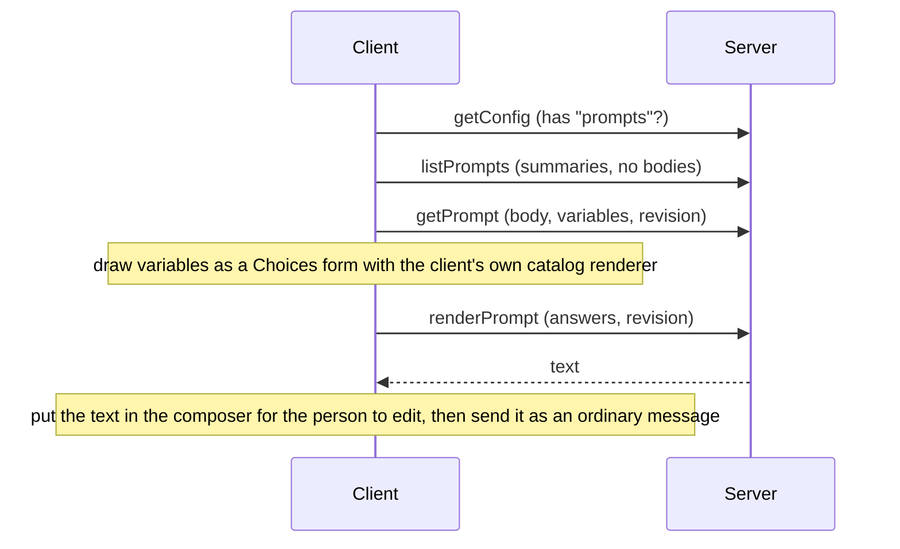
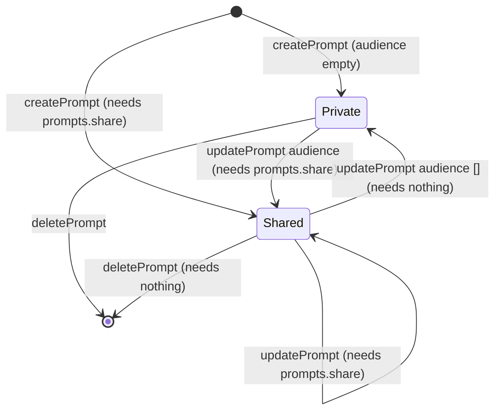

# A person's prompt library (v1)

- **Status:** contract written 2026-11-15 for the owner's "LibreChat-grade, client-agnostic" plan
  ([ADR 0067](../decisions/0067-the-plan-to-librechat-grade-and-the-client-agnostic-rule.md), wave 1, slices P1, P2 and P4), decided by
  [ADR 0070](../decisions/0070-a-persons-prompt-library.md). It describes what the orchestrator does and what the web's mock server does. The web has
  its page **My prompts** (`/prompts`: list, create, edit, delete, copy a shared prompt; `web/README.md` "A person's prompt library", built 2026-11-15,
  proven on the mock only); the `/` menu of the message box and the form that draws a prompt's variables (built 2026-11-18, proven on the mock only); and the
  sharing control (Share, Change sharing, Stop sharing, and the dialog that names the roles; built 2026-11-18, proven on the mock only). *Verified 2026-11-15*: the
  Postgres store's tests (the conformance suite and its own) ran on PostgreSQL 16.15 locally, and the Rust API and the mock pass the same vectors; the
  scenario `dev/prompts-e2e.sh` on the whole stack is the pull request's CI run. *Unverified*: a client other than the web's mock.
- **What it covers:** the six routes [`listPrompts`](chat-api.yaml), `createPrompt`, `getPrompt`, `updatePrompt`, `deletePrompt` and `renderPrompt`
  (`/api/prompts`), and the rules a server follows so that **every server and every client agree on what a prompt is, which prompts a person sees, and the
  exact text a filled prompt becomes**: what a reference is, what a variable is, what an answer is, how the text is built, and in which order errors win.
  The same library is served as **MCP prompts** by the orchestrator's MCP server (`prompts/list`, `prompts/get`, [below](#the-same-library-as-mcp-prompts)).
  `orch_core::prompt` (`orchestrator/crates/core/src/prompt.rs`, Rust) and `web/mock/prompts.ts` (TypeScript) are two
  implementations of this page, and a third reads it the same way.
- **Conformance vectors:** [`examples/prompts/`](examples/prompts/): `references.json` (a body to its segments, or its error), `prompts.json` (a whole
  save to `ok` or its error), `render.json` (a prompt, an answer and the text, or the refusal) and `requests.json` (raw requests and the status and `code`
  each is answered with). The Rust core reads the first three and also the catalog page's `vectors`, `whole-answers` and `invalid-questions` blocks
  ([`ui-catalog-v1.md`](ui-catalog-v1.md#receiving-an-answer)); the Rust API reads the last two over HTTP and `prompts.json` through `createPrompt`; the
  mock's tests read all four; a test of each holds this page's constants to the code.
- **Words:** MUST, SHOULD and MAY are used as in RFC 2119.

A prompt is **its owner's**: nobody else reads it unless the owner shares it with a role, and then the others read it and render it and nothing else. The
server enforces this; a client only offers the screen. `admin` reads no prompt that is not its own ([ADR 0039](../decisions/0039-nobody-reads-another-persons-thread.md)).

## Constants

| Name | Value | Meaning |
|---|---|---|
| `MAX_PROMPTS` | 100 | the most prompts one person holds |
| `MAX_NAME` | 32 | the longest `name`, in characters |
| `MAX_TITLE` | 120 | the longest `title`, in Unicode scalar values |
| `MAX_DESCRIPTION` | 500 | the longest `description`, in Unicode scalar values |
| `MAX_BODY_BYTES` | 16384 | the longest `body`, in UTF-8 bytes |
| `MAX_VARIABLES` | 8 | the most variables of a prompt |
| `MAX_AUDIENCE` | 32 | the most roles a prompt is shared with |
| `MAX_AUDIENCE_VALUE` | 64 | the longest role value, in bytes |
| `MAX_RENDERED_BYTES` | 32768 | the longest rendered text, in UTF-8 bytes |
| `MAX_REQUEST_BYTES` | 65536 | the largest request body |
| `PAGE` | 100 | the most prompts one `listPrompts` answer holds |

## Units

A **length** is counted in Unicode scalar values (an emoji is one), the unit of JSON Schema's `maxLength`; **except the body and the rendered text, which
are counted in UTF-8 bytes**. An **offset** in an error is counted in **UTF-16 code units** (an emoji is two), as in
[`thread-search-v1.md`](thread-search-v1.md) and `Mention`. A JSON string with a lone surrogate is not text: the request is a 400 `bad_request`. The
server **never trims** anything it is given: white space at either end of a title is an error, and a text answer is rendered as sent (the client trims
what a person typed, as the catalog says).

## The recipe

[Diagram: the sequence of a person using a prompt, and of an owner sharing one.]

**Using a prompt** (any person):

1. If `getConfig` has no `prompts`, offer no library.
2. `listPrompts` (`scope=all`, the default) gives summaries: `name`, `title`, `description`, `variableCount`, `own`. Sort for display by `name`
   yourself: the server orders by `id`. Page with `nextCursor` until it is absent.
3. `getPrompt` for the one chosen: `body` and `variables` (questions of the UI catalog) and the `revision`.
4. Draw `variables` as a [`Choices`](ui-catalog-v1.md) form **with the client's own catalog renderer** and the person's answers as the catalog's answer
   (`answers`, one entry per variable, in order). **A client that cannot draw a kind of question does not offer the prompt** (it may say why). With no
   variables, send `answers: []` and draw nothing.
5. `renderPrompt` with the `answers` and the `revision` of step 3 (a 409 `stale_revision` means the prompt changed: read it again). The answer's `text` is
   what the person edits in the message box and sends as an **ordinary message**: nothing here sends it.
6. **Shared text is text.** A client MUST draw a prompt's `title`, `description` and `body` as plain text, never as Markdown or HTML of the author's, and
   MUST NOT run anything in it.

**Owning prompts:** `createPrompt`; `updatePrompt` with the `revision` last read (a 409 `stale_revision` means read again and redo); `deletePrompt`.
Offer the sharing control only when `getMe` lists `prompts.share`. A prompt the person shared before they lost the permission stays shared and
**frozen**: the only writes accepted are the one that empties `audience` and the delete. **A person who lost `prompts.share` cannot edit a shared
prompt (not its title, not its body) without unsharing it first**: the edit that leaves the share in place is a 403 `forbidden`, and a client says so
(offer "stop sharing" beside the edit).

[Diagram: the life of a prompt.]

## The fields of a prompt

[Vectors: `prompts.json`](examples/prompts/prompts.json)

| Member | Rule | Error |
|---|---|---|
| `name` | `^[a-z0-9][a-z0-9-]{0,31}$`; **unique per person** (it is the `/name` of the `/` menu) | 400 `bad_name`; 409 `name_taken` |
| `title` | 1 to `MAX_TITLE` scalar values; no control character (U+0000 to U+001F, U+007F to U+009F) and no [bidirectional control or separator](#text-a-person-reads); **not** starting or ending with U+0020, U+0009, U+000A or U+000D | 400 `bad_title` |
| `description` | 0 to `MAX_DESCRIPTION` scalar values (absent is empty); no control character except U+0009 and U+000A, and no bidirectional control or separator | 400 `bad_description` |
| `body` | 1 to `MAX_BODY_BYTES` UTF-8 bytes; no control character except U+0009, U+000A and U+000D (so **no U+0000**: a database cannot store it); not only U+0020, U+0009, U+000A and U+000D | 400 `bad_body` |
| `variables` | 0 to `MAX_VARIABLES` questions ([below](#the-variables)); absent is `[]` | 400 `bad_variable` (a count above 8 is `at: "variables"`) |
| `audience` | 0 to `MAX_AUDIENCE` distinct role values; absent is `[]` (private) | 400 `bad_audience` |

**Text a person reads** (a title, a description, and the texts of a variable below) refuses, besides the control characters of its
row, the **bidirectional embeddings, overrides and isolates (U+202A to U+202E, U+2066 to U+2069) and the line and paragraph separators (U+2028, U+2029)**,
with the same error as a control character: a shared title that reorders what follows it can pass for another person's. The zero-width joiners, the
left-to-right and right-to-left marks and everything else stay allowed (scripts and emoji need them). The body is judged by its own row and is not
changed by this. **A client draws these fields as plain text** (see step 6 of the recipe).

The **id** is made by the server: `p-` and 12 characters of `[a-z0-9]`. It is global: the id alone names a prompt, so a person in the audience
fetches a shared prompt without knowing who wrote it. A path id that is not of that form is a 400 `bad_request`.

## References

[Vectors: `references.json`](examples/prompts/references.json)

The body is **text with references**: `{{id}}` where `id` is a variable's id, `[A-Za-z0-9_.:-]{1,64}` (case matters). The body is read left to
right, one scalar value at a time, keeping its UTF-16 offset:

1. A `\` followed by `{{` is an **escape**: it writes a literal `{{`, and reading continues after the two braces. Any other `\` is a literal `\`. So
   `\{{x}}` is the text `{{x}}` (no reference), and `\\{{x}}` is the literal `\` followed by the escape: the text `\{{x}}`, no reference.
2. An unescaped `{{` MUST be followed by an id and then exactly `}}`. Anything else is **`bad_reference`**, with `at: "body"` and `offset`, the UTF-16
   offset of that `{{`: `{{ x }}` (white space), `{{}}`, `{{x}`, `{{x`, `{{{x}}}` (the `{{` at offset 0 is followed by `{`), `{{a{{b}}}}` (nested), an id of
   65 characters and an id with a character outside the set (`{{café}}`).
3. A lone `}}`, a `{x}` and a lone `{` are literal text.
4. An id may be used any number of times: every use gets the value.

A body reads into **segments**: literal text, with escapes resolved, and references. `references.json` gives, per body, the segments (a string for
literal text, `{"ref": "id"}` for a reference; adjacent literals are one) or the error.

After the variables are valid, **the first reference whose id is not a variable** is `undeclared_variable` (`at: "body"`, its `offset`), and then
**the first variable, in order, that no reference uses** is `unused_variable` (`at: "variables.<i>"`).

## The variables

[Vectors: `prompts.json`](examples/prompts/prompts.json), and the catalog's [`invalid-questions`](ui-catalog-v1.md#receiving-an-answer)

A variable is a **question of the `Choices` schema of the UI catalog, version 8**
([`ui-catalog-v1.md`](ui-catalog-v1.md#the-choices-schema-as-the-catalog-holds-it), `catalog.json`): same members, same bounds, same rules
([version 5](ui-catalog-v1.md#version-5-questions-with-a-title-a-description-and-typed-options) and
[version 7](ui-catalog-v1.md#rules-json-schema-cannot-say)), with these differences, each a refusal (`bad_variable`):

- **the type `images` is refused**, and so is **`show`** and an option's **`image`**: each needs a surface or a thread's files, which a prompt has neither of;
- **`min` and `max` are refused on a question that takes one choice** (the catalog does not say; a prompt is stricter);
- every variable's `id` is unique among the variables (the catalog's rule) and is the name of its reference;
- **every text a person reads is text a prompt may have**: `question`, `help`, an option's `label` and `description`, `yesLabel`, `noLabel`, `unit`,
  `fromLabel` and `toLabel` have **no control character at all** (a line break and a tab included) and no bidirectional control or separator
  ([above](#text-a-person-reads)); a `default` of a `text` or `longText` question has no bidirectional control or separator either. (A database that keeps
  a variable as JSON cannot hold U+0000, so a store that accepted it would answer a retryable-looking 503 for what no retry can save.)

`bad_variable` carries `at`: `variables.<i>` and, when a member is to blame, `.<member>` (an option: `variables.<i>.options.<j>` and `.<member>`). The
rules are tried in this order, **the first that fails is the error**: (1) the variable is an object; (2) members that no question has, and `show`
(alphabetical); (3) `type` is one of `single`, `multiple`, `select`, `text`, `longText`, `confirm`, `number`, `scale`, `date`, `rank` (absent is `single`);
(4) members that this kind does not take, in the table below (alphabetical); (5) each member's own type and bounds, in the order `id`, `question`, `help`,
`required`, `options`, `multiple`, `allowOther`, `default`, `min`, `max`, `yesLabel`, `noLabel`, `minValue`, `maxValue`, `step`, `unit`, `from`, `to`,
`fromLabel`, `toLabel`, `minDate`, `maxDate` (inside `options`, option by option: `value`, `label`, `description`, `icon`, `recommended`); (6) the rules
between members: `multiple` against `type`, the number of options, option values unique, `min` against `max` against the options, and `default` last.

| Kind | Members besides `id`, `question`, `help`, `type`, `required` |
|---|---|
| `single` | `options` (2 to 12), `allowOther`, `default`, `multiple` (only `false`) |
| `multiple` | `options` (2 to 12), `allowOther`, `default`, `multiple` (only `true`), `min`, `max` |
| `select` | `options` (2 to 50), `allowOther`, `default`, `multiple`, `min`, `max` (these two only with `multiple: true`) |
| `text`, `longText` | `default` |
| `confirm` | `yesLabel`, `noLabel`, `default` |
| `number` | `minValue`, `maxValue`, `step`, `unit`, `default` |
| `scale` | `from`, `to` (required), `fromLabel`, `toLabel`, `default` |
| `date` | `minDate`, `maxDate`, `default` |
| `rank` | `options` (2 to 12, no `image`), `default` |

`required` is **`true` when absent, for every kind** (the web reads it so; version 7 says it for the five newer kinds, this page for all). A
`default` is what a client's form starts with; **the server never substitutes it**. **An integer member** (`min`, `max`, `from`, `to`) is any JSON
number whose value is an integer in range: `5`, `5.0` and `5e0` are 5, and `5.5`, a string and a number out of range are refused (`bad_variable` at the
member). A client that writes a whole double as `5.0` (Dart and JavaScript number types do) is not refused for it.

## The audience

[Vectors: `prompts.json`](examples/prompts/prompts.json)

`audience` is a list of role values, the values of the **roles claim** of a person's credential ([ADR 0045](../decisions/0045-admin-dashboard-in-the-web-and-agent-access-from-the-registry.md)'s
grammar): each is 1 to `MAX_AUDIENCE_VALUE` bytes, every byte in 0x21 to 0x7E (no space, no non-ASCII); **`"*"` means everybody and is only allowed alone**.
At most `MAX_AUDIENCE` values, **counted once each**: `["a", "a"]` is `["a"]`. The server stores and returns the set sorted by bytes. Empty is private.
A violation is `bad_audience`.

**Who sees a shared prompt:** a caller sees it when the audience holds `"*"` or **one of the values of their roles claim, compared byte for byte**
(`Team` is not `team`). **There is no administrator exception**: `admin` sees what its own roles claim sees, like anybody ([ADR 0039](../decisions/0039-nobody-reads-another-persons-thread.md)).
The roles are the credential's, **as given**, not the roles that `auth.roles` defines. A sharer MAY name roles they do not hold, `"*"` included.

**What a person who is not the owner sees** of a shared prompt: `id`, `name`, `title`, `description`, `body`, `variables`, `revision`, `updatedAt` and
`own: false`. **Never** the owner, the audience, or when it was created. Nobody outside the audience gets any answer that says the prompt exists:
**404, the same as for an id that never existed**, on `getPrompt`, `renderPrompt`, `updatePrompt` and `deletePrompt` alike. An **audience member** gets
`getPrompt` and `renderPrompt` (200) and a 404 for the two writes: a prompt is changed by its owner.

**The permission.** A write whose **resulting** audience is not empty needs **`prompts.share`** (`getMe` lists it for a holder): no role holds it by
default and `admin` does not imply it. So an `updatePrompt` that leaves a share in place (it names no `audience`, and the prompt is shared) by a person
who no longer holds it is a **403 `forbidden`**: only `audience: []` and `deletePrompt` are accepted from them. Unsharing and deleting need nothing.

## The answer

[Vectors: `render.json`; the catalog's `vectors`, `whole-answers` and `invalid-questions`](ui-catalog-v1.md#receiving-an-answer)

The request of `renderPrompt` is `{revision?, answers}`. `answers` is the [Choices answer](ui-catalog-v1.md#choices-answers) of the prompt's variables:
**exactly one entry per variable, once each, in variable order**, each `{id, values, other?, text?}`. A prompt has no free-input box, so a request with a
`note` is refused. The server **never repairs** an answer (no trimming, no clamping, no sorting, no default) and says the **first** rule that fails:

- the **whole answer** first: `answers` missing or not a list: `unknown` (`question: "*"`); a `note` member: `unexpected` (`*`); the entries are not the
  variables, once each, in order (an entry that is not an object, a missing, extra, repeated or reordered id): `unknown` (`*`);
- then **each variable, in order**, the first rule that fails (below). The error says `question`, the variable's id, and `rule`.

The rules of the **five newer kinds** (`confirm`, `number`, `scale`, `date`, `rank`) are those of
[the catalog's table](ui-catalog-v1.md#receiving-an-answer) and its 133 vectors. The older types are written here, since the catalog leaves them to
the receiver:

| Type | Entry members | Rules, in this order |
|---|---|---|
| `single`, `select` (one choice) | `id`, `values`, and `other` only with `allowOther` | `values` is a list, else `unknown`; a member not allowed, `unexpected`; nothing given (no `values`, no `other`) and required: `required`; more than one of a value and an `other`: `too_many`; a value that is not a string or not an option's `value`: `not_offered`; an `other` that is not a string, is empty or has a control character (any but U+0009, as for a `text` question): `grammar`; an `other` over 500 scalar values: `too_long` |
| `multiple`, `select` with `multiple: true` | the same | `values` a list, `unexpected`; `required`; each value an option's (`not_offered`); **no value twice** (`repeated`); **in the order of the options** (`out_of_order`); an `other` as above; then the number of choices (the values and the `other`) against `max` (`too_many`) and `min` (`too_few`); an unanswered optional question has no count to check |
| `text`, `longText` | `id`, `values`, `text` | `values` a list, `unexpected`; `values` is not empty: `not_offered`; no `text` and required: `required`; a `text` that is not a string, is empty, or has a control character (a `text` question: any but U+0009; a `longText`: any but U+0009 and U+000A): `grammar`; over 500 (`text`) or 2,000 (`longText`) scalar values: `too_long` |

`unexpected` is a member other than the entry's allowed ones (`other` without `allowOther`, `text` on a choice question, `other` or `text` on a newer kind).
**The rule names are a closed list:** `unknown`, `unexpected`, `required`, `too_many`, `too_few`, `not_offered`, `repeated`, `out_of_order`, `too_long`,
`grammar`, `below_min`, `above_max`, `off_step`, `not_a_permutation`. A decimal is compared exactly (a scaled integer, never a float); a date is a real
calendar day.

## Render

[Vectors: `render.json`](examples/prompts/render.json)

`renderPrompt` writes **nothing** and returns `{text, revision}`. The text is the body's segments, in order: literal text as it is (escapes resolved), and
for each reference **the variable's answer, written by its kind**:

| Kind | Renders as |
|---|---|
| `single`, `select` (one choice) | the chosen option's **label**, or the `other` words |
| `multiple`, `select` with several | the labels in the order of the options joined by `", "`, then the `other` last |
| `text`, `longText` | the `text`, verbatim |
| `confirm` | `yes` or `no`, whatever the labels say |
| `number` | the decimal string as sent (`2.50` stays `2.50`; the `unit` is not written) |
| `scale` | the whole number as sent |
| `date` | `YYYY-MM-DD` as sent |
| `rank` | `1. <label>; 2. <label>; ...` in the person's order |

An **optional variable left unanswered** (`values: []`, no `other` or `text`) renders as the **empty string**: no line is removed and **the default is
never used**. There is **no second pass**: a value that holds `{{y}}` is written as it is. Nothing is trimmed. Before building anything, the server adds up the
sizes: if the text would be over `MAX_RENDERED_BYTES` it is **422 `rendered_too_long`** and nothing is built.

If the request holds a `revision` that is not the prompt's current one, it is **409 `stale_revision`**: the person filled in a form for a body that has
changed. Without one the current prompt is rendered, and the answer says which `revision` it used.

## Errors, and which wins

[Vectors: `requests.json`](examples/prompts/requests.json)

| | |
|---|---|
| 400 `bad_request` | the body is not one JSON object of the route's members (an unknown member, **a member twice in any object of the request, a variable's, an option's or an answer's included**, a member of the wrong type, `null` for any member, a lone surrogate, a body over `MAX_REQUEST_BYTES`, a `revision` that is not `^[1-9][0-9]{0,18}$`, `updatePrompt` with nothing to change besides `revision`), or a path id of the wrong form |
| 400 `bad_scope`, `bad_cursor` | `scope` is not `all`, `mine` or `shared`; `cursor` is not a prompt id |
| 400 `bad_name`, `bad_title`, `bad_description`, `bad_body`, `bad_reference`, `bad_variable`, `undeclared_variable`, `unused_variable`, `bad_audience` | a save the rules above refuse, with `at` (and `offset` for a reference) |
| 401, 403 `no_access` | no sign-in; the roles grant nothing |
| 403 `forbidden` | a write whose resulting audience is not empty, by a person without `prompts.share` |
| 404 | an id that is not the caller's and is not shared with them, or that does not exist; a write by a non-owner |
| 409 `name_taken` | the person already has a prompt of that name |
| 409 `too_many_prompts` | the person holds `MAX_PROMPTS` |
| 409 `stale_revision` | `updatePrompt`, `deletePrompt` (when it names a `revision`) and `renderPrompt` (when it names one): the prompt has changed since |
| 415 | the media type is not **exactly `application/json`** (a parameter such as `charset` is allowed, the case is ignored) |
| 422 `invalid_answer` | the answer does not fit the variables; the members `question` (a variable's id, or `"*"`) and `rule` |
| 422 `rendered_too_long` | the text would be over `MAX_RENDERED_BYTES` |
| 503 | the store cannot answer |

**When two errors apply, the first of these wins.** For every route: 401, 403 `no_access`, then 415, then the shape of the request (400 `bad_request`,
`bad_scope`, `bad_cursor`; a path id of the wrong form). Then:

- `createPrompt`: **403 `forbidden`**, then the values in the order `name`, `title`, `description`, `body` (its size and characters), the references'
  grammar, the variables (each in order), `undeclared_variable`, `unused_variable`, `audience`; then, in the store, 409 `name_taken` and then
  `too_many_prompts`.
- `updatePrompt`: **404**, then **403 `forbidden`** (judged on the resulting audience), then **409 `stale_revision`**, then the values of the whole prompt as
  it would be (the same order), then 409 `name_taken`. A request that changes nothing writes nothing and keeps the revision (the revision is still
  checked).
- `deletePrompt`: 404, then 409 `stale_revision`. `renderPrompt`: the shape of the body (400), 404, 409 `stale_revision`, then 422.

A **write is one statement**, so there is no half-saved prompt. A revision is a string of decimal digits; it grows with every write across all
prompts, and **no revision is given twice**.

## What the server logs

A body, a title, an answer and a role value are **in no log line, trace or error text**: the request log holds the method and the path (which holds only
ids), a body that does not parse is answered in fixed words, and a problem names positions and ids and never quotes a value. A prompt is in no thread, no
fork and no export.

## The routes, in short

| Route | Success | Notes |
|---|---|---|
| `GET /api/prompts?scope=all\|mine\|shared&cursor=p-...` | 200 `{limit, held, items, nextCursor?}` | up to `PAGE` summaries ordered by `id` (bytewise); `held` is how many the caller owns, for any scope; `items` have no `body` and no `variables`, and have `variableCount`; `audience` only on the caller's own; `all` is the caller's own and the ones shared with them, `shared` leaves the caller's own out |
| `POST /api/prompts` | 201 `Prompt` | |
| `GET /api/prompts/{promptId}` | 200 `Prompt` | own, or shared with the caller |
| `PATCH /api/prompts/{promptId}` | 200 `Prompt` | `{revision (required), name?, title?, description?, body?, variables?, audience?}`; a member given **replaces** the whole member |
| `DELETE /api/prompts/{promptId}?revision=N` | 204 | `revision` is optional |
| `POST /api/prompts/{promptId}/render` | 200 `{text, revision}` | `{revision?, answers}` |

A **`Prompt`** is `{id, name, title, description, body, variables, own, audience?, revision, updatedAt}`; `revision` is a string; `audience` is there
only when `own`. **Every answer under `/api/prompts` carries `Cache-Control: no-store`**, the 401, the 403 `no_access`, a 404 or 405 for a path or a verb the routes do not
have, the 415 and a timeout's 503 included.

## The same library as MCP prompts

The orchestrator's MCP server (`/mcp`, [ADR 0019](../decisions/0019-mcp-server-over-streamable-http.md),
`orchestrator/crates/surface-mcp`) serves the caller's library as **MCP prompts**: an MCP client that knows the library
needs no route of its own. The server enables `prompts` in its capabilities, and the library it lists is the caller's
principal's, exactly what `listPrompts?scope=all` answers that person.

| Method | Server call | Answers |
|---|---|---|
| `prompts/list` | `App::list_prompts(principal, all, …)` | every prompt the caller sees, in one page: `name`, `title`, `description`, and its variables as `arguments` |
| `prompts/get` | `App::get_prompt` then `App::render_prompt` | one message, role `user`, its text the rendered prompt; **nothing is sent and nothing is written** |

- **Name.** A prompt is listed under its own `name`. Two prompts the same person sees can hold one name (names are
  unique per owner, and a shared prompt is someone else's), and MCP addresses a prompt by name: when a name is not
  unique in the caller's list, **both** prompts are listed under their `id` (`p-…`) instead. A client does not try to
  parse a name; it gets one from `prompts/list` and gives it back to `prompts/get`.
- **Arguments.** Each variable is one argument: its `name` is the variable's `id` (the `{{reference}}` of the body), its
  `description` is the `question`, and it is `required` unless the variable has `"required": false`. An argument is a
  **string**, because that is what MCP carries: a `text` or `longText` variable takes it as the `text` of the answer; a
  kind that takes several (`multiple`, `rank`, and a `select` with `"multiple": true`) reads it as a comma-separated
  list, trimmed; every other kind takes one value — a choice by its `value` (not its label) and a `scale` or `number` as
  its digits. The server then renders the prompt with [the answer rules of this page](#the-answer), so a choice is
  rendered as its label, a text as sent, and so on.
- **One page.** `prompts/list` answers every prompt the caller sees in a single page and sends no cursor (an MCP client
  asks for no more); reading a prompt's variables costs one store read per prompt that has any.
- **Errors**, as protocol errors (an MCP prompt call has no tool-level refusal): `unknown prompt "<name>"` for a name
  the caller's library does not hold — another person's private prompt, one shared with roles the caller does not have,
  and one that never existed are the same answer; `unknown argument "<name>"` for an argument that names no variable;
  and, for an answer the rules refuse, the variable's id and the rule (`the answer for "focus" breaks the rule
  "not_offered"`), never the value.
- **What it does not do.** No stage of it creates, edits, deletes or shares a prompt, and no `prompts/get` starts a job:
  the text goes to the client's message box and the person sends it, as on `/prompts`.

A client is configured like any MCP server of the deployment: the streamable HTTP transport at `https://<host>/mcp`
with `Authorization: Bearer <token>`, the token of an entry of `MCP_TOKENS_FILE` whose `user` is the person whose library
is wanted. The tool and prompt set is the server's, so the same connection gives `start_job` and the library.
*Unverified* (2026-11-24): each client's own configuration syntax — Claude Code's `claude mcp add --transport http …`
and OpenCode's `"mcp": {"<name>": {"type": "remote", "url": …, "headers": {…}}}` — is from that client's documentation
and was not run against this server.

## Limitations (what this is not)

- **No attachments, no files and no pictures in a prompt**, and no `images` question.
- **No folders, tags, search or ordering by the person** in this version: the list is by id and a client sorts it.
- **No history of a prompt's earlier revisions**, and no copy of a shared prompt into one's own library (a client reads the shared prompt and creates its
  own from what it read).
- **No per-person rate limit** on render in this version.
- **Unicode.** The control-character classes and the bidirectional ones are those of the code points named above; nothing else of Unicode's tables is read
  (no normalisation, no check for look-alike characters, no check of a script's mixture): a shared title can still be misleading, which is why a client
  draws it as plain text and names who may read it.
- **A save rule that is tightened later** is a change of what a stored row may hold: it needs a migration of the stored rows, or a reader that reads
  leniently. A store reads a row back through the same rules ([ADR 0070](../decisions/0070-a-persons-prompt-library.md), *what the build settled*).

## API gaps found

None new. This page closes one gap of [ADR 0067](../decisions/0067-the-plan-to-librechat-grade-and-the-client-agnostic-rule.md#the-rule): `deletePrompt`
takes an optional `revision`, which `deleteUserToolServer` still does not.
