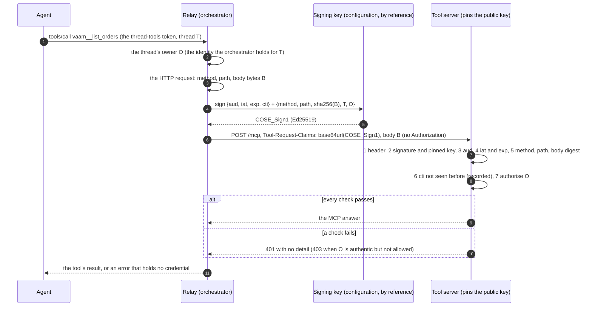
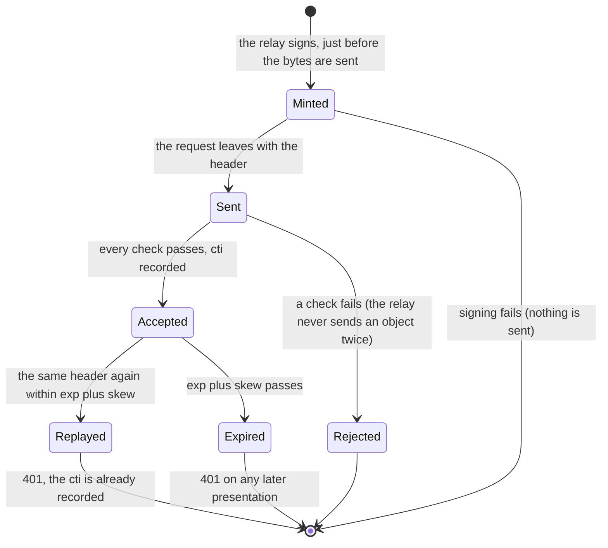
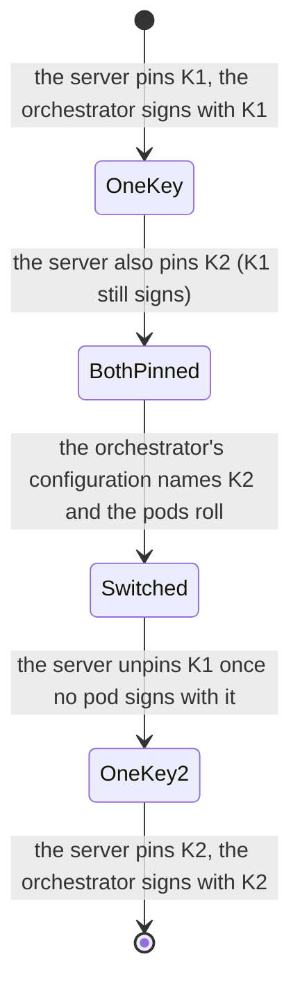

# Signed requests to a tool server (v1)

- **Status:** **proposed (2026-11-02)**, written before the code and implemented by the same change
  ([ADR 0067](../decisions/0067-requests-to-a-tool-server-are-signed-for-the-person.md)). The orchestrator's side is built
  (`orch-signed-request`, `orch-tools-mcp`, the relay and `toolServers[].signing`), proven on mocks and, when it was written, against
  the real `cratestack-cose` 0.17.2 (the [interoperability crate](#how-this-page-is-kept-true), run on 2026-11-02, locally and by its CI job on
  the pull request that brought it, #311). **No tool server verifies it yet**: the receiving side of the first one (vaam-apps, on a cratestack 0.17.2
  MCP endpoint) is written against this page.
- **Served by:** nobody: this is not an A2A extension and an agent never sees it. **Used by:** the orchestrator's relay when it
  calls a tool server on an agent's behalf, and the tool servers that choose to verify it.
- **Decided in:** [ADR 0067](../decisions/0067-requests-to-a-tool-server-are-signed-for-the-person.md); it extends the relay of
  [ADR 0024](../decisions/0024-mcp-tools-attached-per-conversation.md) and replaces, for a server that is configured for it, the
  static bearer of [`config.md`](config.md#toolservers).
- **Not in this page:** the token the orchestrator gives an *agent* to call the orchestrator
  ([`thread-tools-v1.md`](thread-tools-v1.md#the-token)), and the MCP revision the connection speaks
  ([`config.md`](config.md#toolservers), `toolServers[].protocol`).

Facts about third parties are marked *verified* (with a date and a source) or *unverified*; see
[Verified and unverified](#verified-and-unverified-2026-11-02).

## Purpose

A tool server that does something *for a person* (reads their orders, places something in their basket) has to know
**which person**, and has to be able to trust the answer. Until now the relay sent the server one static bearer token and
some static headers, the same for every thread and every person: the server could learn who *the orchestrator* was and nothing
else. This page defines what the relay sends instead, to a server that is configured for it:

- **one header on every HTTP request**, holding a short-lived object signed with a key only the orchestrator has;
- the object says **which request it is for** (method, path, a digest of the exact body bytes), **for whom** (the thread's owner)
  and **in which conversation** (the thread);
- the server pins the orchestrator's public key, checks the object, and then authorises *the owner* as it would any person.

A signed server is sent **no bearer**. A server that is not configured for signing is sent what it was sent before.

## The flow





**Every HTTP request is signed with a header of its own**, a fresh `cti` each: the handshake (`initialize` or
`server/discover`), each page of `tools/list`, `tools/call`, and the `GET` and `DELETE` that a session of an older MCP revision
may use. The relay never sends the same header twice.

## The header

| | |
|---|---|
| Name | `Tool-Request-Claims` (HTTP header names are case-insensitive; the orchestrator sends it in this spelling). Fixed by this page: not configurable |
| Value | the bytes of **one** tagged `COSE_Sign1` (CBOR tag 18), encoded as **base64url without padding** ([RFC 4648 §5](https://www.rfc-editor.org/rfc/rfc4648#section-5)): the characters `A-Z a-z 0-9 - _`, nothing else, no whitespace, no `=` |
| How many | exactly one header, once. A request with none, or with two, is not signed |
| Size | at most **4096** characters. A receiver refuses a longer value before it decodes it |
| `Authorization` | **absent**. A signed server is sent no bearer; a receiver pays no attention to one |
| Other headers | the server's configured extra `headers` (non-credential routing headers, if any) and the MCP transport's own (`Accept`, `Content-Type`, `Mcp-*`) travel as before and are **not** covered by the signature |
| Query string | the orchestrator **never sends one** (the configuration refuses a URL with a query). A request with a query string is not one the orchestrator signed: refuse it |

A receiver removes the header before it passes the request on, and never logs it: for the 60 seconds or less that it
is valid, it is a credential for exactly one request (once the `cti` rule below is applied).

## The claim object

It is the **claim object** of `cratestack-cose`: a tagged `COSE_Sign1` whose protected header carries the CWT claims, whose
payload is the request binding, and which `cratestack_cose::open_claims` verifies. The format is that crate's, byte for byte
(*verified 2026-11-02*, `cratestack-cose` v0.17.2, `src/claims/{header,sign,open}.rs`, and by the
[interoperability test](#how-this-page-is-kept-true)); everything below is fixed by it or by this page.

```text
COSE_Sign1 = #6.18([
  protected   : bstr .cbor {                 ; signed, exactly these entries, in this order
      1  => -19,                             ; alg: Ed25519 (RFC 9864). Nothing else is accepted
      4  => bstr .size 8,                    ; kid: the issuer, see "iss" below
      15 => {                                ; CWT claims (RFC 9597), labels ascending
          3 => tstr,                         ;   aud
          4 => uint,                         ;   exp
          6 => uint,                         ;   iat
          7 => bstr .size 16,                ;   cti
      },
      16 => "application/vnd.vymalo.tool-request.v1+cwt",   ; typ (RFC 9596): the domain separator
  },
  unprotected : {},                          ; always empty
  payload     : bstr,                        ; the request binding (JSON, below)
  signature   : bstr .size 64,               ; Ed25519 over the Sig_structure
])
```

The signature is over the `Sig_structure` of [RFC 9052 §4.4](https://www.rfc-editor.org/rfc/rfc9052#section-4.4), with
`external_aad` **empty**: `["Signature1", protected, h'', payload]`, deterministic CBOR (RFC 8949 §4.2.1: definite lengths,
the shortest head for every number). Ed25519 is deterministic, so the same inputs give the same bytes.

| Claim | Where | Type | Value |
|---|---|---|---|
| **`iss`**, the issuer | the protected header's `kid` (label 4) | 8 bytes | the first 8 bytes of the [RFC 9679](https://www.rfc-editor.org/rfc/rfc9679) COSE key thumbprint (SHA-256) of the orchestrator's Ed25519 public key. The tool server **pins the public key**; the `kid` is how it finds it. See the note below |
| `aud` | CWT claim 3 | text, 1 to 256 bytes | the audience configured for this tool server (`toolServers[].signing.audience`), compared by exact string equality. The tool server's own name for itself, by convention the URL of its MCP endpoint |
| `iat` | CWT claim 6 | unsigned integer | the orchestrator's clock when it signed, whole seconds since the Unix epoch |
| `exp` | CWT claim 4 | unsigned integer | `iat` plus the configured lifetime: **at most 60 seconds**, 30 by default (`toolServers[].signing.ttlSecs`) |
| `cti` | CWT claim 7 | 16 bytes | fresh, random, unique per HTTP request (the operating system's random source) |
| `typ` | protected label 16 | text | exactly `application/vnd.vymalo.tool-request.v1+cwt`. A change of this page that is not compatible is a new `typ`, `…v2+cwt`, never an edit |

**There is no separate `iss` claim, on purpose.** `cratestack-cose`'s claim object accepts only `aud`, `exp`, `iat` and `cti` in
the CWT claims and refuses any other label, so an `iss` there would make every object `Malformed`. The issuer *is* the key: the
`kid` names the key the tool server pinned, and a signature that verifies under a pinned key is a statement by whoever holds it.
Do not put a second issuer name in the payload; two names for one thing are two things to disagree.

### The payload: the request binding

A UTF-8 JSON object with **exactly these five members, written in this order with no whitespace**. The signature covers the bytes, so a
receiver parses what was signed and needs no canonical form (the order is not checked); it **must** refuse an object with another member, a
missing one, a member twice, or a member of another type.

| Member | Type | Value |
|---|---|---|
| `method` | string | the HTTP method of the request: `POST`, `GET` or `DELETE` (upper case) |
| `path` | string | the **path** of the request target as sent: the path of `toolServers[].url`, starting with `/`, percent-encoding as sent, no query, no fragment (an empty path is `/`). At most 512 bytes |
| `body_sha256` | string | the SHA-256 of the **exact bytes of the request body**, as 64 lower-case hexadecimal characters. See [the digest](#the-body-digest) |
| `thread` | string | the id of the thread the call is made for: a UUID, lower case, hyphenated, 36 characters |
| `owner` | string | the **owner of that thread**: the identity the orchestrator holds for it (`ToolCtx.owner`: the trimmed, lower-cased e-mail it authenticated), 1 to 320 bytes, compared byte for byte |

`owner` is the person on whose behalf the tool runs, *as the orchestrator knows them*. It is the orchestrator's assertion and
the tool server trusts it exactly as far as it trusts the key (see [Security notes](#security-notes)). It is **not** the agent, and not whoever
asked an agent to ask another agent: the relay always signs the thread's owner. `thread` identifies the conversation, for audit
and for tools that are scoped to one; it is not an authorisation input by itself.

### The body digest

`body_sha256` is `hex(SHA-256(body))` where `body` is **the bytes of the HTTP message body exactly as they are sent on the wire**:

- for the MCP `POST`, the JSON-RPC message the relay serialised once, before sending (the relay signs the very buffer it sends; it
  does not sign a value that is serialised again afterwards). No `Content-Encoding` is used, so a request that has one is
  refused;
- for a `GET` or a `DELETE`, the body is empty and the digest is that of zero bytes,
  `e3b0c44298fc1c149afbf4c8996fb92427ae41e4649b934ca495991b7852b855`.

A receiver hashes **the bytes it received**, before it parses them as JSON, and compares the two digests in constant time. A
receiver that parses first and hashes a re-serialisation will fail on every request whose spacing it changed.

## Time

| | |
|---|---|
| Lifetime | `exp - iat` is at most **60** seconds. A receiver refuses an object whose `exp - iat` is more than 60, or whose `exp` is before its `iat`: no honest orchestrator makes one |
| Clock skew | the two clocks are assumed to agree within **30 seconds** (NTP). A receiver accepts an object when `iat <= now + 30` and `now <= exp + 30` (all in whole seconds), and may use a smaller allowance |
| Where the time is read | the orchestrator reads its clock once per request, when it signs, so a request that waited in a queue before it is signed is not stale |
| A slow call | `exp` bounds *when the request must arrive*, not how long the tool may run. A call that takes minutes is signed once, at the start |

## Replay

A signature is not single-use by itself, and `cratestack_cose::open_claims` remembers nothing. **The receiving side records the
`cti`.** After every other check has passed, it records `(kid, cti)` with the expiry `exp + 30 s` and refuses the request if the
pair was already there: an *atomic insert-if-absent*, so two replicas that see the same header at once let exactly one through.
A recorded `cti` can be forgotten once `exp + 30 s` has passed, because the same header fails the time check from then on.

The `cti` is recorded **last, and only for an object that passed everything else**, so a flood of garbage fills nothing. With
at most 60 seconds of life and one `cti` per HTTP request, the store holds the requests of about a minute (a tool server that
sees 100 requests a second holds some six thousand sixteen-byte entries).

## What a tool server must check

In this order, each before the next. **Any failure of 1 to 6 is the same answer**: `401`, with nothing that says which check
failed (the server's log may say). 7 is `403`.

| # | Check | Detail |
|---|---|---|
| 1 | The header | present exactly once; at most 4096 characters; base64url without padding decodes; the request has no query string and no `Content-Encoding` |
| 2 | The object | `open_claims(resolver, bytes, "application/vnd.vymalo.tool-request.v1+cwt", b"")`: the strict parse, the `typ`, the `kid` found among the **pinned** keys, the Ed25519 signature. The pinned keys are Ed25519 only (`alg` -19) |
| 3 | The audience | `aud` equals the server's own audience string |
| 4 | The time | `iat`, `exp` and `cti` are all present; `exp - iat <= 60`; `iat <= now + skew`; `now <= exp + skew` |
| 5 | The request | the payload is the five members of [the payload](#the-payload-the-request-binding); `method` equals the request's method; `path` equals the request's path (against the path the server publishes, which is the path in the URL it gave the orchestrator, however a proxy in front of it rewrites); `body_sha256` equals the SHA-256 of the body bytes received |
| 6 | The `cti` | not seen before for this `kid`; recorded with the expiry `exp + skew` ([Replay](#replay)) |
| 7 | The owner | map `owner` to the server's own account for that person and apply **its own** policy to what the call asks. An owner the server does not know, or is not allowed to serve, is `403` |

`thread` is available to the tool after 7 (for audit, idempotency keys, tools scoped to a conversation). Remember that
**a key holder can name any owner**: the server must not give the orchestrator's key more reach than it would give the orchestrator.

### On cratestack

*Unverified against the server it is for* (vaam-apps' endpoint is not built); *verified 2026-11-02* for the library calls, which the
interoperability test runs. A cratestack 0.17 MCP endpoint does 2 with `StaticVerifierResolver` (one entry per pinned key) and
`open_claims`, in an `AuthProvider`; it declares the header with
`CredentialPresence::ask_provider()` and `Credential::header(headers, "tool-request-claims")` in `AuthProvider::credential`, so a
request without the header gets the 401 challenge before its body is read; and the guard then calls `authenticate` with
`RequestContext { method, path, query, body, .. }`, the canonical request: `body` is the exact bytes received, `path` is the
resource's path, `query` must be `None`. Steps 3 to 7 are the provider's. `with_credential_headers([HeaderName::from_static("tool-request-claims")])`
keeps the value out of the logs and out of rmcp.

## Keys and rotation

- The orchestrator holds **one Ed25519 private key per tool server entry**, in its configuration **by reference** (`{ env }` or
  `{ file }`, a PKCS#8 PEM; [`config.md`](config.md#toolservers)), never in the file. A key is for **one** server: the
  server that pins its public half is the only one that can be told apart from another by it.
- The tool server pins **up to two** public keys at a time, so a key can change without a moment in which requests fail:



  The order matters and each step is safe where it stands: pin the new public key (an object signed with it is now accepted,
  and none exists yet), change the orchestrator (objects signed with the old key that are still in flight verify, because
  both are pinned), unpin the old one. A key is changed on a schedule and **at once** if it may have leaked.
- A `kid` is eight bytes, so two keys can share one in theory (about 2³² keys to find a collision). A receiver tries every pinned key
  whose `kid` matches; with two pinned keys that is a lookup, and `open_claims` does it.

## What the orchestrator does when it cannot sign

The relay sends **nothing** to a signed server it cannot sign for: the key does not parse, the owner or the path is longer than the
limits above, the clock is not readable, or the request has no thread (a signed server is called only for a thread, and the relay
always has one). The call fails as `Misconfigured` ("the server is not set up for use", [`thread-tools-v1.md`](thread-tools-v1.md#errors-of-a-call)),
never as an unsigned request and never with a bearer. A server that answers 401 or 403 is `Unauthenticated` or `Forbidden`, as for any server;
the error and the steps hold no key, no header value and no claim.

## Worked example

A **throwaway** key, published here so that an implementation can check itself. **It is public: never pin it anywhere that matters,
and never sign anything with it outside a test.** The same values are in `orchestrator/crates/signed-request/tests/vectors/v1.json`,
and a test fails if this page and that file disagree.

| | |
|---|---|
| Private seed (32 bytes) | `7468726f77617761792d656432353531392d736565642d646f2d6e6f742d7573` (the ASCII text `throwaway-ed25519-seed-do-not-us`) |
| Public key | `0b9dad9357600169c616911b2894775ce6b806321242ecc7b55ead663ede4e63` |
| `kid` | `34b84aeaf4b08543` |
| Audience | `https://tools.example/mcp` |
| `iat`, `exp` | `1790000000`, `1790000030` |
| `cti` | `0102030405060708090a0b0c0d0e0f10` |

The request, a `tools/list` of the MCP endpoint at `https://tools.example/mcp`, for the thread `0194a6c2-6b1e-7c3a-9f40-5d2e8b7a1c33`,
owned by `amina@example.com`:

```text
POST /mcp HTTP/1.1
Host: tools.example
Content-Type: application/json
Tool-Request-Claims: <the value below>

{"jsonrpc":"2.0","id":1,"method":"tools/list","params":{}}
```

The body is 58 bytes; `body_sha256` is `17b0e4fe8898d0f7b668dd1437d3078266e8d170bc490ebbb012e2bbbcd7b913`. The payload (188 bytes):

```json
{"method":"POST","path":"/mcp","body_sha256":"17b0e4fe8898d0f7b668dd1437d3078266e8d170bc490ebbb012e2bbbcd7b913","thread":"0194a6c2-6b1e-7c3a-9f40-5d2e8b7a1c33","owner":"amina@example.com"}
```

The `COSE_Sign1`, 379 bytes, taken apart:

```text
d2                                       tag 18 (COSE_Sign1)
84                                       array of 4
  58 76                                  protected: bstr of 118 bytes
    a4                                   map of 4
      01 32                              1 (alg): -19 (Ed25519)
      04 48 34b84aeaf4b08543             4 (kid): 8 bytes
      0f a4                              15 (CWT claims): map of 4
        03 78 19 68747470733a2f2f746f6f6c732e6578616d706c652f6d6370
                                         3 (aud): "https://tools.example/mcp"
        04 1a 6ab13b9e                   4 (exp): 1790000030
        06 1a 6ab13b80                   6 (iat): 1790000000
        07 50 0102030405060708090a0b0c0d0e0f10
                                         7 (cti): 16 bytes
      10 78 2a 6170706c69636174696f6e2f766e642e76796d616c6f2e746f6f6c2d726571756573742e76312b637774
                                         16 (typ): "application/vnd.vymalo.tool-request.v1+cwt"
  a0                                     unprotected: {}
  58 bc <the 188 payload bytes>          payload
  58 40 52cbf9697976fd425106240e9a43b84d6f0234abb2fc03ea0d482550f468b09c27f3e87381cf5ddde735f40f89c67d685b67682ee15efb99b74d3cc46ffc5b00
                                         signature: 64 bytes
```

The value of the header (the 379 bytes as base64url without padding, 506 characters, on one line):

```text
0oRYdqQBMgRINLhK6vSwhUMPpAN4GWh0dHBzOi8vdG9vbHMuZXhhbXBsZS9tY3AEGmqxO54GGmqxO4AHUAECAwQFBgcICQoLDA0ODxAQeCphcHBsaWNhdGlvbi92bmQudnltYWxvLnRvb2wtcmVxdWVzdC52MStjd3SgWLx7Im1ldGhvZCI6IlBPU1QiLCJwYXRoIjoiL21jcCIsImJvZHlfc2hhMjU2IjoiMTdiMGU0ZmU4ODk4ZDBmN2I2NjhkZDE0MzdkMzA3ODI2NmU4ZDE3MGJjNDkwZWJiYjAxMmUyYmJiY2Q3YjkxMyIsInRocmVhZCI6IjAxOTRhNmMyLTZiMWUtN2MzYS05ZjQwLTVkMmU4YjdhMWMzMyIsIm93bmVyIjoiYW1pbmFAZXhhbXBsZS5jb20ifVhAUsv5aXl2_UJRBiQOmkO4TW8CNKuy_APqDUglUPRosJwn8-hzgc9d3ec19A-Jxn1oW2doLuFe-5m3TTzEb_xbAA
```

To check a receiving side: pin the public key above, set the time to a second in `[1790000000 - 30, 1790000030 + 30]`, give the audience
`https://tools.example/mcp`, and the request above. Every check passes and the owner is `amina@example.com`. Each of these must fail, and
fails in the check named: `PUT` or `/mcp2` or one more space in the body (5); `aud` `https://other.example/mcp` (3); a time of
`1790000100` (4); the same header a second time (6); one changed character anywhere in the header (2, or 1 for a character outside the alphabet).

## Security notes

- **What it gives.** Authenticity of the orchestrator (a key only it holds), integrity of *this* request (method, path, body), the
  identity of the person and the conversation as the orchestrator asserts them, and a bounded replay window with single use
  when the server records the `cti`. It is not encryption: the transport is `https`, and a deployment sends a signed server's traffic
  over anything else only on a development stack.
- **What it does not give.** It does not make the owner's identity true: the orchestrator is the one that authenticated the person
  ([ADR 0033](../decisions/0033-the-orchestrator-is-an-oauth2-resource-server.md)) and the tool server trusts its key to say so. A key that
  leaks lets its holder name any owner on that server for as long as the key is pinned: scope one key to one server, keep it by
  reference in a secret store, rotate it, and let the server's own policy for the owner be as strict as it would be for the person.
- **No bearer, no shared secret.** There is nothing to copy out of the orchestrator's logs and replay after a minute, and nothing a tool
  server holds that lets it speak *as* the orchestrator to another server: it pins a public key.
- **Untrusted answers.** What the server answers is untrusted text, as before ([`thread-tools-v1.md`](thread-tools-v1.md)).
- **Out of scope here.** The static bearer of A2A agents and the HMAC thread-tools token (an agent calling the orchestrator) are
  unchanged; so is who may reach which route of the orchestrator ([ADR 0067](../decisions/0067-requests-to-a-tool-server-are-signed-for-the-person.md),
  "What is not decided here").

## How this page is kept true

| Where | What it proves |
|---|---|
| `orch-signed-request` (unit tests) | the bytes the orchestrator writes for the worked example are exactly the ones above; every field is bound (a different method, path, body, thread or owner fails); the limits above; a key that does not parse |
| `orch-tools-mcp` (`tests/signed.rs`) | a real MCP server over HTTP that speaks only `2026-07-28` and verifies every request as the table above says: the handshake, the listing and the call are each signed, with a fresh `cti`; no bearer is sent; the body digest is of the bytes on the wire; tampering fails; the legacy path is unchanged |
| `orchestrator/crates/signed-request/interop` (CI job `signed-request-interop`) | the orchestrator's bytes verify with the real `cratestack_cose::open_claims` at 0.17.2, and the real `sign_claims` writes the same bytes for the same inputs. It is its own crate with its own toolchain, because `cratestack-cose` needs Rust 1.98 and the orchestrator is on 1.94 |

## Verified and unverified (2026-11-02)

| Claim | Status |
|---|---|
| The claim object is the `cratestack-cose` v0.17.2 format described above (header labels, CWT claims `aud`/`exp`/`iat`/`cti` only, `typ` mandatory, empty unprotected header, empty `external_aad`) | **Verified 2026-11-02** by reading `crates/cratestack-cose/src/claims/{header,sign,open,types}.rs` and `tbs.rs` at the tag `v0.17.2` (`ec92825`), and by running the real `sign_claims` and `open_claims` on the worked example |
| `kid` is the first 8 bytes of the RFC 9679 thumbprint of the Ed25519 key | **Verified 2026-11-02**: `src/thumbprint.rs` at the tag, and the example (`34b84aeaf4b08543`) |
| A cratestack MCP guard gives an `AuthProvider` the method, the resource's path, the query and the exact body bytes, and asks `AuthProvider::credential` before the body is read when the deployment uses `ask_provider()` | **Verified 2026-11-02**: `crates/cratestack-mcp/src/streamable_http/{guard,auth,credential,presence}.rs` and `cratestack-core/src/{context,credential}.rs` at the tag |
| `cratestack-cose` 0.17.2 needs Rust 1.98 (`rust-version`), the orchestrator builds on 1.94.1 | **Verified 2026-11-02**: `cargo info cratestack-cose` and `orchestrator/rust-toolchain.toml` |
| The orchestrator's bytes open with the real `cratestack_cose::open_claims` at 0.17.2, the real `sign_claims` writes the same bytes, and the reference verifier accepts what the real `sign_claims` writes | **Verified 2026-11-02** by running `orchestrator/crates/signed-request/interop` (4 tests, Rust 1.98.1). and by the CI job `signed-request-interop` on the pull request that brought it (#311) |
| A tool server on cratestack verifies all of the above in the order given | **Unverified**: not built yet. The steps are the contract; the first implementation will say where this page is wrong |
| The orchestrator's clock and the server's agree within 30 seconds in the deployment | **Unverified**: an operational assumption (NTP) |
