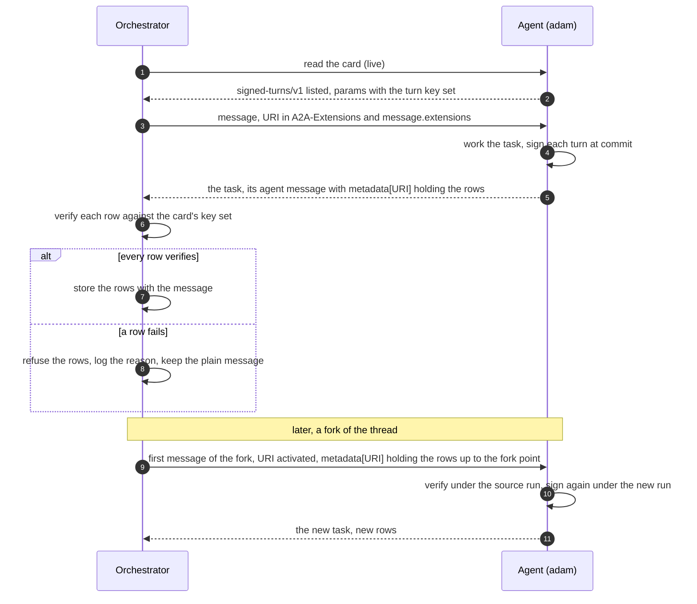
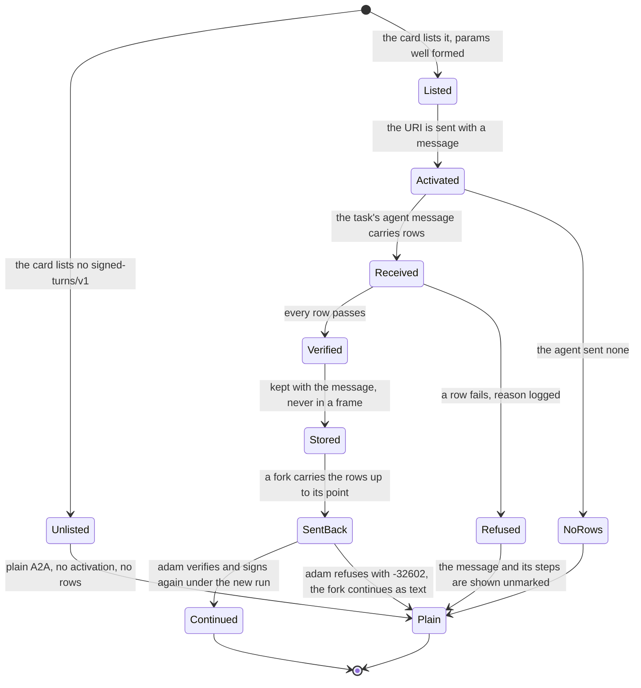

# A2A extension: signed turns (v1)

- **URI:** `https://agents.vymalo.com/a2a/extensions/signed-turns/v1`
- **Status:** **proposed (2026-11-27), card ANR-996; nothing is built on either side.** The agent's half is decided
  ([adam-rs ADR 0068](https://github.com/vymalo/another-adam-rs/blob/main/docs/decisions/0068-adam-signs-its-own-history.md),
  accepted 2026-11-22, slice T4) and **not built**; the orchestrator reads no row. This page and
  [ADR 0111](../decisions/0111-the-orchestrator-verifies-the-rows-an-agent-signs-and-sends-them-back-on-a-fork.md) are
  the orchestrator's side, **proposed, with no owner decision yet**. The scenario is ANR-914's `dev/signed-turns-real-e2e.sh`, *unbuilt*.
- **Defined by:** adam-rs writes the rows and their signatures; this system writes what a client does with them.
  **Used by:** agents that sign their own history (adam, when the deployment turns it on), and the orchestrator.
- **Not this:** the prompt a person signs ([ADR 0087](../decisions/0087-a-signing-app-signs-each-prompt-and-the-orchestrator-refuses-an-unsigned-one.md)),
  the prompt statement and a run's certificate ([ADR 0101](../decisions/0101-a-cloud-runs-model-calls-are-signed-for-the-run-and-the-injector-stays-for-custom-cases.md)),
  or [`signed-tool-requests-v1.md`](signed-tool-requests-v1.md). They are other keys and other `typ`s.

## Purpose

adam signs each assistant message and each tool result it commits, and refuses any history that comes back to it with a
turn that is forged, out of place or signed by a key it does not accept. This extension hands a **client** the same rows, so
the client can check that what it shows as the agent's words and tool results is what the agent committed, and can send
them back to continue from them (a fork). An agent that does not list it is a plain A2A agent and works as before.

## Who does what





## The card

The agent lists the URI only when its deployment turns signed turns on. The member names inside `params` are **this
page's proposal**: adam has not built its card entry (ADR 0068 says only that the card lists the URI and its JWKS the turn keys).

```json
{"uri": "https://agents.vymalo.com/a2a/extensions/signed-turns/v1",
 "required": false,
 "params": {"keys": {"keys": [{"kty": "OKP", "crv": "Ed25519", "kid": "vault:turn-key#v2", "x": "<public key>"}]},
            "revoked": ["vault:turn-key#v1"]}}
```

- `keys` is a JWKS of Ed25519 public keys, each `kid` the key's reference `vault:<name>#v<n>` (adam ADR 0068, decision 7;
  the form is [ADR 0083](../decisions/0083-trusted-components-the-agent-names-and-the-client-draws.md)'s, amended 2026-11-21). During a
  rotation it holds the previous version too; a key stays in the set after its private half is gone, so older rows verify.
- `revoked` is the list of references no longer accepted. A row signed by one is refused wherever it appears.
- These are the **turn keys**, not the card's own signing key and not the prompt-statement or run-certificate keys.
- The orchestrator reads the card live on every send and never caches the set. A card whose `params` do not have this
  shape is read as "not listed". A deployment may also pin the agent's turn keys in its configuration (key name open,
  ADR 0111 question 2); when it does, a `kid` outside the pinned set is refused whatever the card says.

## Activation

The URI goes in `A2A-Extensions` and in `message.extensions`, on a message to an agent whose live card lists it. The
orchestrator never activates it for an agent that does not.

## The rows

The task's agent message carries `metadata[URI]` *(proposed shape; adam fixes it at T4)*:

```json
{"run": "<run id>", "cnv": "<base64url sha-256 of the conversation id>", "idx": 12, "prv": "<chain hash before idx 12>",
 "rows": [ {"role": "assistant", "content": "...", "extra_content": {"adam": {"turn_signature": "<header>..<signature>"}}},
           {"role": "tool", "content": "...", "extra_content": {"adam": {"turn_signature": "<header>..<signature>"}}} ]}
```

From adam's ADR 0068 (decisions 2 and 3), **verified 2026-11-27** against adam-rs `origin/main` `6fe56423`
(`docs/decisions/0068-adam-signs-its-own-history.md`, `crates/adam-core/src/turn/form.rs`):

| Part | Value |
|---|---|
| Where a signature is | `extra_content.adam.turn_signature` of the row, on an assistant row and a tool row. A person's row is chained, not signed |
| The form | a compact JWS with a **detached payload** (RFC 7515 appendix F): `BASE64URL(header)..BASE64URL(signature)` |
| The header | `{"alg":"EdDSA","kid":"<key id>","typ":"adam-turn/v1"}` |
| The payload, never sent | the RFC 8785 canonical JSON of `{typ, run, cnv, idx, prv, msg}` |
| `run` | the run that committed the turn |
| `cnv` | the base64url SHA-256 of the run's conversation id, or of the run's own id when it has none |
| `idx` | the row's position in the transcript |
| `msg` | the row as stored, without its `extra_content.adam` member |
| The chain | `h(-1) = SHA-256(JCS({typ, run, cnv}))`, `h(i) = SHA-256(h(i-1) ‖ SHA-256(JCS(row i)))` over **every** row, a person's included, each with its `adam` member; `prv` of row `i` is `h(i-1)` |

The rows are the ones the task committed. Whether they include a person's rows, and so whether the whole chain is
recomputable from the rows alone, is *unverified* (adam has not built T4).

## What the orchestrator checks

For each row, in this order. The first failure refuses **all** the rows of that message.

| Check | Refusal reason (logged) |
|---|---|
| `metadata[URI]` is well formed and within the bounds the build sets | `malformed` |
| the activated URI matches a listed one: rows from an agent that did not list it or was not asked | `not_listed` |
| the header parses: `alg` is `EdDSA`, `typ` is exactly `adam-turn/v1`, no `crit`, no `b64: false`, no `none` | `bad_header` |
| `kid` is in the key set read for this send and not in `revoked` (or in the pin, when configured) | `unknown_key` |
| the payload rebuilt from `{typ, run, cnv, idx, prv, msg}` verifies under that key | `bad_signature` |
| `run` and `cnv` are the same on every row of one message, and `cnv` equals the thread's earlier `cnv` | `wrong_conversation` |
| `idx` runs without a gap, and each row's `prv` is the chain hash of the row before it | `out_of_order` |

The first row's `prv` is taken as given: a signature over it shows adam signed that row at that position over that prefix,
not that the orchestrator holds the prefix. The orchestrator **never** edits a row to make it verify and never signs one.

**A refused row is never shown as the agent's.** Nothing of it is stored, projected into a frame, exported or sent back. The
log gets one entry, with the reason, the `kid`, the `idx` and the task id, and **no row content and no signature**.
The task is not failed: its message and steps are plain A2A and are shown as before, without a "signed" mark.

## Stored, and what travels

| | Rows |
|---|---|
| The log | the rows as received, **verbatim as text** (not re-serialised), with the `kid` and the time of the check, in the commit of the agent message; a row that passed is not checked again against a later card |
| A frame, the search index, a notification, a model prompt | never |
| An erase of the thread or the account | erases them |
| A fork | **copies none**; its rows come from its own tasks. The fork's first message sends the source thread's rows back (below) |
| An export | carries them, with the public keys (by `kid`) that verified them, so a third party can check the file with no access to the orchestrator |
| A shared thread's link | carries none |

**A fork** whose agent lists the URI sends, as `metadata[URI]` of its first message, the contiguous rows from the start of the
chain to the last row at or before the fork point. adam verifies them under the source run, then signs them again under the
new run (adam ADR 0068, decisions 5 and 6), so every signature of a run names that run. Rows of another person's conversation
are `-32602` (`InvalidParams`) and nothing is written; then the fork continues as it does today, with the history as text
(which the agent reads as a person's words), and the refusal is logged. Without the extension nothing changes.

## Security notes

- The key set arrives in the same card as the listing, so it is as trustworthy as the card read. A deployment that wants
  more pins the turn keys; a pinned set wins over the card.
- Revocation applies at ingest and at a fork, not backwards: a stored row keeps the time of its check (ADR 0111 question 3).
- Rows hold the tool outputs `steps/v1` already shows, so they are bounded and kept as the steps are, and appear nowhere a
  step does not.
- A person's own words are not covered: they are chained, not signed. The prompt signature is ADR 0087.
- Everything adam's ADR says it does not protect still holds: the content of a tool's output, secrets, a rollback to an
  earlier state adam really signed, a stolen key until revoked.

## What the build changes

- The A2A client reads the card entry (the closed set of extensions gains one member), activates the URI, reads `metadata[URI]`
  and runs the checks above in a pure function (no I/O, the key set passed in).
- Each store adapter gains a member for the rows of a message; the log gains a refusal entry with a closed reason.
- `docs/api/chat-api.yaml`, additive only: the export gains a rows member and its keys. No frame gains one.
- The fork path sends the rows when the agent lists the URI and falls back to text on `-32602`.
- adam-rs: its slice T4 (the card entry, the message member, the continuation from rows). Until then nothing here runs.

## Conformance

*Unbuilt* (card ANR-914, after adam's ANR-910 and a pin bump): `dev/signed-turns-real-e2e.sh`, in `dev/e2e-all.sh`. The
**real adam image**, with a turn key from the stack:

1. the card lists the extension and its key set;
2. a task's rows verify against the card's key set (checked from the orchestrator's log of the check and from the stored rows);
3. **a row altered in transit** (a small proxy in the scenario flips one byte of a tool result) is refused, logged with its
   reason and shown as the agent's nowhere, while the message's text still arrives;
4. a fork sends the rows back and the new run's rows verify under the new run;
5. an agent that does not list the URI is plain A2A: nothing activated, nothing stored.

Checks on a mock agent, each red before its fix: a wrong `typ`, `alg: none`, an unknown and a revoked `kid`, a changed
`cnv`, a reordered pair and a gap in `idx` are each refused with their reason; the log never holds a row's content or a
signature; a refused row is absent from the export; a card whose `params` are malformed reads as unlisted.

## Verified and unverified

- *Verified 2026-11-27* (adam-rs `origin/main` `6fe56423`): the URI, the header, the payload, the chain and `cnv` above
  are in `docs/decisions/0068-adam-signs-its-own-history.md` and `crates/adam-core/src/turn/form.rs`; slices T1, T2a and
  T3a-1 to T3a-3 are built; **T3b (the journal's signature) and T4 are not**: a search of that revision for the URI finds
  only the ADR's text.
- *Unverified:* the card's `params` and `metadata[URI]` member names (this page's proposal); whether the rows include a
  person's rows; which subject adam sees on a fork the orchestrator sends, and so whether the rows of a person's thread
  verify there; the size the rows add to a long task.
