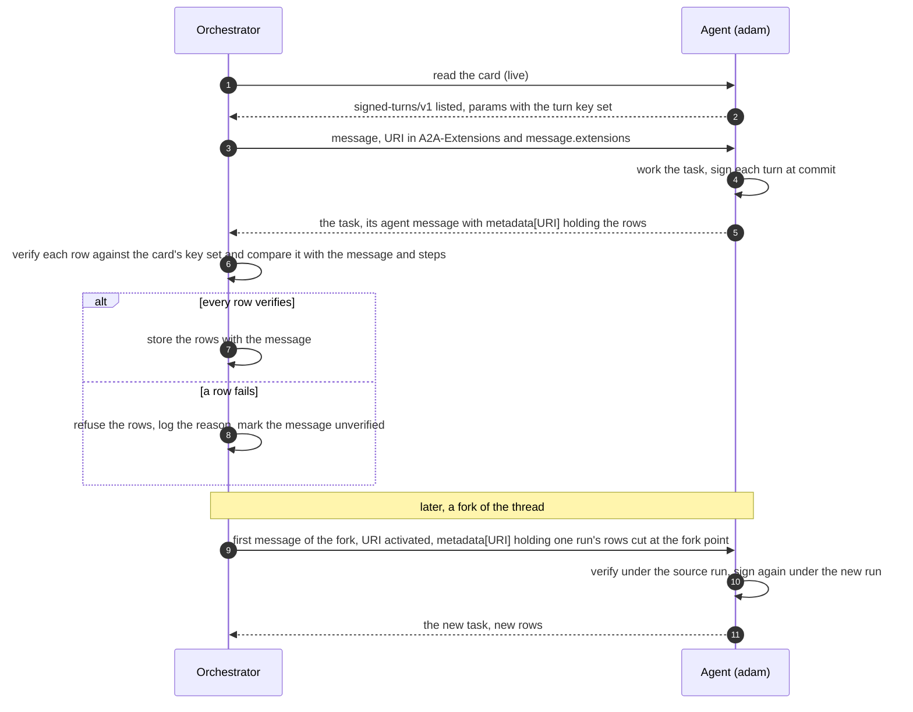
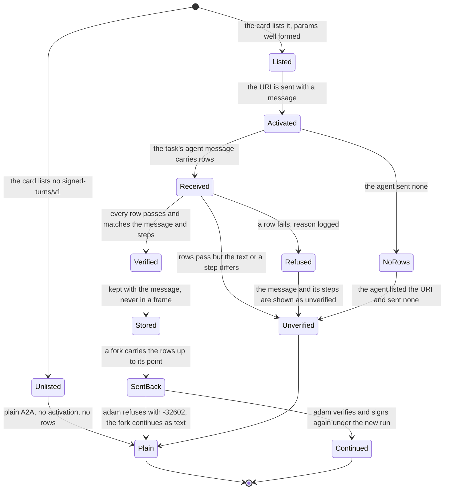

# A2A extension: signed turns (v1)

- **URI:** `https://agents.vymalo.com/a2a/extensions/signed-turns/v1`
- **Status:** **proposed (2026-11-27), card ANR-996; nothing is built on either side.** The agent's half is decided
  ([adam-rs ADR 0068](https://github.com/vymalo/another-adam-rs/blob/main/docs/decisions/0068-adam-signs-its-own-history.md),
  accepted 2026-11-22, slice T4) and **not built**; the orchestrator reads no row. This page and
  [ADR 0111](../decisions/0111-the-orchestrator-verifies-the-rows-an-agent-signs-and-sends-them-back-on-a-fork.md) are
  the orchestrator's side, **proposed, with no owner decision yet**. The scenario is ANR-914's `dev/signed-turns-real-e2e.sh`, *unbuilt*.
- **Defined by:** adam-rs writes the rows and their signatures; this system writes what a client does with them.
  **Used by:** agents that sign their own history (adam, when the deployment turns it on), and the orchestrator.
- **Not this:** the prompt a person signs ([ADR 0087](../decisions/0087-a-signing-app-signs-each-prompt-and-the-orchestrator-refuses-an-unsigned-one.md)),
  the prompt statement and a run's certificate ([ADR 0101](../decisions/0101-a-cloud-runs-model-calls-are-signed-for-the-run-and-the-injector-stays-for-custom-cases.md)),
  or [`signed-tool-requests-v1.md`](signed-tool-requests-v1.md). They are other keys and other `typ`s.

## Purpose

adam signs each assistant message and each tool result it commits, and refuses any history that comes back to it with a
turn that is forged, out of place or signed by a key it does not accept. This extension hands a **client** the same rows.
The client **compares** what it shows with them: the final message text against the last assistant row, and each tool step's
output against its tool row. A match is marked verified; a mismatch, refused rows or no rows is marked unverified, and is
never presented as the agent's verified content. The client may also send the rows back to continue from them (a fork). An
agent that does not list the extension is a plain A2A agent and works as before.

## Who does what





## The card

The agent lists the URI only when its deployment turns signed turns on. The `params` are **this page's proposal**: adam has
not built its card entry (ADR 0068 says only that the card lists the URI and its JWKS the turn keys). They are adam's own
`KeySet` JWKS form (`crates/adam-core/src/turn/key_set.rs`, `from_jwks` and `to_jwks`), so adam's `to_jwks` output is the
entry as it is:

```json
{"uri": "https://agents.vymalo.com/a2a/extensions/signed-turns/v1",
 "required": false,
 "params": {"keys": [{"kty": "OKP", "crv": "Ed25519", "kid": "vault:turn-key#v2", "x": "<public key>"}],
            "revoked": ["vault:turn-key#v1"]}}
```

- `keys` is a list of Ed25519 public keys (RFC 7517); a member `d` makes the set invalid. Each `kid` is the key's reference
  `vault:<name>#v<n>` (adam ADR 0068, decision 7; the form is [ADR 0083](../decisions/0083-trusted-components-the-agent-names-and-the-client-draws.md)'s,
  amended 2026-11-21), **or the key's RFC 7638 thumbprint when `TURN_SIGNING_KEY_ID` is unset**. During a rotation the set
  holds the previous version too; a key stays in the set after its private half is gone, so older rows verify.
- `revoked` is the list of ids no longer accepted. A row signed by one is refused wherever it appears.
- These are the **turn keys**, not the card's own signing key and not the prompt-statement keys.
- **A run certificate is outside v1.** adam's header may carry `x5c` (a certificate chain, `KeyIdentity::Certificate`, adam
  ADR 0068 amended 2026-11-25), and ADR 0101 gives a run an in-memory key with a leaf of its own. v1 looks the `kid` up in
  this set and **does not trust `x5c`**: a row signed that way whose `kid` is not in the set is refused `unknown_key`. Verifying
  it against the agents intermediate, with the leaf's run equal to `run` and its person equal to the thread's owner, is
  [ADR 0111](../decisions/0111-the-orchestrator-verifies-the-rows-an-agent-signs-and-sends-them-back-on-a-fork.md) open question 4.
- The orchestrator reads the card live on every send and never caches the set. A card whose `params` do not have this shape
  is read as "not listed". A deployment may also pin the agent's turn keys in its configuration (key name open, ADR 0111
  question 2); a pinned set wins over the card.

## Activation

The URI goes in `A2A-Extensions` and in `message.extensions`, on a message to an agent whose live card lists it. The
orchestrator never activates it for an agent that does not.

## The rows

The task's agent message carries `metadata[URI]`. Every member beyond adam's own (`run`, `cnv`, `idx`, `prv` and the rows) is
a **proposal to put to adam for T4**:

```json
{"run": "<task id>", "cnv": "<base64url sha-256 of the conversation id>", "idx": 12, "prv": "<chain hash before idx 12>",
 "statement": "<adam-turns/v1 detached JWS over {run, cnv, len, chain}>", "source": "<source context id, on a fork>",
 "rows": [ {"role": "assistant", "content": "...", "extra_content": {"adam": {"turn_signature": "<header>..<signature>"}}},
           {"role": "tool", "content": "...", "extra_content": {"adam": {"turn_signature": "<header>..<signature>"}}} ]}
```

From adam's ADR 0068 (decisions 2 and 3), **verified 2026-11-27** against adam-rs `origin/main` `6fe56423`
(`docs/decisions/0068-adam-signs-its-own-history.md`, `crates/adam-core/src/turn/form.rs`, `chain.rs`, `key_set.rs`):

| Part | Value |
|---|---|
| Where a signature is | `extra_content.adam.turn_signature` of the row, on an assistant row and a tool row. A person's row is chained, not signed |
| The form | a compact JWS with a **detached payload** (RFC 7515 appendix F): `BASE64URL(header)..BASE64URL(signature)` |
| The header | the RFC 8785 canonical JSON of `alg` (`EdDSA`), `kid`, `typ` (`adam-turn/v1`) and an optional `x5c`; no other member, and any other encoding of it is refused (`form.rs`, `read_header`) |
| The payload, never sent | the RFC 8785 canonical JSON of `{typ, run, cnv, idx, prv, msg}` |
| `run` | the run that committed the turn, as the UUID text. **It is the A2A task id** (adam-rs `crates/adam-a2a-runtime/src/backend.rs:52`) |
| `cnv` | the base64url (no padding) SHA-256 of the run's conversation id, or of the run's own id text when it has none |
| `idx` | the row's position in the transcript, an unsigned 32-bit integer |
| `prv` | the chain hash before the row, base64url without padding |
| `msg` | the row as stored, without its `extra_content.adam` member |
| The chain | `h(-1) = SHA-256(JCS({typ: "adam-chain/v1", run, cnv}))` (`chain.rs`), `h(i) = SHA-256(h(i-1) ‖ SHA-256(JCS(row i)))` over **every** row, a person's included, each with its `adam` member; `prv` of row `i` is `h(i-1)` |

**What the proposed shape requires of adam, to be put to it for T4:**

- The rows are **every committed row of the run, a person's rows too** (steer/v1 inserts them), so the whole chain is
  recomputable from the rows alone. Whether adam does this is *unverified*.
- A **statement**: a detached JWS (the same header rules and keys) over `{typ: "adam-turns/v1", run, cnv, len, chain}`, with
  `len` the run's row count and `chain` the hash `h(len-1)`. The chain alone cannot show that the last rows were dropped,
  since a prefix of a valid chain is valid, and the orchestrator cannot check `adam-head/v1`, which signs the whole state
  document. **Once the card lists the URI the statement is required.**
- Whether a task's message carries the **whole transcript, signed again under this task's run** (adam ADR 0068, decision 5)
  or only the rows this task committed is *unverified until T4*.

## What the orchestrator checks

For each message that carries `metadata[URI]`, in this order. The first failure refuses **all** the rows of that message.
`malformed` and `not_listed` are per message; the others name a row.

| Check | Refusal reason (logged) |
|---|---|
| `metadata[URI]` is well formed and within the bounds the build sets | `malformed` |
| the URI is one the live card lists and the message activated: rows from an agent that did not list it or was not asked | `not_listed` |
| the header parses: canonical, only `alg`, `kid`, `typ`, `x5c`, `alg` is `EdDSA`, `typ` is exactly `adam-turn/v1` | `bad_header` |
| `kid` is in the key set and not in `revoked` (or in the pin, when configured). **On a miss the card is read once more, live, before the refusal**; `x5c` is never trusted | `unknown_key` |
| the payload rebuilt from `{typ, run, cnv, idx, prv, msg}` verifies under that key | `bad_signature` |
| **`run` equals this response's A2A task id**, on every row | `wrong_run` |
| `cnv` is the same on every row and, **after the thread's first verified message, equals the `cnv` pinned to the thread** | `wrong_conversation` |
| `idx` runs without a gap, and each row's `prv` is the chain hash of the row before it | `out_of_order` |
| the `statement` is present | `no_statement` |
| the statement verifies, its `len` is the first `idx` plus the number of rows, and its `chain` is the chain hash after the last row | `truncated` |

The first row's `prv` is taken as given: a signature over it shows adam signed that row at that position over that prefix,
not that the orchestrator holds the prefix. A missing statement is refused, so a dropped tail cannot pass. The
orchestrator **never** edits a row to make it verify and never signs one.

**A refused row is never shown as the agent's verified content.** Nothing of it is stored, projected into a frame, exported
or sent back. "Logged" is a tracing line (the reason, the `kid`, the `idx` and the task id; **no row content and no
signature**) and a counter `signed_turns_refused_total{reason}` (a closed set, no thread or agent in a label). The task is not
failed: its message and steps are plain A2A and are shown, marked unverified.

**The comparison and the mark.** When the rows verify, the orchestrator compares the task's final message text with the last
assistant row's content, and each tool step's output with the tool row it belongs to. The mark is the closed member `signed`
(*proposed*): `verified` when everything compared matches, `unverified` on any mismatch, on refused rows, and when an agent
that listed the URI sent no rows; **absent** for an agent that does not list it. The rows arrive with the final message, after the steps'
`agent_step` events were logged ([`steps-v1.md`](steps-v1.md)), so the marks are recorded **on the `agent_message`**: `signed`
for the message (two-valued) and a closed map from step id to `verified` or `unverified` for that task's steps. They are
projected as `vymalo.signed` on the AG-UI message and, after the fact, on those steps. The comparison is a pure function
outside `transition`; its result is an input of the event. The orchestrator never
hides the text; what a client draws from the mark is the web's decision. A step output the agent shortened for the
steps bound (`steps/v1`) is compared by the bounded prefix; **a difference beyond the bound is not detected**.

## Stored, and what travels

| | Rows |
|---|---|
| Beside the log | the rows as received, **verbatim as text** (not re-serialised), with the `kid` and the time of the check, in the commit of the agent message; durable state beside the log, not in it (the amendment of invariant 3). A row that passed is not checked again against a later card. *Unverified until T4:* if a task's message carries the whole re-signed transcript, only the latest run's rows are kept per thread, and a fork cuts that run; otherwise each run's rows are kept |
| A frame, the search index, a notification, a model prompt, the orchestrator's own model calls (title, description) | never. The `signed` mark is the one thing a frame carries |
| An erase of the thread or the account | erases them |
| A fork | **copies none**; its rows come from its own tasks. The fork's first message sends one run's rows of the source thread back (below) |
| An export | carries them, with the public keys (by `kid`) that verified them, so a third party can check the file with no access to the orchestrator |
| A shared thread's link | carries none |

**A fork** whose agent lists the URI sends **one run's rows**. Each task is a new run that adam signs again (adam ADR 0068,
decision 5), so rows of several tasks are not one chain. The fork sends **one run's rows, cut at the fork
point**, keeping that run's `run`, `cnv`, first `idx` and `prv`, and, *proposed*, a `source` member naming
the **source context** (adam's decision 6 requires a fork message to name it). The fork point is a cut of the log at the end of a turn; it maps to the row paired with that turn's final message by the
comparison above, and the cut is that row's `idx`, inclusive. With per-run storage the run is the last task at or before the
point. In the whole-transcript case it is the latest run's rows, but if that run's prefix up to the cut **no longer matches the
history at the fork point** (adam signs again after a compaction or a shortening, adam ADR 0068, decision 5), the fork sends
no rows and continues as text. adam verifies them under the source run, then
signs them again under the new run, so every signature of a run names that run. Rows of another person's conversation are
`-32602` (`InvalidParams`) and nothing is written. If the rows are refused, **or the source thread was deleted
([ADR 0043](../decisions/0043-deleting-a-thread-erases-it.md)) and none exist**, the fork continues as it does today, with the
history as text (which the agent reads as a person's words), and a refusal is logged. Without the extension nothing changes.

## Security notes

- The key set arrives in the same card as the listing, so it is as trustworthy as the card read. A deployment that wants
  more pins the turn keys; a pinned set wins over the card. On an unknown `kid` the card is read once more, live, before the
  refusal, because a rotation may have happened since the send; the set is never cached.
- `run` must be this task's id and `cnv` the thread's, so a row signed for another run or conversation, even by the right
  key, is refused.
- Revocation applies at ingest and at a fork, not backwards: a stored row keeps the time of its check (ADR 0111 question 3).
- Dropping the last rows is not detected by the chain; the `adam-turns/v1` statement is proposed for T4 for that, and is required once the card lists the URI.
- Rows hold the tool outputs `steps/v1` already shows, so they are bounded and kept as the steps are, and appear nowhere a
  step does not.
- A person's own words are not covered: they are chained, not signed. The prompt signature is ADR 0087.
- Everything adam's ADR says it does not protect still holds: the content of a tool's output, secrets, a rollback to an
  earlier state adam really signed, a stolen key until revoked.

## What the build changes

- The A2A client reads the card entry (the closed set of extensions gains one member), activates the URI, reads `metadata[URI]`
  and runs the checks above in a pure function (no I/O, the key set passed in).
- Each store adapter gains a member for a thread's rows (beside the log); the refusal is a tracing line and a counter, not an event; `agent_message` gains the closed `signed` member and the step-mark map.
- `docs/api/chat-api.yaml`, additive only: the export gains a rows member and its keys; the message and step gain `vymalo.signed`. No frame carries rows.
- The fork path sends the rows when the agent lists the URI and falls back to text on `-32602`.
- adam-rs: its slice T4 (the card entry, the message member, the continuation from rows). Until then nothing here runs.

## Conformance

*Unbuilt* (card ANR-914, after adam's ANR-910 and a pin bump): `dev/signed-turns-real-e2e.sh`, in `dev/e2e-all.sh`. The
**real adam image**, with a turn key from the stack:

1. the card lists the extension and its key set;
2. a task's rows verify against the card's key set (checked from the orchestrator's log of the check and from the stored rows);
3. **a row altered in transit** (a small proxy in the scenario flips one byte of a tool result) is refused, logged with its
   reason (the tracing line and the counter), and the message and step are marked `unverified`, never verified, while the
   text still arrives; a message whose text the proxy altered but whose rows are intact is marked `unverified` too;
4. a fork sends the rows back and the new run's rows verify under the new run;
5. an agent that does not list the URI is plain A2A: nothing activated, nothing stored.

Checks on a mock agent, each red before its fix: a wrong `typ`, `alg: none`, an unknown and a revoked `kid`, a changed
`cnv`, a row signed for another task's run (`wrong_run`), a reordered pair, a gap in `idx`, a missing statement and a dropped tail are each refused with their reason; a steered task, with a person's row between two of the agent's, still verifies; the log never holds a row's content or a
signature; a refused row is absent from the export; a card whose `params` are malformed reads as unlisted.

## Verified and unverified

- *Verified 2026-11-27* (adam-rs `origin/main` `6fe56423`): the URI, the header, the payload, the chain (`adam-chain/v1`,
  `chain.rs`) and `cnv` above are in `docs/decisions/0068-adam-signs-its-own-history.md`, `crates/adam-core/src/turn/form.rs`
  and `chain.rs`; the key set's JWKS form is `key_set.rs`; the task id is the run id (`backend.rs:52`). Slices T1, T2a
  (commit `08fe47f3`, #447, no row in the slice table) and T3a-1 to T3a-3 are built; **T2 is not complete**: no host passes
  turn keys except the ephemeral key of `crates/adam-runtime/src/worker.rs:2011`, so the scenario depends on T2 too; **T3b (the journal's signature) and T4 are not**: a search of that revision for the URI finds
  only the ADR's text.
- *Unverified:* the member names of `metadata[URI]` beyond adam's own, the `statement` and `source` members (this page's
  proposals to adam); whether the rows include a person's rows; whether a task's message carries the whole re-signed
  transcript; which subject adam sees on a fork the orchestrator sends, and so whether the rows of a person's thread
  verify there; the size the rows add to a long task.
