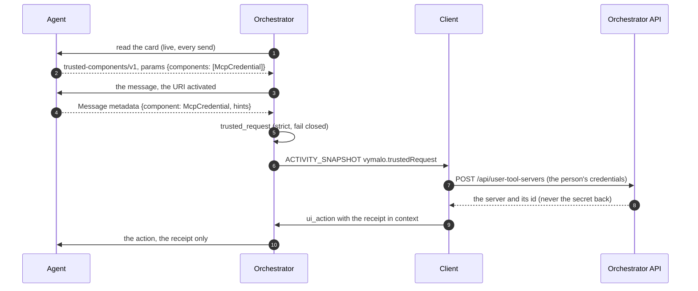

# `trusted-components/v1` — the agent names a component, the client draws it

- **Status:** **proposed 2026-11-21** ([ADR 0083](../decisions/0083-trusted-components-the-agent-names-and-the-client-draws.md)).
  The orchestrator's half is built: it reads the card, logs `trusted_request` and projects the
  `vymalo.trustedRequest` card. The web's half (the interface, its frame and the receipt) is the next
  slice. Only `McpCredential` is built, because it is the only component whose API exists (ADR 0046).
- **A2A extension:** `https://agents.vymalo.com/a2a/extensions/trusted-components/v1`.
- **Who writes it:** this system. **Who serves it:** the agent, by asking; the client, by drawing.

A trusted component is **not** a surface component. A2UI lets an agent draw a form and read what the
person types into it, and anything a component's `action.event.context` binds is resolved by the
client, logged as `ui_action.context` and forwarded to the agent (ADR 0083, "Context"). A secret
typed into such a field would reach the agent. So a trusted component is a **request**: the agent
names one, the client draws its own interface and its own frame, and the agent never sees a value.

## 1. The card

The agent lists the extension with the components it may ask for:

```json
{
  "capabilities": {
    "extensions": [
      {
        "uri": "https://agents.vymalo.com/a2a/extensions/trusted-components/v1",
        "params": { "components": ["McpCredential"] }
      }
    ]
  }
}
```

The orchestrator reads it exactly as every other extension ([ADR 0008](../decisions/0008-platform-integration-via-a2a-extension.md)):

- the URI must be listed **exactly**: another version, a trailing slash or another case is another
  extension, and nothing is offered;
- `params` must be `{components: [...]}`, a non-empty array of strings. A card that lists it with
  anything else offers nothing (fail closed);
- a component this build does not draw is ignored. The ADR names five (`ApiKeyCreate`,
  `McpCredential`, `ModelServer`, `SecretGenerate`, `SecretCollect`); this build knows one, and a card
  that names only the other four offers nothing;
- a name listed twice keeps its first entry. Unknown members of `params` are ignored.

`McpCredential` is a person's own MCP server credential (ADR 0046): the client calls
`POST /api/user-tool-servers` or `PATCH /api/user-tool-servers/{serverId}` with the person's own
credentials, and the secret is write-only.

## 2. Activation

The URI is activated on a message — `A2A-Extensions` and `message.extensions` — only when the card
read for that very call offers it well formed, on a send and on a resubscribe. It tells the agent
that this client can draw a trusted component; an agent that lists it and is sent a message without
the activation must not ask.

A steer activates it too when the card offers it: the person may be asked for a credential in answer
to what they steered.

## 3. The request

The request is an agent **`Message`** whose `metadata` holds the extension's URI:

```json
{
  "role": "agent",
  "messageId": "m-1",
  "taskId": "task-1",
  "parts": [{ "text": "Use this to add your search server." }],
  "metadata": {
    "https://agents.vymalo.com/a2a/extensions/trusted-components/v1": {
      "component": "McpCredential",
      "hints": {
        "name": "My search",
        "scopes": ["search.read"],
        "expiresInDays": 30
      }
    }
  }
}
```

- It may ride on a message with words or with a surface, or be a message of its own. A message with
  no words, no surface and no request is ignored, as it always was.
- **A status update's message is not a carrier.** The request is an agent `Message` in the stream;
  its words are not a status detail, and its metadata is not the status's tier echo or stream entry.
- `component` must be one this build draws, matched exactly. `hints` must be an object; its members
  are optional and bounded:

| Member | Bound |
|---|---|
| `name` | 1 to 80 characters, no control character (a blank name is refused) |
| `scopes` | at most 32 entries; each 1 to 128 bytes of visible ASCII with no space, quote or backslash (RFC 6749, as ADR 0046 checks one) |
| `expiresInDays` | a whole number from 1 to 3650 (a whole double such as `30.0` counts: A2A metadata is a protobuf `Struct`) |

- Unknown members of the request and of `hints` are ignored. A wrong type, a missing `component` or
  `hints`, a component this build does not draw, or a hint out of bounds means **the request is not
  read at all**: no event, no card, nothing drawn. It is never approximated.

The adapter drops a request for a component the card read for that call did not offer, whatever the
agent sent. An asked agent cannot make a request: only the thread's agent may (ADR 0083, and the
thread tools' `ask_agent` is not a way around it).

## 4. What the orchestrator records

The request is one event, `trusted_request`, with `{component, hints}` and the agent as its actor.
It moves no state, opens no run of its own while the thread's run is open, and a log written before
the kind reads as it always did. It is projected as one `ACTIVITY_SNAPSHOT` per request:

```
ACTIVITY_SNAPSHOT {
  messageId: "trusted-<seq>",
  activityType: "vymalo.trustedRequest",
  replace: false,
  content: {
    component: "McpCredential",
    hints: {"name": "My search", "scopes": ["search.read"], "expiresInDays": 30},
    at: "<the event's time>"
  },
  metadata: {"vymalo.actor": {"type": "agent", "name": "coder"}}
}
```

Two requests are two cards; nothing replaces another. The client draws the interface, the mark and
the sentence "the agent can't see this" from it — that frame is the client's, and an agent-drawn
surface can never produce it because an agent cannot draw a trusted component at all.

A reader of a shared thread does not see the card: the request is the owner's business, like the
screens, the sessions and the sharing of the thread.

## 5. The receipt

The client answers by drawing its own interface and, when the person acts, by calling the API with
their credentials. What reaches the agent is the action's **receipt**, in the `context` that already
exists:

```json
{
  "status": "created",
  "id": "u-abc1234567",
  "name": "My search",
  "scopes": ["search.read"],
  "last4": "a1b2",
  "version": "3",
  "where": "vault:my-search#v3"
}
```

- It is a `ui_action.context`: logged verbatim as `ui_action.context` and forwarded to the agent
  (`docs/api/agui.md`, "Outbound: log event → AG-UI"). No new event kind and no new route.
- It fits the context's existing bounds: 256 bytes per id and 16 KiB of context. A name of 80
  characters, 32 scopes of 128 bytes, `last4` and a `vault:` reference are well under it.
- Nothing redacts it, and nothing needs to: no member is a secret. `last4` is never derived by the
  agent or the orchestrator; the client sends the four characters the API returned, and only for a
  kind of secret where a suffix is safe to show. For a generated secret it is omitted.
- A secret a person does see once is on the device, from the API's response, and never in a frame,
  a log or an event (ADR 0083, decision 3 and "Consequences").

## 6. What a client without the extension does

It ignores the request, as it ignores every extension it does not know ([ADR 0008](../decisions/0008-platform-integration-via-a2a-extension.md)):
the agent falls back to saying what to do, and the client offers the link to the screen that does it.
The person gets words and a link, never a plain form.


