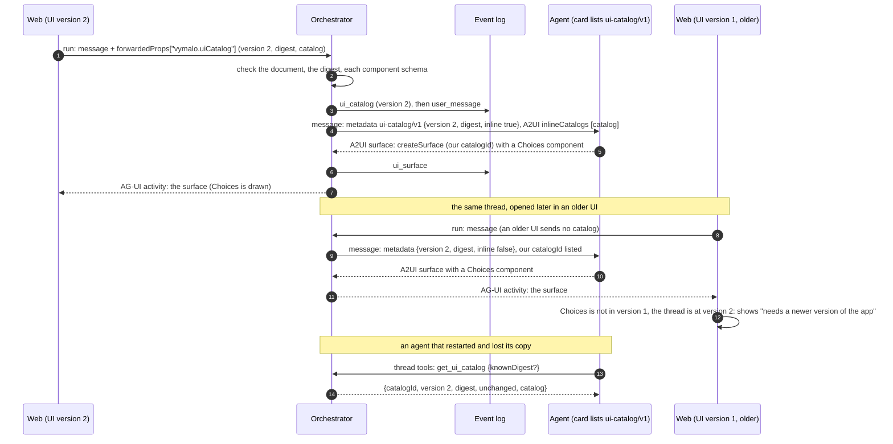
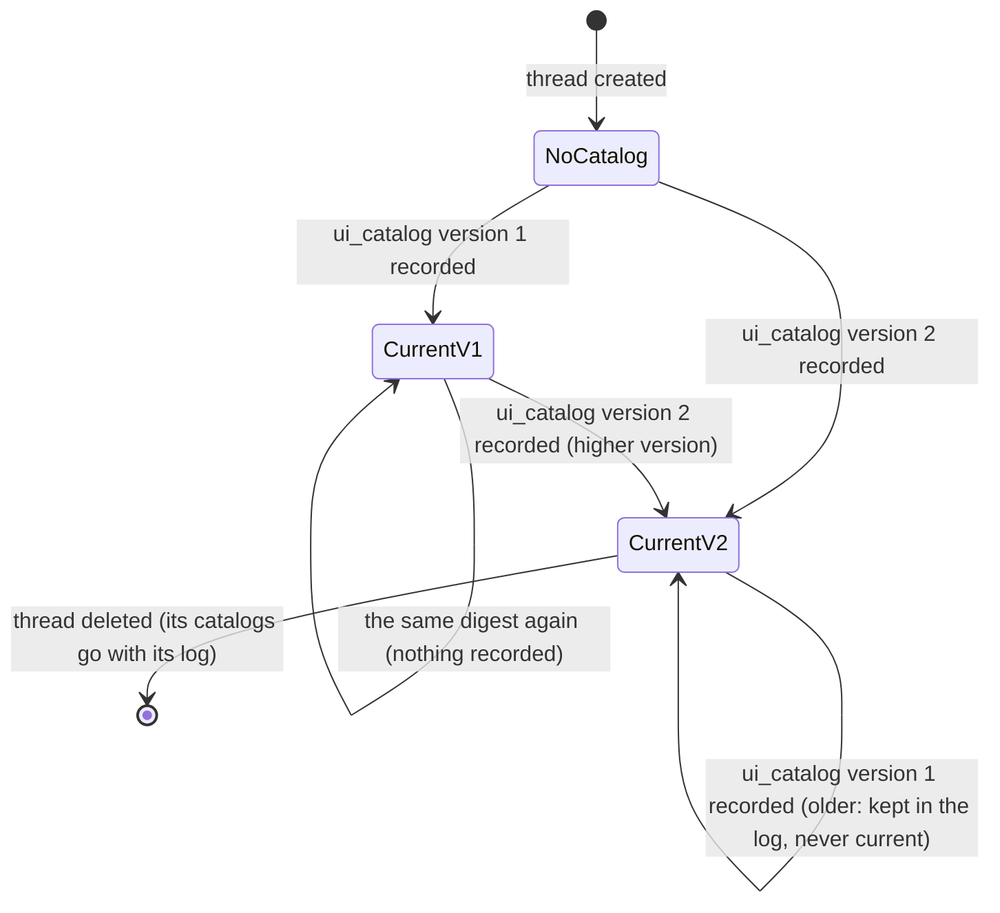

# A2A extension: UI catalog (v1)

- **URI:** `https://agents.vymalo.com/a2a/extensions/ui-catalog/v1`
- **Status:** **contract accepted (2026-10-01, on the owner's delegation); the orchestrator's side is built (MVP
  slice 3: the run member, the `ui_catalog` event and its ledger, `thread.uiCatalog`, the A2A adapter, and the refetch,
  the [thread tools](thread-tools-v1.md) with `get_ui_catalog`, section 6).** The web's catalog, Choices, Cards and
  Mermaid, Image, and the questions of Choices with a title, typed answers and pictures (versions 1 to 5) are built (the web's side of MVP slices 3 and 4); the adam-rs side (an agent that turns the
  catalog into model tools and refetches) is that repository's slice; see
  [`mvp.md`](../mvp.md#the-new-build-order). The owner may revisit anything here.
- **Decided in:** [ADR 0023](../decisions/0023-ui-component-catalog-as-an-a2a-extension.md) and its status note;
  the A2UI transport is [ADR 0013](../decisions/0013-a2ui-generative-ui.md); the optional-extension pattern is
  [ADR 0008](../decisions/0008-platform-integration-via-a2a-extension.md).
- **Defined by:** the web (the catalog). **Carried by:** the orchestrator. **Used by:** agents that speak A2UI.
- **Closes:** [open question 36](../open-questions.md).

## Purpose

Let an agent learn which components the person's screen can draw, answer and ask through them, and keep working when
the chat is opened from a newer or an older version of the UI, **using only the A2A card, A2A message metadata, A2UI's
own capabilities and one MCP tool**. The components are the web's; their parameters are all that change from one
message to the next, so the catalog goes to the agent once and is refetched when it may be stale
([ADR 0023](../decisions/0023-ui-component-catalog-as-an-a2a-extension.md)).

An agent that does not list the extension gets exactly the message it gets today: A2UI capabilities for the basic
catalog and nothing else. The rest of this page is for agents that do, and for the web and orchestrator that serve
them.

Facts about A2UI and MCP are marked *verified* (with a date and a source) or *unverified*; see
[Verified and unverified](#verified-and-unverified-2026-10-01).

## Who does what

| Part | Does |
|---|---|
| **Web** | Owns the catalog (`catalog.json`, its `version` and digest), sends it to the orchestrator at conversation start and when a newer one exists, validates every surface against it and refuses visibly what it cannot draw ([the web's rules](#8-what-the-web-does-with-a-surface)). |
| **Orchestrator** | Checks the catalog as a document (it does not interpret it), records it once per digest as a `ui_catalog` event, tells the agent about the thread's current catalog on each message, and serves the refetch (`get_ui_catalog` on [the thread tools](thread-tools-v1.md)). |
| **Agent** | Lists the extension in its card, reads the catalog, turns it into something its model can call (one tool per component, or one `show` tool whose schema is the catalog), emits A2UI surfaces that name our `catalogId`, and refetches when its copy may be stale. |

## The handshake



A thread's catalog moves only forward. Older catalogs stay in the log, and never become current:



## 1. The catalog

`catalogId` is `https://agents.vymalo.com/a2ui/catalogs/chat`. It is stable: versions are told apart by `version`
and `digest`. The canonical document is exactly an A2UI inline catalog, `{"catalogId": …, "components": {…}}`
([A2UI's `Catalog`](#verified-and-unverified-2026-10-01)), and nothing else: `functions` and `theme` are refused in
v1. Rules for the document:

- Every component schema is self-contained JSON Schema 2020-12: no `$ref`, `$dynamicRef`, `$id` or `$anchor`, and no
  `$schema`. Keys are ASCII. Numbers in the catalog document are integers (`maxLength: 120`, never `1.5`).
- Each schema validates the whole instance `{id, component, …}`: `properties.component.const` equals the component's
  key, and `additionalProperties` is `false`.
- Values are **literals**. Our components have no data bindings and no function calls.
- Every schema writes out the common members: `id` (a string of 1 to 256 characters), `component` (the constant) and
  `weight` (a number, A2UI's layout hint).

### Version 1: Text and Column

```json
{
  "Text": {
    "type": "object",
    "description": "Plain text, drawn as text (no HTML, no links).",
    "properties": {
      "id": {"type": "string", "minLength": 1, "maxLength": 256},
      "component": {"const": "Text"},
      "weight": {"type": "number"},
      "text": {"type": "string", "minLength": 1, "maxLength": 4000},
      "variant": {"enum": ["h1", "h2", "h3", "h4", "h5", "caption", "body"]}
    },
    "required": ["id", "component", "text"],
    "additionalProperties": false
  },
  "Column": {
    "type": "object",
    "description": "Stacks its children vertically.",
    "properties": {
      "id": {"type": "string", "minLength": 1, "maxLength": 256},
      "component": {"const": "Column"},
      "weight": {"type": "number"},
      "children": {"type": "array", "minItems": 1, "maxItems": 50, "items": {"type": "string", "minLength": 1, "maxLength": 256}},
      "align": {"enum": ["start", "center", "end", "stretch"]}
    },
    "required": ["id", "component", "children"],
    "additionalProperties": false
  }
}
```

### Version 2 (slice 3): version 1 plus Choices

Choices asks the person up to 8 questions at once, each with 2 to 8 options (radio buttons, or checkboxes when
`multiple`). One submit sends **one** action; its answer shape is in [Choices answers](#choices-answers). Its schema
is written once, in [version 5](#version-5-questions-with-a-title-a-description-and-typed-options), which only adds
to it: every Choices of version 2 is a Choices of version 5 and reads and answers as it did.

Two rules JSON Schema cannot say are checked by the web's validator and by the agent: question ids are unique in a
Choices, and option values are unique within a question.

### Version 3 (slice 4): version 2 plus Cards and Mermaid

Two output components: nothing is sent back from either. A **card's link** is drawn as a link to a new tab and a
card never loads anything (no image, no favicon: ADR 0013 rule 5). A **Mermaid** graph is drawn by the web as an
**image** (mermaid in the browser, strict security level, no HTML labels, the SVG shown through an ``), with the
source one click away as its text alternative; a graph that does not parse says so and shows its source, and does not
refuse the surface. Both are in the [web's README](../../web/README.md#cards-and-mermaid).

```json
{
  "Cards": {
    "type": "object",
    "description": "A list (or grid) of up to 24 cards: title, optional subtitle, body text, an http(s) link and tags.",
    "properties": {
      "id": {"type": "string", "minLength": 1, "maxLength": 256},
      "component": {"const": "Cards"},
      "weight": {"type": "number"},
      "title": {"type": "string", "maxLength": 120},
      "layout": {"enum": ["list", "grid"]},
      "cards": {
        "type": "array", "minItems": 1, "maxItems": 24,
        "items": {
          "type": "object",
          "properties": {
            "title": {"type": "string", "minLength": 1, "maxLength": 200},
            "subtitle": {"type": "string", "maxLength": 200},
            "body": {"type": "string", "maxLength": 2000},
            "url": {"type": "string", "maxLength": 2048, "pattern": "^https?://"},
            "tags": {"type": "array", "maxItems": 8, "items": {"type": "string", "minLength": 1, "maxLength": 40}}
          },
          "required": ["title"],
          "additionalProperties": false
        }
      }
    },
    "required": ["id", "component", "cards"],
    "additionalProperties": false
  },
  "Mermaid": {
    "type": "object",
    "description": "A mermaid diagram, drawn as an image (no links, no scripts).",
    "properties": {
      "id": {"type": "string", "minLength": 1, "maxLength": 256},
      "component": {"const": "Mermaid"},
      "weight": {"type": "number"},
      "title": {"type": "string", "maxLength": 120},
      "code": {"type": "string", "minLength": 1, "maxLength": 20000},
      "caption": {"type": "string", "maxLength": 500}
    },
    "required": ["id", "component", "code"],
    "additionalProperties": false
  }
}
```

A card's `url` is also checked by the web as an http(s) URL before it is drawn as a link (ADR 0013's link rules): the
schema's pattern only says how a URL starts (`https://` or `http://`, in lower case), so a URL with user information, a
control character or a backslash passes the schema and is refused by the web (rule `url`). A graph's own `%%{init}%%`
directive or front matter cannot change how it is drawn: the web fixes mermaid's security level, its labels, its theme and
its look, and a directive that names one is ignored.

### Version 4 (ADR 0032): version 3 plus Image

`Image` draws **a picture from a file of this thread**, named by the file's `sha256` (the `sha256` of the
[`vymalo.artifact`](agui.md#typed-artifacts) of a file an agent shared, which the artifact store kept:
[ADR 0032](../decisions/0032-files-from-agents-live-in-an-artifact-store.md), decision 11). It is **never a URL**: the
schema has no property that could carry one, and the web fetches nothing but its own route for the thread's files
(`GET /api/threads/{threadId}/artifacts/{sha256}`, [`getArtifact`](chat-api.yaml)). `alt` is required, because the
person who cannot see the picture hears it. This replaces, for this catalog, the rule of
[ADR 0013](../decisions/0013-a2ui-generative-ui.md) that an image is a placeholder that is never fetched (the basic
catalog's `Image`, which names a URL, stays a placeholder).

```json
{
  "Image": {
    "type": "object",
    "description": "A picture from a file of this thread, by its sha256 (the artifact of a file an agent shared); never a URL. alt is required.",
    "properties": {
      "id": {"type": "string", "minLength": 1, "maxLength": 256},
      "component": {"const": "Image"},
      "weight": {"type": "number"},
      "artifact": {"type": "string", "pattern": "^[0-9a-f]{64}$"},
      "alt": {"type": "string", "minLength": 1, "maxLength": 300},
      "caption": {"type": "string", "maxLength": 500}
    },
    "required": ["id", "component", "artifact", "alt"],
    "additionalProperties": false
  }
}
```

Two rules JSON Schema cannot say, both the web's: the surface's `artifact` must be the `sha256` of a **kept file of this
thread** that has `preview: "image"`, else the whole surface is refused (rule `artifact`, never half drawn: a hash of
another thread's file, or of a file that was not kept, is the agent's mistake and is said out loud); and the picture is
drawn as an `` of the file's own `href` (never inline markup, so an SVG runs nothing and loads nothing), with
its `alt`, and its `caption` under it as text. The file's own `artifact` event comes before the surface in the log, so a thread that replays
has it by then; a surface that names a file the thread does not hold (yet) is refused until it does. The later components (List, Stepper, Agent suggestion, Skill request, then
Web view, Notification opt-in) are added by raising the version; each is its own change to this page.

### Version 5: questions with a title, a description and typed options

Version 5 changes `Choices` only, and only by adding: a Choices of version 2 to 4 is valid and is drawn and answered as
before. An agent sends the new members only when the thread's catalog is **version 5 or more** (`ui-catalog/v1`
metadata, or the `get_ui_catalog` tool); on an older screen it sends the subset of the version it has, or asks in
words.

| Level | Member | Meaning |
|---|---|---|
| Form | `title` | The heading (at most 120 characters, as before) |
| | `description` | Why the agent asks, in plain text with no Markdown (at most 500) |
| | `freeInput` `{label?, placeholder?}` | An "anything else" box (at most 2,000 characters), sent as the answer's `note`; `label` defaults to "Anything else you want to add?" |
| | `submitLabel` | The button's words, as before |
| Question | `question` | Its title, as before |
| | `help` | A line under the title: what the options mean, or what the answer is for (at most 300) |
| | `type` | `single` (radio buttons, the default), `multiple` (checkboxes), `select` (a searchable list), `images` (a deck of picture tiles), `text` (one line, at most 500 characters), `longText` (a text area, at most 2,000) |
| | `multiple` | `true` is the old spelling of `type: "multiple"`; on `select` and `images` it lets several be chosen |
| | `required`, `allowOther` | As before; a typed question has no `allowOther` |
| | `default` | A value, or a list of values, chosen before the person touches anything (the text of a typed question); it is sent like any answer |
| | `min`, `max` | The fewest and most choices when several may be chosen; an "Other" with words counts as one |
| Option | `label` | Its title, as before |
| | `description` | Its subtitle (at most 300), as before |
| | `image` `{sha256, alt}` | A picture of **a file of this thread**, by its hash and never by a URL; `alt` is required. Only in `images` questions, and required there |
| | `icon` | One of the [`steps/v1` icon ids](steps-v1.md) (`agent`, `read`, `edit`, `delete`, `move`, `search`, `execute`, `think`, `fetch`, `web`, `git`, `test`, `file`, `tool`, `opencode`); none by default |
| | `recommended` | A "Recommended" mark on the option |

| Limit | Value |
|---|---|
| Questions in a form | 8 |
| Options in a `single` or `multiple` question | 2 to 12 |
| Options in a `select` question | 2 to 50 |
| Pictures in an `images` question | 2 to 16 |
| Options in a `text` or `longText` question | none |

```json
{
  "Choices": {
    "type": "object",
    "description": "ask_user only: use it in the question you ask the person, never in a surface you show with show (nothing waits for its answer, so its form is dead). A form of up to 8 questions answered with one submit: a title, a description of why you ask, and per question a help line and a type: single (radio buttons, the default), multiple (checkboxes), select (a searchable list, up to 50 options), images (a deck of picture tiles, up to 16, each option's image an image file shared in this conversation), text or longText (the person types). An option has a label, a description, an optional image {sha256, alt}, an icon and a recommended badge. freeInput adds an anything-else box. One submit sends one action: name = action.event.name (default \"answer\"), context = {answers:[{id, values:[option value…], other?, text?}], note?} in question order.",
    "properties": {
      "id": {"type": "string", "minLength": 1, "maxLength": 256},
      "component": {"const": "Choices"},
      "weight": {"type": "number"},
      "title": {"type": "string", "maxLength": 120},
      "description": {"type": "string", "maxLength": 500},
      "freeInput": {
        "type": "object",
        "properties": {
          "label": {"type": "string", "minLength": 1, "maxLength": 120},
          "placeholder": {"type": "string", "maxLength": 200}
        },
        "additionalProperties": false
      },
      "questions": {
        "type": "array",
        "minItems": 1,
        "maxItems": 8,
        "items": {
          "type": "object",
          "properties": {
            "id": {"type": "string", "pattern": "^[A-Za-z0-9_.:-]{1,64}$"},
            "question": {"type": "string", "minLength": 1, "maxLength": 300},
            "help": {"type": "string", "maxLength": 300},
            "type": {"enum": ["single", "multiple", "select", "images", "text", "longText"]},
            "options": {
              "type": "array",
              "maxItems": 50,
              "items": {
                "type": "object",
                "properties": {
                  "value": {"type": "string", "pattern": "^[A-Za-z0-9_.:-]{1,64}$"},
                  "label": {"type": "string", "minLength": 1, "maxLength": 120},
                  "description": {"type": "string", "maxLength": 300},
                  "image": {
                    "type": "object",
                    "properties": {
                      "sha256": {"type": "string", "pattern": "^[0-9a-f]{64}$"},
                      "alt": {"type": "string", "minLength": 1, "maxLength": 300}
                    },
                    "required": ["sha256", "alt"],
                    "additionalProperties": false
                  },
                  "icon": {
                    "enum": [
                      "agent",
                      "read",
                      "edit",
                      "delete",
                      "move",
                      "search",
                      "execute",
                      "think",
                      "fetch",
                      "web",
                      "git",
                      "test",
                      "file",
                      "tool",
                      "opencode"
                    ]
                  },
                  "recommended": {"type": "boolean"}
                },
                "required": ["value", "label"],
                "additionalProperties": false
              }
            },
            "multiple": {"type": "boolean"},
            "allowOther": {"type": "boolean"},
            "required": {"type": "boolean"},
            "default": {
              "anyOf": [
                {"type": "string", "maxLength": 2000},
                {"type": "array", "maxItems": 50, "items": {"type": "string", "pattern": "^[A-Za-z0-9_.:-]{1,64}$"}}
              ]
            },
            "min": {"type": "integer", "minimum": 0, "maximum": 50},
            "max": {"type": "integer", "minimum": 1, "maximum": 50}
          },
          "required": ["id", "question"],
          "additionalProperties": false
        }
      },
      "submitLabel": {"type": "string", "minLength": 1, "maxLength": 40},
      "action": {
        "type": "object",
        "properties": {
          "event": {
            "type": "object",
            "properties": {"name": {"type": "string", "minLength": 1, "maxLength": 256}},
            "required": ["name"],
            "additionalProperties": false
          }
        },
        "required": ["event"],
        "additionalProperties": false
      }
    },
    "required": ["id", "component", "questions"],
    "additionalProperties": false
  }
}
```

Rules JSON Schema cannot say, checked by the web's validator (a refusal of the whole surface, rule `schema`, whose reason
names the question and says what to change) and by the agent before it asks:

- question ids are unique in a Choices, and option values are unique within a question;
- the number of options by `type` (the table above), a picture on every option of an `images` question and on no other,
  and none on a typed question;
- `type: "single"` does not go with `multiple: true`, nor `type: "multiple"` with `multiple: false`; a typed question has
  no `multiple`, `allowOther`, `min` or `max`;
- every `default` is an `option` value (one only, unless several may be chosen), and `min` is at most `max`, which is at
  most the number of choices offered;
- the picture of an option must be the `sha256` of a **kept file of this thread** that has `preview: "image"`, else the
  whole surface is refused with the rule `artifact`, as for an [`Image`](#version-4-adr-0032-version-3-plus-image):
  never half drawn.

How a question is drawn: `single` as radio buttons (a `radiogroup`), `multiple` as checkboxes, `select` as a combobox
(ARIA 1.2: a text box that filters the list by label and subtitle, the arrow keys move, Enter chooses; with `multiple` the
choices are chips that can be removed), `images` as a grid of tiles (the picture, a radio button or checkbox with the
label, the subtitle and the mark; the whole tile is the target), `text` and `longText` as a text box and a text area. A
required question holds the button until it has an answer (and `min` of them), and a `max` reached stops further boxes
from being taken.

When the web builds the catalog (`catalog.json`), the file and this page change together; until then this page is the
contract.

### Version 6: code and files

An agent uses the version 6 components only when the thread's catalog is version 6 or higher (the `ui_catalog` the thread
was sent says which). A heavy component, a `Code`, `Diff`, `Terminal`, `Table`, `Chart`, `Gallery`, `Video`, `Audio` or
`FileCard`, is drawn once: a second reference to one in the same surface is refused (rule `expansion`).

Version 6 adds the components an agent shows when it has code, a change, a run or a pull request to show. Group 1 is
`Code`, `Diff`, `FileCard`, `Terminal` and `PullRequest`. None sends anything or holds state, and none fetches anything,
except a `FileCard`'s download, which is the route the thread's own file cards use. Every string is the agent's and is
drawn as text.

| Component | Properties (the rest are rejected) | Limits | Drawn as |
|---|---|---|---|
| `Code` | `code` (required), `title`, `filename`, `language` | code 20,000; title 120; filename 200; language 40 | a monospace block with its title and file name and a **Copy code** button; no highlighting |
| `Diff` | `diff` (required), `title` | diff 20,000; title 120 | the lines of a unified diff: a file header and a hunk in muted type, an added or removed line tinted with its sign and, for a screen reader, "Added:" or "Removed:" |
| `FileCard` | `artifact` (required: the file's `sha256`) | 64 lower-case hex digits | the file's name, size and type, and the download of the file cards |
| `Terminal` | `command` (required), `output`, `exitCode`, `title` | command 2,000; output 20,000; exit code -255 to 255, a whole number | the command after a `$`, an **Exit 0 · passed** or **Exit 2 · failed** badge (an icon and words), and an output of more than 12 lines folded behind **Show all N lines** |
| `PullRequest` | `repo`, `number`, `title`, `state` (required), `branch`, `checks`, `url` | repo 200; title 300; branch 200; number 1 to 2,147,483,647; checks: `passed`, `failed`, `pending`, each 0 to 10,000 (all three or none); url 2,048 | the repository and number, the title as a link (`url`, an http(s) link, opened in a new tab), the state as a word with an icon (`open`, `merged`, `closed`, `draft`), the branch, and the checks as three counts |

Two rules JSON Schema cannot say, both the web's (rule `artifact`, `url`):

- a `FileCard`'s `artifact` must be the `sha256` of a **kept file of this thread**, of any kind (an `Image` must be an image).
  A file the thread does not hold refuses the whole surface;
- a `PullRequest`'s `url` must pass the rule of [ADR 0013](../decisions/0013-a2ui-generative-ui.md) (an absolute `http`
  or `https` URL with no user information), checked by the walk of the surface, not only by the schema.

A surface that names one of these in the basic catalog is refused (rule `catalog`): they are the catalog's, not the basic one's.

```json
[
  {"version": "v0.9.1", "createSurface": {"surfaceId": "s1", "catalogId": "https://agents.vymalo.com/a2ui/catalogs/chat"}},
  {"version": "v0.9.1", "updateComponents": {"surfaceId": "s1", "components": [
    {"id": "root", "component": "Column", "children": ["pr", "run"]},
    {"id": "pr", "component": "PullRequest", "repo": "acme/demo", "number": 7, "title": "Add login",
     "state": "merged", "branch": "feature/login", "checks": {"passed": 3, "failed": 0, "pending": 0},
     "url": "https://github.com/acme/demo/pull/7"},
    {"id": "run", "component": "Terminal", "command": "npm test", "output": "12 passed", "exitCode": 0}
  ]}}
]
```

The contract of the five components, as the catalog holds it (`catalog/catalog.json`; a test keeps them equal):

```json
{
  "Code": {
    "type": "object",
    "description": "Source code, drawn as text in a monospace block with a copy button. Never highlighted, never linked.",
    "properties": {
      "id": {
        "type": "string",
        "minLength": 1,
        "maxLength": 256
      },
      "component": {
        "const": "Code"
      },
      "title": {
        "type": "string",
        "maxLength": 120
      },
      "filename": {
        "type": "string",
        "maxLength": 200
      },
      "language": {
        "type": "string",
        "maxLength": 40
      },
      "code": {
        "type": "string",
        "minLength": 1,
        "maxLength": 20000
      }
    },
    "required": [
      "id",
      "component",
      "code"
    ],
    "additionalProperties": false
  },
  "Diff": {
    "type": "object",
    "description": "A unified diff: its added and removed lines and its file headers, drawn as text.",
    "properties": {
      "id": {
        "type": "string",
        "minLength": 1,
        "maxLength": 256
      },
      "component": {
        "const": "Diff"
      },
      "title": {
        "type": "string",
        "maxLength": 120
      },
      "diff": {
        "type": "string",
        "minLength": 1,
        "maxLength": 20000
      }
    },
    "required": [
      "id",
      "component",
      "diff"
    ],
    "additionalProperties": false
  },
  "FileCard": {
    "type": "object",
    "description": "A file the thread holds, by its sha256: its name, size, type and a download.",
    "properties": {
      "id": {
        "type": "string",
        "minLength": 1,
        "maxLength": 256
      },
      "component": {
        "const": "FileCard"
      },
      "artifact": {
        "type": "string",
        "pattern": "^[0-9a-f]{64}$"
      }
    },
    "required": [
      "id",
      "component",
      "artifact"
    ],
    "additionalProperties": false
  },
  "Terminal": {
    "type": "object",
    "description": "A command and its output, with its exit code; a long output folds.",
    "properties": {
      "id": {
        "type": "string",
        "minLength": 1,
        "maxLength": 256
      },
      "component": {
        "const": "Terminal"
      },
      "title": {
        "type": "string",
        "maxLength": 120
      },
      "command": {
        "type": "string",
        "minLength": 1,
        "maxLength": 2000
      },
      "output": {
        "type": "string",
        "maxLength": 20000
      },
      "exitCode": {
        "type": "integer",
        "minimum": -255,
        "maximum": 255
      }
    },
    "required": [
      "id",
      "component",
      "command"
    ],
    "additionalProperties": false
  },
  "PullRequest": {
    "type": "object",
    "description": "A pull request: repository, number, title, state, branch, checks and link.",
    "properties": {
      "id": {
        "type": "string",
        "minLength": 1,
        "maxLength": 256
      },
      "component": {
        "const": "PullRequest"
      },
      "repo": {
        "type": "string",
        "minLength": 1,
        "maxLength": 200
      },
      "number": {
        "type": "integer",
        "minimum": 1,
        "maximum": 2147483647
      },
      "title": {
        "type": "string",
        "minLength": 1,
        "maxLength": 300
      },
      "state": {
        "enum": [
          "open",
          "merged",
          "closed",
          "draft"
        ]
      },
      "branch": {
        "type": "string",
        "minLength": 1,
        "maxLength": 200
      },
      "checks": {
        "type": "object",
        "properties": {
          "passed": {
            "type": "integer",
            "minimum": 0,
            "maximum": 10000
          },
          "failed": {
            "type": "integer",
            "minimum": 0,
            "maximum": 10000
          },
          "pending": {
            "type": "integer",
            "minimum": 0,
            "maximum": 10000
          }
        },
        "required": [
          "passed",
          "failed",
          "pending"
        ],
        "additionalProperties": false
      },
      "url": {
        "type": "string",
        "maxLength": 2048,
        "pattern": "^https?://"
      }
    },
    "required": [
      "id",
      "component",
      "repo",
      "number",
      "title",
      "state"
    ],
    "additionalProperties": false
  }
}
```

### Version 6: structure and status

Group 2 of version 6 is `Stack`, `Tabs`, `Accordion`, `Callout`, `Checklist` and `Timeline`. `Stack` lays its children out in
a row (the default) or one under another (`direction`); a row wraps on a narrow screen unless `wrap` is `false`, so a phone never
scrolls the page sideways. Use it instead of `Column` for a row. `Tabs` and `Accordion` hold other
components of the surface: their children are ids, walked like any reference (a child that is not in the surface yet
makes it pending; a child that holds its own parent is a cycle, rule `cycle`) and drawn in order. None sends anything.
A state is always said in words beside its icon.

| Component | Properties (the rest are rejected) | Limits | Drawn as |
|---|---|---|---|
| `Stack` | `children` (required): component ids; `direction` (`horizontal`, the default, or `vertical`); `gap` (`none`, `small`, `medium`, the default, or `large`); `align` (`start`, `center`, `end`, `stretch`); `justify` (`start`, `center`, `end`, `between`); `wrap` (`true`, the default, or `false`); `weight` | 1 to 50 children | the children in order, in a row that wraps or in a column; a row wraps on a phone, so the page never scrolls sideways |
| `Tabs` | `tabs` (required): `label` and `child` (a component id) for each | 1 to 8 tabs; label 60 | tabs that the arrow keys move between; only the open tab's child is drawn |
| `Accordion` | `items` (required): `title` and `child` for each; `multiple` | 1 to 20 items; title 200 | sections, closed until their title is pressed (`aria-expanded`); one open at a time unless `multiple`; a closed section's child is not in the page |
| `Callout` | `title`, `text` (required); `tone`: `info` (the default), `success`, `warning`, `error` | title 120; text 2,000 | a box with its icon, the tone in words above the title, the title and the text |
| `Checklist` | `items` (required): `label` and `state` (`done`, `doing`, `todo` or `failed`) for each; `title` | 1 to 50 items; label 200; title 120 | each item's state in words beside an icon, and a progress bar with "N of M done" |
| `Timeline` | `events` (required): `time` and `title`; `description`; `state` (the default is `done`); `title` | 1 to 50 events; time 40; title 200; description 1,000 | an ordered list: the time and the state in words, the title and the description |

Each child of a `Stack`, a `Tabs` or an `Accordion` is a component of the same surface, and is checked by the same rules as any
other. A `Stack`, a `Tabs` or an `Accordion` in the basic catalog is refused (rule `catalog`).

```json
[
  {"version": "v0.9.1", "createSurface": {"surfaceId": "s1", "catalogId": "https://agents.vymalo.com/a2ui/catalogs/chat"}},
  {"version": "v0.9.1", "updateComponents": {"surfaceId": "s1", "components": [
    {"id": "root", "component": "Column", "children": ["note", "tabs"]},
    {"id": "note", "component": "Callout", "tone": "warning", "title": "Read-only", "text": "Writes wait for the migration."},
    {"id": "tabs", "component": "Tabs", "tabs": [{"label": "Overview", "child": "overview"}, {"label": "Steps", "child": "steps"}]},
    {"id": "overview", "component": "Text", "text": "The migration takes about ten minutes."},
    {"id": "steps", "component": "Checklist", "items": [{"label": "Back up", "state": "done"}, {"label": "Migrate", "state": "doing"}]}
  ]}}
]
```

The contract of the six components, as the catalog holds it (`catalog/catalog.json`; a test keeps them equal):

```json
{
  "Stack": {
    "type": "object",
    "description": "Lays children in a row that wraps, or one under another: use it instead of Column for a row.",
    "properties": {
      "id": {
        "type": "string",
        "minLength": 1,
        "maxLength": 256
      },
      "component": {
        "const": "Stack"
      },
      "weight": {
        "type": "number"
      },
      "direction": {
        "enum": [
          "horizontal",
          "vertical"
        ],
        "default": "horizontal"
      },
      "gap": {
        "enum": [
          "none",
          "small",
          "medium",
          "large"
        ],
        "default": "medium"
      },
      "align": {
        "enum": [
          "start",
          "center",
          "end",
          "stretch"
        ]
      },
      "justify": {
        "enum": [
          "start",
          "center",
          "end",
          "between"
        ]
      },
      "wrap": {
        "type": "boolean",
        "default": true
      },
      "children": {
        "type": "array",
        "minItems": 1,
        "maxItems": 50,
        "items": {
          "type": "string",
          "minLength": 1,
          "maxLength": 256
        }
      }
    },
    "required": [
      "id",
      "component",
      "children"
    ],
    "additionalProperties": false
  },
  "Tabs": {
    "type": "object",
    "description": "Tabs: a label and a child component for each, one tab open at a time.",
    "properties": {
      "id": {
        "type": "string",
        "minLength": 1,
        "maxLength": 256
      },
      "component": {
        "const": "Tabs"
      },
      "tabs": {
        "type": "array",
        "minItems": 1,
        "maxItems": 8,
        "items": {
          "type": "object",
          "properties": {
            "label": {
              "type": "string",
              "minLength": 1,
              "maxLength": 60
            },
            "child": {
              "type": "string",
              "minLength": 1,
              "maxLength": 256
            }
          },
          "required": [
            "label",
            "child"
          ],
          "additionalProperties": false
        }
      }
    },
    "required": [
      "id",
      "component",
      "tabs"
    ],
    "additionalProperties": false
  },
  "Accordion": {
    "type": "object",
    "description": "Collapsible sections: a title and a child component for each, opened one at a time or several.",
    "properties": {
      "id": {
        "type": "string",
        "minLength": 1,
        "maxLength": 256
      },
      "component": {
        "const": "Accordion"
      },
      "multiple": {
        "type": "boolean"
      },
      "items": {
        "type": "array",
        "minItems": 1,
        "maxItems": 20,
        "items": {
          "type": "object",
          "properties": {
            "title": {
              "type": "string",
              "minLength": 1,
              "maxLength": 200
            },
            "child": {
              "type": "string",
              "minLength": 1,
              "maxLength": 256
            }
          },
          "required": [
            "title",
            "child"
          ],
          "additionalProperties": false
        }
      }
    },
    "required": [
      "id",
      "component",
      "items"
    ],
    "additionalProperties": false
  },
  "Callout": {
    "type": "object",
    "description": "A note, a success, a warning or an error: a title and a text, the tone said in words and by an icon.",
    "properties": {
      "id": {
        "type": "string",
        "minLength": 1,
        "maxLength": 256
      },
      "component": {
        "const": "Callout"
      },
      "tone": {
        "enum": [
          "info",
          "success",
          "warning",
          "error"
        ]
      },
      "title": {
        "type": "string",
        "minLength": 1,
        "maxLength": 120
      },
      "text": {
        "type": "string",
        "minLength": 1,
        "maxLength": 2000
      }
    },
    "required": [
      "id",
      "component",
      "title",
      "text"
    ],
    "additionalProperties": false
  },
  "Checklist": {
    "type": "object",
    "description": "A checklist of items, each with its state (done, doing, todo or failed), and a progress bar.",
    "properties": {
      "id": {
        "type": "string",
        "minLength": 1,
        "maxLength": 256
      },
      "component": {
        "const": "Checklist"
      },
      "title": {
        "type": "string",
        "maxLength": 120
      },
      "items": {
        "type": "array",
        "minItems": 1,
        "maxItems": 50,
        "items": {
          "type": "object",
          "properties": {
            "label": {
              "type": "string",
              "minLength": 1,
              "maxLength": 200
            },
            "state": {
              "enum": [
                "done",
                "doing",
                "todo",
                "failed"
              ]
            }
          },
          "required": [
            "label",
            "state"
          ],
          "additionalProperties": false
        }
      }
    },
    "required": [
      "id",
      "component",
      "items"
    ],
    "additionalProperties": false
  },
  "Timeline": {
    "type": "object",
    "description": "A timeline of events in order: each with its time, title, optional description and state.",
    "properties": {
      "id": {
        "type": "string",
        "minLength": 1,
        "maxLength": 256
      },
      "component": {
        "const": "Timeline"
      },
      "title": {
        "type": "string",
        "maxLength": 120
      },
      "events": {
        "type": "array",
        "minItems": 1,
        "maxItems": 50,
        "items": {
          "type": "object",
          "properties": {
            "time": {
              "type": "string",
              "minLength": 1,
              "maxLength": 40
            },
            "title": {
              "type": "string",
              "minLength": 1,
              "maxLength": 200
            },
            "description": {
              "type": "string",
              "maxLength": 1000
            },
            "state": {
              "enum": [
                "done",
                "doing",
                "todo",
                "failed"
              ]
            }
          },
          "required": [
            "time",
            "title"
          ],
          "additionalProperties": false
        }
      }
    },
    "required": [
      "id",
      "component",
      "events"
    ],
    "additionalProperties": false
  }
}
```

### Version 6: data

Group 3 of version 6 is `Table`, `KeyValue`, `Stats` and `Chart`: what an agent shows when it has figures. None sends
anything or holds state. The sort of a `Table` is the person's own view and nothing the agent reads.

| Component | Properties (the rest are rejected) | Limits | Drawn as |
|---|---|---|---|
| `Table` | `columns` (required): `key`, `label`, and `align` (`start` or `end`) for each; `rows` (required): objects whose members are the cells, by a column's key; `title` | 1 to 12 columns (a key of 1 to 64 letters, digits or `_.:-`; a label of 80); 0 to 200 rows of at most 12 cells; a text cell of 500 characters | a table; a click on a header sorts by it (ascending, descending, then as it came), and the header says how it is sorted in words |
| `KeyValue` | `pairs` (required): `key` and `value` for each; `title` | 1 to 50 pairs; a key of 120; a text value of 500 | a definition list; a yes or no is written as one, and a value that is not set says so |
| `Stats` | `tiles` (required): `label` and `value` for each; `delta`; `trend` (`up`, `down` or `flat`); `title` | 1 to 12 tiles; label 80; value 40; delta 40 | tiles with the value large and the change beside an arrow and its word (`Up`, `Down`, `Unchanged`) |
| `Chart` | `type` (`bar`, `line` or `pie`), `labels` and `series` (required): each series a `name` and `values`; `title`, `caption`, `unit` | 1 to 24 labels of 40 characters (a pie has at most six, and one series); 1 to 4 series (name 60), each with a value per label, 1 to 24 values of at most a trillion in size, each 0 or at least 1e-6 in size (rule `schema`); unit 20 | a picture (an SVG, named for what it shows), a legend that names each series, and the data behind a **Data** disclosure |

Rules JSON Schema cannot say, all of the web's (rule `schema`, the whole surface refused): a `Table`'s column keys are used
once; each series of a `Chart` has a value for each label; a `pie` has one series, none of whose values is negative and at
least one of which is above zero. The series colours are the page's `--chart-1` to `--chart-4` tokens, which hold at least
5 to 1 on the card in both schemes (computed 2026-10-11 by the WCAG formula; the words and the legend carry the meaning
without them).

```json
[
  {"version": "v0.9.1", "createSurface": {"surfaceId": "s1", "catalogId": "https://agents.vymalo.com/a2ui/catalogs/chat"}},
  {"version": "v0.9.1", "updateComponents": {"surfaceId": "s1", "components": [
    {"id": "root", "component": "Column", "children": ["stats", "runs", "table"]},
    {"id": "stats", "component": "Stats", "tiles": [{"label": "Runs", "value": "1,204", "delta": "+12%", "trend": "up"}]},
    {"id": "runs", "component": "Chart", "type": "bar", "title": "Runs per day", "labels": ["Mon", "Tue"],
     "series": [{"name": "Passed", "values": [30, 42]}, {"name": "Failed", "values": [2, 0]}]},
    {"id": "table", "component": "Table", "columns": [{"key": "name", "label": "Service"}, {"key": "runs", "label": "Runs", "align": "end"}],
     "rows": [{"name": "api", "runs": 812}, {"name": "worker", "runs": 392}]}
  ]}}
]
```

The contract of the four components, as the catalog holds it (`catalog/catalog.json`; a test keeps them equal):

```json
{
  "Table": {
    "type": "object",
    "description": "A table of columns and rows; a column is sorted by a click on its header.",
    "properties": {
      "id": {
        "type": "string",
        "minLength": 1,
        "maxLength": 256
      },
      "component": {
        "const": "Table"
      },
      "title": {
        "type": "string",
        "maxLength": 120
      },
      "columns": {
        "type": "array",
        "minItems": 1,
        "maxItems": 12,
        "items": {
          "type": "object",
          "properties": {
            "key": {
              "type": "string",
              "pattern": "^[A-Za-z0-9_.:-]{1,64}$"
            },
            "label": {
              "type": "string",
              "minLength": 1,
              "maxLength": 80
            },
            "align": {
              "enum": [
                "start",
                "end"
              ]
            }
          },
          "required": [
            "key",
            "label"
          ],
          "additionalProperties": false
        }
      },
      "rows": {
        "type": "array",
        "maxItems": 200,
        "items": {
          "type": "object",
          "propertyNames": {
            "maxLength": 64
          },
          "maxProperties": 12,
          "additionalProperties": {
            "type": [
              "string",
              "number",
              "boolean",
              "null"
            ],
            "maxLength": 500
          }
        }
      }
    },
    "required": [
      "id",
      "component",
      "columns",
      "rows"
    ],
    "additionalProperties": false
  },
  "KeyValue": {
    "type": "object",
    "description": "Pairs of a name and a value, in order, as a list of terms.",
    "properties": {
      "id": {
        "type": "string",
        "minLength": 1,
        "maxLength": 256
      },
      "component": {
        "const": "KeyValue"
      },
      "title": {
        "type": "string",
        "maxLength": 120
      },
      "pairs": {
        "type": "array",
        "minItems": 1,
        "maxItems": 50,
        "items": {
          "type": "object",
          "properties": {
            "key": {
              "type": "string",
              "minLength": 1,
              "maxLength": 120
            },
            "value": {
              "type": [
                "string",
                "number",
                "boolean",
                "null"
              ],
              "maxLength": 500
            }
          },
          "required": [
            "key",
            "value"
          ],
          "additionalProperties": false
        }
      }
    },
    "required": [
      "id",
      "component",
      "pairs"
    ],
    "additionalProperties": false
  },
  "Stats": {
    "type": "object",
    "description": "Tiles of a figure, each with its label, its value, and a change with a trend.",
    "properties": {
      "id": {
        "type": "string",
        "minLength": 1,
        "maxLength": 256
      },
      "component": {
        "const": "Stats"
      },
      "title": {
        "type": "string",
        "maxLength": 120
      },
      "tiles": {
        "type": "array",
        "minItems": 1,
        "maxItems": 12,
        "items": {
          "type": "object",
          "properties": {
            "label": {
              "type": "string",
              "minLength": 1,
              "maxLength": 80
            },
            "value": {
              "type": "string",
              "minLength": 1,
              "maxLength": 40
            },
            "delta": {
              "type": "string",
              "minLength": 1,
              "maxLength": 40
            },
            "trend": {
              "enum": [
                "up",
                "down",
                "flat"
              ]
            }
          },
          "required": [
            "label",
            "value"
          ],
          "additionalProperties": false
        }
      }
    },
    "required": [
      "id",
      "component",
      "tiles"
    ],
    "additionalProperties": false
  },
  "Chart": {
    "type": "object",
    "description": "A bar, line or pie chart of up to four series, drawn as a picture with its data.",
    "properties": {
      "id": {
        "type": "string",
        "minLength": 1,
        "maxLength": 256
      },
      "component": {
        "const": "Chart"
      },
      "title": {
        "type": "string",
        "maxLength": 120
      },
      "caption": {
        "type": "string",
        "maxLength": 500
      },
      "type": {
        "enum": [
          "bar",
          "line",
          "pie"
        ]
      },
      "unit": {
        "type": "string",
        "maxLength": 20
      },
      "labels": {
        "type": "array",
        "minItems": 1,
        "maxItems": 24,
        "items": {
          "type": "string",
          "minLength": 1,
          "maxLength": 40
        }
      },
      "series": {
        "type": "array",
        "minItems": 1,
        "maxItems": 4,
        "items": {
          "type": "object",
          "properties": {
            "name": {
              "type": "string",
              "minLength": 1,
              "maxLength": 60
            },
            "values": {
              "type": "array",
              "minItems": 1,
              "maxItems": 24,
              "items": {
                "type": "number",
                "minimum": -1000000000000,
                "maximum": 1000000000000
              }
            }
          },
          "required": [
            "name",
            "values"
          ],
          "additionalProperties": false
        }
      }
    },
    "required": [
      "id",
      "component",
      "type",
      "labels",
      "series"
    ],
    "additionalProperties": false
  }
}
```

### Version 6: media

Group 4 of version 6 is `Gallery`, `LinkPreview`, `Video` and `Audio`. A picture, a video and a sound are files of the
thread: each is named by its `sha256` and drawn from the thread's own route, never from a URL the agent wrote. A
`LinkPreview` draws what the agent wrote and fetches nothing.

| Component | Properties (the rest are rejected) | Limits | Drawn as |
|---|---|---|---|
| `Gallery` | `images` (required): `artifact` (the `sha256`), `alt` (required) and `caption` for each; `title` | 1 to 12 pictures; alt 300; caption 300 | a grid of the pictures; one opens larger in a dialog, where the arrow keys and the buttons move to the next and the previous one |
| `LinkPreview` | `url` and `title` (required); `description`; `site` | url 2,048, `http` or `https`; title 200; description 1,000; site 100 | a link that opens in a new tab, the description, the site and the host of the link; no page is read, no image, no favicon |
| `Video` | `artifact` and `title` (required); `caption` | title 200; caption 500 | a video with its controls, its title and its download; a video that does not play says so |
| `Audio` | `artifact` and `title` (required); `caption` | title 200; caption 500 | a sound with its controls, its title and its download; a sound that does not play says so |

Rules JSON Schema cannot say, all of the web's (rule `artifact`, the whole surface refused): each picture of a `Gallery`
is an image of the thread; a `Video`'s file is a video and an `Audio`'s file a sound, both of this thread (their
`mimeType`). A `LinkPreview`'s `url` must pass the rule of [ADR 0013](../decisions/0013-a2ui-generative-ui.md) (rule `url`,
checked by the walk of the surface).

The media of a surface is played by the page under its policy: `media-src 'self' blob:`, added to the policy of the
web for this group (the browser mode of [ADR 0054](../decisions/0054-the-web-holds-its-own-tokens-dpop-bound-in-indexeddb.md)
fetches a file with the session and plays an object URL, which is `blob:`). No other source is allowed.

```json
[
  {"version": "v0.9.1", "createSurface": {"surfaceId": "s1", "catalogId": "https://agents.vymalo.com/a2ui/catalogs/chat"}},
  {"version": "v0.9.1", "updateComponents": {"surfaceId": "s1", "components": [
    {"id": "root", "component": "Column", "children": ["shots", "docs", "clip"]},
    {"id": "shots", "component": "Gallery", "title": "Screenshots", "images": [
      {"artifact": "6003a31f3d31c8f86ddcb2fd81eac09c9beec0aee68f1844e19425df920da1f9", "alt": "The list of matches"},
      {"artifact": "2b5ff92cfe7f2be8e45729cd99a7b36f0de467509a6b1e906d3c68164c34b931", "alt": "The matches with percentages", "caption": "Figure 2"}
    ]},
    {"id": "docs", "component": "LinkPreview", "url": "https://www.postgresql.org/docs/current/", "title": "PostgreSQL documentation", "description": "The manual of the current release.", "site": "postgresql.org"},
    {"id": "clip", "component": "Video", "artifact": "67905ad3cc2dd52b1f5f6a6d2814de0396618b29b4238b9af5207aeb69936e6d", "title": "The demo", "caption": "Recorded on Tuesday."}
  ]}}
]
```

The contract of the four components, as the catalog holds it (`catalog/catalog.json`; a test keeps them equal):

```json
{
  "Gallery": {
    "type": "object",
    "description": "Pictures of files of this thread, by their sha256, in a grid; each opens larger.",
    "properties": {
      "id": {
        "type": "string",
        "minLength": 1,
        "maxLength": 256
      },
      "component": {
        "const": "Gallery"
      },
      "title": {
        "type": "string",
        "maxLength": 120
      },
      "images": {
        "type": "array",
        "minItems": 1,
        "maxItems": 12,
        "items": {
          "type": "object",
          "properties": {
            "artifact": {
              "type": "string",
              "pattern": "^[0-9a-f]{64}$"
            },
            "alt": {
              "type": "string",
              "minLength": 1,
              "maxLength": 300
            },
            "caption": {
              "type": "string",
              "maxLength": 300
            }
          },
          "required": [
            "artifact",
            "alt"
          ],
          "additionalProperties": false
        }
      }
    },
    "required": [
      "id",
      "component",
      "images"
    ],
    "additionalProperties": false
  },
  "LinkPreview": {
    "type": "object",
    "description": "A link with its title, description and site, as the agent gave them: nothing is fetched.",
    "properties": {
      "id": {
        "type": "string",
        "minLength": 1,
        "maxLength": 256
      },
      "component": {
        "const": "LinkPreview"
      },
      "url": {
        "type": "string",
        "maxLength": 2048,
        "pattern": "^https?://"
      },
      "title": {
        "type": "string",
        "minLength": 1,
        "maxLength": 200
      },
      "description": {
        "type": "string",
        "maxLength": 1000
      },
      "site": {
        "type": "string",
        "minLength": 1,
        "maxLength": 100
      }
    },
    "required": [
      "id",
      "component",
      "url",
      "title"
    ],
    "additionalProperties": false
  },
  "Video": {
    "type": "object",
    "description": "A video of a file of this thread, by its sha256: played in the page, with its title.",
    "properties": {
      "id": {
        "type": "string",
        "minLength": 1,
        "maxLength": 256
      },
      "component": {
        "const": "Video"
      },
      "artifact": {
        "type": "string",
        "pattern": "^[0-9a-f]{64}$"
      },
      "title": {
        "type": "string",
        "minLength": 1,
        "maxLength": 200
      },
      "caption": {
        "type": "string",
        "maxLength": 500
      }
    },
    "required": [
      "id",
      "component",
      "artifact",
      "title"
    ],
    "additionalProperties": false
  },
  "Audio": {
    "type": "object",
    "description": "A sound recording of a file of this thread, by its sha256: played in the page, with its title.",
    "properties": {
      "id": {
        "type": "string",
        "minLength": 1,
        "maxLength": 256
      },
      "component": {
        "const": "Audio"
      },
      "artifact": {
        "type": "string",
        "pattern": "^[0-9a-f]{64}$"
      },
      "title": {
        "type": "string",
        "minLength": 1,
        "maxLength": 200
      },
      "caption": {
        "type": "string",
        "maxLength": 500
      }
    },
    "required": [
      "id",
      "component",
      "artifact",
      "title"
    ],
    "additionalProperties": false
  }
}
```

## 2. Digest, version and the lock

- `digest = "sha256:" + lowercase hex(SHA-256(UTF-8(canonical(catalog))))`. The canonical form is JSON with object
  keys sorted, no whitespace, strings escaped as `JSON.stringify` and `serde_json` do, and integers in decimal: RFC
  8785 restricted to our inputs. A catalog with a non-ASCII key or a fractional number is refused rather than
  canonicalised, so that the sort order of code points and of UTF-16 units agree. Implementations sort explicitly
  (they do not rely on the order of a map type).
- **Known-answer vector** (computed 2026-10-01 with Python `json.dumps(sort_keys=True, separators=(',', ':'),
  ensure_ascii=False)` and SHA-256):
  input
  `{"catalogId":"https://agents.vymalo.com/a2ui/catalogs/test","components":{"Note":{"type":"object","properties":{"component":{"const":"Note"},"text":{"type":"string","maxLength":10}},"required":["component","text"]}}}`,
  canonical form
  `{"catalogId":"https://agents.vymalo.com/a2ui/catalogs/test","components":{"Note":{"properties":{"component":{"const":"Note"},"text":{"maxLength":10,"type":"string"}},"required":["component","text"],"type":"object"}}}`,
  digest `sha256:a237e931c3a02fc72b214561e3a52d33eaf0e29c9306bbe0ef7b3da238507293`. Every implementation (the
  orchestrator's core, the web, adam-rs) pins it in a test.
- `version` is an integer from 1, **bumped by hand on every change** of the catalog. It orders catalogs: the newest is
  the one with the highest `version`.
- The web keeps `catalog.lock.json`, `{"version": n, "digest": "sha256:…"}`, beside `catalog.json`. A test recomputes
  the digest and fails when the catalog changed without a new lock, and when a lock has a new digest under the same
  version, so a version never names two catalogs.

## 3. From the web to the orchestrator

A run (`POST /agui/agents/{agentId}`, see [`agui.md`](agui.md#run-binding)) may carry the catalog in
`forwardedProps["vymalo.uiCatalog"]`:

```json
{"vymalo.uiCatalog": {
  "catalogId": "https://agents.vymalo.com/a2ui/catalogs/chat",
  "version": 1,
  "digest": "sha256:<64 hex>",
  "catalog": {"catalogId": "https://agents.vymalo.com/a2ui/catalogs/chat", "components": {"Text": {}, "Column": {}}}
}}
```

(`components` is shortened here; it holds the schemas of section 1.)

**When the web sends it.** On a run that creates a thread; and on any later run when the thread's
`STATE_SNAPSHOT` has no `uiCatalog`, or the web's own `version` is higher than the thread's, or the versions are equal
and the digests differ. An older UI sends nothing. The member is merged with whatever else the run carries (an
`a2uiAction`, a release, a gate).

**What the orchestrator checks, before anything is written:**

| Rule | Refusal |
|---|---|
| The member is an object of the shape above; `catalog.catalogId` equals `catalogId`; `catalogId` is an absolute https URL of at most 256 bytes; `version` is 1 to 1,000,000; `digest` matches `^sha256:[0-9a-f]{64}$` **and** equals the recomputed digest | 400, naming the rule |
| The serialised `catalog` is at most 64 KiB | 413 |
| At most 64 components; keys match `^[A-Z][A-Za-z0-9]{0,63}$`; nesting at most 32 deep; section 1's rules hold (no `$ref`, ASCII keys, integers only, no `functions` or `theme`) | 400, naming the rule |
| Each component schema compiles as JSON Schema 2020-12 (no remote resolution) and has `properties.component.const` equal to its key | 400, naming the component |

The member is read on every run, like `vymalo.gate`, and applies only when the run applies an input: a run that only
attaches to a thread ignores it.

## 4. In the log

- **The event.** `ui_catalog` (a closed-enum variant, [ADR 0004](../decisions/0004-closed-enums-over-dyn-registry.md)),
  its data exactly the object of section 3 (`catalogId`, `version`, `digest`, `catalog`, camelCase). Its actor is the
  user. It is appended **first** in its commit, before the `user_message` or `ui_action` of the run, and only when the
  digest is new to the thread.
- **The ledger.** The thread keeps, in the job ledger it already has, the current catalog (`catalogId`, `version`,
  `digest`) and the digests it has seen (the newest 32; the log keeps every event). Observing a catalog **records** it
  when its digest is not among those seen, and makes it **current** when the thread has none, or its `version` is
  higher than the current one, or the version is the same and the digest differs (the later wins; the lock makes it
  not happen). An older version never becomes current. The ledger goes with the thread's later jobs, as the gate does.
  The same rule is applied by the core and by the projection, so a replay agrees with the live run.
- **Delivery.** When an input delegates to an agent, the orchestrator decides what the agent is told: **inline** when
  the input carried a catalog that became current; a **reference** to the current catalog otherwise; **none** when the
  thread has no catalog. A redelivery of a message, and the rework prompt the verification gate sends back to the
  agent, are references. A request to the verifier agent carries none.
  Because "inline" means "this input made it current", it covers the first message of a thread and the first message
  after a digest change with no bookkeeping of what each agent has seen; a lost delivery is healed by the
  [refetch](#6-the-refetch).

## 5. To the agent: the extension

**The card** lists both the extension and the A2UI extension, the latter with `acceptsInlineCatalogs`:

```json
{"capabilities": {"extensions": [
  {"uri": "https://agents.vymalo.com/a2a/extensions/ui-catalog/v1", "required": false},
  {"uri": "https://a2ui.org/a2a-extension/a2ui/v0.9.1", "required": false,
   "params": {"supportedCatalogIds": ["<the basic catalog id>"], "acceptsInlineCatalogs": true}}
]}}
```

**Detection.** The orchestrator reads the card on **every send** (never cached; it fails closed). The extension is
spoken when its URI is listed exactly. Whether the catalog may travel inline is read from `acceptsInlineCatalogs` in
the A2UI entry the orchestrator speaks (`false` when absent, as A2UI says).

**The message**, only when the extension is listed and the thread has a catalog to deliver:

- metadata `"https://agents.vymalo.com/a2a/extensions/ui-catalog/v1": {"catalogId", "version", "digest", "inline"}`,
  on every such message, where `inline` says whether this message carries the catalog;
- the A2UI client capabilities list our `catalogId` **first** in `supportedCatalogIds`, then the basic ids, on every
  such message (not only the one that carries the catalog, so that an agent that holds to A2UI never thinks the screen
  lost it);
- `inlineCatalogs: [<the catalog>]` only when the delivery is inline **and** the agent accepts inline catalogs; if it
  does not, `inline` is `false` and the agent refetches;
- the URI is added to the `A2A-Extensions` header and to `message.extensions`, as ADR 0013 does for A2UI.

A card without the URI gets exactly today's message: basic capabilities only.

**Numbers in the metadata.** An A2A server holds the numbers of a message's metadata as doubles (they are a protobuf
`Struct`), so a catalog that arrives in `inlineCatalogs` reads `maxLength: 256.0`, and `version` reads `2.0`. An agent
that recomputes the digest of a catalog it received must write every whole number as an integer (RFC 8785 writes `256.0`
as `256`) before hashing; the digest it computes is then the one the orchestrator sent. *Verified 2026-10-01* against
the orchestrator's adapter and its fake agent in `orchestrator/crates/e2e/tests/ui_catalog.rs`.

**What the agent does with it.** Turns the catalog into model calls, emits A2UI surfaces whose `createSurface` names
our `catalogId`, and treats the thread's digest as the version of its copy: a message whose `digest` differs from its
copy means its copy is stale. The agent never invents a component the catalog lacks; the web refuses it
([section 8](#8-what-the-web-does-with-a-surface)).

### Choices answers

The person's answer comes back as an A2UI action (ADR 0013): `userAction = {name, surfaceId, sourceComponentId,
timestamp, context}` where `name` is the Choices' `action.event.name` (default `"answer"`), `sourceComponentId` is the
Choices' id, and

```json
{"context": {
  "answers": [
    {"id": "db", "values": ["pg"]},
    {"id": "auth", "values": [], "other": "Keycloak"},
    {"id": "name", "values": [], "text": "Quokka"}
  ],
  "note": "Before Friday, please"
}}
```

| Member | Meaning |
|---|---|
| `answers` | One entry per question, **in question order**, whether it was answered or skipped (an empty `values`) |
| `answers[].id` | The question's `id` |
| `answers[].values` | The `value`s of the options chosen, in the **order of the options** (never of the clicks); empty for a typed question |
| `answers[].other` | The person's own words, at most 500 characters; only when the question has `allowOther` and "Other" is on |
| `answers[].text` | The words of a `text` (at most 500) or `longText` (at most 2,000) question; only when there are any |
| `note` | The words of the form's `freeInput` box (at most 2,000); only when the form has one and it is not empty |

A version 2 to 4 answer (`{id, values, other?}` and no `note`) is the same shape with the new members absent. The words
are trimmed. The chat shows an action of this shape as the person's answer, not as a step: the question and the labels
chosen, the typed words, and the note under the label of the free box.

The worst case, 8 questions of many long values, can pass the 16 KiB of context an action may carry
([`agui.md`](agui.md#actions)): the web then does not send, and says so in the message box's error line, so a form is
better small. The orchestrator's path is the existing one (`ui_action`, the same task). An adam-rs agent reads the answer
as lines of text for its model: `- db: pg`, `- auth: other: "Keycloak"`, `- name: text: "Quokka"`, and a last line
`Note: "Before Friday, please"`.

### The forms catalog of an ask

*2026-10-17,
[ADR 0026](../decisions/0026-agent-mentions-as-structured-references.md#status-note-2026-10-17-third-an-asked-agent-is-sent-a-forms-only-catalog).*
An agent the addressed agent **asks** ([`thread-tools-v1.md`](thread-tools-v1.md#the-child-task)) is not sent the thread's
catalog but a **forms catalog** derived from it, so that it can draw a form, which ends the ask as the person's to answer, and
nothing else (nobody sees an asked agent's surfaces):

| Member | Value |
|---|---|
| `catalogId` | the thread's `catalogId` with `/forms` appended (a trailing slash is not doubled): an https URL under the screen's own id, never fetched |
| `version` | the thread's `version`, unchanged: an agent reads from it what a `Choices` may hold (titles, typed questions, [version 5](#version-5-questions-with-a-title-a-description-and-typed-options)) |
| `components` | `{Choices: <the thread's Choices schema, unchanged>}` and nothing else |
| `digest` | recomputed over the canonical JSON of the derived catalog, exactly as [section 2](#2-digest-version-and-the-lock) says |

It is derived from the thread's current catalog at every send and **never recorded**: no `ui_catalog` event, nothing on the
ledger, the thread's current catalog stays the screen's; the same catalog gives the same forms catalog every time. It
travels like any delivery of [section 5](#5-to-the-agent-the-extension), inline (an asked agent has no `get_ui_catalog`),
only to a card that lists the extension and inline only to one that accepts inline catalogs: the metadata, the first
`supportedCatalogIds` entry and the entry of `inlineCatalogs` all name the derived catalog. A thread with no catalog, or
whose catalog has no `Choices`, sends an asked agent none, and so does a derived id that would exceed 256 bytes; that last case
is logged as a warning by the orchestrator (the thread and the length of the id, never the catalog), since nothing else would say
why such a thread's asks carry no form. The suffix is appended to the thread's id as a string, after any `?` or `#` it carries
(`https://h/c?v=1/forms`): legal for an opaque id that is never fetched. The addressed agent keeps getting the thread's whole
catalog.

## 6. The refetch

The agent can ask for the thread's current catalog at any time with the tool `get_ui_catalog` of the orchestrator's
per-thread MCP endpoint, the **thread tools**: the contract, the token that opens it and the tool's input and output
are in [`thread-tools-v1.md`](thread-tools-v1.md#get_ui_catalog). The agent is meant to expose it to its model. The
answer is the catalog of the newest version the thread recorded, so a chat that crossed UI versions gives the agent
the newest components.

## 7. In AG-UI

`ui_catalog` produces **no frame**. The projection folds it with the same ledger rule as the core. The
`STATE_SNAPSHOT` carries `snapshot.thread.uiCatalog = {catalogId, version, digest}` of the current catalog, present
only when the thread has one, so the goldens of threads without one do not change. This is how the web decides
whether to send its catalog ([section 3](#3-from-the-web-to-the-orchestrator)) and what it does with a surface from a
newer one. The capabilities document lists the extension under `custom` when the live card lists it
([`agui.md`](agui.md#capabilities-document)). The wire changes are in `agui.md` (the run member, the snapshot field,
the capabilities) and `chat-api.yaml` (the `ui_catalog` event kind and its fields).

## 8. What the web does with a surface

`prepareSurface` (the validator of ADR 0013) is given the web's own catalog and, when known, the thread's version and the
files the thread holds:

1. The surface's catalog is the first `createSurface.catalogId` (absent: the basic catalog, as today).
2. **Ours.** Every component must be a key of the web's catalog; each instance is validated against its schema, the
   uniqueness rules and the URL rule; an `Image`, and the picture of an option of a Choices, must name an image file of this thread, else the surface is
   refused with the rule `artifact` ([version 4](#version-4-adr-0032-version-3-plus-image), [version 5](#version-5-questions-with-a-title-a-description-and-typed-options), the `FileCard` of [version 6](#version-6-code-and-files), the pictures and media of [version 6](#version-6-media)). A Choices is also checked for the rules JSON Schema cannot say (the counts by type, defaults, `min` and `max`). Custom components are lowered to
   `vymalo.Choices`, `vymalo.Cards`, `vymalo.Mermaid`, `vymalo.Image` and the 19 components of version 6 (`vymalo.Code` and the rest) so the converter keeps them.
3. **Ours, but the component is not known here.** When the thread's version is higher than the web's, the part is
   shown as a visible placeholder, "This part of the answer needs a newer version of the app", with a reload button.
   It is refused visibly, rule 4 of ADR 0013, not dropped. Otherwise the surface is refused with the rule `catalog`.
4. **A basic catalog id.** Today's vocabulary rules hold, and our custom components are refused there.
5. **Any other `catalogId`.** Refused, rule `catalog`: "names a catalog this app does not have".
6. **A schema violation** is refused, rule `schema`; the reason names the component's id and the first error path.

The refusal shows the reason and the raw operations, as ADR 0013 already does.

## Verified and unverified (2026-10-01)

*Verified 2026-10-01*, from the raw files of `github.com/google/A2UI` (`main`,
`specification/v0_9_1/json/{client_capabilities,server_capabilities,server_to_client,client_to_server}.json`) read that
day, and from <https://a2ui.org/specification/v0.9.1-a2ui-extension-specification/>:

- Client capabilities have `supportedCatalogIds` (required, an array of strings) and `inlineCatalogs`, "should only be
  provided if the agent declares `acceptsInlineCatalogs: true`". A catalog is `{catalogId (required), components: {name:
  JSON Schema}, functions?, theme?}` with `additionalProperties: false`.
- The agent's side (server capabilities, and the card extension's `params`) is `{supportedCatalogIds?,
  acceptsInlineCatalogs?}`; `acceptsInlineCatalogs` defaults to `false`.
- `createSurface` requires `surfaceId` and `catalogId`. A client action is `{version, action: {name, surfaceId,
  sourceComponentId, timestamp, context}}`, all five fields of the action required.
- Component instances are `{"id", "component": "<Name>", …props}`, and the basic catalog's schemas fix the name with
  `properties.component.const`.
- **A discrepancy in A2UI's own files:** the JSON schema keys the capabilities by `"v0.9"` and the extension page's
  example by `"v0.9.1"`. The orchestrator sends `"v0.9.1"` (ADR 0013); adam-rs reads both keys.
- MCP: a tool may return `structuredContent` and should also return the same JSON as text, a protocol error such as an
  unknown tool is a JSON-RPC error (`-32602`), and a tool's own failure is a result with `isError: true` (MCP
  specification 2025-11-25, <https://modelcontextprotocol.io/specification/2025-11-25/server/tools>).

*Verified 2026-10-01*, for the web's Mermaid (`mermaid` 12.0.0 from the npm registry, MIT, read in the installed package and run;
see the [web's README](../../web/README.md#dependencies-and-patches)): `securityLevel` and `maxTextSize` are in mermaid's default
`secure` list, so a graph's directive or front matter cannot change them; `htmlLabels` and `theme` are not, so the web adds them
(and the CSS, the font, the look, the layout) to the list; and ten kinds of graph (flowchart, sequence, class, state, entity
relationship, Gantt, pie, mind map, timeline, git graph) are drawn in Chromium as an image.

*Unverified:* that every adam-rs agent can read an inline catalog under both capability keys (built and tested with
slice 3); the web's behaviour of the lowered custom components in the installed `@assistant-ui` packages (a test in
slice 3 settles it); the 64 KiB catalog limit against the real catalog's size (the lock test will report it).

*Not decided here:* the components after version 3, the Web view and image placement (open question 38), and the
Notification opt-in (open question 37).
