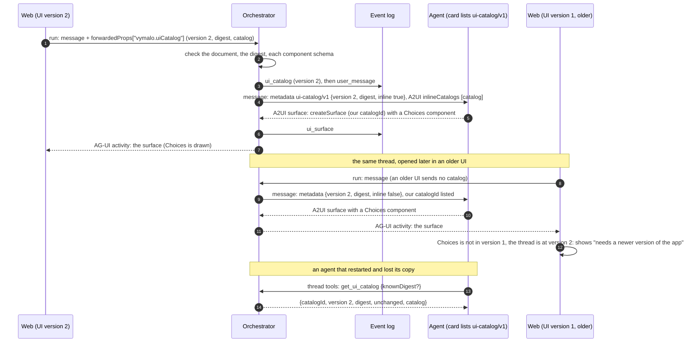
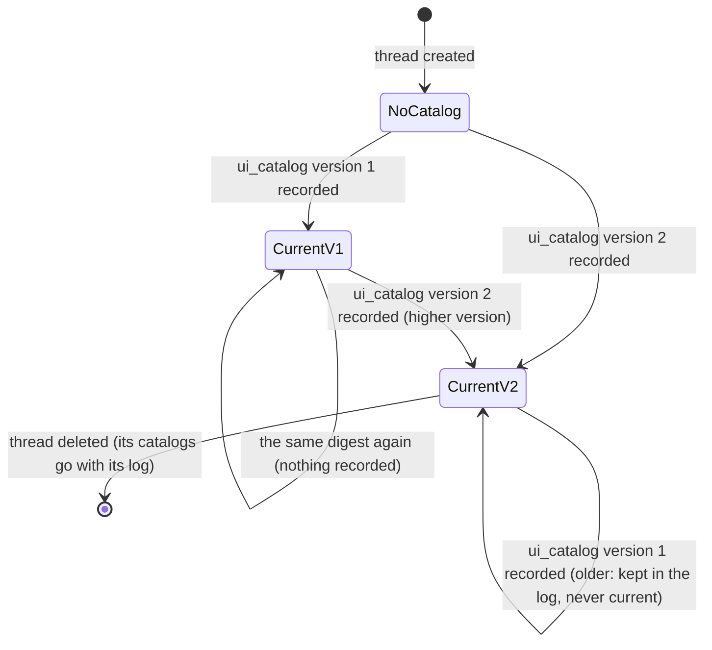
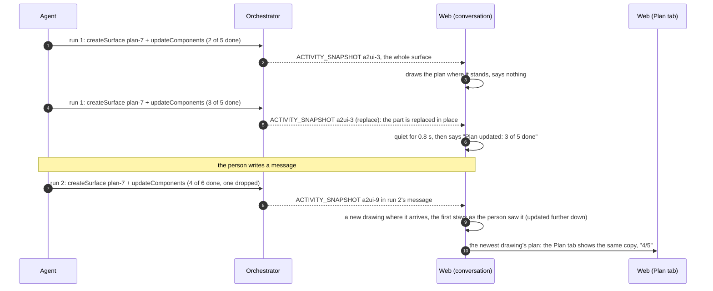

# A2A extension: UI catalog (v1)

- **URI:** `https://agents.vymalo.com/a2a/extensions/ui-catalog/v1`
- **Status:** **contract accepted (2026-10-01, on the owner's delegation); the orchestrator's side is built (MVP
  slice 3: the run member, the `ui_catalog` event and its ledger, `thread.uiCatalog`, the A2A adapter, and the refetch,
  the [thread tools](thread-tools-v1.md) with `get_ui_catalog`, section 6).** The web's catalog, Choices, Cards and
  Mermaid, Image, the questions of Choices with a title, typed answers and pictures (versions 1 to 5), the components of version 6, the five more kinds of question of [version 7](#version-7-more-kinds-of-question), and the questions that show what they ask about and the checklist that carries a plan of [version 8](#version-8-a-question-that-shows-what-it-asks-about-and-a-plan) are built (the web's side of MVP slices 3 and 4, and of slices 9 and 10 of [ADR 0067](../decisions/0067-the-plan-to-librechat-grade-and-the-client-agnostic-rule.md)); the adam-rs side (an agent that turns the
  catalog into model tools and refetches) is that repository's slice; see
  [`mvp.md`](../mvp.md#the-new-build-order). The owner may revisit anything here.
- **Retired by the A2UI v1.0 cutover** ([ADR 0075](../decisions/0075-a2ui-v1-0-cutover.md), accepted 2026-11-19, nothing built):
  A2UI v1.0 requires `"protocolVersion": "1.0"` on a catalog, which breaks this page's document, so the cutover moves to
  `ui-catalog/v2` (a new URI and page, the same `catalogId`, version 9 onwards). This page stays as the record of v1.
  **Retired by [`ui-catalog-v2.md`](ui-catalog-v2.md) (2026-11-19, slice C0):** v2's contract is written and nothing of it
  is built. **This page is still the contract of what is built until slice S4 merges the cutover into `main`**; from then
  on v2 is, and this page is only the record. v2 keeps this page's components, forms and answers unchanged in meaning,
  and links to its sections for them.
- **Decided in:** [ADR 0023](../decisions/0023-ui-component-catalog-as-an-a2a-extension.md) and its status note;
  the A2UI transport is [ADR 0013](../decisions/0013-a2ui-generative-ui.md); the optional-extension pattern is
  [ADR 0008](../decisions/0008-platform-integration-via-a2a-extension.md).
- **Defined by:** the web (the catalog). **Carried by:** the orchestrator. **Used by:** agents that speak A2UI.
- **Closes:** [open question 36](../open-questions.md).

## Purpose

Let an agent learn which components the person's screen can draw, answer and ask through them, and keep working when
the chat is opened from a newer or an older version of the UI, **using only the A2A card, A2A message metadata, A2UI's
own capabilities and one MCP tool**. The components are the web's; their parameters are all that change from one
message to the next, so the catalog goes to the agent once and is refetched when it may be stale
([ADR 0023](../decisions/0023-ui-component-catalog-as-an-a2a-extension.md)).

An agent that does not list the extension gets exactly the message it gets today: A2UI capabilities for the basic
catalog and nothing else. The rest of this page is for agents that do, and for the web and orchestrator that serve
them.

Facts about A2UI and MCP are marked *verified* (with a date and a source) or *unverified*; see
[Verified and unverified](#verified-and-unverified-2026-10-01).

## Who does what

| Part | Does |
|---|---|
| **Web** | Owns the catalog (`catalog.json`, its `version` and digest), sends it to the orchestrator at conversation start and when a newer one exists, validates every surface against it and refuses visibly what it cannot draw ([the web's rules](#8-what-the-web-does-with-a-surface)). |
| **Orchestrator** | Checks the catalog as a document (it does not interpret it), records it once per digest as a `ui_catalog` event, tells the agent about the thread's current catalog on each message, and serves the refetch (`get_ui_catalog` on [the thread tools](thread-tools-v1.md)). |
| **Agent** | Lists the extension in its card, reads the catalog, turns it into something its model can call (one tool per component, or one `show` tool whose schema is the catalog), emits A2UI surfaces that name our `catalogId`, and refetches when its copy may be stale. |

## The handshake



A thread's catalog moves only forward. Older catalogs stay in the log, and never become current:



## 1. The catalog

`catalogId` is `https://agents.vymalo.com/a2ui/catalogs/chat`. It is stable: versions are told apart by `version`
and `digest`. The canonical document is exactly an A2UI inline catalog, `{"catalogId": …, "components": {…}}`
([A2UI's `Catalog`](#verified-and-unverified-2026-10-01)), and nothing else: `functions` and `theme` are refused in
v1. Rules for the document:

- Every component schema is self-contained JSON Schema 2020-12: no `$ref`, `$dynamicRef`, `$id` or `$anchor`, and no
  `$schema`. Keys are ASCII. Numbers in the catalog document are integers (`maxLength: 120`, never `1.5`).
- Each schema validates the whole instance `{id, component, …}`: `properties.component.const` equals the component's
  key, and `additionalProperties` is `false`.
- Values are **literals**. Our components have no data bindings and no function calls.
- Every schema writes out `id` (a string of 1 to 256 characters) and `component` (the constant), and, **only in the schemas that list it**,
  `weight` (a number, A2UI's layout hint): it is in `Text`, `Column`, `Choices`, `Cards`, `Mermaid`, `Image` and `Stack` and in no other component,
  so a `Checklist`, a `Timeline`, a `Table`... refuse it as they refuse any member nobody has.
- A length is counted in **Unicode code points**, not in UTF-16 units or bytes (a character outside the Basic Multilingual Plane counts once:
  `maxLength: 200` takes 200 emoji). The sizes of a surface (64 KiB, 400 components) are those of [section 8](#8-what-the-web-does-with-a-surface).

### Version 1: Text and Column

```json
{
  "Text": {
    "type": "object",
    "description": "Plain text, drawn as text (no HTML, no links).",
    "properties": {
      "id": {"type": "string", "minLength": 1, "maxLength": 256},
      "component": {"const": "Text"},
      "weight": {"type": "number"},
      "text": {"type": "string", "minLength": 1, "maxLength": 4000},
      "variant": {"enum": ["h1", "h2", "h3", "h4", "h5", "caption", "body"]}
    },
    "required": ["id", "component", "text"],
    "additionalProperties": false
  },
  "Column": {
    "type": "object",
    "description": "Stacks its children vertically.",
    "properties": {
      "id": {"type": "string", "minLength": 1, "maxLength": 256},
      "component": {"const": "Column"},
      "weight": {"type": "number"},
      "children": {"type": "array", "minItems": 1, "maxItems": 50, "items": {"type": "string", "minLength": 1, "maxLength": 256}},
      "align": {"enum": ["start", "center", "end", "stretch"]}
    },
    "required": ["id", "component", "children"],
    "additionalProperties": false
  }
}
```

### Version 2 (slice 3): version 1 plus Choices

Choices asks the person up to 8 questions at once, each with 2 to 8 options (radio buttons, or checkboxes when
`multiple`). One submit sends **one** action; its answer shape is in [Choices answers](#choices-answers). Its schema
is written once, in [version 7](#the-choices-schema-as-the-catalog-holds-it), which only adds
to it: every Choices of version 2 is a Choices of version 7 and reads and answers as it did.

Two rules JSON Schema cannot say are checked by the web's validator and by the agent: question ids are unique in a
Choices, and option values are unique within a question.

### Version 3 (slice 4): version 2 plus Cards and Mermaid

Two output components: nothing is sent back from either. A **card's link** is drawn as a link to a new tab and a
card never loads anything (no image, no favicon: ADR 0013 rule 5). A **Mermaid** graph is drawn by the web as an
**image** (mermaid in the browser, strict security level, no HTML labels, the SVG shown through an ``), with the
source one click away as its text alternative; a graph that does not parse says so and shows its source, and does not
refuse the surface. Both are in the [web's README](../../web/README.md#cards-and-mermaid).

```json
{
  "Cards": {
    "type": "object",
    "description": "A list (or grid) of up to 24 cards: title, optional subtitle, body text, an http(s) link and tags.",
    "properties": {
      "id": {"type": "string", "minLength": 1, "maxLength": 256},
      "component": {"const": "Cards"},
      "weight": {"type": "number"},
      "title": {"type": "string", "maxLength": 120},
      "layout": {"enum": ["list", "grid"]},
      "cards": {
        "type": "array", "minItems": 1, "maxItems": 24,
        "items": {
          "type": "object",
          "properties": {
            "title": {"type": "string", "minLength": 1, "maxLength": 200},
            "subtitle": {"type": "string", "maxLength": 200},
            "body": {"type": "string", "maxLength": 2000},
            "url": {"type": "string", "maxLength": 2048, "pattern": "^https?://"},
            "tags": {"type": "array", "maxItems": 8, "items": {"type": "string", "minLength": 1, "maxLength": 40}}
          },
          "required": ["title"],
          "additionalProperties": false
        }
      }
    },
    "required": ["id", "component", "cards"],
    "additionalProperties": false
  },
  "Mermaid": {
    "type": "object",
    "description": "A mermaid diagram, drawn as an image (no links, no scripts).",
    "properties": {
      "id": {"type": "string", "minLength": 1, "maxLength": 256},
      "component": {"const": "Mermaid"},
      "weight": {"type": "number"},
      "title": {"type": "string", "maxLength": 120},
      "code": {"type": "string", "minLength": 1, "maxLength": 20000},
      "caption": {"type": "string", "maxLength": 500}
    },
    "required": ["id", "component", "code"],
    "additionalProperties": false
  }
}
```

A card's `url` is also checked by the web as an http(s) URL before it is drawn as a link (ADR 0013's link rules): the
schema's pattern only says how a URL starts (`https://` or `http://`, in lower case), so a URL with user information, a
control character or a backslash passes the schema and is refused by the web (rule `url`). A graph's own `%%{init}%%`
directive or front matter cannot change how it is drawn: the web fixes mermaid's security level, its labels, its theme and
its look, and a directive that names one is ignored.

### Version 4 (ADR 0032): version 3 plus Image

`Image` draws **a picture from a file of this thread**, named by the file's `sha256` (the `sha256` of the
[`vymalo.artifact`](agui.md#typed-artifacts) of a file an agent shared, which the artifact store kept:
[ADR 0032](../decisions/0032-files-from-agents-live-in-an-artifact-store.md), decision 11). It is **never a URL**: the
schema has no property that could carry one, and the web fetches nothing but its own route for the thread's files
(`GET /api/threads/{threadId}/artifacts/{sha256}`, [`getArtifact`](chat-api.yaml)). `alt` is required, because the
person who cannot see the picture hears it. This replaces, for this catalog, the rule of
[ADR 0013](../decisions/0013-a2ui-generative-ui.md) that an image is a placeholder that is never fetched (the basic
catalog's `Image`, which names a URL, stays a placeholder).

```json
{
  "Image": {
    "type": "object",
    "description": "A picture from a file of this thread, by its sha256 (the artifact of a file an agent shared); never a URL. alt is required.",
    "properties": {
      "id": {"type": "string", "minLength": 1, "maxLength": 256},
      "component": {"const": "Image"},
      "weight": {"type": "number"},
      "artifact": {"type": "string", "pattern": "^[0-9a-f]{64}$"},
      "alt": {"type": "string", "minLength": 1, "maxLength": 300},
      "caption": {"type": "string", "maxLength": 500}
    },
    "required": ["id", "component", "artifact", "alt"],
    "additionalProperties": false
  }
}
```

Two rules JSON Schema cannot say, both the web's: the surface's `artifact` must be the `sha256` of a **kept file of this
thread** that has `preview: "image"`, else the whole surface is refused (rule `artifact`, never half drawn: a hash of
another thread's file, or of a file that was not kept, is the agent's mistake and is said out loud); and the picture is
drawn as an `` of the file's own `href` (never inline markup, so an SVG runs nothing and loads nothing), with
its `alt`, and its `caption` under it as text. The file's own `artifact` event comes before the surface in the log, so a thread that replays
has it by then; a surface that names a file the thread does not hold (yet) is refused until it does. The later components (List, Stepper, Agent suggestion, Skill request, then
Web view, Notification opt-in) are added by raising the version; each is its own change to this page.

### Version 5: questions with a title, a description and typed options

Version 5 changes `Choices` only, and only by adding: a Choices of version 2 to 4 is valid and is drawn and answered as
before. An agent sends the new members only when the thread's catalog is **version 5 or more** (`ui-catalog/v1`
metadata, or the `get_ui_catalog` tool); on an older screen it sends the subset of the version it has, or asks in
words.

| Level | Member | Meaning |
|---|---|---|
| Form | `title` | The heading (at most 120 characters, as before) |
| | `description` | Why the agent asks, in plain text with no Markdown (at most 500) |
| | `freeInput` `{label?, placeholder?}` | An "anything else" box (at most 2,000 characters), sent as the answer's `note`; `label` defaults to "Anything else you want to add?" |
| | `submitLabel` | The button's words, as before |
| Question | `question` | Its title, as before |
| | `help` | A line under the title: what the options mean, or what the answer is for (at most 300) |
| | `type` | `single` (radio buttons, the default), `multiple` (checkboxes), `select` (a searchable list), `images` (a deck of picture tiles), `text` (one line, at most 500 characters), `longText` (a text area, at most 2,000) |
| | `multiple` | `true` is the old spelling of `type: "multiple"`; on `select` and `images` it lets several be chosen |
| | `required`, `allowOther` | As before; a typed question has no `allowOther` |
| | `default` | A value, or a list of values, chosen before the person touches anything (the text of a typed question); it is sent like any answer |
| | `min`, `max` | The fewest and most choices when several may be chosen; an "Other" with words counts as one |
| Option | `label` | Its title, as before |
| | `description` | Its subtitle (at most 300), as before |
| | `image` `{sha256, alt}` | A picture of **a file of this thread**, by its hash and never by a URL; `alt` is required. Only in `images` questions, and required there |
| | `icon` | One of the [`steps/v1` icon ids](steps-v1.md) (`agent`, `read`, `edit`, `delete`, `move`, `search`, `execute`, `think`, `fetch`, `web`, `git`, `test`, `file`, `tool`, `opencode`); none by default |
| | `recommended` | A "Recommended" mark on the option |

| Limit | Value |
|---|---|
| Questions in a form | 8 |
| Options in a `single` or `multiple` question | 2 to 12 |
| Options in a `select` question | 2 to 50 |
| Pictures in an `images` question | 2 to 16 |
| Options in a `text` or `longText` question | none |

The schema of `Choices` is written once, in [version 7](#the-choices-schema-as-the-catalog-holds-it), which only adds to it:
every Choices of version 5 is a Choices of version 7 and reads and answers as it did.

Rules JSON Schema cannot say, checked by the web's validator (a refusal of the whole surface, rule `schema`, whose reason
names the question and says what to change) and by the agent before it asks:

- question ids are unique in a Choices, and option values are unique within a question;
- the number of options by `type` (the table above), a picture on every option of an `images` question and on no other,
  and none on a typed question;
- `type: "single"` does not go with `multiple: true`, nor `type: "multiple"` with `multiple: false`; a typed question has
  no `multiple`, `allowOther`, `min` or `max`;
- every `default` is an `option` value (one only, unless several may be chosen), and `min` is at most `max`, which is at
  most the number of choices offered;
- the picture of an option must be the `sha256` of a **kept file of this thread** that has `preview: "image"`, else the
  whole surface is refused with the rule `artifact`, as for an [`Image`](#version-4-adr-0032-version-3-plus-image):
  never half drawn.

How a question is drawn: `single` as radio buttons (a `radiogroup`), `multiple` as checkboxes, `select` as a combobox
(ARIA 1.2: a text box that filters the list by label and subtitle, the arrow keys move, Enter chooses; with `multiple` the
choices are chips that can be removed), `images` as a grid of tiles (the picture, a radio button or checkbox with the
label, the subtitle and the mark; the whole tile is the target), `text` and `longText` as a text box and a text area. A
required question holds the button until it has an answer (and `min` of them), and a `max` reached stops further boxes
from being taken.

A form stops taking input once the person has acted after it, see [Answered forms](#answered-forms) (version 7's section, true of every version).

When the web builds the catalog (`catalog.json`), the file and this page change together; until then this page is the
contract.

### Version 6: code and files

An agent uses the version 6 components only when the thread's catalog is version 6 or higher (the `ui_catalog` the thread
was sent says which). A heavy component, a `Code`, `Diff`, `Terminal`, `Table`, `Chart`, `Gallery`, `Video`, `Audio` or
`FileCard`, is drawn once: a second reference to one in the same surface is refused (rule `expansion`).

Version 6 adds the components an agent shows when it has code, a change, a run or a pull request to show. Group 1 is
`Code`, `Diff`, `FileCard`, `Terminal` and `PullRequest`. None sends anything or holds state, and none fetches anything,
except a `FileCard`'s download, which is the route the thread's own file cards use. Every string is the agent's and is
drawn as text.

| Component | Properties (the rest are rejected) | Limits | Drawn as |
|---|---|---|---|
| `Code` | `code` (required), `title`, `filename`, `language` | code 20,000; title 120; filename 200; language 40 | a monospace block with its title and file name and a **Copy code** button; no highlighting |
| `Diff` | `diff` (required), `title` | diff 20,000; title 120 | the lines of a unified diff: a file header and a hunk in muted type, an added or removed line tinted with its sign and, for a screen reader, "Added:" or "Removed:" |
| `FileCard` | `artifact` (required: the file's `sha256`) | 64 lower-case hex digits | the file's name, size and type, and the download of the file cards |
| `Terminal` | `command` (required), `output`, `exitCode`, `title` | command 2,000; output 20,000; exit code -255 to 255, a whole number | the command after a `$`, an **Exit 0 · passed** or **Exit 2 · failed** badge (an icon and words), and an output of more than 12 lines folded behind **Show all N lines** |
| `PullRequest` | `repo`, `number`, `title`, `state` (required), `branch`, `checks`, `url` | repo 200; title 300; branch 200; number 1 to 2,147,483,647; checks: `passed`, `failed`, `pending`, each 0 to 10,000 (all three or none); url 2,048 | the repository and number, the title as a link (`url`, an http(s) link, opened in a new tab), the state as a word with an icon (`open`, `merged`, `closed`, `draft`), the branch, and the checks as three counts |

Two rules JSON Schema cannot say, both the web's (rule `artifact`, `url`):

- a `FileCard`'s `artifact` must be the `sha256` of a **kept file of this thread**, of any kind (an `Image` must be an image).
  A file the thread does not hold refuses the whole surface;
- a `PullRequest`'s `url` must pass the rule of [ADR 0013](../decisions/0013-a2ui-generative-ui.md) (an absolute `http`
  or `https` URL with no user information), checked by the walk of the surface, not only by the schema.

A surface that names one of these in the basic catalog is refused (rule `catalog`): they are the catalog's, not the basic one's.

```json
[
  {"version": "v0.9.1", "createSurface": {"surfaceId": "s1", "catalogId": "https://agents.vymalo.com/a2ui/catalogs/chat"}},
  {"version": "v0.9.1", "updateComponents": {"surfaceId": "s1", "components": [
    {"id": "root", "component": "Column", "children": ["pr", "run"]},
    {"id": "pr", "component": "PullRequest", "repo": "acme/demo", "number": 7, "title": "Add login",
     "state": "merged", "branch": "feature/login", "checks": {"passed": 3, "failed": 0, "pending": 0},
     "url": "https://github.com/acme/demo/pull/7"},
    {"id": "run", "component": "Terminal", "command": "npm test", "output": "12 passed", "exitCode": 0}
  ]}}
]
```

The contract of the five components, as the catalog holds it (`catalog/catalog.json`; a test keeps them equal):

```json
{
  "Code": {
    "type": "object",
    "description": "Source code, drawn as text in a monospace block with a copy button. Never highlighted, never linked.",
    "properties": {
      "id": {
        "type": "string",
        "minLength": 1,
        "maxLength": 256
      },
      "component": {
        "const": "Code"
      },
      "title": {
        "type": "string",
        "maxLength": 120
      },
      "filename": {
        "type": "string",
        "maxLength": 200
      },
      "language": {
        "type": "string",
        "maxLength": 40
      },
      "code": {
        "type": "string",
        "minLength": 1,
        "maxLength": 20000
      }
    },
    "required": [
      "id",
      "component",
      "code"
    ],
    "additionalProperties": false
  },
  "Diff": {
    "type": "object",
    "description": "A unified diff: its added and removed lines and its file headers, drawn as text.",
    "properties": {
      "id": {
        "type": "string",
        "minLength": 1,
        "maxLength": 256
      },
      "component": {
        "const": "Diff"
      },
      "title": {
        "type": "string",
        "maxLength": 120
      },
      "diff": {
        "type": "string",
        "minLength": 1,
        "maxLength": 20000
      }
    },
    "required": [
      "id",
      "component",
      "diff"
    ],
    "additionalProperties": false
  },
  "FileCard": {
    "type": "object",
    "description": "A file the thread holds, by its sha256: its name, size, type and a download.",
    "properties": {
      "id": {
        "type": "string",
        "minLength": 1,
        "maxLength": 256
      },
      "component": {
        "const": "FileCard"
      },
      "artifact": {
        "type": "string",
        "pattern": "^[0-9a-f]{64}$"
      }
    },
    "required": [
      "id",
      "component",
      "artifact"
    ],
    "additionalProperties": false
  },
  "Terminal": {
    "type": "object",
    "description": "A command and its output, with its exit code; a long output folds.",
    "properties": {
      "id": {
        "type": "string",
        "minLength": 1,
        "maxLength": 256
      },
      "component": {
        "const": "Terminal"
      },
      "title": {
        "type": "string",
        "maxLength": 120
      },
      "command": {
        "type": "string",
        "minLength": 1,
        "maxLength": 2000
      },
      "output": {
        "type": "string",
        "maxLength": 20000
      },
      "exitCode": {
        "type": "integer",
        "minimum": -255,
        "maximum": 255
      }
    },
    "required": [
      "id",
      "component",
      "command"
    ],
    "additionalProperties": false
  },
  "PullRequest": {
    "type": "object",
    "description": "A pull request: repository, number, title, state, branch, checks and link.",
    "properties": {
      "id": {
        "type": "string",
        "minLength": 1,
        "maxLength": 256
      },
      "component": {
        "const": "PullRequest"
      },
      "repo": {
        "type": "string",
        "minLength": 1,
        "maxLength": 200
      },
      "number": {
        "type": "integer",
        "minimum": 1,
        "maximum": 2147483647
      },
      "title": {
        "type": "string",
        "minLength": 1,
        "maxLength": 300
      },
      "state": {
        "enum": [
          "open",
          "merged",
          "closed",
          "draft"
        ]
      },
      "branch": {
        "type": "string",
        "minLength": 1,
        "maxLength": 200
      },
      "checks": {
        "type": "object",
        "properties": {
          "passed": {
            "type": "integer",
            "minimum": 0,
            "maximum": 10000
          },
          "failed": {
            "type": "integer",
            "minimum": 0,
            "maximum": 10000
          },
          "pending": {
            "type": "integer",
            "minimum": 0,
            "maximum": 10000
          }
        },
        "required": [
          "passed",
          "failed",
          "pending"
        ],
        "additionalProperties": false
      },
      "url": {
        "type": "string",
        "maxLength": 2048,
        "pattern": "^https?://"
      }
    },
    "required": [
      "id",
      "component",
      "repo",
      "number",
      "title",
      "state"
    ],
    "additionalProperties": false
  }
}
```

### Version 6: structure and status

Group 2 of version 6 is `Stack`, `Tabs`, `Accordion`, `Callout`, `Checklist` and `Timeline`. `Stack` lays its children out in
a row (the default) or one under another (`direction`); a row wraps on a narrow screen unless `wrap` is `false`, so a phone never
scrolls the page sideways. Use it instead of `Column` for a row. `Tabs` and `Accordion` hold other
components of the surface: their children are ids, walked like any reference (a child that is not in the surface yet
makes it pending; a child that holds its own parent is a cycle, rule `cycle`) and drawn in order. None sends anything.
A state is always said in words beside its icon.

| Component | Properties (the rest are rejected) | Limits | Drawn as |
|---|---|---|---|
| `Stack` | `children` (required): component ids; `direction` (`horizontal`, the default, or `vertical`); `gap` (`none`, `small`, `medium`, the default, or `large`); `align` (`start`, `center`, `end`, `stretch`); `justify` (`start`, `center`, `end`, `between`); `wrap` (`true`, the default, or `false`); `weight` | 1 to 50 children | the children in order, in a row that wraps or in a column; a row wraps on a phone, so the page never scrolls sideways |
| `Tabs` | `tabs` (required): `label` and `child` (a component id) for each | 1 to 8 tabs; label 60 | tabs that the arrow keys move between; only the open tab's child is drawn |
| `Accordion` | `items` (required): `title` and `child` for each; `multiple` | 1 to 20 items; title 200 | sections, closed until their title is pressed (`aria-expanded`); one open at a time unless `multiple`; a closed section's child is not in the page |
| `Callout` | `title`, `text` (required); `tone`: `info` (the default), `success`, `warning`, `error` | title 120; text 2,000 | a box with its icon, the tone in words above the title, the title and the text |
| `Checklist` | `items` (required): `label` and `state` (`done`, `doing`, `todo` or `failed`; from [version 8](#the-checklist) also `dropped`) for each, and from version 8 a `note`; `title` | 1 to 50 items; label 200; note 200; title 120 | each item's state in words beside an icon, and a progress bar with "N of M done" (a dropped item is in neither number) |
| `Timeline` | `events` (required): `time` and `title`; `description`; `state` (the default is `done`); `title` | 1 to 50 events; time 40; title 200; description 1,000 | an ordered list: the time and the state in words, the title and the description |

Each child of a `Stack`, a `Tabs` or an `Accordion` is a component of the same surface, and is checked by the same rules as any
other. A `Stack`, a `Tabs` or an `Accordion` in the basic catalog is refused (rule `catalog`).

```json
[
  {"version": "v0.9.1", "createSurface": {"surfaceId": "s1", "catalogId": "https://agents.vymalo.com/a2ui/catalogs/chat"}},
  {"version": "v0.9.1", "updateComponents": {"surfaceId": "s1", "components": [
    {"id": "root", "component": "Column", "children": ["note", "tabs"]},
    {"id": "note", "component": "Callout", "tone": "warning", "title": "Read-only", "text": "Writes wait for the migration."},
    {"id": "tabs", "component": "Tabs", "tabs": [{"label": "Overview", "child": "overview"}, {"label": "Steps", "child": "steps"}]},
    {"id": "overview", "component": "Text", "text": "The migration takes about ten minutes."},
    {"id": "steps", "component": "Checklist", "items": [{"label": "Back up", "state": "done"}, {"label": "Migrate", "state": "doing"}]}
  ]}}
]
```

The contract of the six components, as the catalog holds it (`catalog/catalog.json`; a test keeps them equal):

```json
{
  "Stack": {
    "type": "object",
    "description": "Lays children in a row that wraps, or one under another: use it instead of Column for a row.",
    "properties": {
      "id": {
        "type": "string",
        "minLength": 1,
        "maxLength": 256
      },
      "component": {
        "const": "Stack"
      },
      "weight": {
        "type": "number"
      },
      "direction": {
        "enum": [
          "horizontal",
          "vertical"
        ],
        "default": "horizontal"
      },
      "gap": {
        "enum": [
          "none",
          "small",
          "medium",
          "large"
        ],
        "default": "medium"
      },
      "align": {
        "enum": [
          "start",
          "center",
          "end",
          "stretch"
        ]
      },
      "justify": {
        "enum": [
          "start",
          "center",
          "end",
          "between"
        ]
      },
      "wrap": {
        "type": "boolean",
        "default": true
      },
      "children": {
        "type": "array",
        "minItems": 1,
        "maxItems": 50,
        "items": {
          "type": "string",
          "minLength": 1,
          "maxLength": 256
        }
      }
    },
    "required": [
      "id",
      "component",
      "children"
    ],
    "additionalProperties": false
  },
  "Tabs": {
    "type": "object",
    "description": "Tabs: a label and a child component for each, one tab open at a time.",
    "properties": {
      "id": {
        "type": "string",
        "minLength": 1,
        "maxLength": 256
      },
      "component": {
        "const": "Tabs"
      },
      "tabs": {
        "type": "array",
        "minItems": 1,
        "maxItems": 8,
        "items": {
          "type": "object",
          "properties": {
            "label": {
              "type": "string",
              "minLength": 1,
              "maxLength": 60
            },
            "child": {
              "type": "string",
              "minLength": 1,
              "maxLength": 256
            }
          },
          "required": [
            "label",
            "child"
          ],
          "additionalProperties": false
        }
      }
    },
    "required": [
      "id",
      "component",
      "tabs"
    ],
    "additionalProperties": false
  },
  "Accordion": {
    "type": "object",
    "description": "Collapsible sections: a title and a child component for each, opened one at a time or several.",
    "properties": {
      "id": {
        "type": "string",
        "minLength": 1,
        "maxLength": 256
      },
      "component": {
        "const": "Accordion"
      },
      "multiple": {
        "type": "boolean"
      },
      "items": {
        "type": "array",
        "minItems": 1,
        "maxItems": 20,
        "items": {
          "type": "object",
          "properties": {
            "title": {
              "type": "string",
              "minLength": 1,
              "maxLength": 200
            },
            "child": {
              "type": "string",
              "minLength": 1,
              "maxLength": 256
            }
          },
          "required": [
            "title",
            "child"
          ],
          "additionalProperties": false
        }
      }
    },
    "required": [
      "id",
      "component",
      "items"
    ],
    "additionalProperties": false
  },
  "Callout": {
    "type": "object",
    "description": "A note, a success, a warning or an error: a title and a text, the tone said in words and by an icon.",
    "properties": {
      "id": {
        "type": "string",
        "minLength": 1,
        "maxLength": 256
      },
      "component": {
        "const": "Callout"
      },
      "tone": {
        "enum": [
          "info",
          "success",
          "warning",
          "error"
        ]
      },
      "title": {
        "type": "string",
        "minLength": 1,
        "maxLength": 120
      },
      "text": {
        "type": "string",
        "minLength": 1,
        "maxLength": 2000
      }
    },
    "required": [
      "id",
      "component",
      "title",
      "text"
    ],
    "additionalProperties": false
  },
  "Checklist": {
    "type": "object",
    "description": "A checklist of items, each with a state and an optional note, and a progress bar. States: done, doing, todo, failed and, only when the thread's catalog is version 8 or more, dropped (struck through, not counted in \"N of M done\"). For a plan, send the whole surface again each time the plan changes, under the same surfaceId, which starts with plan-.",
    "properties": {
      "id": {
        "type": "string",
        "minLength": 1,
        "maxLength": 256
      },
      "component": {
        "const": "Checklist"
      },
      "title": {
        "type": "string",
        "maxLength": 120
      },
      "items": {
        "type": "array",
        "minItems": 1,
        "maxItems": 50,
        "items": {
          "type": "object",
          "properties": {
            "label": {
              "type": "string",
              "minLength": 1,
              "maxLength": 200
            },
            "state": {
              "enum": [
                "done",
                "doing",
                "todo",
                "failed",
                "dropped"
              ]
            },
            "note": {
              "type": "string",
              "maxLength": 200
            }
          },
          "required": [
            "label",
            "state"
          ],
          "additionalProperties": false
        }
      }
    },
    "required": [
      "id",
      "component",
      "items"
    ],
    "additionalProperties": false
  },
  "Timeline": {
    "type": "object",
    "description": "A timeline of events in order: each with its time, title, optional description and state.",
    "properties": {
      "id": {
        "type": "string",
        "minLength": 1,
        "maxLength": 256
      },
      "component": {
        "const": "Timeline"
      },
      "title": {
        "type": "string",
        "maxLength": 120
      },
      "events": {
        "type": "array",
        "minItems": 1,
        "maxItems": 50,
        "items": {
          "type": "object",
          "properties": {
            "time": {
              "type": "string",
              "minLength": 1,
              "maxLength": 40
            },
            "title": {
              "type": "string",
              "minLength": 1,
              "maxLength": 200
            },
            "description": {
              "type": "string",
              "maxLength": 1000
            },
            "state": {
              "enum": [
                "done",
                "doing",
                "todo",
                "failed"
              ]
            }
          },
          "required": [
            "time",
            "title"
          ],
          "additionalProperties": false
        }
      }
    },
    "required": [
      "id",
      "component",
      "events"
    ],
    "additionalProperties": false
  }
}
```

### Version 6: data

Group 3 of version 6 is `Table`, `KeyValue`, `Stats` and `Chart`: what an agent shows when it has figures. None sends
anything or holds state. The sort of a `Table` is the person's own view and nothing the agent reads.

| Component | Properties (the rest are rejected) | Limits | Drawn as |
|---|---|---|---|
| `Table` | `columns` (required): `key`, `label`, and `align` (`start` or `end`) for each; `rows` (required): objects whose members are the cells, by a column's key; `title` | 1 to 12 columns (a key of 1 to 64 letters, digits or `_.:-`; a label of 80); 0 to 200 rows of at most 12 cells; a text cell of 500 characters | a table; a click on a header sorts by it (ascending, descending, then as it came), and the header says how it is sorted in words |
| `KeyValue` | `pairs` (required): `key` and `value` for each; `title` | 1 to 50 pairs; a key of 120; a text value of 500 | a definition list; a yes or no is written as one, and a value that is not set says so |
| `Stats` | `tiles` (required): `label` and `value` for each; `delta`; `trend` (`up`, `down` or `flat`); `title` | 1 to 12 tiles; label 80; value 40; delta 40 | tiles with the value large and the change beside an arrow and its word (`Up`, `Down`, `Unchanged`) |
| `Chart` | `type` (`bar`, `line` or `pie`), `labels` and `series` (required): each series a `name` and `values`; `title`, `caption`, `unit` | 1 to 24 labels of 40 characters (a pie has at most six, and one series); 1 to 4 series (name 60), each with a value per label, 1 to 24 values of at most a trillion in size, each 0 or at least 1e-6 in size (rule `schema`); unit 20 | a picture (an SVG, named for what it shows), a legend that names each series, and the data behind a **Data** disclosure |

Rules JSON Schema cannot say, all of the web's (rule `schema`, the whole surface refused): a `Table`'s column keys are used
once; each series of a `Chart` has a value for each label; a `pie` has one series, none of whose values is negative and at
least one of which is above zero. The series colours are the page's `--chart-1` to `--chart-4` tokens, which hold at least
5 to 1 on the card in both schemes (computed 2026-10-11 by the WCAG formula; the words and the legend carry the meaning
without them).

```json
[
  {"version": "v0.9.1", "createSurface": {"surfaceId": "s1", "catalogId": "https://agents.vymalo.com/a2ui/catalogs/chat"}},
  {"version": "v0.9.1", "updateComponents": {"surfaceId": "s1", "components": [
    {"id": "root", "component": "Column", "children": ["stats", "runs", "table"]},
    {"id": "stats", "component": "Stats", "tiles": [{"label": "Runs", "value": "1,204", "delta": "+12%", "trend": "up"}]},
    {"id": "runs", "component": "Chart", "type": "bar", "title": "Runs per day", "labels": ["Mon", "Tue"],
     "series": [{"name": "Passed", "values": [30, 42]}, {"name": "Failed", "values": [2, 0]}]},
    {"id": "table", "component": "Table", "columns": [{"key": "name", "label": "Service"}, {"key": "runs", "label": "Runs", "align": "end"}],
     "rows": [{"name": "api", "runs": 812}, {"name": "worker", "runs": 392}]}
  ]}}
]
```

The contract of the four components, as the catalog holds it (`catalog/catalog.json`; a test keeps them equal):

```json
{
  "Table": {
    "type": "object",
    "description": "A table of columns and rows; a column is sorted by a click on its header.",
    "properties": {
      "id": {
        "type": "string",
        "minLength": 1,
        "maxLength": 256
      },
      "component": {
        "const": "Table"
      },
      "title": {
        "type": "string",
        "maxLength": 120
      },
      "columns": {
        "type": "array",
        "minItems": 1,
        "maxItems": 12,
        "items": {
          "type": "object",
          "properties": {
            "key": {
              "type": "string",
              "pattern": "^[A-Za-z0-9_.:-]{1,64}$"
            },
            "label": {
              "type": "string",
              "minLength": 1,
              "maxLength": 80
            },
            "align": {
              "enum": [
                "start",
                "end"
              ]
            }
          },
          "required": [
            "key",
            "label"
          ],
          "additionalProperties": false
        }
      },
      "rows": {
        "type": "array",
        "maxItems": 200,
        "items": {
          "type": "object",
          "propertyNames": {
            "maxLength": 64
          },
          "maxProperties": 12,
          "additionalProperties": {
            "type": [
              "string",
              "number",
              "boolean",
              "null"
            ],
            "maxLength": 500
          }
        }
      }
    },
    "required": [
      "id",
      "component",
      "columns",
      "rows"
    ],
    "additionalProperties": false
  },
  "KeyValue": {
    "type": "object",
    "description": "Pairs of a name and a value, in order, as a list of terms.",
    "properties": {
      "id": {
        "type": "string",
        "minLength": 1,
        "maxLength": 256
      },
      "component": {
        "const": "KeyValue"
      },
      "title": {
        "type": "string",
        "maxLength": 120
      },
      "pairs": {
        "type": "array",
        "minItems": 1,
        "maxItems": 50,
        "items": {
          "type": "object",
          "properties": {
            "key": {
              "type": "string",
              "minLength": 1,
              "maxLength": 120
            },
            "value": {
              "type": [
                "string",
                "number",
                "boolean",
                "null"
              ],
              "maxLength": 500
            }
          },
          "required": [
            "key",
            "value"
          ],
          "additionalProperties": false
        }
      }
    },
    "required": [
      "id",
      "component",
      "pairs"
    ],
    "additionalProperties": false
  },
  "Stats": {
    "type": "object",
    "description": "Tiles of a figure, each with its label, its value, and a change with a trend.",
    "properties": {
      "id": {
        "type": "string",
        "minLength": 1,
        "maxLength": 256
      },
      "component": {
        "const": "Stats"
      },
      "title": {
        "type": "string",
        "maxLength": 120
      },
      "tiles": {
        "type": "array",
        "minItems": 1,
        "maxItems": 12,
        "items": {
          "type": "object",
          "properties": {
            "label": {
              "type": "string",
              "minLength": 1,
              "maxLength": 80
            },
            "value": {
              "type": "string",
              "minLength": 1,
              "maxLength": 40
            },
            "delta": {
              "type": "string",
              "minLength": 1,
              "maxLength": 40
            },
            "trend": {
              "enum": [
                "up",
                "down",
                "flat"
              ]
            }
          },
          "required": [
            "label",
            "value"
          ],
          "additionalProperties": false
        }
      }
    },
    "required": [
      "id",
      "component",
      "tiles"
    ],
    "additionalProperties": false
  },
  "Chart": {
    "type": "object",
    "description": "A bar, line or pie chart of up to four series, drawn as a picture with its data.",
    "properties": {
      "id": {
        "type": "string",
        "minLength": 1,
        "maxLength": 256
      },
      "component": {
        "const": "Chart"
      },
      "title": {
        "type": "string",
        "maxLength": 120
      },
      "caption": {
        "type": "string",
        "maxLength": 500
      },
      "type": {
        "enum": [
          "bar",
          "line",
          "pie"
        ]
      },
      "unit": {
        "type": "string",
        "maxLength": 20
      },
      "labels": {
        "type": "array",
        "minItems": 1,
        "maxItems": 24,
        "items": {
          "type": "string",
          "minLength": 1,
          "maxLength": 40
        }
      },
      "series": {
        "type": "array",
        "minItems": 1,
        "maxItems": 4,
        "items": {
          "type": "object",
          "properties": {
            "name": {
              "type": "string",
              "minLength": 1,
              "maxLength": 60
            },
            "values": {
              "type": "array",
              "minItems": 1,
              "maxItems": 24,
              "items": {
                "type": "number",
                "minimum": -1000000000000,
                "maximum": 1000000000000
              }
            }
          },
          "required": [
            "name",
            "values"
          ],
          "additionalProperties": false
        }
      }
    },
    "required": [
      "id",
      "component",
      "type",
      "labels",
      "series"
    ],
    "additionalProperties": false
  }
}
```

### Version 6: media

Group 4 of version 6 is `Gallery`, `LinkPreview`, `Video` and `Audio`. A picture, a video and a sound are files of the
thread: each is named by its `sha256` and drawn from the thread's own route, never from a URL the agent wrote. A
`LinkPreview` draws what the agent wrote and fetches nothing.

| Component | Properties (the rest are rejected) | Limits | Drawn as |
|---|---|---|---|
| `Gallery` | `images` (required): `artifact` (the `sha256`), `alt` (required) and `caption` for each; `title` | 1 to 12 pictures; alt 300; caption 300 | a grid of the pictures; one opens larger in a dialog, where the arrow keys and the buttons move to the next and the previous one |
| `LinkPreview` | `url` and `title` (required); `description`; `site` | url 2,048, `http` or `https`; title 200; description 1,000; site 100 | a link that opens in a new tab, the description, the site and the host of the link; no page is read, no image, no favicon |
| `Video` | `artifact` and `title` (required); `caption` | title 200; caption 500 | a video with its controls, its title and its download; a video that does not play says so |
| `Audio` | `artifact` and `title` (required); `caption` | title 200; caption 500 | a sound with its controls, its title and its download; a sound that does not play says so |

Rules JSON Schema cannot say, all of the web's (rule `artifact`, the whole surface refused): each picture of a `Gallery`
is an image of the thread; a `Video`'s file is a video and an `Audio`'s file a sound, both of this thread (their
`mimeType`). A `LinkPreview`'s `url` must pass the rule of [ADR 0013](../decisions/0013-a2ui-generative-ui.md) (rule `url`,
checked by the walk of the surface).

The media of a surface is played by the page under its policy: `media-src 'self' blob:`, added to the policy of the
web for this group (the browser mode of [ADR 0054](../decisions/0054-the-web-holds-its-own-tokens-dpop-bound-in-indexeddb.md)
fetches a file with the session and plays an object URL, which is `blob:`). No other source is allowed.

```json
[
  {"version": "v0.9.1", "createSurface": {"surfaceId": "s1", "catalogId": "https://agents.vymalo.com/a2ui/catalogs/chat"}},
  {"version": "v0.9.1", "updateComponents": {"surfaceId": "s1", "components": [
    {"id": "root", "component": "Column", "children": ["shots", "docs", "clip"]},
    {"id": "shots", "component": "Gallery", "title": "Screenshots", "images": [
      {"artifact": "6003a31f3d31c8f86ddcb2fd81eac09c9beec0aee68f1844e19425df920da1f9", "alt": "The list of matches"},
      {"artifact": "2b5ff92cfe7f2be8e45729cd99a7b36f0de467509a6b1e906d3c68164c34b931", "alt": "The matches with percentages", "caption": "Figure 2"}
    ]},
    {"id": "docs", "component": "LinkPreview", "url": "https://www.postgresql.org/docs/current/", "title": "PostgreSQL documentation", "description": "The manual of the current release.", "site": "postgresql.org"},
    {"id": "clip", "component": "Video", "artifact": "67905ad3cc2dd52b1f5f6a6d2814de0396618b29b4238b9af5207aeb69936e6d", "title": "The demo", "caption": "Recorded on Tuesday."}
  ]}}
]
```

The contract of the four components, as the catalog holds it (`catalog/catalog.json`; a test keeps them equal):

```json
{
  "Gallery": {
    "type": "object",
    "description": "Pictures of files of this thread, by their sha256, in a grid; each opens larger.",
    "properties": {
      "id": {
        "type": "string",
        "minLength": 1,
        "maxLength": 256
      },
      "component": {
        "const": "Gallery"
      },
      "title": {
        "type": "string",
        "maxLength": 120
      },
      "images": {
        "type": "array",
        "minItems": 1,
        "maxItems": 12,
        "items": {
          "type": "object",
          "properties": {
            "artifact": {
              "type": "string",
              "pattern": "^[0-9a-f]{64}$"
            },
            "alt": {
              "type": "string",
              "minLength": 1,
              "maxLength": 300
            },
            "caption": {
              "type": "string",
              "maxLength": 300
            }
          },
          "required": [
            "artifact",
            "alt"
          ],
          "additionalProperties": false
        }
      }
    },
    "required": [
      "id",
      "component",
      "images"
    ],
    "additionalProperties": false
  },
  "LinkPreview": {
    "type": "object",
    "description": "A link with its title, description and site, as the agent gave them: nothing is fetched.",
    "properties": {
      "id": {
        "type": "string",
        "minLength": 1,
        "maxLength": 256
      },
      "component": {
        "const": "LinkPreview"
      },
      "url": {
        "type": "string",
        "maxLength": 2048,
        "pattern": "^https?://"
      },
      "title": {
        "type": "string",
        "minLength": 1,
        "maxLength": 200
      },
      "description": {
        "type": "string",
        "maxLength": 1000
      },
      "site": {
        "type": "string",
        "minLength": 1,
        "maxLength": 100
      }
    },
    "required": [
      "id",
      "component",
      "url",
      "title"
    ],
    "additionalProperties": false
  },
  "Video": {
    "type": "object",
    "description": "A video of a file of this thread, by its sha256: played in the page, with its title.",
    "properties": {
      "id": {
        "type": "string",
        "minLength": 1,
        "maxLength": 256
      },
      "component": {
        "const": "Video"
      },
      "artifact": {
        "type": "string",
        "pattern": "^[0-9a-f]{64}$"
      },
      "title": {
        "type": "string",
        "minLength": 1,
        "maxLength": 200
      },
      "caption": {
        "type": "string",
        "maxLength": 500
      }
    },
    "required": [
      "id",
      "component",
      "artifact",
      "title"
    ],
    "additionalProperties": false
  },
  "Audio": {
    "type": "object",
    "description": "A sound recording of a file of this thread, by its sha256: played in the page, with its title.",
    "properties": {
      "id": {
        "type": "string",
        "minLength": 1,
        "maxLength": 256
      },
      "component": {
        "const": "Audio"
      },
      "artifact": {
        "type": "string",
        "pattern": "^[0-9a-f]{64}$"
      },
      "title": {
        "type": "string",
        "minLength": 1,
        "maxLength": 200
      },
      "caption": {
        "type": "string",
        "maxLength": 500
      }
    },
    "required": [
      "id",
      "component",
      "artifact",
      "title"
    ],
    "additionalProperties": false
  }
}
```

### Version 7: more kinds of question

Version 7 changes `Choices` only, and only by adding: a Choices of version 2 to 6 is valid and is drawn and answered as
before. It adds five **kinds** of question, five more values of a question's `type`: a yes or no (`confirm`), a number
(`number`), a point on a short scale (`scale`), a calendar day (`date`) and a list to put in order (`rank`). The
questions of the other six types are not touched. The schema of the whole `Choices`, which this version moves here
because it is the one that holds every kind, is [at the end of this section](#the-choices-schema-as-the-catalog-holds-it).

An agent asks with these kinds only when the thread's catalog is **version 7 or more**, or, the better test, when the
`type` it wants is in the `enum` of the `Choices` schema it was given. How it learns that, and what both sides do
when it is not so, is [Versions and degradation](#versions-and-degradation).

| `type` | The person | Members of the question (the rest of the kind's members are refused) | The answer's `values` |
|---|---|---|---|
| `confirm` | answers yes or no, in the agent's two phrases | `yesLabel` and `noLabel` (each 1 to 40 characters; "Yes" and "No" when absent); `default`: `"yes"` or `"no"`, **the safe answer**, chosen before the person touches anything (a string, never a list) | `["yes"]` or `["no"]`, whatever the labels say |
| `number` | types a number | `minValue`, `maxValue`, `step` (decimal strings: [the grammar](#the-decimal-and-the-date)); `unit` (1 to 20 characters, shown beside the box); `default` (a decimal string) | one decimal string: `["12.5"]` |
| `scale` | picks a point from a short run of whole numbers | `from` (0 or 1; 1 when absent), `to` (2 to 10, **required**, above `from`); `fromLabel`, `toLabel` (1 to 60 characters: the words at the two ends); `default` (a whole number as a string) | one whole number as a string: `["4"]` |
| `date` | picks a day | `minDate`, `maxDate` (`YYYY-MM-DD`); `default` (a date) | one date: `["2026-12-15"]` |
| `rank` | puts the options in order, the best first | `options`: 2 to 12, each `value`, `label` and optionally `description`, `icon`, `recommended`, **no `image`**; `default`: every option's `value` once, as a list: the order the list **starts** in, never an answer by itself | **every** option's `value` once, in the person's order: `["c", "a", "b"]` |

Every kind also has the members all questions have: `id`, `question`, `help` and `required` (as in
[version 5](#version-5-questions-with-a-title-a-description-and-typed-options)); **`required` is `true` when it is absent**.
A member belongs to its kind: `yesLabel` on a `number`, or `step` on a `date`, is refused, and so is a member of a kind on any
of the six older types (`step` on a `single`, `unit` on a `text`). None of the five has `multiple`, `allowOther`, `min` or
`max`, and only a `rank` has `options`. A `default` is **a string** for `confirm`, `number`, `scale` and `date` and **a list**
for `rank`: a one-element list on a `number` is a refused question, not a form that is read as a string.

#### The decimal and the date

A `number` is **a decimal string, never a JSON number**, in the question (`minValue`, `maxValue`, `step`, `default`) and in
the answer. The reason is the wire: an A2A server holds a number of a message's metadata as a double
([section 5](#5-to-the-agent-the-extension)), so `0.1`, `12.50` or a number of sixteen digits would not come out as it went in. A
string comes out as it went in, and the receiver reads it with its own decimal type.

| | Grammar | Notes |
|---|---|---|
| decimal | `-?(0\|[1-9][0-9]{0,14})(\.[0-9]{1,6})?` | ASCII digits only, a minus sign (never a plus), a point (never a comma), no leading zero (`05`), no exponent (`1e3`), no space, no thousands separator, at most 15 digits before the point and 6 after. Zero has no sign: `-0`, `-0.0` and `-0.000000` are refused, `0`, `0.0` and `0.000000` are not. `2.50` is allowed and equals `2.5`. Refused as well: `1.`, `.5`, `+1`, `1e3`, `1,5`, a space or a line break anywhere, and a digit that is not ASCII (`٣`, `３`) |
| whole number (`scale`) | `0\|[1-9][0-9]?` | `7`, never `07` or `7.0` |
| date | `YYYY-MM-DD` | four digits of year (0001 to 9999), two of month and two of day, **a day that exists** in the proleptic Gregorian calendar (`2028-02-29` yes, `2027-02-29` and `2026-04-31` no) |

Decimals are **compared as exact decimals**, never through floating point: `1000.5` is above `1000`, and `0.1 + 0.2` is `0.3`.
A value is **on the step** when it is `minValue` (or `0` when the question has none) plus a whole number of `step`s, exactly
(`step: "0.5"` from `0`: `250.5` yes, `250.25` no; the count of steps may be negative: from `-5` by `2.5`, `-2.5` is on the step). `step` is above zero. A date is a **calendar day, not an instant**: it has no
time and no zone, it is the same day everywhere, and no client or receiver converts it (a client that builds it from a local
time and sends the UTC form is wrong). Dates compare as text, which is right because the form is fixed-width.

**Trimming.** The **client** trims what a person typed before it builds the answer (a person's stray space is not a mistake worth
a refusal); the **receiver never trims**: a value with white space in it is `grammar`. **Locale.** The wire form never depends on
locale: a decimal always has a point and a date is always `YYYY-MM-DD`. What a client *displays* may follow the viewer's locale
(the point may be shown as a comma by a client that converts on the way in and out, a day may be written out in the viewer's
language), as long as what it sends is the wire form.

#### Rules JSON Schema cannot say

Checked by the web's validator (a refusal of the whole surface, rule `schema`, whose reason names the question and says what
to change) and by the agent before it asks. They hold for a Choices of any version, on top of
[version 5's](#version-5-questions-with-a-title-a-description-and-typed-options):

- a kind takes no `options` (except `rank`, which takes 2 to 12, none with an `image`), and none of `multiple`, `allowOther`,
  `min` and `max`; a member of one kind is not on another;
- `minValue` is at most `maxValue`, `step` is above zero, `minDate` is at most `maxDate` and both are real days, `to` is above
  `from`, and a `scale` has a `to`;
- a `default` has the shape of its kind (a string, or for `rank` a list); the same value in the other shape is a refused question;
- every `default` is an answer the kind accepts under [the rules below](#receiving-an-answer): inside the bounds, on the step, a
  real day, `yes` or `no`, every option once. A `rank` without a `default` starts in the order of its options.

The cases of [`invalid-questions`](#receiving-an-answer) below are questions every one of these rules refuses.

#### How a client draws them, and what it checks

A client **validates before it sends** and holds the button, with the reason in words next to the control, until every question
is valid; it sends nothing a receiver would refuse. The receiver checks again ([below](#receiving-an-answer)): a form is only as
trustworthy as the client that drew it. What a client must do:

| Kind | Control | Must |
|---|---|---|
| `confirm` | two radio buttons, the yes first, in a `radiogroup` | name the group with the question; arrows move; the safe answer is chosen when there is a `default`; a state that is never told by colour alone; when the question is optional, a **Clear answer** control that returns it to no answer |
| `number` | a text box (`inputmode="decimal"`, not a browser number box: its locale and exponent forms are not this grammar) with the `unit` beside it | take only the grammar and say it in the error ("Use digits and a point, like 12.5"); say the bound or the step that is broken ("The most is 1000 EUR"); the unit is in the control's name |
| `scale` | the points as radio buttons in a `radiogroup`, `fromLabel` by the first and `toLabel` by the last | each point has its number as its name, and the words at the two ends are the **description** of the first and the last point (`aria-describedby`), not part of the name; arrows move; at most 11 points fit a phone's width by wrapping; when the question is optional, a **Clear answer** control |
| `date` | a native date control with `min` and `max` (or a text box for `YYYY-MM-DD`, which then says the format) | send the control's own `YYYY-MM-DD` and nothing built from a `Date`; say the bound that is broken |
| `rank` | an ordered list; each item has a **Move up** and a **Move down** button named with the item ("Move Beta up") | be fully operable by keyboard without drag and drop (drag may exist as an extra); say the new place in words after each move ("Beta, 1 of 3"); a button at the end of the list that cannot move says so **in words** in the same polite status line ("Cost is already first") and keeps the focus, and a consecutive message differs from the last so that it is announced again; the focus stays on the button that was used, in both directions; until the person has moved an item or pressed **Keep this order**, a required rank is not answered, **whether or not it has a `default` and on a second ask too** (the order the list starts in is the agent's, or the person's earlier one, and is not an answer until they say it is); when the question is optional, a **Clear answer** control returns it to untouched |

Every control has an accessible name (the question's words, with "(optional)" when it is not required; for a group, the name of its legend), its `help` is linked as
its description, **a required question that has no answer yet says what it needs next to the control, in words linked to it** ("Choose yes or no", "Enter a number", "Move an item, or keep the order, to answer"), a button that holds the form back stays reachable by keyboard and says why (`aria-disabled`, linked to the hint), a list is a list to a screen reader (`role="list"`), an error is words linked to the control and never a colour, and a target is at least 44 CSS pixels. The
chat shows the answer as the person's own, with the labels they saw: `Delete it` for `yes`, `250.5 EUR`, `7`, the day written
out in the viewer's own locale, a rank as a numbered list; a question the person skipped says "No answer".

#### The answer

The answer is the [Choices answer](#choices-answers) of version 5, **unchanged in shape**: one entry per question, in question
order, `{id, values}`. Every kind puts what the person gave in `values`, as strings, and sends no `other` and no `text`:

```json answers
{"context": {"answers": [
  {"id": "ship", "values": ["no"]},
  {"id": "budget", "values": ["250.5"]},
  {"id": "nps", "values": []},
  {"id": "when", "values": ["2026-12-15"]},
  {"id": "order", "values": ["risk", "speed", "cost"]}
]}}
```

`values` of a `rank` is the one place where the **order is the person's**; an untouched optional `rank`, and an optional `confirm`, `scale`, `number` or `date` that was cleared, is `[]`; everywhere else it is the order of the options. A
question that is not required and was left alone has `values: []`, as in version 5: that is how "the person did not answer" looks
for every kind (there is no separate "declined" member), and a required question is never sent empty.

#### Receiving an answer

**The orchestrator relays an answer and does not read it**: it checks the action's envelope and size and that the thread has the
surface ([`agui.md`](agui.md#actions)), and nothing of the questions. The receiver is the **agent** that asked, which holds the
form it sent, and it **must validate every answer again**, whatever the client claims to have checked. For each question of the form,
in order, the first rule that fails is the answer's reason. **The rules are tried in the order of this table** (the whole answer first, then each question, the rules of one question top to bottom): a rank answered `["a", "a", "d"]` where `d` is not an option fails `not_offered`, not `not_a_permutation`.

| Rule | A receiver refuses when |
|---|---|
| `unknown` | the answers are not exactly the form's questions, once each, in question order (an answer to a question the form does not have, a missing or repeated one, another order), or `answers` is missing, or an entry's `values` is not a list |
| `unexpected` | an entry of one of the five kinds has a member other than `id` and `values` (`other` and `text` are refused whatever they hold, even an empty string), or the context has a member other than `answers` and `note`, or a `note` when the form has no `freeInput` |
| `required` | `values` is empty and the question is required (`required` is `true` when it is absent) |
| `too_many` | `values` has more than one value (a `rank` is judged by `not_a_permutation`) |
| `not_offered` | `confirm`: a value that is not `yes` or `no`; `rank`: a value that is not one of the options |
| `grammar` | `number`, `scale`, `date`: the value is not [the grammar](#the-decimal-and-the-date) (a real day included), **or is not a string** (`[250.5]`); `confirm` and `rank` refuse a value that is not a string as `not_offered` |
| `below_min` | `number` is below `minValue`, `scale` below `from`, `date` before `minDate` |
| `above_max` | `number` is above `maxValue`, `scale` above `to`, `date` after `maxDate` |
| `off_step` | `number` is not on its `step` |
| `not_a_permutation` | `rank`: not every option exactly once |

These rules are about the five kinds. **The older types are not covered here**: version 5 defined the shape of their answers and not how
a receiver checks them, so an agent checks a `single`, a `multiple`, a `select`, an `images` and a typed answer against the question's
own limits (`required`, the option values, `min`, `max`, the lengths of `other` and `text`) as it sees fit.

An answer that fails any rule is **not acted on**. The receiver tells the person, in words, in a message of the same task: the
question (its `id`, and its words) and the rule, for example `The answer to "budget" was not used (above_max): 1500 is above
the most, 1000 EUR.` It then **asks again**, with the same form as **a new surface with a new `surfaceId`** (the earlier one stays on the screen as it was answered), each question that was valid carrying the person's answer as its
`default` (so nothing the person gave is lost; a receiver may instead ask only the questions that failed). A form that was sent stays answered, see [Answered forms](#answered-forms). It never repairs an answer: no clamping, no rounding, no sorting, no substituting the
default. A conforming client does not send such an answer, so a refusal means a stale form, another client or a hand-made
action, and the message is for the person who then reads it.

The cases below are the contract's conformance vectors: each is a question, the `values` of its answer, and the rule a receiver
answers (`null`: accepted). A receiver and a client's own check both pass them (the web's tests, the mock's receiver and a test
of this page read this block, and a test fails when a case is deleted: the block holds **133 cases**).

```json vectors
[
  {"question": {"id": "ship", "question": "Delete the branch?", "type": "confirm", "yesLabel": "Delete it", "noLabel": "Keep it", "default": "no"},
   "cases": [[["yes"], null], [["no"], null], [["maybe"], "not_offered"], [["Yes"], "not_offered"], [[""], "not_offered"], [[true], "not_offered"], [[1], "not_offered"], [["yes", "no"], "too_many"], [["yes", "maybe"], "too_many"], [[], "required"]]},
  {"question": {"id": "maybe", "question": "Keep it?", "type": "confirm", "required": false},
   "cases": [[[], null], [["yes"], null], [["no"], null]]},
  {"question": {"id": "budget", "question": "Budget?", "type": "number", "unit": "EUR", "minValue": "0", "maxValue": "1000", "step": "0.5"},
   "cases": [[["250"], null], [["250.5"], null], [["0"], null], [["0.0"], null], [["0.000000"], null], [["1000"], null], [["999.5"], null], [["250.25"], "off_step"], [["1000.5"], "above_max"], [["-1"], "below_min"], [["-0.5"], "below_min"], [["1e3"], "grammar"], [["1E3"], "grammar"], [["1,5"], "grammar"], [[" 5"], "grammar"], [["5 "], "grammar"], [["5\n"], "grammar"], [["1 000"], "grammar"], [["05"], "grammar"], [["-0"], "grammar"], [["-0.0"], "grammar"], [["-0.000000"], "grammar"], [["+5"], "grammar"], [["+1"], "grammar"], [["1."], "grammar"], [[".5"], "grammar"], [[""], "grammar"], [["٣"], "grammar"], [["５"], "grammar"], [["NaN"], "grammar"], [[250.5], "grammar"], [[true], "grammar"], [[null], "grammar"], [["250", "300"], "too_many"], [[250.5, 300], "too_many"], [[], "required"]]},
  {"question": {"id": "must", "question": "How many?", "type": "number", "required": true},
   "cases": [[[], "required"], [["3"], null]]},
  {"question": {"id": "ratio", "question": "Ratio?", "type": "number", "required": false},
   "cases": [[[], null], [["0.0"], null], [["-0.000001"], null], [["123456789012345.123456"], null], [["1234567890123456"], "grammar"], [["0.1234567"], "grammar"]]},
  {"question": {"id": "tenth", "question": "Tenths?", "type": "number", "minValue": "0.1", "maxValue": "1", "step": "0.1"},
   "cases": [[["0.3"], null], [["0.1"], null], [["1"], null], [["0.35"], "off_step"], [["0.05"], "below_min"], [["1.1"], "above_max"]]},
  {"question": {"id": "odd", "question": "Odd?", "type": "number", "minValue": "1", "maxValue": "10", "step": "2"},
   "cases": [[["1"], null], [["3"], null], [["9"], null], [["4"], "off_step"], [["0"], "below_min"], [["11"], "above_max"]]},
  {"question": {"id": "signed", "question": "Signed?", "type": "number", "minValue": "-5", "maxValue": "5", "step": "2.5"},
   "cases": [[["-5"], null], [["-2.5"], null], [["0"], null], [["5"], null], [["-3"], "off_step"], [["-5.5"], "below_min"], [["7.5"], "above_max"]]},
  {"question": {"id": "nps", "question": "How likely?", "type": "scale", "from": 0, "to": 10, "fromLabel": "Not at all", "toLabel": "Certainly"},
   "cases": [[["0"], null], [["7"], null], [["10"], null], [["11"], "above_max"], [["-1"], "grammar"], [["3.5"], "grammar"], [["10.0"], "grammar"], [["07"], "grammar"], [["7 "], "grammar"], [["٧"], "grammar"], [[7], "grammar"], [["1", "2"], "too_many"], [[], "required"]]},
  {"question": {"id": "level", "question": "Level?", "type": "scale", "to": 5},
   "cases": [[["1"], null], [["5"], null], [["0"], "below_min"], [["6"], "above_max"]]},
  {"question": {"id": "soft", "question": "Level, if any?", "type": "scale", "to": 5, "required": false},
   "cases": [[[], null], [["3"], null]]},
  {"question": {"id": "when", "question": "Which day?", "type": "date", "minDate": "2026-12-01", "maxDate": "2026-12-31"},
   "cases": [[["2026-12-15"], null], [["2026-12-01"], null], [["2026-12-31"], null], [["2026-11-30"], "below_min"], [["2027-01-01"], "above_max"], [["2026-12-1"], "grammar"], [["12/15/2026"], "grammar"], [["2026-12-15T00:00:00Z"], "grammar"], [["2026-13-01"], "grammar"], [["２０２６-12-15"], "grammar"], [[20261215], "grammar"], [["2026-12-15", "2026-12-16"], "too_many"], [[], "required"]]},
  {"question": {"id": "any", "question": "Any day?", "type": "date"},
   "cases": [[["2028-02-29"], null], [["2000-02-29"], null], [["0001-01-01"], null], [["9999-12-31"], null], [["2027-02-29"], "grammar"], [["1900-02-29"], "grammar"], [["2100-02-29"], "grammar"], [["2026-04-31"], "grammar"], [["0000-01-01"], "grammar"], [["2026-00-10"], "grammar"], [["2026-12-00"], "grammar"]]},
  {"question": {"id": "order", "question": "Put these in order", "type": "rank", "options": [{"value": "a", "label": "Alpha"}, {"value": "b", "label": "Beta"}, {"value": "c", "label": "Gamma"}]},
   "cases": [[["c", "a", "b"], null], [["a", "b", "c"], null], [["a", "b"], "not_a_permutation"], [["a", "a", "b"], "not_a_permutation"], [["a", "b", "c", "c"], "not_a_permutation"], [["a", "b", "d"], "not_offered"], [["a", "a", "d"], "not_offered"], [["d"], "not_offered"], [["a", "b", "c", ""], "not_offered"], [[1, 2, 3], "not_offered"], [[], "required"]]},
  {"question": {"id": "later", "question": "Order these later", "type": "rank", "required": false, "options": [{"value": "a", "label": "Alpha"}, {"value": "b", "label": "Beta"}]},
   "cases": [[[], null], [["b", "a"], null], [["a"], "not_a_permutation"]]}
]
```

Whole answers (`whole-answers`: a form, the context an action carries, and the first refusal as `[question id, rule]`, `*` for the whole answer, `null` for none; `freeInput` says whether the form has a free box):

```json whole-answers
[
  {"freeInput": false, "questions": [{"id": "ok", "question": "OK?", "type": "confirm"}, {"id": "n", "question": "How many?", "type": "number"}], "context": {"answers": [{"id": "ok", "values": ["yes"]}, {"id": "n", "values": ["5"]}]}, "refusal": null},
  {"freeInput": false, "questions": [{"id": "ok", "question": "OK?", "type": "confirm"}, {"id": "n", "question": "How many?", "type": "number"}], "context": {"answers": [{"id": "ok", "values": ["yes"]}, {"id": "zz", "values": ["5"]}]}, "refusal": ["*", "unknown"]},
  {"freeInput": false, "questions": [{"id": "ok", "question": "OK?", "type": "confirm"}, {"id": "n", "question": "How many?", "type": "number"}], "context": {"answers": [{"id": "ok", "values": ["yes"]}]}, "refusal": ["*", "unknown"]},
  {"freeInput": false, "questions": [{"id": "ok", "question": "OK?", "type": "confirm"}, {"id": "n", "question": "How many?", "type": "number"}], "context": {"answers": [{"id": "n", "values": ["5"]}, {"id": "ok", "values": ["yes"]}]}, "refusal": ["*", "unknown"]},
  {"freeInput": false, "questions": [{"id": "ok", "question": "OK?", "type": "confirm"}, {"id": "n", "question": "How many?", "type": "number"}], "context": {"answers": [{"id": "ok", "values": ["yes"]}, {"id": "n", "values": ["5"]}, {"id": "n", "values": ["5"]}]}, "refusal": ["*", "unknown"]},
  {"freeInput": false, "questions": [{"id": "ok", "question": "OK?", "type": "confirm"}, {"id": "n", "question": "How many?", "type": "number"}], "context": {}, "refusal": ["*", "unknown"]},
  {"freeInput": false, "questions": [{"id": "ok", "question": "OK?", "type": "confirm"}, {"id": "n", "question": "How many?", "type": "number"}], "context": {"answers": [{"id": "ok", "values": ["yes"]}, {"id": "n", "values": "5"}]}, "refusal": ["n", "unknown"]},
  {"freeInput": false, "questions": [{"id": "ok", "question": "OK?", "type": "confirm"}, {"id": "n", "question": "How many?", "type": "number"}], "context": {"answers": [{"id": "ok", "values": ["yes"], "other": ""}, {"id": "n", "values": ["5"]}]}, "refusal": ["ok", "unexpected"]},
  {"freeInput": false, "questions": [{"id": "ok", "question": "OK?", "type": "confirm"}, {"id": "n", "question": "How many?", "type": "number"}], "context": {"answers": [{"id": "ok", "values": ["yes"]}, {"id": "n", "values": ["5"], "text": "5"}]}, "refusal": ["n", "unexpected"]},
  {"freeInput": false, "questions": [{"id": "ok", "question": "OK?", "type": "confirm"}, {"id": "n", "question": "How many?", "type": "number"}], "context": {"answers": [{"id": "ok", "values": ["yes"]}, {"id": "n", "values": ["5"]}], "note": "hi"}, "refusal": ["*", "unexpected"]},
  {"freeInput": true, "questions": [{"id": "ok", "question": "OK?", "type": "confirm"}, {"id": "n", "question": "How many?", "type": "number"}], "context": {"answers": [{"id": "ok", "values": ["yes"]}, {"id": "n", "values": ["5"]}], "note": "hi"}, "refusal": null},
  {"freeInput": true, "questions": [{"id": "ok", "question": "OK?", "type": "confirm"}, {"id": "n", "question": "How many?", "type": "number"}], "context": {"answers": [{"id": "ok", "values": ["yes"]}, {"id": "n", "values": ["5"]}], "extra": 1}, "refusal": ["*", "unexpected"]},
  {"freeInput": false, "questions": [{"id": "ok", "question": "OK?", "type": "confirm"}, {"id": "n", "question": "How many?", "type": "number"}], "context": {"answers": [{"id": "ok", "values": ["maybe"]}, {"id": "n", "values": [""]}]}, "refusal": ["ok", "not_offered"]},
  {"freeInput": false, "questions": [{"id": "ok", "question": "OK?", "type": "confirm"}, {"id": "n", "question": "How many?", "type": "number"}], "context": {"answers": [{"id": "ok", "values": ["yes"]}, {"id": "n", "values": []}]}, "refusal": ["n", "required"]}
]
```

Questions every rule of [Rules JSON Schema cannot say](#rules-json-schema-cannot-say) refuses (`invalid-questions`; a client refuses the surface, rule `schema`, and an agent does not send them):

```json invalid-questions
[
  {"because": "minValue above maxValue", "question": {"id": "q", "question": "Q?", "type": "number", "minValue": "10", "maxValue": "5"}},
  {"because": "step of zero", "question": {"id": "q", "question": "Q?", "type": "number", "step": "0"}},
  {"because": "a negative step", "question": {"id": "q", "question": "Q?", "type": "number", "step": "-1"}},
  {"because": "a minus zero minValue", "question": {"id": "q", "question": "Q?", "type": "number", "minValue": "-0"}},
  {"because": "a bound that is a JSON number", "question": {"id": "q", "question": "Q?", "type": "number", "maxValue": 5}},
  {"because": "a default out of bounds", "question": {"id": "q", "question": "Q?", "type": "number", "maxValue": "10", "default": "11"}},
  {"because": "a default off the step", "question": {"id": "q", "question": "Q?", "type": "number", "step": "0.5", "default": "0.25"}},
  {"because": "a one-element list as the default of a number", "question": {"id": "q", "question": "Q?", "type": "number", "default": ["5"]}},
  {"because": "a list as the default of a confirm", "question": {"id": "q", "question": "Q?", "type": "confirm", "default": ["yes"]}},
  {"because": "a default that is not yes or no", "question": {"id": "q", "question": "Q?", "type": "confirm", "default": "maybe"}},
  {"because": "options on a confirm", "question": {"id": "q", "question": "Q?", "type": "confirm", "options": [{"value": "a", "label": "A"}, {"value": "b", "label": "B"}]}},
  {"because": "a scale with no to", "question": {"id": "q", "question": "Q?", "type": "scale"}},
  {"because": "a scale whose to is 1", "question": {"id": "q", "question": "Q?", "type": "scale", "to": 1}},
  {"because": "a scale whose to is 11", "question": {"id": "q", "question": "Q?", "type": "scale", "to": 11}},
  {"because": "a scale whose from is 2", "question": {"id": "q", "question": "Q?", "type": "scale", "from": 2, "to": 5}},
  {"because": "a scale whose to is not above from", "question": {"id": "q", "question": "Q?", "type": "scale", "from": 1, "to": 1}},
  {"because": "a scale default outside the points", "question": {"id": "q", "question": "Q?", "type": "scale", "to": 5, "default": "6"}},
  {"because": "a date range that is backwards", "question": {"id": "q", "question": "Q?", "type": "date", "minDate": "2026-12-31", "maxDate": "2026-12-01"}},
  {"because": "a minDate that is not a day", "question": {"id": "q", "question": "Q?", "type": "date", "minDate": "2026-02-30"}},
  {"because": "a date default after maxDate", "question": {"id": "q", "question": "Q?", "type": "date", "maxDate": "2026-12-01", "default": "2026-12-02"}},
  {"because": "thirteen options on a rank", "question": {"id": "q", "question": "Q?", "type": "rank", "options": [{"value": "v0", "label": "V0"}, {"value": "v1", "label": "V1"}, {"value": "v2", "label": "V2"}, {"value": "v3", "label": "V3"}, {"value": "v4", "label": "V4"}, {"value": "v5", "label": "V5"}, {"value": "v6", "label": "V6"}, {"value": "v7", "label": "V7"}, {"value": "v8", "label": "V8"}, {"value": "v9", "label": "V9"}, {"value": "v10", "label": "V10"}, {"value": "v11", "label": "V11"}, {"value": "v12", "label": "V12"}]}},
  {"because": "one option on a rank", "question": {"id": "q", "question": "Q?", "type": "rank", "options": [{"value": "a", "label": "A"}]}},
  {"because": "a rank with no options", "question": {"id": "q", "question": "Q?", "type": "rank"}},
  {"because": "a rank default that is not every option", "question": {"id": "q", "question": "Q?", "type": "rank", "options": [{"value": "a", "label": "A"}, {"value": "b", "label": "B"}], "default": ["a"]}},
  {"because": "a rank default that repeats an option", "question": {"id": "q", "question": "Q?", "type": "rank", "options": [{"value": "a", "label": "A"}, {"value": "b", "label": "B"}], "default": ["a", "a"]}},
  {"because": "a string as the default of a rank", "question": {"id": "q", "question": "Q?", "type": "rank", "options": [{"value": "a", "label": "A"}, {"value": "b", "label": "B"}], "default": "a"}},
  {"because": "a picture on a rank option", "question": {"id": "q", "question": "Q?", "type": "rank", "options": [{"value": "a", "label": "A", "image": {"sha256": "a1a1a1a1a1a1a1a1a1a1a1a1a1a1a1a1a1a1a1a1a1a1a1a1a1a1a1a1a1a1a1a1", "alt": "x"}}, {"value": "b", "label": "B"}]}},
  {"because": "yesLabel on a number", "question": {"id": "q", "question": "Q?", "type": "number", "yesLabel": "Go"}},
  {"because": "step on a date", "question": {"id": "q", "question": "Q?", "type": "date", "step": "1"}},
  {"because": "unit on a scale", "question": {"id": "q", "question": "Q?", "type": "scale", "to": 5, "unit": "pt"}},
  {"because": "step on a single", "question": {"id": "q", "question": "Q?", "type": "single", "options": [{"value": "a", "label": "A"}, {"value": "b", "label": "B"}], "step": "1"}},
  {"because": "unit on a text", "question": {"id": "q", "question": "Q?", "type": "text", "unit": "kg"}},
  {"because": "multiple on a number", "question": {"id": "q", "question": "Q?", "type": "number", "multiple": true}},
  {"because": "min on a rank", "question": {"id": "q", "question": "Q?", "type": "rank", "options": [{"value": "a", "label": "A"}, {"value": "b", "label": "B"}], "min": 1}}
]
```

Surfaces (`surfaces`: the thread's catalog version, a question, and what a client of version 7 does with it; see [Versions and degradation](#versions-and-degradation)):

```json surfaces
[
  {"threadVersion": 7, "question": {"id": "q", "question": "Q?", "type": "confirm"}, "result": "drawn"},
  {"threadVersion": 6, "question": {"id": "q", "question": "Q?", "type": "confirm"}, "result": "drawn"},
  {"threadVersion": 99, "question": {"id": "q", "question": "Q?", "type": "slider"}, "result": "refused:schema"},
  {"threadVersion": 6, "question": {"id": "q", "question": "Q?", "type": "slider"}, "result": "refused:schema"},
  {"threadVersion": 7, "question": {"id": "q", "question": "Q?", "type": "single", "options": [{"value": "a", "label": "A"}, {"value": "b", "label": "B"}]}, "result": "drawn"}
]
```

#### Versions and degradation

**How an agent learns what the screen can ask.** From the catalog of the thread, in the two ways [section 5](#5-to-the-agent-the-extension)
already gives it: the `version` of the `ui-catalog/v1` metadata of every message (or of `get_ui_catalog`), and the catalog itself,
whose `Choices` schema lists the `type`s it takes. The agent may use a kind when the version is **7 or more**; testing the
`enum` is the same test and also covers a later version that adds more. A thread with no catalog, or with a version below 7,
is a screen that does not know them.

**An agent that knows only version 6**, or a thread below version 7, never meets them: it never uses a type it was not told,
so its forms are valid and are drawn as before. **A client that knows only version 6** is sent the same forms as before, by
an agent that read its version; it never receives a kind. Neither needs a change.

**When an agent wants a kind the screen does not have**, it asks in the version 6 form that is nearest, and then validates the
answer itself, by the same rules:

| Kind | In version 6 |
|---|---|
| `confirm` | a `single` question with two options, `yes` and `no`, the safe one as the `default` |
| `number` | a `text` question; its `help` says the unit and the bounds, and the agent reads the text as a decimal |
| `scale` | a `single` question with one option per point (at most 11), the end points carrying the words |
| `date` | a `text` question whose `help` says `YYYY-MM-DD` |
| `rank` | a `text` question whose `help` lists the options with a number each and asks for the numbers in order |

**The version limits the agent, not the client**: a client of version 7 draws a kind whatever version its thread has recorded (the case `"threadVersion": 6` of `surfaces`).

**When a client meets a kind it does not know** (an old client opening a thread that moved on, or a client of version 7 opening
a later one's), it refuses the **whole surface**, visibly, as [section 8](#8-what-the-web-does-with-a-surface) says. **This is the `schema` refusal and never the "needs a newer version" placeholder**: that placeholder is for a *component* the client lacks (rule 3 of section 8), and a `type` is a member of a component the client has, so an unknown `type` is refused as `schema` even when the thread's version is higher (the case `"type": "slider"` of `surfaces`): a client
of version 6 draws the refusal of rule `schema` whose reason names the place of the `type` (`questions.1.type`), with the raw operations. It
**never guesses** a control (a text box for an unknown kind would send an answer the receiver expects in another shape).
The person then answers **in words, by a message**. So the one rule on the agent that asks with these kinds is: **the
`question` of every question is a complete sentence a person can answer in a message** (with its options or bounds in its `help`),
and **a message sent while the ask is open is the answer**: the agent reads it as the answer to the whole form, as it would
a version 6 form that could not be drawn.

#### The whole catalog

The page holds the schema of `Choices` and the five components' vocabulary is in the sections above; **the whole catalog is one file**, `web/src/features/chat/lib/a2ui/catalog/catalog.json` of this repository, with its version and digest in `catalog.lock.json` next to it (version 8: `sha256:22c333102bed676791dc9d47f21fc0a39be6e5062ef2c52f5a599ecca1b8341d`). At run time it is delivered to an agent in the message (`inlineCatalogs`) or by `get_ui_catalog` ([section 6](#6-the-refetch)). The digest is computed as [section 2](#2-digest-version-and-the-lock) says; **a client of the catalog does not need to compute it**: the screen that owns the catalog and the orchestrator that records it do, and a reader that wants to know whether its copy is current compares the `digest` it was sent.

#### Answered forms

*(This rule is for a `Choices` of any version; it is written here because version 7 is the first to need it.)* A form is **answered**, and stops taking input, as soon as the person has acted on the thread after it: an action on it, an action on any later form, or a plain message. So when the thread waits again (an agent that asks again, or that refused an answer), only the form it asks last is open. A message sent while a form is open answers the ask in words and closes the form like an action does.

#### Examples

Each kind as a question, in one form of the five (the web validates this block, which a test reads):

```json questions
[
  {"id": "ship", "question": "Delete the old branch?", "help": "It cannot be restored.", "type": "confirm", "yesLabel": "Delete it", "noLabel": "Keep it", "default": "no"},
  {"id": "budget", "question": "What is the monthly budget?", "type": "number", "unit": "EUR", "minValue": "0", "maxValue": "1000", "step": "0.5", "default": "250"},
  {"id": "nps", "question": "How likely are you to recommend it?", "type": "scale", "from": 0, "to": 10, "fromLabel": "Not at all", "toLabel": "Certainly", "required": false},
  {"id": "when", "question": "When should it ship?", "type": "date", "minDate": "2026-12-01", "maxDate": "2026-12-31"},
  {"id": "order", "question": "Put these in order of importance", "help": "The most important first.", "type": "rank",
   "options": [{"value": "speed", "label": "Speed", "icon": "execute"}, {"value": "cost", "label": "Cost"}, {"value": "risk", "label": "Risk", "description": "What can go wrong"}]}
]
```

The five as the whole surface, in the form an agent sends (one `Choices`, one submit):

```json
[
  {"version": "v0.9.1", "createSurface": {"surfaceId": "s1", "catalogId": "https://agents.vymalo.com/a2ui/catalogs/chat"}},
  {"version": "v0.9.1", "updateComponents": {"surfaceId": "s1", "components": [
    {"id": "root", "component": "Column", "children": ["ask"]},
    {"id": "ask", "component": "Choices", "title": "Before I ship", "questions": [
      {"id": "ship", "question": "Delete the old branch?", "type": "confirm", "default": "no"},
      {"id": "when", "question": "When should it ship?", "type": "date", "minDate": "2026-12-01"}
    ]}
  ]}}
]
```

#### The Choices schema, as the catalog holds it

The schema of the whole `Choices` (`catalog/catalog.json`; a test keeps them equal). Version 5 wrote it first; this is its
single copy, and it is the schema of **version 8**, which adds the member `show` to a question ([the rules](#a-question-shows)):
without it and the last sentences of the description, it is version 7's.

```json
{
  "Choices": {
    "type": "object",
    "description": "ask_user only: use it in the question you ask the person, never in a surface you show with show (nothing waits for its answer, so its form is dead). A form of up to 8 questions answered with one submit: a title, a description of why you ask, and per question a help line and a type: single (radio buttons, the default), multiple (checkboxes), select (a searchable list, up to 50 options), images (a deck of picture tiles, up to 16, each option's image an image file shared in this conversation), text or longText (the person types). Only when the thread's catalog is version 7 or more: confirm (yes or no, with yesLabel, noLabel and a safe default), number (a decimal string, with minValue, maxValue, step and unit), scale (a whole number from \"from\" to \"to\", with fromLabel and toLabel), date (a calendar day YYYY-MM-DD, with minDate and maxDate) and rank (the person puts every option in order). An option has a label, a description, an optional image {sha256, alt}, an icon and a recommended badge. freeInput adds an anything-else box. One submit sends one action: name = action.event.name (default \"answer\"), context = {answers:[{id, values:[option value, or the one yes/no, decimal, whole number or date, or every option value in the person's order for rank…], other?, text?}], note?} in question order. Read the answer again before you act on it: an out-of-range number, a date outside its bounds or a rank that is not every option once is refused. Only when the thread's catalog is version 8 or more: a question may carry show, 1 to 4 ids of components of the same surface (Text, Image, Mermaid, Code, Cards, Callout or Chart, each shown by one question only and placed nowhere else in the surface), drawn with the question between its text and its control; an image needs its alt.",
    "properties": {
      "id": {
        "type": "string",
        "minLength": 1,
        "maxLength": 256
      },
      "component": {
        "const": "Choices"
      },
      "weight": {
        "type": "number"
      },
      "title": {
        "type": "string",
        "maxLength": 120
      },
      "description": {
        "type": "string",
        "maxLength": 500
      },
      "freeInput": {
        "type": "object",
        "properties": {
          "label": {
            "type": "string",
            "minLength": 1,
            "maxLength": 120
          },
          "placeholder": {
            "type": "string",
            "maxLength": 200
          }
        },
        "additionalProperties": false
      },
      "questions": {
        "type": "array",
        "minItems": 1,
        "maxItems": 8,
        "items": {
          "type": "object",
          "properties": {
            "id": {
              "type": "string",
              "pattern": "^[A-Za-z0-9_.:-]{1,64}$"
            },
            "question": {
              "type": "string",
              "minLength": 1,
              "maxLength": 300
            },
            "help": {
              "type": "string",
              "maxLength": 300
            },
            "show": {
              "type": "array",
              "minItems": 1,
              "maxItems": 4,
              "items": {
                "type": "string",
                "minLength": 1,
                "maxLength": 256
              }
            },
            "type": {
              "enum": [
                "single",
                "multiple",
                "select",
                "images",
                "text",
                "longText",
                "confirm",
                "number",
                "scale",
                "date",
                "rank"
              ]
            },
            "options": {
              "type": "array",
              "maxItems": 50,
              "items": {
                "type": "object",
                "properties": {
                  "value": {
                    "type": "string",
                    "pattern": "^[A-Za-z0-9_.:-]{1,64}$"
                  },
                  "label": {
                    "type": "string",
                    "minLength": 1,
                    "maxLength": 120
                  },
                  "description": {
                    "type": "string",
                    "maxLength": 300
                  },
                  "image": {
                    "type": "object",
                    "properties": {
                      "sha256": {
                        "type": "string",
                        "pattern": "^[0-9a-f]{64}$"
                      },
                      "alt": {
                        "type": "string",
                        "minLength": 1,
                        "maxLength": 300
                      }
                    },
                    "required": [
                      "sha256",
                      "alt"
                    ],
                    "additionalProperties": false
                  },
                  "icon": {
                    "enum": [
                      "agent",
                      "read",
                      "edit",
                      "delete",
                      "move",
                      "search",
                      "execute",
                      "think",
                      "fetch",
                      "web",
                      "git",
                      "test",
                      "file",
                      "tool",
                      "opencode"
                    ]
                  },
                  "recommended": {
                    "type": "boolean"
                  }
                },
                "required": [
                  "value",
                  "label"
                ],
                "additionalProperties": false
              }
            },
            "multiple": {
              "type": "boolean"
            },
            "allowOther": {
              "type": "boolean"
            },
            "required": {
              "type": "boolean"
            },
            "default": {
              "anyOf": [
                {
                  "type": "string",
                  "maxLength": 2000
                },
                {
                  "type": "array",
                  "maxItems": 50,
                  "items": {
                    "type": "string",
                    "pattern": "^[A-Za-z0-9_.:-]{1,64}$"
                  }
                }
              ]
            },
            "min": {
              "type": "integer",
              "minimum": 0,
              "maximum": 50
            },
            "max": {
              "type": "integer",
              "minimum": 1,
              "maximum": 50
            },
            "yesLabel": {
              "type": "string",
              "minLength": 1,
              "maxLength": 40
            },
            "noLabel": {
              "type": "string",
              "minLength": 1,
              "maxLength": 40
            },
            "minValue": {
              "type": "string",
              "pattern": "^-?(0|[1-9][0-9]{0,14})(\\.[0-9]{1,6})?$"
            },
            "maxValue": {
              "type": "string",
              "pattern": "^-?(0|[1-9][0-9]{0,14})(\\.[0-9]{1,6})?$"
            },
            "step": {
              "type": "string",
              "pattern": "^-?(0|[1-9][0-9]{0,14})(\\.[0-9]{1,6})?$"
            },
            "unit": {
              "type": "string",
              "minLength": 1,
              "maxLength": 20
            },
            "from": {
              "type": "integer",
              "minimum": 0,
              "maximum": 1
            },
            "to": {
              "type": "integer",
              "minimum": 2,
              "maximum": 10
            },
            "fromLabel": {
              "type": "string",
              "minLength": 1,
              "maxLength": 60
            },
            "toLabel": {
              "type": "string",
              "minLength": 1,
              "maxLength": 60
            },
            "minDate": {
              "type": "string",
              "pattern": "^[0-9]{4}-[0-9]{2}-[0-9]{2}$"
            },
            "maxDate": {
              "type": "string",
              "pattern": "^[0-9]{4}-[0-9]{2}-[0-9]{2}$"
            }
          },
          "required": [
            "id",
            "question"
          ],
          "additionalProperties": false
        }
      },
      "submitLabel": {
        "type": "string",
        "minLength": 1,
        "maxLength": 40
      },
      "action": {
        "type": "object",
        "properties": {
          "event": {
            "type": "object",
            "properties": {
              "name": {
                "type": "string",
                "minLength": 1,
                "maxLength": 256
              }
            },
            "required": [
              "name"
            ],
            "additionalProperties": false
          }
        },
        "required": [
          "event"
        ],
        "additionalProperties": false
      }
    },
    "required": [
      "id",
      "component",
      "questions"
    ],
    "additionalProperties": false
  }
}
```


### Version 8: a question that shows what it asks about, and a plan

*Requested by the owner, 2026-11-14, when asked which kinds of question an agent should be able to ask: "Images, graphs,... A2UI is
enabled by default so we might as well use it"; [ADR 0067](../decisions/0067-the-plan-to-librechat-grade-and-the-client-agnostic-rule.md),
slices 9 and 10.* Version 7 gave the questions their kinds; version 8 lets a question **show** things, and makes `Checklist` able to
carry an agent's **plan**.

Version 8 only adds. It changes two components, `Choices` (a question may `show` components of its surface) and `Checklist` (a state
`dropped`, an item `note`), and it writes down two rules about a surface that no schema can say: what a client does when [a surface is
sent again](#a-surface-sent-again), and [what a plan is](#the-plan). A surface of version 7 is valid and is drawn and answered as before:
take the additions of this section away and the catalog is version 7's, digest for digest (a test of the web does it).

An agent uses these only when the thread's catalog is **version 8 or more**, or, the better test, when what it wants is in the schema it
was given: `show` among the properties of a question of `Choices`, `dropped` in the `state` of a `Checklist` item. A client that knows
only version 7 is never sent them ([versions](#what-a-client-of-version-7-does)).

#### A question shows

A question of any `type` may carry one more member:

| Member | Meaning |
|---|---|
| `show` | A list of **1 to 4** ids (each a string of 1 to 256 characters) of components **of the same surface**, drawn **with the question**, in the order listed, after its words (`question`, `help`) and before its control |

| Limit | Value |
|---|---|
| Ids in the `show` of one question | 1 to 4 |
| Ids in the `show` of all the questions of one `Choices` | at most 8 |

**What may be shown, a closed list of seven components:** `Text`, `Image`, `Mermaid`, `Code`, `Cards`, `Callout` and `Chart`. Each draws
something to look at; none takes an answer or sends an action to the agent (a `Cards` link, a `Code` **Copy** button and a `Mermaid` or `Chart`
disclosure are controls the person may use, and they only open, copy or show); **none holds other components**, so a shown component can never contain the
question that shows it (this is why no cycle rule is needed). A `Choices` (the question's own or another), a `Column`, a `Stack`,
`Tabs`, `Accordion` and every other component is refused, and so is anything a person can act on. A later version may lengthen the
list (a version that does, says so in the schema's own description); a client refuses a name that is not on *its* list (the rules below).

The components keep their own schemas and their own rules: a shown `Image` is an `Image` (`artifact`, `alt` required), a shown `Chart`
a `Chart`, and so on. A shown `Code`, `Chart` or `Image` is also one of the heavy components of [version 6](#version-6-code-and-files):
it is drawn once, and that one place is its question.

**A shown component is drawn where its question is and nowhere else.** An id that some `Choices` of the surface shows is not a child of
anything, a tab or an item: it is reached by `show` only.

**How `show` relates to the picture of an option.** An option of an `images` question has its own picture (`options[].image`, [version
5](#version-5-questions-with-a-title-a-description-and-typed-options)): it is what is chosen. `show` is what the question is *about*: it is
for the question as a whole, on any type, and it does not replace or duplicate an option's picture. An `images` question may have both,
the shown things above the deck.

##### Rules for what a question shows

Checked by the web's validator and by the agent before it asks. Each is a refusal of the **whole surface** (never half drawn), with the
rule name of [section 8](#8-what-the-web-does-with-a-surface), except the first:

| Result | When |
|---|---|
| *pending* | an id of `show` is not a component of the surface **yet**: as a child that has not been sent, the surface is not complete, nothing is drawn and "The interface is not complete yet." is said, until an `updateComponents` brings it. Judged **last**: a surface that is refused for any other reason is refused, whether or not it is also incomplete |
| `schema` | the `show` of a question names an id twice; **one id is shown by two questions** (of one `Choices` or of two); one `Choices` shows more than 8 in all; the component an id names is **not on the list** above (a `Choices`, its own included, a container, a `Table`, a `Gallery`...); `show` is not a list of 1 to 4 strings |
| `schema` | the shown component breaks its own schema: **an `Image` with no `alt` is refused**, never drawn as decoration |
| `expansion` | the shown component is also placed in the surface in another way: **reached from `root`** by the `children` of a `Column`, a `Stack` or another container, the `child` of a `Button` or a card, the `child` of an entry of the `tabs` of a `Tabs` or of the `items` of an `Accordion`. Only what `root` reaches counts: a container that nothing reaches does not place anything |
| `artifact` | a shown `Image` names a file the thread does not hold, or one that is not an image: the rule of [`Image`](#version-4-adr-0032-version-3-plus-image) |

When several rules fail, the result is that of the first step of this order that fails:

1. each component against its own schema and its own rules, in the order of the surface: for a `Choices` the rules of one form that JSON Schema
   cannot say (an id twice in one question, one id shown by two questions of one form, **more than 8** in the form: `schema`); for an `Image`
   its file (`artifact`);
2. the plan rule (`action`);
3. what the forms of the whole surface show: an id shown by two forms, an id that names a component **not on the list** (`schema`);
4. the walk from `root`: a shown component that is also placed (`expansion`);
5. `pending`, last.

So a plan whose `Choices` shows a `Table` is `action` (step 2 comes before step 3), nine ids shown with one of them not yet in the surface is
`schema` (step 1 before step 5), and a `Choices` that shows itself is `schema` (step 3 before step 4). The vectors each break one rule, or
two, as they say.

##### How a client draws what a question shows

| | A client must |
|---|---|
| Place | draw the shown components **inside the question's group** (the group that its words name), after its words and its `help` and before its control, in the order of `show`. The order of the DOM is the order a screen reader meets them: the question, what it asks about, then the control |
| An image | has its `alt` as its name and is never hidden from assistive technology (the schema makes `alt` required, so there is no decorative image); its `caption` is text under it |
| A diagram, a chart | has the text alternative the component already has: the graph's source one click away, the chart's data behind its **Data** disclosure and its accessible name |
| A form that has stopped taking input | still lets the person read, copy and open what it shows: [Answered forms](#answered-forms) switch off the controls of the question, not the **Copy** of a shown `Code` or a link of a shown `Cards` |
| Not part of the answer | nothing shown sends anything or changes the answer: the form's one button, its held state and its answer are what they were |
| A phone | one column; the page never scrolls sideways; both colour schemes |

##### What a client of version 7 does

A `question` of version 7 has no `show` (its schema refuses every member nobody has), so a client that only knows version 7 meets `show`
as it meets any member it does not know: **the whole surface is refused, rule `schema`**, whose reason names the place, `questions.0.show`,
with the raw operations ([section 8](#8-what-the-web-does-with-a-surface)); it **never ignores** the member, for a form that hides what it
asks about is not the form the agent asked. So **an agent never sends `show` to a client of version 7**: it reads the thread's `version`
(or whether `show` is in the schema it was given), exactly as it does for the kinds of version 7. When it wants to show something and
cannot, it puts the words in the question's `help`, and, where it can place components in the surface, puts them **before** the
`Choices` in the same surface (a `Column`), where a client of version 7 draws them above the form, outside its group. The same holds
for `dropped` and `note` of a `Checklist`.

#### The checklist

`Checklist` ([version 6](#version-6-structure-and-status)) gains in version 8:

| Member | Meaning |
|---|---|
| item `state: "dropped"` | the item was **given up**: it is no longer part of the plan. Drawn **struck through**, and in words (**Dropped**) beside its icon: never by the strike or the colour alone |
| item `note` | up to 200 characters (Unicode code points), plain text, drawn under the label (an empty note is no note) |

The other limits stand: 1 to 50 items, a label of at most 200 characters, a title of at most 120.

**How progress is counted.** A dropped item is **in neither number**: `done` is the count of items whose state is `done`, `total` is the
count of items whose state is not `dropped`, and the words are `<done> of <total> done` (`2 of 3 done` for two done, one doing and two
dropped). A `failed` item is counted in the total and is not done. When every item is dropped the words are `0 of 0 done` and the bar is
not drawn. The bar is a `progressbar` whose value text is the words. A state is always said in words beside its icon.

Vectors (`checklists`: the `items` of a Checklist, its `progress` as `[done, total]`, or `null` when the schema refuses it, and the
`words`; the block holds **16 cases**):

```json checklists
[
  {"because": "the states of version 6", "items": [{"label": "A", "state": "done"}, {"label": "B", "state": "doing"}, {"label": "C", "state": "todo"}, {"label": "D", "state": "failed"}], "progress": [1, 4], "words": "1 of 4 done"},
  {"because": "a dropped item is in neither number", "items": [{"label": "A", "state": "done"}, {"label": "B", "state": "dropped"}, {"label": "C", "state": "doing"}, {"label": "D", "state": "done"}, {"label": "E", "state": "dropped"}], "progress": [2, 3], "words": "2 of 3 done"},
  {"because": "only dropped items: nothing is left to do", "items": [{"label": "A", "state": "dropped"}, {"label": "B", "state": "dropped"}], "progress": [0, 0], "words": "0 of 0 done"},
  {"because": "a failed item is not done and is counted", "items": [{"label": "A", "state": "failed"}, {"label": "B", "state": "done"}], "progress": [1, 2], "words": "1 of 2 done"},
  {"because": "a note on any state", "items": [{"label": "A", "state": "dropped", "note": "Out of scope: the API does not change"}, {"label": "B", "state": "done", "note": "Merged"}, {"label": "C", "state": "todo", "note": "xxxxxxxxxxxxxxxxxxxxxxxxxxxxxxxxxxxxxxxxxxxxxxxxxxxxxxxxxxxxxxxxxxxxxxxxxxxxxxxxxxxxxxxxxxxxxxxxxxxxxxxxxxxxxxxxxxxxxxxxxxxxxxxxxxxxxxxxxxxxxxxxxxxxxxxxxxxxxxxxxxxxxxxxxxxxxxxxxxxxxxxxxxxxxxxxxxxxxxxx"}], "progress": [1, 2], "words": "1 of 2 done"},
  {"because": "a note of 201 characters", "items": [{"label": "A", "state": "todo", "note": "xxxxxxxxxxxxxxxxxxxxxxxxxxxxxxxxxxxxxxxxxxxxxxxxxxxxxxxxxxxxxxxxxxxxxxxxxxxxxxxxxxxxxxxxxxxxxxxxxxxxxxxxxxxxxxxxxxxxxxxxxxxxxxxxxxxxxxxxxxxxxxxxxxxxxxxxxxxxxxxxxxxxxxxxxxxxxxxxxxxxxxxxxxxxxxxxxxxxxxxxx"}], "progress": null},
  {"because": "an empty note is allowed and is no note", "items": [{"label": "A", "state": "todo", "note": ""}], "progress": [0, 1], "words": "0 of 1 done"},
  {"because": "a note that is not text", "items": [{"label": "A", "state": "todo", "note": 5}], "progress": null},
  {"because": "a state that is not one of the five", "items": [{"label": "A", "state": "skipped"}], "progress": null},
  {"because": "Dropped is spelled in lower case", "items": [{"label": "A", "state": "Dropped"}], "progress": null},
  {"because": "a member nobody has", "items": [{"label": "A", "state": "todo", "owner": "me"}], "progress": null},
  {"because": "no item", "items": [], "progress": null},
  {"because": "fifty items, one of them dropped", "items": [{"label": "Step 0", "state": "done"}, {"label": "Step 1", "state": "done"}, {"label": "Step 2", "state": "done"}, {"label": "Step 3", "state": "done"}, {"label": "Step 4", "state": "done"}, {"label": "Step 5", "state": "done"}, {"label": "Step 6", "state": "done"}, {"label": "Step 7", "state": "done"}, {"label": "Step 8", "state": "done"}, {"label": "Step 9", "state": "done"}, {"label": "Step 10", "state": "dropped"}, {"label": "Step 11", "state": "todo"}, {"label": "Step 12", "state": "todo"}, {"label": "Step 13", "state": "todo"}, {"label": "Step 14", "state": "todo"}, {"label": "Step 15", "state": "todo"}, {"label": "Step 16", "state": "todo"}, {"label": "Step 17", "state": "todo"}, {"label": "Step 18", "state": "todo"}, {"label": "Step 19", "state": "todo"}, {"label": "Step 20", "state": "todo"}, {"label": "Step 21", "state": "todo"}, {"label": "Step 22", "state": "todo"}, {"label": "Step 23", "state": "todo"}, {"label": "Step 24", "state": "todo"}, {"label": "Step 25", "state": "todo"}, {"label": "Step 26", "state": "todo"}, {"label": "Step 27", "state": "todo"}, {"label": "Step 28", "state": "todo"}, {"label": "Step 29", "state": "todo"}, {"label": "Step 30", "state": "todo"}, {"label": "Step 31", "state": "todo"}, {"label": "Step 32", "state": "todo"}, {"label": "Step 33", "state": "todo"}, {"label": "Step 34", "state": "todo"}, {"label": "Step 35", "state": "todo"}, {"label": "Step 36", "state": "todo"}, {"label": "Step 37", "state": "todo"}, {"label": "Step 38", "state": "todo"}, {"label": "Step 39", "state": "todo"}, {"label": "Step 40", "state": "todo"}, {"label": "Step 41", "state": "todo"}, {"label": "Step 42", "state": "todo"}, {"label": "Step 43", "state": "todo"}, {"label": "Step 44", "state": "todo"}, {"label": "Step 45", "state": "todo"}, {"label": "Step 46", "state": "todo"}, {"label": "Step 47", "state": "todo"}, {"label": "Step 48", "state": "todo"}, {"label": "Step 49", "state": "todo"}], "progress": [10, 49], "words": "10 of 49 done"},
  {"because": "fifty-one items", "items": [{"label": "Step 0", "state": "todo"}, {"label": "Step 1", "state": "todo"}, {"label": "Step 2", "state": "todo"}, {"label": "Step 3", "state": "todo"}, {"label": "Step 4", "state": "todo"}, {"label": "Step 5", "state": "todo"}, {"label": "Step 6", "state": "todo"}, {"label": "Step 7", "state": "todo"}, {"label": "Step 8", "state": "todo"}, {"label": "Step 9", "state": "todo"}, {"label": "Step 10", "state": "todo"}, {"label": "Step 11", "state": "todo"}, {"label": "Step 12", "state": "todo"}, {"label": "Step 13", "state": "todo"}, {"label": "Step 14", "state": "todo"}, {"label": "Step 15", "state": "todo"}, {"label": "Step 16", "state": "todo"}, {"label": "Step 17", "state": "todo"}, {"label": "Step 18", "state": "todo"}, {"label": "Step 19", "state": "todo"}, {"label": "Step 20", "state": "todo"}, {"label": "Step 21", "state": "todo"}, {"label": "Step 22", "state": "todo"}, {"label": "Step 23", "state": "todo"}, {"label": "Step 24", "state": "todo"}, {"label": "Step 25", "state": "todo"}, {"label": "Step 26", "state": "todo"}, {"label": "Step 27", "state": "todo"}, {"label": "Step 28", "state": "todo"}, {"label": "Step 29", "state": "todo"}, {"label": "Step 30", "state": "todo"}, {"label": "Step 31", "state": "todo"}, {"label": "Step 32", "state": "todo"}, {"label": "Step 33", "state": "todo"}, {"label": "Step 34", "state": "todo"}, {"label": "Step 35", "state": "todo"}, {"label": "Step 36", "state": "todo"}, {"label": "Step 37", "state": "todo"}, {"label": "Step 38", "state": "todo"}, {"label": "Step 39", "state": "todo"}, {"label": "Step 40", "state": "todo"}, {"label": "Step 41", "state": "todo"}, {"label": "Step 42", "state": "todo"}, {"label": "Step 43", "state": "todo"}, {"label": "Step 44", "state": "todo"}, {"label": "Step 45", "state": "todo"}, {"label": "Step 46", "state": "todo"}, {"label": "Step 47", "state": "todo"}, {"label": "Step 48", "state": "todo"}, {"label": "Step 49", "state": "todo"}, {"label": "Step 50", "state": "todo"}], "progress": null},
  {"because": "a note of 200 emoji: a length is in code points, 400 UTF-16 units are 200", "items": [{"label": "A", "state": "todo", "note": "😀😀😀😀😀😀😀😀😀😀😀😀😀😀😀😀😀😀😀😀😀😀😀😀😀😀😀😀😀😀😀😀😀😀😀😀😀😀😀😀😀😀😀😀😀😀😀😀😀😀😀😀😀😀😀😀😀😀😀😀😀😀😀😀😀😀😀😀😀😀😀😀😀😀😀😀😀😀😀😀😀😀😀😀😀😀😀😀😀😀😀😀😀😀😀😀😀😀😀😀😀😀😀😀😀😀😀😀😀😀😀😀😀😀😀😀😀😀😀😀😀😀😀😀😀😀😀😀😀😀😀😀😀😀😀😀😀😀😀😀😀😀😀😀😀😀😀😀😀😀😀😀😀😀😀😀😀😀😀😀😀😀😀😀😀😀😀😀😀😀😀😀😀😀😀😀😀😀😀😀😀😀😀😀😀😀😀😀😀😀😀😀😀😀😀😀😀😀😀😀"}], "progress": [0, 1], "words": "0 of 1 done"},
  {"because": "a note of 201 emoji", "items": [{"label": "A", "state": "todo", "note": "😀😀😀😀😀😀😀😀😀😀😀😀😀😀😀😀😀😀😀😀😀😀😀😀😀😀😀😀😀😀😀😀😀😀😀😀😀😀😀😀😀😀😀😀😀😀😀😀😀😀😀😀😀😀😀😀😀😀😀😀😀😀😀😀😀😀😀😀😀😀😀😀😀😀😀😀😀😀😀😀😀😀😀😀😀😀😀😀😀😀😀😀😀😀😀😀😀😀😀😀😀😀😀😀😀😀😀😀😀😀😀😀😀😀😀😀😀😀😀😀😀😀😀😀😀😀😀😀😀😀😀😀😀😀😀😀😀😀😀😀😀😀😀😀😀😀😀😀😀😀😀😀😀😀😀😀😀😀😀😀😀😀😀😀😀😀😀😀😀😀😀😀😀😀😀😀😀😀😀😀😀😀😀😀😀😀😀😀😀😀😀😀😀😀😀😀😀😀😀😀😀"}], "progress": null}
]
```

#### A surface sent again

An agent's plan is one surface that it sends again each time the plan changes. These rules say what that is, in the order they apply.

1. **The same `surfaceId` is the same surface** (A2UI). In one run, the orchestrator sends the whole surface each time as an
   `ACTIVITY_SNAPSHOT` with `replace: true`, and the client replaces the part where it stands ([`agui.md`](agui.md#surfaces-in-the-projection)).
2. **A `createSurface` for a surface that exists starts it over**: its components and its data model are gone and the ones that follow are
   the surface (A2UI's rule; *verified 2026-11-14* in the reducer the web uses). So **everything before the last `createSurface` of a
   surface is dead**: a client reads only the operations from the last one, and the size limit of the surface counts only those (the limit is
   **64 KiB** of the operations written as JSON, 65,536 bytes of UTF-8, and **400 components** of the surface once applied: the web's `MAX_BYTES`
   and `MAX_COMPONENTS` and [ADR 0013](../decisions/0013-a2ui-generative-ui.md) decision "Limits, as built", *verified 2026-11-14* in
   `web/src/features/chat/lib/a2ui/limits.ts` and `prepare.ts`). The orchestrator has two limits of its own and neither is this one: a payload
   of at most 64 KiB (`MAX_OPERATIONS_BYTES` in `orchestrator/crates/core/src/ui.rs`, the same figure, so that a payload the client would refuse is never stored;
   it has no bound on components) and **256 KiB** (262,144 bytes) of the **alive** operations of a surface that its projection replays (`MAX_SURFACE_BYTES`, *verified 2026-11-14* in the same file),
   which is not a limit a client applies.
   The orchestrator's projection follows the same rule per surface: a `createSurface` for a surface it holds drops that surface's earlier operations
   (they are neither replayed nor counted), so a surface sent again whole is replayed as one copy ([`agui.md`](agui.md#surfaces-in-the-projection)). The client
   skips the dead ones **only when every operation before that `createSurface` names the same surface as it does**; a payload in which any
   earlier operation names another surface is not cut at all and is refused whole by the check of its shape (rule `surfaces`). An `updateComponents` for a surface that is not there, because it was deleted by a `deleteSurface` before it or never created, is **refused as a whole** (rule `shape`); a `createSurface` after a `deleteSurface` makes the surface again. (Which layer does what: the **projection** replays what the log holds. A `deleteSurface` ends a surface and its operations are no longer held, whatever its size; a later operation for the same id, with no `createSurface`, is replayed as a surface of its own, because the projection does not judge a surface. The **client's validator** is what refuses it, as the sentence above says (rule `shape`). The projector does not drop such an update: that would change the frames of the live stream for a case the client already refuses.) An `updateComponents` alone does not start anything over: it adds
   to the components and replaces those that have the same `id`.
3. **A copy of a surface that is not a plan.** Each run that sends the surface holds a copy of it in the conversation. The newest copy is
   the live one; an older copy draws one line, "This interface was updated further down.", and nothing when the newest copy deletes the
   surface. **"Answered" belongs to the copy** ([Answered forms](#answered-forms)): a copy of a form is answered when the person has acted
   after the message that holds *that copy*, so a later copy of an answered form is open (an agent that asks again uses a new `surfaceId`).
4. **A [plan](#the-plan) is matched by its `surfaceId`, and it never rewrites what the person saw.** The copies of a plan are matched by
   `surfaceId` within the thread, whatever their activity key or their run: a run that starts again gives a copy a new key and it is the same
   plan, and a `deleteSurface` followed by a `createSurface` under the same id is the same plan sent again. The thread is cut into
   **stretches** by the messages of a person (a message whose author is a person; a steer is one; the action that answers a form is not).
   Copies of one plan with no message of a person between them are **one drawing**: it stands where the first of them stands and shows the
   newest of them. A copy that arrives after a message of a person starts a **new drawing** where it arrives. An earlier drawing **stays as
   it was when the person wrote** (the newest copy of its stretch), read-only like every plan, under the line "This plan was updated further
   down." (plain text, not a link). Only the thread's newest drawing is live: it is what the Plan tab pins and what the announcer speaks of.
   So the page holds at most one drawing of a plan per stretch, never one per copy, and a person is never shown approving words they did
   not see. Every copy stays in the log and in the export: all of this is presentation.
5. **A form and a plan never meet.** A surface that holds a `Choices` is not a plan (it is refused if its id says it is, rule `action`),
   so rule 4 never touches a form. A form sent again under its id follows rule 3. **A re-ask is a new surface with a new `surfaceId`**, as
   [version 7](#receiving-an-answer) says; an agent never relies on rules 3 and 5 to ask again.

Vectors for rule 2 (`restarts`: the operations of one activity and the index of the first operation that is alive; the block holds
**6 cases**):

```json restarts
[
  {"because": "one create and one update: all alive", "operations": [{"version": "v0.9.1", "createSurface": {"surfaceId": "plan-1", "catalogId": "https://agents.vymalo.com/a2ui/catalogs/chat"}}, {"version": "v0.9.1", "updateComponents": {"surfaceId": "plan-1", "components": [{"id": "root", "component": "Text", "text": "A"}]}}], "from": 0},
  {"because": "the surface sent again whole: only the last copy is alive", "operations": [{"version": "v0.9.1", "createSurface": {"surfaceId": "plan-1", "catalogId": "https://agents.vymalo.com/a2ui/catalogs/chat"}}, {"version": "v0.9.1", "updateComponents": {"surfaceId": "plan-1", "components": [{"id": "root", "component": "Text", "text": "A"}]}}, {"version": "v0.9.1", "createSurface": {"surfaceId": "plan-1", "catalogId": "https://agents.vymalo.com/a2ui/catalogs/chat"}}, {"version": "v0.9.1", "updateComponents": {"surfaceId": "plan-1", "components": [{"id": "root", "component": "Text", "text": "B"}]}}], "from": 2},
  {"because": "three copies", "operations": [{"version": "v0.9.1", "createSurface": {"surfaceId": "plan-1", "catalogId": "https://agents.vymalo.com/a2ui/catalogs/chat"}}, {"version": "v0.9.1", "updateComponents": {"surfaceId": "plan-1", "components": [{"id": "root", "component": "Text", "text": "A"}]}}, {"version": "v0.9.1", "createSurface": {"surfaceId": "plan-1", "catalogId": "https://agents.vymalo.com/a2ui/catalogs/chat"}}, {"version": "v0.9.1", "updateComponents": {"surfaceId": "plan-1", "components": [{"id": "root", "component": "Text", "text": "B"}]}}, {"version": "v0.9.1", "createSurface": {"surfaceId": "plan-1", "catalogId": "https://agents.vymalo.com/a2ui/catalogs/chat"}}, {"version": "v0.9.1", "updateComponents": {"surfaceId": "plan-1", "components": [{"id": "root", "component": "Text", "text": "C"}]}}, {"version": "v0.9.1", "updateComponents": {"surfaceId": "plan-1", "components": [{"id": "root", "component": "Text", "text": "D"}]}}], "from": 4},
  {"because": "an update alone does not start over", "operations": [{"version": "v0.9.1", "createSurface": {"surfaceId": "plan-1", "catalogId": "https://agents.vymalo.com/a2ui/catalogs/chat"}}, {"version": "v0.9.1", "updateComponents": {"surfaceId": "plan-1", "components": [{"id": "root", "component": "Text", "text": "A"}]}}, {"version": "v0.9.1", "updateComponents": {"surfaceId": "plan-1", "components": [{"id": "root", "component": "Text", "text": "B"}]}}], "from": 0},
  {"because": "a create for another surface is not a restart of this one, and the payload is left whole for the shape check", "operations": [{"version": "v0.9.1", "createSurface": {"surfaceId": "s1", "catalogId": "https://agents.vymalo.com/a2ui/catalogs/chat"}}, {"version": "v0.9.1", "updateComponents": {"surfaceId": "s1", "components": [{"id": "root", "component": "Text", "text": "A"}]}}, {"version": "v0.9.1", "createSurface": {"surfaceId": "s2", "catalogId": "https://agents.vymalo.com/a2ui/catalogs/chat"}}], "from": 0},
  {"because": "an earlier operation names another surface than the last createSurface: nothing is cut, the payload is left whole for the shape check", "operations": [{"version": "v0.9.1", "createSurface": {"surfaceId": "s1", "catalogId": "https://agents.vymalo.com/a2ui/catalogs/chat"}}, {"version": "v0.9.1", "createSurface": {"surfaceId": "s2", "catalogId": "https://agents.vymalo.com/a2ui/catalogs/chat"}}, {"version": "v0.9.1", "createSurface": {"surfaceId": "s1", "catalogId": "https://agents.vymalo.com/a2ui/catalogs/chat"}}], "from": 0}
]
```

Vectors for rules 3 and 4 (`copies`: the copies of surfaces in the order the transcript holds them, each in a message of its own, and, where an
item is `{"person": true}`, a message of a person; `key` is the activity key of a copy, `marker` which operations it holds, `deleted` that its
operations delete the surface; `result` has one entry per copy (not per person): `draws:<marker>` the content of that copy, `older` the line of
rule 3, `older-plan:<marker>` an earlier drawing of a plan, showing that copy, under its line, `nothing` a later copy of a drawing, `gone`
that the drawing is of a deleted surface and draws nothing; and `pinned`, the marker of the plan that is pinned, `null` with none. The first
eight cases are those of before the stretches and are unchanged, for none has a person between its copies; the others are new; the block holds **17 cases**):

```json copies
[
  {"because": "a plan in three runs is drawn once, where it first stood, from the newest copy", "copies": [{"key": "a2ui-3", "surfaceId": "plan-1", "marker": "A"}, {"key": "a2ui-3", "surfaceId": "plan-1", "marker": "B"}, {"key": "a2ui-3", "surfaceId": "plan-1", "marker": "C"}], "result": ["draws:C", "nothing", "nothing"], "pinned": "C"},
  {"because": "a plan with one copy is drawn where it is, and pinned", "copies": [{"key": "a2ui-3", "surfaceId": "plan-1", "marker": "A"}], "result": ["draws:A"], "pinned": "A"},
  {"because": "a surface that is not a plan: the older copy says it was updated further down", "copies": [{"key": "a2ui-3", "surfaceId": "s1", "marker": "A"}, {"key": "a2ui-3", "surfaceId": "s1", "marker": "B"}], "result": ["older", "draws:B"], "pinned": null},
  {"because": "a form sent again under its id is a surface that is not a plan: the newest copy is live", "copies": [{"key": "a2ui-4", "surfaceId": "ask", "marker": "A"}, {"key": "a2ui-4", "surfaceId": "ask", "marker": "B"}, {"key": "a2ui-4", "surfaceId": "ask", "marker": "C"}], "result": ["older", "older", "draws:C"], "pinned": null},
  {"because": "two plans: each is drawn once; the pinned one is the plan sent last", "copies": [{"key": "a2ui-3", "surfaceId": "plan-1", "marker": "A"}, {"key": "a2ui-8", "surfaceId": "plan-2", "marker": "B"}, {"key": "a2ui-3", "surfaceId": "plan-1", "marker": "C"}], "result": ["draws:C", "draws:B", "nothing"], "pinned": "C"},
  {"because": "two plans, the second sent last", "copies": [{"key": "a2ui-3", "surfaceId": "plan-1", "marker": "A"}, {"key": "a2ui-3", "surfaceId": "plan-1", "marker": "B"}, {"key": "a2ui-8", "surfaceId": "plan-2", "marker": "C"}], "result": ["draws:B", "nothing", "draws:C"], "pinned": "C"},
  {"because": "a plan beside a form: the form keeps the rule of its own", "copies": [{"key": "a2ui-3", "surfaceId": "plan-1", "marker": "A"}, {"key": "a2ui-5", "surfaceId": "ask", "marker": "B"}, {"key": "a2ui-3", "surfaceId": "plan-1", "marker": "C"}, {"key": "a2ui-5", "surfaceId": "ask", "marker": "D"}], "result": ["draws:C", "older", "nothing", "draws:D"], "pinned": "C"},
  {"because": "no plan", "copies": [{"key": "a2ui-5", "surfaceId": "ask", "marker": "A"}], "result": ["draws:A"], "pinned": null},
  {"because": "copy, a message of the person, copy: two drawings; the first is what the person saw, the second is live", "copies": [{"key": "a2ui-3", "surfaceId": "plan-1", "marker": "A"}, {"person": true}, {"key": "a2ui-3", "surfaceId": "plan-1", "marker": "B"}], "result": ["older-plan:A", "draws:B"], "pinned": "B"},
  {"because": "copies with different keys and one surfaceId, no person between: one drawing, from the newest", "copies": [{"key": "a2ui-3", "surfaceId": "plan-1", "marker": "A"}, {"key": "a2ui-9", "surfaceId": "plan-1", "marker": "B"}, {"key": "a2ui-12", "surfaceId": "plan-1", "marker": "C"}], "result": ["draws:C", "nothing", "nothing"], "pinned": "C"},
  {"because": "the plan sent again in a new job, after the person wrote: a new key, a new drawing, the first kept as it was", "copies": [{"key": "a2ui-3", "surfaceId": "plan-1", "marker": "A"}, {"person": true}, {"key": "a2ui-9", "surfaceId": "plan-1", "marker": "B"}], "result": ["older-plan:A", "draws:B"], "pinned": "B"},
  {"because": "two copies, the person, two copies: the first drawing shows the newest of its stretch", "copies": [{"key": "a2ui-3", "surfaceId": "plan-1", "marker": "A"}, {"key": "a2ui-3", "surfaceId": "plan-1", "marker": "B"}, {"person": true}, {"key": "a2ui-9", "surfaceId": "plan-1", "marker": "C"}, {"key": "a2ui-9", "surfaceId": "plan-1", "marker": "D"}], "result": ["older-plan:B", "nothing", "draws:D", "nothing"], "pinned": "D"},
  {"because": "a delete and a create under the same id in one stretch are one plan sent again", "copies": [{"key": "a2ui-3", "surfaceId": "plan-1", "marker": "A"}, {"key": "a2ui-3", "surfaceId": "plan-1", "marker": "B", "deleted": true}, {"key": "a2ui-9", "surfaceId": "plan-1", "marker": "C"}], "result": ["draws:C", "nothing", "nothing"], "pinned": "C"},
  {"because": "a plan whose newest copy deletes it draws nothing and is not pinned", "copies": [{"key": "a2ui-3", "surfaceId": "plan-1", "marker": "A"}, {"key": "a2ui-3", "surfaceId": "plan-1", "marker": "B", "deleted": true}], "result": ["gone", "nothing"], "pinned": null},
  {"because": "the plan sent last was deleted: the plan before it is pinned", "copies": [{"key": "a2ui-3", "surfaceId": "plan-1", "marker": "A"}, {"key": "a2ui-8", "surfaceId": "plan-2", "marker": "B"}, {"key": "a2ui-8", "surfaceId": "plan-2", "marker": "C", "deleted": true}], "result": ["draws:A", "gone", "nothing"], "pinned": "A"},
  {"because": "two plans interleaved across stretches: each has a drawing per stretch; the pinned one is the plan sent last", "copies": [{"key": "a2ui-3", "surfaceId": "plan-1", "marker": "A"}, {"key": "a2ui-8", "surfaceId": "plan-2", "marker": "B"}, {"person": true}, {"key": "a2ui-12", "surfaceId": "plan-1", "marker": "C"}, {"key": "a2ui-13", "surfaceId": "plan-2", "marker": "D"}], "result": ["older-plan:A", "older-plan:B", "draws:C", "draws:D"], "pinned": "D"},
  {"because": "a surface that is not a plan whose newest copy deletes it: the older copy draws nothing, and the newest draws nothing", "copies": [{"key": "a2ui-3", "surfaceId": "s1", "marker": "A"}, {"key": "a2ui-3", "surfaceId": "s1", "marker": "B", "deleted": true}], "result": ["gone", "gone"], "pinned": null}
]
```

Vectors for rule 3 on a form (`answered`: the copies of one form and the messages of the person, in the order the transcript holds them, each copy in a message of its own; `result`: whether each copy is `answered` or `open`; the block holds
**4 cases**):

```json answered
[
  {"because": "a form and the person's message after it: answered", "items": ["A", "person"], "result": ["answered"]},
  {"because": "a copy of an answered form that came after the person's message is open: it belongs to the copy", "items": ["A", "person", "B"], "result": ["answered", "open"]},
  {"because": "two copies and then the person: both are answered", "items": ["A", "B", "person"], "result": ["answered", "answered"]},
  {"because": "a form with nobody after it: open", "items": ["A"], "result": ["open"]}
]
```

#### The plan

A **plan** is a surface whose `surfaceId` **starts with `plan-` and has at least one more character** (case counts: `Plan-1` and `plan1`
are not plans, and neither is `plan-`). That is the whole hook, and it is the id and not a member of `createSurface` because the id is
the one thing every layer between the agent and the screen already carries and keys on (the A2A part, the envelope check of the
orchestrator, the log, the snapshot, the client); no layer has to learn a new member, and an agent that speaks only the A2UI of this
page can write it. A client **never** guesses a plan from the type of a component: a `Checklist` is a plan only inside a surface with such
an id.

A plan is **read, never answered**: nothing in it sends or asks anything. A surface with such an id that holds something the person can answer is refused (**rule `action`**, "is a plan, which holds nothing the person can
answer or send"). In this catalog that is: a `Choices`; a `TextField` or a `CheckBox` of the basic catalog, an input, **with or without an action**;
and a basic `Button` whose action is an `event` the agent would receive. A `Button` that only opens a link (`functionCall` `openUrl`) or only puts a
message in the box (`userMessage`) sends nothing to the agent and is allowed. What else it holds is up to the
agent; the usual plan is a `Column` of a `Text` and a `Checklist`. The agent sends it **whole** each time it changes, with the same id:

```json
[
  {"version": "v0.9.1", "createSurface": {"surfaceId": "plan-run-7", "catalogId": "https://agents.vymalo.com/a2ui/catalogs/chat"}},
  {"version": "v0.9.1", "updateComponents": {"surfaceId": "plan-run-7", "components": [
    {"id": "root", "component": "Column", "children": ["steps"]},
    {"id": "steps", "component": "Checklist", "title": "Plan", "items": [
      {"label": "Read the failing test", "state": "done"},
      {"label": "Fix the parser", "state": "doing", "note": "The second branch of `parse_group`"},
      {"label": "Port it to the CLI", "state": "dropped", "note": "Out of scope: the CLI does not parse"},
      {"label": "Open the pull request", "state": "todo"}
    ]}
  ]}}
]
```

**Where the person finds it.**

- **In the conversation**, one drawing per stretch of the thread ([rule 4](#a-surface-sent-again)): a section named "Plan from <the agent>". The
  newest drawing changes in place as copies arrive; an earlier one stays as it was, under "This plan was updated further down.".
- **Pinned in the thread's panel**: the **latest plan of the thread** (the plan surface sent last) is the **Plan** tab of the panel
  ([`web/DESIGN.md`](../../web/DESIGN.md#panel)), a third tab beside Activity and Sources that exists only while the thread has a plan, with
  its progress (`2/5`) after its name. It shows the newest copy, the same one the newest drawing does. A thread may hold several plans
  (`plan-a`, then `plan-b`), each with its drawings; **the pinned one is the newest plan that still exists**: when the plan sent last was
  deleted (`deleteSurface`) the one before it is pinned, and with none there is no tab. A plan the agent deleted draws nothing. The tab says
  its progress after its name only when there is something to count (a total of 0, say every item dropped, says nothing).
- **Announced, politely.** The plan in the conversation holds a status region (`role="status"`, polite) that says **"Plan updated: 2 of 5
  done"** ("N of M" is the **sum** over every `Checklist` of the surface: the items done, and the items that are not dropped; "Plan updated" when it has
  none) after the plan has changed and has been **quiet for
  0.8 s** and at the latest **5 s** after the burst began, so a burst of updates is one announcement and the last state is the one said, and a
  plan that is updated more often than every 0.8 s is still announced. Only the newest drawing is announced. A plan that changes within **1 s** of the client first drawing it is still arriving (a replay, or a transcript that has not yet switched to the thread), and nothing is said. What the client remembers to
  tell that the plan changed is keyed by the thread and the plan's `surfaceId`. It says nothing for the first copy the client draws
  (the person reads it where it stands: a thread opened later draws the plan as it is, and so does a client that was not showing the plan
  when the agent sent its first copies), nothing for the words the agent streams (the region reads the plan only), and nothing when a copy
  changes nothing. What the client remembers of a plan, to know that it changed, is the page's and not the component's: the message that
  draws a plan may be drawn again (when its run ends, say) and the announcement waiting for its quiet must survive it.



Vectors for the plan's progress (`plan-progress`: the `items` of each `Checklist` of a plan, one list per checklist, and the progress as `[done, total]`, `null` when the plan has no checklist; the block holds
**4 cases**):

```json plan-progress
[
  {"because": "two checklists in one plan: the numbers are the sums, a dropped item in neither", "checklists": [[{"label": "x", "state": "done"}, {"label": "x", "state": "todo"}], [{"label": "x", "state": "done"}, {"label": "x", "state": "dropped"}]], "progress": [2, 3]},
  {"because": "every item of the only checklist dropped: nothing to count", "checklists": [[{"label": "x", "state": "dropped"}, {"label": "x", "state": "dropped"}]], "progress": [0, 0]},
  {"because": "one checklist of dropped items beside one of work to do", "checklists": [[{"label": "x", "state": "dropped"}], [{"label": "x", "state": "done"}, {"label": "x", "state": "todo"}]], "progress": [1, 2]},
  {"because": "a plan with no checklist has no progress", "checklists": [], "progress": null}
]
```

**What an agent sends.** The whole surface each time: a `createSurface` and an `updateComponents` with the changed components (or all of
them), under one id. The size of what the client reads is that of the last copy ([rule 2](#a-surface-sent-again)). The orchestrator's
replay of a surface is capped at 256 KiB of the operations that are **alive** ([`agui.md`](agui.md#surfaces-in-the-projection)): the copies a
later `createSurface` made dead are dropped, so a plan that is sent very many times is still replayed as its newest copy. Only one copy that
itself is over 256 KiB stops, which a payload of at most 64 KiB makes hard to reach without many `updateDataModel` or `updateComponents`
since the last `createSurface`. A surface that stopped is shown again by the next `createSurface` whose copy fits.

Vectors for what a surface may be and hold (`v8-surfaces`: `files`, the files the thread holds, each with its `sha256` and whether its
`kind` is an `image`; and `cases`, each a surface with its `components` (the operations are one `createSurface` for the `surfaceId`, `s1`
unless the case says, and one `updateComponents` with these; the case's `catalog` is this catalog when absent and `basic` for the A2UI basic catalog
`https://a2ui.org/specification/v0_9_1/catalogs/basic/catalog.json`; its `operationsAfter` are operations that follow) and its `result`: `drawn`,
`pending`, `deleted` or `refused:<rule>`; `noCreate` says that the operations are `operationsAfter` alone; the block holds **46 cases**). The catalog is version 8's and the thread's version is 8:

```json v8-surfaces
{
  "files": [{"sha256": "a1a1a1a1a1a1a1a1a1a1a1a1a1a1a1a1a1a1a1a1a1a1a1a1a1a1a1a1a1a1a1a1", "kind": "image"}, {"sha256": "b2b2b2b2b2b2b2b2b2b2b2b2b2b2b2b2b2b2b2b2b2b2b2b2b2b2b2b2b2b2b2b2", "kind": "other"}],
  "cases": [
    {"because": "a question shows one Text", "components": [{"id": "root", "component": "Column", "children": ["ask"]}, {"id": "ask", "component": "Choices", "questions": [{"id": "q", "question": "Which one?", "type": "single", "options": [{"value": "a", "label": "A"}, {"value": "b", "label": "B"}], "show": ["t1"]}]}, {"id": "t1", "component": "Text", "text": "Some words"}], "result": "drawn"},
    {"because": "a question shows an image, a diagram, a code block and words, in that order", "components": [{"id": "root", "component": "Column", "children": ["ask"]}, {"id": "ask", "component": "Choices", "questions": [{"id": "q", "question": "Which one?", "type": "single", "options": [{"value": "a", "label": "A"}, {"value": "b", "label": "B"}], "show": ["i1", "g", "c", "t1"]}]}, {"id": "i1", "component": "Image", "artifact": "a1a1a1a1a1a1a1a1a1a1a1a1a1a1a1a1a1a1a1a1a1a1a1a1a1a1a1a1a1a1a1a1", "alt": "A screenshot of the list"}, {"id": "g", "component": "Mermaid", "code": "graph TD; A-->B"}, {"id": "c", "component": "Code", "code": "let x = 1;"}, {"id": "t1", "component": "Text", "text": "Some words"}], "result": "drawn"},
    {"because": "two questions show cards and a callout, a third a chart", "components": [{"id": "root", "component": "Column", "children": ["ask"]}, {"id": "ask", "component": "Choices", "questions": [{"id": "a", "question": "Which one?", "type": "single", "options": [{"value": "a", "label": "A"}, {"value": "b", "label": "B"}], "show": ["k"]}, {"id": "b", "question": "Which one?", "type": "single", "options": [{"value": "a", "label": "A"}, {"value": "b", "label": "B"}], "show": ["n"]}, {"id": "c", "question": "Which one?", "type": "single", "options": [{"value": "a", "label": "A"}, {"value": "b", "label": "B"}], "show": ["h"]}]}, {"id": "k", "component": "Cards", "cards": [{"title": "Option A"}, {"title": "Option B"}]}, {"id": "n", "component": "Callout", "title": "Heads up", "text": "This cannot be undone."}, {"id": "h", "component": "Chart", "type": "bar", "labels": ["Mon", "Tue"], "series": [{"name": "Runs", "values": [3, 4]}]}], "result": "drawn"},
    {"because": "a yes or no, a number and a rank show too: any type of question may", "components": [{"id": "root", "component": "Column", "children": ["ask"]}, {"id": "ask", "component": "Choices", "questions": [{"id": "a", "question": "Which one?", "type": "confirm", "show": ["t1"]}, {"id": "b", "question": "Which one?", "type": "number", "show": ["t2"]}, {"id": "c", "question": "Which one?", "type": "rank", "show": ["t3"], "options": [{"value": "a", "label": "A"}, {"value": "b", "label": "B"}]}]}, {"id": "t1", "component": "Text", "text": "Some words"}, {"id": "t2", "component": "Text", "text": "Some words"}, {"id": "t3", "component": "Text", "text": "Some words"}], "result": "drawn"},
    {"because": "a deck of option pictures and a shown picture are different things: both are drawn", "components": [{"id": "root", "component": "Column", "children": ["ask"]}, {"id": "ask", "component": "Choices", "questions": [{"id": "q", "question": "Which one?", "type": "images", "show": ["i1"], "options": [{"value": "a", "label": "A", "image": {"sha256": "a1a1a1a1a1a1a1a1a1a1a1a1a1a1a1a1a1a1a1a1a1a1a1a1a1a1a1a1a1a1a1a1", "alt": "Layout A"}}, {"value": "b", "label": "B", "image": {"sha256": "a1a1a1a1a1a1a1a1a1a1a1a1a1a1a1a1a1a1a1a1a1a1a1a1a1a1a1a1a1a1a1a1", "alt": "Layout B"}}]}]}, {"id": "i1", "component": "Image", "artifact": "a1a1a1a1a1a1a1a1a1a1a1a1a1a1a1a1a1a1a1a1a1a1a1a1a1a1a1a1a1a1a1a1", "alt": "A screenshot of the list"}], "result": "drawn"},
    {"because": "eight shown in one form, four in each of two questions", "components": [{"id": "root", "component": "Column", "children": ["ask"]}, {"id": "ask", "component": "Choices", "questions": [{"id": "a", "question": "Which one?", "type": "single", "options": [{"value": "a", "label": "A"}, {"value": "b", "label": "B"}], "show": ["t1", "t2", "t3", "t4"]}, {"id": "b", "question": "Which one?", "type": "single", "options": [{"value": "a", "label": "A"}, {"value": "b", "label": "B"}], "show": ["t5", "t6", "t7", "t8"]}]}, {"id": "t1", "component": "Text", "text": "Some words"}, {"id": "t2", "component": "Text", "text": "Some words"}, {"id": "t3", "component": "Text", "text": "Some words"}, {"id": "t4", "component": "Text", "text": "Some words"}, {"id": "t5", "component": "Text", "text": "Some words"}, {"id": "t6", "component": "Text", "text": "Some words"}, {"id": "t7", "component": "Text", "text": "Some words"}, {"id": "t8", "component": "Text", "text": "Some words"}], "result": "drawn"},
    {"because": "the id is not a component of the surface yet", "components": [{"id": "root", "component": "Column", "children": ["ask"]}, {"id": "ask", "component": "Choices", "questions": [{"id": "q", "question": "Which one?", "type": "single", "options": [{"value": "a", "label": "A"}, {"value": "b", "label": "B"}], "show": ["t1"]}]}], "result": "pending"},
    {"because": "one of two ids is not there yet, and what is there is fine", "components": [{"id": "root", "component": "Column", "children": ["ask"]}, {"id": "ask", "component": "Choices", "questions": [{"id": "q", "question": "Which one?", "type": "single", "options": [{"value": "a", "label": "A"}, {"value": "b", "label": "B"}], "show": ["t1", "t2"]}]}, {"id": "t1", "component": "Text", "text": "Some words"}], "result": "pending"},
    {"because": "a question shows another Choices", "components": [{"id": "root", "component": "Column", "children": ["ask", "other"]}, {"id": "ask", "component": "Choices", "questions": [{"id": "q", "question": "Which one?", "type": "single", "options": [{"value": "a", "label": "A"}, {"value": "b", "label": "B"}], "show": ["other"]}]}, {"id": "other", "component": "Choices", "questions": [{"id": "q", "question": "Which one?", "type": "single", "options": [{"value": "a", "label": "A"}, {"value": "b", "label": "B"}]}]}], "result": "refused:schema"},
    {"because": "a question shows its own Choices", "components": [{"id": "root", "component": "Column", "children": ["ask"]}, {"id": "ask", "component": "Choices", "questions": [{"id": "q", "question": "Which one?", "type": "single", "options": [{"value": "a", "label": "A"}, {"value": "b", "label": "B"}], "show": ["ask"]}]}], "result": "refused:schema"},
    {"because": "a question shows a Column", "components": [{"id": "root", "component": "Column", "children": ["ask"]}, {"id": "ask", "component": "Choices", "questions": [{"id": "q", "question": "Which one?", "type": "single", "options": [{"value": "a", "label": "A"}, {"value": "b", "label": "B"}], "show": ["col2"]}]}, {"id": "col2", "component": "Column", "children": ["t1"]}, {"id": "t1", "component": "Text", "text": "Some words"}], "result": "refused:schema"},
    {"because": "a question shows a Table, which is not on the list", "components": [{"id": "root", "component": "Column", "children": ["ask"]}, {"id": "ask", "component": "Choices", "questions": [{"id": "q", "question": "Which one?", "type": "single", "options": [{"value": "a", "label": "A"}, {"value": "b", "label": "B"}], "show": ["tb"]}]}, {"id": "tb", "component": "Table", "columns": [{"key": "a", "label": "A"}], "rows": [{"a": "1"}]}], "result": "refused:schema"},
    {"because": "a question shows a Tabs", "components": [{"id": "root", "component": "Column", "children": ["ask"]}, {"id": "ask", "component": "Choices", "questions": [{"id": "q", "question": "Which one?", "type": "single", "options": [{"value": "a", "label": "A"}, {"value": "b", "label": "B"}], "show": ["tabs"]}]}, {"id": "tabs", "component": "Tabs", "tabs": [{"label": "One", "child": "t1"}]}, {"id": "t1", "component": "Text", "text": "Some words"}], "result": "refused:schema"},
    {"because": "a question shows a Stack", "components": [{"id": "root", "component": "Column", "children": ["ask"]}, {"id": "ask", "component": "Choices", "questions": [{"id": "q", "question": "Which one?", "type": "single", "options": [{"value": "a", "label": "A"}, {"value": "b", "label": "B"}], "show": ["st"]}]}, {"id": "st", "component": "Stack", "children": ["t1"]}, {"id": "t1", "component": "Text", "text": "Some words"}], "result": "refused:schema"},
    {"because": "a question shows a Gallery, which is not on the list", "components": [{"id": "root", "component": "Column", "children": ["ask"]}, {"id": "ask", "component": "Choices", "questions": [{"id": "q", "question": "Which one?", "type": "single", "options": [{"value": "a", "label": "A"}, {"value": "b", "label": "B"}], "show": ["ga"]}]}, {"id": "ga", "component": "Gallery", "images": [{"artifact": "a1a1a1a1a1a1a1a1a1a1a1a1a1a1a1a1a1a1a1a1a1a1a1a1a1a1a1a1a1a1a1a1", "alt": "One"}]}], "result": "refused:schema"},
    {"because": "the same id twice in one question", "components": [{"id": "root", "component": "Column", "children": ["ask"]}, {"id": "ask", "component": "Choices", "questions": [{"id": "q", "question": "Which one?", "type": "single", "options": [{"value": "a", "label": "A"}, {"value": "b", "label": "B"}], "show": ["t1", "t1"]}]}, {"id": "t1", "component": "Text", "text": "Some words"}], "result": "refused:schema"},
    {"because": "one id shown by two questions of one form", "components": [{"id": "root", "component": "Column", "children": ["ask"]}, {"id": "ask", "component": "Choices", "questions": [{"id": "a", "question": "Which one?", "type": "single", "options": [{"value": "a", "label": "A"}, {"value": "b", "label": "B"}], "show": ["t1"]}, {"id": "b", "question": "Which one?", "type": "single", "options": [{"value": "a", "label": "A"}, {"value": "b", "label": "B"}], "show": ["t1"]}]}, {"id": "t1", "component": "Text", "text": "Some words"}], "result": "refused:schema"},
    {"because": "one id shown by two forms", "components": [{"id": "root", "component": "Column", "children": ["ask", "ask2"]}, {"id": "ask", "component": "Choices", "questions": [{"id": "q", "question": "Which one?", "type": "single", "options": [{"value": "a", "label": "A"}, {"value": "b", "label": "B"}], "show": ["t1"]}]}, {"id": "ask2", "component": "Choices", "questions": [{"id": "q", "question": "Which one?", "type": "single", "options": [{"value": "a", "label": "A"}, {"value": "b", "label": "B"}], "show": ["t1"]}]}, {"id": "t1", "component": "Text", "text": "Some words"}], "result": "refused:schema"},
    {"because": "an empty list", "components": [{"id": "root", "component": "Column", "children": ["ask"]}, {"id": "ask", "component": "Choices", "questions": [{"id": "q", "question": "Which one?", "type": "single", "options": [{"value": "a", "label": "A"}, {"value": "b", "label": "B"}], "show": []}]}], "result": "refused:schema"},
    {"because": "five ids in one question", "components": [{"id": "root", "component": "Column", "children": ["ask"]}, {"id": "ask", "component": "Choices", "questions": [{"id": "q", "question": "Which one?", "type": "single", "options": [{"value": "a", "label": "A"}, {"value": "b", "label": "B"}], "show": ["t1", "t2", "t3", "t4", "t5"]}]}, {"id": "t1", "component": "Text", "text": "Some words"}, {"id": "t2", "component": "Text", "text": "Some words"}, {"id": "t3", "component": "Text", "text": "Some words"}, {"id": "t4", "component": "Text", "text": "Some words"}, {"id": "t5", "component": "Text", "text": "Some words"}], "result": "refused:schema"},
    {"because": "nine ids in one form, four, four and one", "components": [{"id": "root", "component": "Column", "children": ["ask"]}, {"id": "ask", "component": "Choices", "questions": [{"id": "a", "question": "Which one?", "type": "single", "options": [{"value": "a", "label": "A"}, {"value": "b", "label": "B"}], "show": ["t1", "t2", "t3", "t4"]}, {"id": "b", "question": "Which one?", "type": "single", "options": [{"value": "a", "label": "A"}, {"value": "b", "label": "B"}], "show": ["t5", "t6", "t7", "t8"]}, {"id": "c", "question": "Which one?", "type": "single", "options": [{"value": "a", "label": "A"}, {"value": "b", "label": "B"}], "show": ["t9"]}]}, {"id": "t1", "component": "Text", "text": "Some words"}, {"id": "t2", "component": "Text", "text": "Some words"}, {"id": "t3", "component": "Text", "text": "Some words"}, {"id": "t4", "component": "Text", "text": "Some words"}, {"id": "t5", "component": "Text", "text": "Some words"}, {"id": "t6", "component": "Text", "text": "Some words"}, {"id": "t7", "component": "Text", "text": "Some words"}, {"id": "t8", "component": "Text", "text": "Some words"}, {"id": "t9", "component": "Text", "text": "Some words"}], "result": "refused:schema"},
    {"because": "show is a string, not a list", "components": [{"id": "root", "component": "Column", "children": ["ask"]}, {"id": "ask", "component": "Choices", "questions": [{"id": "q", "question": "Which one?", "type": "single", "options": [{"value": "a", "label": "A"}, {"value": "b", "label": "B"}], "show": "t1"}]}, {"id": "t1", "component": "Text", "text": "Some words"}], "result": "refused:schema"},
    {"because": "show holds a number", "components": [{"id": "root", "component": "Column", "children": ["ask"]}, {"id": "ask", "component": "Choices", "questions": [{"id": "q", "question": "Which one?", "type": "single", "options": [{"value": "a", "label": "A"}, {"value": "b", "label": "B"}], "show": [7]}]}], "result": "refused:schema"},
    {"because": "an image with no alt text", "components": [{"id": "root", "component": "Column", "children": ["ask"]}, {"id": "ask", "component": "Choices", "questions": [{"id": "q", "question": "Which one?", "type": "single", "options": [{"value": "a", "label": "A"}, {"value": "b", "label": "B"}], "show": ["i1"]}]}, {"id": "i1", "component": "Image", "artifact": "a1a1a1a1a1a1a1a1a1a1a1a1a1a1a1a1a1a1a1a1a1a1a1a1a1a1a1a1a1a1a1a1"}], "result": "refused:schema"},
    {"because": "a shown Text that is also a child of the Column", "components": [{"id": "root", "component": "Column", "children": ["ask", "t1"]}, {"id": "ask", "component": "Choices", "questions": [{"id": "q", "question": "Which one?", "type": "single", "options": [{"value": "a", "label": "A"}, {"value": "b", "label": "B"}], "show": ["t1"]}]}, {"id": "t1", "component": "Text", "text": "Some words"}], "result": "refused:expansion"},
    {"because": "a shown Image that is also the child of a tab", "components": [{"id": "root", "component": "Column", "children": ["ask", "tabs"]}, {"id": "ask", "component": "Choices", "questions": [{"id": "q", "question": "Which one?", "type": "single", "options": [{"value": "a", "label": "A"}, {"value": "b", "label": "B"}], "show": ["i1"]}]}, {"id": "i1", "component": "Image", "artifact": "a1a1a1a1a1a1a1a1a1a1a1a1a1a1a1a1a1a1a1a1a1a1a1a1a1a1a1a1a1a1a1a1", "alt": "A screenshot of the list"}, {"id": "tabs", "component": "Tabs", "tabs": [{"label": "Look", "child": "i1"}]}], "result": "refused:expansion"},
    {"because": "a shown image of a file the thread does not hold", "components": [{"id": "root", "component": "Column", "children": ["ask"]}, {"id": "ask", "component": "Choices", "questions": [{"id": "q", "question": "Which one?", "type": "single", "options": [{"value": "a", "label": "A"}, {"value": "b", "label": "B"}], "show": ["i1"]}]}, {"id": "i1", "component": "Image", "artifact": "c3c3c3c3c3c3c3c3c3c3c3c3c3c3c3c3c3c3c3c3c3c3c3c3c3c3c3c3c3c3c3c3", "alt": "A screenshot of the list"}], "result": "refused:artifact"},
    {"because": "a shown image of a file that is not an image", "components": [{"id": "root", "component": "Column", "children": ["ask"]}, {"id": "ask", "component": "Choices", "questions": [{"id": "q", "question": "Which one?", "type": "single", "options": [{"value": "a", "label": "A"}, {"value": "b", "label": "B"}], "show": ["i1"]}]}, {"id": "i1", "component": "Image", "artifact": "b2b2b2b2b2b2b2b2b2b2b2b2b2b2b2b2b2b2b2b2b2b2b2b2b2b2b2b2b2b2b2b2", "alt": "A screenshot of the list"}], "result": "refused:artifact"},
    {"because": "a plan that holds a checklist", "surfaceId": "plan-1", "components": [{"id": "root", "component": "Column", "children": ["list"]}, {"id": "list", "component": "Checklist", "title": "Plan", "items": [{"label": "Read the code", "state": "done"}, {"label": "Write the change", "state": "doing"}]}], "result": "drawn"},
    {"because": "a plan that holds a form", "surfaceId": "plan-1", "components": [{"id": "root", "component": "Column", "children": ["ask"]}, {"id": "ask", "component": "Choices", "questions": [{"id": "q", "question": "Which one?", "type": "single", "options": [{"value": "a", "label": "A"}, {"value": "b", "label": "B"}]}]}], "result": "refused:action"},
    {"because": "the id plan- alone is not a plan: its form is drawn", "surfaceId": "plan-", "components": [{"id": "root", "component": "Column", "children": ["ask"]}, {"id": "ask", "component": "Choices", "questions": [{"id": "q", "question": "Which one?", "type": "single", "options": [{"value": "a", "label": "A"}, {"value": "b", "label": "B"}]}]}], "result": "drawn"},
    {"because": "the prefix is lower case and has a dash: plan1 is not a plan", "surfaceId": "plan1", "components": [{"id": "root", "component": "Column", "children": ["ask"]}, {"id": "ask", "component": "Choices", "questions": [{"id": "q", "question": "Which one?", "type": "single", "options": [{"value": "a", "label": "A"}, {"value": "b", "label": "B"}]}]}], "result": "drawn"},
    {"because": "Plan-1 is not a plan either", "surfaceId": "Plan-1", "components": [{"id": "root", "component": "Column", "children": ["ask"]}, {"id": "ask", "component": "Choices", "questions": [{"id": "q", "question": "Which one?", "type": "single", "options": [{"value": "a", "label": "A"}, {"value": "b", "label": "B"}]}]}], "result": "drawn"},
    {"because": "a surface that is not a plan holds a checklist and a form", "surfaceId": "s2", "components": [{"id": "root", "component": "Column", "children": ["ask", "list"]}, {"id": "ask", "component": "Choices", "questions": [{"id": "q", "question": "Which one?", "type": "single", "options": [{"value": "a", "label": "A"}, {"value": "b", "label": "B"}]}]}, {"id": "list", "component": "Checklist", "items": [{"label": "Read", "state": "todo"}]}], "result": "drawn"},
    {"because": "a plan in the basic catalog that holds a TextField with no action: an input is nothing a plan holds", "catalog": "basic", "surfaceId": "plan-1", "components": [{"id": "root", "component": "Column", "children": ["f"]}, {"id": "f", "component": "TextField", "label": "Name", "value": ""}], "result": "refused:action"},
    {"because": "a plan that holds a CheckBox", "catalog": "basic", "surfaceId": "plan-1", "components": [{"id": "root", "component": "Column", "children": ["c"]}, {"id": "c", "component": "CheckBox", "label": "Agree", "value": false}], "result": "refused:action"},
    {"because": "a plan that holds a Button whose action is an event the agent would receive", "catalog": "basic", "surfaceId": "plan-1", "components": [{"id": "root", "component": "Column", "children": ["b"]}, {"id": "b", "component": "Button", "child": "t", "action": {"event": {"name": "go"}}}, {"id": "t", "component": "Text", "text": "Go"}], "result": "refused:action"},
    {"because": "a plan that holds a Button that only opens a link is a plan", "catalog": "basic", "surfaceId": "plan-1", "components": [{"id": "root", "component": "Column", "children": ["b"]}, {"id": "b", "component": "Button", "child": "t", "action": {"functionCall": {"call": "openUrl", "args": {"url": "https://example.com/docs"}}}}, {"id": "t", "component": "Text", "text": "Docs"}], "result": "drawn"},
    {"because": "a plan that holds Cards with a link, an Image and a long Text", "surfaceId": "plan-1", "components": [{"id": "root", "component": "Column", "children": ["k", "i", "t"]}, {"id": "k", "component": "Cards", "cards": [{"title": "Docs", "url": "https://example.com/docs"}]}, {"id": "i", "component": "Image", "artifact": "a1a1a1a1a1a1a1a1a1a1a1a1a1a1a1a1a1a1a1a1a1a1a1a1a1a1a1a1a1a1a1a1", "alt": "The screen today"}, {"id": "t", "component": "Text", "text": "A long line of words. A long line of words. A long line of words. A long line of words. A long line of words. A long line of words. A long line of words. A long line of words. A long line of words. A long line of words. A long line of words. A long line of words. A long line of words. A long line of words. A long line of words. A long line of words. A long line of words. A long line of words. A long line of words. A long line of words. A long line of words. A long line of words. A long line of words. A long line of words. A long line of words. A long line of words. A long line of words. A long line of words. A long line of words. A long line of words. A long line of words. A long line of words. A long line of words. A long line of words. A long line of words. A long line of words. A long line of words. A long line of words. A long line of words. A long line of words. A long line of words. A long line of words. A long line of words. A long line of words. A long line of words. A long line of words. A long line of words. A long line of words. A long line of words. A long line of words. A long line of words. A long line of words. A long line of words. A long line of words. A long line of words. A long line of words. A long line of words. A long line of words. A long line of words. A long line of words. A long line of words. A long line of words. A long line of words. A long line of words. A long line of words. A long line of words. A long line of words. A long line of words. A long line of words. A long line of words. A long line of words. A long line of words. A long line of words. A long line of words. A long line of words. A long line of words. A long line of words. A long line of words. A long line of words. A long line of words. "}], "result": "drawn"},
    {"because": "a shown Text that is also a child of a Column that nothing reaches from root: only placements reachable from root count", "components": [{"id": "root", "component": "Column", "children": ["ask"]}, {"id": "ask", "component": "Choices", "questions": [{"id": "q", "question": "Which one?", "type": "single", "options": [{"value": "a", "label": "A"}, {"value": "b", "label": "B"}], "show": ["t1"]}]}, {"id": "orphan", "component": "Column", "children": ["t1"]}, {"id": "t1", "component": "Text", "text": "Some words"}], "result": "drawn"},
    {"because": "nine ids shown in one form and one of them not in the surface yet: the count (schema) comes before pending", "components": [{"id": "root", "component": "Column", "children": ["ask"]}, {"id": "ask", "component": "Choices", "questions": [{"id": "a", "question": "Which one?", "type": "single", "options": [{"value": "a", "label": "A"}, {"value": "b", "label": "B"}], "show": ["t1", "t2", "t3", "t4"]}, {"id": "b", "question": "Which one?", "type": "single", "options": [{"value": "a", "label": "A"}, {"value": "b", "label": "B"}], "show": ["t5", "t6", "t7", "t8"]}, {"id": "c", "question": "Which one?", "type": "single", "options": [{"value": "a", "label": "A"}, {"value": "b", "label": "B"}], "show": ["gone"]}]}, {"id": "t1", "component": "Text", "text": "Some words"}, {"id": "t2", "component": "Text", "text": "Some words"}, {"id": "t3", "component": "Text", "text": "Some words"}, {"id": "t4", "component": "Text", "text": "Some words"}, {"id": "t5", "component": "Text", "text": "Some words"}, {"id": "t6", "component": "Text", "text": "Some words"}, {"id": "t7", "component": "Text", "text": "Some words"}, {"id": "t8", "component": "Text", "text": "Some words"}], "result": "refused:schema"},
    {"because": "a plan whose Choices shows a Table: the plan rule (action) comes before what the form shows (schema)", "surfaceId": "plan-1", "components": [{"id": "root", "component": "Column", "children": ["ask"]}, {"id": "ask", "component": "Choices", "questions": [{"id": "q", "question": "Which one?", "type": "single", "options": [{"value": "a", "label": "A"}, {"value": "b", "label": "B"}], "show": ["tb"]}]}, {"id": "tb", "component": "Table", "columns": [{"key": "a", "label": "A"}], "rows": [{"a": "1"}]}], "result": "refused:action"},
    {"because": "the agent deleted the surface: nothing is drawn", "components": [{"id": "root", "component": "Column", "children": ["t"]}, {"id": "t", "component": "Text", "text": "Some words"}], "operationsAfter": [{"version": "v0.9.1", "deleteSurface": {"surfaceId": "s1"}}], "result": "deleted"},
    {"because": "a second createSurface for the surface, with another catalogId, starts it over: nothing of the first is alive and the new surface has no components yet", "components": [{"id": "root", "component": "Column", "children": ["t"]}, {"id": "t", "component": "Text", "text": "Some words"}], "operationsAfter": [{"version": "v0.9.1", "createSurface": {"surfaceId": "s1", "catalogId": "https://a2ui.org/specification/v0_9_1/catalogs/basic/catalog.json"}}], "result": "pending"},
    {"because": "an updateComponents for the surface after its deleteSurface: the surface is not there, the payload is refused", "components": [{"id": "root", "component": "Column", "children": ["t"]}, {"id": "t", "component": "Text", "text": "Some words"}], "operationsAfter": [{"version": "v0.9.1", "deleteSurface": {"surfaceId": "s1"}}, {"version": "v0.9.1", "updateComponents": {"surfaceId": "s1", "components": [{"id": "t", "component": "Text", "text": "Again"}]}}], "result": "refused:shape"},
    {"because": "an updateComponents for a surface that was never created", "components": [], "noCreate": true, "operationsAfter": [{"version": "v0.9.1", "updateComponents": {"surfaceId": "s1", "components": [{"id": "t", "component": "Text", "text": "Again"}]}}], "result": "refused:shape"}
  ]
}
```

##### Tests of the page

The numbers this page states about version 8 are tied to the code by a test that reads the page: 4 ids to a question, 8 to a form, 200 characters
of a note, the seven components, the 0.8 s and 5 s of the announcer, and which components write `weight`.

The web's tests read this page: its vectors run through the validator of the web (`prepareSurface`) and its own reading of a
checklist, the transcript model of the `copies` through the functions that place and pin a plan, the page's schemas are compared
with `catalog.json`, and **a test takes the additions of version 8 away from the catalog and recomputes the digest of version 7**
(`sha256:6df9a37d0ae6fa53b8d22145dc1b5674b6d3f228d1c1b83b2ec640d7b3093d49`), so that the page cannot say what the code does not, nor
the code add what the page does not say.

## 2. Digest, version and the lock

- `digest = "sha256:" + lowercase hex(SHA-256(UTF-8(canonical(catalog))))`. The canonical form is JSON with object
  keys sorted, no whitespace, strings escaped as `JSON.stringify` and `serde_json` do, and integers in decimal: RFC
  8785 restricted to our inputs. A catalog with a non-ASCII key or a fractional number is refused rather than
  canonicalised, so that the sort order of code points and of UTF-16 units agree. Implementations sort explicitly
  (they do not rely on the order of a map type).
- **Known-answer vector** (computed 2026-10-01 with Python `json.dumps(sort_keys=True, separators=(',', ':'),
  ensure_ascii=False)` and SHA-256):
  input
  `{"catalogId":"https://agents.vymalo.com/a2ui/catalogs/test","components":{"Note":{"type":"object","properties":{"component":{"const":"Note"},"text":{"type":"string","maxLength":10}},"required":["component","text"]}}}`,
  canonical form
  `{"catalogId":"https://agents.vymalo.com/a2ui/catalogs/test","components":{"Note":{"properties":{"component":{"const":"Note"},"text":{"maxLength":10,"type":"string"}},"required":["component","text"],"type":"object"}}}`,
  digest `sha256:a237e931c3a02fc72b214561e3a52d33eaf0e29c9306bbe0ef7b3da238507293`. Every implementation (the
  orchestrator's core, the web, adam-rs) pins it in a test.
- `version` is an integer from 1, **bumped by hand on every change** of the catalog. It orders catalogs: the newest is
  the one with the highest `version`.
- The web keeps `catalog.lock.json`, `{"version": n, "digest": "sha256:…"}`, beside `catalog.json`. A test recomputes
  the digest and fails when the catalog changed without a new lock, and when a lock has a new digest under the same
  version, so a version never names two catalogs.

## 3. From the web to the orchestrator

A run (`POST /agui/agents/{agentId}`, see [`agui.md`](agui.md#run-binding)) may carry the catalog in
`forwardedProps["vymalo.uiCatalog"]`:

```json
{"vymalo.uiCatalog": {
  "catalogId": "https://agents.vymalo.com/a2ui/catalogs/chat",
  "version": 1,
  "digest": "sha256:<64 hex>",
  "catalog": {"catalogId": "https://agents.vymalo.com/a2ui/catalogs/chat", "components": {"Text": {}, "Column": {}}}
}}
```

(`components` is shortened here; it holds the schemas of section 1.)

**When the web sends it.** On a run that creates a thread; and on any later run when the thread's
`STATE_SNAPSHOT` has no `uiCatalog`, or the web's own `version` is higher than the thread's, or the versions are equal
and the digests differ. An older UI sends nothing. The member is merged with whatever else the run carries (an
`a2uiAction`, a release, a gate).

**What the orchestrator checks, before anything is written:**

| Rule | Refusal |
|---|---|
| The member is an object of the shape above; `catalog.catalogId` equals `catalogId`; `catalogId` is an absolute https URL of at most 256 bytes; `version` is 1 to 1,000,000; `digest` matches `^sha256:[0-9a-f]{64}$` **and** equals the recomputed digest | 400, naming the rule |
| The serialised `catalog` is at most 64 KiB | 413 |
| At most 64 components; keys match `^[A-Z][A-Za-z0-9]{0,63}$`; nesting at most 32 deep; section 1's rules hold (no `$ref`, ASCII keys, integers only, no `functions` or `theme`) | 400, naming the rule |
| Each component schema compiles as JSON Schema 2020-12 (no remote resolution) and has `properties.component.const` equal to its key | 400, naming the component |

The member is read on every run, like `vymalo.gate`, and applies only when the run applies an input: a run that only
attaches to a thread ignores it.

## 4. In the log

- **The event.** `ui_catalog` (a closed-enum variant, [ADR 0004](../decisions/0004-closed-enums-over-dyn-registry.md)),
  its data exactly the object of section 3 (`catalogId`, `version`, `digest`, `catalog`, camelCase). Its actor is the
  user. It is appended **first** in its commit, before the `user_message` or `ui_action` of the run, and only when the
  digest is new to the thread.
- **The ledger.** The thread keeps, in the job ledger it already has, the current catalog (`catalogId`, `version`,
  `digest`) and the digests it has seen (the newest 32; the log keeps every event). Observing a catalog **records** it
  when its digest is not among those seen, and makes it **current** when the thread has none, or its `version` is
  higher than the current one, or the version is the same and the digest differs (the later wins; the lock makes it
  not happen). An older version never becomes current. The ledger goes with the thread's later jobs, as the gate does.
  The same rule is applied by the core and by the projection, so a replay agrees with the live run.
- **Delivery.** When an input delegates to an agent, the orchestrator decides what the agent is told: **inline** when
  the input carried a catalog that became current; a **reference** to the current catalog otherwise; **none** when the
  thread has no catalog. A redelivery of a message, and the rework prompt the verification gate sends back to the
  agent, are references. A request to the verifier agent carries none.
  Because "inline" means "this input made it current", it covers the first message of a thread and the first message
  after a digest change with no bookkeeping of what each agent has seen; a lost delivery is healed by the
  [refetch](#6-the-refetch).

## 5. To the agent: the extension

**The card** lists both the extension and the A2UI extension, the latter with `acceptsInlineCatalogs`:

```json
{"capabilities": {"extensions": [
  {"uri": "https://agents.vymalo.com/a2a/extensions/ui-catalog/v1", "required": false},
  {"uri": "https://a2ui.org/a2a-extension/a2ui/v0.9.1", "required": false,
   "params": {"supportedCatalogIds": ["<the basic catalog id>"], "acceptsInlineCatalogs": true}}
]}}
```

**Detection.** The orchestrator reads the card on **every send** (never cached; it fails closed). The extension is
spoken when its URI is listed exactly. Whether the catalog may travel inline is read from `acceptsInlineCatalogs` in
the A2UI entry the orchestrator speaks (`false` when absent, as A2UI says).

**The message**, only when the extension is listed and the thread has a catalog to deliver:

- metadata `"https://agents.vymalo.com/a2a/extensions/ui-catalog/v1": {"catalogId", "version", "digest", "inline"}`,
  on every such message, where `inline` says whether this message carries the catalog;
- the A2UI client capabilities list our `catalogId` **first** in `supportedCatalogIds`, then the basic ids, on every
  such message (not only the one that carries the catalog, so that an agent that holds to A2UI never thinks the screen
  lost it);
- `inlineCatalogs: [<the catalog>]` only when the delivery is inline **and** the agent accepts inline catalogs; if it
  does not, `inline` is `false` and the agent refetches;
- the URI is added to the `A2A-Extensions` header and to `message.extensions`, as ADR 0013 does for A2UI.

A card without the URI gets exactly today's message: basic capabilities only.

**Numbers in the metadata.** An A2A server holds the numbers of a message's metadata as doubles (they are a protobuf
`Struct`), so a catalog that arrives in `inlineCatalogs` reads `maxLength: 256.0`, and `version` reads `2.0`. An agent
that recomputes the digest of a catalog it received must write every whole number as an integer (RFC 8785 writes `256.0`
as `256`) before hashing; the digest it computes is then the one the orchestrator sent. *Verified 2026-10-01* against
the orchestrator's adapter and its fake agent in `orchestrator/crates/e2e/tests/ui_catalog.rs`.

**What the agent does with it.** Turns the catalog into model calls, emits A2UI surfaces whose `createSurface` names
our `catalogId`, and treats the thread's digest as the version of its copy: a message whose `digest` differs from its
copy means its copy is stale. The agent never invents a component the catalog lacks; the web refuses it
([section 8](#8-what-the-web-does-with-a-surface)).

### Choices answers

The person's answer comes back as an A2UI action (ADR 0013): `userAction = {name, surfaceId, sourceComponentId,
timestamp, context}` where `name` is the Choices' `action.event.name` (default `"answer"`), `sourceComponentId` is the
Choices' id, and

```json
{"context": {
  "answers": [
    {"id": "db", "values": ["pg"]},
    {"id": "auth", "values": [], "other": "Keycloak"},
    {"id": "name", "values": [], "text": "Quokka"}
  ],
  "note": "Before Friday, please"
}}
```

| Member | Meaning |
|---|---|
| `answers` | One entry per question, **in question order**, whether it was answered or skipped (an empty `values`) |
| `answers[].id` | The question's `id` |
| `answers[].values` | The `value`s of the options chosen, in the **order of the options** (never of the clicks); empty for a typed question. For the kinds of [version 7](#version-7-more-kinds-of-question): the one yes or no, decimal, whole number or date as a string, or, for a `rank`, **every** option's value in the **person's order** |
| `answers[].other` | The person's own words, at most 500 characters; only when the question has `allowOther` and "Other" is on |
| `answers[].text` | The words of a `text` (at most 500) or `longText` (at most 2,000) question; only when there are any |
| `note` | The words of the form's `freeInput` box (at most 2,000); only when the form has one and it is not empty |

A version 2 to 4 answer (`{id, values, other?}` and no `note`) is the same shape with the new members absent, and so is a version 7 answer, which only puts other things in `values` ([what a receiver checks](#receiving-an-answer)). The words
are trimmed. The chat shows an action of this shape as the person's answer, not as a step: the question and the labels
chosen, the typed words, and the note under the label of the free box.

The worst case, 8 questions of many long values, can pass the 16 KiB of context an action may carry
([`agui.md`](agui.md#actions)): the web then does not send, and says so in the message box's error line, so a form is
better small. The orchestrator's path is the existing one (`ui_action`, the same task). An adam-rs agent reads the answer
as lines of text for its model: `- db: pg`, `- auth: other: "Keycloak"`, `- name: text: "Quokka"`, and a last line
`Note: "Before Friday, please"`.

### The forms catalog of an ask

*2026-10-17,
[ADR 0026](../decisions/0026-agent-mentions-as-structured-references.md#status-note-2026-10-17-third-an-asked-agent-is-sent-a-forms-only-catalog).*
An agent the addressed agent **asks** ([`thread-tools-v1.md`](thread-tools-v1.md#the-child-task)) is not sent the thread's
catalog but a **forms catalog** derived from it, so that it can draw a form, which ends the ask as the person's to answer, and
nothing else (nobody sees an asked agent's surfaces):

| Member | Value |
|---|---|
| `catalogId` | the thread's `catalogId` with `/forms` appended (a trailing slash is not doubled): an https URL under the screen's own id, never fetched |
| `version` | the thread's `version`, unchanged: an agent reads from it what a `Choices` may hold (titles, typed questions, [version 5](#version-5-questions-with-a-title-a-description-and-typed-options), and the kinds of [version 7](#version-7-more-kinds-of-question)) |
| `components` | `{Choices: <the thread's Choices schema>}` and nothing else. From [version 8](#a-question-shows) the schema is the thread's **without `show`**: the member is taken out of the question's properties and the sentence of the component's description that offers it is cut (a `Choices` with no `show`, versions 1 to 7, is sent unchanged), because the components `show` may name are not in this catalog and nobody sees an asked agent's surface. A form of an asked agent that names `show` anyway is not read by the orchestrator, which only notes that the agent showed a surface: the surface is not drawn, the ask ends with `form` like any form, its task is cancelled (`cancel_form`) and the ledger refuses a further ask of that agent in the job (`AskRefusal::FormPending`) ([ADR 0026](../decisions/0026-agent-mentions-as-structured-references.md#status-note-2026-11-14-third-the-forms-catalog-no-longer-offers-show)) |
| `digest` | recomputed over the canonical JSON of the derived catalog, exactly as [section 2](#2-digest-version-and-the-lock) says; it is never the thread's digest, and nothing compares the two |

It is derived from the thread's current catalog at every send and **never recorded**: no `ui_catalog` event, nothing on the
ledger, the thread's current catalog stays the screen's; the same catalog gives the same forms catalog every time. It
travels like any delivery of [section 5](#5-to-the-agent-the-extension), inline (an asked agent has no `get_ui_catalog`),
only to a card that lists the extension and inline only to one that accepts inline catalogs: the metadata, the first
`supportedCatalogIds` entry and the entry of `inlineCatalogs` all name the derived catalog. A thread with no catalog, or
whose catalog has no `Choices`, sends an asked agent none, and so does a derived id that would exceed 256 bytes; that last case
is logged as a warning by the orchestrator (the thread and the length of the id, never the catalog), since nothing else would say
why such a thread's asks carry no form. The suffix is appended to the thread's id as a string, after any `?` or `#` it carries
(`https://h/c?v=1/forms`): legal for an opaque id that is never fetched. The addressed agent keeps getting the thread's whole
catalog.

## 6. The refetch

The agent can ask for the thread's current catalog at any time with the tool `get_ui_catalog` of the orchestrator's
per-thread MCP endpoint, the **thread tools**: the contract, the token that opens it and the tool's input and output
are in [`thread-tools-v1.md`](thread-tools-v1.md#get_ui_catalog). The agent is meant to expose it to its model. The
answer is the catalog of the newest version the thread recorded, so a chat that crossed UI versions gives the agent
the newest components.

## 7. In AG-UI

`ui_catalog` produces **no frame**. The projection folds it with the same ledger rule as the core. The
`STATE_SNAPSHOT` carries `snapshot.thread.uiCatalog = {catalogId, version, digest}` of the current catalog, present
only when the thread has one, so the goldens of threads without one do not change. This is how the web decides
whether to send its catalog ([section 3](#3-from-the-web-to-the-orchestrator)) and what it does with a surface from a
newer one. The capabilities document lists the extension under `custom` when the live card lists it
([`agui.md`](agui.md#capabilities-document)). The wire changes are in `agui.md` (the run member, the snapshot field,
the capabilities) and `chat-api.yaml` (the `ui_catalog` event kind and its fields).

## 8. What the web does with a surface

`prepareSurface` (the validator of ADR 0013) is given the web's own catalog and, when known, the thread's version and the
files the thread holds:

1. The surface's catalog is the first `createSurface.catalogId` (absent: the basic catalog, as today).
2. **Ours.** Every component must be a key of the web's catalog; each instance is validated against its schema, the
   uniqueness rules and the URL rule; an `Image`, and the picture of an option of a Choices, must name an image file of this thread, else the surface is
   refused with the rule `artifact` ([version 4](#version-4-adr-0032-version-3-plus-image), [version 5](#version-5-questions-with-a-title-a-description-and-typed-options), the `FileCard` of [version 6](#version-6-code-and-files), the pictures and media of [version 6](#version-6-media)). A Choices is also checked for the rules JSON Schema cannot say (the counts by type, defaults, `min` and `max`, and [version 7's](#rules-json-schema-cannot-say), and [version 8's `show`](#rules-for-what-a-question-shows): the components a question shows are walked with the question, and are refused, rule `schema` or `expansion`, as that section says; a surface that is a [plan](#the-plan) and holds anything the person can answer is refused, rule `action`). **Only the operations from the last `createSurface` of the surface are read** and counted against the size ([a surface sent again](#a-surface-sent-again), rule 2). Custom components are lowered to
   `vymalo.Choices`, `vymalo.Cards`, `vymalo.Mermaid`, `vymalo.Image` and the 19 components of version 6 (`vymalo.Code` and the rest) so the converter keeps them.
3. **Ours, but the component is not known here** (a component, not a member: an unknown `type` of a `Choices` question is rule 6, `schema`, whatever the thread's version). When the thread's version is higher than the web's, the part is
   shown as a visible placeholder, "This part of the answer needs a newer version of the app", with a reload button.
   It is refused visibly, rule 4 of ADR 0013, not dropped. Otherwise the surface is refused with the rule `catalog`.
4. **A basic catalog id.** Today's vocabulary rules hold, and our custom components are refused there.
5. **Any other `catalogId`.** Refused, rule `catalog`: "names a catalog this app does not have".
6. **A schema violation** is refused, rule `schema`; the reason names the component's id and the first error path.

The refusal shows the reason and the raw operations, as ADR 0013 already does.

## Verified and unverified (2026-10-01)

*Verified 2026-10-01*, from the raw files of `github.com/google/A2UI` (`main`,
`specification/v0_9_1/json/{client_capabilities,server_capabilities,server_to_client,client_to_server}.json`) read that
day, and from <https://a2ui.org/specification/v0.9.1-a2ui-extension-specification/>:

- Client capabilities have `supportedCatalogIds` (required, an array of strings) and `inlineCatalogs`, "should only be
  provided if the agent declares `acceptsInlineCatalogs: true`". A catalog is `{catalogId (required), components: {name:
  JSON Schema}, functions?, theme?}` with `additionalProperties: false`.
- The agent's side (server capabilities, and the card extension's `params`) is `{supportedCatalogIds?,
  acceptsInlineCatalogs?}`; `acceptsInlineCatalogs` defaults to `false`.
- `createSurface` requires `surfaceId` and `catalogId`. A client action is `{version, action: {name, surfaceId,
  sourceComponentId, timestamp, context}}`, all five fields of the action required.
- Component instances are `{"id", "component": "<Name>", …props}`, and the basic catalog's schemas fix the name with
  `properties.component.const`.
- **A discrepancy in A2UI's own files:** the JSON schema keys the capabilities by `"v0.9"` and the extension page's
  example by `"v0.9.1"`. The orchestrator sends `"v0.9.1"` (ADR 0013); adam-rs reads both keys.
- MCP: a tool may return `structuredContent` and should also return the same JSON as text, a protocol error such as an
  unknown tool is a JSON-RPC error (`-32602`), and a tool's own failure is a result with `isError: true` (MCP
  specification 2025-11-25, <https://modelcontextprotocol.io/specification/2025-11-25/server/tools>).

*Verified 2026-10-01*, for the web's Mermaid (`mermaid` 12.0.0 from the npm registry, MIT, read in the installed package and run;
see the [web's README](../../web/README.md#dependencies-and-patches)): `securityLevel` and `maxTextSize` are in mermaid's default
`secure` list, so a graph's directive or front matter cannot change them; `htmlLabels` and `theme` are not, so the web adds them
(and the CSS, the font, the look, the layout) to the list; and ten kinds of graph (flowchart, sequence, class, state, entity
relationship, Gantt, pie, mind map, timeline, git graph) are drawn in Chromium as an image.

*Unverified:* that every adam-rs agent can read an inline catalog under both capability keys (built and tested with
slice 3); the web's behaviour of the lowered custom components in the installed `@assistant-ui` packages (a test in
slice 3 settles it); the 64 KiB catalog limit against the real catalog's size (the lock test will report it).

*Not decided here:* the components after version 3, the Web view and image placement (open question 38), and the
Notification opt-in (open question 37).
