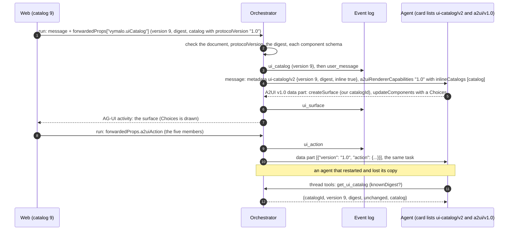
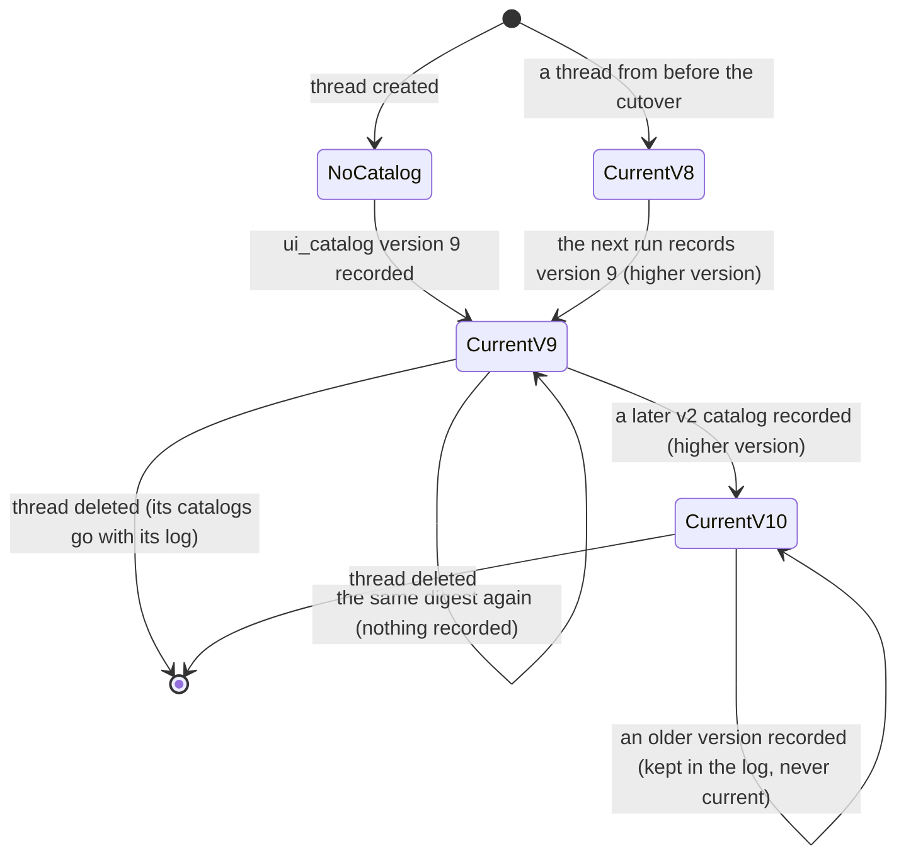

# A2A extension: UI catalog (v2)

- **URI:** `https://agents.vymalo.com/a2a/extensions/ui-catalog/v2`
- **Status:** **contract written 2026-11-19** (slice C0 of the A2UI v1.0 cutover,
  [epic #380](https://github.com/vymalo/another-agentic-system/issues/380)); **nothing is built.** The orchestrator's side is
  slice S1, the web's S2, the dev stack's S3, and adam-rs's A1 and A2. They reach `main` together in one merge, after S4
  ([ADR 0075](../decisions/0075-a2ui-v1-0-cutover.md), decision 9). Until then, [`ui-catalog-v1.md`](ui-catalog-v1.md) is
  what is built.
- **Replaces:** [`ui-catalog/v1`](ui-catalog-v1.md), **retired at the cutover**. That page stays as the record of v1. A
  reader of v1 cannot read this page's document, so this is a new URI and not an edit ([`extensions.md`](extensions.md)).
- **Decided in:** [ADR 0075](../decisions/0075-a2ui-v1-0-cutover.md) (decision 5, and the owner's answers of
  2026-11-19), which amends [ADR 0023](../decisions/0023-ui-component-catalog-as-an-a2a-extension.md) and
  [ADR 0013](../decisions/0013-a2ui-generative-ui.md). The agent side is adam-rs
  [ADR 0056](https://github.com/vymalo/another-adam-rs/blob/main/docs/decisions/0056-a2ui-v1-0-only-a-hard-cutover.md).
- **Defined by:** the web (the catalog). **Carried by:** the orchestrator. **Used by:** agents that speak A2UI v1.0.

## Purpose

The same as v1: an agent learns which components the person's screen can draw, answers and asks through them, and keeps
working when the chat is opened from a newer or an older version of the UI. It uses only the A2A card, A2A message
metadata, A2UI's own capabilities and one MCP tool. What changes is the A2UI version under it: **A2UI v1.0 only**, with
no second dialect. This page is written so that a second client (a Flutter app, say) can implement it.

Facts about A2UI are marked *verified* (with a date and a source) or *unverified*; see
[Verified and unverified](#verified-and-unverified-2026-11-19).

## What changed from v1

Everything else is v1's, unchanged in meaning: the components, the forms and their answers, the ledger, the refetch, the
forms catalog of an ask, and the web's rules on a surface.

| What | v1 | v2 |
|---|---|---|
| This extension's URI | `…/ui-catalog/v1` | `https://agents.vymalo.com/a2a/extensions/ui-catalog/v2` |
| The document | `{catalogId, components}` | `{catalogId, protocolVersion, components}`, `protocolVersion` exactly `"1.0"` |
| `catalogId` | `https://agents.vymalo.com/a2ui/catalogs/chat` | the same (owner, 2026-11-19) |
| Catalog `version` | 1 to 8 | **9** onwards (owner, 2026-11-19) |
| Digest | over the v1 document | over the v2 document, so every digest changes; [a new vector](#2-digest-version-and-the-lock) |
| The A2UI entry of the card | `https://a2ui.org/a2a-extension/a2ui/v0.9.1` | `https://a2ui.org/a2a-extension/a2ui/v1.0` |
| A2UI capabilities on a message | `a2uiClientCapabilities` keyed `"v0.9.1"` | `a2uiRendererCapabilities` keyed `"1.0"` |
| `version` of every A2UI message | `"v0.9.1"` | `"1.0"` |
| The basic catalog id | `…/v0_9_1/catalogs/basic/catalog.json` | `https://a2ui.org/specification/v1_0/catalogs/basic/catalog.json` |
| A turn without capabilities | (no rule) | the agent draws nothing ([No capabilities, no surface](#no-capabilities-no-surface)) |
| An action | `{version, action: {five members}}` | the same five members, `"version": "1.0"`, and nothing else ([Actions](#actions)) |
| A surface of an earlier version | (none) | shown as made by an earlier version, its actions refused ([section 9](#9-surfaces-from-before-the-cutover)) |

## Who does what

| Part | Does |
|---|---|
| **Web** | Owns the catalog (`catalog.json`, its `version` and digest), sends it to the orchestrator at conversation start and when a newer one exists, validates every surface against it and refuses visibly what it cannot draw ([section 8](#8-what-the-web-does-with-a-surface)). |
| **Orchestrator** | Checks the catalog as a document (it does not interpret it), records it once per digest as a `ui_catalog` event, tells the agent about the thread's current catalog on each message, and serves the refetch (`get_ui_catalog` on [the thread tools](thread-tools-v1.md)). |
| **Agent** | Lists this extension and A2UI v1.0 in its card, reads the catalog, turns it into something its model can call, emits A2UI v1.0 surfaces that name our `catalogId` only in a turn that offers them, and refetches when its copy may be stale. |

## The handshake



A thread's catalog moves only forward, as in v1. A thread whose current catalog is a v1 document (version 8 or lower)
moves to 9 on its next run with no migration, and its v1 catalogs stay in the log:



## 1. The document

`catalogId` is `https://agents.vymalo.com/a2ui/catalogs/chat`, the same as v1. It is stable: versions are told apart by
`version` and `digest`. The document is exactly an A2UI v1.0 inline catalog with three members and nothing else:

```json
{"catalogId": "https://agents.vymalo.com/a2ui/catalogs/chat", "protocolVersion": "1.0", "components": {"Text": {}, "Column": {}}}
```

(`components` is shortened here; catalog 9 below holds them all.)

The rules of the document. The first three are new in v2; the rest are v1's.

- **`protocolVersion` is required and is exactly `"1.0"`.** A2UI v1.0 reads a catalog without it as a v0.9 catalog,
  which a v1.0 runtime cannot use.
- **No other member at the root:** no `functions`, `theme`, `instructions`, `metadata`, `$defs`, `$schema`, `$id`, `title`
  or `description`. A later version of this page may add some of them; until then a document that has one is refused.
- **A component schema has no key whose name starts with `@`, no top-level `anyOf` or `oneOf`, and no
  `allowedParents` or `allowedChildren`.** A2UI v1.0 reserves the `@` prefix for its own keys and forbids a top-level
  `anyOf` or `oneOf` in a component's schema. A component's name is not `Surface`, which A2UI v1.0 reserves.
- Every component schema is self-contained JSON Schema 2020-12: no `$ref`, `$dynamicRef`, `$id` or `$anchor`, and no
  `$schema`. Keys are ASCII. Numbers in the document are integers (`maxLength: 120`, never `1.5`).
- Each schema validates the whole instance `{id, component, …}`: `properties.component.const` equals the component's
  key, and `additionalProperties` is `false`.
- Values are **literals**. Our components have no data bindings and no function calls, so an instance carries no
  `@path` and no `@call`. Since the schemas list no `@` member, an instance carries no `@catalogId`, `@accessibility` or
  `@metadata` either: its schema refuses what it does not list.
- Every schema writes out `id` (a string of 1 to 256 characters) and `component` (the constant), and, **only in the schemas that list it**,
  `weight` (a number, A2UI's layout hint): it is in `Text`, `Column`, `Choices`, `Cards`, `Mermaid`, `Image` and `Stack` and in no other component,
  so a `Checklist`, a `Timeline`, a `Table`... refuse it as they refuse any member nobody has.
- A length is counted in **Unicode code points**, not in UTF-16 units or bytes. The sizes of a surface are those of
  [section 8](#8-what-the-web-does-with-a-surface).

### What each component means

Catalog 9 has the 25 components of version 8, **each schema byte for byte the same**. So what each component draws,
the rules JSON Schema cannot say, the answers of a form, the plan and the checklist are v1's, read on these pages of
[`ui-catalog-v1.md`](ui-catalog-v1.md):

| Components | Their meaning |
|---|---|
| `Text`, `Column` | [Version 1](ui-catalog-v1.md#version-1-text-and-column) |
| `Choices` (a form) | [Version 2](ui-catalog-v1.md#version-2-slice-3-version-1-plus-choices), [version 5](ui-catalog-v1.md#version-5-questions-with-a-title-a-description-and-typed-options), [version 7](ui-catalog-v1.md#version-7-more-kinds-of-question) (with [receiving an answer](ui-catalog-v1.md#receiving-an-answer)) and [what a question shows](ui-catalog-v1.md#a-question-shows) |
| `Cards`, `Mermaid` | [Version 3](ui-catalog-v1.md#version-3-slice-4-version-2-plus-cards-and-mermaid) |
| `Image` | [Version 4](ui-catalog-v1.md#version-4-adr-0032-version-3-plus-image) |
| `Code`, `Diff`, `FileCard`, `Terminal`, `PullRequest` | [Version 6: code and files](ui-catalog-v1.md#version-6-code-and-files) |
| `Stack`, `Tabs`, `Accordion`, `Callout`, `Checklist`, `Timeline` | [Version 6: structure and status](ui-catalog-v1.md#version-6-structure-and-status), and [the checklist](ui-catalog-v1.md#the-checklist) of version 8 |
| `Table`, `KeyValue`, `Stats`, `Chart` | [Version 6: data](ui-catalog-v1.md#version-6-data) |
| `Gallery`, `LinkPreview`, `Video`, `Audio` | [Version 6: media](ui-catalog-v1.md#version-6-media) |
| A plan, a surface sent again | [The plan](ui-catalog-v1.md#the-plan), [a surface sent again](ui-catalog-v1.md#a-surface-sent-again) |

The operations in v1's examples and vectors say `"version": "v0.9.1"` and name the v0.9.1 basic catalog. Read them under
v2 with `"version": "1.0"` and the basic catalog id `https://a2ui.org/specification/v1_0/catalogs/basic/catalog.json`;
nothing else in them changes. Slice S2 moves the vectors the web's tests read onto this page in that spelling.

### Catalog 9

This is catalog 9, the whole document. It is `catalog.json` of version 8
(`web/src/features/chat/lib/a2ui/catalog/catalog.json` at `536b6b1`, digest
`sha256:22c333102bed676791dc9d47f21fc0a39be6e5062ef2c52f5a599ecca1b8341d`) with one line added, `"protocolVersion": "1.0"`.
No component is changed. Slice S2 makes `catalog.json` this block, and adam-rs vendors it as `catalog-v9.json` (adam-rs
ADR 0056, decision 6).

```json catalog-9
{
  "catalogId": "https://agents.vymalo.com/a2ui/catalogs/chat",
  "protocolVersion": "1.0",
  "components": {
    "Text": {
      "type": "object",
      "description": "Plain text, drawn as text (no HTML, no links).",
      "properties": {
        "id": {
          "type": "string",
          "minLength": 1,
          "maxLength": 256
        },
        "component": {
          "const": "Text"
        },
        "weight": {
          "type": "number"
        },
        "text": {
          "type": "string",
          "minLength": 1,
          "maxLength": 4000
        },
        "variant": {
          "enum": ["h1", "h2", "h3", "h4", "h5", "caption", "body"]
        }
      },
      "required": ["id", "component", "text"],
      "additionalProperties": false
    },
    "Column": {
      "type": "object",
      "description": "Stacks its children vertically.",
      "properties": {
        "id": {
          "type": "string",
          "minLength": 1,
          "maxLength": 256
        },
        "component": {
          "const": "Column"
        },
        "weight": {
          "type": "number"
        },
        "children": {
          "type": "array",
          "minItems": 1,
          "maxItems": 50,
          "items": {
            "type": "string",
            "minLength": 1,
            "maxLength": 256
          }
        },
        "align": {
          "enum": ["start", "center", "end", "stretch"]
        }
      },
      "required": ["id", "component", "children"],
      "additionalProperties": false
    },
    "Choices": {
      "type": "object",
      "description": "ask_user only: use it in the question you ask the person, never in a surface you show with show (nothing waits for its answer, so its form is dead). A form of up to 8 questions answered with one submit: a title, a description of why you ask, and per question a help line and a type: single (radio buttons, the default), multiple (checkboxes), select (a searchable list, up to 50 options), images (a deck of picture tiles, up to 16, each option's image an image file shared in this conversation), text or longText (the person types). Only when the thread's catalog is version 7 or more: confirm (yes or no, with yesLabel, noLabel and a safe default), number (a decimal string, with minValue, maxValue, step and unit), scale (a whole number from \"from\" to \"to\", with fromLabel and toLabel), date (a calendar day YYYY-MM-DD, with minDate and maxDate) and rank (the person puts every option in order). An option has a label, a description, an optional image {sha256, alt}, an icon and a recommended badge. freeInput adds an anything-else box. One submit sends one action: name = action.event.name (default \"answer\"), context = {answers:[{id, values:[option value, or the one yes/no, decimal, whole number or date, or every option value in the person's order for rank…], other?, text?}], note?} in question order. Read the answer again before you act on it: an out-of-range number, a date outside its bounds or a rank that is not every option once is refused. Only when the thread's catalog is version 8 or more: a question may carry show, 1 to 4 ids of components of the same surface (Text, Image, Mermaid, Code, Cards, Callout or Chart, each shown by one question only and placed nowhere else in the surface), drawn with the question between its text and its control; an image needs its alt.",
      "properties": {
        "id": {
          "type": "string",
          "minLength": 1,
          "maxLength": 256
        },
        "component": {
          "const": "Choices"
        },
        "weight": {
          "type": "number"
        },
        "title": {
          "type": "string",
          "maxLength": 120
        },
        "description": {
          "type": "string",
          "maxLength": 500
        },
        "freeInput": {
          "type": "object",
          "properties": {
            "label": {
              "type": "string",
              "minLength": 1,
              "maxLength": 120
            },
            "placeholder": {
              "type": "string",
              "maxLength": 200
            }
          },
          "additionalProperties": false
        },
        "questions": {
          "type": "array",
          "minItems": 1,
          "maxItems": 8,
          "items": {
            "type": "object",
            "properties": {
              "id": {
                "type": "string",
                "pattern": "^[A-Za-z0-9_.:-]{1,64}$"
              },
              "question": {
                "type": "string",
                "minLength": 1,
                "maxLength": 300
              },
              "help": {
                "type": "string",
                "maxLength": 300
              },
              "show": {
                "type": "array",
                "minItems": 1,
                "maxItems": 4,
                "items": {
                  "type": "string",
                  "minLength": 1,
                  "maxLength": 256
                }
              },
              "type": {
                "enum": [
                  "single",
                  "multiple",
                  "select",
                  "images",
                  "text",
                  "longText",
                  "confirm",
                  "number",
                  "scale",
                  "date",
                  "rank"
                ]
              },
              "options": {
                "type": "array",
                "maxItems": 50,
                "items": {
                  "type": "object",
                  "properties": {
                    "value": {
                      "type": "string",
                      "pattern": "^[A-Za-z0-9_.:-]{1,64}$"
                    },
                    "label": {
                      "type": "string",
                      "minLength": 1,
                      "maxLength": 120
                    },
                    "description": {
                      "type": "string",
                      "maxLength": 300
                    },
                    "image": {
                      "type": "object",
                      "properties": {
                        "sha256": {
                          "type": "string",
                          "pattern": "^[0-9a-f]{64}$"
                        },
                        "alt": {
                          "type": "string",
                          "minLength": 1,
                          "maxLength": 300
                        }
                      },
                      "required": ["sha256", "alt"],
                      "additionalProperties": false
                    },
                    "icon": {
                      "enum": [
                        "agent",
                        "read",
                        "edit",
                        "delete",
                        "move",
                        "search",
                        "execute",
                        "think",
                        "fetch",
                        "web",
                        "git",
                        "test",
                        "file",
                        "tool",
                        "opencode"
                      ]
                    },
                    "recommended": {
                      "type": "boolean"
                    }
                  },
                  "required": ["value", "label"],
                  "additionalProperties": false
                }
              },
              "multiple": {
                "type": "boolean"
              },
              "allowOther": {
                "type": "boolean"
              },
              "required": {
                "type": "boolean"
              },
              "default": {
                "anyOf": [
                  {
                    "type": "string",
                    "maxLength": 2000
                  },
                  {
                    "type": "array",
                    "maxItems": 50,
                    "items": {
                      "type": "string",
                      "pattern": "^[A-Za-z0-9_.:-]{1,64}$"
                    }
                  }
                ]
              },
              "min": {
                "type": "integer",
                "minimum": 0,
                "maximum": 50
              },
              "max": {
                "type": "integer",
                "minimum": 1,
                "maximum": 50
              },
              "yesLabel": {
                "type": "string",
                "minLength": 1,
                "maxLength": 40
              },
              "noLabel": {
                "type": "string",
                "minLength": 1,
                "maxLength": 40
              },
              "minValue": {
                "type": "string",
                "pattern": "^-?(0|[1-9][0-9]{0,14})(\\.[0-9]{1,6})?$"
              },
              "maxValue": {
                "type": "string",
                "pattern": "^-?(0|[1-9][0-9]{0,14})(\\.[0-9]{1,6})?$"
              },
              "step": {
                "type": "string",
                "pattern": "^-?(0|[1-9][0-9]{0,14})(\\.[0-9]{1,6})?$"
              },
              "unit": {
                "type": "string",
                "minLength": 1,
                "maxLength": 20
              },
              "from": {
                "type": "integer",
                "minimum": 0,
                "maximum": 1
              },
              "to": {
                "type": "integer",
                "minimum": 2,
                "maximum": 10
              },
              "fromLabel": {
                "type": "string",
                "minLength": 1,
                "maxLength": 60
              },
              "toLabel": {
                "type": "string",
                "minLength": 1,
                "maxLength": 60
              },
              "minDate": {
                "type": "string",
                "pattern": "^[0-9]{4}-[0-9]{2}-[0-9]{2}$"
              },
              "maxDate": {
                "type": "string",
                "pattern": "^[0-9]{4}-[0-9]{2}-[0-9]{2}$"
              }
            },
            "required": ["id", "question"],
            "additionalProperties": false
          }
        },
        "submitLabel": {
          "type": "string",
          "minLength": 1,
          "maxLength": 40
        },
        "action": {
          "type": "object",
          "properties": {
            "event": {
              "type": "object",
              "properties": {
                "name": {
                  "type": "string",
                  "minLength": 1,
                  "maxLength": 256
                }
              },
              "required": ["name"],
              "additionalProperties": false
            }
          },
          "required": ["event"],
          "additionalProperties": false
        }
      },
      "required": ["id", "component", "questions"],
      "additionalProperties": false
    },
    "Cards": {
      "type": "object",
      "description": "A list (or grid) of up to 24 cards: title, optional subtitle, body text, an http(s) link and tags.",
      "properties": {
        "id": {
          "type": "string",
          "minLength": 1,
          "maxLength": 256
        },
        "component": {
          "const": "Cards"
        },
        "weight": {
          "type": "number"
        },
        "title": {
          "type": "string",
          "maxLength": 120
        },
        "layout": {
          "enum": ["list", "grid"]
        },
        "cards": {
          "type": "array",
          "minItems": 1,
          "maxItems": 24,
          "items": {
            "type": "object",
            "properties": {
              "title": {
                "type": "string",
                "minLength": 1,
                "maxLength": 200
              },
              "subtitle": {
                "type": "string",
                "maxLength": 200
              },
              "body": {
                "type": "string",
                "maxLength": 2000
              },
              "url": {
                "type": "string",
                "maxLength": 2048,
                "pattern": "^https?://"
              },
              "tags": {
                "type": "array",
                "maxItems": 8,
                "items": {
                  "type": "string",
                  "minLength": 1,
                  "maxLength": 40
                }
              }
            },
            "required": ["title"],
            "additionalProperties": false
          }
        }
      },
      "required": ["id", "component", "cards"],
      "additionalProperties": false
    },
    "Mermaid": {
      "type": "object",
      "description": "A mermaid diagram, drawn as an image (no links, no scripts).",
      "properties": {
        "id": {
          "type": "string",
          "minLength": 1,
          "maxLength": 256
        },
        "component": {
          "const": "Mermaid"
        },
        "weight": {
          "type": "number"
        },
        "title": {
          "type": "string",
          "maxLength": 120
        },
        "code": {
          "type": "string",
          "minLength": 1,
          "maxLength": 20000
        },
        "caption": {
          "type": "string",
          "maxLength": 500
        }
      },
      "required": ["id", "component", "code"],
      "additionalProperties": false
    },
    "Image": {
      "type": "object",
      "description": "A picture from a file of this thread, by its sha256 (the artifact of a file an agent shared); never a URL. alt is required.",
      "properties": {
        "id": {
          "type": "string",
          "minLength": 1,
          "maxLength": 256
        },
        "component": {
          "const": "Image"
        },
        "weight": {
          "type": "number"
        },
        "artifact": {
          "type": "string",
          "pattern": "^[0-9a-f]{64}$"
        },
        "alt": {
          "type": "string",
          "minLength": 1,
          "maxLength": 300
        },
        "caption": {
          "type": "string",
          "maxLength": 500
        }
      },
      "required": ["id", "component", "artifact", "alt"],
      "additionalProperties": false
    },
    "Code": {
      "type": "object",
      "description": "Source code, drawn as text in a monospace block with a copy button. Never highlighted, never linked.",
      "properties": {
        "id": {
          "type": "string",
          "minLength": 1,
          "maxLength": 256
        },
        "component": {
          "const": "Code"
        },
        "title": {
          "type": "string",
          "maxLength": 120
        },
        "filename": {
          "type": "string",
          "maxLength": 200
        },
        "language": {
          "type": "string",
          "maxLength": 40
        },
        "code": {
          "type": "string",
          "minLength": 1,
          "maxLength": 20000
        }
      },
      "required": ["id", "component", "code"],
      "additionalProperties": false
    },
    "Diff": {
      "type": "object",
      "description": "A unified diff: its added and removed lines and its file headers, drawn as text.",
      "properties": {
        "id": {
          "type": "string",
          "minLength": 1,
          "maxLength": 256
        },
        "component": {
          "const": "Diff"
        },
        "title": {
          "type": "string",
          "maxLength": 120
        },
        "diff": {
          "type": "string",
          "minLength": 1,
          "maxLength": 20000
        }
      },
      "required": ["id", "component", "diff"],
      "additionalProperties": false
    },
    "FileCard": {
      "type": "object",
      "description": "A file the thread holds, by its sha256: its name, size, type and a download.",
      "properties": {
        "id": {
          "type": "string",
          "minLength": 1,
          "maxLength": 256
        },
        "component": {
          "const": "FileCard"
        },
        "artifact": {
          "type": "string",
          "pattern": "^[0-9a-f]{64}$"
        }
      },
      "required": ["id", "component", "artifact"],
      "additionalProperties": false
    },
    "Terminal": {
      "type": "object",
      "description": "A command and its output, with its exit code; a long output folds.",
      "properties": {
        "id": {
          "type": "string",
          "minLength": 1,
          "maxLength": 256
        },
        "component": {
          "const": "Terminal"
        },
        "title": {
          "type": "string",
          "maxLength": 120
        },
        "command": {
          "type": "string",
          "minLength": 1,
          "maxLength": 2000
        },
        "output": {
          "type": "string",
          "maxLength": 20000
        },
        "exitCode": {
          "type": "integer",
          "minimum": -255,
          "maximum": 255
        }
      },
      "required": ["id", "component", "command"],
      "additionalProperties": false
    },
    "PullRequest": {
      "type": "object",
      "description": "A pull request: repository, number, title, state, branch, checks and link.",
      "properties": {
        "id": {
          "type": "string",
          "minLength": 1,
          "maxLength": 256
        },
        "component": {
          "const": "PullRequest"
        },
        "repo": {
          "type": "string",
          "minLength": 1,
          "maxLength": 200
        },
        "number": {
          "type": "integer",
          "minimum": 1,
          "maximum": 2147483647
        },
        "title": {
          "type": "string",
          "minLength": 1,
          "maxLength": 300
        },
        "state": {
          "enum": ["open", "merged", "closed", "draft"]
        },
        "branch": {
          "type": "string",
          "minLength": 1,
          "maxLength": 200
        },
        "checks": {
          "type": "object",
          "properties": {
            "passed": {
              "type": "integer",
              "minimum": 0,
              "maximum": 10000
            },
            "failed": {
              "type": "integer",
              "minimum": 0,
              "maximum": 10000
            },
            "pending": {
              "type": "integer",
              "minimum": 0,
              "maximum": 10000
            }
          },
          "required": ["passed", "failed", "pending"],
          "additionalProperties": false
        },
        "url": {
          "type": "string",
          "maxLength": 2048,
          "pattern": "^https?://"
        }
      },
      "required": ["id", "component", "repo", "number", "title", "state"],
      "additionalProperties": false
    },
    "Stack": {
      "type": "object",
      "description": "Lays children in a row that wraps, or one under another: use it instead of Column for a row.",
      "properties": {
        "id": {
          "type": "string",
          "minLength": 1,
          "maxLength": 256
        },
        "component": {
          "const": "Stack"
        },
        "weight": {
          "type": "number"
        },
        "direction": {
          "enum": ["horizontal", "vertical"],
          "default": "horizontal"
        },
        "gap": {
          "enum": ["none", "small", "medium", "large"],
          "default": "medium"
        },
        "align": {
          "enum": ["start", "center", "end", "stretch"]
        },
        "justify": {
          "enum": ["start", "center", "end", "between"]
        },
        "wrap": {
          "type": "boolean",
          "default": true
        },
        "children": {
          "type": "array",
          "minItems": 1,
          "maxItems": 50,
          "items": {
            "type": "string",
            "minLength": 1,
            "maxLength": 256
          }
        }
      },
      "required": ["id", "component", "children"],
      "additionalProperties": false
    },
    "Tabs": {
      "type": "object",
      "description": "Tabs: a label and a child component for each, one tab open at a time.",
      "properties": {
        "id": {
          "type": "string",
          "minLength": 1,
          "maxLength": 256
        },
        "component": {
          "const": "Tabs"
        },
        "tabs": {
          "type": "array",
          "minItems": 1,
          "maxItems": 8,
          "items": {
            "type": "object",
            "properties": {
              "label": {
                "type": "string",
                "minLength": 1,
                "maxLength": 60
              },
              "child": {
                "type": "string",
                "minLength": 1,
                "maxLength": 256
              }
            },
            "required": ["label", "child"],
            "additionalProperties": false
          }
        }
      },
      "required": ["id", "component", "tabs"],
      "additionalProperties": false
    },
    "Accordion": {
      "type": "object",
      "description": "Collapsible sections: a title and a child component for each, opened one at a time or several.",
      "properties": {
        "id": {
          "type": "string",
          "minLength": 1,
          "maxLength": 256
        },
        "component": {
          "const": "Accordion"
        },
        "multiple": {
          "type": "boolean"
        },
        "items": {
          "type": "array",
          "minItems": 1,
          "maxItems": 20,
          "items": {
            "type": "object",
            "properties": {
              "title": {
                "type": "string",
                "minLength": 1,
                "maxLength": 200
              },
              "child": {
                "type": "string",
                "minLength": 1,
                "maxLength": 256
              }
            },
            "required": ["title", "child"],
            "additionalProperties": false
          }
        }
      },
      "required": ["id", "component", "items"],
      "additionalProperties": false
    },
    "Callout": {
      "type": "object",
      "description": "A note, a success, a warning or an error: a title and a text, the tone said in words and by an icon.",
      "properties": {
        "id": {
          "type": "string",
          "minLength": 1,
          "maxLength": 256
        },
        "component": {
          "const": "Callout"
        },
        "tone": {
          "enum": ["info", "success", "warning", "error"]
        },
        "title": {
          "type": "string",
          "minLength": 1,
          "maxLength": 120
        },
        "text": {
          "type": "string",
          "minLength": 1,
          "maxLength": 2000
        }
      },
      "required": ["id", "component", "title", "text"],
      "additionalProperties": false
    },
    "Checklist": {
      "type": "object",
      "description": "A checklist of items, each with a state and an optional note, and a progress bar. States: done, doing, todo, failed and, only when the thread's catalog is version 8 or more, dropped (struck through, not counted in \"N of M done\"). For a plan, send the whole surface again each time the plan changes, under the same surfaceId, which starts with plan-.",
      "properties": {
        "id": {
          "type": "string",
          "minLength": 1,
          "maxLength": 256
        },
        "component": {
          "const": "Checklist"
        },
        "title": {
          "type": "string",
          "maxLength": 120
        },
        "items": {
          "type": "array",
          "minItems": 1,
          "maxItems": 50,
          "items": {
            "type": "object",
            "properties": {
              "label": {
                "type": "string",
                "minLength": 1,
                "maxLength": 200
              },
              "state": {
                "enum": ["done", "doing", "todo", "failed", "dropped"]
              },
              "note": {
                "type": "string",
                "maxLength": 200
              }
            },
            "required": ["label", "state"],
            "additionalProperties": false
          }
        }
      },
      "required": ["id", "component", "items"],
      "additionalProperties": false
    },
    "Timeline": {
      "type": "object",
      "description": "A timeline of events in order: each with its time, title, optional description and state.",
      "properties": {
        "id": {
          "type": "string",
          "minLength": 1,
          "maxLength": 256
        },
        "component": {
          "const": "Timeline"
        },
        "title": {
          "type": "string",
          "maxLength": 120
        },
        "events": {
          "type": "array",
          "minItems": 1,
          "maxItems": 50,
          "items": {
            "type": "object",
            "properties": {
              "time": {
                "type": "string",
                "minLength": 1,
                "maxLength": 40
              },
              "title": {
                "type": "string",
                "minLength": 1,
                "maxLength": 200
              },
              "description": {
                "type": "string",
                "maxLength": 1000
              },
              "state": {
                "enum": ["done", "doing", "todo", "failed"]
              }
            },
            "required": ["time", "title"],
            "additionalProperties": false
          }
        }
      },
      "required": ["id", "component", "events"],
      "additionalProperties": false
    },
    "Table": {
      "type": "object",
      "description": "A table of columns and rows; a column is sorted by a click on its header.",
      "properties": {
        "id": {
          "type": "string",
          "minLength": 1,
          "maxLength": 256
        },
        "component": {
          "const": "Table"
        },
        "title": {
          "type": "string",
          "maxLength": 120
        },
        "columns": {
          "type": "array",
          "minItems": 1,
          "maxItems": 12,
          "items": {
            "type": "object",
            "properties": {
              "key": {
                "type": "string",
                "pattern": "^[A-Za-z0-9_.:-]{1,64}$"
              },
              "label": {
                "type": "string",
                "minLength": 1,
                "maxLength": 80
              },
              "align": {
                "enum": ["start", "end"]
              }
            },
            "required": ["key", "label"],
            "additionalProperties": false
          }
        },
        "rows": {
          "type": "array",
          "maxItems": 200,
          "items": {
            "type": "object",
            "propertyNames": {
              "maxLength": 64
            },
            "maxProperties": 12,
            "additionalProperties": {
              "type": ["string", "number", "boolean", "null"],
              "maxLength": 500
            }
          }
        }
      },
      "required": ["id", "component", "columns", "rows"],
      "additionalProperties": false
    },
    "KeyValue": {
      "type": "object",
      "description": "Pairs of a name and a value, in order, as a list of terms.",
      "properties": {
        "id": {
          "type": "string",
          "minLength": 1,
          "maxLength": 256
        },
        "component": {
          "const": "KeyValue"
        },
        "title": {
          "type": "string",
          "maxLength": 120
        },
        "pairs": {
          "type": "array",
          "minItems": 1,
          "maxItems": 50,
          "items": {
            "type": "object",
            "properties": {
              "key": {
                "type": "string",
                "minLength": 1,
                "maxLength": 120
              },
              "value": {
                "type": ["string", "number", "boolean", "null"],
                "maxLength": 500
              }
            },
            "required": ["key", "value"],
            "additionalProperties": false
          }
        }
      },
      "required": ["id", "component", "pairs"],
      "additionalProperties": false
    },
    "Stats": {
      "type": "object",
      "description": "Tiles of a figure, each with its label, its value, and a change with a trend.",
      "properties": {
        "id": {
          "type": "string",
          "minLength": 1,
          "maxLength": 256
        },
        "component": {
          "const": "Stats"
        },
        "title": {
          "type": "string",
          "maxLength": 120
        },
        "tiles": {
          "type": "array",
          "minItems": 1,
          "maxItems": 12,
          "items": {
            "type": "object",
            "properties": {
              "label": {
                "type": "string",
                "minLength": 1,
                "maxLength": 80
              },
              "value": {
                "type": "string",
                "minLength": 1,
                "maxLength": 40
              },
              "delta": {
                "type": "string",
                "minLength": 1,
                "maxLength": 40
              },
              "trend": {
                "enum": ["up", "down", "flat"]
              }
            },
            "required": ["label", "value"],
            "additionalProperties": false
          }
        }
      },
      "required": ["id", "component", "tiles"],
      "additionalProperties": false
    },
    "Chart": {
      "type": "object",
      "description": "A bar, line or pie chart of up to four series, drawn as a picture with its data.",
      "properties": {
        "id": {
          "type": "string",
          "minLength": 1,
          "maxLength": 256
        },
        "component": {
          "const": "Chart"
        },
        "title": {
          "type": "string",
          "maxLength": 120
        },
        "caption": {
          "type": "string",
          "maxLength": 500
        },
        "type": {
          "enum": ["bar", "line", "pie"]
        },
        "unit": {
          "type": "string",
          "maxLength": 20
        },
        "labels": {
          "type": "array",
          "minItems": 1,
          "maxItems": 24,
          "items": {
            "type": "string",
            "minLength": 1,
            "maxLength": 40
          }
        },
        "series": {
          "type": "array",
          "minItems": 1,
          "maxItems": 4,
          "items": {
            "type": "object",
            "properties": {
              "name": {
                "type": "string",
                "minLength": 1,
                "maxLength": 60
              },
              "values": {
                "type": "array",
                "minItems": 1,
                "maxItems": 24,
                "items": {
                  "type": "number",
                  "minimum": -1000000000000,
                  "maximum": 1000000000000
                }
              }
            },
            "required": ["name", "values"],
            "additionalProperties": false
          }
        }
      },
      "required": ["id", "component", "type", "labels", "series"],
      "additionalProperties": false
    },
    "Gallery": {
      "type": "object",
      "description": "Pictures of files of this thread, by their sha256, in a grid; each opens larger.",
      "properties": {
        "id": {
          "type": "string",
          "minLength": 1,
          "maxLength": 256
        },
        "component": {
          "const": "Gallery"
        },
        "title": {
          "type": "string",
          "maxLength": 120
        },
        "images": {
          "type": "array",
          "minItems": 1,
          "maxItems": 12,
          "items": {
            "type": "object",
            "properties": {
              "artifact": {
                "type": "string",
                "pattern": "^[0-9a-f]{64}$"
              },
              "alt": {
                "type": "string",
                "minLength": 1,
                "maxLength": 300
              },
              "caption": {
                "type": "string",
                "maxLength": 300
              }
            },
            "required": ["artifact", "alt"],
            "additionalProperties": false
          }
        }
      },
      "required": ["id", "component", "images"],
      "additionalProperties": false
    },
    "LinkPreview": {
      "type": "object",
      "description": "A link with its title, description and site, as the agent gave them: nothing is fetched.",
      "properties": {
        "id": {
          "type": "string",
          "minLength": 1,
          "maxLength": 256
        },
        "component": {
          "const": "LinkPreview"
        },
        "url": {
          "type": "string",
          "maxLength": 2048,
          "pattern": "^https?://"
        },
        "title": {
          "type": "string",
          "minLength": 1,
          "maxLength": 200
        },
        "description": {
          "type": "string",
          "maxLength": 1000
        },
        "site": {
          "type": "string",
          "minLength": 1,
          "maxLength": 100
        }
      },
      "required": ["id", "component", "url", "title"],
      "additionalProperties": false
    },
    "Video": {
      "type": "object",
      "description": "A video of a file of this thread, by its sha256: played in the page, with its title.",
      "properties": {
        "id": {
          "type": "string",
          "minLength": 1,
          "maxLength": 256
        },
        "component": {
          "const": "Video"
        },
        "artifact": {
          "type": "string",
          "pattern": "^[0-9a-f]{64}$"
        },
        "title": {
          "type": "string",
          "minLength": 1,
          "maxLength": 200
        },
        "caption": {
          "type": "string",
          "maxLength": 500
        }
      },
      "required": ["id", "component", "artifact", "title"],
      "additionalProperties": false
    },
    "Audio": {
      "type": "object",
      "description": "A sound recording of a file of this thread, by its sha256: played in the page, with its title.",
      "properties": {
        "id": {
          "type": "string",
          "minLength": 1,
          "maxLength": 256
        },
        "component": {
          "const": "Audio"
        },
        "artifact": {
          "type": "string",
          "pattern": "^[0-9a-f]{64}$"
        },
        "title": {
          "type": "string",
          "minLength": 1,
          "maxLength": 200
        },
        "caption": {
          "type": "string",
          "maxLength": 500
        }
      },
      "required": ["id", "component", "artifact", "title"],
      "additionalProperties": false
    }
  }
}
```

It validates against A2UI's `catalog_definition.json` at the pinned commit with no error (*verified 2026-11-19*, Python
`jsonschema` 4.26.0, Draft 2020-12, the schemas of [Verified and unverified](#verified-and-unverified-2026-11-19)).

### The numbers of catalog 9

The limits of version 8 stand. They are repeated here because the web's tests read them from this page and compare each
with the constant or the schema the code uses (`page-ties.test.ts`, pointed at this page by slice S2), so a number cannot
change in one place only.

A question's `show` member is a list of **1 to 4** ids, each a string of 1 to 256 characters, of components of the same
surface ([v1's rules](ui-catalog-v1.md#rules-for-what-a-question-shows)):

| Member | Meaning |
|---|---|
| `show` | A list of **1 to 4** ids of components **of the same surface**, drawn **with the question**, in the order listed, after its words (`question`, `help`) and before its control |

| Limit | Value |
|---|---|
| Ids in the `show` of one question | 1 to 4 |
| Ids in the `show` of all the questions of one `Choices` | at most 8 |

**What may be shown, a closed list of seven components:** `Text`, `Image`, `Mermaid`, `Code`, `Cards`, `Callout` and `Chart`.
None takes an answer, and none holds other components.

| Checklist item member | Meaning |
|---|---|
| item `note` | up to 200 characters (Unicode code points), plain text, drawn under the label (an empty note is no note) |

A surface the web draws is at most **64 KiB** of the operations written as JSON, 65,536 bytes of UTF-8, and **400 components** of the
surface once applied, counting only the operations from its last `createSurface`
([a surface sent again](ui-catalog-v1.md#a-surface-sent-again)).

A plan is announced, politely, after it has changed and has been **quiet for 0.8 s** and at the latest **5 s** after the burst
began. A plan that changes within **1 s** of the client first drawing it is still arriving, and nothing is said
([the plan](ui-catalog-v1.md#the-plan)).

## 2. Digest, version and the lock

The rule is v1's, over the v2 document:

- `digest = "sha256:" + lowercase hex(SHA-256(UTF-8(canonical(catalog))))`. The canonical form is JSON with object
  keys sorted, no whitespace, strings escaped as `JSON.stringify` and `serde_json` do, and integers in decimal: RFC
  8785 restricted to our inputs. A catalog with a non-ASCII key or a fractional number is refused rather than
  canonicalised, so that the sort order of code points and of UTF-16 units agree. Implementations sort explicitly
  (they do not rely on the order of a map type). `protocolVersion` is a member like the others, so it sorts last.
- **Known-answer vector of v2** (computed 2026-11-19 with the web's own `canonicalJson` and `catalogDigest`,
  `web/src/features/chat/lib/a2ui/catalog/digest.ts` at `536b6b1`, run by Node 22; and again with Python
  `json.dumps(sort_keys=True, separators=(',', ':'), ensure_ascii=False)` and SHA-256, and with `sha256sum` over the
  canonical form; all three agree):

  input

  ```json
  {"catalogId":"https://agents.vymalo.com/a2ui/catalogs/test","protocolVersion":"1.0","components":{"Note":{"type":"object","properties":{"component":{"const":"Note"},"text":{"type":"string","maxLength":10}},"required":["component","text"]}}}
  ```

  canonical form

  ```json
  {"catalogId":"https://agents.vymalo.com/a2ui/catalogs/test","components":{"Note":{"properties":{"component":{"const":"Note"},"text":{"maxLength":10,"type":"string"}},"required":["component","text"],"type":"object"}},"protocolVersion":"1.0"}
  ```

  digest `sha256:9fdab0c5c2094871cfb01d15046f206f3460341960ddcee4767e2bd33ab8e8f8`. It is v1's vector with
  `"protocolVersion": "1.0"` added (v1's is `sha256:a237e931c3a02fc72b214561e3a52d33eaf0e29c9306bbe0ef7b3da238507293`).
  Every implementation (the orchestrator's core, the web, adam-rs) pins it in a test.
- **The digest of catalog 9** is `sha256:5f174ee91c50759d59a0d7e91e3a1dc2e7c110b82ee91d858f4a23a944ed72b2`, over a
  canonical form of 19,413 bytes (computed the same three ways). Taking `protocolVersion` out of catalog 9 gives back
  catalog 8's digest, `sha256:22c333102bed676791dc9d47f21fc0a39be6e5062ef2c52f5a599ecca1b8341d`; a test can pin both.
- To recompute a vector by hand:

  ```sh
  printf '%s' '<the canonical form above>' | sha256sum
  python3 -c 'import json,hashlib,sys; c=json.dumps(json.load(sys.stdin),sort_keys=True,separators=(",",":"),ensure_ascii=False); print("sha256:"+hashlib.sha256(c.encode()).hexdigest())' < catalog.json
  ```

- `version` is an integer from 1, **bumped by hand on every change** of the catalog. It orders catalogs: the newest is
  the one with the highest `version`. **Version 9 is the first v2 catalog**; versions 1 to 8 are v1 documents and are
  never v2 documents.
- The web keeps `catalog.lock.json`, `{"version": n, "digest": "sha256:…"}`, beside `catalog.json`. A test recomputes
  the digest and fails when the catalog changed without a new lock, and when a lock has a new digest under the same
  version, so a version never names two catalogs. At the cutover the lock is `{"version": 9, "digest":
  "sha256:5f174ee91c50759d59a0d7e91e3a1dc2e7c110b82ee91d858f4a23a944ed72b2"}`.

## 3. From the web to the orchestrator

A run (`POST /agui/agents/{agentId}`, see [`agui.md`](agui.md#run-binding)) may carry the catalog in
`forwardedProps["vymalo.uiCatalog"]`, as in v1, now with the v2 document:

```json
{"vymalo.uiCatalog": {
  "catalogId": "https://agents.vymalo.com/a2ui/catalogs/chat",
  "version": 9,
  "digest": "sha256:5f174ee91c50759d59a0d7e91e3a1dc2e7c110b82ee91d858f4a23a944ed72b2",
  "catalog": {"catalogId": "https://agents.vymalo.com/a2ui/catalogs/chat", "protocolVersion": "1.0", "components": {"Text": {}, "Column": {}}}
}}
```

(`components` is shortened here.)

**When the web sends it** is v1's rule: on a run that creates a thread; and on any later run when the thread's
`STATE_SNAPSHOT` has no `uiCatalog`, or the web's own `version` is higher than the thread's, or the versions are equal and
the digests differ. A web of catalog 9 so sends it on the next run of every thread of catalog 8 or lower.

**What the orchestrator checks, before anything is written** (v1's table, with the v2 rules added):

| Rule | Refusal |
|---|---|
| The member is an object of the shape above; `catalog.catalogId` equals `catalogId`; `catalogId` is an absolute https URL of at most 256 bytes; `version` is 1 to 1,000,000; `digest` matches `^sha256:[0-9a-f]{64}$` **and** equals the recomputed digest | 400, naming the rule |
| `catalog.protocolVersion` is the string `"1.0"`, and `catalog` has no member but `catalogId`, `protocolVersion` and `components` | 400, naming the rule |
| The serialised `catalog` is at most 64 KiB | 413 |
| At most 64 components; keys match `^[A-Z][A-Za-z0-9]{0,63}$` and are not `Surface`; nesting at most 32 deep; section 1's rules hold (no `$ref`, ASCII keys, integers only, no `@` property, no top-level `anyOf` or `oneOf`, no `allowedParents` or `allowedChildren`) | 400, naming the rule |
| Each component schema compiles as JSON Schema 2020-12 (no remote resolution) and has `properties.component.const` equal to its key | 400, naming the component |

A v1 document (no `protocolVersion`) is refused with 400. The member is read on every run and applies only when the run
applies an input, as in v1.

*Amended 2026-11-22 (issue #431):* until this date the orchestrator refused none of four rules of section 1 that this
table names: a key that starts with `@`, a top-level `anyOf` or `oneOf`, `allowedParents` or `allowedChildren`, and a
component named `Surface`. The page was right and the check was not, so the check now refuses each with 400, naming the
rule (`orchestrator/crates/core/src/ui_catalog.rs`, `check_envelope` and `check_reserved_keys`). What A2UI v1.0 says
about them is in [Verified and unverified (2026-11-19)](#verified-and-unverified-2026-11-19): a catalog with a
top-level `anyOf` or `oneOf`, or a component named `Surface`, fails its `catalog_definition.json`
(`ComponentDefinition`, and `components.propertyNames`), so it was relayed to agents as a catalog A2UI v1.0 refuses; an
`@` key takes a name A2UI v1.0 reserves for its own members. The composition rules are allowed by A2UI v1.0 and
refused here by ADR 0075, decision 5, which says only that a later version may add them; the reason this change gives
for enforcing the refusal is that the web enforces no composition rule, so a catalog would state a rule nothing
applies. The `@` rule is read as any object key under a component, at any depth, as `$ref` is: no JSON Schema keyword
starts with `@`. The web's catalog breaks none of the four, and adam-rs only reads the catalog it is sent, so no client
sees a change.

## 4. In the log

v1's [section 4](ui-catalog-v1.md#4-in-the-log), unchanged: the `ui_catalog` event (its data the object of section 3),
the ledger (the current catalog and the newest 32 digests seen; a higher `version` becomes current, an older one never
does), and the delivery (**inline** when the input made the catalog current, a **reference** otherwise, **none** without
a catalog).

The `ui_catalog` events of v1 documents stay in the log of a thread from before the cutover, unchanged; a v2 catalog
becomes current over them by the ledger's rule. **Proposed in C0, for S1 to build or amend:** a v1 document is never
delivered to an agent nor served by `get_ui_catalog`. While such a thread's current catalog is still a v1 document (a run
that carried no catalog), the agent is told as for a thread with no catalog, because a v2 reader refuses a v1 document.

## 5. To the agent: the extension

**The card** lists this extension and the A2UI v1.0 extension, the latter with `acceptsInlineCatalogs`:

```json
{"capabilities": {"extensions": [
  {"uri": "https://agents.vymalo.com/a2a/extensions/ui-catalog/v2", "required": false},
  {"uri": "https://a2ui.org/a2a-extension/a2ui/v1.0", "required": false,
   "params": {"supportedCatalogIds": ["https://a2ui.org/specification/v1_0/catalogs/basic/catalog.json"],
              "acceptsInlineCatalogs": true}}
]}}
```

The A2UI entry's `params` are the inner `"1.0"` object of A2UI's `agent_capabilities.json` (`supportedCatalogIds`,
`acceptsInlineCatalogs`), never the `{"1.0": {…}}` wrapper (*verified 2026-11-19*).

**Detection.** The orchestrator reads the card on **every send** (never cached; it fails closed). Each extension is spoken
when its URI is listed exactly. `https://agents.vymalo.com/a2a/extensions/ui-catalog/v1` and
`https://a2ui.org/a2a-extension/a2ui/v0.9.1` are no longer detected. Whether the catalog may travel inline is read from
`acceptsInlineCatalogs` in the A2UI v1.0 entry (`false` when absent, as A2UI says).

**The message**, to an agent whose card lists A2UI v1.0:

- `metadata["a2uiRendererCapabilities"] = {"1.0": {"supportedCatalogIds": [...], "inlineCatalogs"?: [...]}}` on every
  message, where `supportedCatalogIds` ends with the basic catalog id
  `https://a2ui.org/specification/v1_0/catalogs/basic/catalog.json`, the only basic id. `a2uiClientCapabilities` is never
  sent, and `a2uiRendererDataModel` is not sent: the web does not implement data-model sync;
- when the card **also** lists `ui-catalog/v2` and the thread has a catalog to deliver:
  - `metadata["https://agents.vymalo.com/a2a/extensions/ui-catalog/v2"] = {"catalogId", "version", "digest", "inline"}`,
    where `inline` says whether this message carries the catalog;
  - our `catalogId` **first** in `supportedCatalogIds`, on every such message (not only the one that carries the catalog);
  - `inlineCatalogs: [<the v2 document>]` only when the delivery is inline **and** the agent accepts inline catalogs; if it
    does not, `inline` is `false` and the agent refetches;
- each URI the message activates is in the `A2A-Extensions` header and in `message.extensions`, as ADR 0013 does for A2UI.

```json
{"message": {
  "parts": [{"text": "Which database?"}],
  "extensions": ["https://a2ui.org/a2a-extension/a2ui/v1.0", "https://agents.vymalo.com/a2a/extensions/ui-catalog/v2"],
  "metadata": {
    "https://agents.vymalo.com/a2a/extensions/ui-catalog/v2": {
      "catalogId": "https://agents.vymalo.com/a2ui/catalogs/chat", "version": 9,
      "digest": "sha256:5f174ee91c50759d59a0d7e91e3a1dc2e7c110b82ee91d858f4a23a944ed72b2", "inline": true},
    "a2uiRendererCapabilities": {"1.0": {
      "supportedCatalogIds": ["https://agents.vymalo.com/a2ui/catalogs/chat",
                              "https://a2ui.org/specification/v1_0/catalogs/basic/catalog.json"],
      "inlineCatalogs": [{"catalogId": "https://agents.vymalo.com/a2ui/catalogs/chat", "protocolVersion": "1.0", "components": {"Text": {}}}]}}}}}
```

(`components` is shortened here; the real entry is the whole document.) The `a2uiRendererCapabilities` object, with
catalog 9 inline, validates against A2UI's `renderer_capabilities.json` (*verified 2026-11-19*, as above).

A card without the `ui-catalog/v2` URI gets the basic capabilities only. A card without the A2UI v1.0 URI gets no A2UI
capabilities at all.

**Numbers in the metadata** are v1's note: an A2A server may hold them as doubles, so an agent that recomputes the digest
of a catalog it received writes every whole number as an integer before hashing ([v1](ui-catalog-v1.md#5-to-the-agent-the-extension)).

**What the agent does with it** is v1's: it turns the catalog into model calls, emits surfaces whose `createSurface` names
our `catalogId`, treats the thread's digest as the version of its copy, and never invents a component the catalog lacks.

### No capabilities, no surface

A2UI v1.0's rule, which this extension keeps: **an agent MUST treat a message that carries no
`a2uiRendererCapabilities` entry for `"1.0"` as a turn in which the screen offers no A2UI, and MUST NOT send A2UI parts
(`application/a2ui+json`) in reply to it.** Activating the extension by the header alone offers no catalog, and an entry
keyed for another version is ignored (*verified 2026-11-19*, the extension specification, "Capability scoping").

For an adam agent this means `ask_user`, `show` and the plan tools draw a surface only when the message that started or
resumed the run carried `a2uiRendererCapabilities["1.0"]` and the surface's `catalogId` is among its `supportedCatalogIds`
or its `inlineCatalogs`; otherwise they answer in words (adam-rs ADR 0056, decision 5). A catalog the agent holds from an
earlier message or from `get_ui_catalog` does not offer a surface by itself.

The orchestrator still relays any surface it receives (activation is optional in A2UI; a part is recognised by its media
type), so this rule is the agent's.

### Actions

A person's gesture goes back to the agent as an A2UI v1.0 action, in a data part of media type `application/a2ui+json`
(on the part and in `metadata.mimeType`), on the same A2A task:

```json
{"data": [{"version": "1.0", "action": {
  "name": "answer",
  "surfaceId": "s1",
  "sourceComponentId": "db-form",
  "timestamp": "2026-11-19T10:00:00Z",
  "context": {"answers": [{"id": "db", "values": ["pg"]}]}}}],
 "kind": "data",
 "metadata": {"mimeType": "application/a2ui+json"}}
```

- **Exactly five members:** `name`, `surfaceId`, `sourceComponentId`, `timestamp` (RFC 3339) and `context` (an object).
  A2UI v1.0 also defines an optional `userMessage` and `metadata` on an action; **neither is ever forwarded**. A line an
  agent wrote for a click is put in the message box unsent, never sent as the person's words, inside an action or outside
  it (ADR 0013, rule 7; ADR 0075, decision 4, proposed).
- The limits are v1's: 256 bytes for each of the three strings, 16 KiB for `context` ([`agui.md`](agui.md#actions)).
- An action on a surface whose operations are not `"1.0"` is refused with **422** before anything is written
  ([section 9](#9-surfaces-from-before-the-cutover)).
- **A Choices answer** keeps v1's `context`, `{answers: [{id, values, other?, text?}], note?}`, in question order
  ([Choices answers](ui-catalog-v1.md#choices-answers), [receiving an answer](ui-catalog-v1.md#receiving-an-answer)).

### The forms catalog of an ask

v1's [forms catalog](ui-catalog-v1.md#the-forms-catalog-of-an-ask), unchanged in meaning: an agent the addressed agent
asks is sent `{catalogId: <the thread's id>/forms, protocolVersion: "1.0", components: {Choices: <the thread's Choices
schema without show>}}`, with the thread's `version` and its own digest, derived at every send and never recorded. It is a
v2 document, so it carries `protocolVersion` like the thread's.

## 6. The refetch

The agent asks for the thread's current catalog with `get_ui_catalog` on the [thread tools](thread-tools-v1.md#get_ui_catalog).
It answers with the v2 document in `catalog`. The tool's own input and output do not change, so `thread-tools` stays v1.

## 7. In AG-UI

v1's [section 7](ui-catalog-v1.md#7-in-ag-ui), unchanged: `ui_catalog` produces no frame, and `STATE_SNAPSHOT` carries
`snapshot.thread.uiCatalog = {catalogId, version, digest}`. The capabilities document lists
`custom["https://agents.vymalo.com/a2a/extensions/ui-catalog/v2"] = {}` and
`custom["https://a2ui.org/a2a-extension/a2ui/v1.0"] = {supportedCatalogIds}` when the live card lists them
([`agui.md`](agui.md#capabilities-document)). The surface travels as before, `ACTIVITY_SNAPSHOT{activityType:
"a2ui-surface", content: {a2ui_operations}}`, its operations as sent, now `"1.0"`.

## 8. What the web does with a surface

v1's [section 8](ui-catalog-v1.md#8-what-the-web-does-with-a-surface), with A2UI v1.0 underneath. Slice S2 builds it.

1. The surface's catalog is its `createSurface.catalogId`. A2UI v1.0 makes `catalogId` optional (a component then
   names its catalog with `@catalogId`); a surface that mixes catalogs is [out of scope](#out-of-scope). **A
   `createSurface` that names no `catalogId` is refused, rule `catalog`** (S2's settlement, 2026-11-20): this app
   draws one catalog per surface, and a surface that names none cannot be checked against one. v1's reading of no id
   as the basic catalog goes with the cutover.
2. **Ours.** Every component is a key of the web's catalog, and each instance is validated against its schema and v1's
   rules (uniqueness, URLs, files of the thread, the rules JSON Schema cannot say, plans).
3. **Ours, but the component is not known here**, and the thread's version is higher than the web's: the visible
   placeholder "This part of the answer needs a newer version of the app", with a reload button.
4. **The basic catalog id** `https://a2ui.org/specification/v1_0/catalogs/basic/catalog.json`: the basic vocabulary the
   web draws, and our components refused there.
5. **Any other `catalogId`**: refused, rule `catalog`.
6. **A schema violation**: refused, rule `schema`, naming the component's id and the first error path.

What A2UI v1.0 adds to the checks (ADR 0075, decision 6): every message's `version` is `"1.0"`; bindings are
`{"@path": …}` and calls `{"@call": …}`, with a plain `path` in ChildList templates; `@accessibility`, `@checks`,
`@catalogId` and `@metadata` only at a component's root, and a single-`@` key refused elsewhere; a `TextField` without
`value` refused; `theme` on `createSurface` refused; `components` and `dataModel` inline in `createSurface` read; a second
`createSurface` for a live `surfaceId` refused; an `updateDataModel` without `value` refused, and `null` deleting.
`callRendererFunction` and `agentFunctionResponse` are refused as unknown operations. The limits and ADR 0013's rules 1 to
7 stand.

## 9. Surfaces from before the cutover

The owner's decision (2026-11-19, ADR 0075 decisions 4 and 6). A thread from before the cutover keeps its v0.9.1
surfaces in the log, and nothing is migrated:

- **Not drawn.** A surface whose operations are not `"1.0"` is shown as a card that says it was made by an earlier version
  of the app, with its operations folded and no live control.
- **Its actions refused.** An action on such a surface is refused with **422**, before anything is written.
- The agents' words in the thread are untouched, and its v1 catalogs stay in its log ([section 4](#4-in-the-log)).

R1 is the first release, so no released thread is affected; a thread from a test deployment shows the card.

## Out of scope

Not in this version of the extension (ADR 0075, decision 8, and the epic's *Out of scope*). A later ADR adds each.

| What | Why it waits |
|---|---|
| The function-call messages: `callRendererFunction` / `rendererFunctionResponse`, `callAgentFunction` / `agentFunctionResponse` | No component of catalog 9 needs one; the catalog declares no function. The orchestrator refuses them as unknown operations, and the web sends no `callAgentFunction` |
| Data-model sync (`a2uiRendererDataModel`, `sendDataModel`) | The web does not implement it; it is never sent |
| Multi-catalog surfaces (a component whose `@catalogId` names another catalog than the surface's) | One catalog per surface, as in v1 |
| Catalog `functions`, `instructions`, `theme`, and the composition rules `allowedParents` and `allowedChildren` | Refused in the document ([section 1](#1-the-document)); look and feel belongs to the client, and A2UI v1.0 removed `theme` |
| An agent writing inline `createSurface` (`components`, `dataModel` in it) | The web reads it; adam writes `[createSurface, updateComponents]` |

## Verified and unverified (2026-11-19)

*Verified 2026-11-19*, from the raw files of <https://github.com/a2ui-project/a2ui> at commit
**`b4f91c26fcf62abc0720c21a65840220941d0a3f`**, fetched that day from `raw.githubusercontent.com`:

| File | SHA-256 |
|---|---|
| `specification/v1_0/json/agent_to_renderer.json` | `2f575f783fdda0e4d175fe5d331661655e4a4901613262322792dae7e823761d` |
| `specification/v1_0/json/renderer_to_agent.json` | `58ecde02101f0f37566b5e238dc6ef6af628c3ff312fce0e17ab7670b7215465` |
| `specification/v1_0/json/catalog_definition.json` | `836a48b2deb7ae76c3b68cb4e79c2faa24cba36d4d5396474894796797364d44` |
| `specification/v1_0/json/common_types.json` | `c4e78305b1de73eecb37f8179ba169730250611703683af291b18135a6430dc` |
| `specification/v1_0/json/agent_capabilities.json` | `6a4282dfb26af95a73d960572a31b91c5d5c89d1f9e54cbb8d24c599afcbc3a2` |
| `specification/v1_0/json/renderer_capabilities.json` | `3ebd2889764d892df16d034643ecd9e3a3fc02f298fa05577b95d9e287e703de` |
| `specification/v1_0/json/agent_to_renderer_list.json` | `3d3fef882fe5cc22932d3a91713defaeeb329126200954c06bf9f2c56df51c56` |
| `specification/v1_0/json/renderer_to_agent_list.json` | `98899d7d16222207af3bfd9aab12aa7b8f68dc8b5267dcf76d867236235ec5d8` |
| `specification/v1_0/extensions/a2a/docs/a2ui_extension_specification.md` | `20edcde54f549942d673e988a2c4843f1965df974c1e2ee4db02b036c8fcd13c` |
| `catalogs/basic/v1/catalog.json` | `d4ce11f8fff2da8d5fd0b2793db524f6aa7eef541eefb6fe2b71f0efc17cbfa9` |

The first two hashes are the ones ADR 0075 quotes. What they say:

- **The envelope.** Every agent-to-renderer message and every action has `"version": {"const": "1.0"}`. The operations
  are `createSurface`, `updateComponents`, `updateDataModel`, `deleteSurface`, `callRendererFunction` and
  `agentFunctionResponse`. `createSurface` requires only `surfaceId`; `catalogId`, `components`, `dataModel`,
  `sendDataModel` and `metadata` are optional, and there is no `theme`. `updateDataModel` requires `value`
  (`agent_to_renderer.json`).
- **A component** is `ComponentCommon` (`id` required; `@catalogId`, `@accessibility`, `@metadata`) with the catalog's
  schema and `unevaluatedProperties: false`; its `component` is never `Surface` (`agent_to_renderer.json`,
  `common_types.json`).
- **An action** has `name`, `surfaceId`, `sourceComponentId`, `timestamp` (`date-time`) and `context` (an object), all
  required, and optional `userMessage` and `metadata`; the message has exactly two members, `version` and one of `action`,
  `callAgentFunction`, `rendererFunctionResponse` or `error` (`renderer_to_agent.json`).
- **A catalog** is `{catalogId}` required, with optional `protocolVersion` (default `"0.9"`), `components`, `functions`,
  `$defs`, `$schema`, `$id`, `title`, `description`, `metadata` and `instructions`, and nothing else. A component may not
  be named `Surface`, and its definition may carry `allowedParents`, `allowedChildren` and `metadata`, and no top-level
  `anyOf` or `oneOf` (`catalog_definition.json`).
- **Capabilities.** The renderer's are `{"1.0": {supportedCatalogIds (required), inlineCatalogs?}}`, each inline catalog
  a catalog definition (`renderer_capabilities.json`); the agent's are `{"1.0": {supportedCatalogIds?,
  acceptsInlineCatalogs? (default false)}}` (`agent_capabilities.json`).
- **The basic catalog** has `"catalogId": "https://a2ui.org/specification/v1_0/catalogs/basic/catalog.json"` and
  `"protocolVersion": "1.0"` (`catalogs/basic/v1/catalog.json`). The id is not a resolvable URL: a fetch of that path
  in the repository answers 404, as the schema says an id need not resolve.
- **The A2A binding** (the extension specification, the same text as
  <https://a2ui.org/specification/v1.0-a2ui-extension-specification/>, read 2026-11-19): the URI
  `https://a2ui.org/a2a-extension/a2ui/v1.0`; the card's `params` are the inner `1.0` object; the capabilities are
  `message.metadata["a2uiRendererCapabilities"]`, scoped to the message's turn, and the rule quoted in
  [No capabilities, no surface](#no-capabilities-no-surface); a data part carries `metadata.mimeType =
  "application/a2ui+json"` and a `data` that MUST be an array of messages, processed in order, a failing message not
  stopping the rest; an action travels the same way.
- **Catalogs for 1.0 MUST declare `"protocolVersion": "1.0"`, and a v0.9 catalog cannot be used by a 1.0 runtime**; the `@`
  prefix is reserved; names follow UAX #31 (`specification/v1_0/docs/evolution_guide.md`). Every property name of
  catalog 9 is an ASCII letter followed by ASCII letters, digits or `_`, so it meets UAX #31.
- The specification is stable: "Breaking changes go into a future major version" (`specification/v1_0/README.md`).
- **Checked by running them:** catalog 9 against `catalog_definition.json`, the capabilities of [section 5](#5-to-the-agent-the-extension)
  with catalog 9 inline against `renderer_capabilities.json`, and the card's `params` against
  `agent_capabilities.json#/properties/1.0`, each with no error (Python `jsonschema` 4.26.0 with the schemas above in a
  local registry).

*Unverified:*

- whether A2UI's SDKs read the `A2A-Extensions` header the orchestrator sends, besides the `X-A2A-Extensions` of the
  specification's examples; both `message.extensions` and the header are sent, and adam-rs reads the card and the
  metadata, not the header;
- whether an A2A 1.0 agent puts the media type in `Part.mediaType` or in `metadata.mimeType`: both are read and both
  are written, as in v1 ([`agui.md`](agui.md#a2ui-generative-ui));
- that the pinned `@assistant-ui/react-generative-ui` draws a lowered v1.0 surface: no release read the released `"1.0"`
  on 2026-11-19 (ADR 0075, decision 6), so S2 lowers it and checks npm again.

The schemas are Apache-2.0 (the repository's `LICENSE`); nothing of them is copied into this page.
