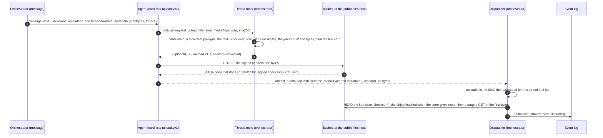
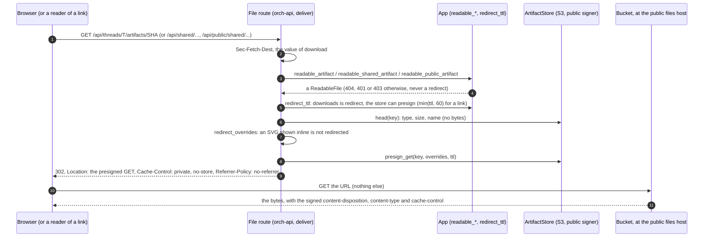

# A2A extension: uploads (v1)

- **URI:** `https://agents.vymalo.com/a2a/extensions/uploads/v1`
- **Status:** **accepted as a design (2026-10-11); the orchestrator's side is built (step 6a, 2026-10-14; the downloads' redirect, step 6b, 2026-10-14) and proven on mocks; the S3 adapter's own cases were also run against a local RustFS (2026-10-14), not the whole chain and no live agent.** What is built:
  the tool, the extension on the card and in the message, the ingest of the reference, the S3 store's presigned `PUT` and `HEAD`, the keys
  `artifacts.upload.*` and `artifacts.s3.publicEndpoint`; and, for downloads, the S3 store's presigned `GET`, the three file routes' `302` to it, and the keys `artifacts.s3.downloads` (opt-in) and
  `artifacts.s3.presignTtlSecs` (A1, [below](#downloads-a1)). What is not: the chart's public files host and its `NetworkPolicy` (step 6c), the rollout (A5), the web's upload surface and its policy for the files
  host (A3, stopped by the owner on 2026-10-13: backend only), the orphan sweep (open question 46), and
  adam-rs's client side. Where the build departs from the first text of this page, the section says so (*As built*). It needs the S3 store with a
  public files host ([ADR 0032](../decisions/0032-files-from-agents-live-in-an-artifact-store.md), its amendments of 2026-10-09 and 2026-10-11).
- **Decided in:** [ADR 0058](../decisions/0058-large-files-go-up-through-a-presigned-url-the-orchestrator-gives-the-agent.md) and its amendment
  of 2026-10-11; the optional-extension pattern is [ADR 0008](../decisions/0008-platform-integration-via-a2a-extension.md).
- **Defined by:** the orchestrator, which also serves the tool. **Used by:** agents that make files larger than the A2A message can carry
  (adam-rs needs a client side: a `share_file` that asks for a slot past its inline cap).
- All extensions in one table: [`extensions.md`](extensions.md).

## Purpose

A file reaches a thread today as an A2A artifact whose part holds the bytes (`raw`, base64 inside the message), at most
`artifacts.maxFileBytes` (10 MiB) ([ADR 0032](../decisions/0032-files-from-agents-live-in-an-artifact-store.md)). A report of 30 MB or a recording does not
fit, and it should not cross the message, the agent's journal and the worker's memory at all.

So the agent asks the orchestrator for **one presigned `PUT`** for the file it has, sends the bytes straight to the bucket, and hands back a reference. The agent
never holds a store credential. The orchestrator never receives the bytes. An agent that does not list the extension, and a deployment whose store cannot presign
(the directory store), are unchanged: `raw` stays the way.

## Who does what

| Part | Does |
|---|---|
| **Agent** | Lists the extension. When a message activated it: asks for a slot with `request_upload`, `PUT`s the bytes to the URL with the signed headers, and names the `uploadId` in its artifact. |
| **Orchestrator** | Activates the extension only when the live card lists it, the thread-tools grant exists and the store can presign. Checks the limits and signs the URL (`request_upload`). Before it commits, checks the object (`HEAD`, the first bytes), then logs `artifact{file}` as for any file. |
| **Bucket** | Takes the `PUT` only if the signature, the key, the method and the signed headers match. Refuses bytes that do not match the signed checksum (*verified 2026-10-14* for RustFS). It does **not** hold the agent to the size it declared: `content-length` cannot be signed, so the orchestrator checks the size after the fact (section 6). |

## The flow

```mermaid
stateDiagram-v2
  [*] --> Refused: too large, over the job's limits, no store that presigns, an asked agent
  [*] --> Issued: request_upload accepted
  Issued --> Uploaded: the agent's PUT (the URL works until it expires)
  Issued --> Expired: no PUT before expiresAt
  Uploaded --> Referenced: the artifact names the uploadId and the object is as declared
  Uploaded --> Rejected: not as declared or over a limit, an error event says the file could not be kept; the object is deleted unless a file of the thread uses its key
  Uploaded --> Unreferenced: never named, left to the orphan sweep (open question 46, not built)
  Refused --> [*]
  Expired --> [*]
  Referenced --> [*]
  Rejected --> [*]
  Unreferenced --> [*]
```





A `PUT` can be repeated while the URL lives (S3 has no single-use URL). The key is the content's hash and the checksum is signed, so a repeat writes the same bytes.

The same two diagrams, with the code that draws each edge, are in [`orchestrator.md`](../orchestrator.md#uploads-adr-0058).

## 1. The card

```json
{"uri": "https://agents.vymalo.com/a2a/extensions/uploads/v1",
 "description": "Uploads large files to the bucket by a presigned URL the thread tools give.",
 "required": false}
```

Listed exactly (no other version, no trailing slash, no other case). No `params`. The card must also list [`thread-tools/v1`](thread-tools-v1.md): the tool is on its endpoint,
and a card that lists `uploads/v1` alone is read as listing neither.

## 2. Activation

The orchestrator names the URI in the `A2A-Extensions` header and in `message.extensions` of a `SendStreamingMessage` **only when** all hold:

- the live card (read for this very message) lists `uploads/v1` and `thread-tools/v1`;
- the request belongs to a thread and carries the thread-tools grant, for the thread's addressed agent (`caller: main`);
- the store can presign (`artifacts.store: s3` with `artifacts.s3.publicEndpoint`) and `artifacts.upload.maxBytes` is set.

*As built:* the grant is minted for the thread's addressed agent only, by the delegation and by a steer; an agent that is **asked** (`ask_agent`) is given the thread's grant
without the offer, so it is never told the limits and its card is not even read for it.

The message metadata under the URI then holds the limits:

```json
{"https://agents.vymalo.com/a2a/extensions/uploads/v1": {"maxBytes": 1073741824, "ttlSecs": 300}}
```

| Member | Meaning |
|---|---|
| `maxBytes` | The most one file may be. The agent should not ask for more. |
| `ttlSecs` | How long a slot's URL works. The agent should upload at once. |

A message that does not activate the extension is the message it is today. An agent MUST NOT call `request_upload` unless a message activated the extension.

## 3. The tool `request_upload`

On the thread-tools endpoint ([`thread-tools-v1.md`](thread-tools-v1.md)), authenticated by the thread's token like every tool there. The caller must be `main`: the
orchestrator keeps no file of an asked agent ([`thread-tools-v1.md`](thread-tools-v1.md#ask_agent)).

**Input** (all required):

| Member | Meaning |
|---|---|
| `filename` | A name, cleaned as for any file (no separator, no control or direction character, 255 bytes). |
| `mediaType` | The type the agent declares. The dispatcher sniffs it again, as for `raw`. |
| `size` | Bytes, an integer from 1 to `maxBytes`. |
| `sha256` | The content's hash, 64 lower-case hexadecimal characters. It is the key: `threads/<thread>/<sha256>`. |

**Result** (`structuredContent`, and the same JSON as text):

```json
{"uploadId": "<kid>.<payload>.<mac>", "url": "https://agentic-files.example/artifacts/threads/<thread>/<sha256>?X-Amz-...",
 "method": "PUT",
 "headers": {"content-type": "<mediaType>", "x-amz-checksum-sha256": "<the digest, base64>",
             "x-amz-meta-sha256": "<the digest, hex>", "x-amz-meta-filename": "<the cleaned name, percent-encoded>"},
 "expiresAt": "2026-10-11T12:05:00Z"}
```

The agent must send `method`, `url` and **every** header in `headers`, with these values, and the bytes. A request that differs in a signed part is refused by the bucket.
`uploadId` is a MAC (HMAC-SHA-256 with the thread-tools key) over the thread, the job, the hash, the size, the type and the expiry, so the dispatcher checks it with no table and
the orchestrator stays stateless. The host in `url` is `artifacts.s3.publicEndpoint`, whether the agent is inside the cluster or outside.

*As built:*

- **The id carries its claims.** The artifact part holds neither the hash nor the size, so a bare MAC could not be checked without a table. The id is
  `<kid>.<base64url(JSON {t: thread, j: job, h: sha256, s: size, m: type, e: expiry in seconds})>.<base64url(HMAC-SHA-256)>`, with the MAC over `"uploads/v1\n<kid>.<payload>"`
  under the thread-tools key the `kid` names (so a rotation reads old ids, and a token of the thread tools is never an id: the domain line differs). At most 1024 bytes;
  `crates/thread-token/tests/upload.rs` pins a vector computed outside Rust.
- **Four signed headers, not two.** `content-type` and `x-amz-checksum-sha256` (the base64 form S3 defines) as written above, and `x-amz-meta-sha256` and `x-amz-meta-filename`, so that an
  uploaded object reads back with the metadata of a file the orchestrator put itself (ADR 0032). The agent sends all four, with these values.
- **`mediaType` is normalised** to `type/subtype` in lower case (parameters dropped) and, for an image, to the one spelling in use (`image/jpg` and `image/pjpeg` are `image/jpeg`, `image/svg` is
  `image/svg+xml`: the same table the ingest sniffs with, so that an honest file is not refused for the spelling it was asked in); that is the type signed, stored and served.
- **The checks run in this order** (cheap and local first; the card is a call to the agent): the caller is the addressed agent, the deployment offers uploads and the store presigns, the task is not over, the size is within
  `maxBytes`, the job has room (the message names the configured limits), and last the live card lists both extensions.
- **The live card is read** when the tool is listed and when it is called (never cached): `tools/list` offers `request_upload` to the thread's addressed agent only, and only while the card lists
  `uploads/v1` and `thread-tools/v1` now. A dispatcher's per-delegation budget lives in memory, so the tool counts the job's files and bytes off the log (each content once) and the
  dispatcher counts again when the reference arrives.
- **`expiresAt`** is an RFC 3339 instant, the slot's life being `artifacts.upload.ttlSecs`.

**Errors** are tool errors (`isError: true`), never a protocol error, with a code in the text:

| Code | When |
|---|---|
| `not_activated` | No message of this task activated the extension: the deployment offers none, or the agent's live card no longer lists `uploads/v1` and `thread-tools/v1`. |
| `too_large` | `size` over `maxBytes`. |
| `over_limit` | The job's file count or bytes (the existing limits, counting uploaded files) would be exceeded. |
| `unsupported` | The store cannot presign. |
| `bad_request` | A member is missing or malformed. |
| `caller_not_allowed` | The caller is an asked agent. |
| `task_over` | *As built, not in the first text.* The thread's task is over: the thread is finished, or the token belongs to an earlier job. |
| `unavailable` | *As built.* The thread, the registry, the store or the agent's card could not be read now; try again. (A card that cannot be read is not a card that says no: it is this, not `not_activated`.) |

## 4. The artifact that names the upload

An A2A artifact with a part that carries **no `raw` and no `url`**: `filename`, `mediaType` and `metadata` under the URI with the `uploadId`. The dispatcher reads it like
the `File` update of [ADR 0032](../decisions/0032-files-from-agents-live-in-an-artifact-store.md) (decision 6), except that it first checks the MAC, then the object:

1. `HEAD` the key: the size and the checksum are those declared. Otherwise the turn says "the file could not be kept" (an `error` event, retryable: false), and the object is deleted (see *Deletion* below).
2. A ranged `GET` of the first bytes, for the sniffed type (an image must agree with its magic bytes), as for inline bytes.
3. The artifact is committed with `file:{sha256, size, filename}`. The log never holds the bytes.

An `uploadId` that is not this thread's and job's MAC, or is expired when the object arrived, is the same error.

*As built:*

- **The part is a `data` part.** The A2A library the orchestrator reads with (`a2a-lf`) refuses a part that holds none of `text`, `raw`, `url` and `data`, so an empty part cannot be sent.
  The agent sends `data: {}` (ignored) with `filename`, `mediaType` and `metadata[<URI>].uploadId`. A part whose metadata names no upload, or an id that is not a string of 1 to 1024 bytes,
  is an ordinary `data` part. One update per part, under the key `a2a:<task>:artifact:<id>:upload:<i>`.
- **Order of the checks**, each failure the same error and the turn going on: the id is this deployment's and names this thread and this job; its size is within `artifacts.upload.maxBytes` and the job has room
  (a content already kept costs nothing); the object exists; its content is the key's hash (the checksum the store gives, else the object read once and hashed as it streams, never held); its size is the
  declared one; it arrived before the URL stopped working (30 s of clock skew allowed; a store that does not say when the object arrived, or says it badly, cannot show that, so once the URL's life and the skew have passed it is refused: the check fails closed); for an image type, its first 4096 bytes are that image.
- **Deletion.** The bucket cannot hold an agent to the size it declared (`content-length` is among the headers a presigned `PUT` cannot sign), so the declared size, `artifacts.upload.maxBytes` and
  the job's limits are enforced **here, after the object is in the bucket**. An object whose reference is refused once the id has been read is therefore deleted, whatever the reason: its content is not
  the key's hash, its size is not the declared one, it arrived late, an image that is not the image it says, or the file is over `maxBytes` or the job's limits. Two things keep an object: a file
  of the thread already uses the key (this delegation has kept the content, or the thread's log holds an artifact with that hash, put inline earlier or by an earlier slot, and that reference must go on
  working; a log of 2000 or more artifacts, which is not read whole, counts as holding it), and a log that cannot be read. Keys are per thread, `threads/<thread>/<hash>`, so nothing outside the thread is
  touched. An id that opens nothing, an object that is not there and a store that fails while the object is read delete nothing. (The first build kept every object whose content was the key's hash;
  that left the bytes of a lied size outside every limit.)
- **The type is the one the object was put with**, the signed `content-type`; the sniff only validates an image type.
- **An asked agent's artifact** that names an upload is the same refusal (it was never offered the extension).
- A deployment with no `artifacts.upload`, or a store that cannot presign, keeps nothing and says the same.

## 5. Limits and configuration

| Key | Default | Meaning |
|---|---|---|
| `artifacts.upload.maxBytes` | none (the extension is off) | The most one uploaded file may be, 1 byte to 5 GiB (S3 takes one `PUT` up to that; a multipart upload is not proposed), and not above `artifacts.maxPerJobBytes`, whose own ceiling is 4 GiB: **the effective ceiling is 4 GiB**. |
| `artifacts.upload.ttlSecs` | `300` | The life of a slot's URL, 30 to 3600. |
| `artifacts.maxPerJobBytes`, the 50 files | `100 MiB`, 50 | Uploaded files count. A deployment that wants a gigabyte raises the first (it allows up to 4 GiB). |
| `artifacts.s3.publicEndpoint` | none | The host of every presigned URL: `https`, or `http` when `server.environment` is not `production`. Without it nothing is presigned. |

The section `artifacts.upload` is refused (exit 78, naming the key) unless the store is `s3` with a `publicEndpoint`, `threadTools.url` and `threadTools.secret` are set and the thread-tools surface is mounted.
Both keys are in [`config.md`](config.md) and the schema.

## 6. Security

- A URL opens **one key, one method, for minutes**; the signature binds the checksum and the type. The agent holds no store credential.
- The key is the content's hash: a second `PUT` writes the same bytes. An object nobody names is an orphan, found by the sweep of open question 46 (not built).
- **The size cap is checked after the fact.** `artifacts.upload.maxBytes` and the job's byte limit bind the *declared* size at `request_upload` and again when the reference arrives; the bucket binds neither,
  because `content-length` cannot be signed. An agent can ask for a slot of 1 byte for the hash of a 4 GiB blob and `PUT` the blob: the checksum matches and the bucket takes it. The ingest then
  refuses the reference (the size is not the declared one) and deletes the object, but until then the bucket holds the bytes, and **for good if the agent never names the `uploadId`** (the only thing that
  triggers the check). Nothing bounds how many slots a job may ask for either: the tool counts what the job has *kept*, not the slots outstanding, so a job can have any number of slots open for their
  few minutes. **A bucket quota, or the orphan sweep of open question 46 (not built), is required before uploads are enabled outside a development stack.**
- **A deleted thread (ADR 0043) is not a closed door for a URL that is still valid.** The deletion removes the folder `threads/<deleted>/`, but a presigned URL issued before it works until it expires
  (`artifacts.upload.ttlSecs`, 300 by default) and can write `threads/<deleted>/<hash>` again, with nobody to name it. The orphan sweep must therefore cover keys of threads that no longer exist, not only
  keys of live threads that nothing references.
- The bucket is reached through the public files host, so the Ingress limits what reaches RustFS: the bucket's path prefix, the methods, and only signed requests
  ([ADR 0058](../decisions/0058-large-files-go-up-through-a-presigned-url-the-orchestrator-gives-the-agent.md#amendment-2026-10-11-downloads-by-presigned-url-on-a-public-files-host), A5).
- Only the person's thread can name an upload: the MAC binds the thread and the job.
- Downloads are **not** part of this extension: the file routes stay the authorization point and redirect to a presigned `GET` (same ADR; [below](#downloads-a1)).

## Downloads (A1)

Not an extension: no card, no activation. The same bucket and the same public host, in the other direction, for the person who reads. [ADR 0058](../decisions/0058-large-files-go-up-through-a-presigned-url-the-orchestrator-gives-the-agent.md)'s amendment of
2026-10-11 (A1) decides it and its amendment of 2026-10-14 (step 6b) says what is built.

```mermaid
stateDiagram-v2
  [*] --> Refused: a check fails (401, 403, the one 404): never a redirect
  [*] --> Readable: every check of the route passes
  Readable --> Streamed: downloads is stream, or the store cannot presign
  Readable --> Streamed: an SVG shown inline (read, sanitized, sent as ever)
  Readable --> Redirected: 302 to a presigned GET
  Readable --> Failed: the HEAD or the signing fails (404, 503 or 500; never the bytes by another road)
  Redirected --> Followed: the browser fetches the URL before it expires
  Redirected --> Expired: not fetched in time, the next request asks again
  Streamed --> [*]
  Followed --> [*]
  Expired --> [*]
  Refused --> [*]
  Failed --> [*]
```





| | |
|---|---|
| **When** | `artifacts.s3.downloads: redirect` (off by default: the web fetches a file with `fetch` and its policy does not list the files host), the store can presign (`artifacts.s3.publicEndpoint`), and the file is not an SVG shown inline. Else the route streams, exactly as before. |
| **First** | Every check the route had, in the same order and unchanged: the identity, the owner or the link, `artifact.read`, the `Sec-Fetch-Dest` refusal and the same 404 for every miss. A refusal is never a redirect. |
| **The answer** | `302`, `Location`: the presigned `GET`, `Cache-Control: private, no-store` (`no-store` on the two link routes, whose hardening sets it on everything) and `Referrer-Policy: no-referrer` (it governs the request the browser is sent on, *verified 2026-10-14* in the Fetch and Referrer Policy specifications and *unverified* in a browser; the page that asked may be a share link's `/s/<token>`). No body, and none of the headers of a file: those are the bucket's answer. |
| **The URL** | Lives `artifacts.s3.presignTtlSecs` (300; 30 to 3600), and **at most 60 seconds** on the two link routes (a revoked link stops within a minute; a URL already issued cannot be recalled). It signs only `host` and three query members: |
| `response-content-disposition` | `inline` for a preview type without `?download=1`, else `attachment`, with the route's cleaned name (a printable-ASCII `filename` and the RFC 5987 `filename*`); a file with no usable name is `artifact-<8 hex digits>`. |
| `response-content-type` | The kept type for a preview type (`text/plain` and `application/json` with `; charset=utf-8` when shown), `application/octet-stream` for every other, as the streamed route sends it. |
| `response-cache-control` | `private, max-age=<the URL's life>`. The immutable year of the streamed route is lost for a redirected file. |
| **An SVG** | Without `?download=1` it is **never redirected** while it is shown inline: read, sanitized (`orch-svg-clean`) and streamed, up to 2 MiB, as ever. With `?download=1`, or when it is larger than 2 MiB (a file that big is not shown inline anyway: the streamed route sends it as an attachment), it is redirected as an attachment (the original bytes), by the size the `HEAD` said, and nobody reads it. |
| **The file is not read** | One `HEAD` says the type, size and name; the orchestrator signs, and the bucket sends the bytes. |
| **A failure** | A `HEAD` that cannot be answered or a signing that fails is a 5xx problem (`503` with `Retry-After` for a store that is unavailable, `500` for a fault of the deployment), logged, and **never the bytes by another road**: a fallback to the stream would hide a broken redirect. A file the store no longer holds is the same 404. |
| **What the bucket does not add** | `X-Content-Type-Options: nosniff`, `Content-Security-Policy: default-src 'none'; sandbox` and the CORS headers are not on a presigned answer (*verified 2026-10-14* for RustFS): the files host's Ingress adds them (step 6c). |

The answers are in [`chat-api.yaml`](chat-api.yaml) (`getArtifact`, `getSharedArtifact`, `getPublicSharedArtifact`: `302`, `500`, `503`). The web's generated client is not changed by it: `openapi-fetch` types only the 2xx responses as data.

## Conformance

What a build is tested for (the orchestrator's fake agent plays the agent side; the adam-rs pull request tests the real one):

- a card without the URI, without `thread-tools/v1`, or a store that cannot presign: no activation, the message is what it is today, `request_upload` answers `not_activated` or `unsupported`;
- `request_upload` refuses each case of the error table and writes nothing;
- a `PUT` with the signed headers succeeds on a real S3-compatible server, and one with other bytes, another type or another key is refused;
- an artifact with a wrong or expired `uploadId` is not committed; an object that is not as declared, over a limit or late is not committed and is deleted, unless the thread already keeps a file with that hash;
- the log, the export and every frame hold no URL, no signature and no `uploadId` (the URL is a secret for minutes: it is not written anywhere);
- `dev/artifact-e2e.sh` passes unchanged for `raw`.

*As built,* these are tested in `crates/e2e/tests/uploads.rs` (the real dispatcher and A2A adapter, the thread-tools endpoint, the S3 adapter over an in-process S3 stub, both stores, the fake agent's `upload`
script), `crates/app/tests/uploads.rs` and `crates/surface-thread-tools/tests/uploads.rs` (every row of the error table, the ingest), `crates/artifacts-s3` (the presigned `PUT`, `HEAD` and the checksum over the stub and,
with `ORCH_TEST_S3_URL`, over a real server) and `crates/thread-token/tests/upload.rs`. There is no `dev/upload-e2e.sh`: a WireMock agent can neither call the tool nor `PUT`, and the id it must name is bound to the job it
was issued in, so no static reply can carry it.

## What is left

Not built, in the order of how much they matter before uploads are enabled outside a development stack:

- **A bucket quota or the orphan sweep (open question 46).** Until one exists, bytes the bucket takes stay until the ingest runs, and for good when the agent never names the `uploadId`: see *Security*. The sweep must cover keys of threads that no longer exist (ADR 0043) as
  well as keys of live threads that nothing refers to. **Required before uploads leave dev.**
- **A bound on the slots outstanding.** `request_upload` counts what the job has *kept*; a job can ask for any number of slots, each good for `artifacts.upload.ttlSecs`.
- **The chart's public files host and its `NetworkPolicy`** (6c), the rollout (A5), the web's upload surface and its policy for the files host (A3, stopped by the owner), and adam-rs's client side. Downloads by redirect (A1) are built
  on the orchestrator's side (6b) and **off by default**: `artifacts.s3.downloads: redirect` must not be set for a deployment that serves the stock web until A3 and 6c are done (a control plane that starts with it logs one warning that says so).
- **What 6c must also do for downloads:** the files host's Ingress **access log must drop the query string**, because a presigned URL carries its signature there and a log that keeps it keeps a working link until it expires; and **consider a
  read-only credential for the signer**: today the key that signs the public `GET`s is the read/write one that `put`, `delete` and the presigned `PUT`s need.
- **No counters for downloads.** A redirect counts nowhere (how many `302`s, how many `HEAD`s or signings failed, how many files were streamed instead); the only trace of a failure is the problem log.
- **A second slot for the same hash overwrites the object's metadata** (its `content-type` and file name): the bytes are the same, the key is the same, and the later `PUT` wins. A fix is to short-circuit when `head(key)`
  finds an object already, or a signed `if-none-match: *` once that is verified on RustFS.
- **A transient store error in the ingest becomes a permanent refusal.** A `head`, `read_prefix` or `hash_object` that fails answers "the file could not be kept", and the idempotency key of the update keeps that answer on
  a redelivery, so the agent cannot try again. The refusal should be retried when the error is transient.
- **The upload id is signed with the thread-tools key itself**, with a domain line, not with a subkey derived from it (HKDF): a compromise of the one key is a compromise of both, and the domain line is the only
  separation.
- **`hash_object` is bounded only by the request timeout (60 s)**, not by the size: a store that gives no checksum makes the ingest read the object, and a large one may not be read in time.
- **A refused upload can delete a file another delegation of the thread is keeping at that moment.** Between the `put` of an inline file and the commit of its reference, the log does not hold it yet; a refusal of
  a slot for the same hash in another delegation of the same thread sees no file using the key and deletes it. It needs the same bytes sent inline and through a lying slot at once. The same delegation is covered.
- **Nothing signs `content-length`.** A signer of our own might make the bucket enforce the size (*unverified* on S3 and RustFS); `object_store` 0.14.2 cannot.

## Verified and unverified

### 2026-10-14, the downloads' redirect (step 6b, RustFS run locally)

*Verified 2026-10-14 (by tests that ran, locally, against RustFS 1.0.1-preview.17; the same suites run over the stub with no server):* a presigned `GET` is served with exactly the signed `response-content-disposition`,
`response-content-type` and `response-cache-control` as the headers of the answer, for a disposition with spaces, quotes, `;`, `&`, `=`, `+`, `?`, `#`, `%`, `*`, `'` and UTF-8; a `Range` of it is a `206` with the
overrides applied; a changed or removed member, one nobody signed (`response-content-encoding`, `-language`, `-expires`), another key or thread, the method `HEAD`, `PUT`, `DELETE` or `POST`, are `403 SignatureDoesNotMatch`;
no signature at all is `403 AccessDenied`; a URL past its life is `403 AccessDenied: Request has expired`; RustFS adds no `X-Content-Type-Options`, `Content-Security-Policy` or `Access-Control-Allow-Origin`, and
answers a preflight of a bucket with no CORS rule with `200` and no `Access-Control-*` header. The whole route (the owner's, over the stub and over RustFS, memory and Postgres) is
`crates/e2e/tests/downloads.rs`. *Unverified:* AWS S3 itself, a real browser following the redirect with `DPoP` (A3), the Ingress and a RustFS CORS rule (6c).

### 2026-10-14, the review of the build (RustFS run locally)

*Verified 2026-10-14 (by tests that ran, locally, against RustFS 1.0.1-preview.17, the pin of `compose.yaml`; CI runs the same in `orchestrator.yml`):* the S3 adapter's suites with `ORCH_TEST_S3_URL` pass (93 tests).
RustFS **enforces the signed checksum** on a presigned `PUT` (other bytes under it: `400 BadDigest`, nothing stored), **says `x-amz-checksum-sha256` and `Last-Modified`** on a `HEAD` signed with checksum mode, and refuses with
`403` a request that differs from the slot in one thing: an `x-amz-*` header the signature does not cover (`x-amz-acl`, an extra `x-amz-meta-*`, `x-amz-storage-class`, `x-amz-server-side-encryption`, `x-amz-tagging`,
and `x-amz-copy-source` naming another thread's object, after which the key holds nothing of it) is `AccessDenied: There were headers present in the request which were not signed`; another `content-type`, another key, another
thread, and `GET`, `HEAD` or `DELETE` on the `PUT` URL are `SignatureDoesNotMatch`. *Verified 2026-10-14 by reading `object_store` 0.14.2 `src/util.rs`:* `content-length` is among the headers its signer rejects
(`RESERVED_SIGNED_HEADERS`), which is why the size is checked after the fact.

**What the build relies on, precisely.** The ingest takes the content hash from the checksum a `HEAD` reports when the store reports one, and reads and hashes the object itself only when it reports none. So the build
**does** rely on a server that reports `x-amz-checksum-sha256` having checked it against the bytes it stored (RustFS does, *verified* above; AWS S3 is expected to, *unverified*: it was not run). A server that echoed the claimed checksum without checking it would make the ingest vouch for
other bytes of the declared size; the ingest's own hash would be the only proof for such a server, and the ingest does not take it when a checksum is reported. The testkit case
`other_bytes_than_declared_are_refused_or_never_vouched_for` (run against every store and, with `ORCH_TEST_S3_URL`, against the real server) fails on such a server for bytes of the declared length; that is a finding for the
owner, not a flaky test.

*Unverified:* a `PUT` through the chart's Ingress with the signed `Host` (6b); that `object_store` 0.14.2's `Signer` and the `HEAD` the adapter signs itself are read the same by every S3-compatible server (AWS S3 itself was
not run); whether a signer of our own that signs `content-length` would make S3 and RustFS enforce the size.

### 2026-10-14, the build (step 6a)

*Verified 2026-10-14 (by tests that ran):* a presigned `PUT` signed with `content-type`, `x-amz-checksum-sha256`, `x-amz-meta-sha256` and `x-amz-meta-filename` is accepted by the S3 adapter's stub only with all four
and with the signed checksum; a `HEAD` signed in the query with `x-amz-checksum-mode: ENABLED` carries the stored checksum; the whole chain (card, grant, tool, `PUT`, reference, ingest, serve) runs in
`crates/e2e/tests/uploads.rs`.

### 2026-10-11, the design

*Verified 2026-10-11:* `object_store` 0.14.2 signs extra headers (`x-amz-checksum-sha256`, `content-type`) and query parameters into a presigned URL (`Signer::signed_url_opts`, read in
`src/signer.rs`); RustFS's S3 compatibility matrix lists "Presigned GET and PUT URLs" as Supported and checksums on copy as Supported
(<https://github.com/rustfs/rustfs/blob/main/docs/architecture/s3-compatibility-matrix.md>, no revision shown).

*Unverified* (that RustFS refuses a presigned `PUT` without the signed checksum header or with other bytes was *verified 2026-10-14*, above): ADR 0032's amendment says it checks a checksum header on an ordinary signed request; that a
`PUT` through the Ingress keeps the signed `Host`; the form S3 expects in `x-amz-checksum-sha256` (to be read from S3's documentation when the tool is written); and the adam-rs client side, which is
that repository's.
