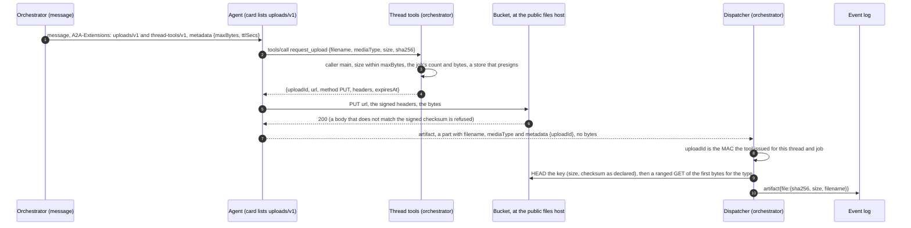
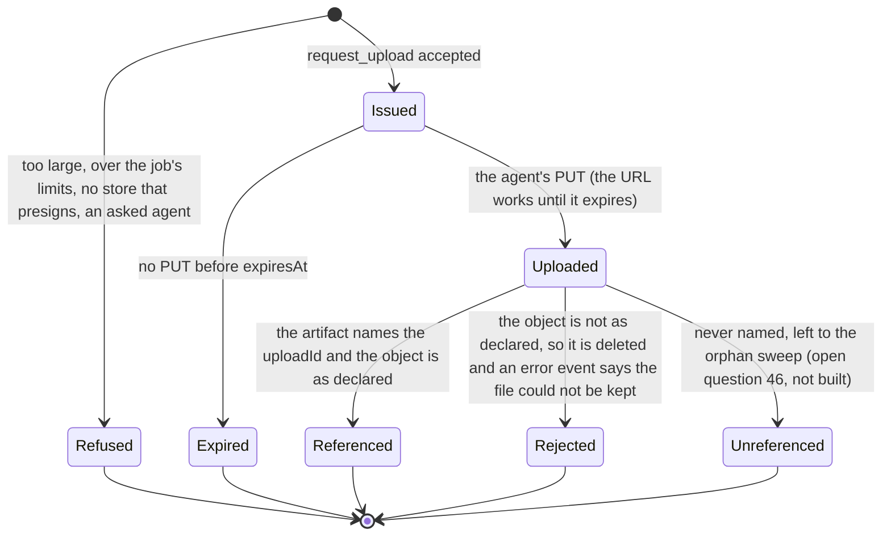

# A2A extension: uploads (v1)

- **URI:** `https://agents.vymalo.com/a2a/extensions/uploads/v1`
- **Status:** **accepted as a design (2026-10-11), on the owner's words of that day; nothing is built.** Every name, status code and default
  here is the ADR's or proposed, for the build to confirm. It needs the S3 store with a public files host
  ([ADR 0032](../decisions/0032-files-from-agents-live-in-an-artifact-store.md), its amendments of 2026-10-09 and 2026-10-11).
- **Decided in:** [ADR 0058](../decisions/0058-large-files-go-up-through-a-presigned-url-the-orchestrator-gives-the-agent.md) and its amendment
  of 2026-10-11; the optional-extension pattern is [ADR 0008](../decisions/0008-platform-integration-via-a2a-extension.md).
- **Defined by:** the orchestrator, which also serves the tool. **Used by:** agents that make files larger than the A2A message can carry
  (adam-rs needs a client side: a `share_file` that asks for a slot past its inline cap).

## Purpose

A file reaches a thread today as an A2A artifact whose part holds the bytes (`raw`, base64 inside the message), at most
`artifacts.maxFileBytes` (10 MiB) ([ADR 0032](../decisions/0032-files-from-agents-live-in-an-artifact-store.md)). A report of 30 MB or a recording does not
fit, and it should not cross the message, the agent's journal and the worker's memory at all.

So the agent asks the orchestrator for **one presigned `PUT`** for the file it has, sends the bytes straight to the bucket, and hands back a reference. The agent
never holds a store credential. The orchestrator never receives the bytes. An agent that does not list the extension, and a deployment whose store cannot presign
(the directory store), are unchanged: `raw` stays the way.

## Who does what

| Part | Does |
|---|---|
| **Agent** | Lists the extension. When a message activated it: asks for a slot with `request_upload`, `PUT`s the bytes to the URL with the signed headers, and names the `uploadId` in its artifact. |
| **Orchestrator** | Activates the extension only when the live card lists it, the thread-tools grant exists and the store can presign. Checks the limits and signs the URL (`request_upload`). Before it commits, checks the object (`HEAD`, the first bytes), then logs `artifact{file}` as for any file. |
| **Bucket** | Takes the `PUT` only if the signature, the key, the method and the signed headers match. Refuses bytes that do not match the signed checksum (*unverified* for RustFS). |

## The flow





A `PUT` can be repeated while the URL lives (S3 has no single-use URL). The key is the content's hash and the checksum is signed, so a repeat writes the same bytes.

## 1. The card

```json
{"uri": "https://agents.vymalo.com/a2a/extensions/uploads/v1",
 "description": "Uploads large files to the bucket by a presigned URL the thread tools give.",
 "required": false}
```

Listed exactly (no other version, no trailing slash, no other case). No `params`. The card must also list [`thread-tools/v1`](thread-tools-v1.md): the tool is on its endpoint,
and a card that lists `uploads/v1` alone is read as listing neither.

## 2. Activation

The orchestrator names the URI in the `A2A-Extensions` header and in `message.extensions` of a `SendStreamingMessage` **only when** all hold:

- the live card (read for this very message) lists `uploads/v1` and `thread-tools/v1`;
- the request belongs to a thread and carries the thread-tools grant, for the thread's addressed agent (`caller: main`);
- the store can presign (`artifacts.store: s3` with `artifacts.s3.publicEndpoint`) and `artifacts.upload.maxBytes` is above 0.

The message metadata under the URI then holds the limits:

```json
{"https://agents.vymalo.com/a2a/extensions/uploads/v1": {"maxBytes": 1073741824, "ttlSecs": 300}}
```

| Member | Meaning |
|---|---|
| `maxBytes` | The most one file may be. The agent should not ask for more. |
| `ttlSecs` | How long a slot's URL works. The agent should upload at once. |

A message that does not activate the extension is the message it is today. An agent MUST NOT call `request_upload` unless a message activated the extension.

## 3. The tool `request_upload`

On the thread-tools endpoint ([`thread-tools-v1.md`](thread-tools-v1.md)), authenticated by the thread's token like every tool there. The caller must be `main`: the
orchestrator keeps no file of an asked agent ([`thread-tools-v1.md`](thread-tools-v1.md#ask_agent)).

**Input** (all required):

| Member | Meaning |
|---|---|
| `filename` | A name, cleaned as for any file (no separator, no control or direction character, 255 bytes). |
| `mediaType` | The type the agent declares. The dispatcher sniffs it again, as for `raw`. |
| `size` | Bytes, an integer from 1 to `maxBytes`. |
| `sha256` | The content's hash, 64 lower-case hexadecimal characters. It is the key: `threads/<thread>/<sha256>`. |

**Result** (`structuredContent`, and the same JSON as text):

```json
{"uploadId": "<opaque>", "url": "https://agentic-files.example/artifacts/threads/<thread>/<sha256>?X-Amz-...",
 "method": "PUT",
 "headers": {"x-amz-checksum-sha256": "<the declared digest, in the form S3 defines>", "content-type": "<mediaType>"},
 "expiresAt": "2026-10-11T12:05:00Z"}
```

The agent must send `method`, `url` and **every** header in `headers`, with these values, and the bytes. A request that differs in a signed part is refused by the bucket.
`uploadId` is a MAC (HMAC-SHA-256 with the thread-tools key) over the thread, the job, the hash, the size, the type and the expiry, so the dispatcher checks it with no table and
the orchestrator stays stateless. The host in `url` is `artifacts.s3.publicEndpoint`, whether the agent is inside the cluster or outside.

**Errors** are tool errors (`isError: true`), never a protocol error, with a code in the text:

| Code | When |
|---|---|
| `not_activated` | No message of this task activated the extension. |
| `too_large` | `size` over `maxBytes`. |
| `over_limit` | The job's file count or bytes (the existing limits, counting uploaded files) would be exceeded. |
| `unsupported` | The store cannot presign. |
| `bad_request` | A member is missing or malformed. |
| `caller_not_allowed` | The caller is an asked agent. |

## 4. The artifact that names the upload

An A2A artifact with a file part that carries **no `raw` and no `url`**: `filename`, `mediaType` and `metadata` under the URI with the `uploadId`. The dispatcher reads it like
the `File` update of [ADR 0032](../decisions/0032-files-from-agents-live-in-an-artifact-store.md) (decision 6), except that it first checks the MAC, then the object:

1. `HEAD` the key: the size and the checksum are those declared. Otherwise the object is deleted and the turn says "the file could not be kept" (an `error` event, retryable: false).
2. A ranged `GET` of the first bytes, for the sniffed type (an image must agree with its magic bytes), as for inline bytes.
3. The artifact is committed with `file:{sha256, size, filename}`. The log never holds the bytes.

An `uploadId` that is not this thread's and job's MAC, or is expired when the object arrived, is the same error.

## 5. Limits and configuration (proposed keys)

| Key | Default | Meaning |
|---|---|---|
| `artifacts.upload.maxBytes` | none (the extension is off) | The most one uploaded file may be, up to 5 GiB (S3 takes one `PUT` up to that; a multipart upload is not proposed). |
| `artifacts.upload.ttlSecs` | `300` | The life of a slot's URL, 30 to 3600. |
| `artifacts.maxPerJobBytes`, the 50 files | `100 MiB`, 50 | Uploaded files count. A deployment that wants a gigabyte raises the first (it allows up to 4 GiB). |
| `artifacts.s3.publicEndpoint` | none | The host of every presigned URL. Without it nothing is presigned. |

## 6. Security

- A URL opens **one key, one method, for minutes**; the signature binds the checksum and the type. The agent holds no store credential.
- The key is the content's hash: a second `PUT` writes the same bytes. An object nobody names is an orphan, found by the sweep of open question 46 (not built).
- The bucket is reached through the public files host, so the Ingress limits what reaches RustFS: the bucket's path prefix, the methods, and only signed requests
  ([ADR 0058](../decisions/0058-large-files-go-up-through-a-presigned-url-the-orchestrator-gives-the-agent.md#amendment-2026-10-11-downloads-by-presigned-url-on-a-public-files-host), A5).
- Only the person's thread can name an upload: the MAC binds the thread and the job.
- Downloads are **not** part of this extension: the file routes stay the authorization point and redirect to a presigned `GET` (same ADR).

## Conformance

What a build is tested for (the orchestrator's fake agent plays the agent side; the adam-rs pull request tests the real one):

- a card without the URI, without `thread-tools/v1`, or a store that cannot presign: no activation, the message is what it is today, `request_upload` answers `not_activated` or `unsupported`;
- `request_upload` refuses each case of the error table and writes nothing;
- a `PUT` with the signed headers succeeds on a real S3-compatible server, and one with other bytes, another type or another key is refused;
- an artifact with a wrong or expired `uploadId`, or with an object that is not as declared, is not committed and the object is deleted;
- the log, the export and every frame hold no URL, no signature and no `uploadId` (the URL is a secret for minutes: it is not written anywhere);
- `dev/artifact-e2e.sh` passes unchanged for `raw`.

## Verified and unverified (2026-10-11)

*Verified 2026-10-11:* `object_store` 0.14.2 signs extra headers (`x-amz-checksum-sha256`, `content-type`) and query parameters into a presigned URL (`Signer::signed_url_opts`, read in
`src/signer.rs`); RustFS's S3 compatibility matrix lists "Presigned GET and PUT URLs" as Supported and checksums on copy as Supported
(<https://github.com/rustfs/rustfs/blob/main/docs/architecture/s3-compatibility-matrix.md>, no revision shown).

*Unverified:* that RustFS refuses a presigned `PUT` without the signed checksum header or with other bytes (ADR 0032's amendment says it checks a checksum header on an ordinary signed request); that a
`PUT` through the Ingress keeps the signed `Host`; the form S3 expects in `x-amz-checksum-sha256` (to be read from S3's documentation when the tool is written); and the adam-rs client side, which is
that repository's.
