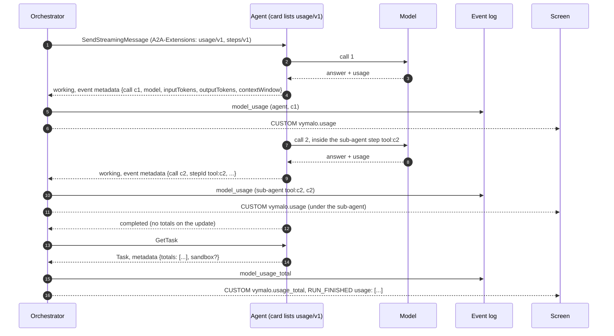

# A2A extension: usage (v1)

- **URI:** `https://agents.vymalo.com/a2a/extensions/usage/v1`
- **Status:** **built on both sides (2026-10-09)**: the orchestrator's and the web's, [ADR 0056](../decisions/0056-token-usage-per-model-call.md),
  proven on a fake A2A agent, the goldens, the web's mock server and a WireMock agent; and the agent's, adam-rs ADR 0032 (adam-rs `09291a6`),
  pinned here since 2026-10-09 ([ADR 0014](../decisions/0014-adam-coder-default-agent-over-a2a.md), its note of that day), so the coder, the chat
  and the researcher of the stack list the extension, and `dev/greeting-e2e.sh` asserts the coder's greeting call and totals (Coder E2E only).
  The contract was proposed on 2026-10-08 at the owner's request ("token gauge: usage per model call from adam-rs to the orchestrator's log to
  the web, sub-agents counted apart"). **Extended 2026-10-27 with `sandbox`** ([section 5](#5-the-sandbox): the time a run's commands used in
  the environment they ran in): the agent's side is adam-rs `55bbe9f` (its ADR 0043, issue 126), the orchestrator's side
  [ADR 0056](../decisions/0056-token-usage-per-model-call.md) amended the same day (read, logged, projected, counted), proven on the fake agent,
  the goldens and a WireMock agent; *unverified* against a real coder in a real run pod.
- **Defined by:** the orchestrator. **Used by:** adam agents (the coder, the folder agents).
- The optional-extension pattern is [ADR 0008](../decisions/0008-platform-integration-via-a2a-extension.md); the step
  ids it refers to are [steps/v1](steps-v1.md)'s.

## Purpose

An agent tells its client how many tokens each model call cost, while it works, and how many the whole task cost
when it ends, so a screen can show how full the model's context is and what a thread has spent, with what each
sub-agent spent counted apart. The counts follow AG-UI 1.0's `TokenUsage` accounting exactly, so the orchestrator
passes them on without converting them (*verified 2026-10-08* in the vendored
`orchestrator/crates/agui-proto/schema/ag-ui-1.0.schema.json`, `$defs.TokenUsage` and `RunFinishedEvent.usage`).

The totals can also say what the run's commands cost in a sandbox, the time they used in the pod, container or dev container they ran in
([section 5](#5-the-sandbox)), so a limit or a price per person can count more than tokens.

An agent that does not list the extension reports nothing, and the screen shows no gauge for it.

## Who does what

| Part | Does |
|---|---|
| **Agent** | Lists the extension. When a request activated it: after every completed model call, one **call report**; when the task ends, its **totals** in the task's metadata, with the **sandbox** its commands used when it ran any in an environment. Nothing when not activated. |
| **Orchestrator** | Activates it only when the live card lists it. Logs each valid call report once (`model_usage`), attributes it to the agent or to the sub-agent step it names, logs the task's totals when it ends (`model_usage_total`, with the `sandbox` when it is valid), and projects both to AG-UI. Drops an invalid report and counts it; drops an invalid `sandbox` alone and counts it, keeping the totals beside it; never fails a task over one. |
| **Screen** | A ring: how full the context of the agent's **latest** call is (`inputTokens / contextWindow`), and on demand the thread's totals per model, the agent and each sub-agent apart. |

## The flow



## 1. The card

```json
{"uri": "https://agents.vymalo.com/a2a/extensions/usage/v1",
 "description": "Reports the tokens of each model call and the task's totals.",
 "required": false}
```

Listed exactly (no other version, no trailing slash, no other case). No `params`.

## 2. Activation

The orchestrator names the URI in the `A2A-Extensions` header of `SendStreamingMessage` and `SubscribeToTask`, and in
`message.extensions`, only when the live card lists it. The agent sends call reports **only** on a request that
activated it. The totals are written to the task whether or not a request activated it (they are data on the task,
read by a poll too).

## 3. The call report

After a model call completes (the provider answered, with or without usage), the agent sends a
`TaskStatusUpdateEvent` with `status.state` `working`, **no `status.message`**, and the report in the **event's**
`metadata` under the URI:

```json
"metadata": { "https://agents.vymalo.com/a2a/extensions/usage/v1": {
  "call": "c7",
  "stepId": "tool:call_2",
  "provider": "openai",
  "model": "glm-5.3",
  "inputTokens": 41250,
  "outputTokens": 812,
  "totalTokens": 42062,
  "reasoningTokens": 300,
  "cachedInputTokens": 38000,
  "contextWindow": 131072
}}
```

| Member | Required | Meaning |
|---|---|---|
| `call` | yes | An id unique within the task, at most 128 bytes. A report with a `call` already seen for the task is a repeat (a resubscribe replays recent events) and is ignored. |
| `stepId` | no | The [steps/v1](steps-v1.md) step the call ran under: a sub-agent's step. Absent: the agent's own call. A `stepId` the orchestrator does not know is the agent's own call. |
| `provider`, `model` | `model` yes | Labels, at most 128 bytes each: the provider as the agent knows it (lower case, e.g. `openai`), the model as configured. |
| `inputTokens`, `outputTokens`, `totalTokens` | yes | AG-UI `TokenUsage` accounting: totals; `totalTokens` is the sum of the other two. |
| `reasoningTokens`, `cachedInputTokens`, `cacheWriteInputTokens` | no | Parts of `outputTokens` / `inputTokens`, never additions. Absent when the provider does not say. |
| `contextWindow` | no | The model's context window in tokens, as the deployment configured it. Absent when not configured: the screen then shows totals, not how full. |

Every count is an integer from 0 to 9007199254740991: a JSON number with no fractional part, `41250.0` included (A2A
metadata is a protobuf `Struct`, so an SDK hands every number back as a double). A report with a missing required member,
a count out of range, a negative or a fractional number (`41250.5`), or `totalTokens` other than the sum is **invalid**:
dropped and counted.
Unknown members are ignored. A call the provider answered without usage is reported with zeros, so the screen knows
a call happened.

## 4. The totals

When the task reaches a terminal state (`completed`, `failed`, `canceled`, `rejected`) or an interrupted one
(`input-required`, `auth-required`), the agent sets the **task's** `metadata` under the URI. The totals are **only on the
task**: the status update that ends or pauses it carries none, and a client does not read them from the last event of a
stream. A streaming client fetches the task (`GetTask`) when it sees that status, or reads them from a `Task` snapshot (a
poll, the first frame of `SubscribeToTask`):

```json
"metadata": { "https://agents.vymalo.com/a2a/extensions/usage/v1": {
  "totals": [
    {"provider": "openai", "model": "glm-5.3", "inputTokens": 512000, "outputTokens": 9100, "totalTokens": 521100,
     "reasoningTokens": 2400, "cachedInputTokens": 470000}
  ]
}}
```

One entry per provider and model, the AG-UI `TokenUsage` shape, covering every model call the task made, its
sub-agents' included (AG-UI's rule for `RUN_FINISHED.usage`). At most 32 entries. A task resumed after
`input-required` reports the totals of all its calls so far: the orchestrator keeps the latest totals of a task, not a
sum of them.

The totals are the record; the call reports are for the live screen and for counting sub-agents apart. When a dropped
stream lost call reports, the totals still hold. The totals may also be **lower** than the sum of the call reports: an
agent leaves out what it could not keep (adam: a retried attempt, a turn a cancel ended, a child canceled before it
answered, remote sub-agents, OpenCode; adam-rs ADR 0032).

**Unknown members are ignored.** The totals object has two members this page defines, `totals` (required) and `sandbox`
([section 5](#5-the-sandbox), optional). A client reads the members it knows of that object, of each entry of `totals` and of `sandbox`
and each of its entries, and **ignores every other member**: a member an agent adds later (as `sandbox` was) is not a new version of the
extension, and a client that predates it takes the tokens as before. Removing a member or changing what one means is a `v2` URI and file
([ADR 0008](../decisions/0008-platform-integration-via-a2a-extension.md)). The same rule holds for the call report (section 3).

## 5. The sandbox

An agent whose tools run commands in an environment can say what that cost: the time its commands used. The `sandbox` member of the totals
object says it, **beside `totals`** and in the same place and at the same moments (section 4): in the **task's** metadata, when the task ends
or pauses, **cumulative for the run so far**, for every reader of the task; the orchestrator keeps the latest. It is data on the task like
the totals, so there is no call report for it, no `working` update carries it, and it adds no event, header or card entry: a client that
predates it ignores it (the rule above).

```json
"metadata": { "https://agents.vymalo.com/a2a/extensions/usage/v1": {
  "totals": [ ... ],
  "sandbox": {
    "environment": "kubernetes",
    "usage": [ {"cpuMillis": 250, "memoryBytes": 536870912, "commands": 12, "milliseconds": 81234} ]
  }
}}
```

`totals` is present whenever the object is, `[]` for a run that made no model call, so a run that only ran commands still reports.

### What the four shapes say

| The task's totals object holds | It means |
|---|---|
| `"sandbox": {"environment": "kubernetes", "usage": [entry, ...]}` | The run's commands ran in a pod and were **measured**: one entry per shape of the pod. |
| `"sandbox": {"environment": "kubernetes", "usage": []}` | A pod was asked for and no command ran in it: **a measured zero**. |
| `"sandbox": {"environment": "local"}` or `{"environment": "devcontainer"}` | The commands ran in the agent's own container, or in a dev container, and **nothing was measured**. |
| no `sandbox` | The run asked for no environment (it only read, or only talked). There is nothing to say. |

**No `usage` means not measured, and not measured is never zero**: a client shows no figure for it, never `0`. What says "measured" is the
presence of `usage`, not the environment word. **No `sandbox` means the run asked for no environment**; it is not a zero either.

### The members

| Member | Required | Meaning |
|---|---|---|
| `environment` | yes | Where the commands ran: `kubernetes`, `local` or `devcontainer`, exactly. The list is closed: another word makes the member invalid, and a new environment is a change to this page. |
| `usage` | no | The entries, **at most 8**. Absent: not measured. |
| `usage[].cpuMillis` | no | The CPU the sandbox reserved, in millicores: the run container's request, not its limit. Absent when the pod had neither a request nor a limit for it; that is not zero. |
| `usage[].memoryBytes` | no | The memory the sandbox reserved, in bytes; the same absence. |
| `usage[].commands` | yes | How many commands ran in a sandbox of this shape. |
| `usage[].milliseconds` | yes | The sum of those commands' wall times, in whole milliseconds. |

What is counted:

* **Command time, not the time a pod lives.** The clock starts when the agent starts a command and stops when it has exited; a command
  stopped by a timeout or a cancel counts until it was stopped. A pod's start-up, its idle wait before it is reaped and the tail before it is
  deleted are not counted: the deployment sets those and absorbs them in its price per second.
* **One entry per shape**, a shape being the pair `cpuMillis`, `memoryBytes` the pod reserved (a deployment that changes its pod template
  between two commands of one run adds an entry). Reserved capacity times command time is what the cluster set aside for the run; a client
  that wants CPU-seconds multiplies `cpuMillis / 1000` by `milliseconds / 1000` per entry and sums the entries.
* **A sub-agent's commands are counted with its parent's**, as its tokens are. **Commands that run at the same time are summed**
  (a sub-agent's beside its parent's, all in the run's one pod), so `milliseconds` can exceed the time the run took. A client never reads
  it as the run's duration.
* **Every count is an integer from 0 to 9007199254740991**, a JSON number with no fractional part: `81234.0` is valid, as for the token
  counts in section 3.
* **It can be lower than what the cluster ran**: it counts the commands the agent kept (a call that failed and was tried again reports the
  try that was kept), whole milliseconds truncated, and the requests of the pod template, not of the pod a namespace's defaults admitted
  (adam-rs ADR 0043, "What the number misses").

The price of a CPU-second or a GiB-second is the deployment's and belongs to the usage record, not to this contract: it only reports the
numbers.

### Invalid

A `sandbox` is **invalid** when it is not an object; when `environment` is missing, is not a string or is not one of the three words; when
`usage` is not an array or has more than 8 entries; when an entry is not an object or lacks `commands` or `milliseconds`; or when a count is
not a whole number from 0 to 9007199254740991 (a negative, a fraction such as `1.5`, a string). `null` is the same as absent. Unknown members
of `sandbox` and of its entries are ignored.

**An invalid `sandbox` is dropped on its own.** The `totals` beside it are valid tokens, so the orchestrator takes them, logs them without a
`sandbox` and counts the drop; a fault in the newer member never loses the tokens. (Totals that are themselves invalid are dropped whole, as
before.)

## 6. What the orchestrator does

| Input | Event logged | AG-UI |
|---|---|---|
| a valid call report | `model_usage` {job, agent, task, call, path (the step path of `stepId`, empty for the agent), the counts, `contextWindow`} | `CUSTOM` `vymalo.usage` with the same members plus `by` (who spent it: `{kind: agent, subagent or ask, name}`) and `at`, under the run (or the sub-agent's run when `path` names an open one) |
| a valid `totals` on a task that ended or paused | `model_usage_total` {job, agent, task, path (only for an ask), totals, sandbox (only when the agent sent a valid one)} | `CUSTOM` `vymalo.usage_total`, whose `value` holds the event's data, `sandbox` included, and `RUN_FINISHED.usage` / `RUN_ERROR.usage` of that run: the latest totals of its task, **the tokens alone** (AG-UI's `TokenUsage` has no member for a sandbox); a run that resumes a task (after a question, or after a message sent while it worked ended the earlier run) says only what the task added since an earlier run said it, as AG-UI requires |
| valid `totals` beside an invalid `sandbox` | `model_usage_total` as above, **without** `sandbox`; counted in `usage_reports_dropped_total{reason="sandbox_invalid"}` | the same without `sandbox` |
| an asked agent's (ADR 0026) reports and totals | the same, on the ask's task, with the path `["ask-<n>"]` | under the ask's sub-run (`sub-ask-<n>`), and left out of the asking run's `RUN_FINISHED.usage`: AG-UI's own rule, an agent invoked as a separate run reports its own usage |

The orchestrator's own model calls (thread titles, descriptions) are not reported here.

## Verified and unverified (2026-10-27, `sandbox`)

- *Verified 2026-10-27* by reading adam-rs at `55bbe9f` (`docs/decisions/0043-sandbox-time-as-usage.md`,
  `crates/adam-a2a-runtime/src/usage.rs`, `totals_metadata`): the agent writes `sandbox` beside `totals` in the totals object, in the four shapes
  of section 5, `totals` always there, entries at most 8 with integer counts; the card does not change.
- *Verified 2026-10-27* by a test that passes on the code before this change (`unknown_members_beside_the_totals_and_inside_their_entries_are_ignored`
  in `orchestrator/crates/core/src/usage.rs`): the orchestrator read the totals member by member and ignored the ones it did not know, so a
  build that predates `sandbox` takes the tokens as before.
- *Verified 2026-10-27* by reading `web/src/features/chat/lib/usage.ts` (`parseTotal`): the web reads `totals` of a `vymalo.usage_total` and
  ignores `sandbox`; no screen draws it.
- *Unverified*: a real coder in a real run pod writing these figures (adam-rs ADR 0043 says its tests run the commands as local processes
  under fakes), and any gateway or SDK that changes the numbers on the way (the SDK hands metadata numbers back as whole doubles, which the
  parse accepts).

## Verified and unverified (2026-10-08)

- *Verified* (the vendored AG-UI 1.0 schema): `TokenUsage`'s members and accounting; `RUN_FINISHED.usage` and
  `RUN_ERROR.usage` are arrays of it, one entry per provider and model, sub-agents' calls included.
- *Verified* (`a2a-lf` 0.3.1, `event.rs`): `TaskStatusUpdateEvent` has an optional `metadata` map beside `status`, so a
  report needs no message.
- *Reported* by the adam-rs side's builder (2026-10-09, merged as `09291a6`, *unverified* here): the SDK hands metadata numbers
  back as whole doubles on JSON-RPC and REST, and adam keeps the totals on the task only, written on `completed`, `failed`,
  `canceled`, `input-required` and `auth-required`.
- *Unverified*: which OpenAI-compatible gateways send `prompt_tokens_details.cached_tokens` and
  `completion_tokens_details.reasoning_tokens`; an agent that does not get them leaves the parts out.
