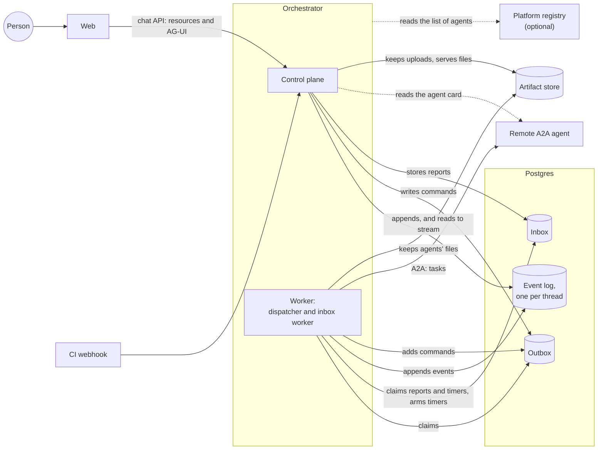

# Concepts

The words this documentation uses: one line each, and the rest under **In depth** (click to open). The pages after this
one in Architecture are the long form: [Architecture](architecture.md) for the components and the lifecycles,
[Orchestrator](orchestrator.md) for the ports, the event model and the data.

## Thread

One conversation, with an owner, a state and an event log.

::: in-depth More on the thread
Its state is one of `queued`, `working`, `verifying`, `blocked`, `done`, `failed` or `cancelled`. Only the pure core moves
it, by `transition(&state, &event)`. [Thread state](orchestrator.md#thread-state-and-transitions)
:::

## Job

The work a message starts on a thread that has no open job.

::: in-depth More on the job
A job is started by a message on a thread that has no open job. It is kept on the thread as its job ledger (the attempt,
the pushed commit, the check results). [Job lifecycle](architecture.md#job-lifecycle)
:::

## Run

One stretch of a thread as an AG-UI client sees it, from `RUN_STARTED` to the event that ends it. A job and a run need
not match: when the agent asks a question the run ends, and the answer opens the next run of the same job.

::: in-depth When a run is open, and the other "run"
A run is open exactly while the thread is `queued`, `working` or `verifying`; an event that arrives when none is open
gets a run of its own, closed at once. [AG-UI binding](api/agui.md#outbound-log-event--ag-ui),
[ADR 0012](decisions/0012-ag-ui-user-facing-protocol.md)

The credential broker's "run" is another thing: its id is the agent's A2A task id
([ADR 0084](decisions/0084-the-run-lease-the-broker-binds-a-run-and-lends-its-model-credential.md) and
[ADR 0089](decisions/0089-the-run-identity-stays-the-agents-task-id-bound-on-first-sight.md), both **proposed**).
:::

## Task

A2A's own unit of work, held by the agent, whereas a *job* is this system's and is kept on the thread. One job can take
several tasks, for example when failed checks send the agent back for a rework.

::: in-depth Which task a message goes to
The answer to an agent that asked for input continues the same task, by its `taskId`. A new task of the thread's own
agent, such as a rework or the first task of a later job, names the one before it in `referenceTaskIds`.
[ADR 0021](decisions/0021-context-across-a2a-tasks.md). The agent assigns the A2A context that holds them
([ADR 0055](decisions/0055-the-agent-assigns-the-a2a-context.md)).
:::

## Event log

The append-only record of everything that happened on a thread. It is the chat: the screen is a projection of it.

::: in-depth Where it lives, and what else persists
It lives in Postgres (SQLite when the orchestrator is embedded,
[ADR 0076](decisions/0076-the-orchestrator-as-a-library-in-an-application.md)). What else persists is listed under
invariant 3 of the agent guide, each kept beside the log, not in it.
[ADR 0001](decisions/0001-rust-state-machine-on-postgres.md)
:::

## Agent

Something the orchestrator hands work to: a remote agent, reached by an A2A agent-card URL, or one hosted in-process.

::: in-depth Hosts, and the in-process option
Remote agents are reached by an A2A agent-card URL. The orchestrator has no code path of its own for any one agent.
[Agent hosts](architecture.md#agent-hosts)

::: in-depth The in-process option
Behind the off-by-default feature `agent-local` a worker may host adam agents in-process
([ADR 0015](decisions/0015-control-plane-and-workers-on-adam-rs.md)).
:::
:::

### Agent card

The A2A document in which a remote agent describes itself, the extensions it supports among other things. The
orchestrator reads it live, from the card URL it knows the agent by
([ADR 0007](decisions/0007-protocol-only-dependencies.md), [ADR 0008](decisions/0008-platform-integration-via-a2a-extension.md)).

### Folder agent

An adam agent that is only a directory (instructions and what goes with them), served by `adam-agent` with no build of
its own. The orchestrator sees an ordinary A2A agent
([ADR 0014](decisions/0014-adam-coder-default-agent-over-a2a.md), status note of 2026-10-01;
[Agents that are only a folder](architecture.md#agents-that-are-only-a-folder)).

### Remote agent

An agent the orchestrator reaches over A2A, wherever it runs. This says how it is reached, not how it is built, so a
folder agent served this way is a remote agent too ([Agent hosts](architecture.md#agent-hosts)).

## Dispatcher

The worker loop that carries a command to an agent and brings back what the agent reports.

::: in-depth What it does, step by step
It claims a row of the outbox, talks to the agent over A2A and turns what the agent reports into events applied to the
thread. Any replica may run it. [Event flow](orchestrator.md#event-flow) What it claims is the [Outbox](#outbox).
:::

## Outbox

The table of commands the core decided on, written in the same transaction as the state change.

::: in-depth The commands, and a row that dies
The commands are delegate, cancel, verify, ask and others. A row that dies re-enters the core as a delivery failure, so
the thread goes `blocked` (retryable) or `failed`, never on as if it was sent.
[Command lifecycle](orchestrator.md#command-outbox-lifecycle)
:::

## Inbox

The table where input that no person is waiting on is stored before it is applied: CI reports from webhooks, and timers.
A person's message does not pass through it.

::: in-depth Who writes it and who applies it
A webhook route stores the report, a commit arms a timer, and the inbox worker claims each row and applies it to its
thread. [Inbox, timers and watches](orchestrator.md#inbox-timers-and-watches),
[ADR 0016](decisions/0016-inbox-timers-and-job-ledger-on-the-thread.md)
:::

## A2A extension

An optional addition to A2A, named by a URI, that an agent lists on its card to say it supports it. An agent that
lists none is a plain A2A agent and still works.

::: in-depth How an extension behaves
It is read live, fails closed and can be removed without breaking plain A2A.
[A2A extensions](api/extensions.md) says which are built and which are only planned.
[ADR 0008](decisions/0008-platform-integration-via-a2a-extension.md)
:::

## Port and adapter

A *port* is a Rust trait at a boundary of the system, such as the store or the agent client. An *adapter* is the code
behind one side of that boundary, in a crate of its own, and a binary only wires the chosen ones together.

::: in-depth Swapping one, and adapters for protocols
Implementations are chosen at build time, not loaded as plugins. The decision asks each port to ship a conformance testkit.
[ADR 0009](decisions/0009-swappable-implementations-at-build-time.md). An inbound protocol surface is an adapter too: it
translates at the edge, so the core never sees the protocol. [Orchestrator](orchestrator.md),
[Crate layout](orchestrator.md#crate-layout)
:::

## Artifact

Something an agent hands over as a result, apart from its replies, recorded on the thread as an `artifact` event. For a
file the orchestrator keeps, the bytes are in the artifact store, under their content hash, and the log holds only the
reference.

::: in-depth Files, and code
The artifact store is a port, with a directory and an S3 implementation.
[ADR 0032](decisions/0032-files-from-agents-live-in-an-artifact-store.md),
[Files from agents](orchestrator.md#files-from-agents). For work on code the result is in git
([ADR 0003](decisions/0003-git-as-durable-state-ephemeral-workers.md)).
:::

## Control plane and worker

The roles of an orchestrator process: the *control plane* serves the HTTP API and sends no work to an agent, and a
*worker* runs the dispatcher and the other background work. By default one process is both (`all`).

::: in-depth How the two meet
They meet only in Postgres, so each scales on its own. These are not the roles of a person, which decide what that
person may do. [Process roles](orchestrator.md#process-roles),
[ADR 0015](decisions/0015-control-plane-and-workers-on-adam-rs.md)
:::

## Platform registry

The list of agents that a platform provisions, which the orchestrator reads live, beside the deployment's own agents
file, when a registry URL is configured. If it cannot be read, none of its agents is listed.

::: in-depth In the code, and what is proven
The port is `AgentRegistry`, which also covers the agents file; the platform's reader is the crate
`orch-registry-platform`. The dev stack uses a mock registry, and a run against a real platform is *unverified*.
[Who may use a platform agent](api/config.md#who-may-use-a-platform-agent),
[ADR 0022](decisions/0022-platform-provisions-agents-system-discovers-them.md),
[ADR 0045](decisions/0045-admin-dashboard-in-the-web-and-agent-access-from-the-registry.md)
:::

## How the terms relate

A person's request goes from the web to the orchestrator and on to an agent, and what happens is written to the
thread's event log. The diagram shows remote agents only, and leaves out the edge proxy and live updates
([Components](architecture.md#components-1) has more).

## Glossary

The ADR column names the decision behind the term; where no ADR decided it, it says which page defines it.

| Term | In one line | Decided by |
|---|---|---|
| Thread | A conversation with an owner, a state and a log | [0020](decisions/0020-a-thread-is-a-conversation.md) |
| Job | One piece of work in a thread's sequence of them | [0020](decisions/0020-a-thread-is-a-conversation.md) |
| Run | The AG-UI span from `RUN_STARTED` to its end | [0012](decisions/0012-ag-ui-user-facing-protocol.md) |
| Task | A2A's unit of work, held by the agent | A2A's term; its use here: [0021](decisions/0021-context-across-a2a-tasks.md) |
| Event log | The append-only record that is the chat | [0001](decisions/0001-rust-state-machine-on-postgres.md) |
| Agent | What the orchestrator hands work to | [0007](decisions/0007-protocol-only-dependencies.md); in-process: [0015](decisions/0015-control-plane-and-workers-on-adam-rs.md) |
| Agent card | A remote agent's A2A self-description | A2A's term; its use here: [0007](decisions/0007-protocol-only-dependencies.md) |
| Folder agent | An adam agent that is only a directory | [0014](decisions/0014-adam-coder-default-agent-over-a2a.md) |
| Remote agent | An agent reached over A2A | [0007](decisions/0007-protocol-only-dependencies.md) |
| Dispatcher | The worker loop that carries commands to agents | No ADR: [Event flow](orchestrator.md#event-flow) |
| Outbox | Commands committed with the state change | [0001](decisions/0001-rust-state-machine-on-postgres.md) |
| Inbox | Stored webhook reports and timers | [0016](decisions/0016-inbox-timers-and-job-ledger-on-the-thread.md) |
| A2A extension | An optional addition to A2A, listed on the card | [0008](decisions/0008-platform-integration-via-a2a-extension.md) |
| Port | A trait at a boundary of the system | [0009](decisions/0009-swappable-implementations-at-build-time.md) |
| Adapter | The code behind one side of a boundary | Implementations: [0009](decisions/0009-swappable-implementations-at-build-time.md); protocols: [Orchestrator](orchestrator.md) |
| Artifact | A result an agent hands over | Kept files: [0032](decisions/0032-files-from-agents-live-in-an-artifact-store.md); the event: [Data model](orchestrator.md#data-model) |
| Control plane | The role that serves the HTTP API | [0015](decisions/0015-control-plane-and-workers-on-adam-rs.md) |
| Worker | The role that runs the background work | [0015](decisions/0015-control-plane-and-workers-on-adam-rs.md) |
| Platform registry | A platform's live list of its agents | [0022](decisions/0022-platform-provisions-agents-system-discovers-them.md) |
