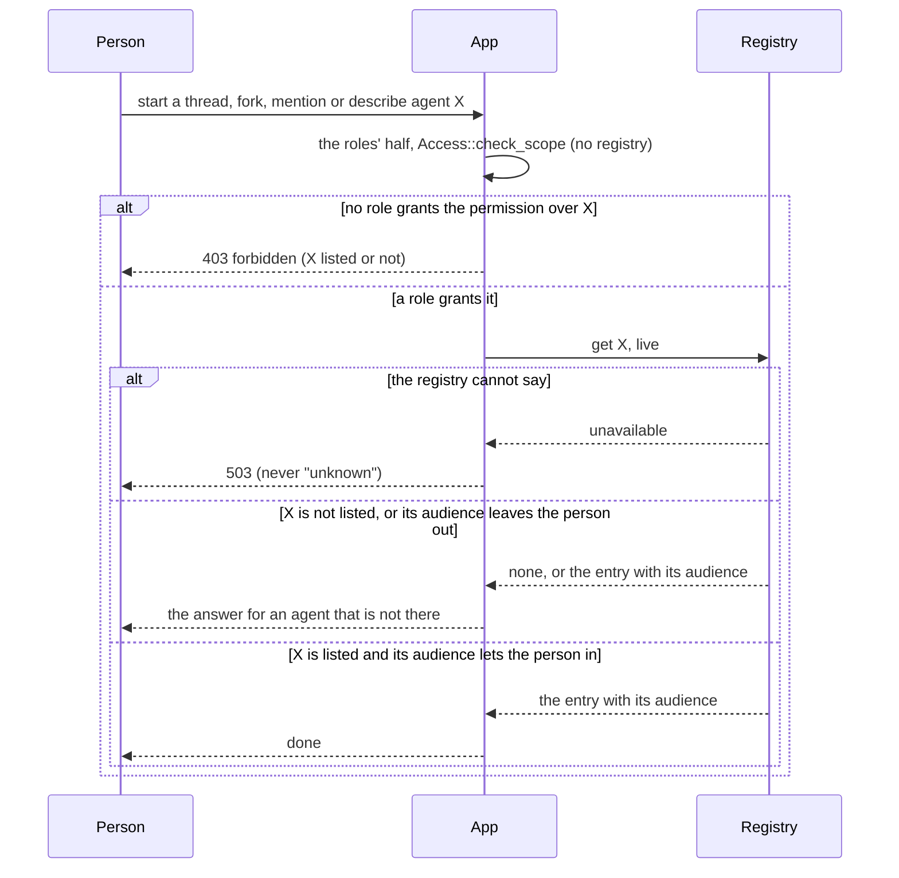
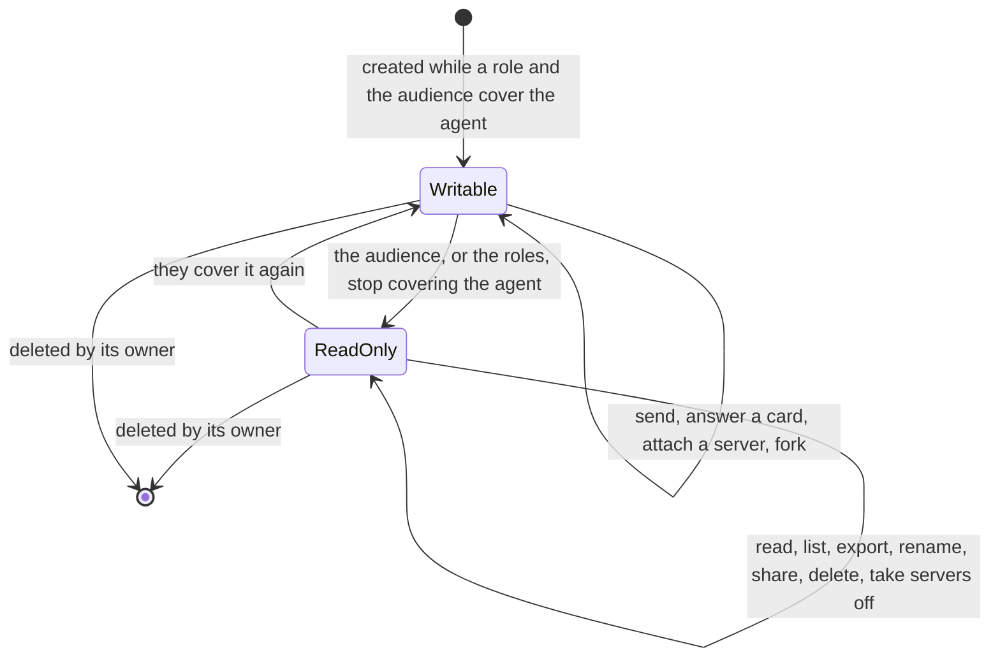

# ADR 0045 — The admin dashboard is an area of the web; permissions are Keycloak roles; who may use a platform agent comes from its registry entry

- **Status:** accepted (2026-10-05); *Amended 2026-10-06* (decision 3 below, see the note at the end), on the owner's request of that day (*"The MVP worked and now we need a dashboard for
  configuring all these. The same one actually."*) and the owner's answers of the same day to the thirteen questions of
  [another-agentic-platform's §93, group *Dashboard v0*](https://github.com/vymalo/another-agentic-platform/blob/main/docs/architecture/11-decisions.md).
  Two **changed** a recommendation: who may configure agents (question 5, decision 3: permissions as Keycloak composite roles) and
  who owns `coder` and `chat` (question 9, decision 4: the dashboard takes them over). Question 2 followed from the first (decision 2), and
  question 6 was taken as recommended with the owner's addition that "RBAC should normally answer this" (decision 1); the rest were taken
  as recommended. "The same one" is confirmed as one dashboard inside this repository's web, with its sign-in and look, not a second app. **Nothing of this is
  built** *(amended 2026-10-16: decision 1, the audience, is built in the orchestrator, slice D8a, see
  [the note at the end](#implemented-2026-10-16-d8a--decision-1-in-the-orchestrator); the rest is not)*. The dashboard itself (its Platform API, the custom resources it writes, its screens and slices) is specified in
  another-agentic-platform, architecture §60a "Admin dashboard v0", and decided there as AD-026 to AD-033
  ([`11-decisions.md`](https://github.com/vymalo/another-agentic-platform/blob/main/docs/architecture/11-decisions.md); they
  were the proposals P-007 to P-012 until today). This ADR is the system's side: decision 1 is AD-028 there, decision 2 is
  AD-026, decision 3 is AD-032, decision 4 is AD-031 and decision 5 is AD-033. Extends
  [ADR 0022](0022-platform-provisions-agents-system-discovers-them.md) and
  [ADR 0033](0033-the-orchestrator-is-an-oauth2-resource-server.md); amends the bullet "The web never talks to the orchestrator
  server to server" of [`architecture.md`](../architecture.md) when decision 2 is built. ADR 0033 and
  [ADR 0039](0039-nobody-reads-another-persons-thread.md) are **not** amended (see Consequences);
  [ADR 0041](0041-deployed-with-helm-on-kubernetes-secrets-by-externalsecret.md) gets a dated note for decision 5.

## Context

The owner wants one dashboard to configure what is set today in Helm values in home-os, in Keycloak and in AWS Secrets
Manager: one coder per GitHub owner, the folder agents, who may use which agent, models, tool servers, the run-pod size class
and the rest. The platform writes agents as custom resources (`AgentService`, `AgentConfig`, its §59a) and lists them in its
registry, `agent-registry/v1`, which the orchestrator reads live ([ADR 0022](0022-platform-provisions-agents-system-discovers-them.md)).

What exists here (*verified 2026-10-05* at `e5da0a4`; the Keycloak and permission-name lines again on 2026-10-05 at the head of this branch):

- **Who may use an agent** is per role: `auth.roles.<role>.agents` in the orchestrator's file lists agent ids or `"*"`
  ([`config.md`](../api/config.md#roles-and-permissions)), checked by `Access::allows(permission, Resource::Agent { id })` in
  `orchestrator/crates/app/src/authz.rs`; the roles are the values of the token's roles claim as the identity provider spells
  them (`Requester::roles`). The file is read once at startup, so a change is a restart. A registry item carries no access
  information: `RegistryEntry` is an endpoint, a name, tags and an origin (`orchestrator/crates/ports/src/registry.rs`).
- **The orchestrator's permissions** are dotted names that a role is mapped to in `auth.roles`: `agent.read`, `agent.invoke`,
  `thread.read`, `thread.write`, `thread.share`, `thread.delete`, `artifact.read`, `admin`
  ([`config.md`](../api/config.md#roles-and-permissions)). The Keycloak client `another-agentic` has the client roles `user`,
  `admin` and one per coder (`coder-vymalo`, `coder-stephane`), put in the token's `agentic_roles` claim by a mapper, and groups
  that bundle them ([`deploy/keycloak/`](../../deploy/keycloak/README.md)). Today a role is both the thing Keycloak grants and
  the key of `auth.roles`.
- **The registry is read live.** `App::list_agents` reads `ports.registry().list()` on every call
  (`orchestrator/crates/app/src/app.rs`); the platform reader keeps a copy at most `max-age`, capped at 60 s
  ([`registry-platform`](../../orchestrator/crates/registry-platform/README.md)); `dev/registry-e2e.sh` (b) asserts that an agent
  added to the mock registry is listed within 10 s with no restart (not run for this ADR).
- **`admin` is operational and content-free** ([ADR 0039](0039-nobody-reads-another-persons-thread.md)): reserved for endpoints
  that show no thread content and no personal data beyond counts, and gating nothing yet.
- **The web never calls a server.** "There are no Next.js API routes, no server-side fetches and no secrets in the web"
  ([`architecture.md`](../architecture.md)). Yet every request to the web carries the person's token: the edge's `forward_auth`
  gets `Authorization: Bearer <ID token>` from oauth2-proxy (`--set-authorization-header=true`) and `copy_headers Authorization`
  puts it on the request to the web as on the one to the orchestrator
  ([`deploy/chart/files/Caddyfile`](../../deploy/chart/files/Caddyfile), [`dev/Caddyfile`](../../dev/Caddyfile)). The web
  ignores it today.

## Decision

### 1. Who may use a platform agent: its audience lists its use permission, and Keycloak's roles answer it

The owner chose (b), the access list on the platform's `AgentService` published in the registry and enforced here, and added
that **"RBAC should normally answer this"**. So:

1. **The use permission.** Each agent has one, a Keycloak client role of `another-agentic` named **`agent.use:<agent-name>`**
   (`agent.use:coder-me`, `agent.use:chat`). It is a role name in the token, made in Keycloak; it is not a key of the
   orchestrator's `auth.roles`, and the orchestrator's `agent.read` and `agent.invoke` stay what `auth.roles` maps.
2. **The attribute.** A registry item may carry `audience`, an array of strings: values of the roles claim
   (`auth.jwt.rolesClaim`, `agentic_roles` on netcup), or `"*"`. It is the platform's `AgentService.spec.access.audience`, an optional
   attribute of `agent-registry/v1` (additive under that contract's Versioning; AD-028 there). **By convention an agent's audience is
   `["agent.use:<agent-name>"]`**, which the dashboard offers by default; the orchestrator does not look at the convention, only at the
   values.
3. **Composites grant it.** Keycloak composite roles (decision 3) include use permissions, so a group's role bundles the agents its
   people may use, and **who may use `coder-me` is decided in Keycloak, not in git**. Keycloak puts the expanded composites in the
   token, so the orchestrator's check stays **"the audience intersects the person's roles"** and needs no code for composites.
4. **The rule.** For an agent the platform registry lists, a person may read it (`agent.read`) or invoke it (`agent.invoke`)
   when **both** hold: a role of theirs grants the permission over the id (`auth.roles`, unchanged), **and** the item's
   `audience` holds `"*"` or one of the values of their roles claim, **or** a role of theirs holds `admin`.
5. **Fail closed.** An item with no `audience`, an empty one, or one the reader cannot read (not an array of strings, more
   than 32 values, a value over 64 characters; `agent.use:` plus a 40-character name is 50) is for people whose roles hold `admin`
   only. An agent the dashboard has just made is therefore seen and tried by administrators and by nobody else until it is given an
   audience **and** somebody holds it. The `admin` exception is about agents, not content: it reaches no thread (ADR 0039 stands).
6. **Static agents are unchanged.** An agent of the agents file has no audience and keeps today's rule; an id listed by
   both sources is the static one ([ADR 0022](0022-platform-provisions-agents-system-discovers-them.md)'s composite). The consequence for
   the coders is under *Consequences*.
7. **Every agent check applies it**, through one predicate in `orch_app::authz`: the list and one agent
   (`list_agents`, `describe_agent`, `GET /api/agents`, the AG-UI capabilities), the default agent, starting a thread,
   sending, forking, a mention and an asked agent (`mentions.rs`, `asks.rs`), and attaching a tool server for an agent. A check
   that has only an id resolves the entry first, as invoking already does to find the endpoint, and a registry that cannot
   be read refuses as it does today. `Resource::Agent` gains the entry's audience, and `RegistryEntry` an `audience` field
   (a change of the port's public struct: the testkit and every adapter move in the same slice).
8. **A thread whose agent the person may no longer use** is read-only for them, as when `agent.invoke` stops covering its
   agent today; it is not hidden, because it is theirs.
9. `GET /api/me`'s `agents` stays the roles' patterns: an audience cannot be said as a pattern, and the web takes its list of
   agents from `GET /api/agents`, which is filtered.

### 2. The admin dashboard is an `/admin` area of the web, drawn for people who hold the dashboard's permissions

1. **Capability-detected, optional, removable** (the pattern of [ADR 0008](0008-platform-integration-via-a2a-extension.md)): the
   web's server has one setting, `PLATFORM_API_URL`. Unset, `/admin` is a 404 and nothing links to it. Set, each page of the
   area asks `GET /v1/info` of the Platform API, live and never cached; a failure is "The platform API cannot be reached" with
   nothing editable. Removing the area leaves the chat as it is.
2. **Drawn for people who hold the dashboard's permissions, not for `admin`.** The owner's answer to question 2 ties the area to the
   permissions of decision 3, not to a single role. The web asks the Platform API's `GET /v1/me` with the person's bearer, which
   lists the dashboard permissions in the token, and draws the link and the area when `platform:agents.read` is among them. It is a
   hint, never a check (the web's rule since [ADR 0033](0033-the-orchestrator-is-an-oauth2-resource-server.md)): the Platform API
   authorizes every request itself, and its 403 is shown. The orchestrator's `GET /api/me` is not used for this, and the
   orchestrator's `admin` (ADR 0039) is not what the dashboard looks at.
3. **One server-side call, to the Platform API, never through the public edge.** The owner confirmed the web's server calls the API with the
   person's bearer. A route handler, `/admin/api/[...path]`, forwards the request to `PLATFORM_API_URL` with the
   `Authorization` header the edge put on it, unchanged, and no other header of the person's. It stores no token and logs none
   (nor the body of an error that might echo one). It is the web's only server-side fetch; the rest of the web keeps calling
   `/api/*` and `/agui/*` from the browser. `/admin/api/*` is not under `/api/*`, so the edge routes it to the web, and the
   API is reached only from the web's pods.
4. **Same look and sign-in**: a feature folder `web/src/features/admin/`, the shadcn primitives and DESIGN.md's tokens,
   Playwright with axe against a mock Platform API in `web/mock`.
5. **Read-only views from what exists**: the tool servers a person attaches (`GET /api/tool-servers`), the sharing cap
   (`GET /api/me`), the registry's state (`GET /api/registry`), the public `ui` settings (`GET /api/config`). The orchestrator's
   own configuration stays its file in the system chart; nothing in this ADR makes it editable from the dashboard (the owner's
   question 13: as recommended).

### 3. Permissions are Keycloak client roles; the roles people hold are composites

The owner's answer to "who may configure agents" **changed the recommendation** (one `admin` role): *"can we break down into
permissions and let roles provide mappings?"*, and chose Keycloak composite roles.

1. **Permissions are client roles** of the client `another-agentic`, fine-grained and named like the orchestrator's dotted names
   (`agent.read`, `thread.delete`) with a prefix so that a dashboard permission never collides with a role such as `user` or `admin`.
   **Proposed v0 set, not final** (the platform's §93 asks the owner to confirm the names before anything is built): `platform:agents.read`
   (read the dashboard, draws `/admin`), `platform:agents.write` (create, edit, suspend and delete agents, and their audience),
   `platform:models.write`, `platform:toolproviders.write`, `platform:secrets.pick` (see the offered Secret keys and name one in a
   write), and the per-agent `agent.use:<agent-name>` of decision 1.
2. **Roles are composites** that bundle permissions, made in Keycloak. Proposed: `platform-viewer`, `agent-editor`, and **`admin`, which
   becomes a composite that includes every dashboard permission** beside what it grants today. The use permissions are bundled the same
   way: the roles the groups of `deploy/keycloak/` carry (`user`, and one per coder) become composites that include
   `agent.use:chat`, `agent.use:researcher`, `agent.use:coder-vymalo`, `agent.use:coder-me`.
3. **Keycloak expands composites into the token**, in the `agentic_roles` claim. **The Platform API checks individual permissions, never
   a role name**, and the orchestrator reads use permissions only through an audience: neither compares a composite's name.
   *Unverified:* that the client's *User Client Role* mapper puts composite-expanded roles in `agentic_roles` on the realm's Keycloak
   version; the Keycloak administration guide's composite-roles section does not say so (checked 2026-10-05,
   <https://www.keycloak.org/docs/latest/server_admin/index.html>). It is tried on the realm before the dashboard is built.
4. **`deploy/keycloak/` will gain these client roles and composites when the dashboard is built.** The exports
   (`roles-and-groups.json`, the client) are **not edited by this decision**: the roles `coder-vymalo` and `coder-stephane` and their groups stay
   as they are until then.
5. A change in Keycloak reaches the Platform API and the orchestrator at the person's next token, within the access token's 15 minutes
   ([`deploy/keycloak/README.md`](../../deploy/keycloak/README.md)).

### 4. The dashboard takes over `coder` and `chat`

The owner changed the recommendation that GitOps keeps them. They leave GitOps at the platform's operator cutover (M3 for the coder, M5 for
`chat`, §59a there), and the dashboard owns them like any agent it makes (AD-031 there). What that means here:

- This repository's chart stops deploying `chat` at its cutover (`chat.runtime: agentservice`, the platform's M5); the coder is not in this
  chart (adam-rs's chart, named by its card URL).
- **Their configuration then lives only in the cluster, not in git.** A backup or export story for dashboard-owned objects is an open
  question in the platform's §93, not decided; the dashboard's Export YAML helps and is manual.
- Models, tool servers and images come from named objects and the operator's default image, and an agent may pin its own image
  (AD-029 there): an agent that names none runs the operator's default coder image, which CI bumps in the operator chart.

### 5. One coder per GitHub owner, one GitHub App each

`coder` is **renamed `coder-vymalo`** (same database, same GitHub App installation), with an alias `coder` for one release so old threads
continue. **`coder-me`** is added for the GitHub owner **`stephane-segning`**. There is **one GitHub App per coder**, each with its own
private key in AWS Secrets Manager (`prod/another-agentic/env`); proposed property names follow the existing ones:
`github_app_private_key_coder_vymalo` (today's `github_app_private_key`, renamed) and `github_app_private_key_coder_me`, with
`coder_me_a2a_token` and `coder_me_db_password` for the token and the database password. The details (the shared database entry, the
agent entry, the roles) are the dated note in [ADR 0041](0041-deployed-with-helm-on-kubernetes-secrets-by-externalsecret.md); the
chart's examples that say `coder-stephane` follow it when the chart changes. How the alias is implemented (in the orchestrator, or as a
second registry item) is open, with the platform's question about the coder's volume claim under the rename.

## Consequences

- The dashboard sets who may use an agent with one field of a custom resource, which reaches people within the registry's
  `max-age` and the reader's cap (30 s and 60 s), with no restart, no write to Keycloak and no write to this repository's
  configuration. **People and use permissions are still Keycloak's**: a new agent's `agent.use:<name>` role is made in Keycloak by an
  administrator of the realm, and added to a composite, because the dashboard never writes Keycloak (an open question in the platform's §93).
- A deployment that reads a platform registry and does not give its items an audience sees its platform agents vanish for
  everyone but administrators when this is built. The platform has no deployment yet (its registry is v0 slice S7); the dev
  mock registry's items get an audience in the same slice, and `dev/registry-e2e.sh` asserts both sides.
- **The chart's `auth.roles` changes when it is built**: for the agents the registry lists, a role must still grant `agent.read` and
  `agent.invoke` over their ids, so `user` becomes `agents: ["*"]` and the per-coder entries go; the audience narrows.
- **A coder that stays a static agent keeps today's rule.** The verification gate (`gate: { require: [agent-checks] }`) is carried only by
  static agents in the system, and a registry agent has none (the platform's M1, §59a), so the coders stay entries of this chart's `agents`
  until the gate can come from the registry. For such an agent the audience is not read; access is `auth.roles[].agents`, and the same Keycloak
  role `agent.use:coder-me` can be the key of an `auth.roles` entry (`agents: [coder-me]`) so Keycloak still decides. Whether to extend the
  audience to static agents or to carry the gate in the registry is **not decided here**; the cutover waits for it.
- The web stops being "no server-side fetches": `architecture.md` and `web/README.md` change in the slice that builds the route
  handler, and the chart gains `web.platformApiUrl`.
- Invariant 2 speaks of "a standard protocol's extension mechanism". The dashboard depends on the platform's own HTTP API, not
  on an A2A extension. It keeps the invariant's other rules (optional, detected live, fail closed, removable, no SDK), and the
  orchestrator never calls the Platform API. **The owner accepted this reading** (question 3).
- **ADR 0033 and ADR 0039 are not amended.** The orchestrator still maps role names it knows to permissions and ignores the others
  (0033); composites only add values to the roles claim. `admin` stays operational and content-free (0039); the dashboard no longer
  hangs on it, so 0039's list of what `admin` gates does not grow.
- Slices (numbered in the platform's §60a): D8 the orchestrator's rule, D9 to D11 the web, D12 the chart, D14 the Keycloak roles and
  composites in `deploy/keycloak/`, D16 the takeover of `coder` and `chat`.

## Alternatives rejected

- **One role, `admin`, for configuring agents** (the recommendation). The owner asked for permissions and roles that map to them.
- **The dashboard edits Keycloak roles and the orchestrator's `auth.roles`.** It needs a Keycloak admin credential and write
  access to this deployment's configuration in a process that takes browser traffic, a restart for every change, and a second
  writer of a file GitOps owns.
- **The platform filters the registry per person.** The orchestrator reads the registry with one service token for everybody;
  reading it per person would put the registry on every request and needs the platform's control plane. It stays the
  platform's target (its §12b); the audience works with the registry it has.
- **An edge route `/platform/*` to the Platform API**, called from the browser. It keeps the web free of server-side calls, but
  puts a configuration-writing API on the public edge and makes the system's edge route into the platform's namespace. The
  owner chose the web's server instead.
- **A second app.** Not what "the same one" means; it would duplicate the sign-in and the look.

## Amended 2026-10-06 — the client calls the Platform API itself

Decision 3 says the web's server forwards the person's bearer to the Platform API through a route handler. **That cannot hold**:
the UI is now one static build, packed into Tauri for desktop and mobile ([ADR 0047](0047-one-ui-for-web-desktop-and-mobile-each-signs-in-as-a-public-oauth-client.md)),
and a static export has no route handlers that read a request and no server to run one. So:

- **The client calls the Platform API directly** with its own bearer (`Authorization: Bearer <JWT>`; in the browser web, the edge adds it as
  it does for `/api`). `/admin/api/[...path]` is not built, and `PLATFORM_API_URL` becomes a field of the web's runtime configuration, not a
  server setting.
- **The Platform API is on the edge** with JWT validation and CORS (the platform's AD-026, amended in parallel:
  <https://github.com/vymalo/another-agentic-platform/blob/main/docs/architecture/11-decisions.md>). It checks permissions, never role names,
  as before. This is the "edge route `/platform/*`" this ADR rejected; what changed is that the web's server no longer exists, and the API now
  validates the token itself.
- The consequence "the web stops being *no server-side fetches*" no longer applies: the web has no server at all.
- The platform proposes **Refine** (a headless React admin framework with a shadcn/ui integration and an access-control provider; *verified
  2026-10-06*, <https://refine.dev/core/docs/ui-integrations/shadcn/introduction/>) for `/admin`. It runs in the browser, so it fits the SPA
  build. Not decided here.

The rest of the decision (permissions as composite roles, the audience, the takeover of `coder` and `chat`) stands.

## Implemented 2026-10-16 (D8a) — decision 1 in the orchestrator

Decision 1, points 1 to 9, is built in `orchestrator/` (slice D8a, the Rust half of D8; the dev stack, D8b, follows). The decision
text above is as it was accepted. What was built, and where it needed a choice:

- **The audience is a type that cannot be confused** (`orch_ports::AgentAudience`, in `crates/ports/src/registry.rs`; `RegistryEntry`
  gains `audience`). Four cases, never a bare list of texts whose empty value could mean "everybody": `Static` (an agent of the agents
  file, which has no audience: `auth.roles` alone decides), `AdminsOnly` (a registry's agent with *none*: no member, `[]` or a malformed
  one), `Everyone` (`["*"]`) and `Roles(AudienceRoles)` (1 to 32 distinct values, none of them `"*"`). `AgentAudience::from_values` is the
  platform contract's *Shape* and *Malformed* as one function (a set; 1 to 64 bytes of `0x21` to `0x7E`; at most 32 distinct values;
  `"*"` only alone, so `["*","*"]` is `["*"]` and `["*","x"]` is malformed; byte for byte; malformed is *none*). `orch-registry-platform`
  reads the item's `audience` into it and logs, once for each change, the agents whose audience was there and malformed.
- **One predicate** (`orch_app::authz`): `Access::allows` and `Access::check` over `Resource::Agent { id, audience }` are decision 1.4, both
  halves: some role grants the permission over the id, **and** `Access::meets_audience` (`Static` or `Everyone`; or a role of the person
  holds `admin`; or the roles claim the credential carried, known to `auth.roles` or not, holds one of the values byte for byte). It is
  asked of every check in decision 1.7: `App::list_agents`, `describe_agent` (so `GET /api/agents` and the AG-UI capabilities),
  `default_agent`, `validate_target` (starting a thread and forking), `may_invoke` (sending, an answer to a card, stop and send), the
  mentions of a message (`mentions.rs`), `check_askable` (`asks.rs`), `set_tools` (attaching a server) and the AG-UI run's "no such
  agent" (`App::find_agent`, which asks the audience's half alone, because the run's roles are asked further on by `validate_target`
  and `submit`, as they were). A check that has only an id asks the roles first, with `Access::check_scope` (the roles' half alone, which never lets a person
  use a registry's agent), and then the registry, as invoking already did. The roles' refusal is therefore what it was, a 403, for every id
  alike, listed or not.
- **A refusal of the audience is the answer for an agent that is not there**, word for word, wherever a person asks for an agent by name
  (decision 1.5's "fail closed" would otherwise tell them it exists): `describe_agent` is `None` (404 "no such agent"), starting or
  forking is 400 "unknown agent 'x'", a mention is 422 "unknown agent 'x' in mentions", `ask_agent` is 422 "agent 'x' is no longer
  listed", the AG-UI run is 404 "no such agent". The list leaves the agent out. **One exception, decision 1.8:** an agent the person
  already has in a thread of their own is not secret to them, so what writes to that thread (a message, stop and send, the action of a
  card, attaching a server; the AG-UI run on it) is **403** `forbidden` "your roles do not grant agent.invoke for the agent x", the answer
  when `agent.invoke` stops covering it; the thread, its events, its export and its place in the list stay theirs, and so do renaming,
  describing, sharing and deleting it, and taking servers off it.
- **`GET /api/me`'s `agents` stays the roles' patterns** (1.9). The web draws its read-only line from those patterns today
  (`web/src/features/me/lib/access.ts`), so a thread whose agent the audience took away shows a composer until the server answers 403; the
  web should read the thread's agent in `GET /api/agents` (a web slice, not this one).

Three choices the decision text leaves open, **for the owner to confirm or change**:

1. **`ask_agent` cannot read the person's roles** (a role is a claim of a request's credential, never stored, and the asker may not be
   in the room), so the audience is asked as `Policy::any_role_may_invoke` asks the roles: *could anyone?* Only an agent with no audience,
   in a deployment where no role of `auth.roles` holds `admin`, is refused there. The person's own roles were asked against the audience
   when they mentioned the agent.
2. **Sending reads the registry now.** `may_invoke` resolves the thread's agent as starting does, so a message to a thread of a
   registry's agent is a 503 while the registry cannot be read (before, it was accepted and the delivery waited). An agent the registry
   no longer lists has no audience to keep a person out of: the message is accepted and the dispatcher says it is no longer listed, as
   before. A static agent never asks the registry.
3. **Attaching a server is an act on the agent**, so `PUT /api/threads/{id}/tools` with a server the thread does not have takes
   `agent.invoke` over the thread's agent, **roles included** (before, it took `thread.write` alone). Taking servers off does not.

Two **known differences from the platform's contract** (`docs/extensions/agent-registry-v1.md` there, section *Audience*, "the consumer's
rule"), each for the owner to confirm or change:

- **The `admin` exception.** The contract's rule 4 gives administrators no exception: an administrator sees an item with an audience
  only when their own roles hold `"*"` or one of its values. This decision (1.4) says they do: a role of theirs that holds `admin` passes
  the audience, and still needs a role that grants the permission over the agent's id. The orchestrator follows this ADR, which the owner
  accepted. The contract's remedy for a deployment that wants it, an `agent.use:` composite for each administrator, is not needed here, and
  a deployment that wants the contract's rule gives no role `admin`.
- **The roles claim.** The contract's rule 2 reads a claim with an element that is not a text as *no roles at all*. The orchestrator's
  reader (`orch-auth-jwt`, `claims.rs`, `roles()`) skips such an element and keeps the texts, and reads a claim that is a single text as
  one role; this build uses the roles as that reader gives them and does not change it. The difference matters only for a claim from the
  identity provider that holds something other than texts, which Keycloak's mapper does not write (*unverified* on the realm).

*Verified 2026-10-16* by tests, not against a real platform: `orch-ports` (the audience's grammar as unit and property tests, the
registry conformance case `audience_round_trips`), `orch-registry-platform` (the item's member and every malformed case, over HTTP),
`orch_app::authz` (the predicate, unit and property tests against a model written apart), `crates/app/tests/audience.rs` and
`ask_call.rs` (one test for each place above), `crates/api/tests/audience.rs`, `crates/surface-agui/tests/registry.rs`,
`crates/surface-mcp/tests/tools.rs` and `crates/e2e/tests/registry.rs` (the real reader over HTTP, down to the AG-UI answer). The
fixtures that listed a registry's agent with no audience now say `["*"]` (D8b does the same for the dev stack's mock registry, and gives
its test users the roles the audiences name; the dev scenarios were not run).
