# ADR 0046 — People add their own MCP servers from the UI; their secrets live in a credential broker, never here

- **Status:** **accepted (2026-10-11)**, on the owner's words of that day: "ADR 0046 should be accepted and built." Every name, default and
  shape marked *proposed* below is **accepted as written**, except what the amendment of 2026-10-11 amends (decision 3: the broker is in the
  orchestrator, behind two ports) and the few points it keeps open (its last section). **Nothing of this is built yet** *(as written on 2026-10-11; slice 1 is built since, see the amendment of 2026-10-14 at the end)*; the owner asked for it to
  be built. The amendment also reads the title's "never here" as *never in the log, an export, a frame, a file or in clear*: a sealed secret is
  now kept here (amendment, and invariant 3's note in `CLAUDE.md`).
  *Amended 2026-10-14: slice 1 of the amendment's list is built (the ports, their testkits, the in-memory stores and the egress guard); see the last section.*
  *Amended 2026-10-14: slice 2 is built too (`orch-credential-broker` and `credential_broker_conformance!`); see the section "Amended 2026-10-14, slice 2" at the end.*
  *Amended 2026-10-14: slice 3 is built too (`orch-secrets-pg`, the `secrets` configuration section, `orchestrator secrets rewrap` and the chart's key, off by default); see the section "Amended 2026-10-14, slice 3" at the end.*
  *Amended 2026-10-14: the security review of slice 3 changed the lock's wait, the isolation of the writes, what `rewrap` opens, the all-zero key, the migration Job's configuration and the rotation's runbook; see the section "Amended 2026-10-14, slice 3 review" at the end (departures 57 to 60).*
  *Amended 2026-10-14: slice 4a is built (everything below the HTTP API: the definitions in Postgres with the limit of eight kept under a lock per owner, the `userToolServers` section, the permission `tools.user.add` and the composition root); see the section "Amended 2026-10-14, slice 4a" at the end (departures 61 to 73).*
  *Amended 2026-10-14: the security review of slice 4a changed what the bundle of people's servers gives out (no secret store), how its mode is fixed (by constructor), which roles build it (those that serve routes), what a delete does in a deployment without credentials, the exit code of a refused statement and the docs of the lock; see the section "Amended 2026-10-14, slice 4a review" at the end (departures 74 to 82).*
  *Amended 2026-10-15: slice 4b is built (the HTTP API for people's own servers of the kinds `none`, `bearer` and `api_key`, `oauth2` stored `added`, their servers beside the deployment's in `GET /api/tool-servers`, and the OpenAPI); see the section "Amended 2026-10-15, slice 4b" at the end (departures 83 to 100).*
  *Amended 2026-10-15: slice 4c is built (authorizing an `oauth2` server: `POST /api/user-tool-servers/{id}/authorize`, the callback the person's browser comes back to with no sign-in, the port `PendingAuthorizations` and its Postgres table, the redirect-URI key `userToolServers.oauth.callbackUrl`, the Client ID Metadata Document route, a per-person rate limit; built in the image, not in the chart); see the section "Amended 2026-10-15, slice 4c" at the end (departures 109 to 124).*

  *Earlier status (2026-10-06, kept as written):* proposed (2026-10-06). **Accepted** on the owner's decisions of 2026-10-06: decisions 1 to 4 below, in
  substance (an agent's own servers are fixed; people add their own, with four kinds of authentication, stored per person, "we'll mimic how LibreChat is
  doing their stuffs"; secrets go to a credential broker, never into the log; a user server is relayed like today's web search and fails closed; a person's
  URL is untrusted). **Proposed**, for the owner to confirm: every name, default and shape marked *proposed*, which are the ports, the permission, the
  configuration, the endpoints and the lifecycle. **Nothing of this is built.** Extends [ADR 0024](0024-mcp-tools-attached-per-conversation.md) (the relay)
  and [ADR 0045](0045-admin-dashboard-in-the-web-and-agent-access-from-the-registry.md) (permissions); amends invariant 3 of `CLAUDE.md` for the
  definitions of decision 2. *Amended 2026-10-06:* the link to the platform's broker (decision 3) now names its section.

## Context

Today a person attaches only what the deployment lists in `toolServers` ([`config.md`](../api/config.md#toolservers)), with
credentials from the orchestrator's own configuration, and the orchestrator relays the server's tools to the agent on the
thread's endpoint, `thread-tools/v1` ([`thread-tools-v1.md`](../api/thread-tools-v1.md#attached-servers-and-the-relay-slice-8),
`dev/tools-e2e.sh`). "A person cannot enter a URL: the list is the deployment's." The owner wants people to bring their own
servers, with their own credentials, as LibreChat does.

What LibreChat does, as far as this ADR copies it (*verified 2026-10-06*, page fetches; the tool summarised the pages, so a
wording below is a paraphrase unless quoted):

- Servers can be added from the UI, **per-user credentials** are asked of the person ("User provides key"), and "each user gets
  their own isolated connection" and "will be prompted to authenticate with their own OAuth login"
  (<https://www.librechat.ai/docs/features/mcp>).
- Authentication of a UI-added server is an **API key** (Bearer, Basic or a custom header) or **OAuth 2.0**; an OAuth server is
  "registered on save but starts out disconnected" until the person authorizes; a UI-created server resolves only the person's
  own variables, never the server's environment or the person's identity token (same page).
- OAuth is the **authorization code flow with PKCE**, with automatic renewal when a refresh token exists
  (same page); the settings are `authorization_url`, `token_url`, `client_id`, `client_secret`, `scope`, `redirect_uri`
  (`/api/mcp/<server>/oauth/callback`) (<https://www.librechat.ai/docs/configuration/librechat_yaml/object_structure/mcp_servers>).
- Who may create is a flag, `interface.mcpServers.create` (beside `USE`, `SHARE`, `SHARE_PUBLIC`), and a server can be shared with
  users, groups, roles or all (same pages); LibreChat's network guard is `mcpSettings.allowedDomains` and `allowedAddresses`,
  private IP literals blocked unless allowed (configuration page).
- *Unverified:* how LibreChat encrypts what it stores (its pages say only "stored securely"), and whether its callback binds
  `state` to the signed-in person.

What the protocol requires of a client (*verified 2026-10-06*, MCP specification 2025-11-25,
<https://modelcontextprotocol.io/specification/2025-11-25/basic/authorization>): discovery by the server's Protected Resource
Metadata (RFC 9728) and the authorization server's metadata; **PKCE with `S256`**, refusing a server whose metadata lacks
`code_challenge_methods_supported`; the `resource` parameter (RFC 8707) on the authorization and the token request; client
registration by pre-registration, Client ID Metadata Documents or dynamic registration; tokens only in the `Authorization`
header, never in a URL; all authorization-server endpoints over HTTPS and redirect URIs `localhost` or HTTPS; a client must
not send a token to a server other than the one its authorization server issued it for. Every authorization is optional for
a server, so **"none"** is a real kind.

## Decision

1. **An agent's own MCP servers are fixed** *(accepted)*. They are the agent's files or custom resource (adam-rs `mcp.json`), and nothing here edits them. A user server is only ever
   **added on top**, as a relayed tool `<server>__<tool>`, so it cannot shadow or replace one of the agent's. The deployment's
   `toolServers` stay as they are.
2. **People add their own servers, kept per person** *(accepted; the rest proposed)*.
   - **Kinds** (a closed enum, ADR 0004, *proposed* name `UserAuth`): `none`; `bearer` (a token); `api_key` (a value in a header
     the person names, with LibreChat's "custom header" shape; the names `Host`, `Accept`, `Content-Type`, `Mcp-*` and
     `Last-Event-ID` are refused, as for `toolServers[].headers`); `oauth2` (authorization code with PKCE; scopes, and an
     optional pre-registered client id).
   - **Owner and limits:** keyed by the token's subject, as threads are ([ADR 0039](0039-nobody-reads-another-persons-thread.md)):
     nobody lists, reads or attaches another's server (a 404). *Proposed* at most 8 per person; the existing 16 per thread
     stand. **Org sharing is later** (open question 53): nothing here shares a server.
   - **What is stored here** is the definition and its state, never a secret: id, name, URL, kind, header name, scopes, state,
     a `CredentialRef` (an opaque id the broker gave). Postgres, a table of its own like the thread's organisation in
     [ADR 0042](0042-the-thread-list-is-the-owners.md); **no event** records it (it is the person's, not the thread's).
     The log keeps recording `tools_attached` with an id only, as now.
   - **The id** is `u-` plus 10 lowercase letters or digits, made here; a deployment `toolServers[].id` may not start with `u-`
     when the feature is on (a startup error), so the two never collide.
3. **Secrets go to a credential broker** *(accepted)*. The broker, its storage and its OAuth work are specified in the platform
   ([architecture §39a, `08-security.md`](https://github.com/vymalo/another-agentic-platform/blob/main/docs/architecture/08-security.md#39a-connections-user-mcp-servers-and-the-credential-broker)). This repository's side is two ports in `orch-ports`
   ([ADR 0009](0009-swappable-implementations-at-build-time.md); no driver type in a signature), each with a testkit, in the
   style of `ToolServerClient`. **Not implemented here.**
   - `UserToolServerStore` (*proposed*): `put`, `get`, `list(owner)`, `set_state` and `delete` of a definition, by
     `(owner, id)`; a Postgres adapter and an in-memory one, with a conformance testkit.
   - `CredentialBroker` (*proposed*): `store(owner, server, kind, material) -> CredentialRef` (material is a `ToolSecret`),
     `begin_oauth(owner, server, redirect) -> {authorize_url, state}`, `complete_oauth(owner, state, code)`,
     `lease(owner, server) -> Lease { header, value: ToolSecret, expires_at }`, and `revoke(owner, server)`. Discovery, PKCE
     `S256`, the `resource` parameter, client registration, storage and refresh are the broker's, as the spec requires of a
     client; this side never holds a verifier, a refresh token or a client secret. Its errors carry a class
     (`Classify`, as every port's): `NeedsReauth`, `Unavailable`, `Unknown`.
   - **A secret appears only** on the person's request body to the add or key endpoint, in memory, on its way to `store`, and
     on the relay's request to the server in a `ToolSecret`. It is in **no** event, outbox row, export, AG-UI frame, log line,
     step input or output ([ADR 0030](0030-a-step-carries-its-input-and-output-bounded-and-redacted.md)), error or agent file;
     the request body of those endpoints is never logged. A test that plants a sentinel secret and greps every output is the
     acceptance of the slice, as `dev/tools-e2e.sh` does for configured ones.
   - **Fail closed**: with no broker configured, `bearer`, `api_key` and `oauth2` cannot be added (only `none`); the feature
     itself is off unless `userToolServers.enabled: true` (*proposed*).
4. **A user server is relayed like web search, and fails closed** *(accepted; the names proposed)*.
   - **Added** with `POST /api/user-tool-servers` (*proposed*; with `PATCH`, `DELETE`, `POST …/authorize`, and the OAuth
     callback `GET /api/user-tool-servers/oauth/callback`, `state` bound to the person who started the flow and used once; see the amendment below for desktop and mobile).
     `GET /api/tool-servers` lists the person's own beside the deployment's, each with `status`
     (`ready`, `needs_auth`, `unavailable`) and a `reason` the web shows; never a URL's credential.
   - **Attached** by the existing `PUT /api/threads/{id}/tools`, which needs `thread.write` as today. Only the thread owner's own
     servers are accepted (a 422 otherwise); a fork carries those its new owner owns and detaches the rest in its first
     events, as it does for an agent that may not use a server.
   - **Relayed** by `RelayTools` through the same `ToolServerClient`: per `tools/list` and `tools/call` it asks the broker for a
     **fresh** `lease`, so a token is never cached by the relay or older than the broker says; the agent sees `<id>__<tool>` and
     the orchestrator reports the step with the server's icon (a generic one: a user supplies none).
   - **A server whose credential cannot be obtained is not offered**: not `ready` in the picker (with its reason), a 422 on
     attach, left out of `tools/list`, and a call that was already attached fails as a refused credential does today
     (`isError`, "the MCP server needs the person to sign in again", a `failed` step), never a silent skip. The person's own
     `needs_auth` is a call to action in the web, not an error of the agent.
   - **What a user server says is untrusted**: its tool `annotations` are dropped (ADR 0024: untrusted unless from a trusted
     server), its `description` is cut at 2 KiB, and nothing it returns is read as an instruction here.
   - **Permission** (*proposed*, ADR 0045 style, an orchestrator permission mapped in `auth.roles`, and in Keycloak a client
     role that a composite can bundle): **`tools.user.add`** gates adding, editing, authorizing and re-keying a server.
     Listing one's own, attaching it (`thread.write`) and **removing** it are not gated by it, so a person whose permission is
     taken away can still remove what they added; but with it off a person's servers are not offered (`status:
     unavailable`, reason "not permitted"). It is **off by default**: the chart grants it to no role, and a deployment gives it to
     the roles it chooses. `admin` (ADR 0039) does not imply it and reads nobody's servers.
5. **A person's URL is untrusted** *(accepted; the rules proposed)*. One function, in `orch-ports` so that the broker's side
   applies the same, decides whether a URL may be added **and** whether a connection may be made:
   1. **`https` only**, a host, no user information, query or fragment; no redirect is followed (the client follows none today).
   2. **Private ranges are denied by default**: loopback, RFC 1918, link-local (the metadata address among them),
      carrier-grade NAT, multicast, reserved and the IPv6 equivalents, judged on **the address the connection is made to**, not
      on the name, so DNS rebinding has no gap. This is the guard of `dev/searxng-mcp/server.mjs` (`fetch`), which is the
      model, ported rather than shared.
   3. **The deployment's lists win** (`userToolServers.egress.deny` and `.allow`, host patterns, *proposed*): a **deny** match
      refuses, whatever else; a non-empty **allow** list refuses every host it does not match; a host that an allow entry names
      may resolve to a private address (an operator's explicit choice, as LibreChat's `allowedAddresses`); the default of the
      allow list is empty, meaning every public host.
   4. **The same rules apply to every URL the broker fetches** for the server (its resource metadata, authorization-server
      metadata, token endpoint and a client-metadata document), because those come from a stranger too (the spec itself warns
      of SSRF in the last).
   5. The check runs when a server is added or edited, again at each connection, and a refusal says which rule, never a
      resolved address.

## The flow

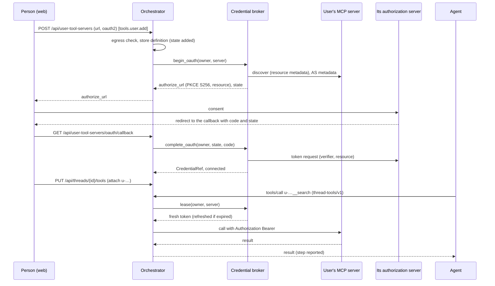

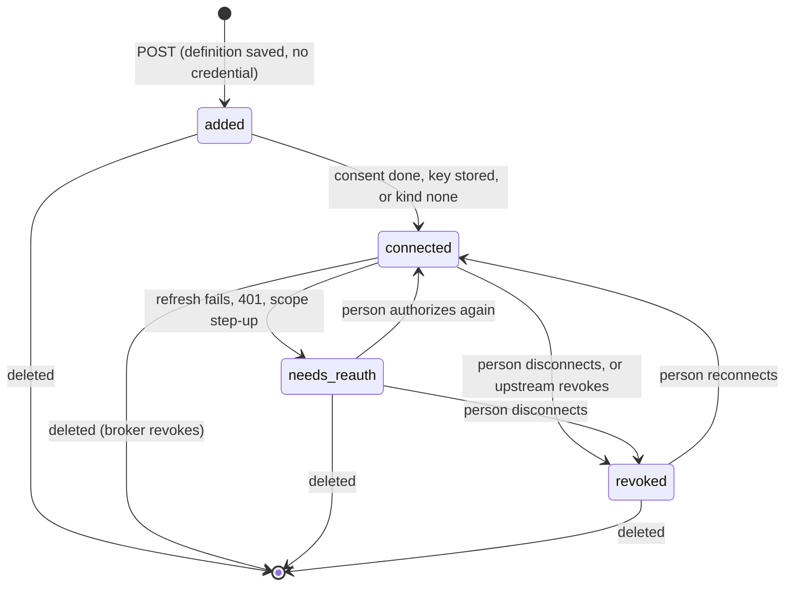

Only `connected` is offered. `unavailable` (server down, egress refused, permission off) is a reason shown, not a stored
state: it clears when the cause does. The state is the definition's, so it is the same for every thread of the person.

## Consequences

- One agent, with a chat's web search, can also have the person's own GitHub or Notion server for that chat only; the agent's
  own tools are untouched, and nobody else's thread sees the server.
- **Invariant 3 is amended** (note in `CLAUDE.md`): Postgres also keeps a person's definitions of servers, which is not the log
  and holds no secret. The credentials are the broker's, outside this repository's database.
- **A new required port pair**: the composition root needs a broker adapter, and one for the platform's service is a slice of
  its own. With none, only `none` servers work.
- **The relay gains a dependency on the broker on its critical path**: a broker that is down makes the person's `oauth2`,
  `bearer` and `api_key` servers `unavailable`, never the deployment's.
- **A revoked permission** does not detach a server from a running thread; it stops it being offered and leased at the next
  attach, and `userToolServers.enabled: false` stops every lease at once (the chart's switch).
- `config.md`, its schema, `chat-api.yaml`, `thread-tools-v1.md` and the web's picker change in the slices that build it;
  `docs/open-questions.md` question 11 (authentication to MCP servers) is partly answered here and stays open for the
  deployment's own servers.
- Slices (*proposed*): ports and testkits with an in-memory broker; the egress function and its tests; the Postgres store and
  endpoints; the relay's lease; the web (add, authorize, status); the platform's broker adapter.

## Alternatives rejected

- **Secrets in this database, encrypted** (as the orchestrator holds the configured ones in its environment). It makes the
  orchestrator the vault for strangers' tokens, with refresh and rotation here, and the owner chose a broker.
- **The agent connects to the person's server directly** ("direct", ADR 0024). The agent would hold the credential and the log
  would not see the calls; the relay is what exists and shows steps.
- **Let a person edit an agent's own servers.** They are the agent's contract, versioned with it; users add on top.
- **No egress guard, trusting the person.** The orchestrator would fetch any URL, the cloud metadata address among them.

## Amended 2026-10-06: the callback on desktop and mobile

[ADR 0047](0047-one-ui-for-web-desktop-and-mobile-each-signs-in-as-a-public-oauth-client.md) adds Tauri clients that call
the API with a bearer token. The browser that comes back to the OAuth callback (the system browser on desktop, the in-app
tab on mobile) carries neither that token nor, on native, the web's cookie. So the callback does not need the person to be
signed in: when the signed-in person starts the flow, `begin_oauth` returns the `state` and the orchestrator keeps only
`state → (who, which server, an expiry of minutes)`; the PKCE verifier stays in the broker, as decision 3 says. The callback
finds the person through that `state` alone, used once, and passes `code` and `state` to `complete_oauth`. The page
it answers says "you can return to the app"; the app learns the new status from `GET /api/tool-servers`.

## Amended 2026-10-11: accepted; the broker is the orchestrator's, behind two ports

The owner, 2026-10-11: "ADR 0046 should be accepted and built." Asked where the broker lives, he answered: "The orchestrator, but we keep it modular
enough, so that another company can decide to go with K8s secrets or Bitwarden or openbao if they want."

This **replaces decision 3's wording** (the platform's broker, the two ports, "this side never holds a verifier, a refresh token or a client secret",
"not implemented here"). Decisions 1, 2, 4 and 5, the flow and the callback amendment of 2026-10-06 stand. The old text above is kept as it was; read it
with this section. *Facts about third parties are in [Verified and unverified](#verified-and-unverified-2026-10-11).* **Nothing is built** *(as of 2026-10-11; slice 1 is built since, see the amendment of 2026-10-14)*.

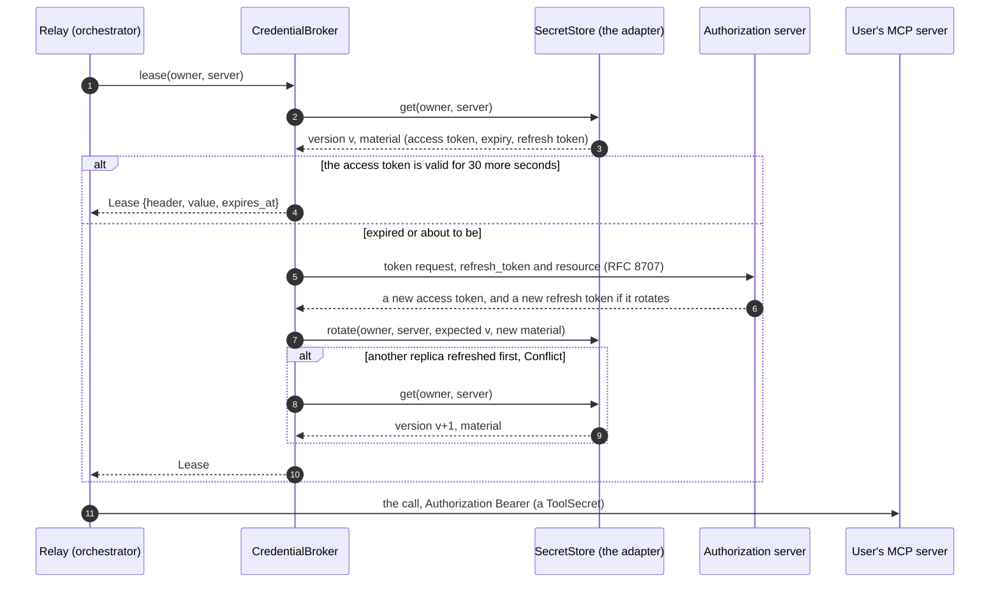

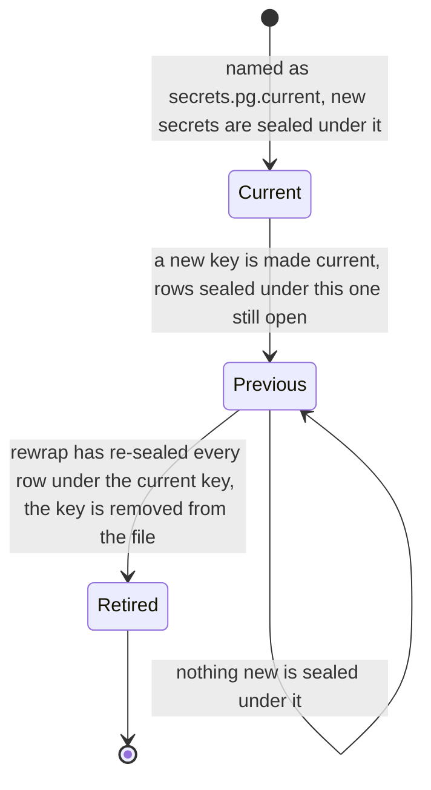

1. **Where.** The broker is in the orchestrator: no separate service, no platform dependency. The platform's broker
   ([another-agentic-platform §39a](https://github.com/vymalo/another-agentic-platform/blob/main/docs/architecture/08-security.md#39a-connections-user-mcp-servers-and-the-credential-broker),
   *unverified here*: not re-read on 2026-10-11) stays a **possible future adapter of `CredentialBroker` itself** (an implementation that asks the platform for a lease), not of `SecretStore`.
2. **Two ports** in `orch-ports` ([ADR 0009](0009-swappable-implementations-at-build-time.md); no driver type in a signature), each with a conformance testkit in the style of
   `artifact_store_conformance!`. `UserToolServerStore` (definitions, decision 3's first bullet) is unchanged.
   - **`CredentialBroker`**: `store`, `begin_oauth`, `complete_oauth`, `lease`, `revoke`, as decision 3 listed them. **One implementation, written once** (`orch-credential-broker`): OAuth
     discovery (the protected resource metadata of RFC 9728, then the authorization server's), **PKCE `S256`** (refusing a server whose metadata lacks
     `code_challenge_methods_supported`), the **`resource` parameter** (RFC 8707) on the authorization and the token request, **client registration** (pre-registered, a Client ID Metadata
     Document, or dynamic registration, in that order), **refresh**, and **short leases**. Its URL guard is decision 5's. Errors are classed as before (`NeedsReauth`, `Unavailable`, `Unknown`).
   - **`SecretStore`**: storage of **opaque material** by `(owner, server)`; the adapter keeps it sealed at rest, and none parses it (the broker serialises the token set, the PKCE verifier of a pending flow
     under `(owner, "<server>#flow")`, a client secret).

     | Call | Does |
     |---|---|
     | `put(owner, server, material) -> version` | Creates or replaces. |
     | `get(owner, server) -> Option<(version, material)>` | Absent is `None`, not an error. |
     | `delete(owner, server)` | Idempotent. |
     | `rotate(owner, server, expected, material) -> version` | **Compare and swap** (*the owner's word "rotate", read this way*): replaces only when `expected` is the stored version, else `Conflict`. It is how a refreshed, rotated token set is stored without a lost update between replicas. |

     `material` is a `SecretMaterial`: `Debug` prints `<redacted>`, no `Display`, zeroized on drop (as `ToolSecret`, `orchestrator/crates/ports/src/tools.rs`), at most 16 KiB. Errors are classed
     (`Classify`): `Conflict`, `Unavailable`, `KeyUnknown`, `Corrupt`.
3. **Adapters are separate crates, chosen at build time** (invariant 6): a Cargo feature each, on `secrets.store` in the configuration, a store not compiled in is exit 78 naming the feature
   (as `artifacts.store`). With no `secrets` section only `none` servers can be added (decision 3's fail-closed rule, restated).
   - **`orch-secrets-pg`, the default.** One table in the orchestrator's own database (`user_secrets`: owner, server, version, envelope, updated). An **AES-256-GCM envelope**
     `{v, kid, nonce, ciphertext+tag}` with a random 96-bit nonce and the associated data `owner ‖ server ‖ version ‖ kid`, so a row moved to another person, server or version does not open.
     **The key comes from the configuration by reference, an AWS secret through an ExternalSecret** (chart property `user_secrets_key`, 32 random bytes, as `openssl rand -hex 32`):
     `secrets.pg.keys: [{id, key: {file: …}}]` and `secrets.pg.current: <id>`. **Rotation by key id**: add a key, make it current, run
     `orchestrator secrets rewrap` (it re-seals each row under the current key through `rotate` *(amended 2026-10-14, slice 3: in place at the same version, not through `rotate`; departure 47)*), then remove the old one. A row sealed under an id the file does not hold is `KeyUnknown`:
     that server is `unavailable`, never a crash.
   - **Later and optional**, each its own crate and its own dated amendment when it is built: **`orch-secrets-k8s`** (Kubernetes Secrets), **`orch-secrets-openbao`**, **`orch-secrets-bitwarden`**
     (Bitwarden Secrets Manager). A name an adapter derives for an object is a hash of `(owner, server)`, so no string a person chose becomes an object name (as `ArtifactKey`). What each
     can and cannot do is in the facts below: the Bitwarden adapter is **not promised**.
4. **Every adapter passes the testkit**: `secret_store_conformance!` (put then get, `get` of nothing, idempotent delete, `rotate` conflict, a second owner never sees the first's material, material that
   does not read back byte for byte is a failure, no secret in an error or a `Debug`); the broker has `credential_broker_conformance!` over an in-memory store and a WireMock authorization server.
5. **Refresh is the broker's and lazy**: at `lease`, inside the call, one refresh at a time per `(owner, server)` in a process (single flight); across replicas `rotate` settles it, and the loser
   re-reads. **This closes open question 54** (the orchestrator refreshes; it did not ask the platform).
6. **A secret appears** where decision 3 said (the person's request body, memory, the relay's call in a `ToolSecret`) **and at rest in the `SecretStore`, sealed**, nowhere else. The
   broker now holds a verifier, a refresh token and a client secret, in memory only while it uses them.
7. **Invariant 3.** A sealed secret in Postgres is new stored state, so its note in `CLAUDE.md` is amended today (and ADR 0001 has a status note). It is not the log, it is read only to lease a credential, and
   nothing reasons on it. **A consequence to plan for:** the database holds only envelopes, so **a backup of the database does not restore the secrets without the key**, which lives in the AWS secret;
   losing the key loses every stored credential (people authorize again), losing the database loses the definitions as well.

**Consequences, replacing decision 3's.** No new infrastructure for the default: the same database. The composition root needs one `SecretStore` adapter, `pg` unless a deployment chooses another at build time.
The relay's critical path now depends on the database and, at a refresh, on the person's authorization server, not on a second service. A company that wants Kubernetes Secrets, OpenBao or Bitwarden writes or
picks an adapter crate and sets `secrets.store`; nothing else changes. **Slices, replacing the list above:** the two ports and their testkits with an in-memory store; `orch-credential-broker` against a mock
authorization server; the egress function; `orch-secrets-pg` with `rewrap` and the chart's key; the definitions' table and the endpoints; the relay's lease; the web (add, authorize, status); then the
optional adapters. **The first alternative rejected below ("Secrets in this database, encrypted") is reversed for the default adapter**, on the owner's words: the broker is the orchestrator's and the vault is
behind a port, one crate away.

**Kept open (the owner to confirm, or a later amendment):**
1. The **envelope layout and the associated data** above, which are this amendment's, the owner having named AES-256-GCM, the key by reference and rotation by key id only.
2. **`rotate` as compare and swap.** If the owner meant key rotation only, the port loses `rotate` and the broker takes a lock instead.
3. **A refresh token presented twice.** `rotate` prevents a lost update, not a double spend: two replicas that refresh at the same instant present one refresh token twice, and an authorization server that
   treats reuse as theft revokes the grant (the server goes `needs_auth`). Single flight makes it rare. A cross-replica lock is not in the port; add one if it happens.
   *(Closed 2026-10-14, slice 2 review: the broker claims the refresh in the store with `rotate` before it asks, so no lock is added to the port; see departure 37.)*
4. **The three later adapters**, and **the platform's adapter of `CredentialBroker`**: nothing is decided beyond their place.

### Verified and unverified (2026-10-11)

*Verified 2026-10-11*, page reads (the tool summarised the pages, so wording is a paraphrase unless quoted):
- **Kubernetes Secrets** (<https://kubernetes.io/docs/concepts/configuration/secret/>): "Kubernetes Secrets are, by default, stored unencrypted in the API server's underlying data store (etcd)", and the page
  recommends encryption at rest. A Secret is created with `POST /api/v1/namespaces/{namespace}/secrets` and patched at `…/secrets/{name}`
  (<https://kubernetes.io/docs/reference/kubernetes-api/config-and-storage-resources/secret-v1/>); the size limit is a constant, `MaxSecretSize`, whose number was not read. So the adapter would rely on the cluster's
  encryption at rest and on RBAC for the orchestrator's ServiceAccount; it adds no sealing of its own unless the owner wants one (*open*).
- **OpenBao KV v2** (<https://openbao.org/docs/secrets/kv/kv-v2/>): a secret is written and read at `secret/data/<path>` (the mount is configurable), deleting the metadata path `secret/metadata/<path>` removes the key with
  all versions, every write makes a version, and a write may carry a `cas` value that must match the current version. That fits `put`, `get`, `delete` and `rotate`. The HTTP methods and request bodies were not read
  on the API page (its fetch returned nothing); the adapter's author reads them first.
- **Bitwarden Secrets Manager** (<https://bitwarden.com/help/secrets-manager-overview/>, <https://bitwarden.com/help/secrets-manager-sdk/>): its objects are secrets, projects, machine accounts and access tokens; there is a CLI and
  an SDK (a Rust core with wrappers for several languages). The SDK page lists authenticating, retrieving a secret and listing secrets and projects; it does **not** mention creating, updating or deleting, and no stand-alone
  REST API appeared on the pages read. **Whether an adapter can `put`, `delete` and `rotate` is unverified**, which is why it is not promised.

*Unverified:* the safe volume of random 96-bit nonces under one AES-GCM key (NIST SP 800-38D sets a limit near 2^32 invocations; from memory, the volume here is tiny) *(read and verified 2026-10-14, slice 3: section 8.3 says 2^32; see the facts of that section)*; the platform's section (above).

## Amended 2026-10-14, slice 1: the ports, their testkits, the in-memory stores and the egress guard are built

All in `orchestrator/crates/ports` (`orch-ports`); `orch-core` is untouched, and **nothing is wired into the binary**: no `config`, no endpoint, no relay change, no adapter beyond the in-memory ones.
Decisions 1, 2, 4 and 5, the flow and the amendments above stand. What exists, by file under `orchestrator/crates/ports/src/`:

| File | Public names | Pinned by |
|---|---|---|
| `egress.rs` | `EgressPolicy` (`new`, `allowing_http`, `with_allow`, `with_deny`, `from_lists`, `check_url`, `check_resolved`), `EgressTarget`, `CheckedAddrs`, `EgressRefusal` (`rule()` for the operator's log; `public_reason()`, `public_rule()`, `public_class()` for a person), `HostPattern`, `EgressHost`, `AddressClass`, `classify_address`, `is_public_address`, `MAX_URL_BYTES` | `tests/egress.rs` |
| `secrets.rs` | `SecretStore` (`put`, `get`, `delete`, `rotate`), `SecretMaterial`, `MAX_SECRET_BYTES`, `MaterialTooLarge`, `SecretVersion`, `SecretServer`, `SecretError` | `secret_store_conformance!` (with an optional `breaker`), `tests/secrets.rs` |
| `user_tools.rs` | `UserToolServerStore` (`insert`, `get`, `list`, `replace`, `set_state`, `delete`), `StoredServer`, `ServerRevision`, `UserToolServer` (`new` from an `&EgressTarget`, `from_stored`), `UserToolServerId`, `UserAuth`, `UserToolServerState`, `ToolServerStatus`, `UnavailableReason`, `DefinitionError`, `UserToolServerStoreError`, `MAX_USER_TOOL_SERVERS` | `user_tool_server_store_conformance!`, `tests/user_tool_servers.rs` |
| `credentials.rs` | `CredentialBroker` (`store`, `begin_oauth`, `complete_oauth`, `lease`, `revoke`), `CredentialLease` (a closed enum), `CredentialRef`, `OAuthStart`, `OAuthState`, `RedirectUri`, `CredentialError` | `tests/credentials.rs` (a stub broker that follows the trait's docs; **no conformance macro**, it is slice 2's) |
| `tools.rs` | `is_reserved_header`, `RESERVED_HEADERS`; `ToolSecret` is now wiped on drop | `tests/user_tool_servers.rs`, `tests/secrets.rs`; `orch-tools-mcp` uses it |
| `memory/` | `MemorySecretStore`, `MemoryUserToolServers` (feature `testkit`) | the two macros |

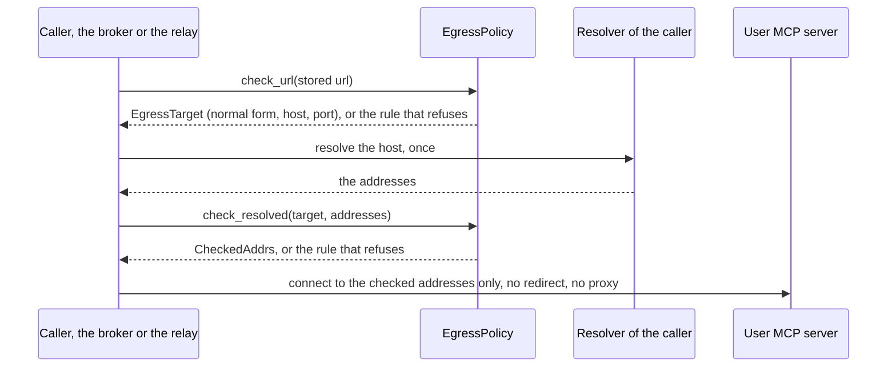

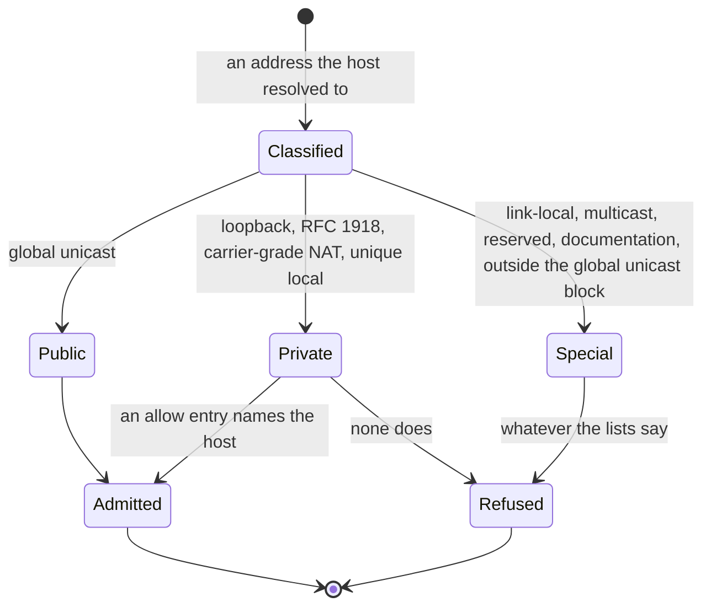

**Departures from the text above, and clarifications the ports needed** (the owner to confirm; each is one line to change). *Numbered as the pull request's body numbers 1 to 10; 11 and 12 were in this list and not in the body; 13 to 19 are the review's, below.*

1. **`allow` lifts private, for what the operator named exactly; never for a suffix, never special** (decision 5.3). A host named by an **exact `allow` entry** (a host written in full, or an address) may resolve to a private-use address (loopback, RFC 1918, carrier-grade NAT, unique local): the address entry for that address only. A **`*.` suffix entry** only *admits* the hosts it matches: it does **not** lift the ban on private addresses, because it names a family of names that a stranger can make (`*.vercel.app` would let `evil.vercel.app` resolve to `10.0.0.1`); to reach a private network, name the hosts or the addresses. Nothing in `allow` lifts a link-local one (the metadata address among them), nor an unspecified, multicast, broadcast, reserved or documentation one: a pattern such as `*.internal` would otherwise name `metadata.google.internal`. An IP literal written in `allow` is held to the same. *(Amended 2026-10-14, review: the suffix case; the text before said any `allow` match lifted the private ban.)*
2. **The guard refuses more than the ADR lists:** `localhost` and `*.localhost` (always loopback, RFC 6761) at `check_url` unless `allow` names them **exactly**; **one** refused address among those a name resolved to refuses the whole answer (the model's `guardedLookup` does the same); a URL whose normal form is over 2 KiB. *(Amended 2026-10-14, review, also:)* the lists are applied to **the addresses a name resolved to and to IP literals, in any spelling** (an IPv6 address that carries an IPv4 one is compared as that IPv4 address), so `deny: ["8.8.8.8"]` stops a name that resolves to it and `https://[::ffff:808:808]/`; an `allow` address entry admits a name whose every resolved address it names; a numeric pattern is read strictly (`010.0.0.1`, `127.1`, `0x7f.1` are refused); `192.88.99.0/24` is a special range.
3. **`CredentialLease`, not `Lease`**: `orch_ports::Lease` is the thread store's. For `Authorization` the lease's token is the **bare token** (the relay gives it to `ToolServerEndpoint::with_bearer`); any other header carries the value as it is. *(Amended 2026-10-14, review: it is a closed enum, `Bearer` and `Header`, with no `PartialEq`, `Eq` or `Clone`.)*
4. **`complete_oauth(owner, server, state, code)`** takes the server, which the list of decision 3 did not: the pending flow is kept under `(owner, server)` (amendment, 2), so the broker cannot find the verifier without it. The callback knows the server from the table that maps `state` to the person (amendment of 2026-10-06). *(Amended 2026-10-14, slice 2 review: it takes the callback's `iss` as well, `complete_oauth(owner, server, state, code, iss)`; departure 36.)*
5. **`begin_oauth`, `lease` and `store` carry only `(owner, server id)`** (and the secret, and the redirect), not the URL, the kind, the scopes or the client id: `orch-credential-broker` is composed over a `UserToolServerStore` and reads them from the definition, which stays the one place that says what a server is. *(Amended 2026-10-14, review: `store` no longer takes the kind, which could disagree with the definition.)*
6. **The `SecretStore` key's second half is a `SecretServer`**, not a free string: `u-abcdefghij` (a server's credential) or `u-abcdefghij#flow` (its pending flow, the amendment's `"<server>#flow"`), validated, so no string a person chose becomes an object name.
7. **Stricter than the text, in `SecretStore`**: a version is **never handed out twice for one key, not even across a `delete`**. Without it a replica that read version 3, then saw the grant revoked and made again, could `rotate` from 3 and overwrite the new grant with a refresh of the old one. `rotate` of a secret that is not there is a `Conflict`. Material may be empty. `KeyUnknown` and `Corrupt` have the error class `Corrupt` (nobody retries, an operator is told); the server is unavailable either way. *(Amended 2026-10-14, review: the contract is what `rotate` needs and no more. A version is opaque and **callers compare it for equality only**; the port no longer asks for "one counter for the whole store", which an adapter over OpenBao's per-key versions or a Kubernetes `resourceVersion` could not give, only that a version is never given twice for a key, across a delete included, and that the writers of one key are serialized and numbered in the order they land, so the version a key holds is the greatest it gave, which the concurrent case asserts. The memory store keeps its store-wide counter. A `put` of identical material is still a new version.)* `orch-secrets-pg` is to take versions from a sequence; an adapter that cannot do the same fails the case `a_version_is_never_reused_after_a_delete`.
8. **The `api_key` header refuses `Host`, `Accept`, `Content-Type`, `Last-Event-ID`, every `Mcp-*` and `Authorization`**: the last because it is the `bearer` kind's and `orch-tools-mcp` refuses it in `headers` (it is also what `toolServers[].headers` refuses today). A person who needs `Authorization: Basic …` cannot yet; see open question 2 below. *(Amended 2026-10-14, review: also `Content-Length`, `Transfer-Encoding`, `Connection`, `Upgrade`, `TE`, `Expect`, `Keep-Alive`, `Trailer`, `Cookie` and every `Proxy-*`, in any case: headers the HTTP client frames or routes the request with.)*
9. **The state is the diagram's, `added`, `connected`, `needs_reauth`, `revoked`** (`UserToolServerState`), because the text says `unavailable` is a reason shown and not a stored state. `ready`, `needs_auth` and `unavailable` with a reason are the derived `ToolServerStatus` and a closed `UnavailableReason` (`not_permitted`, `egress_refused`, `server_down`, `broker_down`). *(Amended 2026-10-14, review: no port signature uses these two types. They stay in `orch-ports`, and not in the API's crate, because the API's listing and the relay's refusal to offer a server both write them and this is the crate both depend on, and because `UserToolServerState::status()` is the one table from a stored state to what a person sees. They move to the crate that owns the endpoints if it becomes the only one that needs them.)*
10. **The reserved-header check is one function now**, `orch_ports::is_reserved_header`: `orch-tools-mcp` uses it in place of its private copy. `orch-config` still has its own list (it depends on no other crate of the workspace), unchanged.
11. **The definition's "optional header name, scopes"** are in the variants of `UserAuth` (`api_key { header }`, `oauth2 { scopes, client_id }`), not fields beside it.
12. **The limit of eight is the store's**: `UserToolServerStoreError::TooMany { limit }` (class `Rejected`), an edit at the limit is not a ninth, and the testkit races sixteen adds to see eight succeed. A definition's name is held to 80 characters, at most 32 scopes. *(Amended 2026-10-14, review: the testkit repeats the race twenty times, each with an owner of its own, because a count that is read and then written passes the limit only when the writers interleave. The trait's docs name the technique a SQL adapter must use, a lock per owner, taken before the count: a transaction-scoped advisory lock keyed by the owner, or `SELECT … FOR UPDATE` on a row of the owner. That is the definitions table's, **slice 4**; `orch-secrets-pg` keeps no limit.)*
13. **`UserToolServerStore` has no upsert** *(review)*. `put` was an unconditional write: an edit that read a definition and then wrote it back reverted a state or a credential reference the broker wrote in between, and brought back a server that was deleted in between. It is `insert` (`Exists`, `TooMany`), `replace(owner, server, expected)` and `set_state(owner, id, state, expected)`, both **compare and swap on a `ServerRevision`** the store keeps and a read returns (`StoredServer`): a stale revision is `Conflict`, an absent definition is `NotFound` and nothing is created. The credential reference is set by `replace` (no third call). A revision is new for every write and never given twice for a key, across a delete included; callers compare for equality. `delete` is unconditional and idempotent. Chosen over "set_state without a revision, never resurrecting": a state computed for a URL that was edited since must not be written onto the edited definition.
14. **A definition's URL is one the guard accepted** *(review)*. `UserToolServer::new` takes an `&EgressTarget`, which only `EgressPolicy::check_url` makes (and an adapter's `UserToolServer::from_stored`), so an unchecked string cannot be stored. A row read back goes through `from_stored`, which checks the URL again as the **normal form** of a URL that passes the rules of the URL itself (scheme, user information, host, query, fragment, port, length), **not** the deployment's lists or the address: the lists change, and a person must still be able to list a server that today's lists refuse, see `unavailable` (`egress_refused`) and delete it; the connection applies the lists every time. `Debug` of a definition and of an `EgressTarget` prints the scheme, host and port, **never the path**, which can carry a secret.
15. **A credential is bound to the URL it was issued for** *(review; the contract of the broker, written in the trait's docs)*. The broker keeps the definition's normal-form URL (the OAuth `resource`) inside the sealed material when it stores a credential, and `lease` compares it with the definition's now: a mismatch is `NeedsReauth`. Deleting a server is **"revoke, then delete"**: `revoke` reads the definition to find the authorization server, so it runs first, and a `revoke` that fails aborts the delete. A revoked or never-given credential is `NeedsReauth`; `Unknown` is "no such server" (and a kind that has no credential: `lease` of a `none` server is `Unknown`, and the relay does not ask).
16. **The OAuth inputs are values, not strings** *(review)*. `begin_oauth` takes a `RedirectUri` (`https`, or `http` on the loopback literals `127.0.0.1` and `[::1]`, no fragment, no user information: the MCP and native-app rules; `localhost` and custom schemes are not accepted), `OAuthStart` says when the pending flow ends (`expires_at`), and `OAuthState` is checked when it is made (16 to 128 unreserved characters, also for a callback's) and compared in constant time. **An abandoned flow, or a callback with `error=`, needs no call**: the pending flow expires, the broker forgets it the next time it meets it, and the `state` cannot be completed after `expires_at`.
17. **A person is not shown the precise refusal** *(review)*. `private-address` and `no-address` together tell which internal names exist. `EgressRefusal::rule()` stays precise, for the operator's log; the API shows `public_reason()`, `public_rule()` and `public_class()`, which are one for both.
18. **`ToolSecret` is wiped on drop** *(review)*, as `SecretMaterial` is, and both **derive** `ZeroizeOnDrop` (the derive refuses a field that is not wiped), so the promise is checked by the compiler. `tests/secrets.rs` pins the declaration and does not claim to prove that memory is cleared.
19. **The testkit looks into the errors that can hold text** *(review)*. `no_error_or_debug_text_shows_a_secret` only provoked `Conflict`, which holds nothing. `secret_store_conformance!(make, breaker = path)` takes an `async fn(&S)` that breaks the store (a Postgres adapter closes its pool; the memory store is taken down) and runs `put`, `get`, `rotate` and `delete` with a sentinel in flight, looking for it in the `Display`, `Debug` and sources of each error. Without a breaker the case is skipped and says so. Four leaky stores in the tests show it can fail.

**Facts.** *Verified 2026-10-14, by `tests/egress.rs` against `url` 2.5.8:* the URL parser reads `2130706433`, `017700000001`, `0x7f000001`, `0x7f.0.0.1`, `0177.0.0.1`, `127.1`, fullwidth digits, a trailing dot and bracketed IPv6 forms as the address they name, normalises `https:///mcp`
to `https://mcp/` and drops an empty `@`; no address that `std` calls private, loopback, link-local, multicast, broadcast, documentation, unspecified, unique local or unicast link-local is judged public, over every /16 of IPv4 and every first group of IPv6 (`tests/egress.rs`).
*Verified 2026-10-14, review, by tests and a probe:* the URL parser decodes `127%2e0%2e0%2e1` to `127.0.0.1` and refuses a zone id in a bracketed literal; `std`'s `Ipv4Addr::from_str` refuses `010.0.0.1` (a leading zero), `127.1` and `0x7f.1`; the `zeroize_derive` 1.5.0 derive of `ZeroizeOnDrop` fails to compile for a field that is neither `Zeroize` nor `ZeroizeOnDrop` (checked with a `std::fs::File` field, not kept).
*Unverified (from memory of the IANA special-purpose registries, not re-read today):* `192.88.99.0/24` as the deprecated 6to4 relay anycast prefix (RFC 7526), the carrier-grade NAT, benchmarking, reserved and `2001::/23` ranges, `64:ff9b:1::/48`, `5f00::/16`, and `3fff::/20` as the second documentation prefix (RFC 9637). *Unverified:* that `reqwest` 0.13's `dns::Resolve` and
`ClientBuilder::resolve_to_addrs` do what the egress docs say a caller uses them for; the slice that writes the broker reads them first *(read and verified in slice 2, 2026-10-14: see its facts)*.

**Open for the next slices.**
1. **`orch-credential-broker`** *(built in slice 2, 2026-10-14: see the section at the end)*: its conformance macro (`credential_broker_conformance!`), over `MemorySecretStore`, `MemoryUserToolServers` and a mock authorization server; how it takes an `EgressPolicy`; a resolver hook for `reqwest`. **The macro must have a case for departure 15**: a credential stored for one URL is not lent after the definition's URL changes (`NeedsReauth`), nor for a definition made again under the same id; a revoked or never-given credential is `NeedsReauth`, a missing server and a `none` kind are `Unknown`; an expired `state` is `Unknown` and a used one too; `revoke` is idempotent and runs before the definition is deleted.
2. **`Authorization` in an `api_key` header** (departure 8): LibreChat offers Basic. Allow it by letting the broker lease `Authorization` with a whole value (`Basic …`), which `ToolServerEndpoint` cannot carry today (it sets `Authorization` from `bearer` only), or keep it out.
3. ~~`ToolSecret` is not zeroized~~ *(amended 2026-10-14, review: it is, departure 18)*. What stays: a lease's value sits in memory for the length of a call, and a request makes copies while it is sent, which the wipe does not cover.
4. **A deployment with no `secrets` section** needs a `SecretStore` and a `CredentialBroker` that refuse every call (`NoArtifacts` is the model); not built, the composition root's slice. *(Built in slice 4a: `NoSecrets`, `NoBroker` and `NoUserToolServers`, departures 66 and 67.)*
5. **`orch-secrets-pg`** *(built in slice 3, 2026-10-14: see the section at the end; `rewrap` is not through `rotate`, departure 47)*: versions from a sequence (never given twice for a key, across a delete included, in the order the writes land), `rewrap` through `rotate`, and a `breaker` for the testkit that closes its pool. *(Amended 2026-10-14, review: "the limit under a lock per owner" is no longer here; it is the definitions table's, slice 4, below.)*
6. **The definitions table (slice 4)**: revisions from a sequence, the limit of eight under a lock per owner taken before the count (an advisory lock keyed by the owner or `SELECT … FOR UPDATE` on an owner row; the testkit races it twenty times), `replace` and `set_state` as one statement with the revision in its `WHERE`, rows read back through `UserToolServer::from_stored` (a failure is `Corrupt`), and the API showing `EgressRefusal::public_reason()` and never `rule()`. *(The table half is built in slice 4a, departures 61 to 63; the API half is slice 4b's.)*
7. The IPv6 table treats anything outside `2000::/3` as special: a new allocation is added to `egress.rs` when a server lives in it.

## Amended 2026-10-14, review of the slice 1 pull request

The review of [pull request 250](https://github.com/vymalo/another-agentic-system/pull/250) found five major points and twelve minor ones, all fixed in the same pull request before it merged. The departures above carry each change where it belongs, marked *(review)* or *(Amended 2026-10-14, review)*; in short: the lists judge addresses in any spelling and a suffix never lifts the private ban (1, 2); the two checks that could not fail now can (18, 19); a credential is bound to its URL, which is the broker's contract (15); the definitions store has no upsert (13). Also: the lease is a closed enum (3), the version contract is what `rotate` needs (7), the redirect and the state are values (16), the headers a client frames a request with are refused (8), a URL never prints its path (14), the refusal a person sees is one for two causes (17), the limit race is repeated (12), and `ToolServerStatus` and `UnavailableReason` stay in `orch-ports`, with a reason (9). Decisions 1 to 5 stand.

## Amended 2026-10-14, slice 2: the broker is built

`orchestrator/crates/credential-broker` (package `orch-credential-broker`) is the one implementation of `CredentialBroker`, and `credential_broker_conformance!` (with its fixture trait
`BrokerFixture`) is in `orch-ports`' testkit. **Nothing is wired into the binary**: no `config`, no endpoint, no relay change, no secret adapter beyond the in-memory store (slices 3 to 5). `orch-core`
is untouched; `orch-ports` gained the testkit module `credential_broker` and doc changes only (no signature changed). Decisions 1 to 5, the slice 1 departures and the amendments above stand.
Process diagrams (the OAuth flow, the lease and its refresh, the states of a credential and of a pending flow) are in the crate's `README.md`; every node and edge is a call or a branch in the code.

| Where | What |
|---|---|
| `crates/credential-broker/src/broker.rs` | `Broker<S, D, C = SystemClock>` (generic over `S: SecretStore`, `D: UserToolServerStore`, `C: Clock`; the stores are held by value, as the adapters are cheap to clone), `BrokerBuilder`, `egress_refusal(&CredentialError)` |
| `.../src/http.rs` | the one HTTP client and the guard in front of it: `check_url`, the `reqwest::dns::Resolve` hook, `HostLookup`/`SystemLookup`, bounds |
| `.../src/discovery.rs`, `oauth.rs`, `material.rs`, `flights.rs`, `config.rs` | RFC 9728 and RFC 8414 discovery, PKCE and the token endpoint, the sealed records, single flight, `BrokerConfig` |
| `crates/ports/src/testkit/credential_broker.rs` | the 27 cases, `BrokerFixture`, `RefreshOutcome`, `AsRequests`, `Consent`; macro in `testkit/mod.rs` |
| `crates/credential-broker/tests/` | `conformance.rs` (the macro, over `MemorySecretStore`, `MemoryUserToolServers` and an axum authorization server on `127.0.0.1`), `egress.rs`, `registration.rs`, `behaviour.rs`, `hygiene.rs`, `support/` (the mock server, a tripwire that counts connections, a secret store that yields after every call so that two replicas interleave) |

The new third-party dependencies of the workspace: **none** (`Cargo.lock` gains only the workspace package). `reqwest`, `url`, `base64`, `sha2`, `getrandom`, `serde_json`, `jiff`, `tokio`, `tracing` and
`zeroize` were already in it; `axum`, `tracing-subscriber` and `futures` are dev-dependencies of the new crate.

**Departures from the text above, and choices the build needed** (the owner to confirm; each is small to change). Numbered after slice 1's 19.

20. **`store` is for `bearer` and `api_key`; `oauth2` is `Unknown`.** The trait's docs also let `store` keep "an OAuth client secret of a client they registered themselves"; this broker does not: a pre-registered client
    (`oauth2 { client_id }`) is a **public** client with PKCE, and a client secret is only ever one that dynamic registration returned, kept inside the grant. The conformance macro does not pin this (an implementation that keeps
    client secrets still conforms); this crate's `tests/behaviour.rs` does. A confidential pre-registered client is an open question (below).
21. **A grant keeps the endpoints its authorization server named, and `revoke` does not read the definition.** The token and revocation endpoints (and the client) are sealed with the tokens, so a refresh and a revocation go
    where the grant was issued, with no second discovery, and a `revoke` works for a definition that is already gone (the trait's docs say `revoke` reads the definition to find the authorization server; it needs not, and
    "revoke, then delete" still holds). Each endpoint is judged by the guard **when it is used**, so a list tightened since is applied (a refresh under a deny list is refused with nothing sent: a test).
22. **The broker writes one state of the definition: `needs_reauth`**, with `set_state` and the revision it read, when it learns the grant is over (a refresh refused with `400` or `401`; an access token that ran out with no
    refresh token). A definition edited since is a `Conflict` or `NotFound` and nothing is written (a test renames a server while a refresh is in flight). `connected`, `revoked` and the credential reference are the API's
    `replace`, because the reference must be written in the same compare and swap. This is the "if the port requires it" of the slice's brief: the trait's docs on `set_state` call it the broker's write, and name no other.
23. **Discovery is by the well-known URIs only**: the path-inserted form, then the root (RFC 9728). The MCP specification (2025-11-25) says a client MUST also support the `WWW-Authenticate: Bearer resource_metadata=…` of a `401`
    from the server and use that URL when present; this broker makes no unauthenticated request to the person's server, so a server that publishes its metadata elsewhere is `Unavailable` (`NotFound`). Adding the probe is
    one function and an unauthenticated `POST` through the guard; not done.
24. **The broker never fetches a Client ID Metadata Document**: the authorization server does. The broker only *names* it: `BrokerConfig::with_client_metadata_url` (an `https` URL with a path, checked when the broker is
    built; the orchestrator serves the document, a later slice), used as the `client_id` when the server says `client_id_metadata_document_supported` and neither the definition nor the broker has a better one. The ADR's
    rule 5.4 ("a client-metadata document" among the URLs the broker fetches) therefore applies to nothing here; the SSRF risk of that fetch is the authorization server's (the draft says so).
25. **Dynamic registration happens at each `begin_oauth`**, a public client (`token_endpoint_auth_method: none`) for that redirect URI. A person who authorizes ten times leaves ten registrations at the authorization server.
    No RFC 7592 management, no cache of the client by `(owner, server, redirect)`. If the server returns a client secret it is kept in the grant and used (`client_secret_basic`, or `client_secret_post`).
    *(Amended 2026-10-14, slice 2 review: a client the broker registered is used again for an hour by the next `begin_oauth` for the same issuer and redirect URI; departure 40. There is still no RFC 7592 management.)*
26. **`complete_oauth` claims the flow before it exchanges the code**: it swaps the flow for a marker with `rotate` (the version it read), so of two callbacks for one `state` (two replicas, a double click) one wins and the
    code is spent once (a test races two). The flow is deleted whatever came of the exchange: **a failed exchange spends the `state`**, and the person begins again. *(Amended 2026-10-14, slice 2 review: the marker stays and nothing deletes it, departure 38; a callback whose `iss` is refused claims nothing.)* A wrong `state` is `Unknown` and leaves the flow (so a
    stranger's guess cannot end the person's flow); an expired one is `Unknown` and is forgotten.
27. **A refresh runs in a spawned task** (`tokio::spawn`), awaited by `lease`: a caller that gives up (a timeout in the relay) does not interrupt it between the authorization server's answer and the `rotate`, which would
    lose a refresh token the server has rotated. `lease` therefore needs a Tokio runtime (a test drops a lease at 80 ms and finds the refresh done and kept).
28. **Only `invalid_grant` drops the tokens.** Any `400` or `401` at the token endpoint is `NeedsReauth` and marks the definition (as the brief said), but only `invalid_grant` (RFC 6749, 5.2: the refresh token is invalid,
    expired or revoked) is certain enough to throw the tokens away (a compare and swap, so a grant made since is untouched); after that `lease` is `NeedsReauth` with no request. An `invalid_client` (the registered client was
    deleted) leaves the tokens, the definition is marked, and the person's next authorization registers again.
29. **The lifetime of an access token**: `expires_in` seconds (read as a number, a float or a numeric string; at most a year); when the server says nothing, **an hour if a refresh token was given**, else **no known end**
    (lent until the server says otherwise). *(Amended 2026-10-14, slice 2 review: `expires_in: 0` counts as nothing said; departure 43.)* A lease ends at `min(token end, now + lease TTL)`; the lease TTL (300 s) and the 30 s margin are `BrokerConfig`.
30. *(Revised 2026-10-14, slice 2 review: **the `resource` parameter is the definition's own normal-form URL**, once `same_resource` shows the document's `resource` names it; the document's spelling is never sent, and a person who named no scope asks for none; departure 39. The original text follows.)* **The `resource` parameter is the `resource` the server's own metadata declares**, after `same_resource` shows it names the definition's URL (`https://h` and `https://h/` are one; a different path, port, scheme, a
    query or a fragment are not, and then the document is not used: RFC 9728, 3.3). The MCP specification prefers the form without a trailing slash, which the URL parser does not write for a root path. The credential is
    bound to the definition's **normal form** (departure 15), not to this string.
31. **Two endpoints are judged at `begin_oauth`**, before the person is sent anywhere: the token endpoint (`check_url` and, for an address, `check_resolved`) and the authorization endpoint (by its shape only: scheme,
    host, user information and the lists, with the query removed, because the endpoint is a place to send the person and may carry a query that the guard refuses for a fetched URL). The registration and revocation
    endpoints are judged when used.
32. **`CredentialRef` is `cred-<server id>-v<secret version>`**; **the sealed records** are JSON `{"v":1,"d":…}` (the credential: a `bearer`, an `api_key` or an `oauth2` grant with its URL, `resource`, client, endpoints and
    tokens; the pending flow: the `state`, the verifier, its `expires_at`, the URL, the redirect URI, the client and the endpoints, or the marker `used`). A record that cannot be read (garbage, another version) is
    `Unavailable`, never `NeedsReauth`: the person's credential is not "gone", the store is wrong.
33. **`CredentialError` has no "invalid input" class**: a secret too large for the store (over 16 KiB with the record) is `Unavailable` with a fixed phrase, and a malformed token (empty, a newline in it) is kept as it is. The
    API must validate what a person types before `store` (length, characters); see the open points.
34. **`HostLookup` is public** (`SystemLookup` by default): how a name becomes addresses is a parameter of the builder, so that a test can map a name to a loopback address (DNS rebinding, and a name admitted by `allow` and
    connected to only through the hook) and a deployment can put its own resolver in. The guard judges whatever it answers.
35. **The testkit's authorization server must enforce** PKCE `S256`, the `resource` parameter, the redirect URI and the client's authentication (the module's docs list them), so that a case that gets a token has proved the
    request was right; and the fixture gives a second broker over the same stores (`replica()`) and a clock it reads, which the replica and expiry cases need. The suite is 27 cases (listed in `orch-ports`' README) *(36 since the slice 2 review)*.

**How the suite was checked to be able to fail.** Each of these changes to the broker was made in turn and made at least one test fail, then reverted: no URL binding (3 cases), `put` in place of `rotate` at a refresh,
no single flight, `S256` not required, no claim of the `state` (found only after the secret store was made to yield after every call: with a store whose calls never yield, two callers of one `join` run one after the
other and never race), the flow's expiry ignored, no `resource` at the token endpoint (17 cases), no 30-second margin, `invalid_grant` as `Unavailable`, no spawn, a state written with a fresh read instead of the revision
read, no `check_url`, no check of the resolved addresses, redirects followed.

**Facts, verified 2026-10-14.**
- *By reading the source* in `~/.cargo/registry/src` at the versions of `Cargo.lock`: `reqwest` 0.13.5 has `ClientBuilder::dns_resolver<R: IntoResolve>` (not behind a feature) and the trait `reqwest::dns::Resolve`
  (`fn resolve(&self, Name) -> Resolving`, `Addrs = Box<dyn Iterator<Item = SocketAddr> + Send>`), whose docs say "Explicitly specified port in the URL will override any port in the resolved `SocketAddr`s. Otherwise,
  port `0` will be replaced by the conventional port for the given scheme"; `ClientBuilder::resolve_to_addrs` overrides per domain and the resolver still serves the rest; `hyper-util` 0.1.21's `HttpConnector` does not call
  the resolver for a host that is an IP literal (`SocketAddrs::try_parse`), so the broker judges a literal itself before sending; `reqwest::Error::without_url`, `Response::chunk` exist; `form` is a separate feature that
  the workspace does not enable, so form bodies are built with `url::form_urlencoded`. The egress tests exercise the hook (a name resolved to a private address, to a mix, to nothing, to an error, and an admitted name
  connected to only through the hook) and fail when the hook does not judge the answer.
- *By page reads* (the tool summarised the pages, so wording is a paraphrase unless quoted): the **MCP authorization specification 2025-11-25** (<https://modelcontextprotocol.io/specification/2025-11-25/basic/authorization>):
  clients "MUST support both" discovery mechanisms (the `WWW-Authenticate` header and the well-known URIs, in that order), the well-known fallback is the path-inserted URI then the root; the authorization-server metadata
  URLs for an issuer with and without a path are tried in the order the crate's `README.md` lists (OAuth 2.0 metadata, then OpenID Connect with the path inserted, then appended); registration priority is pre-registered,
  Client ID Metadata Documents when `client_id_metadata_document_supported`, dynamic registration, then ask the user; clients "MUST refuse to proceed" when `code_challenge_methods_supported` is absent; `resource` "MUST be
  included in both authorization requests and token requests", and `https://mcp.example.com` is preferred to the form with a trailing slash; "All redirect URIs MUST be either `localhost` or use HTTPS" and all authorization-server
  endpoints HTTPS. **RFC 9728** (<https://www.rfc-editor.org/rfc/rfc9728.html>), 3.1 (the well-known URI is formed by inserting the suffix between the host and the path; a terminating slash after the host is removed) and 3.3 ("The `resource`
  value returned MUST be identical to the protected resource's resource identifier value … If these values are not identical, the data contained in the response MUST NOT be used"). **RFC 8414** (<https://www.rfc-editor.org/rfc/rfc8414.html>), 3 (the
  suffix is inserted between host and path, a terminating slash of the path removed first), 3.3 (the `issuer` returned "MUST be identical" to the one used), and the defaults: `token_endpoint_auth_methods_supported`
  omitted is `client_secret_basic`, `code_challenge_methods_supported` omitted means no PKCE. **RFC 7636** (<https://www.rfc-editor.org/rfc/rfc7636.html>): a verifier of 43 to 128 unreserved characters with at least 256 bits of
  entropy, `S256` is `BASE64URL-ENCODE(SHA256(ASCII(code_verifier)))` without padding (the crate's unit test reproduces the vector of RFC 7636, appendix B, which was written from memory and passes only if the transform is
  right). **RFC 8707** (<https://www.rfc-editor.org/rfc/rfc8707.html>), 2: "Its value MUST be an absolute URI", no fragment; the same parameter on the token request "for all grant types", and a refresh request in its figure carries it.
  **RFC 7591** (<https://www.rfc-editor.org/rfc/rfc7591.html>): registration is a JSON `POST`; `token_endpoint_auth_method` `none`, `client_secret_post`, `client_secret_basic` (default); `client_secret_expires_at` is required if a secret is
  issued. **RFC 7009** (<https://www.rfc-editor.org/rfc/rfc7009.html>), 2.1 and 2.2: a form `POST` with `token` and `token_type_hint`, client authentication as in RFC 6749, `200` also for an invalid token, `503` meaning "assume the token
  still exists"; revoking a refresh token "SHOULD also invalidate all access tokens based on the same authorization grant". **The Client ID Metadata Document draft**: the page now shows
  `draft-ietf-oauth-client-id-metadata-document-02`, dated 6 July 2026 and expiring 7 January 2027 (the MCP specification cites `-00`): the client identifier URL "MUST use the https URL scheme" and "MUST contain a path component",
  the document's `client_id` must match the URL, and the authorization server "MUST NOT" fetch a document URL (or one inside it) that resolves to a special-use address nor follow redirects automatically.
- *By tests of this crate, against a mock authorization server of ours*: everything the suite lists. No live authorization server, GitHub, Notion or other product was used.

*Unverified:* RFC 6749, 2.3.1 (the Basic credentials are form-encoded before the base64 step: from memory, followed in `BasicAuth`) and 5.2 (the error codes; the response is read as JSON with an `error` member, and `400`/`401`
as the refusals) *(5.2 read in the slice 2 review, 2026-10-14, below)*; RFC 9207 (`iss` on the redirect) is not implemented and was not read *(read and implemented in the slice 2 review, below)*; which real authorization servers omit `expires_in`, send it as a string or a float, return `200` with an `error`, or require
`client_secret_post` (all handled defensively); whether the platform's TLS verifier (`rustls` with the system roots) accepts a real authorization server's certificate in the image (every test connects over `http` to the
loopback); how an authorization server that detects refresh-token reuse behaves when two replicas present one token at the same instant (the mock has no reuse detection: "kept open" point 3 stands) *(the mock has it since the slice 2 review, and the claim of departure 37 keeps the token from being presented twice)*.

**Open for the next slices.**
1. **`orch-secrets-pg`** *(built in slice 3, 2026-10-14: it passes `secret_store_conformance!` with a breaker, and each of the three guarantees below has a case of its own in its tests)* must pass `secret_store_conformance!`, and the broker relies on three of its guarantees: `rotate` of a missing secret is a `Conflict` (a revoke racing a refresh), a version is never reused for a key,
   and a `get` that returns `KeyUnknown` or `Corrupt` is an error the broker maps to `Unavailable` (and, in `revoke`, still deletes the row).
2. **The API (slice 4)** orders its writes around the broker: `store` or `complete_oauth`, then `replace` of the definition with the returned `CredentialRef` and state `connected`; an edit of the URL or the kind is `revoke`,
   then `replace` as `added`; a delete is `revoke`, then `delete`. It validates what a person types before `store` (departure 33), shows `public_reason()` found through `egress_refusal` and never an `Unavailable`'s
   `Debug`, keeps the table `state` to (owner, server) with the expiry `OAuthStart::expires_at`, passes the callback's `iss` to `complete_oauth` as it came and shows `OAuthStart::issuer` to the person, and rate-limits `begin_oauth` *(amended 2026-10-14, slice 2 review: the broker checks `iss`, the API does not interpret it; departure 36)*. A server whose `lease` is `NeedsReauth` while the definition says
   `connected` (a time-based end the broker marks, or a URL mismatch) is `needs_auth` in the listing.
3. **The relay (slice 5)** calls `lease` per `tools/list` and `tools/call`, and sets `needs_reauth` itself on a `401` from the server (the broker learns only of a refresh); `Unavailable` maps to `broker_down` or, with an
   `egress_refusal`, `egress_refused`. A refresh holds the single-flight lock for up to the request timeout (10 s), so a slow authorization server delays the other leases of that one server.
4. **The composition root (slice 4)** builds the broker with the `userToolServers.egress` policy (`allowing_http` only outside production), the clock, a `client_metadata_url` and a `client_name` from the configuration, and
   serves the Client ID Metadata Document at that URL (its `redirect_uris` must contain the callback and the desktop's loopback listener); with no `secrets` section it needs a broker that refuses every call. *(Built in slice 4a, departure 68: `userToolServers.egress` and `oauth`; the route that serves the document is slice 4b's.)*
5. **Decisions for the owner**: a confidential pre-registered client (a client secret typed by the person; departure 20), the `WWW-Authenticate` probe (23), caching or deleting dynamic registrations (25), an invalid-input
   class on `CredentialError` (33), and `Authorization: Basic` for an `api_key` (slice 1's open point 2, unchanged).

## Amended 2026-10-14, slice 2 review

The review of [pull request 251](https://github.com/vymalo/another-agentic-system/pull/251) (security) found two major points and seven minor ones, all fixed in the same pull request. Nothing is wired into the binary; decisions 1 to 5 and the amendments above stand, with the departures marked *(Amended)* or *(Revised)* where they stood. What it changed in the port is two lines (`complete_oauth` takes `iss`, `OAuthStart` names the `issuer`) and in the testkit's fixture four required methods (below). Departures continue the numbering, 36 to 46.

**Major 1: the mix-up defence could not be applied by anybody.** A person's server names its authorization server in its own metadata, so a person with several servers talks to several, some a stranger's: the situation in which RFC 9700 requires a defence against mix-up and names the `iss` parameter of RFC 9207. Discovery checked the issuer and dropped it, the pending flow had none, and the port carried none.

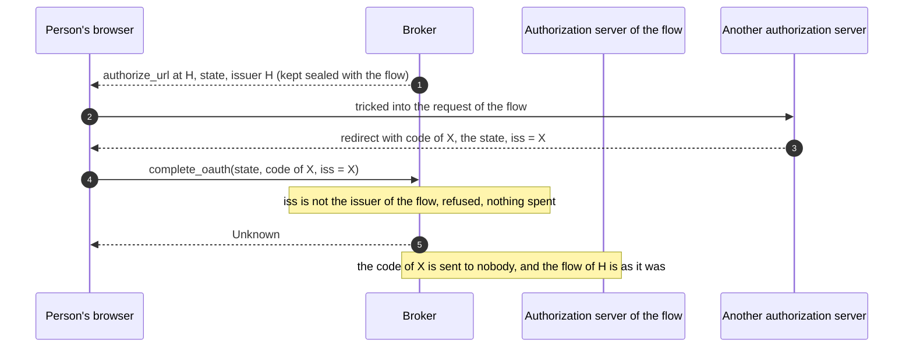

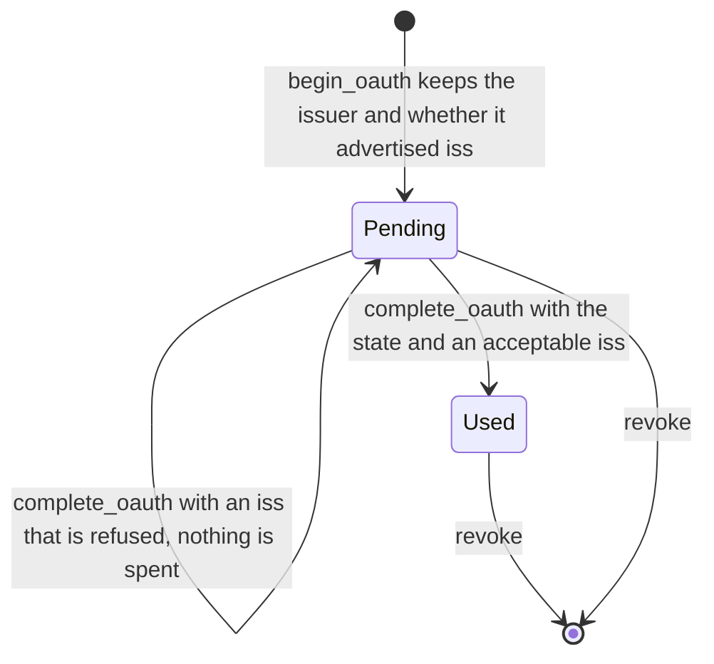

36. **`complete_oauth(owner, server, state, code, iss: Option<&str>)` and `OAuthStart { .., issuer }`.** The broker, not the API, applies RFC 9207, section 2.4, because it is the one that holds what the comparison needs: the issuer of the authorization server it sent the person to (the `issuer` of the metadata, which discovery showed is the one the resource named) and whether that server advertised `authorization_response_iss_parameter_supported` (only a JSON `true` counts). The comparison is `==` on the strings (simple string comparison, RFC 3986, 6.2.1). The API passes the `iss` of the redirect as it came, decoded, and shows `issuer` to the person. The rule, in the trait's module docs and the broker's `PendingFlow::check_issuer`:

    | The server advertised | `iss` of the callback | Result |
    |---|---|---|
    | yes | equal | accepted |
    | yes | another | refused (MUST) |
    | yes | none | refused (MUST) |
    | no | one | refused (the RFC says SHOULD discard and leaves the policy local; this broker refuses) |
    | no | none | accepted (the server takes no part; the defence is the `state` alone) |

    A refusal is `Unknown` (it is not a callback of this flow), a warning with a fixed reason and the server's id and never the value (a stranger chose it), and **spends nothing**: the check is before the claim, so the code is sent to nobody and the person's own callback still completes the flow. The testkit has the fixture's server take part or not (`IssParameter`), `Consent::iss`, `issuer()`, and `other_authorization_server_consent` (the browser tricked into a second, honest authorization server, a second mock on its own port); six cases pin the table and the mix-up. *Residual:* a server that does not advertise `iss` and an attacker who is that server get no protection from this check; for them the `state` and the issuer-bound endpoints (all taken from the one metadata document whose `issuer` matched) are what there is, which is RFC 9700, 4.4.2's own limit: "just storing the authorization server URL is not sufficient". An `error=` callback is not a call; its text is shown as unverified (RFC 9207, 2.4).

**Major 2: a rotating refresh token was presented twice, and a lost race was read as a revoked grant.** (a) After `invalid_grant`, `end_grant`'s compare and swap lost when another replica had rotated, the loss was ignored, and the code went on to mark the definition `needs_reauth` and return `NeedsReauth`. (b) `rotate` prevents a lost update, not a second request: two replicas that read the same refresh token both asked.

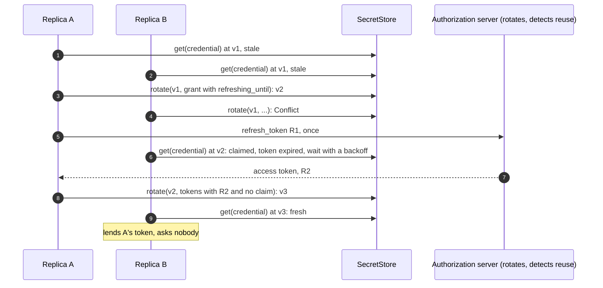

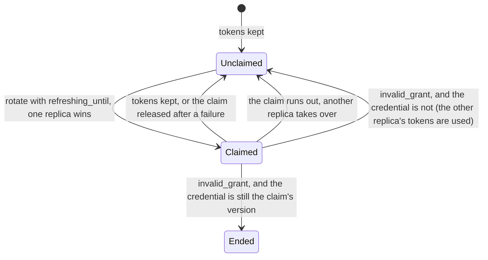

37. **The refresh is claimed before it is asked for; closes "kept open" point 3.** The grant gains `refreshing_until`. A replica that needs a refresh writes it with `rotate` on the version it read, for one request timeout and 10 s (so at most 70 s), and only the replica whose swap lands asks. A replica that finds a claim lends the access token if it has not expired (the 30 s margin is skipped, an expired token is not lent) and otherwise reads the store again, 20 ms doubling to 250 ms, until the version moves or the claim ends, and then claims itself; after one claim's length of *real* time it gives up with `Unavailable`, in case a clock stands still. The claim ends with the tokens that answer it (written with `rotate` on the claim's version, three tries if the store stumbles), is released after a failure, and a refusal first reads the credential again so that a refresh that is no longer the grant's writes nothing: the swap that ends the grant is also checked, and a lost one is no longer ignored. **In a process** the first caller of a key leads and the others follow it (a `watch` of the outcome): they are told how it ended, with the egress refusal if that was why (and that the tokens could not be kept, if the store failed three times after the server rotated them), and ask nobody, so eight leases against a failing or hanging server are one request and one timeout. No lock is added to `SecretStore`: the claim is the broker's record and `rotate` is its only primitive. *Residual:* a replica that stalls longer than the claim (a stopped process, a clock that jumps) can be overtaken, and its rotated token is then presented twice by the replica that took over; the claim's length is the request timeout, which bounds the request, plus 10 s for keeping what came back. The testkit's authorization server rotates with reuse detection (`set_reuse_detection`), three replicas and six leases make one request, and a hang or a failure makes one.

**The minor points.**

38. **A used flow's marker stays; nothing deletes a flow** *(departure 26 amended)*. `complete_oauth`'s last step deleted the flow unconditionally, which could delete a flow begun since, and the credential it wrote could follow a `revoke` that ran beside it. `SecretStore` has no compare-and-delete and adding one is a change to a merged port, so the flow is swapped for the marker `used` (it holds nothing), which stays until the next `begin_oauth` or a `revoke`; an expired flow is ended by a swap on the version read. The write of the credential is under the flight of the key and between two looks at the flow: it must still be the marker this callback wrote, before and after the `put`. A flow that is gone or another means a `revoke` or a `begin_oauth` ran beside it, the tokens are revoked upstream, and after the `put` the credential is taken back by a swap on the version written (not a delete, which could take another authorization's), for the grant without its tokens: **a revoke wins**, in the process and in another (tested with the `put` held at a gate). The happy-path case of the testkit no longer asserts the row is gone; it asserts the state opens nothing a second time.
39. **The `resource` is the definition's URL; no scope unless the person named one** *(departure 30 revised)*. The metadata is a stranger's, and what is sent to the authorization server is chosen from the definition. `scopes_supported` is not read. The MCP specification's scope selection would use it; this is a departure for the owner to confirm (below), and a server that needs a scope shows the person which to name.
40. **A client the broker registered is used again for an hour** *(departure 25 amended)*, for the same issuer and redirect URI, from the pending flow or the grant, so that a caller that begins in a loop registers once; never at another issuer (it could carry a secret), and not longer than an hour (a registration the server forgot would otherwise be tried for ever). The randomness and the size of the sealed flow (with the largest client a registration can give: a 2 KiB id and a 1 KiB secret) are checked before anything is registered. The API rate-limits `begin_oauth`.
41. **A grant is for the scopes and the `client_id` the person authorized with**, as it is for the URL (departure 15): an edit of either is `NeedsReauth`, with no refresh (a conformance case). The scopes compare as a set.
42. **Bounds on what a stranger sets and a deployment tunes.** A URL in the metadata over 2 KiB, an issuer over 2 KiB, an authorization request over 8 KiB, a client id over 2 KiB, a client secret over 1 KiB: refused as `Unavailable` with a fixed phrase. `BrokerConfig` is checked against upper bounds: lease 1 h, flow 1 h, refresh margin 10 min, request and connect 60 s, response 1 MiB, the document URL 2 KiB. The bounds are the review's numbers where it gave them; the margin's and the flow's are the author's.
43. **`expires_in: 0` is read as nothing said**: some servers send it for a token that does not expire, and "ends now" would make every lease a refresh.
44. **Only the error codes the RFCs define are logged**: RFC 6749, 5.2 (`invalid_request`, `invalid_client`, `invalid_grant`, `unauthorized_client`, `unsupported_grant_type`, `invalid_scope`) and RFC 8707 (`invalid_target`); anything else, however well formed, is `unknown`. The text `error` may hold is "%x20-21 / %x23-5B / %x5D-7E" (RFC 6749, 5.2), so a refresh token fits; the hygiene test plants a sentinel in it.
45. **The refusal warnings name the server's id** (not a secret); the dead `set_fragment` of the authorization endpoint is gone (a fragment is refused by the guard: RFC 6749, 3.1).
46. **The tests** now show which endpoint is refused at which address (the metadata address with an allow list that names it, so that the class of the address decides, for the token, registration and revocation endpoints), an oversize body with no `Content-Length` and a body that drips, and the tripwire says on stderr that it proved less when `127.0.0.2` cannot be bound (`ORCH_TEST_REQUIRE_TRIPWIRE=1` makes it a failure).

**How the new tests were checked to be able to fail.** Each of these changes was made in turn and made at least one test fail, then reverted: a missing `iss` accepted, an `iss` accepted from a server that did not advertise it, any `iss` accepted, a comparison that ignores case, no claim written, followers that do not follow (every caller leads), no re-read and no checked swap at a refusal, one try of `rotate` instead of three, a release that does nothing, a valid token not lent while another replica refreshes, an error code logged as the server wrote it, the document's `resource` sent, no reuse of a client, a reuse that ignores the issuer, no size check of the flow before the registration, no 2 KiB limit, no scope and client binding, zero seconds as a lifetime, no limit on a chunked body, no request timeout (the dripping body), no look after the write of the credential, no look before it, a taken-back credential left as it was, followers told the tokens were kept when they were not.

**Facts, verified 2026-10-14** (by fetching <https://www.rfc-editor.org/rfc/rfcNNNN.txt>; quotes are exact):
- **RFC 9207**, 2.4: "If the value does not match the expected issuer identifier, clients MUST reject the authorization response and MUST NOT proceed with the authorization grant"; the comparison "MUST use simple string comparison as defined in Section 6.2.1 of [RFC3986]"; "Clients MUST reject authorization responses without the iss parameter from authorization servers that do support the parameter according to the client's configuration. Clients SHOULD discard authorization responses with the iss parameter from authorization servers that do not indicate their support for the parameter. However, there might be legitimate authorization servers that provide the iss parameter without indicating their support in their metadata. Local policy or configuration can determine whether to accept such responses"; "For error responses, clients MUST NOT assume that the error originates from the intended authorization server." 3: `authorization_response_iss_parameter_supported` is a boolean, "If omitted, the default value is false." 2: the value "MUST be a URL that uses the "https" scheme without any query or fragment components."
- **RFC 9700**, 2.1: "When an OAuth client can interact with more than one authorization server, a defense against mix-up attacks (see Section 4.4) is REQUIRED", with the `iss` parameter of RFC 9207 as the first option; 4.4.2: "clients MUST store, for each authorization request, the issuer they sent the authorization request to and bind this information to the user agent" (the binding to the user agent is the API's table of `state`) *(amended, slice 4c review: it is not. The table of `state` binds a flow to the **account** that began it, not to the **browser** that opens the link, and the callback has no session to bind to (ADR 0047). RFC 9700's "bind to the user agent" is therefore met only as far as the issuer is kept per flow and checked by `iss`; the rest is the accepted risk of departure 125.)*, and "just storing the authorization server URL is not sufficient"; 4.4.2.1: "the client MUST compare the received issuer identifier to the stored issuer identifier. If there is a mismatch, the client MUST abort the interaction." 2.2.2: "Refresh tokens for public clients MUST be sender-constrained or use refresh token rotation"; 4.14.2: under rotation "The previous refresh token is invalidated ... If a refresh token is compromised and subsequently used by both the attacker and the legitimate client, one of them will present an invalidated refresh token ... it will revoke the active refresh token."
- **RFC 6749**, 5.2: the six error codes above, and "Values for the "error" parameter MUST NOT include characters outside the set %x20-21 / %x23-5B / %x5D-7E." **RFC 8707**: `invalid_target` is registered (an error code of the resource parameter).
- *By tests of this crate, against mock authorization servers of ours* (one that rotates refresh tokens with reuse detection, one that is a stranger's for the mix-up): everything above. No live authorization server was used.

*Unverified:* which real authorization servers advertise `authorization_response_iss_parameter_supported` or send `iss` unadvertised (the policy of 36 refuses the second, which RFC 9207 allows a deployment to accept: a deployment that meets such a server decides, and the change is one arm of `check_issuer`); the length of time real authorization servers keep a dynamic registration (the hour of 40 is a guess to be kept short); that a refresh in 70 s is enough for the replicas' clocks and a loaded store (37's residual).

**Decisions for the owner**, added to the slice 2 list: no scope when the person named none, against the MCP specification's preference for `scopes_supported` (39); an `iss` from a server that did not advertise it is refused, which RFC 9207 allows either way (36); an hour for a registration's reuse (40); the bounds of 42.

## Amended 2026-10-14, slice 3: `orch-secrets-pg`, the `secrets` section, `orchestrator secrets rewrap` and the chart's key are built

The default `SecretStore`, its configuration, its one operator command and the chart's key. **Nothing in the running service uses the store yet**: the service reads and checks the `secrets` section (every role does) and refuses a store its build lacks, and
`orchestrator secrets rewrap` is the one caller (the composition root, the definitions' table, the endpoints and the relay are slices 4 and 5). `orch-core` and the `SecretStore` port are untouched (no signature changed); the broker is untouched.
Decisions 1 to 5, the slice 1 and 2 departures and the amendments above stand, except decision 3's `rewrap` through `rotate` (departure 47). Departures continue the numbering, 47 onward.

| Where | What |
|---|---|
| `orchestrator/crates/secrets-pg` (`orch-secrets-pg`) | `PgSecretStore` (`impl SecretStore`, `migrate`, `rewrap`, `close`, `connect`, `from_pool`), `Keyring`, `KeyId`, `KeyBytes`, `RewrapReport`, `advisory_lock_key`; `migrations/0001_user_secrets.sql`; 62 tests (20 without a database, 16 of `secret_store_conformance!`, 16 and 10 of its own) |
| `orchestrator/crates/config` | `secrets` (`UserSecrets`, `SecretStoreKind`, `UserSecretsPg`, `UserSecretKey`), `Config::validate_user_secrets`, `Secrets::user_secret_keys`; `docs/api/config.md` and `config.schema.json` |
| `orchestrator/bin/orchestrator` | the feature `secrets-pg` (on by default), `src/secrets.rs` (the command), `load_user_secrets`; `tests/secrets.rs` runs the binary as a process against Postgres |
| `deploy/chart` | `orchestrator.userSecrets.{enabled, keys, current}` (off), the property `user_secrets_key`, the mount, the section of the rendered configuration; `render-check.sh` (37 new checks); `deploy.yml` lints, kubeconforms and reads the render through the pinned image once its tag has the section |
| `.github/workflows/orchestrator.yml` | the guard that **an applied migration is never edited** covers `crates/secrets-pg/migrations` as well as the store's |

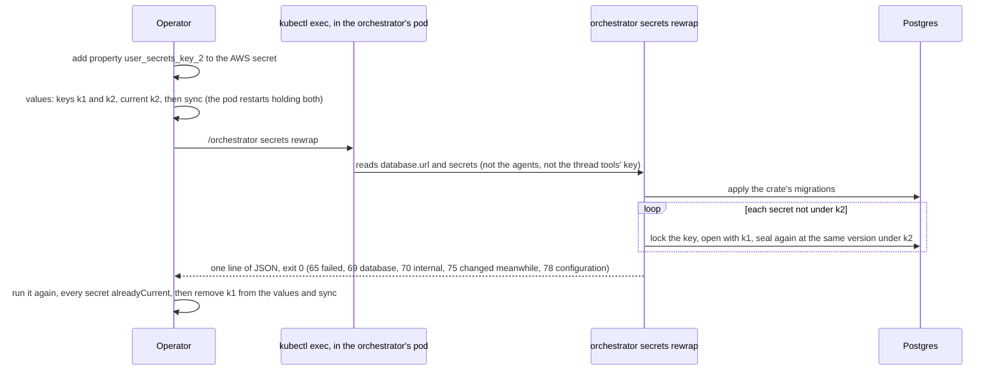

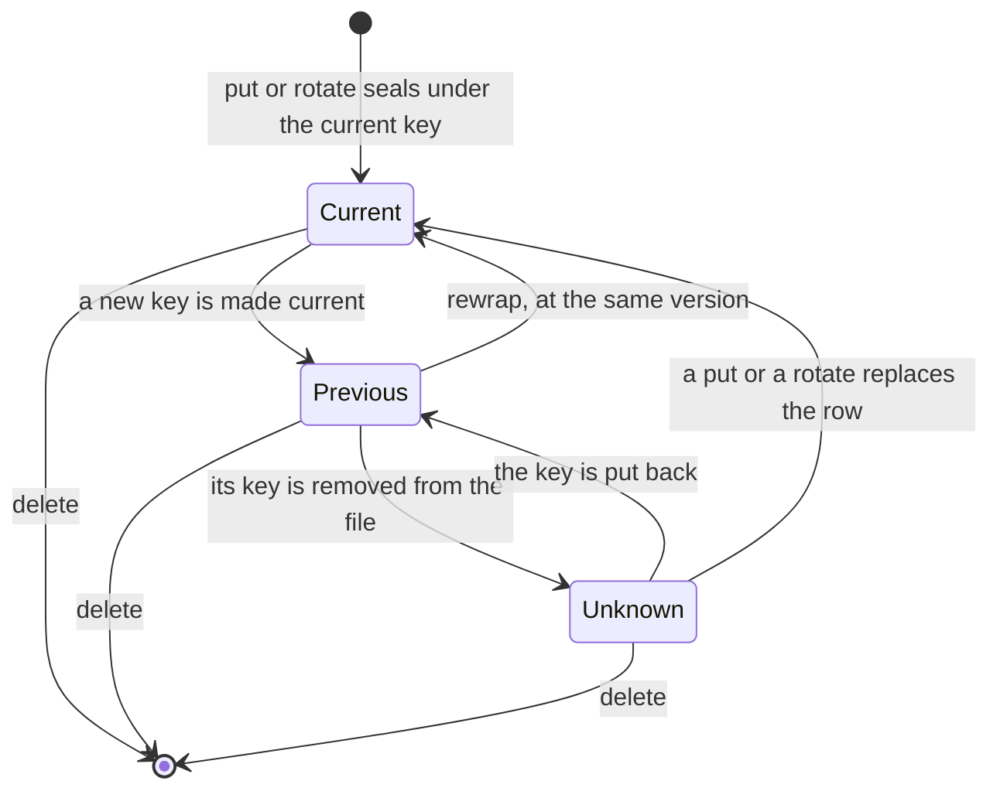

**Departures from the text above, and choices the build needed** (the owner to confirm; each is small to change).

47. **`rewrap` is not a `rotate`: it re-seals in place at the same version.** Decision 3 said it re-seals "through `rotate`". The broker refreshes by **claiming** the grant with `rotate(read version)` and ending the claim with `rotate(claim's version)`
    (`crates/credential-broker/src/broker.rs`, `claim` and `keep`); a `Conflict` at the second is read as "another replica took over" (`Asked::Changed`) and the refresh token the authorization server has just rotated to is dropped. A `rewrap` that made a new version
    between the two would turn that into a lost grant. So it opens the row with the key it names and seals the same material again, **new nonce, current key, same version**, under the key's lock, and only if the row still has the version the run saw (a row written or
    deleted since is left alone and counted). The port's contract holds: callers compare versions for equality only, and the material behind a version has not changed. The test `a_refresh_that_is_claimed_before_a_rewrap_can_still_keep_its_tokens_after_it` is the scenario, and fails (with two others) if `rewrap` takes a new version. `updated` says when the material last changed and is not touched.
48. **The crate has its own history of migrations.** `orch-secrets-pg` runs `crates/secrets-pg/migrations` through a `Migrator` whose table is renamed (`Migrator::dangerous_set_table_name`, `_orch_secrets_pg_migrations`), so it depends on none of `orch-store-postgres`' schema and the two histories never see each other's versions
    (a shared `_sqlx_migrations` would make each refuse the other's as `VersionMissing`, and both number from 1). A test runs both migrators in one schema, twice each, in both orders and at the same moment. The CI guard that an applied migration is never edited now covers both directories.
49. **Versions are numbered under a per-key advisory lock, from one sequence for the store.** Every write of a key (`put`, `rotate`, `delete`, one row of `rewrap`) is a transaction that takes `pg_advisory_xact_lock` of 64 bits of the SHA-256 of a domain string and the owner and server (each with its length) first, and only then reads, takes
    `nextval('user_secret_versions')`, seals and writes. The version is in the associated data, so it must be known before sealing, and a number taken outside the writers' order could commit after a greater one; under the lock the writers of a key are serialized from lock to commit, take their numbers in the order they land,
    and a key holds the greatest it was given (the testkit's concurrent case asserts it, and fails in two of three runs when the lock is taken out). A failed write leaves a gap and never a repeat. `delete` takes the lock too (so a `rewrap` and a `delete` are ordered), `get` takes none, and a `rotate`
    never opens the old row, so it can replace one whose key is gone. A refused `rotate` takes no version. `advisory_lock_key` is public: anything else that writes the table by hand takes the same lock.
50. **The envelope is four columns, and the associated data has a format byte and eight-byte lengths.** `v`, `kid`, `nonce` (12 bytes) and `ciphertext` (with the 16-byte tag), beside `owner`, `server`, `version` and `updated`, with checks on the lengths and an index on `kid` (so `rewrap` and an operator's
    `SELECT kid, count(*) ... GROUP BY kid` look rows up by key id). The associated data is `v (1 byte) ‖ len(owner) ‖ owner ‖ len(server) ‖ server ‖ version ‖ len(kid) ‖ kid`, every length and the version eight bytes big-endian: the text above said `owner ‖ server ‖ version ‖ kid` and asked for an unambiguous
    encoding; this is one, and it binds the format too. A unit test pins the bytes and another pins the cipher against OpenSSL, so changing either is a migration, not an edit. A row moved to another owner, server, pending flow or version, or whose `kid` is edited (even to a key with the same bytes), does not open.
51. **A key is 64 hexadecimal characters, an id is 1 to 64 of `A-Z a-z 0-9 . _ -`, and a ring has 1 to 16 keys.** The text said "32 random bytes, as `openssl rand -hex 32`"; the configuration refuses anything else by key path and never quotes what it read (`secrets.pg.keys[0].key`), white space around the hex is cut (an `{ env }` value is trimmed, a `{ file }` loses a newline),
    `current` must name a listed key, ids are unique. Two ids may carry one key's bytes in the configuration (the crate's tests need it to show the `kid` is authenticated); the chart refuses it (departure 55). `UserSecretKey.key` is the **fifteenth secret** of the schema (`tests/schema.rs` pins the list; ADR 0034's "fourteen" stands for the time it was written).
    `KeyBytes` is wiped when dropped, its `Debug` is `<redacted>`, and no error of the crate or of the configuration holds a key, a part of one or the text it was read from. The key schedule of the cipher is wiped with the `zeroize` feature of `aes-gcm`.
52. **The command's exit codes.** `0` every secret is under the current key (none failed, none changed under the run); `65` at least one could not be re-sealed (`keyUnknown`: put the key back, or `corrupt`: investigate; the others are done); `69` the database failed (run it again; the rows done count as current); `70` the migrations' history does not match this build, or another internal error;
    `75` nothing failed, but a secret was written or deleted while the run was under way and was left alone; `78` the configuration (no file, no `secrets` section, a key that does not resolve) or a build without `secrets-pg`; `2` a usage error. **`75` is not `0`** because a writer on a replica that still runs the old configuration seals under the old key, so a run that saw a row change
    proves nothing about that row: the operator removes no key until a run exits `0`, and the second run of the procedure is the proof. The report is one line of JSON on stdout, names a failure by server and key id and never the person, and the logs are on stderr. The command reads the database URL and the section and nothing else, applies the crate's migrations first (so it can run before the service has
    ever started), and takes no flag of its own.
53. **The service reads the section in every role, and refuses a store its build lacks.** `secrets.store: pg` without the feature `secrets-pg` is exit 78 naming it (as `artifacts.store`), and the keys are resolved by every role (the chart's one process has them). It does nothing else with them. The feature is on by default.
54. **`PgSecretStore::connect` waits ten seconds for a connection**, not sqlx's thirty (which is also how long it tries a database that is down): the command that connects once would hang that long before it could say `69`, and the broker that will call the store gives up on a request after ten.
55. **The chart: `orchestrator.userSecrets.{enabled, keys, current}`, off by default, a list of keys.** The plan of the slice named one property, `user_secrets_key`; the chart takes a list `[{ id, property }]` (default one key, `k1` from `user_secrets_key`, current `k1`) so that a rotation can be written in values: add `k2` from its own property, make it current, run `rewrap`, remove `k1`. Each key is mounted as
    `/run/secrets/orchestrator/user-secrets-key-<id>` and named in `secrets.pg.keys` as a `{ file }`. **Off, the render has no `secrets` section and asks the AWS secret for nothing, byte for byte**: an ExternalSecret that asks for a property the AWS secret lacks stops the whole Secret syncing (the thread tools' key and the agents' bearers with it), and an image built before the section refuses it (exit 78),
    so turning it on is the owner's step, after adding the property and after the pinned tag has the section (`deploy.yml` reads the render through the pinned image by itself from that tag on, and says so until then). The chart refuses: no key, more than 16, an id outside the alphabet or over 64 characters or used twice, a property used twice (two ids for one key rotate nothing), a missing property (with ExternalSecrets on),
    a `current` that is not a listed id, an `enabled` that is not a boolean. **No Job runs `rewrap` in this slice**: the README gives it as a one-off `kubectl exec deploy/<release>-orchestrator -- /orchestrator secrets rewrap` in the running pod, which has the configuration, both keys and the database URL mounted.
56. **A bound on the volume of seals.** NIST SP 800-38D, section 8.3, bounds the invocations of the authenticated encryption function at 2^32 for a key with random 96-bit nonces; every `put`, `rotate` and `rewrap` of a row is one under the current key, so a deployment at ten million writes a day reaches it in 430 days. The crate's README says so; rotating the key resets it. Nothing counts the seals.

**How the tests were checked to be able to fail.** Each change was made in turn, made at least one test fail, then reverted: no advisory lock in the write path; `rewrap` through a new version; `rewrap` without the check of the version it saw; a version left out of the associated data. The conformance suite's `breaker` is `PgSecretStore::close`.

**Facts, verified 2026-10-14.**
- *By reading the source* in `~/.cargo/registry/src` at the versions of `Cargo.lock`: `sqlx-core` 0.9.0 `src/migrate/migrator.rs` has `Migrator::dangerous_set_table_name(&mut self, impl Into<Cow<'static, str>>)` (the table may be schema-qualified; its documentation warns that changing the name for a database that has a history loses it, which a new crate has not); `aes-gcm` 0.11.1 is `Apache-2.0 OR MIT`, `rust-version` 1.85,
  with features `aes`, `alloc`, `zeroize` and `getrandom` (the last not enabled here: the nonce comes from the workspace's `getrandom`), and brings ten packages to the lock file (`aead`, `aes`, `cipher`, `cpubits`, `ctr`, `ghash`, `inout`, `polyval`, `universal-hash`, and itself).
- *By page reads of the PostgreSQL 16 manual* (the pages were fetched and their text read; wording is a paraphrase unless quoted): "Explicit Locking", advisory locks: transaction-level lock requests "are automatically released at the end of the transaction, and there is no explicit unlock operation"; "Functions", administrative: `pg_advisory_xact_lock(key bigint)` "obtains an exclusive transaction-level advisory lock, waiting if necessary";
  "Sequence Manipulation Functions": "the value obtained by nextval is not reclaimed for re-use if the calling transaction later aborts", so a failed write leaves a gap and never a repeat. The tests ran against PostgreSQL 16.14 (Ubuntu 24.04's package), the major version CI uses.
- *NIST SP 800-38D* (<https://nvlpubs.nist.gov/nistpubs/Legacy/SP/nistspecialpublication800-38d.pdf>, text extracted with `pdftotext`), section 8.3: "The total number of invocations of the authenticated encryption function shall not exceed 2^32, including all IV lengths and all instances of the authenticated encryption function with the given key", for the RBG-based construction; section 8: the probability that the same IV and key are used twice shall be no greater than 2^-32.
- *By tests*: the cipher and the associated data against OpenSSL 3.0.13 through Python `cryptography` 49.0.0 (two vectors, the associated data encoded by a separate encoder); `sysexits.h` of glibc 2.39 (`libc6-dev` 2.39-0ubuntu8.7) has `EX_DATAERR` 65, `EX_UNAVAILABLE` 69, `EX_SOFTWARE` 70, `EX_TEMPFAIL` 75, `EX_CONFIG` 78;
  Helm v3.19.0 (checksum checked against get.helm.sh) renders the chart's checks and `helm lint` passes with the keys on; the real orchestrator binary reads the chart's rendered configuration with two keys through `print-config.sh` (`bin` mode) and prints references only.

*Unverified:* that `kubectl exec` of the image's entrypoint (`/orchestrator`, distroless, no shell) works in the pod on netcup (the command was run as a process against Postgres in CI, not in a pod); that the ExternalSecret syncs the extra properties on netcup; which `sha-<7>` is the first to read `secrets` (recorded in the chart's README once the bump after this slice's merge lands);
how the nonce volume behaves over a real deployment's years (departure 56 is arithmetic, not a measurement).

**Open for the next slices.**
1. **The composition root (slice 4)** builds the store from `secrets` (`orchestrator::config::load_user_secrets` already builds the `Keyring`; the service wants the same from its `Loaded`), shares the orchestrator's pool or opens its own, and runs `migrate` at boot beside the thread store's. With no `secrets` section it needs the store and the broker that refuse every call. *(Built in slice 4a: the root builds the store with `PgSecretStore::connect` in a pool of its own, departure 64, runs `migrate` at boot in every role, and puts the refusing ports in place when there is no section.)* *(Amended, slice 4a review: in the roles that serve routes only, departure 76.)*
2. **A Job for `rewrap`** in the chart (as the migration Job of ADR 0058) if the owner would rather not `kubectl exec`.
3. **Decisions for the owner:** `75` as a non-zero exit for a secret that changed under the run (departure 52); a list of keys in the chart rather than one property (55); the format byte and eight-byte lengths of the associated data (50); 16 keys at most (51); ten seconds for a connection (54).

## Amended 2026-10-14, slice 3 review: a bounded lock, `READ COMMITTED`, `rewrap` opens every row, and a runbook that waits for the rollout

The security review of the slice (PR 252) found one major point and several minor ones. Nothing above is rewritten; each departure below says which earlier one it amends. `orch-core` and the `SecretStore` port are untouched. Departures continue at 57.

| Finding | What changed | The test that pins it |
|---|---|---|
| A lock that is held for long keeps every writer of that key on a pooled connection; with four connections an unrelated `get` then fails | every write sets `SET LOCAL lock_timeout = '2000ms'` (`LOCK_TIMEOUT`) right after `BEGIN`; SQLSTATE `55P03` is `Unavailable`, rolled back at once (57) | `a_key_whose_lock_is_held_makes_its_writers_unavailable_and_leaves_the_pool_to_the_rest`, `a_rewrap_that_meets_a_wedged_key_stops_there_and_has_done_the_rows_before_it` |
| The lock of `delete` (and of `put`, `rotate`) was pinned by no test | `a_delete_waits_for_the_lock_of_its_key_and_removes_what_the_writer_ahead_of_it_wrote`, `a_put_waits_for_the_lock_of_its_key`, `a_rotate_waits_for_the_lock_of_its_key_and_compares_versions_after_it`: a raw transaction holds the lock, the call must queue (seen in `pg_locks`), stay queued, and finish after the commit | the same three |
| The write path silently depended on `READ COMMITTED` | `BEGIN ISOLATION LEVEL READ COMMITTED` for every write (58) | `writers_of_one_key_do_not_depend_on_the_isolation_the_database_defaults_to` (sessions that default to `REPEATABLE READ`) |
| `rewrap` skipped rows under the current key without opening them | it opens them, and counts those that do not open as `failed` (exit 65) (59); the runbooks say never to change the bytes behind an id | `a_row_under_the_current_key_is_opened_and_counted_as_failed_when_it_does_not` |
| The runbook did not say to wait for the rollout | the chart README's step 3 does, and says why (59) | (documentation) |
| The migration Job's configuration named key files it does not mount | the template unsets `secrets` in the Job's copy of the configuration | `render-check.sh`, three checks for each order of the migration (before and after the switch), with the keys on |
| A flaky test (`a_row_that_changes_while_the_run_waits_for_its_lock_is_left_alone_and_counted`, 8 failures in 300 runs here) | each test makes its owners from a tag of its own, and the helpers wait on **that key's** lock in `pg_locks` | the test itself, 300 runs; `the_helpers_that_watch_the_locks_see_exactly_one_key_whatever_its_bits` |
| `a_key_id_edited_into_another_key_with_the_same_bytes_does_not_open` failed in a stress run | not reproduced at 1000 connections; reproduced as `Err(Unavailable { .. PoolTimedOut })` when 25 copies of the binary share a server with the default `max_connections` of 100. The assertion prints the outcome (never the material), and the pools of the tests are smaller (eight connections) | (the message) |
| An all-zero key | refused in the configuration and by `KeyBytes::from_hex` (`KeyError::ZeroKey`), with a message of its own and no value in it (60) | `a_key_of_all_zeros_is_refused_by_what_it_is_and_one_with_a_digit_is_not` (config), `a_key_of_all_zeros_is_refused_and_a_key_with_some_is_not` (crate) |
| The key-id rule is written twice (`orch-config`'s `is_key_id`, `orch-secrets-pg`'s `KeyId::parse`) | one sweep of ids (empty, 63 to 65 characters, every ASCII character alone and after a letter, spaces, a slash, non-ASCII, a newline) through both, in the binary, which sees both crates and breaks no dependency rule | `the_configuration_and_the_store_agree_on_what_a_key_id_is` |
| An unused dev-dependency (`futures`) | removed | (the build) |

**Departures and choices of the review** (the owner to confirm; each is small to change).

57. **A write waits at most two seconds for a lock; the pool stays at four.** Amends 49 (the lock is still the first statement, now preceded by `SET LOCAL lock_timeout`). A wait that ends is SQLSTATE `55P03`, `SecretError::Unavailable` (class `Transient`, detail "locked by another writer"), the transaction is rolled back and the connection goes back to the pool at once. The same bound covers a wait for a row lock that a hand-made transaction holds, which is the operator's repair the crate's README invites; such a repair has two seconds, then its key's writers fail. A `rewrap` that meets a key held for longer stops with `Unavailable` (exit 69): the rows before it are done and the run is repeated. The pool is **not** made larger: a call holds a connection for milliseconds, the size is a parameter (`connect_with`, or the orchestrator's own pool by `from_pool`, which slice 4 may choose), and a larger pool only moves the limit to the server. What the bound does not do: writers arriving at one wedged key faster than four per two seconds still queue the other keys' calls (they fail after ten seconds); nothing writes one key that fast, and the alarm for it is the rate of `Unavailable` with the lock detail, not a bigger pool.
58. **Every write transaction is `READ COMMITTED`, explicitly.** Amends 49. With `default_transaction_isolation = 'repeatable read'` on the database or the role, the snapshot is taken at the lock statement, before the wait, and the writer that waited fails with SQLSTATE `40001` on the row the writer ahead of it wrote. The transaction begins with `BEGIN ISOLATION LEVEL READ COMMITTED` (sqlx 0.9 `Pool::begin_with`). `get` is one statement and needs no transaction.
59. **`rewrap` opens every row, and a key id's bytes never change.** Amends 47 and 52 (what "current" and exit 0 mean). A key id is all a row says of its key. If the bytes behind an id change (the property behind `k1` overwritten, or `k1` removed and a different key added under the name), every row sealed under it stops opening, and a run that counted the rows under the current id as current, unopened, reported `alreadyCurrent` and exited 0. The run now opens the rows already under the current key too (without the lock, nothing written: a row is read whole or not at all), and counts those that do not open as `failed`, kind `corrupt`, exit 65; `alreadyCurrent` means "under the current key and opens". The cost is one decryption per row per run, which is fine for an operator command. **The rule for operators: never change the bytes behind an id, add a new id** (the chart README, the crate README, `docs/api/config.md` and the command's `--help` say so), and **after making the new key current, wait until the rollout is complete and no pod runs the old configuration** before running `rewrap`: a pod still on the old `current` seals under the old key after the run, which the exit 75 of a run and a second run that reports every row current are the proof of (52).
60. **A key of 64 zeros is refused.** Amends 51. It is the shape of a template's placeholder or an empty buffer and no generator makes one; the configuration says "the secret is all zero bytes, which is no key" (a message of its own, naming the key's path and not quoting the value) and `KeyBytes::from_hex` returns `KeyError::ZeroKey` (a new variant of a `#[non_exhaustive]` enum). `KeyBytes::from_bytes` is unchanged.

**How the review's tests were checked to be able to fail** (each change made in turn, then reverted): no `SET LOCAL lock_timeout` (the pool-of-four case failed with `PoolTimedOut` on the `get` of another key, and the wedged `rewrap` was still waiting after 12 seconds); `begin()` for `begin_with` (the `REPEATABLE READ` case failed in round 0 with SQLSTATE `40001`); `pool.begin()` in place of the lock in `put`, in `delete` and in `rotate`, one at a time (the queueing case of each failed); `rewrap` counting rows under the current id as current (the changed-bytes case counted five as current); `unset` of `secrets` taken out of the migration Job's template (both render checks failed); the zero check taken out of `KeyBytes::from_hex` and, separately, out of the configuration (a test failed in each); the configuration's id limit made 65, and the crate's alphabet given a `+` (the sweep failed in each, naming the id). The flaky wait was reproduced before the fix (8 failures in 300 runs, three binaries and four copies at once) and not after.

**Facts, verified 2026-10-14.** *By reading the source* in `~/.cargo/registry/src`: `sqlx-core` 0.9.0 has `Pool::begin_with(impl SqlSafeStr)`, and `sqlx-postgres` 0.9.0 runs a custom `BEGIN` statement as given (and refuses one inside a transaction); `PgConnectOptions::options` escapes spaces and backslashes in a value and appends to what is there. *By tests, against PostgreSQL 16.14*: a wait for an advisory lock under `lock_timeout` ends with SQLSTATE `55P03`; under `REPEATABLE READ` an `INSERT ... ON CONFLICT DO UPDATE` after a wait on a row the earlier writer changed fails with `40001` ("could not serialize access due to concurrent update"); a `bigint` advisory key is split into `classid` (high 32 bits) and `objid` (low 32), both unsigned, and `(classid::bigint << 32) | objid::bigint` is the key again for a key of either sign. *Unverified:* `lock_timeout`'s wording in the PostgreSQL 16 manual (the behaviour above is what the tests saw); that `kubectl rollout status` is enough to know that no old pod is left (the README says to look at the pods too).

## Amended 2026-10-14, slice 4a: the definitions in Postgres, the `userToolServers` section, `tools.user.add` and the composition root are built

Slice 4 of the list above is split in two. **4a is everything below the HTTP API** and is built here; **4b** (next) adds the endpoints (`/api/user-tool-servers…`, the OAuth callback, `GET /api/tool-servers` with status, attach), the OpenAPI, the Client ID Metadata Document route and the rate limit. Slice 5 (the relay's lease) is unchanged. `orch-core` is untouched and **no port signature, error type or conformance case changed**; `orch-ports` gained the refusing ports and the bundle (departure 65), and the 48 struct literals of `PortSet` in tests gained one field. Decisions 1 to 5, the flow and the departures above stand, except where a departure below says it amends one.

| Where | What |
|---|---|
| `crates/store-postgres` | `PgUserToolServers` (`impl UserToolServerStore`, `from_pool`, `pool`), `OWNER_LOCK_CLASS`, `LOCK_TIMEOUT`; `migrations/0021_user_tool_servers.sql` (the table `user_tool_servers`, the sequence `user_tool_server_revisions`); `tests/conformance.rs` runs `user_tool_server_store_conformance!` (the twenty-times limit race included); `tests/user_tool_servers.rs` (14 tests of the adapter) |
| `crates/ports` | `NoUserToolServers`, `NoSecrets`, `NoBroker` (the refusing ports); `UserToolPorts`, `UserTools<D, S, B>`, `UserToolsMode`, `NoUserTools`; `Ports::UserTools` and `Ports::user_tools()`; `PortSet<…, T = NoUserTools>` with the field `user_tools`; `tests/no_user_tools.rs` |
| `crates/config` | `userToolServers` (`UserToolServers`, `UserToolServersEgress`, `UserToolServersOauth`), `AuthPermission::ToolsUserAdd`, the rules, `config.schema.json`, `docs/api/config.md`; `tests/user_tool_servers.rs` |
| `crates/app` | `Permission::ToolsUserAdd` (`tools.user.add`), `App::user_tools()` |
| `crates/secrets-pg` | `Keyring` is `Clone` (it shares its keys) |
| `bin/orchestrator` | `src/user_tools.rs` (`UserToolsSettings`, `ConfiguredUserTools`, `build`), `Config.user_tools`, the dependency on `orch-credential-broker`, the exit code `69` for a transient `SecretError` |
| `docs/api/chat-api.yaml` | `tools.user.add` in the `Permission` enum of `GET /api/me` |

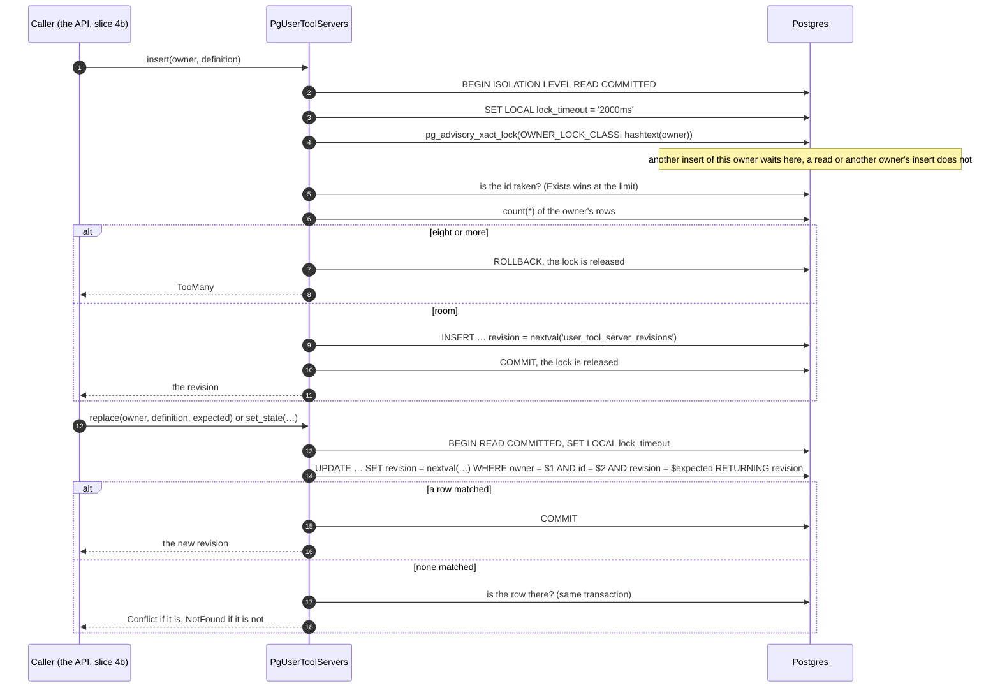

```mermaid
stateDiagram-v2
  [*] --> Off: userToolServers absent or enabled: false
  [*] --> WithoutCredentials: enabled, no secrets section
  [*] --> Full: enabled, secrets.store pg
  Off --> [*]: nothing built, nothing opened, all three ports refuse
  WithoutCredentials --> [*]: definitions in Postgres; the secret store and the broker refuse; only `none` servers
  Full --> [*]: definitions, a sealed store in a pool of its own, the broker over both
```

**Departures from the text above, and choices the build needed** (the owner to confirm; each is small to change). Numbered after the review of slice 3's 60.

61. **The limit's lock is a two-`int4` advisory lock of a class of its own.** The brief and the trait's docs gave the technique (a lock per owner, taken before the count) and asked for a key space that cannot collide with the other advisory locks of the database. The thread store takes `hashtextextended('orch:watch:…', 0)`, the secret store 64 bits of a SHA-256, sqlx's migrators a database-wide number: all one-`bigint` locks, and **no choice of a 64-bit number can promise it differs from another one's**. Postgres keeps the two-`int4` form apart (the lock tag's last field, `objsubid` 1 and 2 in `pg_locks`), so `pg_advisory_xact_lock(OWNER_LOCK_CLASS, hashtext(owner))` is **structurally** a different lock from every one-`bigint` lock, whatever the numbers. The class is `0x75737276` (`usrv`); among two-`int4` locks nothing else of the orchestrator takes one, and a collision between two owners' hashes only makes them take turns. The hash is the server's `hashtext`, not the process's: every replica of every build agrees on a key during a rolling update, which a hasher of the standard library does not promise across Rust versions. `SELECT … FOR UPDATE` on an owner row was rejected: it needs an owners table that nothing else has. *Pinned by* `the_lock_of_an_owner_collides_with_no_lock_of_a_bigint_key` (a transaction holds the one-`bigint` lock with the same 64 bits, an insert is not delayed by it, and `pg_locks` shows both granted at once with `objsubid` 1 and 2). *(Amended, slice 4a review: the list above is the orchestrator's own. adam-rs, which shares the database under `agent-local`, takes a one-`bigint` lock too, `pg_advisory_xact_lock(hashtext($1))` for its migrations (`crates/adam-store-postgres/src/lib.rs` line 621 at the pinned revision `5581d40`: an `int4` widened to `bigint`, `objsubid` 1). The claim is **every other advisory lock the orchestrator or adam-rs takes in this database is one-`bigint`**, which is true: `grep advisory` over `orchestrator/` finds the thread store's `hashtextextended`, the secret store's one-`bigint` key and this lock, sqlx-postgres 0.9's migrator takes `pg_advisory_lock($1)` (read in `~/.cargo/registry/src`), and the pinned adam-rs checkout has that one call; departure 81.)*
62. **A revision is a number the `UPDATE` draws.** `replace` and `set_state` are each one statement, `UPDATE … SET revision = nextval('user_tool_server_revisions') … WHERE owner = $1 AND id = $2 AND revision = $expected RETURNING revision`, so the compare and the swap are one step and a writer that waited for the row's lock finds the revision moved. The number is drawn by the statement, and whether that is before or after a wait for the row's lock is the executor's order, which was not read (*unverified*): a writer that **loses** may have drawn a number it never writes (a gap, never a repeat). The winners of one key still chain upwards, because a writer can only hold the revision of a commit it saw, and so starts after it. A statement that matched nothing is followed, **in the same transaction**, by one read of the key: the row is there (`Conflict`) or not (`NotFound`, nothing is brought back). An `expected` that does not fit the column (the port's number is a `u64`, the column a `bigint`) is `-1`, which the column's check forbids, so it matches nothing.
63. **Every write is its own `READ COMMITTED` transaction with `lock_timeout` of two seconds**, as slice 3's review required of the secret store (departures 57 and 58): `delete` and the two `UPDATE`s too, because under `REPEATABLE READ` a single statement that waited for a row another writer changed fails with `40001`. SQLSTATE `55P03` is `Unavailable` (class `Transient`, "locked by another writer"), rolled back at once so the connection goes back to the pool. This **also bounds a wait for a row** that somebody's hand-made transaction holds (the operator's repair). Reads (`get`, `list`) are one statement and take no transaction.
64. **The definitions share the thread store's pool; the secret store gets a pool of its own.** Slice 3's open point 1 left the choice ("shares the orchestrator's pool or opens its own"). The definitions' statements are short and their lock waits bounded, and the thread store's pool is the orchestrator's (default 10 connections, `database.maxConnections`). The secret store is on the lease path of every call a person's server gets and its waits are the ones slice 3's review worried about, so `build` connects it a pool of four of its own (`PgSecretStore::connect`): a lock that is held in the secret store can never keep a connection of the thread store, and the other way round. The cost is four connections a replica **when the feature is on with a `secrets` section** (none otherwise). *(Amended, slice 4a review: and only in a process that serves routes, `all` or `control-plane`; a `worker` opens none, departure 76.)* *Pinned by* `enabled_with_secrets_keeps_credentials_sealed_in_a_pool_of_its_own` (the thread store's pool is two connections and the test holds both, and the secret store still answers).
65. **The ports are held by the bundle (static dispatch), not by `Arc<dyn …>`.** The three ports return `impl Future` (not dyn-compatible), and ADR 0009 is static dispatch, so the brief's "`Arc<dyn …>` or generics" is generics: `Ports::UserTools: UserToolPorts` and `PortSet<…, T = NoUserTools>` with a field `user_tools`, as `artifacts` was added. `UserToolPorts` carries the three ports, **the `EgressPolicy`** (the one the broker was composed with, so a URL the API accepts is a URL the broker may fetch) and a closed enum **`UserToolsMode`** (`Off`, `WithoutCredentials`, `Full`) so that 4b asks what the deployment has (`is_enabled()`, `keeps_credentials()`) instead of calling a refusing port and reading its error. `App::user_tools()` gives it. The cost is one line in each of the 48 struct literals of `PortSet` in tests (`user_tools: orch_ports::NoUserTools::off()`), done by a script; no type annotation changed (the default parameter). The binary's one type is `UserTools<ConfiguredServers, ConfiguredSecrets, ConfiguredBroker>`, three enums by static dispatch as `ConfiguredArtifacts` is. *(Amended, slice 4a review: the bundle holds two ports and not three, `UserTools<ConfiguredServers, ConfiguredBroker>`, departure 74, and its mode is fixed by its constructor and not passed beside the ports, departure 75. The 48 literals did not change: `NoUserTools::off()` is the same call.)*
66. **The refusing ports refuse every call as `Unavailable`**, without a new error variant (slice 1's open point 4: `NoArtifacts` is the model). `NoSecrets` and `NoBroker` answer with one fixed sentence that names both causes (`secrets` absent, or `userToolServers` off), `NoUserToolServers` with one that names `userToolServers.enabled`; none holds an owner, server id, URL, state or secret (the test plants sentinels and looks in `Display`, `Debug` and every source). **`NoSecrets.get` refuses** (absent is `None` for a store that keeps, which would read as "this server has no credential" when the truth is "nothing can be kept"), and **`NoBroker.revoke` refuses**: a delete of a server that holds a credential, in a deployment that took the `secrets` section away, waits for the store to come back instead of orphaning a sealed credential nobody can revoke. The cost is that such a server cannot be deleted meanwhile; the API skips `revoke` for a kind that has no credential (`UserAuth::needs_credential`). *(Amended, slice 4a review: this cost is withdrawn, and a person was stranded by it. `NoBroker.revoke` still refuses, for the honesty of the port, but in `WithoutCredentials` the caller does not call it: it deletes the definition, and the sealed row, if any, stays unreachable without a key. Departure 77.)* The class is `Transient` because an `Unavailable` is, and the person is shown `broker_down` (`UnavailableReason`), not "sign in again".
67. **`NoUserToolServers` refuses reads too.** A feature that is off keeps and reads nothing, so a route that forgets to check `mode().is_enabled()` cannot write a definition (fail closed). The consequence for 4b: `GET /api/tool-servers` must check the mode and not call the store when it is `Off`. *(Amended, slice 4a review: the rule is now in the docs of `UserToolPorts` (what a caller does), of `UserToolPorts::servers()` and of `NoUserToolServers`, departure 78.)*
68. **The names of the section.** `userToolServers.{enabled, egress.{allow, deny, allowHttp}, oauth.{clientName, clientMetadataUrl}}`, an `Option` in `Config` (absent prints nothing in `--print-config`) and `enabled: false` until set. The brief put `allowHttp` after the lists without saying where: it is under `egress`, because it is a rule about the URL. **The section is checked on or off** (a typo is heard at once; the id rule needs the feature on), and `allowHttp: true` is refused in production on or off (a file copied from staging). A host pattern is checked by `orch-config` with a copy of `orch_ports::HostPattern`'s rule, because that crate depends on no other; the binary's tests hold the two to the same answers over forty-odd entries. A list is at most 256 entries and no entry is repeated (an entry in `allow` and in `deny` is not an error: `deny` wins). `clientName` is 1 to 80 characters of one line (the broker only requires it not to be blank), `clientMetadataUrl` is what the broker takes (`https`, a host, a path that is not `/`, no fragment or user information, 2 KiB). **No tunable of the broker is a key** (lease and flow lifetimes, timeouts, response size): the defaults stand, and a key is one line to add when a deployment needs one.
69. **A deployment `toolServers[].id` that starts with `u-` is a startup error only while the feature is on** (decision 2), naming `toolServers[i].id`, before anything connects. With it off the ids are free, as they have always been.
70. **`tools.user.add` is a permission of `AuthPermission` (the file), `Permission` (the application) and `GET /api/me`'s enum**, held by **no role by default**: the built-in `user` and `admin` do not hold it, `admin` does not imply it (a test grants `admin` alone and is refused), it takes no scope and no agents (a role that holds only it and sets either is told they do nothing), and it is asked of `Resource::Anything` (a server of the person's own). `GET /api/me` lists it through the code it already has for every permission. **Not granted anywhere in this slice**: not in `dev/orchestrator*.yaml` (no check requires every permission to be listed there) and not in the chart's roles; 4b decides with the endpoints, and a deployment lists it for the roles it chooses.
71. **`Keyring` is `Clone`.** `PgSecretStore::connect` takes the ring by value and the configuration keeps it; a clone shares the `Arc`'d ciphers, so it is another handle and not another copy of the key bytes. `KeyBytes` stays without `Clone`.
72. **`orch-credential-broker` is a dependency of the binary with no Cargo feature of its own.** It adds no third-party crate (the lock file gains one edge, `orchestrator → orch-credential-broker`); what is behind a feature is the store it is built over (`secrets-pg`). A build without `secrets-pg` still supports `enabled` with no `secrets` section.
73. **A secret store whose database is down at startup is exit 69, one whose migrations do not match this build is exit 1** (as the thread store's). `PgSecretStore::connect` waits ten seconds (departure 54), so a process that cannot reach its database says so after ten seconds, in every role that serves routes. *(Amended, slice 4a review: only an outage is 69. A statement the database refuses, a missing privilege at `migrate`, is 1 as the thread store's, departure 79; and a `worker` does not build the store, departure 76.)*

**How the tests were checked to be able to fail.** Each of these changes was made in turn, made at least one test fail, then reverted: no owner lock; the count read before the lock is taken (the held-lock test and the limit race fail); the lock as a one-`bigint` key made of the same bits (the key-space test); default isolation (the `REPEATABLE READ` case); no `lock_timeout` (both bounded-wait cases); no revision in the `WHERE` of `replace` (the stale-revision case and the race). **The layers above the store:** an `*.` entry that accepts anything (the configuration's test, and the binary's sweep that holds the file and the guard to the same answers); no `u-` rule; `allowHttp` allowed in production; the built-in `user` role holding `tools.user.add` (two unit tests of the policy); `NoSecrets.get` answering `None`; a refusal that names the owner; the settings built whether or not `enabled` (the smoke test finds `user_secrets` made while the feature is off); the secret store on the thread store's pool (the test that holds both of that pool's connections times out); a transient `SecretError` that is not exit 69 (two tests); the permission mapped to another one when the policy is built.

**Facts, verified 2026-10-14.** *By tests against PostgreSQL 16.14 (Ubuntu 24.04's package, the major version CI uses):* a one-`bigint` advisory lock and a two-`int4` advisory lock with the same class and object numbers are both granted at once to two sessions, and `pg_locks.objsubid` is 1 for the first and 2 for the second; a wait for an advisory lock under `lock_timeout` ends with SQLSTATE `55P03`; `hashtext(text)` returns an `int4`, equal for equal text in one cluster. *Unverified:* that `hashtext` is stable across a major upgrade of the server (it is an internal function the manual does not document; the key need only be stable inside a running cluster, where every replica asks the same server, and a lock does not outlive its transaction), and the wording of the manual for `pg_locks.objsubid` (the behaviour above is what the tests saw).

**What 4b must know** (exact names). The ports are `app.user_tools()` (`orch_ports::UserToolPorts`): `.mode()` (`UserToolsMode`), `.egress()` (`&EgressPolicy`: call `check_url` on an add or an edit, and keep `UserToolServer::new(id, name, &target, auth)` for the definition), `.servers()` (`insert`, `get`, `list`, `replace`, `set_state`, `delete`), `.broker()` (`store`, `begin_oauth`, `complete_oauth`, `lease`, `revoke`) and `.secrets()` (the API never calls it: the broker holds a clone). *(Amended, slice 4a review: `.secrets()` is gone from the bundle, departure 74; and the rules for a caller are in departures 77 and 78: ask `mode()` first, and a delete in `WithoutCredentials` does not call `revoke`.)* The permission is `Permission::ToolsUserAdd` with `Resource::Anything` (`access.check(…)`). A server with `auth.needs_credential() == false` is added in `WithoutCredentials` and `Full`; any other kind needs `mode().keeps_credentials()`, else a 422 that says the deployment keeps no credentials. `Off` is a 404 or a feature absent from `GET /api/tool-servers`, decided from the mode and not from a store error (departure 67). The ids come from `UserToolServerId::generate()` or `from_entropy(ids.new_token_bytes())`. **Not built and needed by 4b**, found while building 4a: (1) the table that maps an OAuth `state` to `(owner, server, expiry)` for the callback (amendment of 2026-10-06): the process holds no state of its own and the callback may reach another replica than the one that began the flow, so it is a Postgres table (or a record in the `SecretStore` under a name derived from the state's hash); the broker keeps the verifier under `(owner, server#flow)` and cannot find the flow from a `state` alone; (2) the base of the redirect URI (`begin_oauth` takes a `RedirectUri`): `server.publicUrl` is the web's origin and may be the right base, or a key of `userToolServers.oauth` is added; (3) the route that serves the Client ID Metadata Document at the path of `oauth.clientMetadataUrl`, whose `redirect_uris` must hold the callback and the desktop's loopback listener; until it exists a URL set there names a document nobody serves; (4) `tools.user.add` for the roles the dev stack and the chart choose.

**Open for the next slices.**
1. **The endpoints (4b)**, as above, with the API showing `EgressRefusal::public_reason()` (found through `orch_credential_broker::egress_refusal`) and never `rule()`, and the rate limit of `begin_oauth`. Slice 2's open point 2 (the order of the API's writes around the broker) and slice 1's open point 6 (the API half) are 4b's; the table half of slice 1's open point 6 is closed here.
2. **The relay's lease (5)**, unchanged.
3. **Closed by this slice:** slice 1's open point 4 (a deployment with no `secrets` section: the refusing ports), slice 2's open point 4 (the composition root builds the broker with the egress policy, the clock, `clientName` and `clientMetadataUrl`; the document's route is 4b's) and slice 3's open point 1 (the root builds the store from `secrets`, runs `migrate` at boot, chooses its pool).
4. **Decisions for the owner:** the two-`int4` lock and its class (61); the pool of four for the secret store against sharing (64); that `Ports` and 48 test literals gained a field, against a type-erased handle (65); that a server holding a credential cannot be deleted while the `secrets` section is gone (66; *withdrawn in the slice 4a review, departure 77: it can be deleted, and `revoke` is not called*); no key for the broker's lifetimes and timeouts (68); that `NoUserToolServers` refuses reads (67).

## Amended 2026-10-14, slice 4a review: the bundle gives out no secret store, the mode is fixed by the constructor, only the roles that serve routes build it, and a person can always delete a server

The security review of PR 253 (slice 4a) found one major and several minor points. All are fixed in the same PR; nothing of slice 4a is rewritten above, and the notes marked *(amended, slice 4a review: …)* point here. No `orch-ports` trait signature changed (a marker trait, `KeepsCredentials`, was added to the crate); the migration `0021_user_tool_servers.sql` was edited because it is new in this PR and not on `main`. Departures are numbered on from 73.

| Finding | Where | What |
|---|---|---|
| Major: definitions stranded when the deployment keeps no credentials | `orch-ports` (docs of `UserToolPorts`, `UserToolsMode`, `NoBroker`), `orch-store-postgres` (`PgUserToolServers::count_with_credential`), the binary (`user_tools::build`) | the rule for 4b, and one warning at boot (departure 77) |
| 2. A plaintext-capable `SecretStore` in what `App` hands out | `orch-ports` (`UserToolPorts`, `UserTools<D, B>`), the binary (`ConfiguredSecrets` removed) | no secret store in the bundle (74) |
| 3. Every role built the bundle | the binary (`settings_for`, `build_for_role`, `boot.rs`) | only `all` and `control-plane` (76) |
| 4. A contradictory bundle could be built | `orch-ports` (`UserTools::{off, without_credentials, full}`, `KeepsCredentials`), `orch-credential-broker` | the mode is the constructor (75) |
| 5. Reads on the refusing store | `orch-ports` (docs) | check `mode()` first (78) |
| 6. A refused statement exited 69 | `orch-secrets-pg` (`is_outage`), the binary (`exit_code`) | only an outage is 69 (79) |
| 7. The accept boundaries of the host-pattern sweep | `orch-config` and `orch-ports` tests, the binary's sweep | 63 and 253 accepted, 64 and 254 refused (no departure) |
| 8. The lock form in the trait's docs | `orch-ports` (`UserToolServerStore` docs) | the two-`int4` form and why (81) |
| 9. The URL is stored unsealed | this section, `orch-store-postgres` README | accepted (80) |
| Nits | `orch-store-postgres` tests and migration | two timings loosened; `CHECK (owner <> '')` (82) |

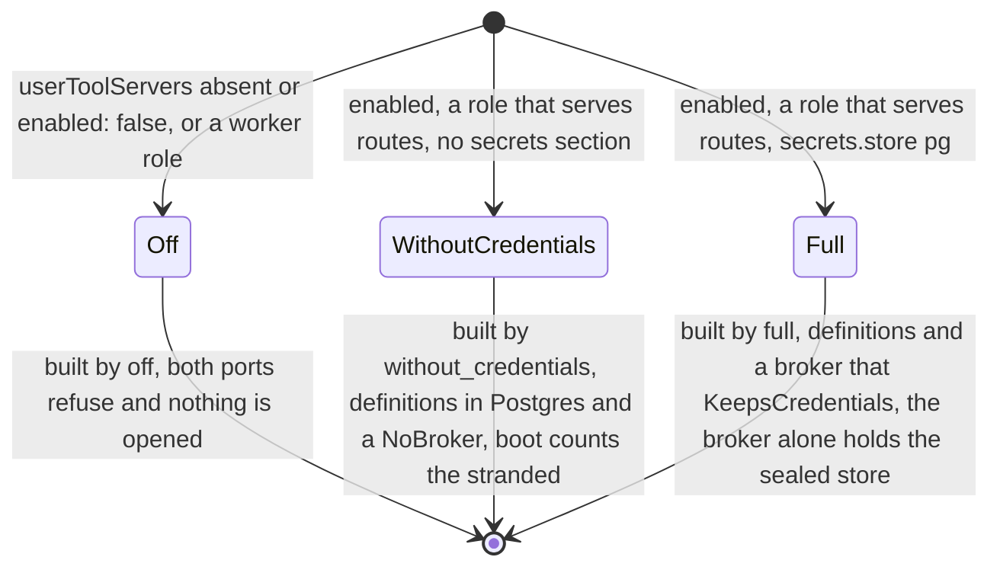

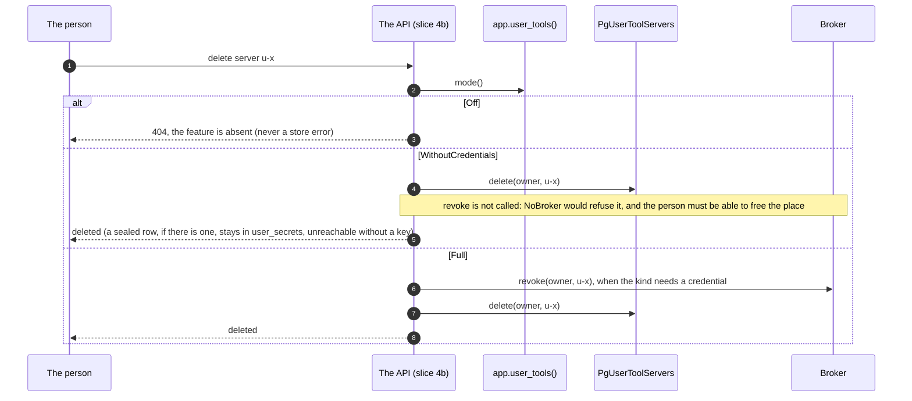

**Departures from the text above, and choices the review needed** (the owner to confirm; each is small to change).

74. **The bundle holds no secret store; the rule is that no handler reads secret material.** `UserToolPorts::secrets()` and `App::user_tools()` exposed a store whose `get` returns decrypted material to any future handler, and the API never needs one: the broker holds a clone and is the only reader. `Secrets` and `secrets()` are gone from `UserToolPorts`, the third parameter from `UserTools`, and `ConfiguredSecrets` from the binary; the composition root still builds the sealed store and gives it to the broker. What a handler may do is the definitions and the broker's five operations (`store`, `begin_oauth`, `complete_oauth`, `lease`, `revoke`); the relay's is `lease`, which returns a `CredentialLease` for one call. `NoSecrets` stays in `orch-ports` (public, tested, the model of a refusing store) and no root uses it: a deployment without a `secrets` section gets `NoBroker`. *Pinned by* `a_bundle_gives_out_no_secret_store` (a `UserToolPorts` of four items compiles, which it would not if the trait still asked for a `Secrets` type) and by `enabled_with_secrets_keeps_credentials_sealed_in_a_pool_of_its_own`, which reaches the sealed store through the module's `assemble` and not through the bundle.
75. **The mode is what the constructor built, and `Full` over a broker that refuses cannot be built.** `UserTools::new(mode, egress, servers, secrets, broker)` accepted `Full` over `NoBroker`, so the mode was a second source of truth. The three constructors are now the only ways in: `off()` (the refusing ports, put in with `From<NoUserToolServers>` and `From<NoBroker>`), `without_credentials(egress, servers)` (the given definitions and a `NoBroker`) and `full(egress, servers, broker)`, where `broker` must be `KeepsCredentials`: a marker trait in `orch-ports` that adds nothing to `CredentialBroker`, which `orch-credential-broker`'s `Broker` implements and `NoBroker` does not. `UserTools<D, B>`'s `B` is the root's own type (an enum over the adapters, by static dispatch) and `full` converts into it with `From<K>`, so the binary's `ConfiguredBroker` does not have to claim it keeps credentials in its `Off` variant. The cost is a type annotation where `B` cannot be inferred (`UserTools::<D, B>::full`). What is still possible is `without_credentials(egress, NoUserToolServers)`, a bundle that says enabled over a store that refuses: every call then fails, which is fail closed, and nothing says it is a mistake except its being unreachable by accident. *Pinned by* `the_mode_of_a_bundle_is_derived_from_the_constructor_that_built_it`, a `compile_fail` example on `UserTools::full` (checked, once, to fail with `NoBroker: KeepsCredentials` not satisfied and not with some other error) and `the_broker_keeps_credentials`.
76. **Only a process that serves routes builds the ports; the roles that do are `all` and `control-plane`.** People's servers are used in two places: the API of slice 4b and the relay of `thread-tools/v1`. Found with `grep -rn RelayTools orchestrator`: `RelayTools` (`crates/surface-thread-tools/src/relay.rs`) is built by `boot.rs::with_relay` for `thread_tools_routes`, which `surface_routes` calls from `control_plane_router`, which `run` builds only when `cfg.role.runs_control_plane()`; an agent that wants a tool calls the control plane over HTTP at `threadTools.url`, and the routes of 4b are mounted by the same router. A `worker` serves its probes and nothing else. So `user_tools::settings_for(role, settings)` gives a worker no settings, `build_for_role` builds the refusing bundle for it (mode `Off`, which is true of what it can do; no fourth state), opens no connection and migrates nothing, and says once, when the file enables the feature, why the worker builds nothing for it. *Pinned by* `only_a_process_that_serves_routes_is_given_the_settings`, `a_worker_builds_the_refusing_bundle_and_opens_no_connection` (the database is not there and a worker is not told, while `all` and `control-plane` stop with 69), `a_process_that_serves_routes_builds_the_ports_and_a_worker_does_not` (`user_secrets` is made by the first two and not by the worker) and, as a process, `a_worker_opens_nothing_for_people_s_own_servers_and_a_control_plane_does` in `tests/smoke.rs`. If a later slice mounts something that uses people's servers outside the control plane, `settings_for` is the one place that changes.
77. **A delete in `WithoutCredentials` does not call `revoke`, and boot says how many servers are stranded.** (Amends 66.) The deletion flow is revoke, then delete, and `NoBroker.revoke` refuses. With `userToolServers.enabled` and no `secrets` section, a definition that already holds a `CredentialRef` (the operator removed the section after credentials were stored: a lost key, a response to a compromise) could not be deleted by its owner, and went on counting toward the eight. **`NoBroker` keeps refusing**, for the honesty of the port: nothing was revoked, and a port that said so would lie. **The rule for 4b** is written in the docs of `UserToolPorts`, `UserToolsMode::WithoutCredentials` and `NoBroker` and in the `orch-ports` README: in `WithoutCredentials`, a delete deletes the definition and does not call `revoke`; the sealed row, if there is one, stays in `user_secrets`, unreachable without a key. In `Full` it is revoke, then delete, and a kind that needs no credential skips the revoke as before. **An orphan is never lent**: the ids are random (`u-` and ten characters of `[a-z0-9]`, about 3.7 x 10^15 of them), so a later definition does not meet one by chance, and the broker binds a credential to the definition's URL and to the id made again (departure 15), so an orphan would not be lent even to a definition with the same id. **At boot in `WithoutCredentials`**, `PgUserToolServers::count_with_credential` (an inherent method; it is not on the port, which is unchanged) counts the definitions whose `credential` is not null with one query, the count only; above zero, one warning says how many, that they stay unavailable until the `secrets` section is back with its keys, and that their owners can still delete them. No owner, no id, no reference and no URL is in the line. A count that fails is a warning too and does not stop the process: it is a courtesy to the operator, and the database answered the migrations a moment before. *Pinned by* `the_definitions_that_hold_a_credential_are_counted_over_every_owner` and `the_count_of_credentials_is_unavailable_when_the_pool_is_closed` (the store), `a_deployment_without_secrets_says_how_many_servers_hold_a_credential_and_who_not` (the line holds the count and none of the sentinels; a person deletes one while the broker is not asked; the next boot says one), `the_stranded_servers_are_counted_only_where_no_credentials_are_kept` and `a_count_that_fails_is_a_warning_and_not_a_stop`. *Open:* a sweep of the orphans, rows of `user_secrets` whose server no longer exists; it is a later job and needs a join across two migration histories (no foreign key can say it). *(Amended, slice 4b review: the two ways an orphan is made by the API, which only that sweep removes, are recorded in departure 104: a re-key's `store` landing between a delete's `revoke` and its `delete`, and an add's take-back whose best-effort `revoke` fails.)*
78. **Reads on the refusing store: a caller checks `mode()` first.** `NoUserToolServers` refuses reads as `Transient` (departure 67), so a caller that calls `servers().list` without asking `mode().is_enabled()` would fail every request, and every job that reaches the relay, in a default deployment. The rule is written on `UserToolPorts` ("What a caller does"), on `UserToolPorts::servers()`, on `NoUserToolServers`, on `App::user_tools()` and in both READMEs, and it is what 4b and 5 follow: `Off` is a 404 or a feature that is absent, decided from the mode and never from a store error. The behaviour did not change.
79. **Only an outage is exit 69; a statement the database refuses is exit 1.** (Amends 73.) `secrets-pg`'s `db_err` maps a statement the database refused (a missing privilege during `migrate`) to `Unavailable`, as it must (the port has no class for a bug), and the class of an `Unavailable` is `Transient`, so the new arm of `exit_code` exited 69 and the process was restarted for ever as for an outage, where the thread store's equivalent (`Internal`) exits 1. The error cannot tell by its variant, but it keeps the driver's error as its source: `orch_secrets_pg::is_outage(&SecretError)` reads it. The connection, TLS, the pool, the worker, a lock that was not got in time (SQLSTATE `55P03`, the "lock timeout" of the finding) and the SQLSTATEs the thread store's `transient_sqlstate` lists (class `08`, class `53`, `40001`, `40P01`, `57P01` to `57P03`) are outages; any other refusal is not; an `Unavailable` with no source (an adapter that knows nothing more) is an outage; so is any source that is neither a driver error nor a migration's own failure. The binary asks `user_tools::is_outage`. The `SecretStore` port did not change. *Pinned by* `only_a_database_that_cannot_answer_is_an_outage` (a table over synthetic SQLSTATEs), `a_statement_the_database_refuses_is_unavailable_and_no_outage` (a real `migrate` in a session that may write nothing), `exit_codes_follow_the_root_cause` and `a_secret_store_whose_database_refuses_its_migrations_is_not_an_outage` (exit 1 end to end through `build`). *Open:* `orchestrator secrets rewrap` (slice 3) maps by class in its own `error_exit_code`, so a refused statement there is 69 too; it was not part of this review and is not changed here.
80. **The URL is stored unsealed, and that is accepted.** `user_tool_servers.url` is plain text. The guard refuses user information and a query, which is where a URL secret normally lives (`?key=…`), but a path segment can still carry one (webhook-style URLs). Accepted, for three reasons: a definition must be readable without the `secrets` section (a deployment that removed it still lists and deletes them, departure 77), so sealing the URL would tie every definition to a key, and key loss would then lose the definitions and not only the credentials; the kinds `bearer` and `api_key` exist for a secret, and putting one in a path is the person's choice; and the broker needs the URL on every call, so a sealed URL would be opened as often as a credential is lent. What it leaves: someone who can read the database (a leaked backup) reads the URLs, and so a secret a person put in a path; the credentials stay sealed. **The URL is never logged and never in an error**: `UserToolServer`'s `Debug` prints scheme, host and port and never the path, a `Corrupt` row says nothing of it, a driver error holds no parameter, and the boot warning of 77 is a count. *Pinned by* `a_row_that_is_not_a_definition_is_corrupt_and_the_message_holds_nothing_of_it`, `a_closed_pool_is_unavailable_and_says_nothing_of_the_definition` and the boot test of 77.
81. **The lock form in the trait's docs.** `UserToolServerStore`'s docs recommended `pg_advisory_xact_lock(hashtext(owner))`, the one-`bigint` form that departure 61 had already rejected, so the trait contradicted the adapter. They now say the two-`int4` form with a class of the adapter's own, and why: adam-rs, which shares the database under `agent-local`, takes `pg_advisory_xact_lock(hashtext($1))` (`crates/adam-store-postgres/src/lib.rs` at the pinned revision), and a person's e-mail could hash to its migration key. The claim "every other advisory lock the orchestrator or adam-rs takes in this database is one-`bigint`" replaces "the other advisory locks of the database" in this ADR (the note on 61), in the READMEs of `orch-store-postgres` and `orch-ports`, in `docs/orchestrator.md` and in the docs of `OWNER_LOCK_CLASS`.
82. **The owner is not empty (a `CHECK`), and has no other rule.** `UserId::new` trims and lower-cases and has no length cap and no rule that it be non-empty; both authenticators refuse an identity that is empty after the trim (`auth-header`: `!e.is_empty() && e.contains('@')`; `auth-jwt`: the claim must be text that is not empty once trimmed). The migration says `owner text NOT NULL CHECK (owner <> '')`, which is what no caller means. **No length cap**: `UserId` has none (an e-mail is as long as the proxy or the token made it), and a cap here would refuse a person the thread store accepts; the eight a person may hold bound the table per owner. **No check of case**: Postgres' `lower()` follows the database's collation and not Rust's tables (*verified 2026-10-14*, PostgreSQL 16.14: `lower('ÀÉİ')` is `ÀÉİ` under `"C"`, `àéi` under `"C.utf8"` and `àéi̇` under `"und-x-icu"`, and Rust's `to_lowercase` gives the last), so a check of case could refuse an owner that Rust wrote. *Pinned by* `the_table_refuses_an_owner_that_is_empty`.

**Test changes that are not departures.** In `tests/user_tool_servers.rs` of the store, `the_lock_of_an_owner_collides_with_no_lock_of_a_bigint_key` has no timeout of its own: a lock that delayed the insert would hold it for `LOCK_TIMEOUT` and end it as `Unavailable`, which fails the `expect` just the same, and a slow runner cannot. `a_wait_for_the_lock_of_the_owner_ends_as_unavailable_and_gives_the_connection_back` keeps its lower bound (it did wait about `LOCK_TIMEOUT`, which a refusal at once would not) and its outer bound is now fifteen times `LOCK_TIMEOUT`, so a loaded runner does not fail it while a wait that never ends still does. The host-pattern sweep has the boundaries it lacked, in `orch-config`'s own tests, `orch-ports`' tests and the binary's sweep: a label of 63 bytes and a name of 253 (with a trailing dot, and behind `*.`) are accepted, 64 and 254 refused.

**How the review's tests were checked to be able to fail** (each change made in turn, then reverted, and the restored file touched so that a stale build could not stand in for it): `is_outage` as `class() == Transient` (the table test failed on "a missing privilege"); `exit_code` by class (two tests failed with 69 for 1); `name.len() <= 253` as `< 253` and the label range `1..=63` as `1..63` in `orch-config`, and `>` as `>=` and `1..=` as `1..` in `orch-ports` (the new boundary test of the crate failed in each, and the binary's sweep failed on `< 253` and on `>=`); the `CHECK` taken out of the migration (the empty-owner test failed); the `WHERE credential IS NOT NULL` taken out of the count (the count test failed); the boot warning taken out (two tests failed); `settings_for` giving every role the settings (three unit tests and the smoke test failed); the secret store on the thread store's pool (the pool-of-its-own test failed, and so did the two that depend on the secret store connecting with a URL of its own); `without_credentials` setting `Full` (the constructor test failed). The `compile_fail` example was run once as a plain test and failed with `the trait bound NoBroker: KeepsCredentials is not satisfied`, so it does not pass for a typo.

**Facts, verified 2026-10-14.** *By `grep advisory` and reading* `orchestrator/crates` and `~/.cargo/git/checkouts/another-adam-rs-*/5581d40/crates`: the orchestrator's advisory locks are `hashtextextended($1, 0)` (thread store), `$1` as `bigint` (secret store), sqlx's `pg_advisory_lock($1)` and the two-`int4` lock of this store; adam-rs's pinned revision has one, `pg_advisory_xact_lock(hashtext($1))` at `crates/adam-store-postgres/src/lib.rs:621`. *By a test against PostgreSQL 16.14*: `pg_advisory_xact_lock(hashtext('…'))` takes the `bigint` overload (`hashtext` returns `integer`, widened), `pg_locks` shows `classid` 0 and `objsubid` 1; `lower()` depends on the collation (above). *By reading the source* (`orchestrator/crates/core/src/ids.rs`, `auth-header/src/lib.rs`, `auth-jwt/src/claims.rs`): `UserId::new` only trims and lower-cases; the two authenticators refuse an empty identity. *Unverified:* the wording of the PostgreSQL manual on which `lower()` rules apply (the behaviour above is what the test saw); that an `Unavailable` of another future `SecretStore` adapter keeps its driver's error as a source (the rule of 79 is to treat one that does not as an outage).

**What 4b must know, added by the review.** (1) Ask `app.user_tools().mode()` first; `Off` is a 404 or an absent feature, never a store error (78). (2) A delete: `Full` is revoke (when `auth.needs_credential()`), then delete; `WithoutCredentials` is delete, no revoke (77). (3) There is no `.secrets()`; the API never reads secret material (74). (4) **The listing must survive a corrupt row.** `UserToolServerStore::list` fails entirely on one row that does not read back (`Corrupt`), so the API could not show the person the id they need to delete it. The port does not change: the API's listing shows an error that names the cause (a definition that does not read back) and offers deletion by id, which `delete` allows without reading the row. (5) **The writes of the definitions are not behind a semaphore** (minor 7 of the review, left alone on purpose): each write is a short transaction with a bounded lock wait (63), and 4b's rate limit on the endpoints is the mitigation for a person who floods them.

**Open for the next slices, added by the review.** (a) The sweep of orphaned sealed rows (77). (b) `secrets rewrap`'s exit code by class (79). (c) 4b's listing of a corrupt row and its rate limit (above).

## Amended 2026-10-15, slice 4b: the HTTP API for people's own servers, without OAuth, is built

The routes, the listing and the OpenAPI for the kinds `none`, `bearer` and `api_key`; an `oauth2` server can be added and is stored `added`, and says it needs the person to authorize (**its authorization, the callback, the Client ID Metadata Document route and the rate limit of `begin_oauth` are 4c; attaching a person's server to a thread and the relay's lease are slice 5**). `orch-core` is untouched and **no `orch-ports` signature, error or conformance case changed** (`orch-ports` has doc changes only). Decisions 1 to 5, the flow and the departures above stand, except where one below says it amends one. Departures continue the numbering, 83 onward.

| Where | What |
|---|---|
| `crates/app/src/user_tools.rs` | `App::add_user_tool_server`, `list_own_tool_servers`, `edit_user_tool_server`, `delete_user_tool_server`, `user_tool_servers_enabled`, `user_tool_kinds`; `AddUserToolServer`, `EditUserToolServer`, `OwnToolServer`, `OwnServers`, `OwnReason`, `UserToolRefusal`, `MAX_USER_SECRET_BYTES`; `AppError::UserTool` (the permission and owner checks are in these, no handler is given a port) |
| `crates/api/src/user_tools.rs`, `routes.rs`, `problem.rs`, `lib.rs` | `POST`, `GET`, `PATCH`, `DELETE` of `/api/user-tool-servers[/{id}]`, behind a layer that is a 404 while the feature is off; the body reader `SecretBody`; the picker `GET /api/tool-servers` with the person's own after the deployment's; the problems and their codes |
| `docs/api/chat-api.yaml` | four operations, `UserToolServer`, `UserToolAuth`, `UserToolServers`, the two requests (`secret` is `writeOnly`), `ToolServer` with `own`, `status`, `reason`, the problem codes; every statement that a body with a secret is write-only |
| `crates/app/tests/user_tools.rs` (35), `crates/api/tests/user_tools.rs` (21), `crates/api/tests/user_tools_secret.rs` (1, a process of its own), `crates/api/tests/contract.rs` | the order of writes, the checks, the permission, the other person, the limit, the revision, `WithoutCredentials`, the corrupt row, the sentinel; every HTTP response is validated against the schema the contract gives that operation and status |
| `dev/orchestrator.yaml` (and its browser-auth copy), `compose.yaml`, `dev/mock-oidc/users.json`, `dev/user-tools-e2e.sh`, `dev/e2e-all.sh` | `userToolServers` and `secrets` on in the dev stack, the dummy key `USER_SECRETS_KEY`, the role `tool-maker` (the only one that holds `tools.user.add`) and two users, the scenario |

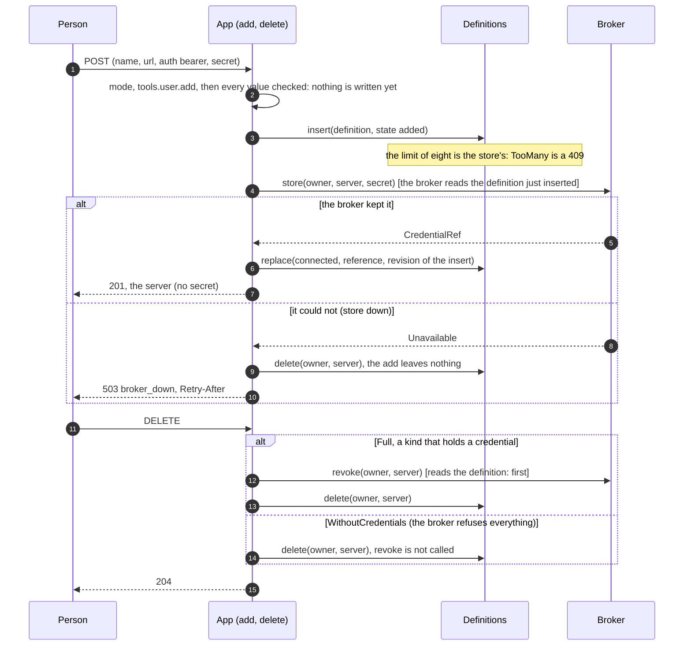

```mermaid
stateDiagram-v2
  [*] --> connected: POST none (nothing to wait for)
  [*] --> added: POST oauth2, or bearer and api_key (until the broker keeps the secret)
  added --> connected: bearer or api_key: store then replace, or PATCH with a secret
  connected --> connected: PATCH name, header, or a new secret
  connected --> added: PATCH url, kind, scopes or client: revoke first, replace with no credential
  connected --> needs_reauth: the broker (a refresh refused), slice 5's relay (a 401): not this slice's write
  needs_reauth --> connected: PATCH with a secret (bearer, api_key); OAuth is 4c
  revoked --> connected: PATCH with a secret; OAuth is 4c
  added --> [*]: DELETE, or a failed add taking it back
  connected --> [*]: DELETE (revoke, then delete)
  needs_reauth --> [*]: DELETE
  revoked --> [*]: DELETE
```

*(Amended, slice 4b review: the edge `connected --> added` writes the definition first (a compare-and-swap) and revokes after, departure 101; and `revoke` reads no definition, so the delete's "reads the definition: first" in the sequence above is not the reason it revokes first: a definition deleted first would leave a sealed credential that nothing names. See the sequence and state diagrams of the review section below.)*

**Departures from the text above, and choices the build needed** (the owner to confirm; each is small to change).

83. **Two listings, one picker.** The ADR names `GET /api/tool-servers` for the listing, and it has the person's own servers after the deployment's, **additive**: a deployment's entry is byte for byte what it was (and with the feature off the whole answer is), an own entry adds `own: true`, `status` and `reason` and has no description, icon or `agents`. The web's picker reads `ToolServer`, and every added member is optional in the schema. The URL, the kind, the state and the revision a management screen needs are in **`GET /api/user-tool-servers`**, which also has what an array cannot carry: `limit` (8), `kinds` (the kinds this deployment takes: `none` only without a `secrets` section) and an `error`. Needs `thread.write` on the picker (as it always did) and no permission of its own on the other (listing is not gated, decision 4).
84. **`auth` is the same object read and written; the secret is a top-level `secret`.** `{kind: none | bearer | api_key | oauth2, header?, scopes?, clientId?}` is what a response writes and what a request takes, so a client can read a server, change `auth` and send it back. The token or the key is `secret` of the request (required for `bearer` and `api_key`, refused for the others; on `PATCH` alone it re-keys), `writeOnly` in the schema, and nothing returns it. `auth` is required on `POST` (a client that forgot it must not add a server that sends no credential).
85. **The revision travels in the body, as a string; it is optional.** `revision` of `PATCH` is the one the listing gave. Not `If-Match`: the listing has no per-server `ETag`, and a request header outside the CORS allow-list (`server.cors`, ADR 0047) would break the desktop and mobile apps. A string, because the store's `u64` is opaque ("compare for equality only") and a JSON number past 2^53 is not safe in a browser. A server that changed since is **409 `stale_revision`** and nothing is written. **Without it**, the edit applies to the server as it is: the application reads it again up to three times when the broker or another request wrote in between (the broker marks `needs_reauth` by itself) and then fails with `Contended` (503, `Retry-After: 1`). *(Amended, slice 4b review: the refusal is `UserToolRefusal::Busy`, whose sentence is about the server, departure 108; and the revision is digits only, departure 108.)*
86. **The limit of eight is a 409 `too_many_servers`**, not a 422: it depends on what the person already holds (like `over_cap` and `thread_active`), not on the request alone (like the 16 of `putThreadTools`), and deleting one makes the same request work. The store enforces it (`TooMany`); an edit at the limit is not a ninth.
87. **A `store` that fails after the `insert` takes the definition back.** The slice 2 order stays (insert, `store`, `replace`), and if `store` fails the definition is **deleted** and the answer is a 503 `broker_down`: a failed add leaves nothing, costs no place, and a retry does not leave two. `revoke` is not called for it (the broker kept nothing: its `put` is atomic, and a secret store that is down would fail the revoke the same way and double the wait). If the delete fails too, the server stays `added`, listed with `needs_auth` / `not_connected`, and its owner re-keys or deletes it (a warning says so). A `replace` that fails after a **successful** `store` (the person deleted or changed the server in the milliseconds since the insert) revokes what was kept, best effort, and answers 503 `Contended`. For an **edit** the order is the ADR's: `revoke` first, a failure aborts with nothing written; then `replace` as `added` with no credential; then, with a secret, `store` and `replace` as `connected`. A `store` that fails there leaves the server `added` (the old credential is gone, the new definition is what the person asked for, and they give the key again). A re-key alone is `store` then one `replace`. *(Amended, slice 4b review: for an **edit** the order is the reverse, `replace` first and `revoke` after, departure 101; and the take-back of a failed add holds when the request is dropped, departure 102, and when the `store` may have kept the key, which is revoked first, departure 104.)*
88. **A `none` server is `connected` at once** (the diagram of the ADR: "kind none"), inserted in one write; an `oauth2` server is inserted `added` and stays so until 4c. A change to `none` makes the server `connected` and revokes what the old kind held.
89. **What an edit revokes.** The credential is bound to the URL, the kind and, for OAuth, the scopes (as a set) and the client id (departures 15 and 41), so a change of any of these is `revoke`, then `replace` as `added`. A new **name** or a new **header** of an `api_key` keeps it: the header is the definition's, the sealed record does not hold it (checked in `Broker::ready`). Editing a server that holds a credential, in `WithoutCredentials` (the operator removed `secrets`), is refused with 422 `credentials_not_kept` when it would need a `revoke` or a kind that wants a credential; the name can still change, and the person can delete (departure 77).
90. **The listing's status asks nobody, so no `lease`.** A lease refreshes a token: a network call to an authorization server, up to eight of them, in every page view and every picker open. The broker marks `needs_reauth` itself when it learns a grant ended (departure 22), the relay will on a 401 (slice 5), and a credential bound to another URL cannot happen through this API (an edit revokes). So the status is the definition's state and the deployment's rules, the first that holds: not permitted (`unavailable` / `not_permitted`), today's lists refuse the URL (`egress_refused`, by `check_url` only: no DNS), a credential kind in a deployment that keeps none (`broker_down`), then `connected` is `ready` and `added`, `needs_reauth`, `revoked` are `needs_auth` with the reasons `not_connected`, `reauthorize`, `disconnected`. **The cost:** a server whose access token ran out with no refresh token is `ready` here until a lease marks it; slice 2's open point 2 (a `connected` server whose `lease` is `NeedsReauth` is `needs_auth`) is therefore met by the broker's marking, one lease late. `reason` is a code (a closed list in the schema); the web writes the sentence. `server_down` is in the port's list and not produced here: nothing connects.
91. **A definition that does not read back.** The port fails a listing as a whole on one such row and names no id (4a review, point 4; the port is unchanged). The application says `OwnServers::Unreadable`: `GET /api/user-tool-servers` is a **200 with no servers and `error: {code: unreadable}`** (not a 5xx: the other servers are not lost and the deployment's do not depend on this), the picker leaves the person's own servers out and keeps the deployment's, an edit is a 500 (it cannot read the row), and **a delete by id works** and also revokes (the kind is not known, so whatever credential there is goes). A person who knows the id deletes it; one who does not cannot be told it: the id of a row that fails to read is not in the port's error. **A listing that names the readable rows and the unreadable ids is a change to the port**, not made here; until then one bad row hides the person's other servers too.
92. **A store that is down fails the lists with a 503**, as every route that reads storage does, and is not an empty list; only the permanent fault of departure 91 degrades. *(Amended, slice 4b review: the picker `GET /api/tool-servers` no longer fails for it, departure 108; `GET /api/user-tool-servers` keeps its 503.)*
93. **The secret, the body and the logs.** `SecretBody` reads the body of `POST` and `PATCH` itself and `ApiJson` is not used for them: serde quotes a string it finds where it expected a map (`invalid type: string "SECRETVALUE", expected a map`, *verified 2026-10-15*, serde_json 1.0.151), which here can be the secret. Every refusal is a fixed sentence; an unknown member is refused without being named (a secret put where a member name goes would be echoed); the secret becomes a `ToolSecret` by moving the string; the request types print neither it nor the URL. The rule for a secret, checked before any write (departure 33): 1 to 4096 bytes (`MAX_USER_SECRET_BYTES`: the sealed record is JSON, where a quote or a backslash costs two bytes, and with the URL it must stay under the store's 16 KiB, so 4 KiB leaves room even for a secret of nothing else), printable ASCII (a header value), **not trimmed silently**, and a space at either end is refused (a pasted newline is not accepted by quietly changing the secret). The request logging records the method and the path (`RedactedSpan`), never a body or a header. What is **not** wiped: the buffer the body arrived in and the JSON value the string passed through before it moved (the same limit as `ToolSecret`'s own doc). The cause of a broker failure is logged by its class and chain, which the port promises hold no secret.
94. **The feature off is a 404 before the body is read** (a layer on the routes asks `App::user_tool_servers_enabled`), so an off deployment does not parse a request it does not have, and a worker-only process, which mounts no routes, has none (departure 76).
95. **`DELETE` of a server that is not there is a 404**, the second time too, as `deleteThread` is; the port's `delete` stays idempotent. A malformed id is the same 404 as one that never existed, as is another person's (the bodies are equal: a test). The delete needs no permission and no `thread.write`.
96. **A refused URL is a 400 `url_refused` whose `detail` is `EgressRefusal::public_reason()`**, never `rule()` and never an address (departure 17). Only the reason is shown: `public_class()` is `Invalid` for every refusal, so the status is always 400, and `public_rule()` adds nothing a client acts on. What is checked at add and edit is `check_url` (the shape, the scheme, the lists, the names that are always loopback); the DNS is **not** asked, so a name that resolves to a private address is accepted here and refused by the broker at each connection, as the ADR says ("again at each connection").
97. **`AppError::UserTool(UserToolRefusal)`** is one variant with a closed enum inside, and the API maps it in one place (`user_tool_problem`): 404 (`Off`, `NotFound`), 409 `too_many_servers` and `stale_revision`, 422 `credentials_not_kept`, 400 `url_refused`, 503 `broker_down` + `Retry-After: 5`. The problem codes are listed in the contract.
98. **The dev stack grants `tools.user.add` to one role.** `dev/orchestrator.yaml` (and its browser-auth copy, which `check-browser-auth-config.sh` holds to the same text outside its markers) has `userToolServers: {enabled: true, egress: {allowHttp: true, allow: [mock-mcp-search]}}`, a `secrets.pg` with one key by `{ env: USER_SECRETS_KEY }` (a dummy of `compose.yaml`, in every orchestrator process: every role checks the section), and the role `tool-maker`; `mock-oidc` has `tool-maker@example.com` and `tool-maker-2@example.com`. `allow` names the one host of the stack, so every other is refused there (the scenario shows it), and `allowHttp` is development's. **The chart grants it to no role and has no `userToolServers` key yet**: the routes of the pinned image are 404 in a chart deployment until a later slice adds the switch, and the chart's README says how an operator will grant the permission (list it in a role's `permissions`).
99. **No rate limit on the write routes.** The slice 4a review named "4b's rate limit on the endpoints" as the mitigation for a person who floods the writes. It is **not built**: the number of servers a person holds (8), the bounded lock waits of the store (departure 63), the permission (held by the roles a deployment chooses) and a body bounded to 32 KiB are what limit them. The limiter of 4c's `begin_oauth` is the natural place for a per-person limit on `POST`, `PATCH` and the authorization together; the owner to decide whether it is wanted before the web exposes the form.
100. **Until slice 5 the picker offers what an attach refuses.** A person's own server is listed `ready` by `GET /api/tool-servers`, and `PUT /api/threads/{id}/tools` with its `u-` id is the 422 "no server is offered" it has always been for an id the deployment does not list. Turning `userToolServers` on before slice 5 merges shows the web an entry it cannot attach; nothing enables it outside the dev stack.

**How the tests were checked to be able to fail.** Each change was made in turn, made at least one test fail, then reverted and the file touched: the add without the check of the secret; a failed `store` that does not take the definition back; an edit with no `revoke` before the `replace`; a new URL that is not a new grant; a delete that never revokes, that revokes first only when the broker is there, that revokes after the delete, and one that calls `revoke` in a deployment that keeps no credentials; a listing that ignores the permission; an edit that needs no permission; a stale revision that is not checked; the lists of today ignored by the status; a `none` server inserted `added`; the new URL of an edit not checked; an edit that does not read again after a race; serde's messages for a bad body (the planted value is quoted); the body logged at `DEBUG` (the sentinel test, whose canary shows the capture finds a secret); an answer that may be cached; the routes mounted while the feature is off; the limit as a 422; the picker without the person's servers; the URL in the picker; an unknown member named in the 400.

**Facts, verified 2026-10-15.** *By tests:* serde_json 1.0.151 quotes the string it found (`invalid type: string "…", expected a map at line 1 column 13`) and a duplicate field by name; `tower-http`'s `TraceLayer` with `RedactedSpan` records the method, the URI (the path), the version and the request id, and a capture at `TRACE` with the span events finds none of the secrets planted in request bodies (the request header carries only the caller's own token, which the test does not plant). *By running the real thing:* the orchestrator binary of this checkout, with `dev/orchestrator.yaml` made local (jwt against the mock issuer served by `dev/mock-oidc/server.mjs`, a PostgreSQL 16.14 database, `secrets.pg` with the dummy key), passed every check of `dev/user-tools-e2e.sh` that needs no Docker; by hand, `user_secrets` held one row (`kid dev1`, 126 bytes of ciphertext) for a bearer server, a dump of `user_secrets` and `user_tool_servers` held neither the token nor a secret in the URL's path, the log held none, and deleting the server removed the row. *By generating:* `openapi-typescript` 7.13.0 reads the new `chat-api.yaml` (the web's `schema.d.ts` was not regenerated or type-checked: `web/` is not touched).

*Unverified:* the compose run of `dev/user-tools-e2e.sh` (no Docker daemon was available: the checks of the database and of `docker compose logs` were run by hand as above, and the script reports them skipped without Docker); that the web still type-checks against the regenerated schema (every added member of `ToolServer` is optional); that a `Cache-Control: no-store` answer with a URL is not kept by a proxy of the deployment; that `Bytes::from_request` applies the edge's 1 MiB body limit before the 32 KiB check of `SecretBody` (the larger body is refused either way, by one or the other).

**What 4c must know.** (1) `begin_oauth` is called with a `RedirectUri` and the person's `OwnToolServer` is already stored `added`, `needs_auth` / `not_connected`; after `complete_oauth` the API `replace`s the definition as `connected` with the returned `CredentialRef`, on the revision it read (the order of departure 87, with `complete_oauth` in place of `store`). (2) `UserToolRefusal` and `user_tool_problem` are where a new refusal goes; `credentials_failure(step, &CredentialError)` is the one mapping from the broker's errors (an `egress_refusal` found through `orch_credential_broker::egress_refusal` is the 4c addition: `begin_oauth` fetches the server's metadata, so a refusal there is `egress_refused`, shown as `public_reason`). (3) `App::user_tool_kinds` already lists `oauth2`. (4) The table that maps `state` to `(owner, server, expiry)` is a Postgres table of the process-less callback (item 1 of "What 4b must know" in the slice 4a section); `OAuthStart::expires_at` is its expiry. (5) The write routes have no rate limit (departure 99); `begin_oauth` needs one. (6) `SecretBody` is for bodies that carry a secret; the authorize route carries none and can use `ApiJson`, but its callback's query carries a `code`, which is a secret to the log: `trace::redact_uri` keeps the query, and a callback must be added to what it takes out.
**What slice 5 must know.** (1) `PUT /api/threads/{id}/tools` takes ids from `checked_tools`, which looks at the deployment's list only: a `u-` id is accepted when the person owns it and its `status` is `ready`, which `App::list_own_tool_servers` computes (the same function, `describe`, without the lease); the attach and the relay then `lease`. (2) The relay sets `needs_reauth` itself on a 401 with `set_state` and the revision it read. (3) The mode is `app.user_tools().mode()`, asked first (departures 67 and 78); a fork keeps the servers its new owner owns. (4) `OwnToolServer` is the type that says what a server is to the person; the relay's refusal to offer one uses `ToolServerStatus` and `UnavailableReason` of `orch-ports`.

**Open for the next slices, closed or changed by this one.** Slice 1's open point 6 (the API half) and slice 2's open point 2 (the order of writes around the broker, validate before `store`, show `public_reason`, not an `Unavailable`'s `Debug`) are closed for the kinds this slice has; the OAuth half (`begin_oauth`, `complete_oauth`, the table, the rate limit, the callback's `iss`) is 4c. The 4a review's (c) is closed (the corrupt row: departure 91) **except** that one bad row still hides the others. Still open: the sweep of orphaned sealed rows (77), `secrets rewrap`'s exit code by class (79), the rate limit (99), the web (slice 6) and the chart's switch for `userToolServers`.

**Decisions for the owner:** two listings and the picker's added members (83); `secret` outside `auth` and `auth` required (84); the revision in the body, optional, a string (85); the limit as a 409 (86); the take-back of a failed add (87); a `none` server `connected` at once (88); a new header keeps the credential, a new scope does not (89); a listing with no lease, one lease late (90); a bad row hides the person's other servers until a port change (91); a secret refused with a space at its end and never trimmed (93); no rate limit on the writes (99).

## Amended 2026-10-15, slice 4b review: an edit writes before it revokes, the writes run to their end, and what the review found in the tests and the logs

The security review of the slice 4b pull request (#254) found two major problems in the order and the lifetime of the write sequences and a number of smaller ones. This section lists what changed. `orch-core` is untouched and **no `orch-ports` signature, error or conformance case changed** (doc text only, in `credentials.rs`, `bundle.rs` and the README). Departures 83 to 100 stand except where a note on one, or a departure below, says it is amended. Departures continue the numbering, 101 onward.

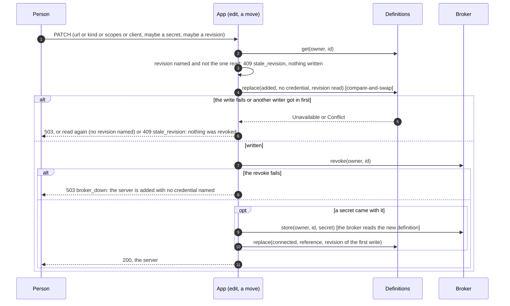

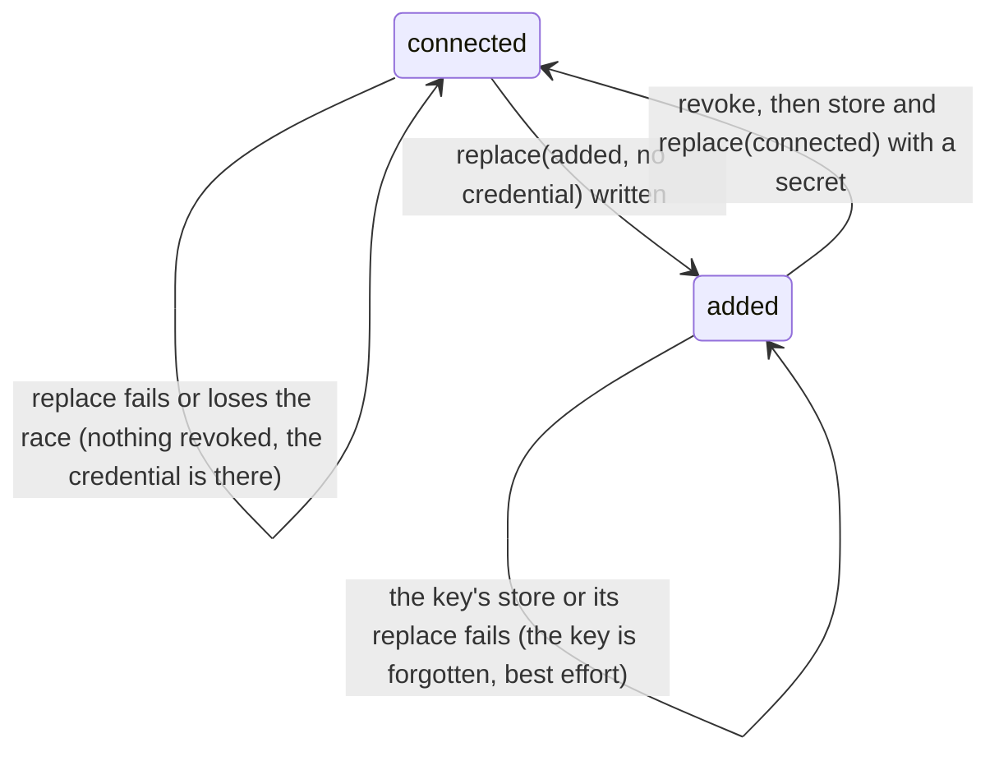

101. **An edit that moves a server writes the definition first.** Departure 87 had the edit revoke the credential and then write the definition. A `revoke` cannot be taken back and a `replace` can fail, so a store that failed after the revoke, a writer that got in first (the compare-and-swap lost) and a request that was dropped each left a server that said `connected` and named a credential the broker no longer had. The order is now **`replace` as `added` with no credential (a compare-and-swap on the revision that was read), then `revoke`, then, with a secret, `store` and `replace` as `connected`**: a write that can lose a race comes before a write that cannot be taken back. A write that fails or loses has revoked nothing, so the server still says `connected` and its credential is still there, and with a `revision` named a 409 still means that nothing was written. A `revoke` that fails after the write leaves the server `added` with no credential named, the answer is a 503 `broker_down` (the OpenAPI says the change *has been written*), and the sealed record that is left is bound to the old URL, kind or grant, which the broker refuses to lend for the new definition (`Broker::credential` compares them), so it is not lent, and the next key or the delete forgets it. **Once the edit has written the definition its revision is spent**: a later conflict (the broker marked the row while the edit revoked) reads the server again and finishes the edit, and is never a `stale_revision` over a move that was made. The port's doc for `revoke` no longer says that it reads the definition (it does not: departure 21); the order against the definition is the caller's, and the doc says which order an edit and a delete keep and why. *(Tests: `a_new_url_replaces_the_server_as_added_with_no_credential_and_then_revokes` and its three siblings in `crates/app/tests/user_tools.rs` read the definition the broker saw at each call; `a_move_whose_write_fails_has_revoked_nothing_and_the_server_keeps_its_credential`, `a_move_that_loses_the_race_has_revoked_nothing_and_with_a_revision_is_stale`, `once_the_move_is_written_a_later_conflict_does_not_make_it_stale`, `a_failed_revoke_after_the_move_says_so_and_leaves_the_server_added`, `a_failed_store_after_a_move_leaves_the_server_added_and_the_old_key_gone` and `a_move_with_a_key_whose_last_write_fails_leaves_the_server_added_and_the_key_forgotten`.)*
102. **The three write routes run their `App` call in a task of their own.** The sequences of departures 87 and 101 are compensations between `await`s, and axum drops a handler's future at its next `await` when the client hangs up, and `tower-http`'s `TimeoutLayer` (30 s, `ApiConfig::request_timeout`) drops it when it fires: a drop skipped every compensation after it. Eight aborted adds could fill the eight places, and a cancelled move left a half-done state. `create`, `edit` and `delete` now run the call in `tokio::spawn` and await the `JoinHandle`, as the broker does for a refresh (departure 27); a `JoinError` (the task panicked, or the runtime ended it) is a 500 with the fixed `internal error`, and the cause is logged by the fact, never by a value. A request that is dropped still finishes its sequence and its answer goes nowhere; the person reads the list. **What holds now, exactly:** a failed add takes its definition back and spends no place *when the take-back itself succeeds* and the process lives to run it; if the definitions' store is down at that moment, or the process stops in the middle, the server stays `added` (`needs_auth` / `not_connected`) and holds its place until its owner gives it a key or deletes it. Departure 87 and the OpenAPI said "nothing is left" without that exception; they now say it. The OpenAPI documents the 500 of the three routes. *(Tests, `crates/api/tests/user_tools.rs`: the store holds the request at a step of the sequence, the test drops the request future the way a hang-up does and the way the timeout does (an `ApiConfig` with a 300 ms timeout), lets the sequence go on and asserts that it completed, and that the held future was not itself dropped: `an_add_that_is_dropped_mid_sequence_still_takes_its_definition_back` (and eight more servers then fit), `an_edit_that_is_dropped_mid_sequence_finishes_the_move`, `a_delete_that_is_dropped_between_its_revoke_and_its_delete_still_deletes` and `a_write_that_panics_is_a_500_with_a_fixed_body_and_the_server_goes_on`.)*
103. **A re-key keeps its key only for the revision it just read, and settles a key that lost the race.** The broker keeps a key in place of the old one and cannot give the old one back, so a re-key with a `revision` named that was stale could answer 409 after the sealed secret had been overwritten, where the OpenAPI says a 409 writes nothing. The re-key now reads the definition again immediately before `store` and goes no further when the revision is not the one it read (the person's named revision was already checked against the first read; this closes the window between that read and the `store`, test `a_stale_rekey_is_refused_before_the_new_key_is_kept`). The compare-and-swap stays after the `store`, and when it still loses, the definition is read again and the key is **settled**: if the definition **still names a credential** (a rename, the broker marking the grant, another key) it relies on what the broker holds and the key stays (revoking it would leave a `connected` server with nothing behind it, which is the harm departure 101 removes, test `a_rekey_that_loses_the_race_after_the_key_is_kept_takes_no_credential_away`); if it **names none** (another request moved the server: the broker read the new definition when it kept the key, bound the key to the new URL, and would lend it there) or is **gone**, the key is forgotten, best effort (test `a_rekey_that_loses_to_a_move_forgets_the_key_the_move_left_without_a_name`). This departs from the review's wording ("revoke on a best-effort basis" after any conflict): an unconditional `revoke` would break a `connected` server whose definition merely moved on a revision, which finding 1 forbids. **A recorded risk:** a forgetting that lands between the *other* request's `store` and its `replace` (the two writes of an edit that moves a server and gives a key) takes that request's key as well, and its server is then `connected` with nothing behind it until the next lease marks it `needs_reauth` (departure 90); the window is a few milliseconds of two edits of one person at once. Nothing but a lock per server closes it, and a lock is the broker's job and not this slice's. With a `revision` named the answer is still 409 `stale_revision`; the OpenAPI says in which case the new key stays beside it.
104. **An add whose `store` may have kept the key revokes it before it takes the definition back** (amends 87: "`revoke` is not called for it"). A `put` that committed and whose answer was lost has kept the key, and the take-back then left a sealed row that no definition names. Any failure of `store` but `Unknown` ("no such server", which kept nothing) now calls `revoke`, best effort, before the `delete` (test `a_store_that_may_have_kept_the_key_is_revoked_before_the_definition_is_taken_back`); a `revoke` that fails is logged and the take-back goes on. **This is the cheap fix, not the sweep.** The two sources of a sealed row that nothing names, which only the sweep of departure 77 can remove, are recorded there: (1) **a re-key's `store` landing between a delete's `revoke` and its `delete`** (the delete removes the definition; the key the re-key kept is named by nothing and nobody revokes it; a `replace` that then finds the row gone revokes, but a `replace` that went through before the delete does not know), and (2) **an add's take-back whose best-effort `revoke` fails**, which is likely exactly when the sealed store is what failed. A forgetting that fails anywhere else (departures 101 and 103) is the same kind of row. None is lent (the broker binds a record to the definition's URL and kind, and the ids are random), and `user_secrets` is bounded by the people who hold servers, so the sweep stays a later job (open item (a) of the slice 4a review).
105. **Five checks that no test could fail are pinned, and both checks of `auth` stay.** The review changed each of these in turn and found the tests green, because the bodies the tests sent were refused for another reason too. The tests now send bodies that would be accepted if the check were not there. *(1) The content type*, the CSRF guard of the three routes: a valid add and a valid rename sent as `text/plain` (with and without a charset), `text/json`, a form, a multipart form, `application/jsonp`, something that is not a media type, and **with no `Content-Type` at all** are each the fixed 400 of departure 93, and nothing is added or renamed; `application/json; charset=utf-8`, `Application/JSON` and `application/merge-patch+json` are read. *(2) The cap of 32 KiB*: a valid add padded with whitespace (which JSON allows) to 32 KiB plus one byte, 33 KiB, 40 KiB and 1 MiB is a 400 naming the cap, 2 MiB and 3 MiB are a 400 from the API's own limit of 1 MiB (`DefaultBodyLimit` in `lib.rs`, which closes the unverified item of the slice 4b section about `Bytes::from_request`), nothing is added, and a body of **exactly** 32 KiB is read (a `>=` fails). *(3) `parse_edit`'s unknown member*: `{"name": "x", "secrte": "…"}` is a 400 with the fixed sentence, renames nothing and does not echo the member (before, `{"nam": "x"}` was refused for having nothing to change, whatever the check did). *(4) The two checks of `auth`*: the members no kind has (`unknown member of auth; the members are …`) and the members another kind has (`auth has a member that is not for this kind`) overlap on an unknown member, and the review asked to remove one or test both. **Both stay**: the first names the members a person can use, which the second cannot say, and the second is the only one that refuses a known member of another kind (`header` on a `bearer`). Each test case says which sentence it expects, so removing either fails one. *(5) The best-effort `revoke` of an add*, after a `replace` that fails (`an_add_whose_last_write_fails_forgets_the_key_it_kept`) and before the take-back (`a_store_that_may_have_kept_the_key_is_revoked_before_the_definition_is_taken_back`), were pinned in the first commit of this section; each fails when its call is removed.
106. **A corrupt row is no longer a dead end: the store names its id in the log.** Departure 91 left a person whose row does not read back with an empty list and an `error` that sent them to the operator, who had nothing to go by: the port's error names no id. **The port and its error enum are unchanged** (the review forbade it, and a listing that names the unreadable ids is the owner's question, below). Instead `PgUserToolServers` logs **one warning per row that fails `UserToolServer::from_stored`**: for a `get` of it and, since the listing now reads every row before it fails for the first, for every such row of a `list`. The line holds the row's **id** (`u-` and ten characters, which the table checks and which says nothing of the person) and the sentence of the error, which holds no owner, name, URL or reference (departure 91's test for that sentence still stands); an id that does not have that shape (the table's check dropped by a repair by hand) is not copied, since nothing says what it holds. The `error.detail` of `GET /api/user-tool-servers` now says that the operator can find the id of the damaged server in the orchestrator's log, and the operator, who can read the table, finds its owner; the OpenAPI says the same. The cost is one warning per page view of an owner with a damaged row, which is what an alert on corrupt data is. *(Tests: `crates/store-postgres/src/user_tool_servers.rs`, unit tests of `stored` with a captured log and no database (the id and nothing else; a row that reads back is silent; an id that is not one is not copied); `crates/store-postgres/tests/user_tool_servers.rs`, `a_row_that_does_not_read_back_is_warned_of_by_its_id_and_by_nothing_else` over a real Postgres (one warning for a `get`, one per damaged row for a `list`, none for the row that reads back, no owner, name, URL or secret); `crates/api/tests/user_tools.rs` for the sentence and for the answer naming no id.)* **For the owner to decide:** a listing that names the readable rows and the ids of the unreadable ones (so the web can offer to delete each) is a change to `UserToolServerStore::list`, and it is not made here; until then one damaged row still hides the person's other servers, and the person's way out is the operator's log or deleting by an id they remember.
107. **What the scenario's log check cannot see, and the `--print-config` recipe.** `dev/user-tools-e2e.sh` greps `docker compose logs orchestrator` for the planted secrets, and the stack logs at the default `info,rmcp=warn`, so a secret logged at `debug` or `trace`, or by a request span, would pass it. The header of the script and `dev/README.md` now say so and point to the check that does cover it: the Rust test `a_secret_typed_for_a_server_is_in_no_response_no_log_no_event_and_no_definition` (`crates/api/tests/user_tools_secret.rs`), a process of its own that captures every level up to `trace` with the span events and finds a canary (the slice 4b section's facts). The recipe of `dev/README.md` that checks a configuration file with `--print-config` failed with exit 78 for `USER_SECRETS_KEY` (64 hexadecimal characters, checked) and `SHARING_SECRET` (at least 32 bytes and not `THREAD_TOOLS_SECRET`'s value, checked), which the slice 4b and the sharing work had added to `dev/orchestrator.yaml`, and for `BROWSER_A2A_TOKEN`, the `tokenEnv` of the browser agent. The recipe sets all three and the text says which variables are validated and not only required (*verified 2026-10-15* by running the recipe with the binary of this checkout: exit 0 with them, exit 78 naming `secrets.pg.keys[0].key` and `sharing.secret` with `x`, and naming `sharing.secret` when the two keys are equal). `cargo test -p orchestrator --test smoke`, which carries the same dummies, is what keeps the recipe from drifting again.
108. **Three small things the review asked for.** *(1) A busy server is not a busy thread.* The add (its `replace` found the definition changed) and the edit (three reads, three lost races) answered `AppError::Contended`, which the API says as "the thread is busy; try again". There is a new `UserToolRefusal::Busy` ("the server is being changed by another request; try again", 503, `Retry-After: 1`, no code, class `Conflict` as before). `AppError::Contended` keeps the sentence about a thread. A closed enum of `orch-app`, not a port: nothing of `orch-ports` changed. *(2) `revision` is digits only.* The schema says `^[0-9]+$` and `u64::from_str` also takes a leading plus, so `"+5"` was read as revision 5 (and answered 409, as a stale one); the parser now takes ASCII digits and nothing else, and `+5`, `-5`, a revision with spaces, an empty one, `0x5` and fullwidth digits are a 400 (leading zeros stay: the schema allows them and `007` is revision 7). *(3) The picker does not fail for the person's definitions.* `GET /api/tool-servers` was a 503 when the store of definitions failed, and it is how the **deployment's** servers are attached too, which do not depend on that store. It now lists the deployment's servers and leaves the person's own out, as it does for a row that does not read back (departure 91), with one warning that holds the cause and no person and no server; `GET /api/user-tool-servers` keeps its 503 (departure 92) so that a store that is down is not shown as an empty list. The OpenAPI drops the 503 of `listToolServers` and says why. *(Tests: `a_server_that_keeps_changing_is_a_503_that_does_not_blame_a_thread` in `problem.rs`; the app tests that assert `Busy` for an add and an edit that lose; the extra cases of `an_edit_that_changes_nothing_or_names_unknown_members_is_a_400`; `a_store_that_is_down_costs_the_picker_only_the_persons_own_servers` with a captured log.)*

**How the tests of this section were checked to be able to fail.** Each fix was reverted in turn and the file touched afterwards. *101:* the application's `user_tools.rs` put back as the pull request had it (revoke first): 11 of the 44 tests of `crates/app/tests/user_tools.rs` fail. *102:* `to_the_end` made to call the future directly instead of spawning it: the three dropped-request tests and the panic test fail (the panic closes the connection). *103:* the settling of a key that lost the race removed: `a_rekey_that_loses_to_a_move_forgets_the_key_the_move_left_without_a_name` fails; the check of the revision before `store` removed (the pull request's code): `a_stale_rekey_is_refused_before_the_new_key_is_kept` fails (it is among the 11 of 101). *104:* the revoke before the take-back removed: `a_store_that_may_have_kept_the_key_is_revoked_before_the_definition_is_taken_back` fails (also among the 11). *105:* the check of the content type removed (`a_valid_body_that_is_not_declared_as_json_is_the_fixed_400_and_writes_nothing` fails); the cap check disabled, and the cap as `>=` (`a_body_over_the_cap_is_a_400_even_when_it_is_valid_json_and_writes_nothing` fails both ways); the unknown-member check of `parse_edit` removed (`an_unknown_member_beside_valid_ones_is_a_400_for_an_edit_and_renames_nothing` fails); the first, and then the second, check of `auth` removed (`auth_refuses_an_unknown_member_and_a_member_of_another_kind_each_in_its_own_words` fails each time, and `a_body_that_cannot_be_used_is_a_400_that_quotes_nothing_of_it` also for the second); the revoke after a failed `replace` of an add removed, and the revoke before its take-back removed (one test each). *106:* the `inspect_err` that logs removed (both unit tests and the integration test fail), and the listing made to stop at the first unreadable row again (the integration test fails: one warning, not two). *108:* the edit and the add answering `AppError::Contended` again (one app test each), `Busy` mapped to a 500 (the unit test of `problem.rs`), the revision parsed by `u64::from_str` alone (the 400 cases fail on `+5`) and the picker with `?` on the listing again (the store-down test fails).

**Facts, verified 2026-10-15.** *By reading the code:* the broker's `lease` compares a record with the definition's URL, kind and (for OAuth) grant (`Broker::credential`), not with the `CredentialRef` the definition names, so a key kept for a definition that no longer names one would be lent for the URL it was bound to (departure 103). *By tests:* the API's own limit on a body is 1 MiB (`DefaultBodyLimit` in `lib.rs`), so a 2 MiB or 3 MiB body is refused before the routes' 32 KiB check reads it (departure 105); `tower-http`'s `TimeoutLayer` and a client that hangs up each drop a handler's future at its next `await` and a task spawned before that is not dropped (departure 102). *By running the real thing:* the recipe of `dev/README.md` against the binary of this checkout (departure 107). *Unverified:* the compose run of `dev/user-tools-e2e.sh` (no Docker daemon in the review session, as in the slice 4b section); whether a deployment's reverse proxy cuts a request off at a time that is not the API's 30 s (the task finishes either way).

**Open after this review.** (a) **The sweep of sealed rows that nothing names** (item (a) of the slice 4a review, departure 77), with the two sources departure 104 records: a re-key's `store` landing between a delete's `revoke` and its `delete`, and an add's take-back whose best-effort `revoke` fails. (b) **A lock per server** would close the windows departures 103 and 104 name (two requests of one person at once, a few milliseconds each); it belongs to the broker and is not proposed here. (c) **A listing that names the readable servers and the ids of the unreadable ones** (departure 106). (d) The rate limit of the write routes (99), unchanged. (e) The compose run of the scenario, which only CI does.

**Decisions for the owner:** the edit writes the definition before it revokes, and a failed revoke is a server that says `added` (101); the writes run to their end even when the client has gone, so an add can cost a place when its take-back fails or the process stops (102); a key that lost a race is forgotten only when the definition names no credential, which is not what the review's wording asked and why (103); a listing of the unreadable ids is a port change (106); the picker degrades when the store is down, where the management listing does not (108).

## Amended 2026-10-15, slice 4c: authorizing an OAuth server is built (the authorize route, the callback, the pending store, the Client ID Metadata Document)

A person who holds `tools.user.add` can now authorize an `oauth2` server of their own: `POST /api/user-tool-servers/{id}/authorize` starts the flow, the person's browser comes back to `GET /api/user-tool-servers/oauth/callback` with no sign-in, and the server becomes `connected`. The orchestrator serves its own **Client ID Metadata Document** at the path of `userToolServers.oauth.clientMetadataUrl` when one is named, and has an address for the browser to come back to (`userToolServers.oauth.callbackUrl`, by default `server.publicUrl` and the callback's path). **Built in the image, not rolled out:** the chart has no `userToolServers` key and its edge does not let the callback through, so none of this works in a cluster until the rollout does the steps under "What the rollout must do" (the chart's README says the same). **Not built:** attaching a person's server to a thread and the relay's lease (slice 5), the web (slice 6), a scenario of the dev stack (see departure 124). `orch-core` is untouched. Decisions 1 to 5, the flow, the amendment of 2026-10-06 ("the callback on desktop and mobile") and departures 1 to 108 stand, except where a departure below says it amends one. Departures continue the numbering, 109 onward.

| Where | What |
|---|---|
| `crates/ports/src/pending.rs`, `memory/pending.rs`, `testkit/pending_authorizations.rs`, `bundle.rs`, `credentials.rs` | the port `PendingAuthorizations` (`put`, `take`), `StateDigest`, `PendingAuthorization`, `PendingAuthorizationError`, the refusing `NoPendingAuthorizations`, the in-memory `MemoryPendingAuthorizations`, the conformance macro `pending_authorizations_conformance!`; `UserToolPorts` gains `type Pending` and `fn pending()` and `UserTools` a third type parameter (departure 109); `CredentialError::egress_refusal()` |
| `crates/store-postgres/migrations/0022_user_tool_oauth_pending.sql`, `src/pending_authorizations.rs` | the table `user_tool_oauth_pending` and `PgPendingAuthorizations` (departure 110) |
| `crates/app/src/user_tools.rs`, `app.rs`, `error.rs` | `App::authorize_user_tool_server`, `App::finish_user_tool_authorization`, `StartedAuthorization`, `OAuthCallback`, `AuthorizationOutcome`, three refusals (`EgressRefused`, `OAuthNotConfigured`, `AuthorizationUnavailable`), `AppConfig::user_tool_redirect` |
| `crates/api/src/user_tools.rs`, `oauth.rs`, `authorize_limit.rs`, `trace.rs`, `problem.rs`, `lib.rs` | the authorize route and its limit; the public callback and the document route, outside the identity layer; the query of the callback taken out of the logs; the new problems |
| `crates/config/src/types.rs`, `rules.rs`, `docs/api/config.md`, `config.schema.json` | `userToolServers.oauth.callbackUrl`, the rule that it exists when credentials are kept, the rules of `clientMetadataUrl` (departures 118, 119) |
| `bin/orchestrator/src/user_tools.rs`, `config.rs`, `boot.rs` | `ConfiguredPending` (Postgres, in the thread store's pool, where the broker is built), the redirect URI handed to the application, the document handed to the router |
| `docs/api/chat-api.yaml` | `authorizeUserToolServer`, `finishUserToolAuthorization`, `getOAuthClientMetadata`, `UserToolAuthorization`, `OAuthClientMetadata`, the problem codes; the contract test now drives the three operations |
| `dev/Caddyfile`, `deploy/chart/README.md` | the dev edge lets exactly `GET` of the callback through; the chart's README lists the rollout (the chart itself is untouched) |
| tests | `crates/ports/tests/pending_authorizations.rs` and the macro (9 cases) over memory; `crates/store-postgres/tests/pending_authorizations.rs` (7) and the macro over Postgres; `crates/app/tests/user_tools_oauth.rs` (28); `crates/api/tests/user_tools_oauth.rs` (31) with the real broker and the real router against an authorization server on the loopback; `crates/api/tests/user_tools_oauth_secret.rs` (1, a process of its own); unit tests of the limiter, the callback's parser and the document; `crates/config/tests/user_tool_servers.rs` and the binary's own |

```mermaid
sequenceDiagram
  autonumber
  participant C as App or web (signed in)
  participant A as Orchestrator (API and application)
  participant K as Broker
  participant N as Pending authorizations
  participant D as Definitions
  participant W as Browser (no session)
  participant S as Authorization server
  C->>A: POST /api/user-tool-servers/{id}/authorize
  A->>A: limit (ten a minute per person), mode, tools.user.add, an oauth2 server of this person
  A->>K: begin_oauth(owner, id, redirect URI)  [discovery and registration, every URL through the egress guard]
  K-->>A: authorize_url, state, expires_at, issuer  [the PKCE verifier stays sealed in the broker]
  A->>N: put(state, owner, id, expires_at)  [only SHA-256(state) is kept, replaces the server's earlier one]
  A-->>C: 200 {authorizeUrl, issuer, expiresAt}, no-store
  C->>W: opens authorizeUrl (system browser, or the in-app tab)
  W->>S: signs in, consents
  S-->>W: 302 redirect URI with code, state and iss (or error)
  W->>A: GET /api/user-tool-servers/oauth/callback?... (no Authorization, no cookie)
  A->>N: take(state)  [DELETE ... RETURNING: once, whatever comes of the rest]
  alt unknown, used, replaced by a later authorize, or ended
    A-->>W: 400 page "This link is not valid"
  else error, or no usable code
    A-->>W: 400 page "The authorization was not completed" (the broker is not called)
  else
    A->>D: get(owner, id)  [still an oauth2 server]
    A->>K: complete_oauth(owner, id, state, code, iss)  [iss checked first (RFC 9207), code, verifier and resource sent to the token endpoint]
    K->>S: token request
    K-->>A: CredentialRef
    A->>D: replace(connected, reference) on the revision read
    opt another writer got in first
      A->>D: get, replace again if the URL and the grant are the same, else revoke what was kept
    end
    A-->>W: 200 page "You can return to the app"
  end
  C->>A: GET /api/user-tool-servers  (the server is connected)
```

```mermaid
stateDiagram-v2
  [*] --> added: POST oauth2 (4b)
  added --> added: authorize (a state is kept, nothing is written)
  added --> added: callback refused (error, a code the server refuses, a server changed meanwhile): nothing written
  added --> connected: callback, code accepted (replace connected + reference)
  connected --> connected: authorize again (nothing is written until a callback)
  connected --> connected: callback again (the new grant replaces the old one)
  connected --> added: PATCH url, scopes or client (4b: the credential is revoked)
  needs_reauth --> connected: callback
  revoked --> connected: callback
  connected --> [*]: DELETE (4b)
```

```mermaid
stateDiagram-v2
  [*] --> Pending: put(state)
  Pending --> Replaced: a put for the same server (the later state wins)
  Pending --> Taken: take while now is before expires_at (once)
  Pending --> Ended: take at or after expires_at (the row is deleted, nothing is given)
  Pending --> Swept: the next put of anyone, once expires_at is past
  Replaced --> [*]
  Taken --> [*]
  Ended --> [*]
  Swept --> [*]
```

**Departures from the text above, and choices the build needed** (the owner to confirm; each is small to change).

109. **A port of its own: `PendingAuthorizations` (`put`, `take`), not the `SecretStore`.** The amendment of 2026-10-06 says the orchestrator keeps `state → (who, which server, an expiry)` and 4b's "What 4c must know" (4) says it is a table. It is a port, as ADR 0009 asks of every boundary, with a conformance testkit, a refusing implementation (`NoPendingAuthorizations`, every call `Unavailable` with one sentence), an in-memory one and a Postgres one. It is not the `SecretStore` because the callback needs an **atomic read-and-remove by an opaque key** (a compare-and-delete the secret store has not, and which the broker's own `rotate` is not), the state is **not a secret to be read back** (it is looked up and, for the owner and the server, matched), and the sealed table is for what must be kept for its owner. **The change to the bundle:** `UserToolPorts` (4a) gains `type Pending: PendingAuthorizations` and `fn pending(&self) -> &Self::Pending`, `UserTools<D, B>` becomes `UserTools<D, B, A>`, and `UserTools::full` takes the pending store as its fourth argument; `without_credentials` and `off` take none (the type parameter is built with `From<NoPendingAuthorizations>`, as `B` is with `From<NoBroker>`). `NoUserTools` is now `UserTools<NoUserToolServers, NoBroker, NoPendingAuthorizations>`, so the 48 test literals that name `Ports`/`PortSet` with the default `NoUserTools` are unchanged. **An implementer of `UserToolPorts` outside this workspace breaks** (a new required associated type and method); none is known, and the crate README says so. No other signature, error or conformance case of `orch-ports` changed (`CredentialError::egress_refusal()`, a new method that finds the guard's refusal in an error's source chain, is the only other addition; `orch-credential-broker` now calls it in place of its own copy).
110. **The state is kept as its SHA-256, taken once, one per server, and bounded by the caller's clock.** A state is a bearer value that completes a person's authorization, so a copy of the table must not hold working ones: the adapter keeps `StateDigest` (SHA-256 of the 256-bit state the broker makes, which cannot be turned back), whose `Debug` shows nothing of its bytes. `take` is one `DELETE … RETURNING` (**at most once under any race**: the conformance suite has 32 callers take one state, twenty rounds, and asks for one winner); a state is valid while `now < expires_at` (the expiry is `OAuthStart::expires_at`, 600 s by default), and a `take` at or after it deletes the row and gives nothing. `(owner, server)` is unique, so a later `put` for a server **replaces** the earlier (the broker keeps one pending flow per server too), which bounds the table at one row per server of each person however often they authorize, and `put` also deletes every row that ended at or before the `now` it is given, so abandoned flows (a closed tab) do not accumulate. No foreign key to the definitions: a definition deleted while a flow is pending leaves a row that expires and a callback that finds no server. Migration `0022` (`user_tool_oauth_pending`) is in the thread store's database and pool, as the definitions' table is (departure 64), with the same `READ COMMITTED` and two-second `lock_timeout` per statement; a driver error keeps its message and SQLSTATE and not the driver's error, whose `Debug` carries the failing row (a constraint's `DETAIL`). No error, log line or `Debug` of the port names a state, an owner or a server.
111. **Authorize writes nothing and works from any state; the order is `begin_oauth`, then `put`.** The definition stays what it was until a callback finishes the flow, so an authorize that is abandoned changes no state, spends no revision and costs no place. An `oauth2` server can be authorized again whatever its state, which is how a `needs_reauth`, a `revoked` and a `connected` server whose grant the person wants to replace are made `connected` (the web needs no other call). The order is the broker first because the state is the broker's: a `put` that fails after a successful `begin_oauth` is a 503 and leaves a broker flow that no `state` finds, which expires on its own (or is replaced by the next `begin_oauth`); the other order would keep a state for a flow that does not exist. The route needs `tools.user.add` (a 403 without it, checked in the application), a feature that is on (404 otherwise, as the other routes), a deployment that keeps credentials (422 `credentials_not_kept`) and an address for the callback (422 `oauth_not_configured`, which a loaded configuration cannot produce: departure 118; it is for an application built by hand), and a server that is the person's and is `oauth2`.
112. **What the authorize route answers.** 200 `{authorizeUrl, issuer, expiresAt}` with `Cache-Control: no-store` (the URL carries the `state` and the PKCE challenge, so it is a capability for the length of the flow: never logged, never cached; the `state` is **not** given beside it). `issuer` is the authorization server's issuer identifier, so that the screen can show which server a stranger's MCP server chose. **404 for every server that is not the caller's `oauth2` server**: another person's, one that never existed, a malformed id and a server of another kind are the same answer. **422 `egress_refused`** when the guard stops a URL the broker was about to fetch (the server's metadata, its authorization server's, the token or registration endpoint), with `EgressRefusal::public_reason()` as its `detail` and never the rule or an address (departure 17); it is a 422 and not the `url_refused` 400 of an add or an edit because the person typed none of those URLs: the server's metadata named them. **503 `authorization_unavailable`** (`Retry-After: 5`) for any other failure of the broker or of the authorization server (no usable metadata, no PKCE support, a store down); the cause is logged by class and chain and never sent. A pending store that fails is the 503 `storage is unavailable` every store's failure is. The route has no body, and the call runs in a task of its own (`to_the_end`, departure 102) so that a hang-up does not leave a broker flow with no state. *(amended, slice 4c review: the 422 for a name that resolves to a denied address and the 503 for one that does not resolve tell the person who typed the URL a little about DNS; accepted, departure 134. What the answer and the authorization server see of the owner is departure 125.)*
113. **A rate limit on authorize: ten a minute per person, a token bucket, in this process.** Slice 2's open point 2 asked for one on `begin_oauth` (it makes the broker fetch URLs that a stranger's metadata names, and register a client: a person in a loop turns the orchestrator into a request generator aimed at hosts of their choosing). `AuthorizeLimiter` has a bucket per person of `burst` 10, refilled one call every 6 s, counted in thousandths of a call on `tokio::time::Instant` (no floating point), the table bounded at 4096 people (a full bucket is forgotten; when the table is still full a person it has not met is refused until one is). A refused call is **429 with `code: rate_limited` and `Retry-After`** (whole seconds, at least 1, rounded up), `no-store`, and it is answered **before** anything else is looked at: every call counts, including one refused for a missing permission or an unknown server, so the limiter is in front of the permission check and a person without `tools.user.add` gets a bucket too (the bound is what keeps the table from growing). **The limit is per process and in memory**: with several replicas a person gets that many times as many; it is a brake on abuse and not a quota, and a shared one needs a store of its own, which the table of pending authorizations (bounded at one row per server of each person) does not need. `ApiConfig::authorize_limits` sets it and **no configuration key does** (the defaults are the decision; the tests move the clock). This closes departure 99 **for authorize only**: the write routes (`POST`, `PATCH`) are still unlimited, and whether they should share this bucket stays the owner's question. *(amended, slice 4c review: unchanged, and a limit per client address at the edge is recommended in front of the public routes, departure 128.)*
114. **The callback is a public route, outside the identity layer, and reads four parameters.** It sits beside the shared thread's public link (ADR 0040): no handler reads `Authorization`, `X-Auth-Request-Email` or a cookie, and a request is answered whether or not it carries one. It has a limit of its own, **under its own key** in the public limiter (so a flood of callbacks does not use the share links' budget), 429 with `Retry-After` and a problem body, no page. It reads **`code`, `state`, `iss` and `error` and nothing else**: a parameter it does not know is ignored (RFC 6749, 4.1.2), `error_description` and `error_uri` are never read (a stranger's text, and without `iss` checked it may not even come from the authorization server: RFC 9207), and **a known parameter given twice makes the request invalid and spends nothing** (RFC 6749, 3.1: "MUST NOT be included more than once"; the broker's `state` check would otherwise be a choice between two values). A query over 16 KiB is an invalid link, and a `code` over 8 KiB (`MAX_CALLBACK_CODE_BYTES`) is "not completed", both before anything is called. The code is a `ToolSecret` from the moment it is parsed. *(amended, slice 4c review: the callback's key is `oauth-callback` and the document has `oauth-client-metadata`, and a limited callback is the fixed page, not a problem: departure 128.)*
115. **The page is fixed text, with hardening, and `HEAD` is a 405.** The answer is a small HTML page whose words are all fixed in the source: **nothing of the request is in it** (no owner, server, URL, code, state, `iss` or `error`). Headers: `Content-Security-Policy: default-src 'none'; frame-ancestors 'none'; base-uri 'none'; form-action 'none'`, `Referrer-Policy: no-referrer` (the URL holds the `code` and the `state`, and a later navigation must not carry it), `Cache-Control: no-store`, `X-Content-Type-Options: nosniff`, `X-Frame-Options: DENY`, `X-Robots-Tag: noindex, nofollow`. Status: **200** "You can return to the app"; **400** "This link is not valid" (unknown, used, replaced, ended, a malformed query, a mismatched `iss`) or "The authorization was not completed" (the person declined, a code the server refused, a server changed meanwhile); **503** "The authorization could not be finished" (a store or the authorization server was not available). There is no redirect to the app and no deep link: the app learns the new status from `GET /api/user-tool-servers` or the picker, as the amendment of 2026-10-06 says. **`HEAD` is not answered as `GET`**: axum runs the `GET` handler for a `HEAD` and drops the body (*verified 2026-10-15*, axum 0.8.9, by making the explicit route a `GET`'s and watching the test of a `HEAD` spend a state), so a prefetch that asked only for the headers would have spent the `state`; it is a 405 with `Allow: GET`, and the dev edge does not let a `HEAD` through either. *(amended, slice 4c review: a 429 of the limiter and the bare 503 of the request timeout on this route are the same kind of page, with the same headers: departure 128.)*
116. **The query is never logged, and the state is spent by the first callback that finds it, whatever comes of it.** `trace::redact_uri` writes `…` for the query on this path (the request span recorded the URI, and the `code` is in it); a unit test and the sentinel test hold it. Of the sequence in the diagram, steps after `take` can each end the callback and **none puts the state back**: an `error=`, a missing `code`, a refused `iss` (the broker sends the code to nobody and its own flow stays, but the state here is spent), a refused exchange, a server that changed. The person begins again. The cost is that a transient failure of the authorization server (a 503 at its token endpoint) also needs a new authorize; the benefit is that **a state never stays usable for a second try with a different code**, and that nothing has to decide which failures are retryable. A failure to **read** the pending store (`take`) is the exception that costs nothing: the state is still there, and the page is a 503. An `error=` callback calls nothing: the broker's pending flow expires by itself (slice 2: `begin_oauth` again replaces it), and nobody can complete it, since the only copy of the `state` that the callback accepts is spent.
117. **Naming the credential: a write on the revision read, settled like a re-key.** After `complete_oauth` the definition is replaced as `connected` with the reference, on the revision read before the exchange (the order of departure 87 with `complete_oauth` in place of `store`). When another writer got in first, the definition is read again: if **the URL and the grant (kind, scopes as a set, client)** are the same (a rename, or the broker marking the row), the write is made again on the new revision, up to `EDIT_ATTEMPTS`; if the server moved or was deleted, the credential fits no definition and is **revoked, best effort**, and the page says "not completed"; a store that fails the write forgets the credential the same way. This is the rule of departure 103 for a key that lost a race, with the same recorded risk (a forgetting that lands between another request's `store` and its `replace`; the sweep of departure 77 stays a later job). A callback runs in **a task of its own** (as departure 102): a browser that closes the connection cannot leave it between the broker keeping the grant and the definition naming it. It does **not look at `tools.user.add` again**: the permission was checked when the flow began, the flow lives ten minutes, and a person who has lost it sees their servers `unavailable` (`not_permitted`) at the next listing, as 4b's departure 90 says. *(amended, slice 4c review: `complete_oauth` now ends a flow whose definition has changed since `begin_oauth` and answers `Unknown`, so the callback in the window of an edit is an invalid link: departure 127. The settling after a lost compare-and-swap, for a callback that read the definition **before** the edit, is as written.)*
118. **The address the browser comes back to: `userToolServers.oauth.callbackUrl`, by default `server.publicUrl` and `/api/user-tool-servers/oauth/callback`.** (The text said "a `RedirectUri`" without saying where it comes from.) A value is an `https` URL with a host, at most 2 KiB, with no user name, password, query or fragment; **outside production** also `http` on `127.0.0.1` or `[::1]` (the broker's `RedirectUri`: an IP literal and not the name `localhost`, which a name server can point elsewhere); in production `https` only. **With `userToolServers.enabled` and `secrets` set it is required** (from the key or from `server.publicUrl`): the process exits 78 naming the key otherwise, because an `oauth2` server could be added and never authorized. The rule is in `orch-config` (which depends on no other crate of the workspace) and the binary's tests hold it to the same answers as `RedirectUri`. A deployment whose `server.publicUrl` is an `http` address that OAuth does not take as a redirect is refused at startup with the key to set, not at the first authorize. *(amended, slice 4c review: the path of `callbackUrl` must be exactly `/api/user-tool-servers/oauth/callback`; the key moves the origin and never the path: departure 126.)*
119. **The Client ID Metadata Document is served by the orchestrator, at the path of `clientMetadataUrl`, with no sign-in.** (The text left the route to this slice.) 4a had the URL as a value the broker sends as the `client_id`; now `GET <that path>` answers `application/json` (`Cache-Control: public, max-age=3600`, `nosniff`, `noindex`): `client_id` (the URL, byte for byte as the broker sends it), `client_name`, `redirect_uris` (the callback and nothing else), `grant_types: [authorization_code, refresh_token]`, `response_types: [code]`, `token_endpoint_auth_method: none` (a public client with PKCE). It holds nothing secret and is built once, at startup, and **only where it can be used**: the feature is on, the file has `secrets` (a broker exists to send an authorization server to it) and the callback is known. **Two startup rules, in the configuration and again where the document is built:** the path is under none of `/api`, `/agui`, `/mcp`, `/thread-tools`, `/webhooks`, `/healthz`, `/readyz`, `/metrics` and `/oauth2` (the orchestrator or its edge serves them already; a test holds the configuration's list and the router's equal), and **the URL is on the origin of the callback** (the orchestrator serves the document there, the edge lets a `GET` of the path through, and the document lists the callback as its only redirect). A deployment that publishes the document elsewhere leaves the key out and uses registration. With the key out the route is a 404 and the broker registers a client (slice 2: RFC 7591, a client reused for an hour). *(amended, slice 4c review: `Cache-Control: public, max-age=300`, the reserved list is 25 paths and a test holds it to what the edges and the web serve, the redirect it lists must be at the served path, and the document has a limiter key of its own: departures 126, 128 and 133.)*
120. **The routes are mounted in two groups.** The authorize route is with the other `/api/user-tool-servers` routes, behind the identity layer and the 404 while the feature is off; the callback and the document are a group of their own outside the identity layer, merged into the router beside `/api/user-tool-servers/{id}` (axum matches the literal `oauth/callback` before a segment, and the tests drive the id routes, authorize and the callback through the one router, `a_person_adds_authorizes_comes_back_and_the_server_is_connected`). With the feature off the callback is a 404 (`with_the_feature_off_the_callback_is_a_404`); a deployment that keeps no credentials answers it as an unknown link (it has nothing pending), and the document route is not mounted there (`without_a_document_configured_its_path_is_not_served`).
121. **The picker and the listing are unchanged.** An `oauth2` server `connected` by a callback is `ready` and one that is `added` is `needs_auth` / `not_connected` (departure 90); the callback's outcome is not pushed to the app. The OpenAPI says so on the authorize operation: the client opens `authorizeUrl` in the system browser (desktop), the in-app tab (mobile) or a tab (web) and reads the list again.
122. **The `iss` the broker checks is the one the browser brought, as it came.** The application passes it as the query decoded it and compares nothing itself; a callback with no `iss` is passed as `None`, and the table of departure 36 decides (an `iss` is required of a server that advertised `authorization_response_iss_parameter_supported`, and refused from one that did not). The test with the `iss` of a stranger, an empty one and none shows that the code is sent to **nobody** (the authorization server counts no code exchange) and that the genuine redirect of the same attempt is then refused too, because the state was spent (departure 116) and the broker's own flow, which "spends nothing" (departure 36), is not what the person can use: they begin again, and that works.
123. **Log lines.** The callback logs one `info` line with the outcome (`connected`, `invalid_link`, `not_completed`, `unavailable`) and no field of the request; the broker's own lines (slice 2) are unchanged. The sentinel test captures `TRACE` with span events in a process of its own, plants secrets in the authorization server (codes, verifiers, access and refresh tokens that start `SENTINEL-`), puts the flow through a used state, an ended one, a mix-up, a decline with a description a stranger wrote, a parameter given twice, a forged state and a code nobody issued, and finds none of them in any response, page, log line, definition, pending store or `Debug`. A canary shows that the capture finds a secret if one is logged; a control shows that the sealed store does hold the grant, so that searching the rest for it could find something.
124. **No scenario of the dev stack for this slice.** The brief made it optional. A scenario would be a mock MCP server **and** authorization server (a small Node program in `dev/`, beside `mock-mcp-search`), a compose service, an `egress.allow` entry in `dev/orchestrator.yaml` and in its browser-auth copy, a script that plays the browser by following the redirect, and a row in `e2e-all.sh`: more than this slice could prove without a Docker daemon to run it on (there is none in the session that built this), and an unrun script is not a check. What is built for the dev stack is the one thing a scenario would need and nothing else could do: **the edge lets exactly `GET /api/user-tool-servers/oauth/callback` through with no sign-in** (`@oauthCallback` in `dev/Caddyfile`, before `handle /api/*`, dropping `Authorization` and `X-Auth-Request-Email`). The proof of the flow is the Rust tests, against an authorization server the test starts on the loopback and the real broker and router. A scenario is the next step if the owner wants one before the chart rollout. *(amended, slice 4c review: what is built for the dev stack is now asserted through the edge with no credential by `dev/user-tools-e2e.sh`, near misses of the path included: departure 129. There is still no scenario of the OAuth flow itself.)*

**How the tests were checked to be able to fail.** Each change was made in turn, made at least one test fail, then reverted and the file touched. *The port:* a `take` that does not consume (five tests fail); an inclusive expiry; a `put` that keeps the earlier state of a server; a `put` that does not sweep (memory and Postgres); a Postgres `take` as a `SELECT` then a `DELETE` (the 32-taker race fails: **the only test that can see it**); a Postgres `put` that ignores a second put for the server; a digest that keeps the state's text (the digest test and the row test fail); a driver error kept as the error's source (`an_error_the_server_answers_names_no_row` fails). *The application:* authorize without the permission; authorize for any kind; a callback that ignores `error`; a callback that drops `iss`; any change under the code taken for the same grant; `forget_unnamed` that forgets nothing (five tests fail); an egress refusal told as a plain failure; authorize that skips the check for credentials. *The API:* a parser that accepts a parameter twice; `HEAD` handled as `GET`; `redact_uri` that keeps the callback's query (the unit test and the sentinel test fail); the page without `Content-Security-Policy`, and without `Referrer-Policy` (15 tests fail each: the shared helper that asserts a safe page); a limiter that never counts; an authorize that is not limited; a callback not run in a task of its own (`a_browser_that_closes_the_connection_does_not_stop_the_authorization` fails); a document under a reserved path; an authorize view that carries the state; the callback without the feature switch. *The configuration:* a callback that is not required with credentials kept; a document on another origin than the callback. Thirty-one mutations in all, every one caught (a run that changed nothing, an unused variable, was redone as the digest that keeps the text).

**Facts.** *Verified 2026-10-15 by running the real thing:* the broker (slice 2) against the test's authorization server through the real router, over a throwaway PostgreSQL 16.14 (the Postgres tests of the port and the store ran, 7 cases of the store and the macro's 9, and the macro's 32-taker race); axum 0.8.9 runs a `GET` route's handler for a `HEAD` (departure 115); *verified 2026-10-15 against the text of RFC 6749* (rfc-editor.org): 3.1 and 4.1.2, parameters "MUST NOT be included more than once" and an unrecognised response parameter is ignored (departures 114 and 115). *Unverified:* a **real authorization server** and a real browser (the system browser on the desktop, the in-app tab on mobile), so what a real server does with `iss`, `error_description` and a CIMD `client_id` is the broker's slice 2 verification and no more; **the Caddy `handle` of the dev edge** (`docker compose --profile '*' config -q` and `dev/check-browser-auth-config.sh` pass, `caddy validate` was not run: no Docker daemon and no `caddy` in the session); the compose run of every scenario (as in the earlier sections); the draft of OAuth Client ID Metadata Documents is a draft, and its member names are slice 2's reading of it; RFC 8252 7.3 (a loopback redirect is an IP literal), as slice 2's `RedirectUri` has it, was not read again here; the per-process limiter across replicas (by design it is per process).

**What the rollout must do** (chart; the image has all of it and the chart's README has the same list). (1) Render `userToolServers` (`enabled`, `egress`, `oauth.clientName`) next to `secrets` in the orchestrator's configuration, and **make sure `server.publicUrl` (https) or `userToolServers.oauth.callbackUrl` is set, or the process exits 78**. (2) Let `GET /api/user-tool-servers/oauth/callback` through the edge **with no sign-in**, as its own `handle` before `handle /api/*`, GET only, with `header_up -Authorization -X-Auth-Request-Email`; if the Ingress puts oauth2-proxy in front of the edge's `forward_auth`, its `skip_auth_routes` needs the same path. Without it the person lands on the sign-in page and the authorization never finishes. (3) If `clientMetadataUrl` is set, the same for `GET` of its exact path (an `https` URL on the callback's origin, never under the reserved paths). (4) Grant `tools.user.add` to the roles that may add servers. (5) Allow the orchestrator's egress to the internet in any `NetworkPolicy` (the deployment's `egress` lists keep it off private addresses). `deploy/chart/tests/render-check.sh` should assert (2) and (3). *(amended, slice 4c review: the `skip_auth_routes` remark of (2) does not apply to the chart, which has no middleware in front of the edge and no `skip_auth_routes`; and the rollout gains three steps, departure 130.)*

**What slice 5 must know.** (1) Nothing of the lease changed: a `connected` `oauth2` server has the `CredentialRef` the callback wrote, and the broker's `lease` refreshes an access token lazily (slice 2). (2) When the relay learns a grant ended (a 401) it sets `needs_reauth` with `set_state`; **the way back is `authorize` again** (any state), and the callback makes the server `connected`. (3) `UserToolPorts::pending()` exists and the relay needs nothing from it. (4) `ToolServerStatus` for an `oauth2` server is unchanged (departure 121).

**Open after this slice.** (a) The scenario of the dev stack (departure 124). (b) The chart's switch and the edge's path (the rollout). (c) The rate limit of the write routes (99) and a shared limit across replicas (113). (d) The sweep of sealed rows nothing names (77, 104), unchanged. (e) A retry of a callback whose exchange failed transiently (116). (f) The compose run of the scenarios, which only CI does.

**Decisions for the owner:** a port of its own and the change to the bundle's type (109); the state hashed and not sealed, one per server, taken once (110); authorize writes nothing and works from any state (111); `egress_refused` a 422 and not a 400 (112); ten a minute per person per process, authorize only (113); the callback outside sign-in with its own limit, duplicates invalid (114); no redirect back to the app and a page of fixed words (115); a spent state is never given back, a transient failure costs a new authorize (116); the callback does not re-check `tools.user.add` (117); the callback address required with credentials kept, and a startup refusal when `server.publicUrl` is not a redirect OAuth takes (118); the document on the origin of the callback and its path outside the reserved ones (119); no scenario in the dev stack (124).

## Amended 2026-10-15, slice 4c review: consent phishing is an accepted risk, the callback path is the served one, a flow is for the definition it began with, and the edge's one public path is asserted

The security review of the slice 4c pull request (#255) found two major problems and a number of smaller ones. This section lists what changed and what was decided not to. `orch-core` is untouched and **no `orch-ports` trait signature or error changed**: the conformance macro `credential_broker_conformance!` gained two cases and the port's module docs a section (departure 127). Decisions 1 to 5, the flow, the amendments above and departures 1 to 124 stand except where a note on one, or a departure below, says it is amended. Departures continue the numbering, 125 onward.

| Where | What |
|---|---|
| `crates/config/src/rules.rs`, `types.rs`, `docs/api/config.md`, `config.schema.json` | the rule that `callbackUrl` has the served path (126); `CLIENT_METADATA_RESERVED_PATHS`, now 25 (133); the text of `clientName` (125) |
| `bin/orchestrator/src/user_tools.rs`, `config/file.rs` | `callback_redirect`, the second look at the path where the redirect URI is built (126); the test that holds the reserved list to the paths the edges and the web serve (133) |
| `crates/credential-broker/src/broker.rs`, `material.rs` | `complete_oauth` ends a flow whose definition changed (127) |
| `crates/ports/src/testkit/credential_broker.rs`, `testkit/mod.rs`, `credentials.rs`, `README.md` | two conformance cases and a section of the port's docs (127) |
| `crates/api/src/oauth.rs`, `lib.rs`, `docs/api/chat-api.yaml` | a limiter key and a guard for each public route, the 429 and the timeout's 503 as the fixed page, `Cache-Control: public, max-age=300`, the redirect of the document at the served path, the 25 reserved paths (126, 128, 133) |
| `crates/app/src/user_tools/authorize.rs`, `user_tools.rs`, `app.rs` | the authorize and callback logic moved out of `user_tools.rs` (135, a move only); `AuthorizeLocks` (132) |
| `dev/user-tools-e2e.sh`, `dev/Caddyfile`, `dev/README.md` | the one public path asserted through the edge, with no credential (129) |
| `deploy/chart/README.md` | the rollout notes corrected and three added (130) |
| tests | `crates/api/tests/user_tools_oauth.rs` (31 to 44), `crates/app/tests/user_tools_oauth.rs` (28 to 30, and 2 unit tests of the lock), `crates/credential-broker/tests/conformance.rs` (36 to 38 cases) and `behaviour.rs`, `crates/config/tests/user_tool_servers.rs`, the binary's own |

```mermaid
sequenceDiagram
  autonumber
  participant X as Holder of tools.user.add (the attacker)
  participant A as Orchestrator
  participant V as Another person (the victim)
  participant S as Authorization server (a real one)
  participant M as Attacker's MCP server
  X->>A: add an oauth2 server whose URL is M, then authorize
  A-->>X: authorizeUrl (client_name is the orchestrator's own)
  X->>V: sends authorizeUrl
  V->>S: opens it, reads the orchestrator's name, consents
  S-->>V: redirect to the callback with code, state and iss
  V->>A: GET callback (no session, only the state)
  A->>A: take(state): the attacker's account and server
  A->>S: code and the attacker's PKCE verifier
  S-->>A: tokens of the victim's account
  A->>A: the grant is kept in the attacker's definition
  Note over A,M: slice 5 would lease it as a bearer to M, harmless only if S binds the token to resource (RFC 8707)
```

```mermaid
sequenceDiagram
  autonumber
  participant P as Person
  participant E as App (an edit of the URL)
  participant D as Definitions
  participant B as Broker
  participant W as Browser (the callback)
  P->>B: begin_oauth (the flow keeps the URL, the scopes, the client id)
  P->>E: PATCH url
  E->>D: replace(added, new URL, no credential)
  W->>B: complete_oauth(state, code)
  B->>D: get: the URL is not the flow's
  B-->>W: Unknown, the flow is ended, the code goes to nobody
  E->>B: revoke (deletes the credential and the flow)
  E-->>P: 200
```

```mermaid
stateDiagram-v2
  [*] --> Pending: begin_oauth
  Pending --> Used: complete_oauth, the state and an acceptable iss, rotate takes it
  Pending --> Used: a callback after expires_at
  Pending --> Used: a callback for a definition whose URL, scopes or client id differ (new)
  Pending --> Pending: a rename, or the scopes in another order
  Used --> Pending: begin_oauth again
  Used --> [*]: revoke
```

**Departures from the text above, and choices the review needed** (the owner to confirm; each is small to change).

125. **Consent phishing is an accepted risk; this is what it is, what bounds it, and what was done in code.** *The attack.* The `state` binds a flow to the **account** that began it, not to the **browser** that opens the link, and the callback has no session (ADR 0047) to bind it to. So a holder of `tools.user.add` can add a server whose URL is their own MCP server, call authorize, and send somebody else the `authorizeUrl`. If that person consents at the authorization server (the page shows the orchestrator's own `client_name`, the redirect and the scopes), the callback finishes **with the attacker's PKCE verifier and in the attacker's account**: the victim's grant sits in the attacker's definition, and slice 5 would lease it as a bearer to the attacker's MCP URL. *What bounds it.* The attacker must be someone who holds `tools.user.add`, which no role holds by default; the `resource` of the authorization request is the attacker's URL, so an authorization server that binds the token to its audience (RFC 8707) issues a grant that is good at the attacker's server only, which is nothing; and the URL must pass the deployment's `userToolServers.egress` lists. The residual is a real authorization server that **ignores `resource`** and issues a general token: the attacker's MCP server then holds a token for the victim's account there (*unverified* for any real server: no real authorization server was used in this build). *Accepted, with these mitigations, which are the deployment's:* (1) **keep `tools.user.add` to roles you trust**; (2) **name the hosts you trust in `userToolServers.egress.allow`**, the authorization servers and the MCP hosts, so that an attacker cannot point the orchestrator at a server of their own (an empty allow list allows every public host); (3) **show the `issuer`** next to the button, which the answer of authorize carries for that (the web, slice 6); (4) **rely on the audience binding of RFC 8707 at the authorization server**. *Corrected:* the sentence of this ADR that said the binding of RFC 9700, 4.4.2, to the user agent is the API's table of `state` was wrong, and carries a dated note where it stands (about line 632). *Done in code, both cheap.* **(a) `userToolServers.oauth.clientName`** was already a key (`another-agentic-system` by default, 1 to 80 characters of one line) and is the name on the consent page and in the Client ID Metadata Document; its text now says it must **say what the orchestrator is** (for example `Acme Chat`), never a person, a team or a server, and so do `docs/api/config.md`, the schema, the chart's rollout notes and the OpenAPI. **(b) Nothing shows the server's owner**, found by reading the code and pinned by a test: the answer of authorize holds `authorizeUrl`, `issuer` and `expiresAt`; the URL holds `response_type`, `client_id`, `redirect_uri` (the orchestrator's callback), `state` (random), the PKCE challenge, `resource` (the server's URL, which the owner typed) and `scope` (the owner's list); the registration (RFC 7591) sends `client_name` (the configuration's), the redirect and the grant types; discovery and the token request carry no name; **the server's display name, its id and the owner's identity are sent to nobody**. *(Test: `nothing_that_names_the_owner_or_the_server_reaches_the_answer_or_the_authorization_server` in `crates/api/tests/user_tools_oauth.rs` adds a server called "Zebra notes of Alice" for alice@example.com, runs the whole flow against the authorization server of the tests and finds neither the e-mail, "alice", "zebra", the id nor "example.com" in the answer, the URL or any request the authorization server received (`Debug` of every `Seen`), and holds the members of the authorization request to the eight above.)* This is not a fix: nothing was wrong. Not built, and for the owner (below): binding the flow to the browser, a confirmation of the issuer and the MCP host before the link is opened, a startup rule that refuses `oauth2` kinds with an empty allow list in production.

```mermaid
stateDiagram-v2
  [*] --> Added: add oauth2 server (a holder of tools.user.add)
  Added --> LinkMade: authorize (state kept for the account)
  LinkMade --> LinkSent: the link is sent to somebody else
  LinkSent --> Granted: that person consents, the callback finishes it
  Granted --> Harmless: the authorization server binds the token to resource
  Granted --> Harmful: it does not, and slice 5 lends the grant to the attacker's URL
```

126. **A `callbackUrl` with any path but the served one is refused, with exit 78 and the path in the words** (amends 118). `is_oauth_callback_url` checked the scheme, host, port and the parts that must be absent, but not the path, and the tests asserted `https://api.example.com/cb` valid. The router mounts the callback at `/api/user-tool-servers/oauth/callback` and nowhere else (axum matches exactly: no trailing slash, no case folding, no decoded `%2F`), so with any other path every authorization ended at a 404 and the Client ID Metadata Document listed a redirect nobody serves. Now the path of the URL **as it reads once parsed** (the one the broker sends) must be that path: in the rules (`userToolServers.oauth.callbackUrl: its path must be /api/user-tool-servers/oauth/callback, the only path the orchestrator serves the callback at …`), **again where the redirect URI is built** (`callback_redirect` in the binary, which uses the router's own constant and refuses anything else) and **again where the document is made** (`ClientMetadata::new` answers `ClientMetadataError::RedirectPath`). The key may name another origin (an API host of its own), never another path. The derived callback (`server.publicUrl` and the path) is unchanged, and `server.publicUrl` has no path of its own (an existing rule). The tests that asserted the wrong behaviour are corrected (`crates/config/tests/user_tool_servers.rs`, `bin/orchestrator/src/config/file.rs`), the one that held the file to the port's `RedirectUri` now holds it to the port's answers **at the served path** (`the_file_takes_exactly_the_redirects_the_port_takes_at_the_served_path`), and `docs/api/config.md`, the schema, the READMEs and the chart's notes say it. *(Tests: `a_callback_url_whose_path_is_not_the_served_one_is_refused_and_the_expected_path_is_named` (eleven near misses of the path, the shape refused first for a relative URL, the check independent of credentials and of `publicUrl`), `a_callback_at_another_path_names_the_path_that_is_served`, `the_redirect_is_built_only_for_the_path_the_router_serves`, `a_document_that_cannot_be_served_is_refused` and `a_document_cannot_list_a_redirect_the_router_does_not_serve`.)*

127. **A flow is for the definition it began with** (amends 117 and 101). An edit that moves a server writes the definition as `added` with no credential and **then** revokes (departure 101), and the revoke deletes the pending flow. A callback that lands between the two read the new definition (an `oauth2` one, which is all `complete_oauth` checked), found the old flow, exchanged a code that was obtained for the old URL and had the application replace the new definition as `connected` with it. The edit's revoke then deleted the credential, so the end state was a server that said `connected` and `ready` and a lease that said `NeedsReauth`: not exploitable (a lease compares the URL, the scopes and the client), but wrong. `complete_oauth` now compares the **URL, the scopes (as a set) and the client id** the flow recorded at `begin_oauth` with the definition it reads, and on any difference **ends the flow** (swapped for the marker, as an expired one is) and answers `Unknown`, so the code goes to nobody; the application's page is "This link is not valid". A rename, and the same scopes in another order, are not a difference. The flow is ended, not left: the definition put back does not bring it back, and the person authorizes again. No signature changed; `Unknown` is what the port already says of a flow that is not this flow's (its module docs gain a section). *The other order of the race*, a callback that read the definition **before** the edit, is departure 117's settling: the write loses the compare-and-swap and the credential is revoked. *(Tests, at three levels. The port: two new cases of `credential_broker_conformance!`, `a_flow_is_for_the_definition_it_began_with` (the URL, the scopes and the client id each: `Unknown`, no code exchanged, the definition put back does not revive the flow, no credential, a new authorization works) and `a_rename_or_a_reordering_of_the_scopes_does_not_end_a_flow`. The broker: `a_flow_for_a_url_that_was_edited_meanwhile_is_refused_and_its_code_goes_to_nobody` (the old test, `tokens_of_a_flow_for_a_url_that_was_edited_meanwhile_are_not_lent`, asserted that such a flow **completed** and was then not lent; it is replaced by this one) and `a_callback_between_an_edits_write_and_its_revoke_exchanges_nothing_and_keeps_nothing`, over a store of definitions that stops after the `replace` that was armed, as the reviewer's did (the edit's `replace`, then its `revoke`, with the callback between). The API, with the real broker and router: the same three edits written to the store underneath so that nothing revokes (`a_url_edited_between_authorize_and_the_callback_…`, `scopes_edited_…`, `a_client_edited_…`: 400 "This link is not valid", no token exchange, the server `added`), the same edits through `PATCH` (`an_edit_of_the_url_or_the_scopes_through_the_api_ends_the_flow_too`), a rename (`a_rename_between_authorize_and_the_callback_keeps_the_flow`: 200, `connected`) and `a_callback_in_the_window_of_a_url_edit_never_leaves_a_connected_server_with_the_old_url_grant` (a real `PATCH` held after its `replace`, the callback in the window: 400, no exchange, `added`, `hasCredential` false and no secret left).)*

128. **The callback and the document have a limiter key each; a limited callback and a timed-out one are the fixed page; the document is cached for five minutes** (amends 114, 115 and 119). The two routes were limited under one key, so one anonymous client at ten requests a second could push every legitimate callback and every fetch of the document by an authorization server into 429. Each has its own key (`oauth-callback` and `oauth-client-metadata`); both still draw on the one bucket of all public routes (100 a second), so this stops one route being starved through the other, not a flood of both, and not a flood of one against itself: the limiter is not per client. **A per-IP limit at the edge is recommended** (the rollout notes, departure 130). On the callback a 429 was a JSON problem, and the request timeout's 503 was empty; both are now the fixed page ("Too many requests", with `Retry-After`; "could not be finished") with the headers of every other answer of the route, the second by a `map_response` outside the timeout layer, so it can be done locally. A limited request never reached the handler, so the link is not spent and works a moment later. The document's 429 stays a problem with `Retry-After` (the fetcher is an authorization server). `Cache-Control` of the document is `public, max-age=300` (it was an hour): the document is static, but a change of the client's name or redirect, which a consent page shows, should not stay hidden for an hour. *(Tests: `flooding_the_callback_leaves_the_document_served`, `flooding_the_document_leaves_the_callback_served`, `a_limited_callback_is_the_fixed_page_with_the_hardening_and_retry_after` (and the link works after the wait), `a_callback_the_timeout_ends_is_the_fixed_503_page_with_the_hardening` (the API's timeout at 250 ms, the token endpoint at 1.2 s) and the document test's `max-age=300`.)*

129. **The dev edge's "exactly one path" is asserted, and what Caddy's matcher is is recorded.** `dev/user-tools-e2e.sh` reaches the edge already (`BASE_URL`, the compose `edge`, as `share-e2e.sh` does) and now sends requests with **no credential at all**: `GET` of the callback with a state nobody began is the orchestrator's fixed 400 page, with its `Content-Security-Policy` (the exact value), `Referrer-Policy`, `Cache-Control`, `X-Frame-Options` and `X-Content-Type-Options`, and nothing of the request on it; `GET /api/user-tool-servers` is 401; `HEAD`, `POST`, `PUT` and `DELETE` of the callback are 401. **Caddy's `path` matcher is wider than the exact string** (found by the review, not re-run here: it matches without regard to case, merges `//`, decodes `%2F` and resolves `..`), and the request goes on to the orchestrator as it came. That is **fail closed**: the router matches exactly (axum is case-sensitive and does not decode or resolve), so the near miss is no route there, and the fallback of the router sits behind the identity layer, which answers 401 to a request with no credential. The script asserts the near misses are 401 through the edge (another case, `//`, `/api//`, `%2F` and `%2f`, `..`, `.`, a trailing slash, with `--path-as-is`), and a new API test sends the same paths **as written on a raw connection** (no client tidies them) to the orchestrator and shows a real flow's state is not spent by them (`a_near_miss_of_the_callback_path_is_the_identity_layers_401_and_spends_nothing`). The comment of the handle in `dev/Caddyfile` records all of it, and says that a public path added later must be as exact on the orchestrator's side. *The three public share blocks of the dev Caddyfile are line for line the chart's, and `render-check.sh` passes; the new handle stays after `handle @publicWeb`.* **Unverified here:** the compose run of the script (there is no Docker daemon in the session); the section was run against a fake edge to check its `curl` and `awk` wiring (every check ran, and the one that failed was an artefact of the fake server rewriting a leading `//`).

130. **The chart's rollout notes are corrected, and three are added** (amends the rollout list). Step 2 of "What the rollout must do" said that if the Ingress puts oauth2-proxy in front of the edge's `forward_auth`, its `skip_auth_routes` needs the path. It does not apply to this chart: `templates/ingress.yaml` sends the whole host to the edge and has no middleware, oauth2-proxy is reached only by the edge's `forward_auth` and `handle /oauth2/*`, and the chart sets no `skip_auth_routes`; only the edge's Caddyfile changes (a deployment that adds its own authentication middleware by `ingress.annotations` is outside the chart). Added: (5) name trusted hosts in `egress.allow`, keep `tools.user.add` to trusted roles and set `clientName` to what the orchestrator is (departure 125); (6) **keep the query of the callback out of the access logs**: the orchestrator never logs it, but Traefik's and Caddy's access logs may record `code` and `state` (*unverified* for the versions pinned: Caddy logs no request unless the Caddyfile has a `log` directive, and the chart's has none; whether and how Traefik's access log records the query depends on the cluster's setting, *unverified*), and the `state` is a bearer value until it is used once; (7) **a per-IP limit at the Ingress** (departure 128). Only the chart's README changed; the chart did not.

131. **The mix-up residual is not changed; it is the owner's call.** `check_issuer` (departure 36) accepts a callback with **no** `iss` from an authorization server that did **not** advertise `authorization_response_iss_parameter_supported`, because many real authorization servers implement no RFC 9207, and refusing them would refuse most of them. The residual is the mix-up attack of RFC 9700, 4.4 against such a server: the flow records the issuer it began with and sends the code only to that issuer's token endpoint, but a callback with no `iss` cannot say which server issued the code. It is easier with the single `client_id` of a Client ID Metadata Document, which every authorization server that takes one accepts for the same URL. **The default is not changed.** The option, if the owner wants it: a switch (say `userToolServers.oauth.requireIssuer`, default off) that makes `begin_oauth` refuse an authorization server that does not advertise support, so that every flow has an `iss` to compare; it would refuse the servers that do not implement RFC 9207, which is why it is a switch and not a default. Nothing is built.

132. **Two authorizations of one server at once cannot leave both links invalid** (the review's minor 8). `begin_oauth` and keeping the `state` are two calls, so an interleaving (A begins, B begins, B keeps, A keeps) left the broker with B's flow and the pending store with A's state: both links invalid. It failed closed (the person authorized again), but the web can send two requests for one click. The two calls now run under **a lock per (person, server) in the process** (`AuthorizeLocks` in `crates/app/src/user_tools/authorize.rs`; a `tokio` mutex per key in a table that holds only the keys that are held or waited for, forgotten when the last handle goes, a cancelled waiter included: not state, and bounded by the authorizations that are running, which the limiter and the eight servers bound). The broker's own per-server lock (`Flights`) is not on the port and the application may not depend on the broker's crate, so the application keeps its own; **it does not reach another process**, where that interleaving still fails closed. A lock across replicas needs a store of its own (the pending table's row per server could carry it) and is not proposed. *(Tests: `two_authorizations_of_one_server_at_once_leave_the_later_one_completable` (the first held after its flow is made, the second run as far as it goes, then both released: the link of the broker's latest flow completes), `an_authorization_is_not_held_up_by_another_servers` (another server of the person and the same id of another person are not held up) and two unit tests of the table.)*

133. **The Client ID Metadata Document's reserved paths are what the edge and the web serve, and a test keeps them so** (amends 119). The list was the orchestrator's and oauth2-proxy's nine paths. It is now 25: `/edge-healthz`, `/.well-known`, `/config.json`, `/s`, `/auth`, `/signed-in`, `/threads`, `/_next`, `/_not-found`, `/brand`, `/404.html`, `/index.html`, `/favicon.ico`, `/icon.svg`, `/apple-icon.png` and `/manifest.webmanifest` were added: the handles of the chart's and the dev stack's Caddyfiles, the web image's own Caddyfile, and the pages and files of `web/src/app` and `web/public`. A document at one of them would shadow a page or a file the web serves at the same origin. (`/.well-known` is reserved whole, so a document at `/.well-known/oauth-client/…`, which an earlier test used as a good path, is now refused; `/oauth/client-metadata.json` is still the example.) `the_reserved_paths_cover_what_the_edges_and_the_web_serve` in the binary reads the three Caddyfiles (`handle /…`, `path …` and `path_regexp ^/…` lines) and the web's directories, and fails when a path they name is not in the list, so a route the edge or the web gains fails there until the list names it; the equality of the configuration's list and the router's stays (`the_reserved_paths_of_the_file_and_of_the_route_are_one_list`). The static export's generated files at the root (`__next.*.txt`, `index.txt`, `_not-found.txt`) are not listed one by one: they are not paths a person would choose.

134. **A name that resolves to a denied address is a 422 and one that does not resolve is a 503; accepted.** Authorize answers 422 `egress_refused` when the guard stops a URL (including a name that resolves to a private or reserved address) and 503 `authorization_unavailable` when a name does not resolve, so the person who typed the URL learns a little about what a name resolves to. The person typed the URL, the answers are the guard's public sentence and a fixed one, and the route is limited to ten a minute per person (departure 113), so this is a very slow oracle for somebody who can already add a server and see the same in the add (`url_refused`). Documented in the OpenAPI.

135. **The authorize and callback logic moved to `crates/app/src/user_tools/authorize.rs`** (the file had grown from 1104 to 1568 lines). A move and nothing else: the two methods and the callback's, `StartedAuthorization`, `OAuthCallback`, `AuthorizationOutcome`, `MAX_CALLBACK_CODE_BYTES` and the three helpers they use left `user_tools.rs`, which re-exports the four public names, so no path changed. The lines of both files together differ from the old file only in imports, the new file's header and the `mod` and `pub use` lines (checked by comparing the sorted lines). The table of the slice 4c section cites `crates/app/src/user_tools.rs` for these; it is now the new file.

136. **The test of the authorize limiter has a margin that a loaded runner does not use up.** `the_limit_is_per_person_counts_every_call_and_gives_calls_back` refilled one call every 300 ms and slept 450 ms (about 150 ms of margin). It now refills one call every 2 s and sleeps 2.5 s: the call is given back with 500 ms to spare, and a second one is not given back before 1.5 s more.

**How the tests of this section were checked to be able to fail.** Each fix was reverted in turn (made to do nothing) with the tests kept, the tests were run, and the file was restored and touched. *126:* the three checks of the path (the rule, the binary's, the document's) made to accept every path: `a_callback_url_whose_path_is_not_the_served_one_is_refused_and_the_expected_path_is_named`, `a_document_that_cannot_be_served_is_refused`, `a_callback_at_another_path_names_the_path_that_is_served`, `the_file_takes_exactly_the_redirects_the_port_takes_at_the_served_path` and `the_redirect_is_built_only_for_the_path_the_router_serves` fail. *127:* the comparison in `complete_oauth` disabled: `a_flow_is_for_the_definition_it_began_with` (the conformance case), `a_flow_for_a_url_that_was_edited_meanwhile_is_refused_and_its_code_goes_to_nobody` and `a_callback_between_an_edits_write_and_its_revoke_exchanges_nothing_and_keeps_nothing` (the broker), and `a_url_edited_between_…`, `scopes_edited_between_…`, `a_client_edited_between_…` and `a_callback_in_the_window_of_a_url_edit_never_leaves_a_connected_server_with_the_old_url_grant` (the API) fail; the rename cases pass in both states, as they are meant to. The case first failed before the fix was written. *128:* the document's guard on the callback's key (both flood tests fail), the callback's 429 made a problem again (`a_limited_callback_is_the_fixed_page_with_the_hardening_and_retry_after`, and `the_callback_is_rate_limited_with_the_other_public_routes` for its `Cache-Control`), the `map_response` over the timeout removed (`a_callback_the_timeout_ends_is_the_fixed_503_page_with_the_hardening`) and the cache time put back to an hour (the document test). *132:* the lock removed: `two_authorizations_of_one_server_at_once_leave_the_later_one_completable` fails with `InvalidLink`, as it did before the lock was written. *133:* `/brand` renamed in both lists: `a_document_that_cannot_be_served_is_refused`, `the_document_is_served_on_a_path_nothing_else_is_served_at` and `the_reserved_paths_cover_what_the_edges_and_the_web_serve` fail (the equality test passes, both lists having changed). *125 (b) and 129 pin behaviour that was already right*, so they cannot fail on a fix that was not needed; each was checked to be able to fail by a change that breaks what it pins: the owner appended to the `issuer` of the authorize answer (`nothing_that_names_the_owner_or_the_server_reaches_the_answer_or_the_authorization_server` fails) and a second route for the callback with a trailing slash (`a_near_miss_of_the_callback_path_is_the_identity_layers_401_and_spends_nothing` fails).

**Facts.** *Verified 2026-10-15 by running the real thing:* a throwaway PostgreSQL 16.14 for the tests that need one; the real broker against the tests' authorization server through the real router for every API test above; `shellcheck dev/user-tools-e2e.sh` clean; `sh dev/check-browser-auth-config.sh` ok; `deploy/chart/tests/render-check.sh` with helm v3.19.0 (the dev Caddyfile's three public share blocks are the chart's); `node tools/docs-check/check-docs.mjs`; the new section of the script against a fake edge. *Verified by reading the code:* nothing that names the owner or the server is sent to an authorization server (departure 125); the chart has no middleware in front of the edge and no `skip_auth_routes` (130); the broker's lock (`Flights`) is not on the port (132). *Unverified:* Caddy's matcher behaviour (the review's finding, recorded in the Caddyfile; not re-run, there is no Docker daemon or `caddy` in the session), the compose run of every script, a real authorization server (whether it binds a token to `resource`, whether it implements RFC 9207, what it shows on its consent page), whether Traefik's and Caddy's access logs record the callback's query in the deployment, and a Traefik rate-limit middleware in front of the public routes.

**What the rollout must do, as amended** (chart; the list of the slice 4c section, with step 2 corrected and steps 5 to 7 extended or added: departure 130). (1) `userToolServers` rendered next to `secrets`, with `server.publicUrl` or a `callbackUrl` **at the path `/api/user-tool-servers/oauth/callback`**. (2) The edge's one handle for `GET` of the callback (nothing in the Ingress or in oauth2-proxy), written as `dev/Caddyfile`'s and asserted as `dev/user-tools-e2e.sh` asserts the dev edge's. (3) If `clientMetadataUrl` is set, its exact path, never under the 25 reserved ones. (4) `tools.user.add` to trusted roles. (5) Egress for the orchestrator, `egress.allow` naming the hosts you trust, `clientName` set to what the orchestrator is. (6) The callback's query out of the access logs. (7) A per-IP limit at the Ingress.

**Open after this review.** (a) The scenario of the dev stack for the flow itself (departure 124), still. (b) The chart's switch and the edge's handle (the rollout). (c) A lock and a rate limit across replicas (113, 132). (d) The sweep of sealed rows nothing names (77, 104). (e) A retry of a callback whose exchange failed transiently (116). (f) The compose run of the scenarios, which only CI does. (g) The mix-up switch (131).

**Decisions for the owner:** (1) **consent phishing is an accepted risk** with the four mitigations of departure 125, and what would close it is not built: *binding the flow to the browser* (the callback has no session, so it would need something the app and the browser share, such as a short code the app shows and the person confirms after the callback, or a cookie set by a first request of the browser to the orchestrator before it is sent to the authorization server); *a confirmation in the app* that shows the `issuer` and the MCP host before the link is opened (the web, slice 6); *a startup rule* that refuses `oauth2` kinds in production while `userToolServers.egress.allow` is empty, so that an attacker cannot point the orchestrator at a server of their own. Which of the three, if any, before the chart rollout? (2) The **mix-up residual** (131): leave the default (an authorization server that advertises no RFC 9207 support is served), or add the switch that refuses such a server, and whether to turn it on in the chart. (3) `clientName` should say what the orchestrator is: should the chart require it (no default) so that a deployment cannot go live under `another-agentic-system`? (4) A per-IP limit at the edge: the chart's, or the cluster's? (5) The callback path is fixed at `/api/user-tool-servers/oauth/callback` (126): a deployment behind a path prefix would need a key for the prefix and a router that strips it; not built, not asked for. (6) Two authorizations at once are serialized in a process only (132); a lock across replicas is not proposed.
