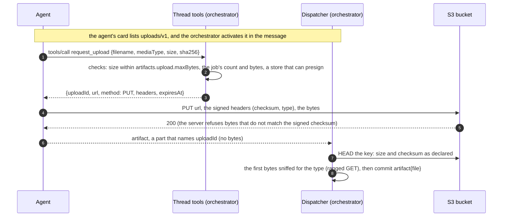
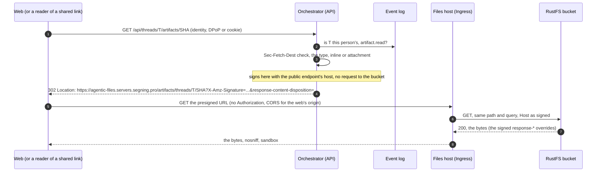
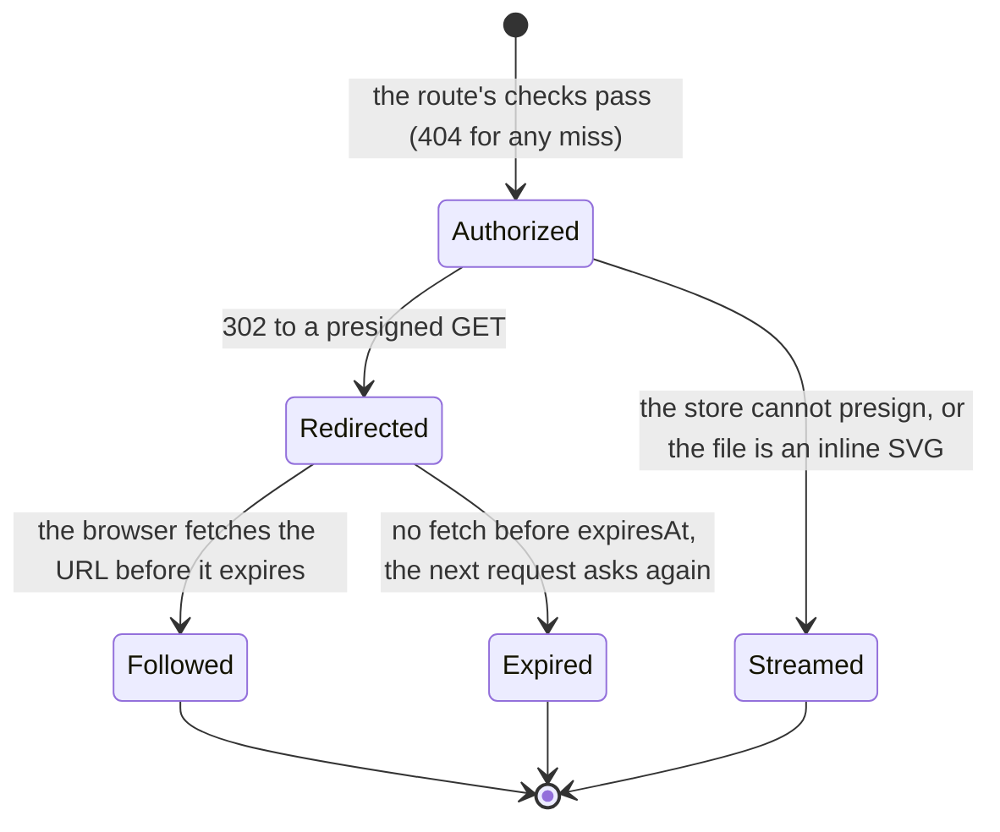

# ADR 0058 — Large files go up through a presigned URL the orchestrator gives the agent

- **Status:** **accepted (2026-10-11)**, on the owner's words of that day (the quote in the amendment at the end). Proposed
  2026-10-09, on the owner's request of that day; **design only, nothing is built**. It is the "presigned upload minted by a thread
  tool" that [ADR 0032](0032-files-from-agents-live-in-an-artifact-store.md) (decision 5) leaves for later, and it needs the S3 store
  (that ADR's amendment of 2026-10-09). **Amended (2026-10-11):** downloads go to the browser by a redirect to a presigned URL on a
  public files host, a presigned upload is signed for the same host, the thread's prefix is its replayable folder, and the rollout on
  netcup is listed: see [the amendment](#amendment-2026-10-11-downloads-by-presigned-url-on-a-public-files-host). The wire contract is
  [`api/uploads-v1.md`](../api/uploads-v1.md).

  **Amended (2026-10-14):** the orchestrator's side of the uploads is built (step 6a), proven on mocks, on the in-process S3 stub and, for the S3 adapter's
  own cases, on a RustFS run locally; **not** on a live agent or a RustFS run of the whole chain. Downloads by redirect (A1), the chart's public files host and its
  `NetworkPolicy`, and the rollout (A5) are step 6b, and the web's upload surface (A3) is not built because the owner stopped UI work on 2026-10-13 ("backend
  only"). **Two decisions changed in the build:** decision 2 (the slot signs four headers, not two) and decision 4 (an object that is refused is deleted unless a
  file of the thread already uses its key; the first draft of the build narrowed the deletion to bytes that do not hash to the key, and review widened it again),
  and a limit that decisions 3 and 6 assumed the bucket holds (the size) is checked after the fact. The text of the decisions is left as it was written. See
  [the amendment at the end](#amendment-2026-10-14-what-step-6a-built-what-changed-from-the-decisions-above-and-what-is-left).

  **Amended (2026-10-14, step 6b):** the orchestrator's side of A1 is built, **opt-in**: the download routes answer a `302` to a presigned `GET` only when `artifacts.s3.downloads:
  redirect` says so, and not, as A1 wrote, whenever `publicEndpoint` is set (the departure and its reason are in
  [the last amendment](#amendment-2026-10-14-step-6b-what-the-build-of-a1-did-and-the-one-departure)). The chart's public files host is step 6c; the web (A3) is not built.

## Context

A file reaches the thread as an A2A artifact whose part holds the bytes (`raw`, base64 in the JSON-RPC message), at most
`artifacts.maxFileBytes` (10 MiB) and 100 MiB a job ([ADR 0032](0032-files-from-agents-live-in-an-artifact-store.md), decision 7).
adam-rs keeps a file in its journal and caps it at 4 MiB, 6 MiB a run (`MAX_ARTIFACT_FILE_BYTES`, `MAX_RUN_FILE_BYTES` of
`crates/adam-runtime`, *verified 2026-10-09* by reading adam-rs at `09291a6`). A report of 30 MB, a data set or a recording does not
fit, and should not cross the message, the agent's journal and the worker's memory at all.

`object_store` 0.14.2, which the S3 store is built on, presigns a request: `Signer::signed_url_opts(method, path, expires_in,
SignedUrlOptions)` folds query parameters and **headers** into a SigV4 query signature, for example `x-amz-checksum-sha256` and
`content-type`, which the recipient must then send as signed (*verified 2026-10-09* by reading `src/signer.rs` and `src/aws/mod.rs`).

## Decision (accepted 2026-10-11)

```mermaid
stateDiagram-v2
  [*] --> Issued: request_upload accepted
  [*] --> Refused: too large, over the job's limits, no store that presigns
  Issued --> Uploaded: the agent's PUT (the URL works until it expires)
  Issued --> Expired: no PUT before expiresAt
  Uploaded --> Referenced: the artifact names it and the object is as declared
  Uploaded --> Unreferenced: never named; left to the orphan sweep (open question 46, not built)
  Expired --> [*]
  Refused --> [*]
  Referenced --> [*]
  Unreferenced --> [*]
```

1. **An optional extension, `uploads/v1`** ([ADR 0008](0008-platform-integration-via-a2a-extension.md)): an agent that can upload lists it on its card;
   the orchestrator activates it on the messages it sends, with its limits (`maxBytes`, `ttlSecs`) in the message's metadata. An agent
   that does not list it is unchanged, and so is a deployment whose store cannot presign (the directory store): the extension is not
   activated, and `raw` stays the only way.
2. **The agent asks for a slot over the thread's own tools** (`thread-tools/v1`, already authenticated by the per-thread token):
   `request_upload {filename, mediaType, size, sha256}`. The key is the content's hash, `threads/<thread>/<sha256>`, as for every file,
   so the agent declares the hash and the size first. The answer is a **presigned `PUT` for that one key**, its signed headers
   (`x-amz-checksum-sha256` of the declared hash, `content-type`), and its expiry: **five minutes** by default. The agent never holds a
   store credential, and the URL opens one key, for one method, for minutes.
3. **"One-time" is what the key makes it.** S3 has no single-use URL: within its few minutes the URL can be used again. Because the
   key is the hash and the checksum is signed, a second `PUT` can only write the same bytes again, which is harmless, and nothing else.
4. **The agent hands back a reference, not bytes**: its artifact's part names the `uploadId` (in the extension's metadata). The
   dispatcher checks the object before it commits, as it checks inline bytes ([ADR 0032](0032-files-from-agents-live-in-an-artifact-store.md),
   decision 6): a `HEAD` (the size, the checksum), the first bytes read for the type, then `artifact{file}`. An object that is not as
   declared is deleted and the turn says "the file could not be kept".
5. **The port grows by two optional calls**, `presign_put(key, meta, ttl)` and `head(key)`, each with a default that says
   "not supported" (a store that cannot presign is not broken by it; [ADR 0009](0009-swappable-implementations-at-build-time.md)).
   The S3 store implements them with `object_store`'s signer.
6. **Limits** are configuration: `artifacts.upload.maxBytes` (a GiB, say), `artifacts.upload.ttlSecs` (300), and the job's existing
   count and bytes, which now count uploaded files too.
7. **The agent must reach the bucket.** An agent in the cluster reaches the release's RustFS only if its NetworkPolicy lets it in
   (today it admits the orchestrator alone); an agent outside needs the bucket at a public https address. The deployment decides which
   agents get the extension.

## Consequences

- A file of any size the deployment allows, with no bytes in A2A, in the agent's journal or in the orchestrator's memory.
- adam-rs needs a client side: a `share_file` that, past its inline cap, asks for a slot, uploads and hands back the reference.
- *Unverified:* that RustFS refuses a `PUT` to a presigned URL without the signed checksum header, or with other bytes (it checks
  a checksum header on an ordinary signed request, the amendment of ADR 0032 says); presigned URLs through an ingress for agents outside.

## Alternatives rejected

- **The orchestrator receives the upload and streams it to the store** (a `PUT /uploads/<id>` of its own): no store reachable by
  agents, but every large file through the orchestrator's pods and its edge, which is what this avoids. Kept as the fallback for a
  store that cannot presign, if one is ever needed.
- **Store credentials for the agent** (a key per agent): a credential an agent could leak, for a whole bucket.
- **A multipart upload** for very large files: `object_store` presigns one request only (its signer's documentation); to be added if
  files over five gigabytes (S3's limit for one `PUT`) are ever wanted.

## Amendment (2026-10-11): downloads by presigned URL on a public files host

The owner, 2026-10-11, accepting this ADR and widening it:

> "I propose that sharing files goes through extensions … so that we can complete it on the orchestrator with S3 and stop caring too
> much about single file size. RustFS should be enabled as soon as possible too. We can release it via a hostname
> agentic-files.servers.segning.pro so that we can also use them on the web after presigned url are calculated. I'm imagining how all
> artifacts from a single thread are under a S3 folder, replayable."

Decisions 1 to 7 above stand, with one change: decision 7 (the agent must reach the bucket) is **relaxed by A2**. The rest is new.
*Facts, with their status, are in [Verified and unverified](#verified-and-unverified-2026-10-11).* **Nothing is built.**

- **A1. Downloads.** `GET /api/threads/{id}/artifacts/{sha}` and its two shared variants (`/api/shared/{token}/artifacts/{sha}`,
   `/api/public/shared/{token}/artifacts/{sha}`) **stay the authorization point**: identity, the thread's owner or the link, `artifact.read`,
   the `Sec-Fetch-Dest` refusal ([ADR 0054](0054-the-web-holds-its-own-tokens-dpop-bound-in-indexeddb.md), its correction of 2026-10-09)
   and the same 404 for every miss run first, unchanged. Then, with an S3 store that can presign and `artifacts.s3.publicEndpoint` set, the
   route answers **`302` to a presigned GET** on the public files host instead of streaming. Otherwise (the directory store, S3 with no public
   endpoint) it streams as today. The presign:
   - **TTL** `artifacts.s3.presignTtlSecs`, default **300**, 30 to 3600. The two shared variants use `min(ttl, 60)`: a revoked link
     ([ADR 0040](0040-thread-sharing-by-revocable-link.md)) must stop working within a minute. A URL already issued cannot be recalled (S3 has no revoke);
     a deleted file ([ADR 0043](0043-deleting-a-thread-erases-it.md)) stops at once because the object is gone.
   - **`response-content-disposition`**: `attachment; filename="…"` (the route's existing, cleaned name, with the RFC 5987 form) unless the type is one of the
     preview types (`orch_core::Preview`) **and** the request has no `?download=1`, then `inline`.
   - **`response-content-type`**: the kept type for a preview type, `application/octet-stream` for every other, as the route sends today
     ([ADR 0054](0054-the-web-holds-its-own-tokens-dpop-bound-in-indexeddb.md), its correction).
   - **`response-cache-control`**: `private, max-age=<ttl>`. The route's year-long `immutable` cache is lost for S3-served files (the URL changes on each
     request); said in the consequences.
   - These are signed query parameters, so the holder of the URL cannot change them (*verified 2026-10-11*: S3's `GetObject` accepts the
     `response-*` parameters only on a signed request). The 302 itself is `Cache-Control: private, no-store`.
   - **`X-Content-Type-Options: nosniff`** cannot be asked of S3 by a `response-*` parameter (the six it takes are cache-control, content-disposition,
     content-encoding, content-language, content-type and expires). The **files host's Ingress adds it**, with `Content-Security-Policy: default-src 'none';
     sandbox` and `Referrer-Policy: no-referrer`, by the controller's headers middleware. Whether RustFS adds any of them itself is *unverified*.
   - **SVG: the orchestrator keeps serving the sanitized one, streamed.** A request for an SVG without `?download=1` is not redirected: it is read, cleaned by
     `orch-svg-clean` and sent as today (up to 2 MiB). Why not a sanitized copy in the bucket: it is a second object per SVG and a second key shape in
     `ArtifactKey` (the port refuses anything but `threads/<thread>/<sha256>`), a cleaner fixed at write time cannot be improved later, and it would still be
     served from a host that is **the same site** as the app (`servers.segning.pro`; only the origin differs), where a script that ran in an SVG
     document could send same-site requests. `?download=1` of an SVG is the original bytes as an attachment, and is presigned like any download (an attachment is
     not rendered). The web draws a file as an ``, never as a document ([ADR 0032](0032-files-from-agents-live-in-an-artifact-store.md), decision 9).
- **A2. Presigning uses the public endpoint; the bucket is reached on the internal one.** SigV4 signs the `Host` header, so a URL signed for
   `http://release-rustfs:9000` does not work at `agentic-files.servers.segning.pro`. Two settings, both under `artifacts.s3`:
   - `endpoint` (exists): what the orchestrator calls for `put`, `get`, `delete`, `copy`, `head`: in the cluster, the Service of the release's RustFS.
   - `publicEndpoint` (new): an `https` URL with a host, no credentials, query or fragment (`http` only outside `server.environment: production`).
     It is the host in every presigned URL, for **downloads and for uploads** (decision 2 above). The store builds a second signer with the same bucket and credentials
     and this endpoint, and uses it for signing only: no request goes to the public host from the orchestrator. Absent: nothing is presigned.
   With an endpoint the addressing is path style ([ADR 0032](0032-files-from-agents-live-in-an-artifact-store.md), amendment of 2026-10-09), so the bucket name is the first
   path segment of the public URL, and the Ingress routes that prefix only.
   **Decision 7 changes:** an agent, in the cluster or outside it, reaches the bucket through the **public files host** over https. RustFS's NetworkPolicy needs no
   exception for agents; it admits the ingress controller's namespace beside the orchestrator and the bucket Job.
- **A3. The web.** [ADR 0054](0054-the-web-holds-its-own-tokens-dpop-bound-in-indexeddb.md) (decision 9) makes the web **fetch** a file with its token and show an object
   URL, because an `` carries no header; the public reader keeps plain links. So the files host is added to the web's policy in three places:
   - `connect-src` (the web's `fetch` follows the redirect: a policy applies to the redirect target, per the CSP specification, *unverified here*: not re-read),
   - `img-src` (the public reader's plain `` and any direct image), and
   - `media-src` (audio and video previews, when there are any).
   One variable for the three, `WEB_CSP_FILES_SRC` (origins, *proposed*; the web's `src/lib/csp.ts`, the `Caddyfile`, `apps/tauri` take it). **CORS**: the files host answers
   `Access-Control-Allow-Origin: <the web's origin>` (not `*`), methods `GET`, `HEAD`, `OPTIONS`, `Access-Control-Allow-Headers` including `DPoP`, `Vary: Origin`.
   Exactly one layer sets these (the Ingress, or the bucket if RustFS is shown to answer a preflight): two sets of `Access-Control-*` headers make the browser refuse.
   Uploads come from agents, not browsers, so no `PUT` is allowed in CORS.
   The browser drops `Authorization` on a cross-origin redirect and keeps other headers, so the web's `DPoP` header reaches the files host and makes that request
   preflighted. This is *unverified* (see below), and if it fails the fallback is a JSON answer from the same route, `{url, expiresAt}` for a request that asks
   for `application/json`, which the web then fetches with no header. Not decided; the build proves the redirect first.
- **A4. Replayable.** The key `threads/<thread>/<sha256>` ([ADR 0032](0032-files-from-agents-live-in-an-artifact-store.md), decision 2), under the configured `prefix`, is
   the thread's **folder**: every file the thread ever kept, by hash, and nothing of another thread. A fork copies the files it inherits into its own folder (ADR 0042);
   a deletion removes the folder (`delete_prefix`, ADR 0043). **The log plus the prefix is the replay**: the log says what happened and the folder holds every byte it
   refers to. *Proposed, a later slice:* a **thread bundle**, `GET /api/threads/{id}/bundle` (permission `thread.read` and `artifact.read`), a streamed archive of
   `thread.json` (the export), `files/<sha256>` for each reference, and `manifest.json` (hash, size, type, name per file, the export's `versions`), so a thread can be read
   again elsewhere. Importing a bundle is not proposed (question 76 asks).
- **A5. The rollout on netcup**, in this order (the owner's steps 1 and 3; the chart's 2 and 4 are built by the slices):
   1. **Secrets.** The owner adds the AWS properties `artifacts_s3_access_key_id` and `artifacts_s3_secret_access_key` to `prod/another-agentic/env`
      (they exist in the chart's contract; the deployment has not set them).
   2. **The chart** gains an Ingress for RustFS's S3 API on the files host (`rustfs.ingress.{enabled, host, clusterIssuer, corsOrigins}`, *proposed*): TLS from the
      cluster issuer as the app's, the route limited to the bucket's path prefix and to the methods `GET`, `HEAD`, `OPTIONS` (and `PUT` only while `uploads/v1` is on), the headers of A1 and
      the CORS of A3, and the NetworkPolicy exception for the ingress controller. Nothing under `/` or an admin path is routed.
   3. **home-os** sets `rustfs.enabled: true`, `orchestrator.artifacts.store: s3`, `orchestrator.artifacts.s3.publicEndpoint:
      https://agentic-files.servers.segning.pro` (`orchestrator.artifacts.s3.endpoint` is the Service's by default) and the web's `WEB_CSP_FILES_SRC`. DNS for the host.
   4. **A one-off `orchestrator artifacts migrate --from fs --to s3`** moves today's files before the volume is dropped. It is the binary's first subcommand (it has
      flags only), and: reads the directory at `--fs-root` (the kept volume of the directory store, mounted by a Job), writes to the configured `artifacts.s3`
      through `ArtifactStore::put` (**the same keys**, so the references in the log stay valid; the meta becomes object metadata exactly as `put` writes it, and
      `ArtifactMeta::check` runs on each file); idempotent by content, resumable, `--dry-run`, a report (files, bytes, skipped, failed), exit 0 only when every file
      is in the bucket with the right size. The chart renders the Job on request (`orchestrator.artifacts.migrate.enabled`), mounting the kept claim. Until it has run,
      the files of earlier threads read as gone (404): it runs right after the sync. The claim is deleted by hand afterwards (the chart never prunes it).
   5. **The orchestrator can scale past one pod.** The directory volume is what ties it to one replica (`Recreate`). With `s3` the chart may lift that rule (a change of its
      own); that nothing else pins it is *unverified*.
- **A6. The extension URI stays `https://agents.vymalo.com/a2a/extensions/uploads/v1`** (decision 1). Its contract is [`api/uploads-v1.md`](../api/uploads-v1.md); the index of
   all extensions is [`api/extensions.md`](../api/extensions.md).

**Consequences of the amendment.** Large downloads no longer cross the orchestrator's pods or its edge. The year-long immutable browser cache of the streamed route is
gone for S3 files (a new signature per request). The S3 API of a *preview* release of RustFS (1.0.1-preview.17, ADR 0032) is reachable from the internet by signature only, so the
Ingress's path and method limits and the checks below are not optional. A revoked share link can serve a file for up to a minute through a URL already issued.

### Verified and unverified (2026-10-11)

*Verified 2026-10-11:*
- `object_store` 0.14.2 presigns with extra signed query parameters and headers: `Signer::signed_url_opts` with `SignedUrlOptions::with_query` and `with_signed_header`
  (read in `src/signer.rs` of the crate in the local cargo registry; its documentation says the recipient "must send exactly these query parameters and headers").
- S3's `GetObject` takes `response-cache-control`, `response-content-disposition`, `response-content-encoding`, `response-content-language`, `response-content-type` and
  `response-expires`, and "must" be signed: "These parameters cannot be used with an unsigned (anonymous) request"
  (<https://docs.aws.amazon.com/AmazonS3/latest/API/API_GetObject.html>).
- RustFS's S3 compatibility matrix lists "Presigned GET and PUT URLs" as Supported, and one grouped row names "versioning, object-lock, checksum, CORS, raw request, and conditional write
  behavior" as Supported without saying which CORS calls
  (<https://github.com/rustfs/rustfs/blob/main/docs/architecture/s3-compatibility-matrix.md>, read through the raw file; no revision or date shown on it).

*Unverified, to be proven against RustFS 1.0.1-preview.17 and in a real browser before the files host goes live:*
- that a presigned `GET` with the `response-*` overrides above is honoured by RustFS (the matrix is silent), and that `Range` works;
- that RustFS answers a CORS preflight from the bucket's configuration, and whether it adds `nosniff` (this ADR puts both on the Ingress);
- that an anonymous request for a key is refused (403) and the bucket's default is private;
- that a same-origin `fetch` with `Authorization` and `DPoP` that is redirected to the files host loses `Authorization`, keeps `DPoP`, is preflighted, and succeeds (Fetch's redirect
  rules, not re-read here);
- that a Traefik route can require a signature in the query (`X-Amz-Signature`), which would also keep unsigned probes off a preview server;
- that RustFS refuses a presigned `PUT` whose body does not match the signed checksum (decision, *Consequences* above, still stands).

## Amendment (2026-10-14): what step 6a built, what changed from the decisions above, and what is left

**Amended (2026-10-14).** No decision above is reversed in its aim, but two changed in the build, and a third assumption did not hold. The text of the decisions is
left as it was written; this is where they differ:

- **Decision 2: four signed headers, not two.** The slot signs `content-type`, `x-amz-checksum-sha256`, `x-amz-meta-sha256` and `x-amz-meta-filename` (item 3 below).
- **Decision 4: the deletion.** The text deletes an object that is "not as declared". As built, every refused upload's object is deleted (a hash that is not the key's, a size
  that was lied about, a late arrival or one whose time the store does not say, an image that is not one, a file over `maxBytes` or the job's limits) **unless a file of the
  thread already uses its key** (item 5 below). The first draft of the build was narrower than the text, deleting only bytes that do not hash to the key; review found that
  it left bytes of any size outside every limit, and widened it.
- **Decisions 3 and 6: the size is not held by the bucket.** They assumed a limit the bucket enforces; `content-length` cannot be signed, so the size is checked after the
  fact (item 9 below).

This note records what the build does, where it chose differently from the text, and what is still to do. The contract page
([`api/uploads-v1.md`](../api/uploads-v1.md), the sections marked *As built*) has the detail; the sequence and state diagrams of the code are in
[`orchestrator.md`](../orchestrator.md#uploads-adr-0058).

**Built (all on the orchestrator's side, tested on mocks and on an in-process S3 stub):**

- The port `ArtifactStore` gains `can_presign`, `presign_put`, `head` and `read_prefix`, each with a default that says "not supported" (a new `ArtifactError::Unsupported`), so no implementer breaks. A testkit
  (`artifact_presign_conformance!`, `artifact_no_presign_conformance!`) and `MemoryArtifacts::presigning()` prove an implementation.
- The S3 store signs the `PUT` with a second signer for `artifacts.s3.publicEndpoint` (A2) and answers `head` with the stored checksum (one `HEAD` signed in the query, sent with its own client, because `object_store`
  does not parse a checksum on `HEAD`); a server that gives none leaves the dispatcher to read and hash the object.
- The configuration keys `artifacts.upload.maxBytes` (1 byte to 5 GiB, and not above `maxPerJobBytes`, whose own ceiling is 4 GiB: **4 GiB is the effective ceiling**) and `artifacts.upload.ttlSecs` (30 to 3600, default 300), and `artifacts.s3.publicEndpoint`; the schema is regenerated.
  A2 does not name the keys; these are the build's. `artifacts.upload` without an S3 store with a public endpoint, the thread-tools key and URL, and the thread-tools surface is exit 78 naming the key.
- The extension on the card, in the message (the limits, for the thread's addressed agent only) and in the artifact; the tool `request_upload` as a thread-tools provider; the ingest in the dispatcher.

**Where the build departs from the text above, and why:**

1. **The upload id carries its claims** (thread, job, hash, size, type, expiry) with the MAC over them, as a signed token, instead of a bare MAC: the artifact part carries neither the hash nor the size, so a bare MAC cannot be
   checked without a table, and decision 2 forbids one. Same key and rotation as the thread tools; a domain line keeps the two apart.
2. **The reference part is a `data` part** (empty, with the id in its metadata), not a part with no body: `a2a-lf` refuses a part that holds none of `text`, `raw`, `url` and `data`.
3. **The slot signs four headers**, not two: `content-type`, `x-amz-checksum-sha256`, and the two user-metadata headers (`x-amz-meta-sha256`, `x-amz-meta-filename`) a `put` writes, so that an uploaded object reads back like any other.
4. **The tool reads the live card** instead of a flag in the token (a new claim would break old verifiers during a rolling deploy), and counts the job's files and bytes off the log (the dispatcher's budget is in memory
   and per delegation); the ingest enforces again.
5. **Deletion (decision 4), as built.** An object whose reference is refused once the id has been read is deleted, whatever the reason, **unless** a file of the thread already uses its key: this delegation has kept
   the content, or the log holds an artifact with that hash (put inline earlier, or by an earlier slot; a log too long to read whole counts as holding it). A delete there would break that reference. Keys are per
   thread (`threads/<thread>/<hash>`), so nothing outside the thread is touched. (The first draft deleted only an object whose content does not hash to the key, and kept the others "because the same bytes may be a file
   the thread keeps": that protected the reference and left the bytes of a lied size in the bucket, item 9.)
6. **The type of an uploaded file is the one it was put with** (the signed header, normalised to `type/subtype`); the sniff only validates an image type.
7. **The offer is not given to an asked agent**, and `request_upload` is not a built-in tool but a provider (`ThreadTool::ALL` is unchanged), listed to the addressed agent while the deployment offers uploads.
8. **Two errors beyond the table:** `task_over` (the thread's task is over) and `unavailable` (the thread, the registry, the store or the agent's card could not be read now; a card that cannot be read is this, not
   `not_activated`).
9. **The size is enforced after the fact, not by the bucket.** `content-length` cannot be signed into a presigned `PUT`: `object_store` 0.14.2 rejects it among the headers it will not sign, because the signer drops it
   (*verified 2026-10-14* by reading `src/util.rs`, `RESERVED_SIGNED_HEADERS`). So `artifacts.upload.maxBytes` and the job's bytes bind the **declared** size, at `request_upload` and again at the ingest, and not the bytes the
   bucket takes. An agent can ask for a slot of 1 byte for the hash of a 4 GiB blob and `PUT` it: the checksum matches and the bucket takes it. The ingest then refuses the reference and deletes the object, but until it
   runs the bucket holds the bytes, and for good if the agent never names the `uploadId` (nothing else triggers the check). Decision 3's "harmless" holds for the content, not for the space it takes. **A bucket quota, or the
   orphan sweep of open question 46, is required before uploads are enabled outside a development stack.** The number of slots a job may ask for is not bounded either: the tool counts what the job has kept, not the
   slots outstanding.

**Left (step 6b and later):** A1 (downloads by a `302` to a presigned `GET` on the public files host), the chart's Ingress for the files host with its path, method and header limits and the `NetworkPolicy` exception, A5 (the
rollout on netcup and `orchestrator artifacts migrate`), the orphan sweep for an upload nobody names (open question 46: it must also cover a key of a thread that was deleted, because a still-valid URL can recreate
`threads/<deleted>/<hash>` within its lifetime, [ADR 0043](0043-deleting-a-thread-erases-it.md)), a bucket quota, and adam-rs's client side. **A3 (the web) is not built**: the owner said on 2026-10-13 "backend only",
so no upload surface, no file chip and no change to the web's policy were made. Known and not done, each listed in [`api/uploads-v1.md`](../api/uploads-v1.md#what-is-left): a second slot for the same hash overwrites the
object's type and name metadata; a transient store error in the ingest becomes a permanent refusal through the idempotency key; the slot's id is signed with the thread-tools key itself, not a derived subkey; `hash_object` is
bounded only by the request timeout; no bound on the slots outstanding.

**Verified 2026-10-14 (by tests that ran, locally, against RustFS 1.0.1-preview.17, the pin of `compose.yaml`):** the S3 adapter's suites with `ORCH_TEST_S3_URL` (93 tests, of which 5 are new) pass. RustFS **enforces the signed
checksum** on a presigned `PUT` (other bytes under it are `400 BadDigest` and nothing is stored), **says the checksum** on a `HEAD` with checksum mode (and `Last-Modified`), and refuses with `403` every request that differs from the
slot in one thing: an `x-amz-*` header the signature does not cover (`x-amz-acl`, an extra `x-amz-meta-*`, `x-amz-storage-class`, `x-amz-server-side-encryption`, `x-amz-tagging`, and `x-amz-copy-source` naming another
thread's object, after which the key holds nothing of it) is `AccessDenied: There were headers present in the request which were not signed`; another `content-type`, another key or thread, and `GET`, `HEAD` and `DELETE` on
the `PUT` URL are `SignatureDoesNotMatch`. CI runs the same in `orchestrator.yml`.

**What the build relies on, precisely.** The ingest takes the content hash from the checksum a `HEAD` reports when the store reports one, and reads and hashes the object itself only when it reports none. So the build **does**
rely on a server that reports `x-amz-checksum-sha256` having checked it against the bytes it stored: RustFS does (above); AWS S3 is expected to (*unverified*: it was not run). A server that echoed the claimed checksum without checking it would make the ingest vouch for
other bytes of the declared size; for such a server only the ingest's own hash would be a proof, and the ingest does not take it when a checksum is reported. The case `other_bytes_than_declared_are_refused_or_never_vouched_for` of the testkit
(run against every store and, with `ORCH_TEST_S3_URL`, against the real server) fails on such a server for bytes of the declared length, and that is a finding for the owner, not a flaky test.

**Unverified:** a `PUT` through the chart's Ingress with the signed `Host` (6b); that `object_store` 0.14.2's `Signer` and the `HEAD` the adapter signs itself are read the same by every S3-compatible server (AWS S3 itself was not
run); whether a signer of our own that signs `content-length` into the `PUT` would make S3 and RustFS enforce the size (nobody has tried), which would close item 9. There is no `dev/upload-e2e.sh`: a WireMock agent can neither call the tool nor `PUT`, and the id it would name is bound to the job it was issued in.

## Amendment (2026-10-14, step 6b): what the build of A1 did, and the one departure

**Amended (2026-10-14, step 6b).** The orchestrator's side of A1 (downloads by a `302` to a presigned `GET` on the public files host) is built and proven on mocks, on the in-process S3 stub and on a RustFS run
locally; **not** through the chart's Ingress, a real browser, or a live agent. The 6a amendment put the chart's public files host and its `NetworkPolicy` in 6b; the owner's split
is: 6b is the orchestrator's side of A1, **6c is the chart**. The text of A1 is left as it was written. This is where the build differs from it.

**The one departure: the redirect is opt-in.** A1 redirects "with an S3 store that can presign and `artifacts.s3.publicEndpoint` set". As built it also needs **`artifacts.s3.downloads: redirect`** (`stream`, the
default, sends the bytes through the orchestrator as before). The reason: the web fetches a file with `fetch` and DPoP ([ADR 0054](0054-the-web-holds-its-own-tokens-dpop-bound-in-indexeddb.md), decision 9), and
its `connect-src` (`web/src/lib/csp.ts`) does not list the files host: A3, which adds `WEB_CSP_FILES_SRC`, is not built (the owner stopped the UI work on 2026-10-13). `publicEndpoint` is already needed
by 6a's uploads, so a redirect switched on by it alone would break every file in the web for a deployment that only wanted uploads. `redirect` without `publicEndpoint` is a configuration error
(exit 78, naming `artifacts.s3.downloads`). Turning it on is the deployment's decision, taken together with the files host's CORS and the web's policy (6c and A3).

**Built:**

- **The port.** `ArtifactStore::presign_get(key, &ResponseOverrides, ttl) -> PresignedGet { url, expires_at }`, with the "not supported" default (`ArtifactError::Unsupported`), beside `presign_put` and `head`.
  `ResponseOverrides { content_disposition, content_type, cache_control }` are neutral (no S3 name in the signature), each `None` or visible ASCII of at most 2048 bytes; a lifetime under a second or over seven
  days, or an override a header cannot carry, is `Invalid` before anything is signed. `can_presign` now answers for the three calls. `ArtifactHead` gains `filename`, so that the route learns the name a download
  is given from a `HEAD`, **without reading the file** (A1 does not say how the route knows the name; reading the object to find out would put its first bytes through the orchestrator for every redirect).
  The testkit proves any implementation (`PresignFixture.download` plays the browser's `GET`; four new cases: the signed overrides come back whatever characters they hold, only what was asked is signed, a URL opens
  its key and no other, a wrong request gets no URL; and a store that cannot presign says `Unsupported`); `MemoryArtifacts::presigning()` signs `memory://` URLs and plays the bucket's `GET` (`download`).
- **The S3 store** signs with the **public** signer (A2): `response-content-disposition`, `response-content-type` and `response-cache-control` are query members of the signature, and the signed headers are
  only `host`, so the browser sends nothing else. `head` also says the object's name (`x-amz-meta-filename`, percent-decoded).
- **The application.** The checks of the three routes are one function with the open: `App::readable_artifact`, `readable_shared_artifact` and `readable_public_artifact` run the checks of `open_*` (which are now
  those plus `open_readable`) and return a `ReadableFile`, the proof that they passed. `redirect_ttl` says whether to redirect and for how long (`min(ttl, 60)` for a reader of a link), `readable_meta` reads the
  type, size and name from a `HEAD`, `presign_download` signs.
- **The routes** (`orch_api::artifacts::deliver`, one function for all three): every check first and unchanged, then, with a redirect, `302` with `Location`, `Cache-Control: private, no-store`
  (the two link routes' own hardening makes it `no-store`, as for everything they serve) and `Referrer-Policy: no-referrer` (an addition of the build: a redirect's policy governs the request the browser is sent on, and the page
  that asked may be a share link's `/s/<token>`). Disposition, type and cache are decided by one pure function (`redirect_overrides`) from the same rules the streamed
  response uses (`content_type` is shared): `inline` only for a preview type without `?download=1`, the kept type for a preview type (`text/plain` and `application/json` with a charset when shown),
  `application/octet-stream` for every other, `private, max-age=<the URL's life>`. An SVG without `?download=1` is never redirected (sanitized and streamed); with it, it is redirected as an attachment.
- **The configuration**: `artifacts.s3.downloads` (`stream` | `redirect`, default `stream`) and `artifacts.s3.presignTtlSecs` (30 to 3600, default 300). The schema is regenerated.
- **The contract**: `getArtifact`, `getSharedArtifact` and `getPublicSharedArtifact` document the `302` (and the 500 and 503 of a signing that fails).

**Where the build chose, and why:**

1. **A signing that fails is a 5xx, with no fallback to streaming.** Signing is local (the signer makes no request), so a failure is a bug or a broken deployment (an override the route built that a header
   cannot carry, a store that says it can presign and cannot: both are `500`, never a `400`), or a store that cannot be reached for the `HEAD` (`503` with `Retry-After`). A fallback to the stream would
   answer the request and hide the fault, and would put back, silently, the very load the redirect exists to take off the orchestrator. The error is logged by the problem mapping.
2. **The file is not read to be redirected**: one `HEAD` (type, size, name), then the signature. An object that is gone is the same 404 as before; one that says no type is `Corrupt`, as `get` says.
3. **Whole seconds.** `X-Amz-Expires` is whole seconds and S3 refuses 0, so a lifetime under a second is `Invalid`, and `expires_at` is the whole-second expiry.
4. **The 302 of a link is `no-store`**, not `private, no-store`: the hardening of the shared routes sets one `Cache-Control` on every response of theirs (ADR 0040), and it is no weaker.
5. **The year-long immutable cache is lost** for a redirected file, as A1 said: the URL changes with each request, and the bucket's answer says `private, max-age=<the URL's life>` (at most 60 for a link).

**Verified 2026-10-14 (by tests that ran, locally, against RustFS 1.0.1-preview.17, the pin of `compose.yaml`; CI runs the same in `orchestrator.yml`):** a presigned `GET` with the three `response-*` members is
served with exactly those values as the headers of the answer, for a disposition with spaces, quotes, `;`, `&`, `=`, `+`, `?`, `#`, `%`, `*`, `'` and UTF-8 in both forms, a `Range` of it is a `206` with the overrides
applied, and RustFS refuses with `403 SignatureDoesNotMatch` a URL whose `response-content-disposition`, `response-content-type` or `response-cache-control` is changed or removed, to which a member
nobody signed is added (`response-content-encoding`, `-language`, `-expires`), whose key or thread is another's, and whose method is `HEAD`, `PUT`, `DELETE` or `POST`; a request with no signature, with or without the
members, is `403 AccessDenied` (the bucket is private by default); a URL past its life is `403 AccessDenied: Request has expired` (a real wait of 3.5 s on a 2 s URL: `object_store` takes no clock of ours).
That RustFS adds **none** of `X-Content-Type-Options`, `Content-Security-Policy` and `Access-Control-Allow-Origin` to the answer (with an `Origin` header or without), and answers the preflight (`OPTIONS` with
`Origin`, `Access-Control-Request-Method: GET` and `Access-Control-Request-Headers: dpop`) of a presigned URL with `200` and no `Access-Control-*` header, is *verified* by the same run for a bucket with no CORS rule
configured (the stack's): the direction the ADR assumed, so the files host's Ingress must add the headers and the CORS (6c). Whether RustFS answers a preflight from a CORS rule of the bucket stays *unverified*. The end-to-end test (`crates/e2e/tests/downloads.rs`) follows the `Location` against the stub and, with `ORCH_TEST_S3_URL`, against RustFS, on the
in-memory store and on Postgres.

Of the *Unverified* items of 2026-10-11 this closes, for RustFS 1.0.1-preview.17: that a presigned `GET` with the `response-*` overrides is honoured, and that `Range` works; that an anonymous request for a key is refused
(`403`) and the bucket is private by default; and, in part, whether RustFS adds `nosniff` and answers a preflight (it does neither, without a CORS rule).

**Unverified:** that AWS S3 itself accepts the same URLs (not run); that a real browser's `fetch` with `Authorization` and `DPoP` is redirected to the files host, loses `Authorization`, keeps `DPoP`, is preflighted and succeeds
(A3, not built, and the reason the redirect is opt-in); the Ingress's path, method and header limits and the CORS (6c); that a Traefik route can require `X-Amz-Signature` in the query; a large file's download
through the Ingress; and that `Content-Disposition` with the RFC 5987 form is honoured by every browser from a redirected URL as it is from a streamed response.

**Left (6c and later):** the chart's Ingress for the files host (the path prefix, the methods, the three headers, the CORS) and its `NetworkPolicy` (6c); A3 (the web's policy, `WEB_CSP_FILES_SRC`, the
fallback if the redirect loses `DPoP`); A5 (the rollout and `orchestrator artifacts migrate`); A4's thread bundle; the orphan sweep and a bucket quota of the 6a amendment; adam-rs's client side. Until A3 and 6c are done,
`artifacts.s3.downloads: redirect` must not be set for a deployment that serves the stock web.

