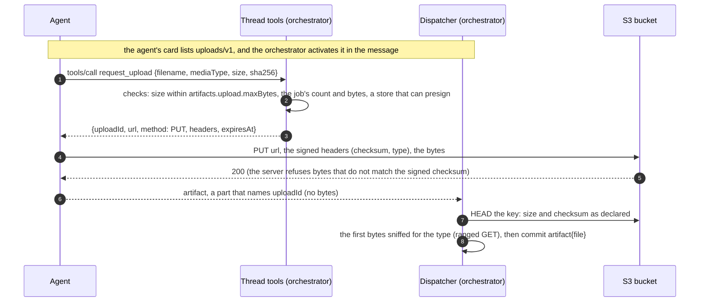
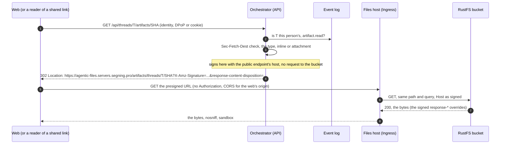
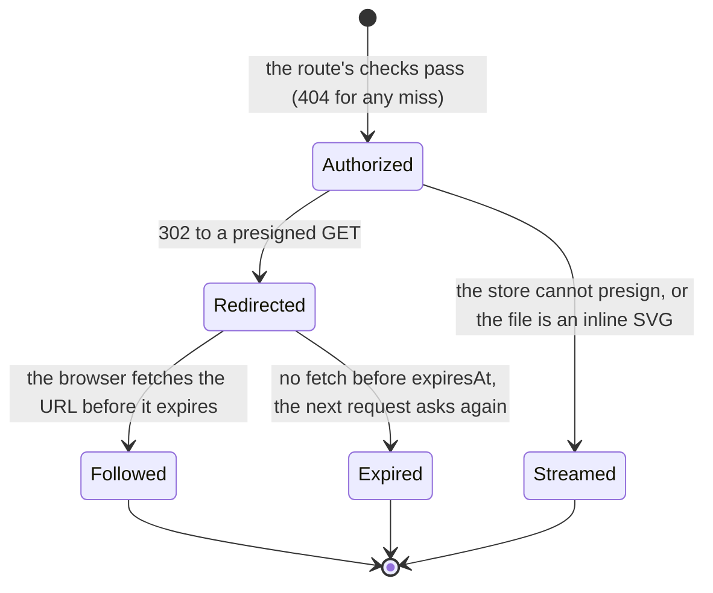

# ADR 0058 — Large files go up through a presigned URL the orchestrator gives the agent

- **Status:** **accepted (2026-10-11)**, on the owner's words of that day (the quote in the amendment at the end). Proposed
  2026-10-09, on the owner's request of that day; **design only, nothing is built**. It is the "presigned upload minted by a thread
  tool" that [ADR 0032](0032-files-from-agents-live-in-an-artifact-store.md) (decision 5) leaves for later, and it needs the S3 store
  (that ADR's amendment of 2026-10-09). **Amended (2026-10-11):** downloads go to the browser by a redirect to a presigned URL on a
  public files host, a presigned upload is signed for the same host, the thread's prefix is its replayable folder, and the rollout on
  netcup is listed: see [the amendment](#amendment-2026-10-11-downloads-by-presigned-url-on-a-public-files-host). The wire contract is
  [`api/uploads-v1.md`](../api/uploads-v1.md).

  **Amended (2026-10-14):** the orchestrator's side of the uploads is built (step 6a), proven on mocks, on the in-process S3 stub and, for the S3 adapter's
  own cases, on a RustFS run locally; **not** on a live agent or a RustFS run of the whole chain. Downloads by redirect (A1), the chart's public files host and its
  `NetworkPolicy`, and the rollout (A5) are step 6b, and the web's upload surface (A3) is not built because the owner stopped UI work on 2026-10-13 ("backend
  only"). **Two decisions changed in the build:** decision 2 (the slot signs four headers, not two) and decision 4 (an object that is refused is deleted unless a
  file of the thread already uses its key; the first draft of the build narrowed the deletion to bytes that do not hash to the key, and review widened it again),
  and a limit that decisions 3 and 6 assumed the bucket holds (the size) is checked after the fact. The text of the decisions is left as it was written. See
  [the amendment at the end](#amendment-2026-10-14-what-step-6a-built-what-changed-from-the-decisions-above-and-what-is-left).

  **Amended (2026-10-14, step 6b):** the orchestrator's side of A1 is built, **opt-in**: the download routes answer a `302` to a presigned `GET` only when `artifacts.s3.downloads:
  redirect` says so, and not, as A1 wrote, whenever `publicEndpoint` is set (the first of six departures from A1, with its reason, is in
  [the last amendment](#amendment-2026-10-14-step-6b-what-the-build-of-a1-did-and-where-it-departs-from-it)). The chart's public files host is step 6c; the web (A3) is not built.

  **Amended (2026-10-14, step 6c):** the chart's public files host is built (A5.2, with the headers of A1 and the CORS of A3), **off by default**, with the chart values that wire 6a's uploads and 6b's downloads. It is a Caddy proxy
  behind a Traefik `Ingress`, not "the controller's headers middleware" of A1, and `publicEndpoint` is derived from the host instead of set by home-os (A5.3): two departures, with the build's others, in
  [the last amendment](#amendment-2026-10-14-step-6c-the-chart-builds-the-files-host-and-what-running-it-proved). Run against a real RustFS from a script; **not** through Traefik, a real browser or the cluster.

  **Amended (2026-10-14, step 6d):** A5.4 is built: `orchestrator artifacts migrate --from fs --to s3`, the binary's first command, and the chart's Job for it (`orchestrator.artifacts.migrate`, **off by default**). It loads the store of the configuration and nothing else (a departure: the full loader would have
  asked the Job for the database), the Job is a hook and not a plain Job, and the exit codes, the skip rule and the stop after five failures of the bucket are the build's. Run against the in-memory store, the in-process S3 stub and a local RustFS; **not** on a cluster, and the owner's rollout is not done. See
  [the last amendment](#amendment-2026-10-14-step-6d-the-migration-is-built-and-where-it-departs-from-a54).

  **Amended (2026-10-14, step 6d review, #248):** the review found that the Job ran after the switch, which loses files (a fork) and brings deleted ones back, an empty or wrongly mounted claim that counted as a success, and
  `--config` before the command refused. The Job now runs **before** the switch and once more for the delta, an empty claim is exit 66, links are failures, an upload is proven by content. Three statements of the step 6d amendment are corrected in place
  and the whole account is in [the amendment after it](#amendment-2026-10-14-step-6d-review-copy-before-the-switch-and-what-the-review-found).

## Context

A file reaches the thread as an A2A artifact whose part holds the bytes (`raw`, base64 in the JSON-RPC message), at most
`artifacts.maxFileBytes` (10 MiB) and 100 MiB a job ([ADR 0032](0032-files-from-agents-live-in-an-artifact-store.md), decision 7).
adam-rs keeps a file in its journal and caps it at 4 MiB, 6 MiB a run (`MAX_ARTIFACT_FILE_BYTES`, `MAX_RUN_FILE_BYTES` of
`crates/adam-runtime`, *verified 2026-10-09* by reading adam-rs at `09291a6`). A report of 30 MB, a data set or a recording does not
fit, and should not cross the message, the agent's journal and the worker's memory at all.

`object_store` 0.14.2, which the S3 store is built on, presigns a request: `Signer::signed_url_opts(method, path, expires_in,
SignedUrlOptions)` folds query parameters and **headers** into a SigV4 query signature, for example `x-amz-checksum-sha256` and
`content-type`, which the recipient must then send as signed (*verified 2026-10-09* by reading `src/signer.rs` and `src/aws/mod.rs`).

## Decision (accepted 2026-10-11)

```mermaid
stateDiagram-v2
  [*] --> Issued: request_upload accepted
  [*] --> Refused: too large, over the job's limits, no store that presigns
  Issued --> Uploaded: the agent's PUT (the URL works until it expires)
  Issued --> Expired: no PUT before expiresAt
  Uploaded --> Referenced: the artifact names it and the object is as declared
  Uploaded --> Unreferenced: never named; left to the orphan sweep (open question 46, not built)
  Expired --> [*]
  Refused --> [*]
  Referenced --> [*]
  Unreferenced --> [*]
```

1. **An optional extension, `uploads/v1`** ([ADR 0008](0008-platform-integration-via-a2a-extension.md)): an agent that can upload lists it on its card;
   the orchestrator activates it on the messages it sends, with its limits (`maxBytes`, `ttlSecs`) in the message's metadata. An agent
   that does not list it is unchanged, and so is a deployment whose store cannot presign (the directory store): the extension is not
   activated, and `raw` stays the only way.
2. **The agent asks for a slot over the thread's own tools** (`thread-tools/v1`, already authenticated by the per-thread token):
   `request_upload {filename, mediaType, size, sha256}`. The key is the content's hash, `threads/<thread>/<sha256>`, as for every file,
   so the agent declares the hash and the size first. The answer is a **presigned `PUT` for that one key**, its signed headers
   (`x-amz-checksum-sha256` of the declared hash, `content-type`), and its expiry: **five minutes** by default. The agent never holds a
   store credential, and the URL opens one key, for one method, for minutes.
3. **"One-time" is what the key makes it.** S3 has no single-use URL: within its few minutes the URL can be used again. Because the
   key is the hash and the checksum is signed, a second `PUT` can only write the same bytes again, which is harmless, and nothing else.
4. **The agent hands back a reference, not bytes**: its artifact's part names the `uploadId` (in the extension's metadata). The
   dispatcher checks the object before it commits, as it checks inline bytes ([ADR 0032](0032-files-from-agents-live-in-an-artifact-store.md),
   decision 6): a `HEAD` (the size, the checksum), the first bytes read for the type, then `artifact{file}`. An object that is not as
   declared is deleted and the turn says "the file could not be kept".
5. **The port grows by two optional calls**, `presign_put(key, meta, ttl)` and `head(key)`, each with a default that says
   "not supported" (a store that cannot presign is not broken by it; [ADR 0009](0009-swappable-implementations-at-build-time.md)).
   The S3 store implements them with `object_store`'s signer.
6. **Limits** are configuration: `artifacts.upload.maxBytes` (a GiB, say), `artifacts.upload.ttlSecs` (300), and the job's existing
   count and bytes, which now count uploaded files too.
7. **The agent must reach the bucket.** An agent in the cluster reaches the release's RustFS only if its NetworkPolicy lets it in
   (today it admits the orchestrator alone); an agent outside needs the bucket at a public https address. The deployment decides which
   agents get the extension.

## Consequences

- A file of any size the deployment allows, with no bytes in A2A, in the agent's journal or in the orchestrator's memory.
- adam-rs needs a client side: a `share_file` that, past its inline cap, asks for a slot, uploads and hands back the reference.
- *Unverified:* that RustFS refuses a `PUT` to a presigned URL without the signed checksum header, or with other bytes (it checks
  a checksum header on an ordinary signed request, the amendment of ADR 0032 says); presigned URLs through an ingress for agents outside.

## Alternatives rejected

- **The orchestrator receives the upload and streams it to the store** (a `PUT /uploads/<id>` of its own): no store reachable by
  agents, but every large file through the orchestrator's pods and its edge, which is what this avoids. Kept as the fallback for a
  store that cannot presign, if one is ever needed.
- **Store credentials for the agent** (a key per agent): a credential an agent could leak, for a whole bucket.
- **A multipart upload** for very large files: `object_store` presigns one request only (its signer's documentation); to be added if
  files over five gigabytes (S3's limit for one `PUT`) are ever wanted.

## Amendment (2026-10-11): downloads by presigned URL on a public files host

The owner, 2026-10-11, accepting this ADR and widening it:

> "I propose that sharing files goes through extensions … so that we can complete it on the orchestrator with S3 and stop caring too
> much about single file size. RustFS should be enabled as soon as possible too. We can release it via a hostname
> agentic-files.servers.segning.pro so that we can also use them on the web after presigned url are calculated. I'm imagining how all
> artifacts from a single thread are under a S3 folder, replayable."

Decisions 1 to 7 above stand, with one change: decision 7 (the agent must reach the bucket) is **relaxed by A2**. The rest is new.
*Facts, with their status, are in [Verified and unverified](#verified-and-unverified-2026-10-11).* **Nothing is built.**

- **A1. Downloads.** `GET /api/threads/{id}/artifacts/{sha}` and its two shared variants (`/api/shared/{token}/artifacts/{sha}`,
   `/api/public/shared/{token}/artifacts/{sha}`) **stay the authorization point**: identity, the thread's owner or the link, `artifact.read`,
   the `Sec-Fetch-Dest` refusal ([ADR 0054](0054-the-web-holds-its-own-tokens-dpop-bound-in-indexeddb.md), its correction of 2026-10-09)
   and the same 404 for every miss run first, unchanged. Then, with an S3 store that can presign and `artifacts.s3.publicEndpoint` set, the
   route answers **`302` to a presigned GET** on the public files host instead of streaming. Otherwise (the directory store, S3 with no public
   endpoint) it streams as today. The presign:
   - **TTL** `artifacts.s3.presignTtlSecs`, default **300**, 30 to 3600. The two shared variants use `min(ttl, 60)`: a revoked link
     ([ADR 0040](0040-thread-sharing-by-revocable-link.md)) must stop working within a minute. A URL already issued cannot be recalled (S3 has no revoke);
     a deleted file ([ADR 0043](0043-deleting-a-thread-erases-it.md)) stops at once because the object is gone.
   - **`response-content-disposition`**: `attachment; filename="…"` (the route's existing, cleaned name, with the RFC 5987 form) unless the type is one of the
     preview types (`orch_core::Preview`) **and** the request has no `?download=1`, then `inline`.
   - **`response-content-type`**: the kept type for a preview type, `application/octet-stream` for every other, as the route sends today
     ([ADR 0054](0054-the-web-holds-its-own-tokens-dpop-bound-in-indexeddb.md), its correction).
   - **`response-cache-control`**: `private, max-age=<ttl>`. The route's year-long `immutable` cache is lost for S3-served files (the URL changes on each
     request); said in the consequences.
   - These are signed query parameters, so the holder of the URL cannot change them (*verified 2026-10-11*: S3's `GetObject` accepts the
     `response-*` parameters only on a signed request). The 302 itself is `Cache-Control: private, no-store`.
   - **`X-Content-Type-Options: nosniff`** cannot be asked of S3 by a `response-*` parameter (the six it takes are cache-control, content-disposition,
     content-encoding, content-language, content-type and expires). The **files host's Ingress adds it**, with `Content-Security-Policy: default-src 'none';
     sandbox` and `Referrer-Policy: no-referrer`, by the controller's headers middleware. Whether RustFS adds any of them itself is *unverified*.
   - **SVG: the orchestrator keeps serving the sanitized one, streamed.** A request for an SVG without `?download=1` is not redirected: it is read, cleaned by
     `orch-svg-clean` and sent as today (up to 2 MiB). Why not a sanitized copy in the bucket: it is a second object per SVG and a second key shape in
     `ArtifactKey` (the port refuses anything but `threads/<thread>/<sha256>`), a cleaner fixed at write time cannot be improved later, and it would still be
     served from a host that is **the same site** as the app (`servers.segning.pro`; only the origin differs), where a script that ran in an SVG
     document could send same-site requests. `?download=1` of an SVG is the original bytes as an attachment, and is presigned like any download (an attachment is
     not rendered). The web draws a file as an ``, never as a document ([ADR 0032](0032-files-from-agents-live-in-an-artifact-store.md), decision 9).
- **A2. Presigning uses the public endpoint; the bucket is reached on the internal one.** SigV4 signs the `Host` header, so a URL signed for
   `http://release-rustfs:9000` does not work at `agentic-files.servers.segning.pro`. Two settings, both under `artifacts.s3`:
   - `endpoint` (exists): what the orchestrator calls for `put`, `get`, `delete`, `copy`, `head`: in the cluster, the Service of the release's RustFS.
   - `publicEndpoint` (new): an `https` URL with a host, no credentials, query or fragment (`http` only outside `server.environment: production`).
     It is the host in every presigned URL, for **downloads and for uploads** (decision 2 above). The store builds a second signer with the same bucket and credentials
     and this endpoint, and uses it for signing only: no request goes to the public host from the orchestrator. Absent: nothing is presigned.
   With an endpoint the addressing is path style ([ADR 0032](0032-files-from-agents-live-in-an-artifact-store.md), amendment of 2026-10-09), so the bucket name is the first
   path segment of the public URL, and the Ingress routes that prefix only.
   **Decision 7 changes:** an agent, in the cluster or outside it, reaches the bucket through the **public files host** over https. RustFS's NetworkPolicy needs no
   exception for agents; it admits the ingress controller's namespace beside the orchestrator and the bucket Job.
- **A3. The web.** [ADR 0054](0054-the-web-holds-its-own-tokens-dpop-bound-in-indexeddb.md) (decision 9) makes the web **fetch** a file with its token and show an object
   URL, because an `` carries no header; the public reader keeps plain links. So the files host is added to the web's policy in three places:
   - `connect-src` (the web's `fetch` follows the redirect: a policy applies to the redirect target, per the CSP specification, *unverified here*: not re-read),
   - `img-src` (the public reader's plain `` and any direct image), and
   - `media-src` (audio and video previews, when there are any).
   One variable for the three, `WEB_CSP_FILES_SRC` (origins, *proposed*; the web's `src/lib/csp.ts`, the `Caddyfile`, `apps/tauri` take it). **CORS**: the files host answers
   `Access-Control-Allow-Origin: <the web's origin>` (not `*`), methods `GET`, `HEAD`, `OPTIONS`, `Access-Control-Allow-Headers` including `DPoP`, `Vary: Origin`.
   Exactly one layer sets these (the Ingress, or the bucket if RustFS is shown to answer a preflight): two sets of `Access-Control-*` headers make the browser refuse.
   Uploads come from agents, not browsers, so no `PUT` is allowed in CORS.
   The browser drops `Authorization` on a cross-origin redirect and keeps other headers, so the web's `DPoP` header reaches the files host and makes that request
   preflighted. This is *unverified* (see below), and if it fails the fallback is a JSON answer from the same route, `{url, expiresAt}` for a request that asks
   for `application/json`, which the web then fetches with no header. Not decided; the build proves the redirect first.
- **A4. Replayable.** The key `threads/<thread>/<sha256>` ([ADR 0032](0032-files-from-agents-live-in-an-artifact-store.md), decision 2), under the configured `prefix`, is
   the thread's **folder**: every file the thread ever kept, by hash, and nothing of another thread. A fork copies the files it inherits into its own folder (ADR 0042);
   a deletion removes the folder (`delete_prefix`, ADR 0043). **The log plus the prefix is the replay**: the log says what happened and the folder holds every byte it
   refers to. *Proposed, a later slice:* a **thread bundle**, `GET /api/threads/{id}/bundle` (permission `thread.read` and `artifact.read`), a streamed archive of
   `thread.json` (the export), `files/<sha256>` for each reference, and `manifest.json` (hash, size, type, name per file, the export's `versions`), so a thread can be read
   again elsewhere. Importing a bundle is not proposed (question 76 asks).
- **A5. The rollout on netcup**, in this order (the owner's steps 1 and 3; the chart's 2 and 4 are built by the slices):
   1. **Secrets.** The owner adds the AWS properties `artifacts_s3_access_key_id` and `artifacts_s3_secret_access_key` to `prod/another-agentic/env`
      (they exist in the chart's contract; the deployment has not set them).
   2. **The chart** gains an Ingress for RustFS's S3 API on the files host (`rustfs.ingress.{enabled, host, clusterIssuer, corsOrigins}`, *proposed*): TLS from the
      cluster issuer as the app's, the route limited to the bucket's path prefix and to the methods `GET`, `HEAD`, `OPTIONS` (and `PUT` only while `uploads/v1` is on), the headers of A1 and
      the CORS of A3, and the NetworkPolicy exception for the ingress controller. Nothing under `/` or an admin path is routed.
   3. **home-os** sets `rustfs.enabled: true`, `orchestrator.artifacts.store: s3`, `orchestrator.artifacts.s3.publicEndpoint:
      https://agentic-files.servers.segning.pro` (`orchestrator.artifacts.s3.endpoint` is the Service's by default) and the web's `WEB_CSP_FILES_SRC`. DNS for the host.
   4. **A one-off `orchestrator artifacts migrate --from fs --to s3`** moves today's files before the volume is dropped. It is the binary's first subcommand (it has
      flags only), and: reads the directory at `--fs-root` (the kept volume of the directory store, mounted by a Job), writes to the configured `artifacts.s3`
      through `ArtifactStore::put` (**the same keys**, so the references in the log stay valid; the meta becomes object metadata exactly as `put` writes it, and
      `ArtifactMeta::check` runs on each file); idempotent by content, resumable, `--dry-run`, a report (files, bytes, skipped, failed), exit 0 only when every file
      is in the bucket with the right size. The chart renders the Job on request (`orchestrator.artifacts.migrate.enabled`), mounting the kept claim. Until it has run,
      the files of earlier threads read as gone (404): it runs right after the sync. The claim is deleted by hand afterwards (the chart never prunes it).
   5. **The orchestrator can scale past one pod.** The directory volume is what ties it to one replica (`Recreate`). With `s3` the chart may lift that rule (a change of its
      own); that nothing else pins it is *unverified*.
- **A6. The extension URI stays `https://agents.vymalo.com/a2a/extensions/uploads/v1`** (decision 1). Its contract is [`api/uploads-v1.md`](../api/uploads-v1.md); the index of
   all extensions is [`api/extensions.md`](../api/extensions.md).

**Consequences of the amendment.** Large downloads no longer cross the orchestrator's pods or its edge. The year-long immutable browser cache of the streamed route is
gone for S3 files (a new signature per request). The S3 API of a *preview* release of RustFS (1.0.1-preview.17, ADR 0032) is reachable from the internet by signature only, so the
Ingress's path and method limits and the checks below are not optional. A revoked share link can serve a file for up to a minute through a URL already issued.

### Verified and unverified (2026-10-11)

*Verified 2026-10-11:*
- `object_store` 0.14.2 presigns with extra signed query parameters and headers: `Signer::signed_url_opts` with `SignedUrlOptions::with_query` and `with_signed_header`
  (read in `src/signer.rs` of the crate in the local cargo registry; its documentation says the recipient "must send exactly these query parameters and headers").
- S3's `GetObject` takes `response-cache-control`, `response-content-disposition`, `response-content-encoding`, `response-content-language`, `response-content-type` and
  `response-expires`, and "must" be signed: "These parameters cannot be used with an unsigned (anonymous) request"
  (<https://docs.aws.amazon.com/AmazonS3/latest/API/API_GetObject.html>).
- RustFS's S3 compatibility matrix lists "Presigned GET and PUT URLs" as Supported, and one grouped row names "versioning, object-lock, checksum, CORS, raw request, and conditional write
  behavior" as Supported without saying which CORS calls
  (<https://github.com/rustfs/rustfs/blob/main/docs/architecture/s3-compatibility-matrix.md>, read through the raw file; no revision or date shown on it).

*Unverified, to be proven against RustFS 1.0.1-preview.17 and in a real browser before the files host goes live:*
- that a presigned `GET` with the `response-*` overrides above is honoured by RustFS (the matrix is silent), and that `Range` works;
- that RustFS answers a CORS preflight from the bucket's configuration, and whether it adds `nosniff` (this ADR puts both on the Ingress);
- that an anonymous request for a key is refused (403) and the bucket's default is private;
- that a same-origin `fetch` with `Authorization` and `DPoP` that is redirected to the files host loses `Authorization`, keeps `DPoP`, is preflighted, and succeeds (Fetch's redirect
  rules, not re-read here);
- that a Traefik route can require a signature in the query (`X-Amz-Signature`), which would also keep unsigned probes off a preview server;
- that RustFS refuses a presigned `PUT` whose body does not match the signed checksum (decision, *Consequences* above, still stands).

## Amendment (2026-10-14): what step 6a built, what changed from the decisions above, and what is left

**Amended (2026-10-14).** No decision above is reversed in its aim, but two changed in the build, and a third assumption did not hold. The text of the decisions is
left as it was written; this is where they differ:

- **Decision 2: four signed headers, not two.** The slot signs `content-type`, `x-amz-checksum-sha256`, `x-amz-meta-sha256` and `x-amz-meta-filename` (item 3 below).
- **Decision 4: the deletion.** The text deletes an object that is "not as declared". As built, every refused upload's object is deleted (a hash that is not the key's, a size
  that was lied about, a late arrival or one whose time the store does not say, an image that is not one, a file over `maxBytes` or the job's limits) **unless a file of the
  thread already uses its key** (item 5 below). The first draft of the build was narrower than the text, deleting only bytes that do not hash to the key; review found that
  it left bytes of any size outside every limit, and widened it.
- **Decisions 3 and 6: the size is not held by the bucket.** They assumed a limit the bucket enforces; `content-length` cannot be signed, so the size is checked after the
  fact (item 9 below).

This note records what the build does, where it chose differently from the text, and what is still to do. The contract page
([`api/uploads-v1.md`](../api/uploads-v1.md), the sections marked *As built*) has the detail; the sequence and state diagrams of the code are in
[`orchestrator.md`](../orchestrator.md#uploads-adr-0058).

**Built (all on the orchestrator's side, tested on mocks and on an in-process S3 stub):**

- The port `ArtifactStore` gains `can_presign`, `presign_put`, `head` and `read_prefix`, each with a default that says "not supported" (a new `ArtifactError::Unsupported`), so no implementer breaks. A testkit
  (`artifact_presign_conformance!`, `artifact_no_presign_conformance!`) and `MemoryArtifacts::presigning()` prove an implementation.
- The S3 store signs the `PUT` with a second signer for `artifacts.s3.publicEndpoint` (A2) and answers `head` with the stored checksum (one `HEAD` signed in the query, sent with its own client, because `object_store`
  does not parse a checksum on `HEAD`); a server that gives none leaves the dispatcher to read and hash the object.
- The configuration keys `artifacts.upload.maxBytes` (1 byte to 5 GiB, and not above `maxPerJobBytes`, whose own ceiling is 4 GiB: **4 GiB is the effective ceiling**) and `artifacts.upload.ttlSecs` (30 to 3600, default 300), and `artifacts.s3.publicEndpoint`; the schema is regenerated.
  A2 does not name the keys; these are the build's. `artifacts.upload` without an S3 store with a public endpoint, the thread-tools key and URL, and the thread-tools surface is exit 78 naming the key.
- The extension on the card, in the message (the limits, for the thread's addressed agent only) and in the artifact; the tool `request_upload` as a thread-tools provider; the ingest in the dispatcher.

**Where the build departs from the text above, and why:**

1. **The upload id carries its claims** (thread, job, hash, size, type, expiry) with the MAC over them, as a signed token, instead of a bare MAC: the artifact part carries neither the hash nor the size, so a bare MAC cannot be
   checked without a table, and decision 2 forbids one. Same key and rotation as the thread tools; a domain line keeps the two apart.
2. **The reference part is a `data` part** (empty, with the id in its metadata), not a part with no body: `a2a-lf` refuses a part that holds none of `text`, `raw`, `url` and `data`.
3. **The slot signs four headers**, not two: `content-type`, `x-amz-checksum-sha256`, and the two user-metadata headers (`x-amz-meta-sha256`, `x-amz-meta-filename`) a `put` writes, so that an uploaded object reads back like any other.
4. **The tool reads the live card** instead of a flag in the token (a new claim would break old verifiers during a rolling deploy), and counts the job's files and bytes off the log (the dispatcher's budget is in memory
   and per delegation); the ingest enforces again.
5. **Deletion (decision 4), as built.** An object whose reference is refused once the id has been read is deleted, whatever the reason, **unless** a file of the thread already uses its key: this delegation has kept
   the content, or the log holds an artifact with that hash (put inline earlier, or by an earlier slot; a log too long to read whole counts as holding it). A delete there would break that reference. Keys are per
   thread (`threads/<thread>/<hash>`), so nothing outside the thread is touched. (The first draft deleted only an object whose content does not hash to the key, and kept the others "because the same bytes may be a file
   the thread keeps": that protected the reference and left the bytes of a lied size in the bucket, item 9.)
6. **The type of an uploaded file is the one it was put with** (the signed header, normalised to `type/subtype`); the sniff only validates an image type.
7. **The offer is not given to an asked agent**, and `request_upload` is not a built-in tool but a provider (`ThreadTool::ALL` is unchanged), listed to the addressed agent while the deployment offers uploads.
8. **Two errors beyond the table:** `task_over` (the thread's task is over) and `unavailable` (the thread, the registry, the store or the agent's card could not be read now; a card that cannot be read is this, not
   `not_activated`).
9. **The size is enforced after the fact, not by the bucket.** `content-length` cannot be signed into a presigned `PUT`: `object_store` 0.14.2 rejects it among the headers it will not sign, because the signer drops it
   (*verified 2026-10-14* by reading `src/util.rs`, `RESERVED_SIGNED_HEADERS`). So `artifacts.upload.maxBytes` and the job's bytes bind the **declared** size, at `request_upload` and again at the ingest, and not the bytes the
   bucket takes. An agent can ask for a slot of 1 byte for the hash of a 4 GiB blob and `PUT` it: the checksum matches and the bucket takes it. The ingest then refuses the reference and deletes the object, but until it
   runs the bucket holds the bytes, and for good if the agent never names the `uploadId` (nothing else triggers the check). Decision 3's "harmless" holds for the content, not for the space it takes. **A bucket quota, or the
   orphan sweep of open question 46, is required before uploads are enabled outside a development stack.** The number of slots a job may ask for is not bounded either: the tool counts what the job has kept, not the
   slots outstanding.

**Left (step 6b and later):** A1 (downloads by a `302` to a presigned `GET` on the public files host), the chart's Ingress for the files host with its path, method and header limits and the `NetworkPolicy` exception, A5 (the
rollout on netcup and `orchestrator artifacts migrate`), the orphan sweep for an upload nobody names (open question 46: it must also cover a key of a thread that was deleted, because a still-valid URL can recreate
`threads/<deleted>/<hash>` within its lifetime, [ADR 0043](0043-deleting-a-thread-erases-it.md)), a bucket quota, and adam-rs's client side. **A3 (the web) is not built**: the owner said on 2026-10-13 "backend only",
so no upload surface, no file chip and no change to the web's policy were made. Known and not done, each listed in [`api/uploads-v1.md`](../api/uploads-v1.md#what-is-left): a second slot for the same hash overwrites the
object's type and name metadata; a transient store error in the ingest becomes a permanent refusal through the idempotency key; the slot's id is signed with the thread-tools key itself, not a derived subkey; `hash_object` is
bounded only by the request timeout; no bound on the slots outstanding.

**Verified 2026-10-14 (by tests that ran, locally, against RustFS 1.0.1-preview.17, the pin of `compose.yaml`):** the S3 adapter's suites with `ORCH_TEST_S3_URL` (93 tests, of which 5 are new) pass. RustFS **enforces the signed
checksum** on a presigned `PUT` (other bytes under it are `400 BadDigest` and nothing is stored), **says the checksum** on a `HEAD` with checksum mode (and `Last-Modified`), and refuses with `403` every request that differs from the
slot in one thing: an `x-amz-*` header the signature does not cover (`x-amz-acl`, an extra `x-amz-meta-*`, `x-amz-storage-class`, `x-amz-server-side-encryption`, `x-amz-tagging`, and `x-amz-copy-source` naming another
thread's object, after which the key holds nothing of it) is `AccessDenied: There were headers present in the request which were not signed`; another `content-type`, another key or thread, and `GET`, `HEAD` and `DELETE` on
the `PUT` URL are `SignatureDoesNotMatch`. CI runs the same in `orchestrator.yml`.

**What the build relies on, precisely.** The ingest takes the content hash from the checksum a `HEAD` reports when the store reports one, and reads and hashes the object itself only when it reports none. So the build **does**
rely on a server that reports `x-amz-checksum-sha256` having checked it against the bytes it stored: RustFS does (above); AWS S3 is expected to (*unverified*: it was not run). A server that echoed the claimed checksum without checking it would make the ingest vouch for
other bytes of the declared size; for such a server only the ingest's own hash would be a proof, and the ingest does not take it when a checksum is reported. The case `other_bytes_than_declared_are_refused_or_never_vouched_for` of the testkit
(run against every store and, with `ORCH_TEST_S3_URL`, against the real server) fails on such a server for bytes of the declared length, and that is a finding for the owner, not a flaky test.

**Unverified:** a `PUT` through the chart's Ingress with the signed `Host` (6b); that `object_store` 0.14.2's `Signer` and the `HEAD` the adapter signs itself are read the same by every S3-compatible server (AWS S3 itself was not
run); whether a signer of our own that signs `content-length` into the `PUT` would make S3 and RustFS enforce the size (nobody has tried), which would close item 9. There is no `dev/upload-e2e.sh`: a WireMock agent can neither call the tool nor `PUT`, and the id it would name is bound to the job it was issued in.

## Amendment (2026-10-14, step 6b): what the build of A1 did, and where it departs from it

**Amended (2026-10-14, step 6b).** The orchestrator's side of A1 (downloads by a `302` to a presigned `GET` on the public files host) is built and proven on mocks, on the in-process S3 stub and on a RustFS run
locally; **not** through the chart's Ingress, a real browser, or a live agent. The 6a amendment put the chart's public files host and its `NetworkPolicy` in 6b; the owner's split
is: 6b is the orchestrator's side of A1, **6c is the chart**. The text of A1 is left as it was written. This is where the build differs from it.

**Six departures from A1.** The first is the one that changes what A1 says; the other five are what the build did where A1 is silent or where it held a detail the build could not. Each is explained once, where the build is described:

1. **The redirect is opt-in** (`artifacts.s3.downloads: redirect`), not implied by `publicEndpoint`: just below.
2. **`ArtifactHead` gains `filename`**, so a redirect never reads the object: *Built, the port*. It breaks struct literals of `ArtifactHead` outside the workspace, and testkit users must supply `PresignFixture.download`.
3. **The `302` carries `Referrer-Policy: no-referrer`**: *Built, the routes*.
4. **The `302` of a link route is `Cache-Control: no-store`**, not `private, no-store`: *Where the build chose*, 4.
5. **Whole-second lifetimes** (a URL's life is whole seconds, `expires_at` is the floor of now plus it, and zero is refused): *Where the build chose*, 3.
6. **No fallback to the stream when signing fails**: *Where the build chose*, 1.

**Departure 1: the redirect is opt-in.** A1 redirects "with an S3 store that can presign and `artifacts.s3.publicEndpoint` set". As built it also needs **`artifacts.s3.downloads: redirect`** (`stream`, the
default, sends the bytes through the orchestrator as before). The reason: the web fetches a file with `fetch` and DPoP ([ADR 0054](0054-the-web-holds-its-own-tokens-dpop-bound-in-indexeddb.md), decision 9), and
its `connect-src` (`web/src/lib/csp.ts`) does not list the files host: A3, which adds `WEB_CSP_FILES_SRC`, is not built (the owner stopped the UI work on 2026-10-13). `publicEndpoint` is already needed
by 6a's uploads, so a redirect switched on by it alone would break every file in the web for a deployment that only wanted uploads. `redirect` without `publicEndpoint` is a configuration error
(exit 78, naming `artifacts.s3.downloads`). Turning it on is the deployment's decision, taken together with the files host's CORS and the web's policy (6c and A3).

**Built:**

- **The port.** `ArtifactStore::presign_get(key, &ResponseOverrides, ttl) -> PresignedGet { url, expires_at }`, with the "not supported" default (`ArtifactError::Unsupported`), beside `presign_put` and `head`.
  `ResponseOverrides { content_disposition, content_type, cache_control }` are neutral (no S3 name in the signature), each `None` or visible ASCII of at most 2048 bytes; a lifetime under a second or over seven
  days, or an override a header cannot carry, is `Invalid` before anything is signed. `can_presign` now answers for the three calls. `ArtifactHead` gains `filename`, so that the route learns the name a download
  is given from a `HEAD`, **without reading the file** (A1 does not say how the route knows the name; reading the object to find out would put its first bytes through the orchestrator for every redirect).
  (Departure 2.) This breaks a struct literal of `ArtifactHead` outside the workspace, and a user of the testkit must supply `PresignFixture.download`; `#[non_exhaustive]` on `ArtifactHead` is a follow-up to consider
  (`crates/ports/README.md`, *Notes*).
  The testkit proves any implementation (`PresignFixture.download` plays the browser's `GET`; four new cases: the signed overrides come back whatever characters they hold, only what was asked is signed, a URL opens
  its key and no other, a wrong request gets no URL; and a store that cannot presign says `Unsupported`); `MemoryArtifacts::presigning()` signs `memory://` URLs and plays the bucket's `GET` (`download`).
- **The S3 store** signs with the **public** signer (A2): `response-content-disposition`, `response-content-type` and `response-cache-control` are query members of the signature, and the signed headers are
  only `host`, so the browser sends nothing else. `head` also says the object's name (`x-amz-meta-filename`, percent-decoded).
- **The application.** The checks of the three routes are one function with the open: `App::readable_artifact`, `readable_shared_artifact` and `readable_public_artifact` run the checks of `open_*` (which are now
  those plus `open_readable`) and return a `ReadableFile`, the proof that they passed. `redirect_ttl` says whether to redirect and for how long (`min(ttl, 60)` for a reader of a link), `readable_meta` reads the
  type, size and name from a `HEAD`, `presign_download` signs.
- **The routes** (`orch_api::artifacts::deliver`, one function for all three): every check first and unchanged, then, with a redirect, `302` with `Location`, `Cache-Control: private, no-store`
  (the two link routes' own hardening makes it `no-store`, as for everything they serve) and `Referrer-Policy: no-referrer` (departure 3: an addition of the build. A redirect's policy governs the request the browser is sent on, and the page
  that asked may be a share link's `/s/<token>`, a capability the files host must not see. *Verified 2026-10-14 against the specifications, not in a browser:* the Fetch Living Standard's HTTP-redirect fetch invokes "set request's referrer policy on redirect" on the request and the redirect response,
  and Referrer Policy §8.2 (https://www.w3.org/TR/referrer-policy/, the text dated 26 January 2017 that the address served on 2026-10-14) sets the request's referrer policy to the response's `Referrer-Policy` header when it is not empty. How each browser behaves is *unverified*.) Disposition, type and cache are decided by one pure function (`redirect_overrides`) from the same rules the streamed
  response uses (`content_type` is shared): `inline` only for a preview type without `?download=1`, the kept type for a preview type (`text/plain` and `application/json` with a charset when shown),
  `application/octet-stream` for every other, `private, max-age=<the URL's life>`. An SVG without `?download=1` is never redirected (sanitized and streamed); with it, it is redirected as an attachment.
- **The configuration**: `artifacts.s3.downloads` (`stream` | `redirect`, default `stream`) and `artifacts.s3.presignTtlSecs` (30 to 3600, default 300). The schema is regenerated.
- **The contract**: `getArtifact`, `getSharedArtifact` and `getPublicSharedArtifact` document the `302` (and the 500 and 503 of a signing that fails).

**Where the build chose, and why** (1, 3 and 4 are departures 6, 5 and 4; 2 is why `ArtifactHead` has a `filename`, departure 2; 5 is what A1 already said):

1. **A signing that fails is a 5xx, with no fallback to streaming.** Signing is local (the signer makes no request), so a failure is a bug or a broken deployment (an override the route built that a header
   cannot carry, a store that says it can presign and cannot: both are `500`, never a `400`), or a store that cannot be reached for the `HEAD` (`503` with `Retry-After`). A fallback to the stream would
   answer the request and hide the fault, and would put back, silently, the very load the redirect exists to take off the orchestrator. The error is logged by the problem mapping.
2. **The file is not read to be redirected**: one `HEAD` (type, size, name), then the signature. An object that is gone is the same 404 as before; one that says no type is `Corrupt`, as `get` says.
3. **Whole seconds.** `X-Amz-Expires` is whole seconds and S3 refuses 0, so a lifetime under a second is `Invalid`, and `expires_at` is the whole-second expiry: the floor of the time of signing plus the lifetime, because `X-Amz-Date` is floored to the second and `expires_at` must never be later than the URL's real end.
4. **The 302 of a link is `no-store`**, not `private, no-store`: the hardening of the shared routes sets one `Cache-Control` on every response of theirs (ADR 0040), and it is no weaker.
5. **The year-long immutable cache is lost** for a redirected file, as A1 said: the URL changes with each request, and the bucket's answer says `private, max-age=<the URL's life>` (at most 60 for a link).

**Verified 2026-10-14 (by tests that ran, locally, against RustFS 1.0.1-preview.17, the pin of `compose.yaml`; CI runs the same in `orchestrator.yml`):** a presigned `GET` with the three `response-*` members is
served with exactly those values as the headers of the answer, for a disposition with spaces, quotes, `;`, `&`, `=`, `+`, `?`, `#`, `%`, `*`, `'` and UTF-8 in both forms, a `Range` of it is a `206` with the overrides
applied, and RustFS refuses with `403 SignatureDoesNotMatch` a URL whose `response-content-disposition`, `response-content-type` or `response-cache-control` is changed or removed, to which a member
nobody signed is added (`response-content-encoding`, `-language`, `-expires`), whose key or thread is another's, and whose method is `HEAD`, `PUT`, `DELETE` or `POST`; a request with no signature, with or without the
members, is `403 AccessDenied` (the bucket is private by default); a URL past its life is `403 AccessDenied: Request has expired` (a real wait of 3.5 s on a 2 s URL: `object_store` takes no clock of ours).
That RustFS adds **none** of `X-Content-Type-Options`, `Content-Security-Policy` and `Access-Control-Allow-Origin` to the answer (with an `Origin` header or without), and answers the preflight (`OPTIONS` with
`Origin`, `Access-Control-Request-Method: GET` and `Access-Control-Request-Headers: dpop`) of a presigned URL with `200` and no `Access-Control-*` header, is *verified* by the same run for a bucket with no CORS rule
configured (the stack's): the direction the ADR assumed, so the files host's Ingress must add the headers and the CORS (6c). Whether RustFS answers a preflight from a CORS rule of the bucket stays *unverified*. The end-to-end test (`crates/e2e/tests/downloads.rs`) follows the `Location` against the stub and, with `ORCH_TEST_S3_URL`, against RustFS, on the
in-memory store and on Postgres.

Of the *Unverified* items of 2026-10-11 this closes, for RustFS 1.0.1-preview.17: that a presigned `GET` with the `response-*` overrides is honoured, and that `Range` works; that an anonymous request for a key is refused
(`403`) and the bucket is private by default; and, in part, whether RustFS adds `nosniff` and answers a preflight (it does neither, without a CORS rule).

**Unverified:** that AWS S3 itself accepts the same URLs (not run); that a real browser's `fetch` with `Authorization` and `DPoP` is redirected to the files host, loses `Authorization`, keeps `DPoP`, is preflighted and succeeds
(A3, not built, and the reason the redirect is opt-in); the Ingress's path, method and header limits and the CORS (6c); that a Traefik route can require `X-Amz-Signature` in the query; a large file's download
through the Ingress; and that `Content-Disposition` with the RFC 5987 form is honoured by every browser from a redirected URL as it is from a streamed response.

**Left (6c and later):** the chart's Ingress for the files host (the path prefix, the methods, the three headers, the CORS) and its `NetworkPolicy` (6c); A3 (the web's policy, `WEB_CSP_FILES_SRC`, the
fallback if the redirect loses `DPoP`); A5 (the rollout and `orchestrator artifacts migrate`); A4's thread bundle; the orphan sweep and a bucket quota of the 6a amendment; adam-rs's client side. Until A3 and 6c are done,
`artifacts.s3.downloads: redirect` must not be set for a deployment that serves the stock web: a control plane that starts with it says so in one warning.

What 6c must also do, found in the review of 6b:

- **The files host's Ingress access log must drop the query string.** A presigned URL carries its signature (`X-Amz-Signature`, `X-Amz-Credential`) there, and the URL is a credential for its seconds or minutes: a log that keeps it keeps a
  working link until it expires. (Which field of the controller's log holds it is *unverified*.)
- **Consider a read-only credential for the signer.** Today the key that signs the public `GET`s is the read/write one of `artifacts.s3.accessKeyId`, the same that `put`, `delete` and the presigned `PUT`s need. A signer for downloads
  only would hold a credential that cannot write. It is a second key and a second signer, so a decision for the owner, not built.
- **No counters.** A redirect counts nowhere: how many `302`s, how many `HEAD`s or signings failed, how many files were streamed instead. The only trace of a failure is the problem log.

## Amendment (2026-10-14, step 6c): the chart builds the files host, and what running it proved

**Amended (2026-10-14, step 6c).** A5.2 is built in `deploy/chart` (`rustfs.ingress`, `templates/files-host.yaml`, `files/files-host/Caddyfile`, `templates/networkpolicy.yaml`), with the values that wire 6a's uploads and 6b's
downloads. Everything is **off by default**, and with the host off the render is the RustFS-only one byte for byte. Backend and deployment only: the web (A3) and `apps/` are not touched. The text of A5 is left as written; this is
where the build differs from it and what it proved. The chart's section is [`deploy/chart/README.md`](../../deploy/chart/README.md#the-files-host-adr-0058).

**Built:**

- `rustfs.ingress.{enabled, host, className, clusterIssuer, tlsSecretName, annotations, corsOrigins, proxy}`: a Traefik `Ingress` for the host (TLS from the cluster issuer, the app's by default) in front of one Caddy pod (**the edge's pinned image**, no second pin) in front of the RustFS Service.
  The host is the deployment's: no default, and not the owner's name (home-os sets `agentic-files.servers.segning.pro`).
- `orchestrator.artifacts.s3.{publicEndpoint, downloads, presignTtlSecs}`, `orchestrator.artifacts.maxPerJobBytes` and `orchestrator.artifacts.upload.{enabled, maxBytes, ttlSecs}`, each **written only when set** (the default render has none of them), and `_validate.tpl` refuses at render time each contradiction the orchestrator
  refuses at startup (exit 78): `upload` without `store: s3`, a public endpoint, the thread-tools surface or `maxBytes`; `maxBytes` above `maxPerJobBytes` (the orchestrator's 100 MiB when unset, which is why `maxPerJobBytes` is a value too); `downloads: redirect` without a public endpoint; an `http` public endpoint
  (the chart is always `production`). It also refuses what the orchestrator would silently ignore: a public endpoint, a lifetime or `redirect` with the directory store, and a public endpoint that is not the files host's while the files host is on.
- The `NetworkPolicy` of the proxy (in: the ingress controller's namespace on 8080; out: DNS and RustFS on 9000) and RustFS's, which admits the proxy beside the orchestrator and the bucket Job. Agents need no rule (A2). **Unlike the edge's, the namespace is required**: with `networkPolicy.enabled` and no `networkPolicy.ingressControllerNamespace` the render is refused, because the proxy trusts the forwarding headers of the private ranges (`trusted_proxies static private_ranges`, for Traefik) and a policy that admits any source would let any pod present itself as Traefik. home-os must set it (`examples/netcup.values.yaml` does not: the namespace of netcup's Traefik is not known in this repository).

**Where the build departs from the text, and why:**

1. **A proxy, not "the controller's headers middleware" (A1).** A plain Ingress cannot limit methods or require a query member; a headers middleware cannot answer a preflight, match an origin exactly or drop RustFS's own CORS headers; Traefik's access log is the cluster's configuration, not the chart's; and a Caddyfile can be run against the real server
   before it reaches a cluster. Cost: a pod and a hop.
2. **`publicEndpoint` is derived (A5.3).** A5 had home-os set `orchestrator.artifacts.s3.publicEndpoint`. With the files host on it is `https://<rustfs.ingress.host>`, and the chart refuses a different value: the proxy routes the bucket's path only, and SigV4 signs the host, so two names that can differ are a way to sign for a host nothing serves.
3. **The proxy refuses more than A5 listed**, each a wall in front of a preview S3 server: a query is let through only if it has a 64-digit `X-Amz-Signature` **and** nothing but the members the presigner writes (`X-Amz-*`, the three `response-*`), because RustFS 1.0.1-preview.17 answers a signed `GET <key>?uploads=` and `?tagging=` with the object, i.e. ignores the subresource
   (*verified* below); `Authorization` is dropped, so a request signed in a header cannot get through; the path is matched **decoded once, not cleaned** (`vars_regexp` on `{http.request.uri.path}`, because Caddy's `path_regexp` matches a cleaned path and would let `//` and `/../` through to RustFS), and **a path with any `%` in it is refused** (the first build said "as it came", which was wrong: decoded once is not the string RustFS is sent, so `%2F`, `%61` and `%2d` matched and were forwarded encoded; the presigner never encodes this path, whose bucket and prefix are of `A-Za-z0-9._/-`, so nothing legitimate is lost; a `%` in the query, as in `X-Amz-Credential`'s `%2F`, is not touched); probes are TCP, because a health path would be routed on the public host.
4. **A `PUT` body is limited to `artifacts.upload.maxBytes` (413)** by the proxy. The 6a amendment found that the bucket cannot hold an agent to its declared size (`content-length` cannot be signed). This is not a fix of that: it is a ceiling the bucket does not have, per request, for the files host only (not for a bucket reached another way). A quota or the orphan sweep is still required. **What holds, exactly** (the first build said only "413"): `request_body` alone streams up to `maxBytes` to RustFS and aborts, so a *declared* `Content-Length` over the limit is checked first and answered 413 **before anything reaches RustFS and before a `100 Continue`** (verified: `Expect: 100-continue` gets the 413 with no 100); a *chunked* body, which declares no length, is cut by `request_body` and refused (413) **after at most `maxBytes` has reached RustFS**, which aborts the request. A `GET` or `HEAD` has no body: the first build forwarded one without limit; `request_body` now allows one byte (`max_size 0` would mean no limit, *verified*) and refuses more with 413 after at most that byte has reached RustFS.
5. **RustFS's own `Access-Control-*` headers are dropped** by the proxy (it adds none today, *verified* in 6b), so that exactly one layer sets them, as A3 asks, even if a later RustFS adds some.
6. **The access log is kept, with the query removed** (Caddy's `filter` encoder on `request>uri`, and the `Referer` dropped), on both the access log and the default log, so that errors that print the request are filtered too. The alternative, no access log, would leave no trace of who read what or of the refusals.
7. **`downloads` and `presignTtlSecs` are written only when set**, because the orchestrator image pinned in the chart (`sha-312ad2a`, 6a) refuses them (exit 78, *verified* below). A deployment sets them once the tag is at or after `1dc6c21`, and `deploy.yml` reads the render through the pinned image by itself from then on.
8. **The proxy's own errors carry the security headers, and two answers of Go's server cannot.** The first build said "on every answer", which was false for the answers Caddy gives itself when a handler fails: the 413 of a body over its limit and the 502 of a RustFS that is down skip the site's `header` (*verified*: they had none, and `Server: Caddy`). A `handle_errors` block now applies the same snippet, and `Server` and `Via` are removed (`defer`), so those answers have the three headers once each and no CORS header. Two answers are written by Go's HTTP server before Caddy sees the request and cannot carry them: the 400 to a request it cannot parse (a malformed request line or header name) and the 200 to `OPTIONS *`. Neither reaches RustFS.
9. **What a hop adds about the caller is not passed on**: `X-Forwarded-Host|Proto|Port|Server`, `Forwarded`, `X-Real-Ip`, `Via` and `Cookie` are dropped (RustFS needs none of them: the proof passes with them gone, `X-Forwarded-Proto` included). `X-Forwarded-For` is kept for RustFS's own log. No compression is added or undone (`compression off`: the bytes are exact). The access to the proxy is the `NetworkPolicy`'s above.
10. **The desktop app's origin is not claimed.** `tauri://localhost` is in the example values (`tests/files-host-uploads.values.yaml`) because the app is a client of the file routes, but through the `302` of `downloads: redirect` it is *unverified* and may fail: per the Fetch standard a cross-origin redirect can taint the request's origin to `null` (*unverified*, read, not run), and the proxy never answers `Origin: null`. Do not list the app as supported until it has been tried.

**Verified 2026-10-14, by `deploy/chart/tests/files-host-proof.sh` (139 checks, run locally, repeatable):** the Caddyfile the chart renders, in the chart's pinned Caddy image run as the chart runs it (uid 65532, read-only root, `NET_BIND_SERVICE` only), in front of the dev stack's RustFS 1.0.1-preview.17, with `curl` sending the public `Host` and the
forwarding headers Traefik adds, and URLs signed for the public name by `tests/presign.mjs` (SigV4 query signing in 100 lines of Node, **not** the orchestrator's presigner; the script first signs the three URLs whose signatures `object_store` 0.14.2 pins in its own tests, `src/aws/credential.rs`: AWS's documented presigned GET (`aeeed9bb...`), a PUT that signs a `content-type` header (`653d5b20...`) and a PUT that signs the query members `partNumber` and `uploadId` (`4fb562e4...`), and that a header value is signed with its inner white space folded; the proof starts with that `selftest`, and the proxy's CI matrix needs no signature to be right):

- a presigned `PUT` for the **public Host** reaches RustFS with the Host unchanged and is stored; Caddy's `reverse_proxy` keeps the Host, port included (a URL signed for `host:8443` works with that Host only), and RustFS refuses a URL sent with another Host (403). This closes the *unverified* "a PUT through the chart's Ingress with the signed Host" of the 6a and 6b amendments **for the proxy**; Traefik in front of it is not run.
- the `GET` returns the bytes with exactly the signed `response-content-disposition`, `-type` and `-cache-control`; a `Range` is a `206`; a `HEAD` signed for `HEAD` works; each of `nosniff`, the sandbox policy and `no-referrer` is on the answer once, and there is no `Server` and no `Via`; RustFS needs none of the headers the proxy drops (the checks pass with `X-Forwarded-*`, `Forwarded`, `X-Real-Ip` and `Cookie` gone).
- outside the key prefix, everything is a 404 with or without a signature: `/`, a bucket, a listing (even with a signature that is right), another bucket, another prefix, the admin and console paths, `/health/*`, `//`, `/../`, and a path with a `%` (`%2F` between the bucket and `threads` or before the hash, `%61` for the first digit of the hash, `%2e%2e`, a trailing `%2F`; the first build forwarded the first three). An unsigned request, a malformed signature, `?uploads` and `?tagging` (signed right), and a header-signed request are the proxy's own 403. A member of the query *twice* passes the proxy and is refused by RustFS: the signed `GET` with `response-content-type=text/html` appended is a `403 SignatureDoesNotMatch`, one with a second `X-Amz-Expires` a `400 AuthorizationQueryParametersError`. No proxy rule is needed for it (the review of this step asked whether one was). `DELETE`, `POST` and `PATCH` are 405, with a valid
  presigned `DELETE` URL, and the object is still there afterwards.
- with uploads off a signed `PUT` is a 405; on, a body of exactly `maxBytes` is stored and one larger (2048 bytes against 1024) is a 413 both with a length and chunked, and nothing of it is in the bucket. A `GET` with a body is a 413.
- a preflight from a listed origin is a 204 with that origin, `GET, HEAD, OPTIONS`, `DPoP, Range`, `Vary: Origin` and no credentials header; one asking for `PUT` is answered with methods that do not have it; one from another origin has no CORS header; a read answers only a listed origin; with no origin listed there is no `Access-Control-*` and no `Vary` at all.
- the proxies' logs, three containers and 106 access-log lines, hold no `X-Amz-Signature`, access-key id, signed member, `Referer` or query string in any `uri`, including an error line of a proxy whose upstream is down (a 502).
- the image pinned in `values.yaml` (`sha-312ad2a`) reads the render with the files host and with uploads (`--print-config`), and refuses `artifacts.s3.downloads` as an unknown key (exit 78).
- RustFS 1.0.1-preview.17 answers a signed `GET <key>?uploads=` and `?tagging=` with the object (the subresource is ignored), which is why the allow-list of query members is not decoration.

**Verified 2026-10-14, by `deploy/chart/tests/files-host-ci.sh` (447 checks over 328 requests; in CI, job `files host` of `deploy.yml`):** the review of this step found that nothing ran the Caddyfile: `render-check.sh` reads its text, and a `respond 204` deleted from the block that answers an `OPTIONS`, with the goldens regenerated, stayed green and sent a non-preflight `OPTIONS` to RustFS. The script renders three shapes (default; uploads and two CORS origins with `maxBytes` 1024; a bucket with a dot, a prefix and one origin),
runs `caddy validate` on each in the chart's pinned image (and shows that it refuses a Caddyfile with an unknown directive), and runs the image as the chart runs it in front of a stub upstream that writes a line for every request that reaches it (before its body is read, and again after) and answers 200 with a `Server`, an `Access-Control-Allow-Origin` for another origin and credentials flag, which the proxy must not pass on.
Each request is judged by its status, by whether it reached the stub, and by the three security headers on the answer: an `OPTIONS` in a dozen shapes (a preflight of a listed origin asking `GET` or `PUT`, of another origin, with no `Origin`, a listed `Origin` with no requested method, unsigned, with a subresource, with a body, off the key prefix, with a `%` in the path) never reaches the stub; a subresource, an unsigned query, a signature that is short, long, in capitals or not hex, an `Authorization` header with no query, are 403 and never reach it; twenty-seven paths outside the key prefix or not a key and a dozen with a `%`
(`%2F`, `%61`, `%2d` in the uuid, `%2e%2e`, `%00`, `%25`) are 404 and never reach it; `DELETE`, `POST`, `PATCH`, `TRACE`, `PROPFIND` and an unknown method are 405, and a `PUT` too with uploads off; with uploads on, a `PUT` of 1024 bytes reaches the stub whole, one that *declares* 1025, 2048 or 4096 is a 413 and **nothing reaches the stub, with or without `Expect: 100-continue`** (no `100` is sent), and a *chunked* one of 2048 or 4096 is a 413 after **at most 1024 bytes** reached it, cut;
a `GET` with a body, declared or chunked, and a `HEAD` with a declared one are a 413 after **one byte** at most; what a hop adds (`Authorization`, `X-Forwarded-Host|Proto|Port|Server`, `Forwarded`, `X-Real-Ip`, `Cookie`, `Via`) does not reach the stub, `Host` does, `X-Forwarded-For` does with the client first, and no `Accept-Encoding` is added; the path and query reach it untouched. The three headers are on every answer of 200, 204, 403, 404, 405, 413 and, with the stub stopped, 502 (not on the 400 and the `OPTIONS *` that Go's server answers, which the script marks), with no `Server` and no `Via`; CORS answers a listed origin and no other (an origin that only starts like a listed one, or contains it, gets none), on a preflight and on a read, and none of the answers to an origin that is not listed has an `Access-Control` header, errors included;
no answer carries the stub's origin; and the proxies' logs (327 access lines) have no signature, access-key id, `Referer`, query string, `Server` or `Via`. **Eighteen mutations of the Caddyfile each made it fail** (run by hand on a copy of the chart with `FILES_CI_CHART`, not kept in CI): the review's, `handle_errors`, the `%` rule, the declared-length `respond`, the `request_body` of a `GET`, of a `PUT`, `header_up` of `X-Forwarded-Host`, of `Authorization` and of `Cookie`, `compression off`, `-Server`, `-Via`, the CSP, the query allow-list, the unsigned `respond`, the 405, the drop of RustFS's CORS header and the `respond 204` of a preflight. *Not run:* a Caddy other than 2.11.4, an arm64 runner, the proxy behind Traefik.

**Unverified:** the desktop app (`tauri://localhost`) through the `302` of `downloads: redirect`: per the Fetch standard a cross-origin redirect can taint the origin of the request to `null` (read, not run), and the proxy never answers `Origin: null`, so it is not listed as supported; a Caddy other than 2.11.4; Traefik in front of the proxy (its TLS, the `X-Forwarded-*` it sends, its **entrypoint timeouts**: v3's `readTimeout` defaults to 60 s and would cut a large `PUT` that takes longer, *read* in Traefik's reference on 2026-10-14, not run on netcup, and its **access log**, which is the cluster's: its request line carries the query unless the field
is dropped; the reference lists `accesslog.fields.queryParameters.defaultMode`, default `keep`; an owner action); the `NetworkPolicy` under netcup's CNI; a pod reaching the public name from inside the cluster; the orchestrator's own presigner through the proxy (the proof signs with a script of the same algorithm; the S3 adapter's presigned URLs were run against RustFS in 6a and 6b, not through
this Caddyfile, and the query members were read in `object_store` 0.14.2's `src/aws/credential.rs`); AWS S3 itself; a real browser's preflight and the `DPoP` header (A3); that `downloads: redirect` reads in an orchestrator image from 6b (not run: no such image is published, the keys were read in `types.rs` and `rules.rs`).

**Left:** the owner's rollout (A5.1, 3 and 4: the AWS properties, DNS and the values in home-os, `orchestrator artifacts migrate --from fs --to s3`); A3 (the web's policy: until then `downloads: redirect` stays off, and `corsOrigins` stays empty for the stock web); a bucket quota or the orphan sweep
before `upload.enabled` leaves a development stack; adam-rs's client side; a read-only credential for the signer (the 6b review: a second key, and RustFS's IAM is not provisioned by the chart); counters for downloads (not built).

## Amendment (2026-10-14, step 6d): the migration is built, and where it departs from A5.4

**Amended (2026-10-14, step 6d).** A5.4 is built: the command `orchestrator artifacts migrate --from fs --to s3 --fs-root <dir> [--dry-run]` and the chart's Job that runs it. Backend and deployment only: the web (A3) and `apps/` are not touched. The text of A5 is left as written; this is what was built, where it
differs, and what it proved. The command is documented in [`bin/orchestrator`](../../orchestrator/bin/orchestrator/README.md#the-command-artifacts-migrate), the library in [`orch-artifacts-fs`](../../orchestrator/crates/artifacts-fs/README.md#moving-a-directory-into-another-store), the Job and the steps of the rollout in
[`deploy/chart/README.md`](../../deploy/chart/README.md#moving-the-files-of-the-directory-store-to-the-bucket-adr-0058-a54).

**Built** (all of A5.4's list):

- **The first subcommand of the binary.** No command is the service, unchanged (every flag and variable, `--help`, `--version`, `--print-config`). *Amended (2026-10-14, review): `--help` is not unchanged: the top-level help gains a `Commands:` section naming `artifacts`. Every flag and variable, `--version` and `--print-config` are.* `--from` and `--to` have one value each (`fs`, `s3`): anything else is clap's exit 2. A flag of the service given on the command line with the command (`--listen-addr`,
  `--print-config`) is a usage error, never ignored; `--config` and `--log-format` are shared.
- **It reads the directory** at `--fs-root` (opened **read-only**: `FsArtifacts::open_read_only` makes no directory and writes no probe, so the Job's read-only mount works), **writes to the configured `artifacts.s3` through `ArtifactStore::put` under the same keys**, so the references in the log stay valid, with the meta as the object's metadata exactly as a
  plain `put` writes it (the type, the hash, the percent-encoded name), and runs `ArtifactMeta::check` on each file. A file whose bytes do not hash to its key, are not the size its meta says, or whose meta is refused is `failed` and **never uploaded**.
- **Idempotent by content and resumable**: a file the bucket already holds is skipped; `--dry-run` reads, checks and asks the bucket and writes nothing; the report (files, uploaded, skipped, would-upload, replaced, failed with each key and reason, ignored entries, bytes) is one line of JSON on stdout, the logs are on stderr; **exit 0 only when every file is in the bucket with the right
  size** (on a dry run, when none failed). Nothing is deleted from the directory or the bucket. *Amended (2026-10-14, review): with the right **content** (proven by the checksum or a read-back), and only when there was at least one file or `--allow-empty` was given.*
- **The library is `orch-artifacts-fs`** (`open_read_only`, `scan`, `migrate`, generic over any `ArtifactStore` target), tested without the CLI; the binary is the command line, the configuration, the report and the exit code.
- **The chart**: `orchestrator.artifacts.migrate.{enabled, dryRun, activeDeadlineSeconds, resources}`, `templates/artifacts-migrate.yaml`, `_validate.tpl` (refuses `enabled` with `store: fs`) *[Amended 2026-10-14: it now refuses `enabled` with no S3 target, and allows `store: fs` beside one]*, RustFS's `NetworkPolicy` admitting the Job, `tests/migrate.values.yaml`, assertions in `render-check.sh`, and `deploy.yml` (lint, template, kubeconform, and a **gated** run of the
  Job's command). The Job mounts the **kept claim read-only** by its existing name, the orchestrator's pinned image and ConfigMap, and of the orchestrator's Secret the two S3 credentials and nothing else; the orchestrator's security context; two retries; a deadline; the report kept in its log for a week. The chart never prunes the claim and the Job never deletes it: the owner does, by hand, after the report.

**Where the build departs from A5.4, and why:**

1. **The Job is not given "the same configuration" as the orchestrator, but the same file and the two S3 credentials only.** The service's loader resolves every secret the file names (the database URL, the thread-tools key, the model and tool-server keys), so a command that loads the file as the service does would need the Job to mount the database secret
   and more, to never use them. `Config::validate_artifacts` (`orch-config`) checks the file's syntax and shape whole and then **only** the `artifacts` section's rules and its two credentials; Postgres is never opened. It is new public API of `orch-config`, with its tests. The store is built as the service builds it
   (`ConfiguredArtifacts::build`: bucket, region, endpoint, prefix, credentials, timeout), **without a public endpoint**: nothing is presigned here.
2. **A hook Job, not a plain Job** (A5.4 said "a Job"; the owner's brief asked to argue it). A Job's pod template is immutable, so a plain Job could not be synced again after the next image bump ("field is immutable") and a deletion by TTL would have Argo CD recreate it; a hook is recreated at every sync (`before-hook-creation`). It must run after the bucket
   exists (the RustFS hook Job is weight 0 and wave 0, this is 10), and a hook that fails fails the sync, which is what a migration that did not finish should do. No `hook-succeeded` deletion, so its report can be read in its log; the TTL removes it after a week. The cost: it runs again in every sync while `migrate.enabled` is on (it is idempotent: every file is skipped), and the owner turns it
   off before deleting the claim, or the Job stays pending until its deadline and fails the sync. `activeDeadlineSeconds` (3600, a value) exists for that case. **Amended (2026-10-14, review): "idempotent: every file is skipped" is true and is not "harmless", and the chart's comment "another sync while it is on does no harm" was false.** A Job that runs again after the switch reads a volume that nothing writes to any more: it puts back, from the read-only claim, the files of a thread that was deleted since the switch (the delete erased the bucket's copy, not the volume's), against ADR 0043. It must be turned off at the **very next** sync after the switch, not "before the claim is deleted". The deadline is 1800 seconds, not 3600.
3. **Exit codes beyond 0 and non-zero**: `65` a file is damaged or cannot be migrated, `66` the directory cannot be read, `69` the bucket failed on a file and on nothing else (re-running resumes), `78` the configuration, `2` a usage error. A directory with no file is exit 0 with `"files":0` (an empty volume has nothing to move, and a wrongly mounted empty directory looks the same: **the owner reads the count
   in the report before deleting the claim**; the README says so). **Amended (2026-10-14, review): wrong. A wrongly mounted claim looks exactly like an empty store, so "nothing to move" was a success nobody checked, and reading the count is a step people skip.** A directory with no file is now **exit 66** (the same code as a missing root: both are the wrong claim or the wrong path), the report says `"empty":true,"complete":false`, and `--allow-empty` (`migrate.allowEmpty`) accepts a store that really has no file.
4. **The skip rule is the build's.** `head` first: a different size, or a checksum that is not the key's, is not the file; a checksum that is the key's is. When the server says none (**RustFS 1.0.1-preview.17 says none for an object a plain `put` wrote**, *verified 2026-10-14* by `migrating_a_directory` on that server) the object is read back and hashed as it streams, so a second run reads each object once more;
   a store that cannot `head` is read instead. An object of another size or other bytes under the key is **overwritten** and counted (`replaced`): it is not what the key says. After a `put` the bucket is asked for the size only (A5.4: "the right size"), not read back. **Amended (2026-10-14, review): the size proves nothing about the bytes.** After a `put` the object is proven by content: the bucket's checksum when it says one, else it is read back and hashed as it streams (one read per uploaded file; RustFS says none, so each upload on it is read back). Only an object that names another hash than its key is overwritten (`ArtifactError::another_hash`); any other `Corrupt` from the bucket is the bucket's failure, with its own message.
5. **The run stops after five files in a row on which the bucket failed** (`notAttempted` in the report). A5.4 did not say: a bucket that cannot be reached would otherwise cost each remaining file its retries.
6. **One file at a time, in memory** (`put` takes `Bytes`); a file over `artifacts.maxFileBytes` (the ingest's own limit, 10 MiB by default, which the chart does not change) is `failed` as `tooLarge` before it is read. No parallel copy.
7. **The pinned orchestrator image does not have the command.** `deploy.yml` reads the Job's configuration through the pinned image whatever its tag (it is the S3 one, byte for byte: asserted), and runs the Job's **command** in the pinned image (`print-config.sh <values> docker <image> job`: the rendered arguments, dummy S3 files, an empty directory for the claim; it must report no files and exit 0) **only once the tag is
   at or after the commit that introduced `pub enum ArtifactsCommand`** *[Amended 2026-10-14: it must exit 66 with `"empty":true,"complete":false`, and exit 0 with `"complete":true` once `--allow-empty` is layered, in both orders; the gate is the commit that introduced `pub allow_empty`, which is after the one named here]*, as it does for `baseUrl: { file }` and `downloads`. Until then it prints a notice and runs nothing. *Verified 2026-10-14*: the image `sha-1dc6c21` answers the Job's arguments with `error: unexpected argument 'artifacts' found` (exit 2), which is why the step is gated. *Unknown until the bump after this change's merge lands:* the first `sha-<7>` that has the command.

**Verified 2026-10-14, by tests that ran locally:**

- `orch-artifacts-fs`, `tests/migrate.rs` (21 cases, into `MemoryArtifacts`): every file under its own key with its meta; a second run skips all; a dry run writes nothing; a hash mismatch, a short file, an unreadable meta, a refused meta, a file over the bound are failed and never uploaded while the others go; objects that are the wrong size or other bytes are replaced; a store that says no checksum or cannot `head` is read back; leftovers are ignored and named;
  an empty directory and a missing `threads` are zero files; opening read-only creates nothing; nothing is deleted from either side; a `put` the target forgets is a failure; an unreachable target stops the run after five. Four mutations of the code (the dry run, the vetting, the skip, the count of failures) were each caught by a test.
- `orch-artifacts-s3`, `migrating_a_directory` (5 cases): a volume of five files (two threads, a non-ASCII name, an empty file, one of 3 MiB, one damaged) dry-run, migrated and migrated again, over the in-process stub and **a real RustFS 1.0.1-preview.17** (`ORCH_TEST_S3_URL`): the objects read back with the directory's meta, the damaged one is named and absent, the second run skips four; a stub that refuses the credentials fails the files one by one and shows none. The suite (125 cases) passes against RustFS.
- `orch-config`: `Config::validate_artifacts` (5 cases) resolves the store of a file whose database and thread-tools key cannot be resolved, names only the S3 credentials when they cannot, applies the rules of the store and not of the rest.
- `orchestrator` (the executable): the command line (9 unit cases and the process: usage errors exit 2 with nothing on stdout, the service's flags and `--print-config` refused, no file 78, a directory store 78, a missing credential 78 naming it and nothing of the database, a missing directory 66 and nothing made, an unreachable bucket 69 after five files), the store alone from a whole file (5 cases),
  and, **with RustFS**, a dry run, a run of six files, a second run that skips six, and a damaged file named in the report with exit 65 and the directory untouched; the report is the only line of stdout and no credential is in either stream. The service's own tests (with Postgres) pass unchanged.
- The chart: `render-check.sh` (the Job off renders nothing; on, the hook, the pinned image, the arguments, the kept claim by name mounted read-only twice, of the Secret only the two credentials, no database URL or token, the orchestrator's security context, RustFS's policy admitting it; the configuration byte for byte the one without it; the refusals; four mutations of the template (the claim writable, a third key of the Secret, an unpinned image, another source store) were each caught),
  `helm lint`, `kubeconform -strict` on the render (32 resources valid), `actionlint` on `deploy.yml`, `shellcheck`, and the Job's command run through `print-config.sh ... job` with the built binary on the rendered configuration (exit 0, no files, no connection).

**Unverified:** that Argo CD runs the hook as PostSync after the bucket Job and reads `helm.sh/hook-weight` as a wave (the Job carries `argocd.argoproj.io/sync-wave` itself); *[Amended 2026-10-14: the first of these is verified, see the review amendment.]* a read-only mount of the kept RWO claim under longhorn and the storage class's reclaim policy when the claim is deleted; the `NetworkPolicy` under Cilium; the command against AWS S3 itself (RustFS and the stub only);
the image built from this change (the command was run as a binary, and the Dockerfile is unchanged); the resource sizes (50m/128Mi and 512Mi, starting points); how long a large volume takes (one file at a time).

**Left:** the owner's rollout (A5.1, A5.3: the AWS properties, DNS, home-os's values; and A5.4's own steps: the sync with `migrate.enabled`, reading the report, turning it off, deleting the claim by hand), A5.5 (the orchestrator past one pod), A3 (the web), the bucket quota or the orphan sweep before uploads leave a development stack, adam-rs's client side, a parallel copy if a volume is large enough to need one.

## Amendment (2026-10-14, step 6d review): copy before the switch, and what the review found

**Amended (2026-10-14).** The review of #248 (the PR of step 6d) read the build above and found three defects that matter and five that do not. Backend and deployment only: the web (A3) and `apps/` are not touched. The text of A5 and of the step 6d amendment stays as written, with the three statements that are false corrected in place (marked *Amended*); this is the account.

**Found, and what changed:**

1. **The Job ran after the switch, with the orchestrator already on the bucket (the main finding).** With `store: s3` the orchestrator reads the bucket, so every file of an earlier thread was a 404 until the Job had finished; a **fork** made in that window permanently lost the files it inherits (`copy_files_to_fork`, `crates/app/src/app.rs`, skips a source that is not there); and a thread **deleted** while `migrate.enabled` stayed on had its files put back from the read-only claim at the next sync, which ADR 0043 forbids. The chart's comment "another sync while it is on does no harm" and the README's "every file is skipped" were false in exactly the case that mattered.
   **The fix is the order: copy first, then switch.** `migrate.enabled` is allowed while `store` is still `fs`, as long as the S3 target is configured (`orchestrator.artifacts.s3.*`, or `rustfs.enabled`); `_validate.tpl` says so and refuses it without a target. The orchestrator keeps serving from the claim while the Job copies. For that the Job has **a configuration of its own** (the orchestrator's with only `artifacts` replaced by the bucket the switch will write; one template, `agentic.artifactsS3.settings`, writes the S3 settings for both, and the orchestrator's render is byte for byte what it was), **a Secret of its own** (its own `ExternalSecret` on the same two AWS properties, in its own template file, so that turning the Job on or off neither adds a key to the orchestrator's Secret nor changes the checksum that restarts the pod that holds the volume), and, because the claim is `ReadWriteOnce` and the orchestrator holds it, **a required pod affinity** to the orchestrator's pod on `kubernetes.io/hostname`, merged with the release's own `affinity`.
2. **An empty claim, a directory that is not a store, a claim mounted at the wrong path, counted as success** (`files: 0`, `complete: true`, exit 0), because `scan` returns nothing on a missing `threads` directory and the exit code had no check on the count. Fail closed: exit **66**, `"empty":true,"complete":false`, a line on stderr (`no file of a directory store under <root>`), a dry run included; `--allow-empty` / `migrate.allowEmpty` (default false) accepts a store that really has no file. 66 and not a new code: a claim that holds no store is the same operator error as a missing root.
3. **`--config` or `--log-format` before the command was refused** with a flag called `--Args`: `ArgMatches::ids()` also yields the group the clap derive makes of the struct. The guard now looks at the arguments the struct declares and lets the `global` ones through; a flag of the service is refused by name.
4. **The check after a put was the size** (`deep=false`). It is now by content: the bucket's checksum, else a streamed read-back hashed; a test target that keeps other bytes of the same length is a failure.
5. **Links were ignored without failing the run**, though the directory store follows them: a file the log references through a link went missing silently. A link where a file, a meta, a thread's directory or `threads` belongs, and a directory or special file where a file belongs, are now `unreadable` entries (named by path and reason, not counted in `files`), the run is not complete, and the exit is 65. A name of a thread that is not a directory is ignored and says so (the label "not a name this store writes" was wrong for a linked thread directory).
6. **`Corrupt` from the bucket was read as "different" and overwritten under a wrong message.** Only an object that names another hash than its key is (`ArtifactError::another_hash()` in `orch-ports`, used by `orch-artifacts-s3` and the migration); any other (no size, no content type) is a failure of the bucket with its own words.
7. **`validate_artifacts` checked less than the server does.** It now also runs the download settings and the part of the upload rules that reads the `artifacts` section alone (the public endpoint, the limits, the store and the endpoint an upload needs); what an upload needs of the thread-tools surface stays the service's.
8. **Docs and defaults:** a fresh install with `store: s3` has no `<release>-artifacts` claim, so the Job would stay Pending until its deadline (say it, and "enable only if the release ever used `fs`: `kubectl get pvc`"); the default deadline is **1800** seconds, not 3600 (the claim is 5Gi and a Job that cannot start should say so in half an hour); plain `helm upgrade` waits for a hook Job with a default `--timeout` of 5 minutes; with `backoffLimit: 2` the log to read is the last pod's.

**The procedure now** (chart README, "The steps"): (1) with `store: fs`, the S3 target and `migrate.enabled`, sync: the Job copies everything while the orchestrator serves from the claim, and its report is read (`files` above 0, `complete`); optionally a `dryRun` first. (2) Set `store: s3` with `migrate.enabled` still on, sync: the Job copies only the delta. (3) Turn `migrate.enabled` off at the very next sync, before anyone can delete a thread. (4) Optionally a dry run to see `skipped == files`. (5) Delete the claim by hand.

**The residual window, said plainly.** Only the delta, from the restart of step 2 until its report is read: a **fork** then can lose files not yet copied, and a **delete** then is undone by a Job that runs after it. Beside it: the **volume keeps the files of every thread deleted after the switch** until the claim is deleted (the erasure of ADR 0043 is complete for the bucket and not for the claim); and a thread deleted **between** steps 1 and 2, while the orchestrator was on the claim, leaves its copied objects in the bucket, which nobody references (keep the two syncs close, or remove `threads/<uuid>/` under the prefix by hand). *Not built:* the orchestrator could refuse forks (and deletes) while a migration is pending, which would close the window.

**Verified 2026-10-14, by tests that ran locally:**

- `orch-artifacts-fs`, `tests/migrate.rs` (33 cases, into `MemoryArtifacts`; the 21 of step 6d, minus the empty-directory one, plus the review's): an upload to a bucket that says no checksum is read back once per file and a swap of same-length bytes is caught (with a checksum the swap is caught by it and nothing is read); a `Corrupt` that names another hash is overwritten and any other `Corrupt` from `head` or from `get` is a `Target` failure that overwrites nothing; four kinds of directory with no file are `empty` and not `complete`; a file, a meta, a thread's directory and `threads` that are links, and a directory where a file belongs, are `unreadable` by path with their reason and never called ignored. Four mutations of the code (a size as the proof after a put, every `Corrupt` as "another hash", a link taken for a file, an empty directory taken for complete) were each caught.
- `orch-config`, `the_store_alone` (7 cases): what the server refuses of the section is refused by the store alone (a redirect with no public endpoint, an `http` public endpoint in production and not outside it, an upload larger than a job may keep, an upload with no public endpoint), and the thread-tools rules are not asked about.
- `orchestrator`: unit tests (177) and the process (`tests/smoke.rs`, 67 cases, with Postgres and RustFS): `--config` and `--log-format` before the command, a variable of the service in the environment tolerated, `--role` refused by name and no other; an empty directory (bare, an empty `threads`) is 66 with `empty: true`, with `--dry-run` too, and 0 with `--allow-empty`; a linked thread directory is 65 by path with or without `--allow-empty`; against **RustFS** the run, the second run, the dry run and the damaged file as before, now with each upload read back. With `agent-local`: 180 unit and 66 process cases. `cargo test` of the rest of the workspace (every crate but `orch-e2e` and `orchestrator`) passes; `orch-artifacts-s3` against RustFS (125 cases) passes.
- The chart: `render-check.sh` (883 checks, 38 more than before): both orders (the Job's configuration says `s3` while the orchestrator's says `fs`, with the bucket the switch writes; the pod affinity is there before the switch and not after; the claim is mounted read-only twice; only the two Secret items, in the Job's own Secret and ExternalSecret; the orchestrator's Deployment, ConfigMap and ExternalSecret are byte for byte the same with the Job on or off when the target is not RustFS), `dryRun` and `allowEmpty` in the command, the refusals, large numbers written whole through the Job's ConfigMap; five mutations of the Job's template (no affinity, `fs` kept in the Job's configuration, a writable claim, the orchestrator's Secret, a third key) were each caught, and a check of step 6d that had passed vacuously (`doc` called inside `sh -c`, which does not see it, under a `!`) is now direct, as are the new ones that need a function. `helm lint`, `kubeconform -strict` on both renders, `actionlint`, `shellcheck`, and the Job's command run through `print-config.sh ... job` with the built binary on the Job's own configuration, with the two S3 files only: exit 66 and `"empty":true,"complete":false`, and with `--allow-empty` exit 0 and `"complete":true`.
- *Verified 2026-10-14 (argo-cd.readthedocs.io, the Helm and sync-waves pages, read by the reviewer):* Argo CD maps `post-install` and `post-upgrade` to PostSync, treats `helm.sh/hook-weight` as the equivalent of a sync-wave, runs PostSync after all resources are Healthy, and a failed hook fails the sync. The Job's hook annotations are as that says.

**Unverified:** all of that on netcup's own Argo CD; that the required pod affinity puts the Job on the node where longhorn attached the `ReadWriteOnce` claim, and that a read-only mount of it beside the orchestrator's read-write one works there (proven by the render, not in a cluster); the `NetworkPolicy` under Cilium; the command against AWS S3 itself; that enabling RustFS in step 1 restarts the orchestrator once (its pod's `checksum/secrets` hashes the whole ExternalSecrets file: shown by the render's checksums, not observed); the first `sha-<7>` that has `--allow-empty` (the CI step that runs the Job's command in the pinned image is gated on it and says so until then).

**Left:** the owner's rollout (the AWS properties, the values in home-os, and the steps above); the orchestrator refusing forks and deletes while a migration is pending (named, not built); the orphans of a thread deleted between the two syncs and the claim's copies of threads deleted after the switch (the procedure says how to avoid them; nothing sweeps them); A5.5, A3, the quota or the orphan sweep before uploads leave a development stack, adam-rs's client side, a parallel copy.
