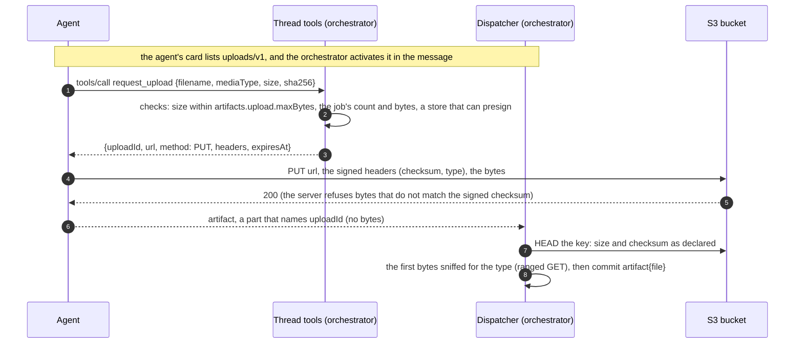
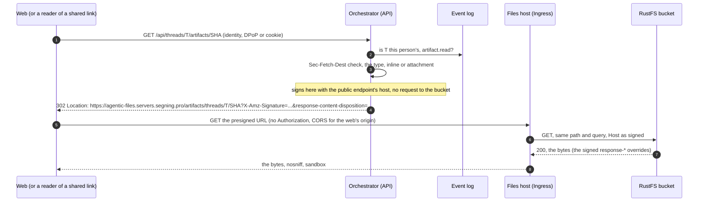
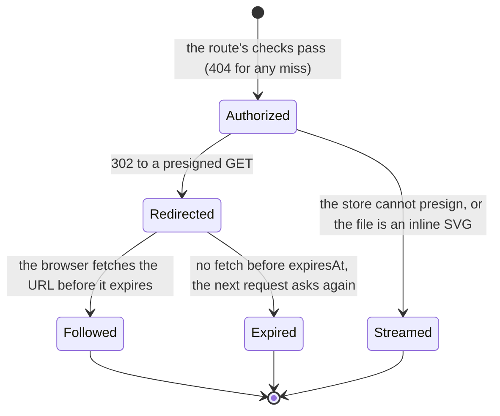

# ADR 0058 — Large files go up through a presigned URL the orchestrator gives the agent

- **Status:** **accepted (2026-10-11)**, on the owner's words of that day (the quote in the amendment at the end). Proposed
  2026-10-09, on the owner's request of that day; **design only, nothing is built**. It is the "presigned upload minted by a thread
  tool" that [ADR 0032](0032-files-from-agents-live-in-an-artifact-store.md) (decision 5) leaves for later, and it needs the S3 store
  (that ADR's amendment of 2026-10-09). **Amended (2026-10-11):** downloads go to the browser by a redirect to a presigned URL on a
  public files host, a presigned upload is signed for the same host, the thread's prefix is its replayable folder, and the rollout on
  netcup is listed: see [the amendment](#amendment-2026-10-11-downloads-by-presigned-url-on-a-public-files-host). The wire contract is
  [`api/uploads-v1.md`](../api/uploads-v1.md).

## Context

A file reaches the thread as an A2A artifact whose part holds the bytes (`raw`, base64 in the JSON-RPC message), at most
`artifacts.maxFileBytes` (10 MiB) and 100 MiB a job ([ADR 0032](0032-files-from-agents-live-in-an-artifact-store.md), decision 7).
adam-rs keeps a file in its journal and caps it at 4 MiB, 6 MiB a run (`MAX_ARTIFACT_FILE_BYTES`, `MAX_RUN_FILE_BYTES` of
`crates/adam-runtime`, *verified 2026-10-09* by reading adam-rs at `09291a6`). A report of 30 MB, a data set or a recording does not
fit, and should not cross the message, the agent's journal and the worker's memory at all.

`object_store` 0.14.2, which the S3 store is built on, presigns a request: `Signer::signed_url_opts(method, path, expires_in,
SignedUrlOptions)` folds query parameters and **headers** into a SigV4 query signature, for example `x-amz-checksum-sha256` and
`content-type`, which the recipient must then send as signed (*verified 2026-10-09* by reading `src/signer.rs` and `src/aws/mod.rs`).

## Decision (accepted 2026-10-11)

```mermaid
stateDiagram-v2
  [*] --> Issued: request_upload accepted
  [*] --> Refused: too large, over the job's limits, no store that presigns
  Issued --> Uploaded: the agent's PUT (the URL works until it expires)
  Issued --> Expired: no PUT before expiresAt
  Uploaded --> Referenced: the artifact names it and the object is as declared
  Uploaded --> Unreferenced: never named; left to the orphan sweep (open question 46, not built)
  Expired --> [*]
  Refused --> [*]
  Referenced --> [*]
  Unreferenced --> [*]
```

1. **An optional extension, `uploads/v1`** ([ADR 0008](0008-platform-integration-via-a2a-extension.md)): an agent that can upload lists it on its card;
   the orchestrator activates it on the messages it sends, with its limits (`maxBytes`, `ttlSecs`) in the message's metadata. An agent
   that does not list it is unchanged, and so is a deployment whose store cannot presign (the directory store): the extension is not
   activated, and `raw` stays the only way.
2. **The agent asks for a slot over the thread's own tools** (`thread-tools/v1`, already authenticated by the per-thread token):
   `request_upload {filename, mediaType, size, sha256}`. The key is the content's hash, `threads/<thread>/<sha256>`, as for every file,
   so the agent declares the hash and the size first. The answer is a **presigned `PUT` for that one key**, its signed headers
   (`x-amz-checksum-sha256` of the declared hash, `content-type`), and its expiry: **five minutes** by default. The agent never holds a
   store credential, and the URL opens one key, for one method, for minutes.
3. **"One-time" is what the key makes it.** S3 has no single-use URL: within its few minutes the URL can be used again. Because the
   key is the hash and the checksum is signed, a second `PUT` can only write the same bytes again, which is harmless, and nothing else.
4. **The agent hands back a reference, not bytes**: its artifact's part names the `uploadId` (in the extension's metadata). The
   dispatcher checks the object before it commits, as it checks inline bytes ([ADR 0032](0032-files-from-agents-live-in-an-artifact-store.md),
   decision 6): a `HEAD` (the size, the checksum), the first bytes read for the type, then `artifact{file}`. An object that is not as
   declared is deleted and the turn says "the file could not be kept".
5. **The port grows by two optional calls**, `presign_put(key, meta, ttl)` and `head(key)`, each with a default that says
   "not supported" (a store that cannot presign is not broken by it; [ADR 0009](0009-swappable-implementations-at-build-time.md)).
   The S3 store implements them with `object_store`'s signer.
6. **Limits** are configuration: `artifacts.upload.maxBytes` (a GiB, say), `artifacts.upload.ttlSecs` (300), and the job's existing
   count and bytes, which now count uploaded files too.
7. **The agent must reach the bucket.** An agent in the cluster reaches the release's RustFS only if its NetworkPolicy lets it in
   (today it admits the orchestrator alone); an agent outside needs the bucket at a public https address. The deployment decides which
   agents get the extension.

## Consequences

- A file of any size the deployment allows, with no bytes in A2A, in the agent's journal or in the orchestrator's memory.
- adam-rs needs a client side: a `share_file` that, past its inline cap, asks for a slot, uploads and hands back the reference.
- *Unverified:* that RustFS refuses a `PUT` to a presigned URL without the signed checksum header, or with other bytes (it checks
  a checksum header on an ordinary signed request, the amendment of ADR 0032 says); presigned URLs through an ingress for agents outside.

## Alternatives rejected

- **The orchestrator receives the upload and streams it to the store** (a `PUT /uploads/<id>` of its own): no store reachable by
  agents, but every large file through the orchestrator's pods and its edge, which is what this avoids. Kept as the fallback for a
  store that cannot presign, if one is ever needed.
- **Store credentials for the agent** (a key per agent): a credential an agent could leak, for a whole bucket.
- **A multipart upload** for very large files: `object_store` presigns one request only (its signer's documentation); to be added if
  files over five gigabytes (S3's limit for one `PUT`) are ever wanted.

## Amendment (2026-10-11): downloads by presigned URL on a public files host

The owner, 2026-10-11, accepting this ADR and widening it:

> "I propose that sharing files goes through extensions … so that we can complete it on the orchestrator with S3 and stop caring too
> much about single file size. RustFS should be enabled as soon as possible too. We can release it via a hostname
> agentic-files.servers.segning.pro so that we can also use them on the web after presigned url are calculated. I'm imagining how all
> artifacts from a single thread are under a S3 folder, replayable."

Decisions 1 to 7 above stand, with one change: decision 7 (the agent must reach the bucket) is **relaxed by A2**. The rest is new.
*Facts, with their status, are in [Verified and unverified](#verified-and-unverified-2026-10-11).* **Nothing is built.**

1. **Downloads.** `GET /api/threads/{id}/artifacts/{sha}` and its two shared variants (`/api/shared/{token}/artifacts/{sha}`,
   `/api/public/shared/{token}/artifacts/{sha}`) **stay the authorization point**: identity, the thread's owner or the link, `artifact.read`,
   the `Sec-Fetch-Dest` refusal ([ADR 0054](0054-the-web-holds-its-own-tokens-dpop-bound-in-indexeddb.md), its correction of 2026-10-09)
   and the same 404 for every miss run first, unchanged. Then, with an S3 store that can presign and `artifacts.s3.publicEndpoint` set, the
   route answers **`302` to a presigned GET** on the public files host instead of streaming. Otherwise (the directory store, S3 with no public
   endpoint) it streams as today. The presign:
   - **TTL** `artifacts.s3.presignTtlSecs`, default **300**, 30 to 3600. The two shared variants use `min(ttl, 60)`: a revoked link
     ([ADR 0040](0040-thread-sharing-by-revocable-link.md)) must stop working within a minute. A URL already issued cannot be recalled (S3 has no revoke);
     a deleted file ([ADR 0043](0043-deleting-a-thread-erases-it.md)) stops at once because the object is gone.
   - **`response-content-disposition`**: `attachment; filename="…"` (the route's existing, cleaned name, with the RFC 5987 form) unless the type is one of the
     preview types (`orch_core::Preview`) **and** the request has no `?download=1`, then `inline`.
   - **`response-content-type`**: the kept type for a preview type, `application/octet-stream` for every other, as the route sends today
     ([ADR 0054](0054-the-web-holds-its-own-tokens-dpop-bound-in-indexeddb.md), its correction).
   - **`response-cache-control`**: `private, max-age=<ttl>`. The route's year-long `immutable` cache is lost for S3-served files (the URL changes on each
     request); said in the consequences.
   - These are signed query parameters, so the holder of the URL cannot change them (*verified 2026-10-11*: S3's `GetObject` accepts the
     `response-*` parameters only on a signed request). The 302 itself is `Cache-Control: private, no-store`.
   - **`X-Content-Type-Options: nosniff`** cannot be asked of S3 by a `response-*` parameter (the six it takes are cache-control, content-disposition,
     content-encoding, content-language, content-type and expires). The **files host's Ingress adds it**, with `Content-Security-Policy: default-src 'none';
     sandbox` and `Referrer-Policy: no-referrer`, by the controller's headers middleware. Whether RustFS adds any of them itself is *unverified*.
   - **SVG: the orchestrator keeps serving the sanitized one, streamed.** A request for an SVG without `?download=1` is not redirected: it is read, cleaned by
     `orch-svg-clean` and sent as today (up to 2 MiB). Why not a sanitized copy in the bucket: it is a second object per SVG and a second key shape in
     `ArtifactKey` (the port refuses anything but `threads/<thread>/<sha256>`), a cleaner fixed at write time cannot be improved later, and it would still be
     served from a host that is **the same site** as the app (`servers.segning.pro`; only the origin differs), where a script that ran in an SVG
     document could send same-site requests. `?download=1` of an SVG is the original bytes as an attachment, and is presigned like any download (an attachment is
     not rendered). The web draws a file as an ``, never as a document ([ADR 0032](0032-files-from-agents-live-in-an-artifact-store.md), decision 9).
2. **Presigning uses the public endpoint; the bucket is reached on the internal one.** SigV4 signs the `Host` header, so a URL signed for
   `http://release-rustfs:9000` does not work at `agentic-files.servers.segning.pro`. Two settings, both under `artifacts.s3`:
   - `endpoint` (exists): what the orchestrator calls for `put`, `get`, `delete`, `copy`, `head`: in the cluster, the Service of the release's RustFS.
   - `publicEndpoint` (new): an `https` URL with a host, no credentials, query or fragment (`http` only outside `server.environment: production`).
     It is the host in every presigned URL, for **downloads and for uploads** (decision 2 above). The store builds a second signer with the same bucket and credentials
     and this endpoint, and uses it for signing only: no request goes to the public host from the orchestrator. Absent: nothing is presigned.
   With an endpoint the addressing is path style ([ADR 0032](0032-files-from-agents-live-in-an-artifact-store.md), amendment of 2026-10-09), so the bucket name is the first
   path segment of the public URL, and the Ingress routes that prefix only.
   **Decision 7 changes:** an agent, in the cluster or outside it, reaches the bucket through the **public files host** over https. RustFS's NetworkPolicy needs no
   exception for agents; it admits the ingress controller's namespace beside the orchestrator and the bucket Job.
3. **The web.** [ADR 0054](0054-the-web-holds-its-own-tokens-dpop-bound-in-indexeddb.md) (decision 9) makes the web **fetch** a file with its token and show an object
   URL, because an `` carries no header; the public reader keeps plain links. So the files host is added to the web's policy in three places:
   - `connect-src` (the web's `fetch` follows the redirect: a policy applies to the redirect target),
   - `img-src` (the public reader's plain `` and any direct image), and
   - `media-src` (audio and video previews, when there are any).
   One variable for the three, `WEB_CSP_FILES_SRC` (origins, *proposed*; the web's `src/lib/csp.ts`, the `Caddyfile`, `apps/tauri` take it). **CORS**: the files host answers
   `Access-Control-Allow-Origin: <the web's origin>` (not `*`), methods `GET`, `HEAD`, `OPTIONS`, `Access-Control-Allow-Headers` including `DPoP`, `Vary: Origin`.
   Exactly one layer sets these (the Ingress, or the bucket if RustFS is shown to answer a preflight): two sets of `Access-Control-*` headers make the browser refuse.
   Uploads come from agents, not browsers, so no `PUT` is allowed in CORS.
   The browser drops `Authorization` on a cross-origin redirect and keeps other headers, so the web's `DPoP` header reaches the files host and makes that request
   preflighted. This is *unverified* (see below), and if it fails the fallback is a JSON answer from the same route, `{url, expiresAt}` for a request that asks
   for `application/json`, which the web then fetches with no header. Not decided; the build proves the redirect first.
4. **Replayable.** The key `threads/<thread>/<sha256>` ([ADR 0032](0032-files-from-agents-live-in-an-artifact-store.md), decision 2), under the configured `prefix`, is
   the thread's **folder**: every file the thread ever kept, by hash, and nothing of another thread. A fork copies the files it inherits into its own folder (ADR 0042);
   a deletion removes the folder (`delete_prefix`, ADR 0043). **The log plus the prefix is the replay**: the log says what happened and the folder holds every byte it
   refers to. *Proposed, a later slice:* a **thread bundle**, `GET /api/threads/{id}/bundle` (permission `thread.read` and `artifact.read`), a streamed archive of
   `thread.json` (the export), `files/<sha256>` for each reference, and `manifest.json` (hash, size, type, name per file, the export's `versions`), so a thread can be read
   again elsewhere. Importing a bundle is not proposed (question 76 asks).
5. **The rollout on netcup**, in this order (the owner's steps 1 and 3; the chart's 2 and 4 are built by the slices):
   1. **Secrets.** The owner adds the AWS properties `artifacts_s3_access_key_id` and `artifacts_s3_secret_access_key` to `prod/another-agentic/env`
      (they exist in the chart's contract; the deployment has not set them).
   2. **The chart** gains an Ingress for RustFS's S3 API on the files host (`rustfs.ingress.{enabled, host, clusterIssuer, corsOrigins}`, *proposed*): TLS from the
      cluster issuer as the app's, the route limited to the bucket's path prefix and to the methods `GET`, `HEAD`, `OPTIONS` (and `PUT` only while `uploads/v1` is on), the headers of A1 and
      the CORS of A3, and the NetworkPolicy exception for the ingress controller. Nothing under `/` or an admin path is routed.
   3. **home-os** sets `rustfs.enabled: true`, `orchestrator.artifacts.store: s3`, `orchestrator.artifacts.s3.publicEndpoint:
      https://agentic-files.servers.segning.pro` (`orchestrator.artifacts.s3.endpoint` is the Service's by default) and the web's `WEB_CSP_FILES_SRC`. DNS for the host.
   4. **A one-off `orchestrator artifacts migrate --from fs --to s3`** moves today's files before the volume is dropped. It is the binary's first subcommand (it has
      flags only), and: reads the directory at `--fs-root` (the kept volume of the directory store, mounted by a Job), writes to the configured `artifacts.s3`
      through `ArtifactStore::put` (**the same keys**, so the references in the log stay valid; the meta becomes object metadata exactly as `put` writes it, and
      `ArtifactMeta::check` runs on each file); idempotent by content, resumable, `--dry-run`, a report (files, bytes, skipped, failed), exit 0 only when every file
      is in the bucket with the right size. The chart renders the Job on request (`orchestrator.artifacts.migrate.enabled`), mounting the kept claim. Until it has run,
      the files of earlier threads read as gone (404): it runs right after the sync. The claim is deleted by hand afterwards (the chart never prunes it).
   5. **The orchestrator can scale past one pod.** The directory volume is what ties it to one replica (`Recreate`). With `s3` the chart may lift that rule (a change of its
      own); that nothing else pins it is *unverified*.
6. **The extension URI stays `https://agents.vymalo.com/a2a/extensions/uploads/v1`** (decision 1). Its contract is [`api/uploads-v1.md`](../api/uploads-v1.md).

**Consequences of the amendment.** Large downloads no longer cross the orchestrator's pods or its edge. The year-long immutable browser cache of the streamed route is
gone for S3 files (a new signature per request). The S3 API of a *preview* release of RustFS (1.0.1-preview.17, ADR 0032) is reachable from the internet by signature only, so the
Ingress's path and method limits and the checks below are not optional. A revoked share link can serve a file for up to a minute through a URL already issued.

### Verified and unverified (2026-10-11)

*Verified 2026-10-11:*
- `object_store` 0.14.2 presigns with extra signed query parameters and headers: `Signer::signed_url_opts` with `SignedUrlOptions::with_query` and `with_signed_header`
  (read in `src/signer.rs` of the crate in the local cargo registry; its documentation says the recipient "must send exactly these query parameters and headers").
- S3's `GetObject` takes `response-cache-control`, `response-content-disposition`, `response-content-encoding`, `response-content-language`, `response-content-type` and
  `response-expires`, and "must" be signed: "These parameters cannot be used with an unsigned (anonymous) request"
  (<https://docs.aws.amazon.com/AmazonS3/latest/API/API_GetObject.html>).
- RustFS's S3 compatibility matrix lists "Presigned GET and PUT URLs" as Supported, and one grouped row names "versioning, object-lock, checksum, CORS, raw request, and conditional write
  behavior" as Supported without saying which CORS calls
  (<https://github.com/rustfs/rustfs/blob/main/docs/architecture/s3-compatibility-matrix.md>, read through the raw file; no revision or date shown on it).

*Unverified, to be proven against RustFS 1.0.1-preview.17 and in a real browser before the files host goes live:*
- that a presigned `GET` with the `response-*` overrides above is honoured by RustFS (the matrix is silent), and that `Range` works;
- that RustFS answers a CORS preflight from the bucket's configuration, and whether it adds `nosniff` (this ADR puts both on the Ingress);
- that an anonymous request for a key is refused (403) and the bucket's default is private;
- that a same-origin `fetch` with `Authorization` and `DPoP` that is redirected to the files host loses `Authorization`, keeps `DPoP`, is preflighted, and succeeds (Fetch's redirect
  rules, not re-read here);
- that a Traefik route can require a signature in the query (`X-Amz-Signature`), which would also keep unsigned probes off a preview server;
- that RustFS refuses a presigned `PUT` whose body does not match the signed checksum (decision, *Consequences* above, still stands).
