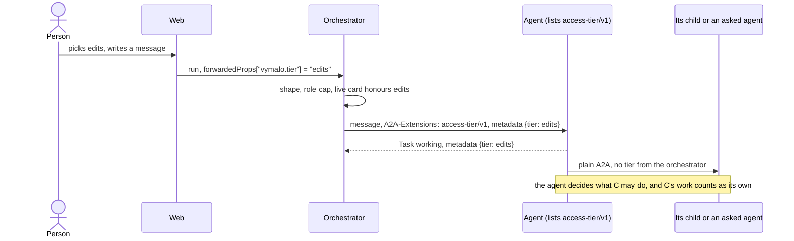

# ADR 0061 — The person picks an access tier for each message; the agent keeps to it, and nothing is passed down

- **Status:** proposed (2026-10-11), at the owner's request (the quote in *Context*). **The owner's own, 2026-10-11:**
  the direction (an autonomous agent, a control of four tiers, no permissions passed down to children) and adam's mapping of tools
  onto the tiers (*What adam-rs implements*). **Proposed**, for the owner to confirm: every name, status code, default and shape
  below. **The six open questions were settled the same day**, on the owner's direction that the agent be fully autonomous and
  permissions easy (*Questions settled*, at the end). **Built 2026-10-11 on mocks: the orchestrator and the web**
  (the checks, the log, the dispatcher, `maxTier`, the chip); **adam-rs's side is not built.** Extends
  [ADR 0008](0008-platform-integration-via-a2a-extension.md) (the optional-extension pattern) and
  [ADR 0033](0033-the-orchestrator-is-an-oauth2-resource-server.md) (roles). When it is accepted,
  [ADR 0014](0014-adam-coder-default-agent-over-a2a.md)'s note on the coder's consent forms gets a dated amendment. The wire
  contract is [`api/access-tier-v1.md`](../api/access-tier-v1.md).

## Context

The owner, 2026-10-11, about what an agent may do:

> "we're managing with a2a. So if we're passing down permissions from parents to children too heavily, it might impact too much
> what remains from the core protocol a2a gives us, making it difficult to switch from one vendor (adam-rs) to another one (e.g
> kagent). So the agent should be fully autonomous, and its permissions should be as easy as eating chips. Bon, if we can
> implement a way for the user to control the access control tier (edits only, plan, auto, bypass all) and let the agent adapt to
> that, then it's better again."

What exists, and what the design rests on:

- **The person has no say in how autonomous an agent is.** The coder asks before it widens its reach, a form each time, and the model
  never grants: only the person's answer to that very call does ([ADR 0014](0014-adam-coder-default-agent-over-a2a.md), its
  note on workspaces). What it may do is its instructions, its tools and its deployment. A person cannot say "only look" or "go
  ahead".
- **A2A has no notion of a permission.** Extensions are the protocol's way to add one: a card lists them, a client activates
  them with the `A2A-Extensions` header, and the data rides in `metadata` (*verified 2026-10-01*, recorded in
  [`steps-v1.md`](../api/steps-v1.md#verified-and-unverified-2026-10-01)).
- **Delegation is plain A2A here.** An agent the orchestrator asks for another agent ([ADR 0026](0026-agent-mentions-as-structured-references.md))
  is a child task with nothing but the asking agent's message. A sub-agent in an adam folder inherits nothing from its parent
  ([ADR 0050](0050-the-chat-has-sub-agents.md), *verified 2026-10-06*).
- **kagent is reached over plain A2A 1.0** and `dev/kagent-e2e.sh` runs the orchestrator against it
  ([ADR 0055](0055-the-agent-assigns-the-a2a-context.md)). Whatever this ADR adds must leave that scenario unchanged.
- Invariant 2 applies: a host convenience is an optional extension, capability-detected, read live, never cached, fail closed,
  removable without breaking plain A2A.

## Decision

1. **An optional extension, `access-tier/v1`**, URI `https://agents.vymalo.com/a2a/extensions/access-tier/v1`. An agent lists it
   in its card with `params: {tiers, default}`: the tiers it honours, and what it works under when a message names none. The
   orchestrator reads the card on every send, uses the extension only when it is listed exactly with well-formed params, and an
   agent that lists nothing gets plain A2A, unchanged.
2. **Four tiers, a closed list** ([ADR 0004](0004-closed-enums-over-dyn-registry.md)): `plan` < `edits` < `auto` < `bypass`.
   - `plan`: read and propose. No change to a repository or any external system.
   - `edits`: change files, commit, push branches, open pull requests. No merge, creation, rename or delete, no settings.
   - `auto`: everything autonomous, merging and creating included. What cannot be undone is outside it.
   - `bypass`: never asks for permission.
3. **The tier rides on the message**: one member, `tier`, in the message's metadata under the URI, with the URI in the
   `A2A-Extensions` header and `message.extensions`. From the web it is `forwardedProps["vymalo.tier"]`, per message. **Absent, the
   agent works under its own `default`** (adam's is `auto`), and the extension is not activated.
4. **The agent enforces. The orchestrator checks only** the shape, the person's role cap and that the live card honours the
   tier (400, 422, 503; nothing written), stores the choice on the `user_message` (so an export shows it) and sends it on that
   message. **A tier is never silently dropped**: if the card no longer honours it at the send, the job fails and nothing is
   sent. It never falls back to the default.
5. **The agent's duties.** Never exceed the tier. Say which tier it worked under (the task's metadata echoes it, and the answer
   says it when it mattered). Refuse clearly when a request needs more: do not do the act, say which tier it needs, and do the
   rest.
6. **Nothing is passed down.** The orchestrator sends a tier only to the thread's own agent, and on the person's behalf: none to
   an `ask_agent` child, a verifier or any task it starts for another agent. Each agent decides for its own children, and work
   done through a child counts as the agent's own. Delegation stays plain A2A.
   *Amended 2026-10-11 (the security review of adam's side):* a message the orchestrator sends to the thread's agent that
   **continues the person's work** is sent under the tier of the person's last message of the job, not at the agent's own default:
   the rework of the verification gate (so a webhook's or a timer's), the delegation of an A2UI action, an answer to a blocked
   job, and a message from the MCP surface, which cannot name a tier (an answer's is capped by the role of whoever gives it).
   Left alone, the rework of a job the person ran at `edits` would have run at `auto`, which can merge and create. A thread whose
   first message names none, and an MCP `start_job`, have no choice to continue: the agent's own default applies.
7. **The web** shows a tier chip in the composer **only when** the selected agent's capabilities document carries the extension.
   Hidden otherwise, never a disabled or invented control. It sends a tier once the person has picked one.
8. **A role may cap the tier**: `auth.roles.<role>.maxTier`, optional, one of the four; absent means no cap. `GET /api/me` says
   it as a hint.
9. **A tier only narrows.** It never grants what the credential, the GitHub App's granted permissions, branch protection or the
   deployment's own limits withheld, and it is a promise by the agent, not a security boundary.

The state diagram of one message's tier is in [the contract](../api/access-tier-v1.md#the-flow). There is no lifecycle beyond it:
the orchestrator keeps no tier between messages.

## Alternatives considered

- **A per-tool permission list.** The person (or the orchestrator) names the tools an agent may use. Rejected: tool names are an
  agent's own vocabulary (adam's `merge_pull_request` is nobody else's), so the orchestrator would carry every vendor's catalog and
  stop being protocol-only ([ADR 0007](0007-protocol-only-dependencies.md)). It grows with every tool, and no one picks from forty
  switches. The owner asked for something "as easy as eating chips": four words.
- **Passing permissions down to children.** A tier, or a narrower one, sent on every delegated task. Rejected, and it is the
  owner's point: every agent on the way would have to understand it, and the first that does not makes it false or the delegation
  impossible. It ties the orchestrator's requests to one vendor's idea of a permission and makes a switch from adam-rs to kagent
  hard. The orchestrator cannot see inside a task, so it could not enforce it either.
- **Nothing.** The agent decides alone, as today. Rejected: the person cannot say "only a plan" or "go ahead and merge", and the
  coder keeps asking forms for what the person has already said yes to.
- **A tier per thread, kept by the orchestrator.** Rejected: it adds state to a stateless process and a route to change it.
  Per message needs nothing stored beyond the message, and the web can remember the pick in the browser.

## Consequences

- **Easier:** the person controls autonomy with one chip. An agent without the extension, kagent included, gets the request it
  got before, byte for byte, and the web shows it no control. Swapping vendors changes nothing in the orchestrator. An export
  shows the tier of every message.
- **Harder, and said plainly:** the tier is a promise. An agent that lists the extension and works above its tier has a defect the
  orchestrator cannot see. A deployment that needs a boundary gives the agent a credential that cannot do the thing.
- **Easier to get wrong, and tested:** the orchestrator's own messages on a thread's behalf carry the job's last chosen tier, so
  the core keeps it (`Job.tier`) and the outbox rows carry it. The role's cap is applied when the person chooses and when an answer
  or an MCP message inherits the tier; the dispatcher that sends a rework has no principal and does not apply it again.
- **Harder:** an asked agent works under its own default, so a person who picks `plan` for the chat relies on the chat agent not
  to ask an agent to change anything (duty 1). That is the price of not passing permissions down. It was asked whether `ask_agent`
  should soften it, and settled that it does not in v1 ([Questions settled](#questions-settled), 1).
- **Required elsewhere:** in the orchestrator, the `AccessTier` enum, the checks, `user_message.tier`, `agent_status` `data.tier`,
  the adapter, the dispatcher's second read of the card, `maxTier` on a role and on `GET /api/me`, the capabilities key with its
  params; in the web, the chip and the tier on a message; in the docs, the pages the contract names under *What the build changes*;
  in adam-rs, the section below.
- **A decision of ADR 0014 changes when this is accepted:** at `auto` and `bypass` the person's tier is a standing consent, so the
  coder's per-repository form goes. The model still never grants: the tier is the person's, set in the composer, never the
  model's.

## What adam-rs implements

A summary: the contract is the page above, and the adam-rs pull request has its own ADR.

- **The card** lists the extension with `tiers: [plan, edits, auto, bypass]` and `default: auto`, in `adam-coder` and in
  `adam-agent` (an agent folder may list fewer).
- **The message:** read `tier` from the metadata of a message that activated the extension, from the next step on, never in the
  middle of a tool call, newest message first. A task never keeps a tier from another task. An unhonoured tier or a missing one is
  an A2A error.
- **The echo:** `{"tier": ...}` in the task's metadata on its first `Task`, and in the words of an answer that declines an act.
- **The mapping of the coder's tools**, the owner's choice of 2026-10-11. On renaming and deleting repositories he said: *"Even
  renaming or deleting repos should be allowed, but only via bypass tier."*

  | Tier | The coder |
  |---|---|
  | `plan` | Read-only tools only, and a plan as the answer |
  | `edits` | Edit files, commit, push branches, open pull requests. No `merge_pull_request`, no `create_repository`, no rename, no delete. The consent form for a repository the person did not name stays |
  | `auto` (adam's default) | Everything in `edits`, plus `merge_pull_request` and `create_repository`. A bare repository name the person writes counts as named, so no form. No `rename_repository`, no `delete_repository` |
  | `bypass` | Everything in `auto`, plus `rename_repository` and `delete_repository`, and no consent form at all |

  GitHub's own branch protection and the App's granted permissions still apply at every tier, and so do the deployment's own
  limits (`CREATE_REPO_OWNERS`). *Settled 2026-10-11 ([Questions settled](#questions-settled), 2 and 3):* at `plan` and `edits`
  the consent form stays, a bare repository name counts as named at `auto` and `bypass`, and an empty `CREATE_REPO_OWNERS` means
  the owners the coder's GitHub App is installed on.
- **Children:** the coder keeps its own helpers (OpenCode, folder sub-agents) to the tier in force, by its own means, and does not
  ask another agent for a change its tier forbids.
- **Facts:** the coder at the pin (adam-rs `5581d40`) has `create_repository`, asked each time, and its GitHub tools in this
  repository's vendored folder are read-only (*verified 2026-10-11* by reading `dev/coder/agent/mcp.json` and searching the repository:
  `merge_pull_request`, `rename_repository` and `delete_repository` appear nowhere here). Whether adam-rs has those three tools is
  *unverified*, its code not being in this repository.

## Questions settled

The six questions this ADR was written with were settled on 2026-10-11. Each says the question, then the answer. The ADR stays
**proposed**: the owner has not tried the built state (nothing here has run against a live model or a real GitHub).

1. **`ask_agent` and the tier.** Should `ask_agent` take an optional `tier` that the **asking agent** chooses for the child (never
   the person's, never above its own)? It would keep the person's `plan` from being undone by an asked agent's default, and still
   pass nothing down on the orchestrator's own.
   **Settled (2026-10-11), on the owner's direction that the agent be fully autonomous and permissions easy:** `ask_agent` carries
   no tier in v1. An asked agent works under its own default, and the asking agent keeps its helpers to its tier by its own means
   (duty 1 of the contract).
2. **Which consent forms stay where.** The owner named the form for a repository the person did not name under `edits`, and the
   bare name under `auto`. Read as: `plan` keeps the form as `edits` does (it concerns reading), and a bare name counts as named at
   `auto` and `bypass` only.
   **Settled (2026-10-11), on the owner's direction that the agent be fully autonomous and permissions easy:** a bare repository
   name counts as named at `auto` and `bypass`. At `plan` and `edits` the consent form stays. This is adam's side (adam-rs); the
   orchestrator does nothing for it, and it is recorded here so the adam-rs pull request has the answer.
3. **"Repository creation by default."** Read as: at `auto` the coder has `create_repository` and no form, and `CREATE_REPO_OWNERS`
   still decides for which owners (today an empty list offers no tool). Does the owner mean to change that default as well?
   **Settled (2026-10-11), on the owner's direction that the agent be fully autonomous and permissions easy:** creation by default
   means `CREATE_REPO_OWNERS` empty is the owners the coder's GitHub App is installed on. Adam's side (adam-rs); recorded here.
4. **The echo in the log.** Is `agent_status` `data.tier` worth having in v1? And should the echo carry a `needs` (the tier a
   declined act needs) so the web can offer "switch to bypass"?
   **Settled (2026-10-11), on the owner's direction that the agent be fully autonomous and permissions easy:** the agent's echo is
   recorded as `agent_status.data.tier`. There is no `needs` hint in v1; a declined act is said in the agent's words.
5. **Other doors.** The MCP surface, webhooks and timers send no tier. Should `start_job` take one?
   **Settled (2026-10-11), on the owner's direction that the agent be fully autonomous and permissions easy:** `start_job` names no
   tier in v1. *Amended the same day (decision 6):* a message that continues a job, an MCP `answer` included, a webhook's or a
   timer's rework, is sent under the job's last chosen tier, so no door runs an agent wider than the person chose.
6. **No cap is the default.** `maxTier` absent means a person may pick `bypass` on any agent that honours it, the built-in `user`
   role included. The owner may want `bypass` to be something a deployment opts into.
   **Settled (2026-10-11), on the owner's direction that the agent be fully autonomous and permissions easy:** there is no
   `maxTier` cap by default. A deployment that wants `bypass` to be opt-in caps its roles in `auth.roles`.
