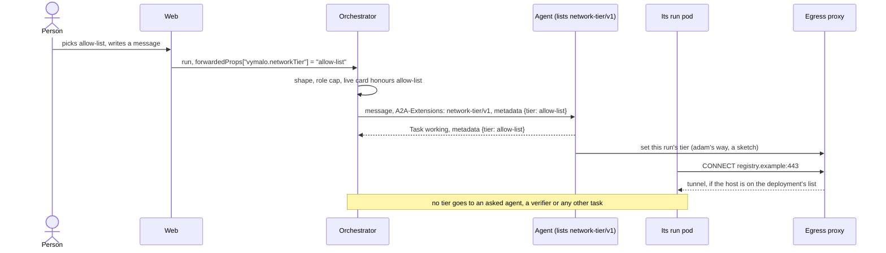

# ADR 0062 — The person picks a network tier for each message; the agent keeps to it, and nothing is passed down

- **Status:** proposed (2026-10-11), at the owner's request (the quote in *Context*). **The owner's own, 2026-10-11:** the direction (more concepts like
  `thread-tools/v1`, one for the network), the three tiers `offline`, `allow-list` (package registries and the forge) and `open`, that the agent enforces
  it, adam's way (run pods that reach only an egress proxy that applies the tier), that nothing is passed to children, a role cap `maxNetworkTier`, and what the
  orchestrator checks. **Proposed**, for the owner to confirm: every name, status code, default and shape below, and the open questions at the end. **Nothing of
  this is built.** Extends [ADR 0008](0008-platform-integration-via-a2a-extension.md) (the optional-extension pattern) and
  [ADR 0033](0033-the-orchestrator-is-an-oauth2-resource-server.md) (roles). It is the sibling of the access tier (ADR 0061, *proposed, on the branch `wip/sys-tiers`*, not
  merged when this was written, so not linked): the same shape on another axis. The wire contract is [`api/network-tier-v1.md`](../api/network-tier-v1.md).

## Context

The owner, 2026-10-11, after `thread-tools/v1`:

> "We should have more concepts like that [thread-tools/v1] too. E.g for the permission tier, the networking tier or even the raw model and OpenAI compatible server configuration."

The pattern he points at is one optional extension per concern: the agent's card lists it, the orchestrator activates it per message, the data rides in `metadata`, an agent without it is plain A2A.
The permission tier is ADR 0061, the raw model server is ADR 0063 (`model-relay/v1`, proposed), and this is the network.

What exists, and what the design rests on:

- **The person has no say in how much network what an agent runs may reach.** The coder's run pods, where its builds and commands execute, are limited by the deployment: their NetworkPolicy allows DNS and the
  internet except private ranges, link-local and the cluster's CIDRs (*verified 2026-10-11*: `deploy/coder/templates/run-pods-networkpolicy.yaml` of adam-rs at the pin `5581d40`, read with `git show` in a local clone).
  A person cannot say "work offline" for a task that must not fetch anything, nor "go ahead and install" for one that must.
- **A2A has no notion of a network limit.** Extensions are the protocol's way to add one (*verified 2026-10-01*, recorded in [`steps-v1.md`](../api/steps-v1.md#verified-and-unverified-2026-10-01)).
- **Delegation is plain A2A here** ([ADR 0026](0026-agent-mentions-as-structured-references.md), [ADR 0050](0050-the-chat-has-sub-agents.md)), and **kagent is reached over plain A2A 1.0**
  ([ADR 0055](0055-the-agent-assigns-the-a2a-context.md), `dev/kagent-e2e.sh`). Whatever is added must leave that scenario unchanged.
- **The orchestrator cannot see inside a task.** It cannot enforce a tier; only the place the agent's code runs can.
- Invariant 2 applies: a host convenience is an optional extension, capability-detected, read live, never cached, fail closed, removable without breaking plain A2A.

## Decision

1. **An optional extension, `network-tier/v1`**, URI `https://agents.vymalo.com/a2a/extensions/network-tier/v1`. An agent lists it in its card with `params: {tiers, default}`: the tiers it honours and what it
   works under when a message names none. The orchestrator reads the card on every send, uses the extension only when it is listed exactly with well-formed params, and an agent that lists nothing gets plain A2A.
2. **Three tiers, a closed list** ([ADR 0004](0004-closed-enums-over-dyn-registry.md)): `offline` < `allow-list` < `open`.
   - `offline`: what the agent runs reaches nothing but the agent's own channels (its model endpoint, the orchestrator's thread tools and relay, the files host).
   - `allow-list`: also the hosts of the deployment's list, **the package registries and the forge**. The list is the agent's deployment's, never the person's and never the orchestrator's.
   - `open`: the public internet as the deployment allows. Private ranges and the cloud metadata address are refused at every tier.
3. **The tier rides on the message**: one member, `tier`, in the message's metadata under the URI, with the URI in the `A2A-Extensions` header and `message.extensions`. From the web it is
   `forwardedProps["vymalo.networkTier"]`, per message. **Absent, the agent works under its own `default`** (adam's is `open`, what its run pods allow today), and the extension is not activated.
4. **The agent enforces. The orchestrator checks only** the shape, the person's role cap and that the live card honours the tier (400, 422, 503; nothing written), stores the choice on the `user_message`
   (so an export shows it) and sends it on that message. **A tier is never silently dropped:** if the card no longer honours it at the send, the job fails and nothing is sent. It never falls back to the default.
5. **The agent's duties.** Never exceed the tier. Say which tier it worked under (the task's metadata echoes it). When a step fails for lack of network, do not reach for another route (a mirror, a tunnel, a tool
   that fetches for it): say which tier the step needed, and do the rest.
6. **Nothing is passed down.** The orchestrator sends a tier only on the person's message to the thread's agent: none to an `ask_agent` child, a verifier or any task it starts for an agent. Each agent decides
   for its own children; what they run counts as the agent's own. An asked agent works under its own deployment's network.
7. **A role may cap the tier**: `auth.roles.<role>.maxNetworkTier`, optional, one of the three; absent means no cap. `GET /api/me` says it as a hint.
8. **The web** shows a network chip in the composer **only when** the selected agent's capabilities document carries the extension; hidden otherwise, never a disabled or invented control. It sends a tier once the
   person has picked one.
9. **A tier only narrows**, and it is **a promise by the agent unless the deployment makes it a boundary**. It never grants what the deployment's network policy, credentials or the forge withheld. It does not govern the servers a
   person attached to the thread (the orchestrator calls those, [ADR 0024](0024-mcp-tools-attached-per-conversation.md)); open question 78 asks whether it should.
10. **Independent of the access tier.** A person may pick `edits` and `offline`. Neither implies nor widens the other.

The state diagram of one message's tier is in [the contract](../api/network-tier-v1.md#the-flow). There is no lifecycle beyond it: the orchestrator keeps no tier between messages.

## Alternatives considered

- **The orchestrator sends the list of hosts.** The person or the orchestrator names the hosts an agent may reach. Rejected: which registries and forge a build needs is the agent's deployment's knowledge (and changes with
  its toolchain), the list would become a second place to maintain, and a person cannot be asked to pick from forty hosts. Three words, and the list stays where it can be correct.
- **One combined "permission" with the access tier.** Rejected: they are different axes. "Edit files, but offline" and "plan, with the web open" are real wishes, and a vendor may honour one and not the other.
- **Passing the tier to children.** Rejected for the reason of ADR 0061: every agent on the way would have to understand it, and the first that does not makes it false.
- **A tier per thread, kept by the orchestrator.** Rejected: state in a stateless process, and a route to change it. Per message stores nothing but the message; the web remembers the pick.
- **More tiers** (registries only, forge only). Rejected for v1: the list's content is the deployment's. A deployment that wants two lists runs two agents, or a v2 adds a tier.
- **Nothing.** The deployment decides alone. Rejected: the person cannot ask for an offline task or an install.

## Consequences

- **Easier:** one chip controls how far what the agent runs may reach. An agent without the extension, kagent included, gets the request it got before, byte for byte. An export shows the tier of every message.
- **Harder, and said plainly:** a tier is a promise unless the agent's deployment enforces it. An agent that lists the extension and works above its tier has a defect the orchestrator cannot see. For adam the sketch
  below makes it a boundary, but only if the cluster's network plugin enforces the policy (*unverified* for the owner's cluster, as adam-rs's own page says).
- **Harder:** an asked agent works under its own network, so a person who picks `offline` relies on the agent they talk to not to ask another agent for what needs the network (duty 1). The price of passing nothing down.
- **Required elsewhere:** in the orchestrator, the `NetworkTier` enum, the checks, `user_message.networkTier`, `agent_status` `data.networkTier`, the adapter, the dispatcher's second read of the card, `maxNetworkTier`
  on a role and on `GET /api/me`, the capabilities key with its params; in the web, the chip and the tier on a message; in the docs, the pages the contract names under *What the build changes*; in adam-rs, below.

## What adam-rs implements (a sketch)

adam-rs designs and builds its side in its own ADR. The shape, so the contract can be seen to be implementable (the contract page has the diagram):

- **The card** lists the extension with `tiers: [offline, allow-list, open]` and `default: open` in `adam-coder` and `adam-agent` (an agent folder may list fewer).
- **The run pod's NetworkPolicy** allows egress **only to an egress proxy** and to the agent's own channels, and no DNS: the proxy resolves names. The proxy applies the tier per run, set by the coder when a message names
  one: `offline` refuses every `CONNECT`, `allow-list` accepts the targets on the deployment's list, `open` accepts any target whose resolved address is not private.
- **The message:** read `tier` from a message that activated the extension, from the next step on, newest first, never in the middle of a tool call. A task never keeps a tier from another task.
- **The echo:** `{"tier": ...}` in the task's metadata on its first `Task`, and in the words of an answer that says which tier a step needed.
- **Facts:** the run pods and their NetworkPolicy are in the pin (above). That the tools in the image (cargo, npm, pip, git over https) read a proxy setting, and which hosts the deployment's list needs, are *unverified*.

## Open questions

1. **A default of `open` for adam** keeps today's behaviour. Should the chart's default be `allow-list`, with `open` something a person picks?
2. **Who edits the list?** The deployment (a chart value). Should an administrator be able to add a host for one agent without a deploy? Not decided.
3. **Other doors.** The MCP surface, webhooks and timers send no tier. Should `start_job` take one?
4. **No cap is the default.** `maxNetworkTier` absent means a person may pick `open` on any agent that honours it.
5. **The servers a person attached under `offline`** (decision 9): hide them from the agent, or leave them? [`open-questions.md`](../open-questions.md), question 78.
6. **A promise or a boundary.** Should the card say which a tier is, so the web can tell the person? Question 79.
