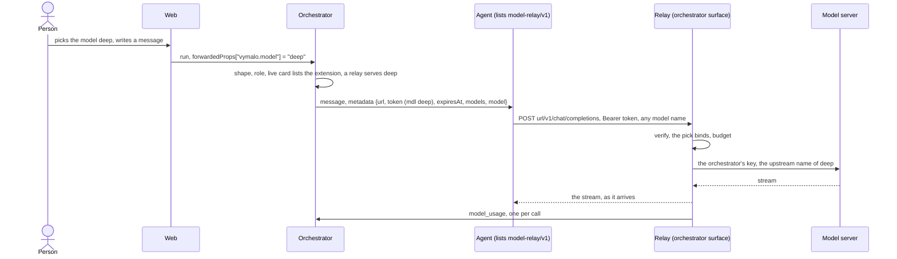

# ADR 0063 — An OpenAI-compatible model endpoint per thread on the orchestrator: the agent asks for its model, and no model key travels in A2A

- **Status:** proposed (2026-10-11), at the owner's request (the quote in *Context*). **The owner's own, 2026-10-11:** the direction and its shape (the card declares the extension, the message
  carries `{url, token, expiresAt, models}`, the agent calls `POST {url}/v1/chat/completions` and `/v1/models`, the orchestrator forwards to the configured model server with its own key, records usage
  per call, enforces a per-thread or per-person budget, the person picks the model per thread in the UI through a chip shown only for agents that declare the extension, SSE passes through, no model
  key in A2A, an agent without the extension uses its own model). **Proposed**, for the owner to confirm: every name, status code, default and shape below, and the open questions at the end. **Nothing of
  this is built.** Extends [ADR 0005](0005-openai-compatible-model-endpoint.md) and [ADR 0035](0035-utility-model-tasks.md) (the named endpoints), [ADR 0056](0056-token-usage-per-model-call.md) (usage) and
  [ADR 0008](0008-platform-integration-via-a2a-extension.md) (the optional-extension pattern); its token and route follow [`thread-tools/v1`](../api/thread-tools-v1.md). The wire contract is
  [`api/model-relay-v1.md`](../api/model-relay-v1.md).

## Context

The owner, 2026-10-11, after `thread-tools/v1`:

> "We should have more concepts like that [thread-tools/v1] too. E.g for the permission tier, the networking tier or even the raw model and OpenAI compatible server configuration."

What exists, and what the design rests on:

- **The agent holds its own model access.** An adam agent is configured with a model endpoint and key (`MODEL_API_KEY` and the like, in its own deployment); the orchestrator never sees them.
  So it cannot choose the model for a thread, cannot bound what a thread spends, and sees spend only as far as the agent reports it ([ADR 0056](0056-token-usage-per-model-call.md), `usage/v1`).
  The coder's run pods, where OpenCode makes its own model calls, even hold the long-lived key.
- **The orchestrator already speaks to model servers.** Named endpoints, each with a base URL, a key and a timeout (`models.endpoints.<name>`, ADR 0035), behind the `ChatModel` port, which is text in and
  text out, not streamed, for utility tasks. It is not a relay: it reads nothing but the answer's text.
- **The orchestrator already gives an agent a per-thread endpoint, opened by a token:** `thread-tools/v1` (HS256, one thread, one caller, one message, any replica verifies it with no table). The same
  mechanism fits a model endpoint.
- **A2A has no notion of a model endpoint,** and an agent that does not list an extension is plain A2A ([ADR 0008](0008-platform-integration-via-a2a-extension.md), invariant 2). kagent and every other
  agent must be unchanged.
- **An OpenAI client needs only a base URL and a key.** If the thread token is the key, an unmodified client works.
- **A gateway cannot do this alone.** A gateway in front of the model (EAIG, AISIX: [ADR 0005](0005-openai-compatible-model-endpoint.md)) sees keys and requests, not threads, people or the web's model pick.

## Decision

1. **An optional extension, `model-relay/v1`**, URI `https://agents.vymalo.com/a2a/extensions/model-relay/v1`, no `params`. An agent lists it in its card. The orchestrator reads the card on every send and
   activates the extension (the header and `message.extensions`) only when the exact URI is listed, the request belongs to a thread, and a relay is configured. An agent that lists nothing is unchanged.
2. **The message carries the way in:** metadata under the URI `{url, token, expiresAt, models, model?}`. `url` is `<publicUrl>/model-relay/<threadId>`; `token` is **a thread token** minted as thread-tools mints
   its own (HS256, the same key and rotation, one per message, any replica verifies it), with the audience `model-relay` and two more claims, `mdls` (the models the person's roles allow) and `mdl` (the pick); `models`
   lists the allowed models by id, label and context window, never an upstream name or key; `model` is the person's pick for this message, when there is one.
3. **The endpoint:** a new surface on the orchestrator, `model-relay`, a machine route outside the edge identity (as thread-tools): `POST {url}/v1/chat/completions` and `GET {url}/v1/models`, `Authorization:
   Bearer <token>`. Nothing else is served in v1 (no embeddings, completions, Responses API, files). A thread token for thread-tools does not open it and the reverse (the audience is checked).
4. **The orchestrator forwards with its own key** to the model server of the resolved model: a list in the configuration maps each id to a named endpoint (ADR 0035) and the model's name there. The agent
   never learns the upstream URL, name or key. The upstream key is never in a response, a header or an error; an upstream 401 or 403 is a generic `502`.
5. **The relay changes two things in a request and nothing else:** the model name, and `stream_options.include_usage` for a streamed call. Tool calls, reasoning fields and every other member pass through both
   ways, unread and unlogged; the relay executes no tool. A streamed answer is passed through **as it arrives**, `[DONE]` included.
6. **It records usage per call.** One `model_usage` event ([ADR 0056](0056-token-usage-per-model-call.md)) per call, written by the relay from the upstream's own `usage`, attributed to the agent (or `ask-<n>`),
   idempotent by `relay:<message>:<n>`. An agent that uses the relay does not also report those calls through `usage/v1`.
7. **It enforces a budget,** in tokens, per thread and/or per person in a fixed window, both optional. Over the budget a call is `429` `budget_exhausted` **before** it is forwarded, and the job gets one `error`
   event so the person sees why. One call may overshoot. Counters are derived from the `model_usage` events and kept in a small table written in the same transaction (a cache of the log, rebuildable). Invariant
   3's note is amended when this is built, as ADR 0042's was.
8. **The person picks the model per thread, in the UI.** A model chip in the composer, **shown only when** the selected agent's capabilities document carries the extension (hidden otherwise, never a disabled
   control). The pick rides on the message (`forwardedProps["vymalo.model"]`), is checked (shape 400; the role allows it, the card lists the extension and a relay serves it, 422; card unreadable 503; nothing
   written), logged on `user_message.model`, never silently dropped (the job fails at the send when the card no longer lists the extension) and **binds**: the thread's calls under that message's token are served
   by that model whatever name they send. A role may limit the models (`auth.roles.<role>.models`). The web remembers the pick per thread, in the browser.
9. **Its timeouts are its own,** not the utility tasks' 20 seconds: connect 10, first byte 120, idle between chunks 60, 900 in all. It **retries nothing**; a hang-up drops the upstream request and records a cancelled call; after the first byte a timeout is one error event and a closed stream with no `[DONE]`.
10. **What is logged:** usage and labels only, **never a prompt, an answer, a tool argument or a reasoning text**, and no setting changes that. A sentinel test searches everything the system keeps or says.
11. **An agent without the extension uses its own model,** and nothing here touches it. The orchestrator's own utility calls (titles, descriptions) stay on `ChatModel` and are not relayed or counted. An asked
    agent that lists the extension gets a token with no pick, and its calls count against the thread's budget.

The state diagram of a relayed call is in [the contract](../api/model-relay-v1.md#the-flow). There is no lifecycle beyond a call and the token's: the orchestrator keeps no model between messages.

## Alternatives considered

- **The agent holds the model key, as today.** Rejected: no choice of model per thread, no budget, spend seen only if the agent reports it, and a long-lived key in every pod that runs model calls.
- **Send the model key in the A2A message.** Rejected by the owner's own words and by [ADR 0024](0024-mcp-tools-attached-per-conversation.md)'s rule for tool credentials: a key in a message reaches the agent's journal, its logs and its model's context.
- **A gateway in front is enough** (budgets in EAIG or AISIX). Rejected as the whole answer: it does not know the thread, the person or the pick. A deployment may still put one behind the relay: the relay's upstream is any OpenAI-compatible endpoint.
- **The pick is advisory:** the agent's `model` wins when it is allowed. Rejected for v1: an agent that hard-codes a name would undo the person's choice and the budget the choice implies. Question 80.
- **Record only what the agent reports** (`usage/v1`). Rejected for relayed calls: the orchestrator sees the real response and a report cannot be trusted to be complete; the cost is that an agent must not report them twice.
- **Log bodies for debugging.** Rejected: prompts hold what people wrote and tool arguments hold secrets. A decision of its own if ever.
- **Rewrite the Responses API or embeddings too.** Not in v1; question 82.
- **Extend `ChatModel` to stream.** Rejected: that port is for the orchestrator's own utility calls and reads the text only. A forward of bytes with its own timeouts is a different port, `ModelForwarder`.

## Consequences

- **Easier:** the person chooses the model per thread and sees the spend; a deployment bounds a thread or a person; the model key leaves the agents' pods; the usage of a relayed call is exact. An agent without the
  extension is unchanged, byte for byte, kagent included.
- **Harder, and said plainly:** the orchestrator is in the path of every relayed token: its pods carry the agents' streams, add a hop and a dependency (a relay that is down stops the agents that use it, and they
  should not fall back to a key of their own when the answer is a budget). A leaked token spends the person's budget until it expires.
- **A new port** `ModelForwarder` (a streaming forward, a conformance testkit, no driver type in a signature), implemented by `orch-model-openai` beside `ChatModel`; a new surface crate `orch-surface-model-relay`;
  the thread token gains an audience; the log gains `user_message.model`; **a budget counter table** (derived state: invariant 3's note is amended when it is built).
- **Required elsewhere:** the web (the chip, the model on a message), `config.md` and its schema (`modelRelay`, `auth.roles.<role>.models`), `agui.md` (the capability and the metadata), the chart (the values), and
  adam-rs (below). `docs/open-questions.md` question 6 (budgets) gets a proposed answer for relayed calls (tokens per thread and per person).
- **The ring:** a relayed call's `model_usage` carries `contextWindow` only when the configuration names one for the model.

## What adam-rs implements (a sketch)

adam-rs designs and builds its side in its own ADR. The shape: when a message activated the extension, build the model client for that message from its metadata (base URL `{url}/v1`, the token as the API key), take
the model list from `/v1/models`, keep the newest token, hand the same URL and token to helpers that make model calls (OpenCode in a run pod gets the thread-scoped token instead of the long-lived key), do not report
those calls through `usage/v1`, and on a `429` `budget_exhausted` say so in words instead of falling back to a model of its own. An agent folder's own model setting stays the fallback for a message that did not activate
the extension.

## Open questions

1. **The pick binds** (decision 8). Should it be advisory, so an agent's sub-agent can use a smaller model of its own choosing? Question 80 in [`open-questions.md`](../open-questions.md).
2. **Budgets** per role, a window other than fixed, and what a call with no `usage` costs (the contract charges its `max_tokens`). Question 81.
3. **Other APIs** (Responses, embeddings, audio) in a v2. Question 82.
4. **No budget is the default.** A deployment that wants one sets it; should the chart ship one?
5. **Does the model chip show the spend** (the ring already shows context, ADR 0056)? Not decided.
