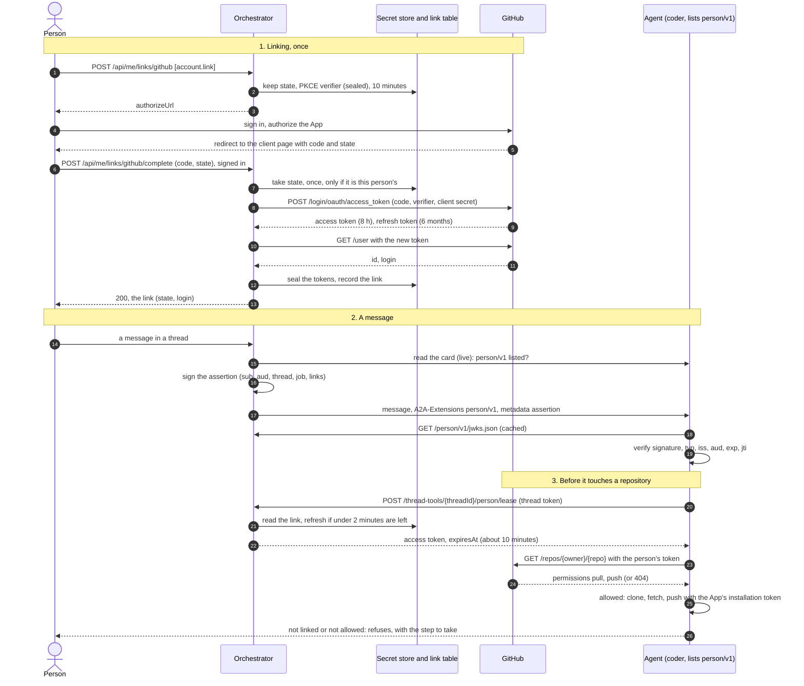
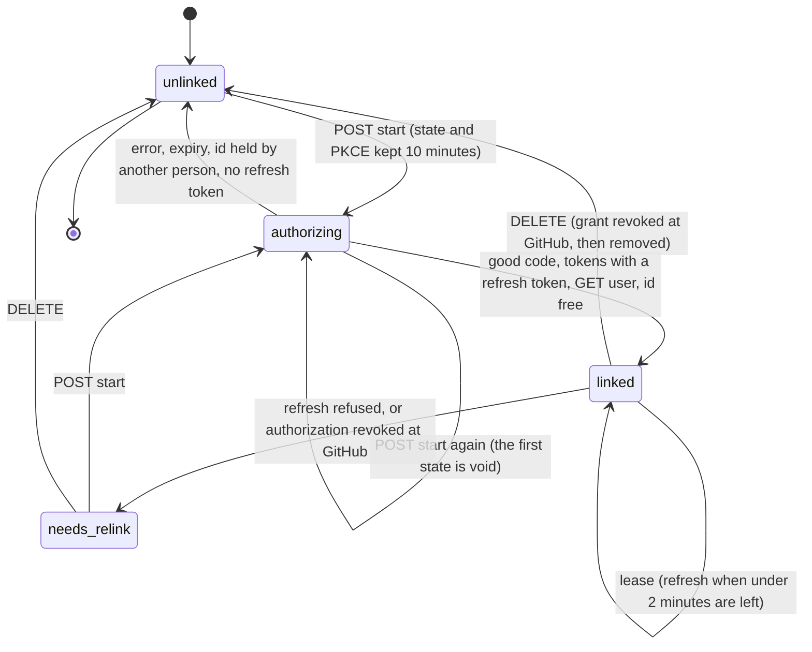

# ADR 0064 — The person reaches the agent as a signed assertion, links their GitHub account, and the coder checks their access before it touches a repository

- **Status:** **proposed (2026-10-18).** The owner decided, 2026-10-18 (as the task brief recorded it): *people link their GitHub account, and we keep
  the GitHub App*. The App does the work; the person's own GitHub identity proves they may. The plan behind it: the coder is offered to everyone,
  10,000 people, starting in Cameroon. **Proposed**, for the owner to confirm: every name, default, status code and shape below, and the
  [decisions at the end](#decisions-for-the-owner-to-confirm). **Nothing is built.** One design across this repository and adam-rs: the
  coder's side (verify, check, refuse) is adam-rs's own ADR, slice B1c. Extends [ADR 0008](0008-platform-integration-via-a2a-extension.md) (an
  optional extension), [ADR 0046](0046-people-add-their-own-mcp-servers-secrets-in-a-credential-broker.md) (the sealed secret store, the lease, the
  pending-state port) and [ADR 0033](0033-the-orchestrator-is-an-oauth2-resource-server.md) (who the person is). It amends no decision. It does **not**
  copy ADR 0046's public OAuth callback: decision 4 says why. When it is accepted, the note on invariant 3 in `CLAUDE.md` gets one more clause
  (*Consequences*).

## Context

An agent never learns who the person is. The coder is about to be sold to everyone, so this now matters. *Verified 2026-10-18 by reading the code at
`26504af`* (this repository) *and `c969a4f`* (adam-rs):

| What | Where |
|---|---|
| `SendRequest` has no field for a person. | `orchestrator/crates/ports/src/agent.rs:169-240` |
| The metadata of an A2A message carries the release, a2ui, ui-catalog, thread-tools, mentions, access-tier and uploads. Nothing says who the person is. | `orchestrator/crates/agent-a2a/src/client.rs:561-617` |
| The thread token is HS256, a shared secret. Its `sub` is the thread id; its other claims are `job`, `agt`, `caller`, `depth`, `jti`. It has no person. | `orchestrator/crates/thread-token/src/lib.rs:4,313,407`, [`thread-tools-v1.md`](../api/thread-tools-v1.md#the-token) |
| The agent is called with one static bearer per agent. | `orchestrator/crates/agent-a2a/src/client.rs:144-148,238-241,277-279` |
| `person.said` is the person's words, for an asked agent only. It is not an identity. | [`thread-tools-v1.md`](../api/thread-tools-v1.md#the-person-member) |
| **The user is the e-mail by default**, not the token's `sub`: `auth.jwt.userClaim` is `email` (a deployment may name another claim, `sub` included, and then every owner key changes). The code keeps that one value as `Principal.user`; `Principal` has no other subject. | `orchestrator/crates/ports/src/auth.rs:112-118`, `orchestrator/crates/auth-jwt/src/claims.rs:89-115`, [`config.md`](../api/config.md) (`auth.jwt.userClaim`) |
| **A message is sent from the outbox**, by any replica, with the thread in hand. The signed-in request is long gone. What the thread-tools guard knows of the person is `thread.owner`. | [`orchestrator.md`](../orchestrator.md) (inbox and outbox), [ADR 0001](0001-rust-state-machine-on-postgres.md), `orchestrator/crates/surface-thread-tools/src/guard.rs:163` |
| The coder acts with a GitHub App's installation tokens, for every account in `GITHUB_APP_OWNERS`. Nothing asks whether the person who wrote the message may touch the repository. The rule of what counts as *named* (adam-rs ADR 0036) says which repositories the person asked for, not which they may use. | adam-rs [ADR 0017](https://github.com/vymalo/another-adam-rs/blob/main/docs/decisions/0017-a-github-app-works-on-every-account-it-is-installed-on.md) (D1, D2) |
| adam-rs wants the person's identity for a git mirror of each person (its open decision 3). | adam-rs [ADR 0041](https://github.com/vymalo/another-adam-rs/blob/main/docs/decisions/0041-a-run-pod-sees-only-its-own-run.md), "Decisions for the owner to confirm", item 3 |

The risk, in one sentence: with two customers' organisations in `GITHUB_APP_OWNERS`, a person of one can name a private repository of the
other, and the coder works on it with the App's token.

What GitHub gives (*verified 2026-10-18*, [Facts](#facts-verified-and-unverified)): a GitHub App can ask a person to authorize it. The token that
results, a **user access token**, can reach only what **both the user and the app** can reach. So it is a proof of what the person may do, and
the App's installation token stays the one that does the work.

Invariants (`CLAUDE.md`), checked first. **1, protocols only:** the extension is an optional A2A extension; GitHub is reached by OAuth 2.0 over HTTP at
configured URLs, through one adapter behind a port, with no SDK; the orchestrator is never told what a repository is. **2, optional extension:** capability
detected from the live card, never cached, fail closed, removable. **3, stateless:** the link is state (a table of non-secret facts, and sealed tokens in the
`SecretStore` of ADR 0046); it is not the log and no event records it. **6, swappable:** a new port with a testkit; the GitHub adapter is a crate of its own.

## Decision

1. **An optional extension, `person/v1`.** URI `https://agents.vymalo.com/a2a/extensions/person/v1` (the prefix of every extension,
   [`extensions.md`](../api/extensions.md)). Do not confuse it with the `person` member of `thread-tools/v1`, which is what the person said.
   An agent lists it in its card: `{"uri": …, "required": false, "params": {"claims": ["github"]}}`. `claims` is optional, a closed list
   (today only `github`): what the agent wants beyond the person's `sub`. The orchestrator reads the card on every send and uses the extension only
   when the URI is exact and the params are well formed, as for every other extension; an agent that lists nothing gets **plain A2A, unchanged**
   (kagent, the verifier, every agent of today).
   - **Sent** when: the card lists it, the request belongs to a thread (not the verifier), and the orchestrator holds a signing key. Every message gets
     its own assertion, an ask and a rework included.
   - **`required: true`** is the agent saying it fails closed without a person. If the orchestrator cannot send the assertion, the job fails and **nothing is
     sent**, with a reason that says so. It never falls back to a plain message. With `required: false`, the message goes plain and the agent decides.
   - **Where:** `metadata[URI] = {"assertion": "<JWS>", "expiresAt": "<RFC 3339>"}`, the URI in `A2A-Extensions` and in `message.extensions`. The
     assertion is never written to the log, the outbox, an export, a frame or a log line, and the types that hold it print `[redacted]`, as the
     thread token's do.
2. **The assertion is a JWS the orchestrator signs.** Header `{"alg": "EdDSA", "typ": "person+jwt", "kid": …}`. The `typ` keeps it from being taken for a
   thread token or an ID token. Claims:

   | Claim | Value |
   |---|---|
   | `iss` | `person.issuer`: the URL under which agents reach the orchestrator (the same base as `THREAD_TOOLS_URL`), no trailing slash. The agent is configured with it. |
   | `aud` | the agent's **card URL**, as the orchestrator calls it (`AgentTransport::A2a.card_url`). |
   | `sub` | the person, as a **pseudonym** (below). Never the e-mail. |
   | `thr`, `job` | the thread id and the number of the job the message belongs to. |
   | `caller`, `depth` | as in the thread token: `main`, or `ask:<n>` for an asked agent. |
   | `jti` | the A2A message id. One assertion per message. |
   | `iat`, `exp` | `exp` is `iat` plus `person.assertionTtlSecs`: **300** by default, 60 to 3,600. Read from 30 seconds before `iat` to 29 after `exp`, as the thread token. |
   | `links` | **only when the person linked an account, the agent's card asks for it (`claims`) and the deployment names the agent** (`person.agents.<id>.claims`): `{"github": {"state": "linked", "id": 583231, "login": "octocat"}}`, or `{"github": {"state": "needs_relink"}}`. Absent: never linked, or unlinked. |

   **`sub`** is `base64url(HMAC-SHA-256(person.subjectKey, "person/v1" 0x00 agent-id 0x00 owner))`, 43 characters. *Why a pseudonym derived from the owner:*
   the OIDC `sub` is not kept apart from the owner key and not at hand where a message is sent (the table above), the owner key is the e-mail by default and must not reach an agent, and a derived
   value needs no new table and works in every `auth.mode`. *Why per agent:* two agents cannot join their records of one person. *Cost:* the key is never rotated
   (a new key is a new person to every agent), and a person whose e-mail changes is a new person, as for their threads today (question 85).
3. **Its keys are their own, asymmetric, and published.** The orchestrator signs with Ed25519 keys from its configuration (`person.signing`: a list of keys
   with ids and a current id; a previous key stays in the list until the longest assertion has expired). It serves their **public halves** as a JWKS,
   `GET {iss}/person/v1/jwks.json`, on the internal thread-tools surface: unauthenticated, not routed by the edge, `Cache-Control` of minutes.
   **The thread token's keys are not reused**, and the code says why: the thread token is HS256, one shared secret
   (`thread-token/src/lib.rs:4,313,407`; `kid` is a hash of the secret, `lib.rs:32`). A JWKS cannot publish it, and an agent that held it could forge a
   thread token for any thread and an assertion for any person. *What is reused:* the place of the minting (the adapter, at send time, from a non-secret
   grant, as `ThreadToolsIssuer` does), the claim vocabulary, the current-and-previous rotation, the surface and its host check, and the thread token itself
   to authenticate the lease (decision 5). **Workers mint, the control plane serves**, and the section is both-or-neither in every role, as `threadTools` is.
   - **The agent trusts what it is configured with, never the message**: `PERSON_ISSUER`, the audience (its own card URL as the orchestrator spells it) and the
     JWKS URL. It reads the keys as `orch-auth-jwt` reads an issuer's: EdDSA only, `none` and the HMAC family refused whatever key they name, fetched on first
     use, refreshed every 10 minutes, refetched on an unknown `kid` at most once in 30 seconds, kept an hour while the orchestrator is down and then failing closed
     (`orchestrator/crates/auth-jwt/src/lib.rs:116-126` are the numbers; adam-rs writes its own code).
4. **People link their GitHub account, in the orchestrator, with the GitHub App's user authorization.** A new port `AccountLinks` in `orch-ports` (a testkit,
   no driver type in a signature, [ADR 0009](0009-swappable-implementations-at-build-time.md)) and one adapter crate, `orch-link-github`, written once, over three
   things that exist or are one step from existing: the `SecretStore` (ADR 0046) for the tokens, **sealed**; `PendingAuthorizations` for the `state`; and a table of
   non-secret facts, `account_links` (owner, provider, GitHub id, login, state, times), with a unique `(provider, id)`. The provider is a closed enum
   ([ADR 0004](0004-closed-enums-over-dyn-registry.md)), `GitHub` only. The two existing ports gain a closed second kind of key, so that a link is not a tool server
   (the Postgres adapters get a new text form to bind and, for the pending table, a migration; existing rows are untouched).

   | Method and path | Who | Does |
   |---|---|---|
   | `GET /api/me/links` | any signed-in person | `{"github": {"available", "state": "unlinked" \| "linked" \| "needs_relink", "id", "login", "linkedAt"}}`. `available` is false when the deployment has no `links.github`. |
   | `POST /api/me/links/github` | permission **`account.link`** | Body `{"redirectUri"}`, one of `links.github.redirectUris`. Starts. `201 {"authorizeUrl", "expiresAt"}`. Ten a minute per person (as ADR 0046, slice 4c). `404` when not configured. |
   | `POST /api/me/links/github/complete` | **the same person who started it** | Body `{"code", "state"}`. Finishes. `200` the link. `404 unknown_flow` for a `state` that is unknown, used, ended **or another person's** (the same answer, and a refusal spends nothing); `409 account_taken`; `422 no_refresh_token`; `503` when GitHub cannot be reached. |
   | `DELETE /api/me/links/github` | any signed-in person | Unlinks (below). `200 {"revokedAtGitHub": true \| false}`. `503` when GitHub cannot be reached and `force` is not set. |

   - **The browser comes back to the client, not to a public route of the orchestrator.** `redirect_uri` is a page of the web, the desktop app's loopback listener
     ([ADR 0047](0047-one-ui-for-web-desktop-and-mobile-each-signs-in-as-a-public-oauth-client.md)) or another address the deployment lists, held to ADR 0046's `RedirectUri`
     rules (https, or http on a loopback IP literal). That client reads `code` and `state` and sends them to `complete` **with the person's own bearer**. This is a
     departure from ADR 0046's callback, which is public because the browser that comes back carries no token, and it is deliberate. A public callback finds the person by
     the `state` alone, so a stranger who starts a flow and gets a victim to authorize it would link **the victim's GitHub account to the stranger's** account, and the
     stranger would then pass the coder's check with the victim's repositories. ADR 0046 accepted the same shape for MCP servers (its slice 4c review, "consent phishing is an
     accepted risk"), where the stake is a server; here it is repository access. Two things stop it, and both are needed: the code goes to the initiating client and `complete`
     is authenticated, so the victim's code never reaches the stranger and a `state` of the stranger's is refused for the victim; and PKCE `S256`, so a code the stranger obtained
     with their own challenge cannot be redeemed against a flow of the victim. There is no new open path in the edge.
   - **The flow** is the web application flow of a GitHub App: `state` of 128 random bits, kept (as a digest) for 10 minutes and taken once by the person who began; the
     PKCE verifier sealed under the pending slot. `complete` exchanges the code (client id, **client secret**, code, redirect URI, verifier), calls `GET /user` with the new
     token to learn the **GitHub id and login**, then seals the tokens and writes the row, in a task of its own so that a client that goes away cannot leave it half done.
     The id is the key: `login` can be renamed on GitHub and is for display.
   - **Expiring tokens are required.** If the answer has no `expires_in` and `refresh_token`, the link is refused and the tokens dropped: the App must keep
     "User-to-server token expiration" on. The orchestrator never keeps a token that does not run out.
   - **One GitHub account, one person.** The unique `(provider, id)` makes a second person who authorizes the same account a refusal; the token just made is
     revoked with `DELETE /applications/{client_id}/token` (one token, **not** the grant, which would end the first person's link too).
   - **Unlink** is revoke, then delete, as ADR 0046 does for a server. The orchestrator refreshes if the access token has run out, calls
     `DELETE /applications/{client_id}/grant` (the grant and every token of this user for this App), and only then removes the row and the sealed tokens. If GitHub
     cannot be reached, the link stays and the answer is `503`; `?force=true` removes it here and says `"revokedAtGitHub": false`, and the person can remove the
     authorization at github.com. A person can always unlink, with or without `account.link`.
   - **`needs_relink`** when a refresh is refused (the refresh token expired after six months, or the person revoked the authorization at GitHub). The person links again.
   - **Configuration** (*proposed*, [a sketch below](#configuration-a-sketch); `config.md` and its schema change in B1b). The URLs are settable for GitHub Enterprise Server and
     for the test mock. It needs the `secrets` section of ADR 0046: without it, linking is unavailable and says so. **The same GitHub App as the coder's**: the orchestrator
     holds its client secret, the coder its private key. The App's settings list the redirect URIs.
5. **The coder redeems a lease of the person's token from the orchestrator.** `POST /thread-tools/{threadId}/person/lease`, body `{"provider": "github"}`,
   `Authorization: Bearer <the thread token>`. It is **a plain route beside the MCP endpoint, not an MCP tool**, so `tools/list` never shows it and a model that
   was given the endpoint cannot call it. It is modelled on ADR 0046's lease (`orchestrator/crates/ports/src/credentials.rs:169,526`) and on how the relay uses
   one (`orchestrator/crates/surface-thread-tools/src/relay/own.rs`: a fresh lease for each request, none kept, the credential never in a step or an error), with the same refresh
   protocol: one refresh at a time in a process, a claim in the store with `rotate` across replicas, because a refresh token is used once
   (`credentials.rs:513`, GitHub says the same).
   - **Bound to the thread, the job and the agent.** The guard that opens the MCP route runs first (`guard.rs:148-160`: the token, the thread, the agent, the ask on
     the ledger). The lease adds two checks the MCP route does not make for `main`: the token's `job` is the thread's current job **and that job is open** (the `main` arm
     of the guard, `guard.rs:148`, checks the agent only; the job is checked for an ask, `guard.rs:154`), and the agent is one the deployment names for it
     (`person.agents.<id>.lease: [github]`, **empty by default**). An agent that lists the extension is not thereby trusted with a token.
   - **Whose token:** the thread's owner's (`Verified.owner`, `guard.rs:25-30`). Never a parameter of the request.
   - **Answer:** `200 {"token", "expiresAt", "id", "login"}` with `Cache-Control: no-store`. `expiresAt` is the lease: `leaseTtlSecs` (default **600**) from now, never past the
     token's own expiry. The orchestrator refreshes first when fewer than 120 seconds are left, so a lease always has time to be used. **A lease cannot shorten a
     GitHub token**: it bounds how long the agent may hold it, and the token itself lives until its 8 hours end or the grant is revoked.
   - **Refusals** (problem details, RFC 9457): `401` the guard's; `403 lease_not_allowed`; `404 not_linked`; `409 needs_relink`; `409 job_over`;
     `503 unavailable` with `Retry-After` (the secret store or GitHub could not be reached; never a failed token).
   - **Audited, not logged as an event.** One log line and one metric per redemption, with the thread, job, agent, caller, provider and outcome. Never the token,
     the login or the id. The thread's log, its export and its frames hold nothing of it.
6. **The coder checks the person's access before it touches a repository** (adam-rs B1c). For a run, **before** it adds a repository to a workspace, clones,
   fetches or mirrors it, reads it through GitHub, or pushes, publishes or opens a pull request, the coder asks GitHub with the person's token whether this person
   may: `GET {GITHUB_API_URL}/repos/{owner}/{repo}`; `permissions.pull` for a read, `permissions.push` for a push. The App's installation token **still does the
   work**. The leased token is used for this check and nothing else: it does not clone, push or comment.
   - **No path without the check.** The rule is on the one place that hands out an installation token for a repository (adam-rs ADR 0017 D4 names it,
     `GitCredentials::token_for`): no token for a repository, no clone, no read, no push until the check has passed for this run, this repository and this need.
     adam-rs decides the placement.
   - **Both conditions.** The check is added to the rule that the person must have named the repository (adam-rs ADR 0036): named **and** allowed.
   - **Same words for "no".** A `404` or `403` is "not found, or you have no access to it". The coder does not say which.
   - **A rename.** A `301` is followed once, on the same API host, and the check is made again on the canonical name.
   - **Fail closed.** Any other answer (a `5xx`, a `429`, a network error, a lease refused with `503`, a `200` with no `permissions`) is "I cannot verify your access
     right now, try again", never a fallback to the App's token and never a guess. A `401` on a leased token means a refresh moved the token (the old one dies
     when a refresh succeeds) or the person revoked it: the coder redeems **one** new lease and asks again, and gives up after that (a revoked link answers the lease `409`).
   - **Caching:** in the memory of the run, never on disk, never in the run's durable context or journal, never shared between runs or people. An allowed answer is
     kept **5 minutes** (a push is checked again if its answer is older), a refused one **30 seconds**. A lease is kept until its `expiresAt`. A person who loses
     access to a repository loses it in a running run within 5 minutes.
   - **Consistency.** The lease's GitHub `id` must equal the assertion's `links.github.id`; if they differ (the person linked another account in between) the run's later
     steps are refused.
7. **Unlinked people, and what the deployment sets.** If the assertion has no `links.github`, the coder refuses with a step the person can follow: *"To work on
   `acme/widgets` I need to know you may. Link your GitHub account (Settings, Connections, GitHub), then ask me again."* For a `needs_relink` it says to link again.
   The coder's mode (`PERSON_GITHUB_CHECK`, chart `person.githubCheck`):

   | Mode | A person who has not linked | A person who has |
   |---|---|---|
   | **`required`** (the default once the card lists `person/v1`) | refused for every repository | read checked for a read, push checked for a push |
   | **`public-reads`** | may read **public** repositories (the repository object says `private: false`); no push, no creation, no private repository | as `required` |
   | **`off`** | as today, not asked | not asked (the assertion is still verified, for what else needs the person) |

   `off` is for a deployment with one owner, such as the owner's own. `create_repository` needs a link in `required` and `public-reads`; whether the person may create
   under an organisation is not checked here (question 87). A repository on a host other than the App's (`GITHUB_API_URL`) cannot be checked, so `required` refuses it.
8. **What the identity is for later, named only, not built here.** A git mirror of each person, named by `sub` (adam-rs ADR 0041, open decision 3); a package cache
   of each person (its decision 2); limits of each person (runs, disk, model budget) keyed by `sub`; commits and pull requests that name the person (the linked
   `id` and `login`). Each is a decision of its own, in adam-rs.
9. **Security rules** ([*Security*](#security), in full): the person's token never enters a run pod, a log, an event, an export, a frame or the model's context; sealed at
   rest (ADR 0046's envelope); a lease is bound to thread, job and agent; unlinking revokes at GitHub; deleting a thread leaves the link alone.

## The flow





Only `linked` yields a lease. The state is the person's, the same for every thread and every agent. An expired access token is not a state: the next lease refreshes it.
A running coder learns of a `needs_relink` at its next `401` or its next lease, so a revocation at GitHub reaches it within its cache, 5 minutes at most (the 10 minutes of
a lease are only how long it may hold the token). GitHub tells an App when a person revokes its authorization (the `github_app_authorization` event, *verified*); using it to mark the
link at once is a small addition to the route that exists, `POST /webhooks/github`, which acknowledges and ignores the events it does not read
([`webhooks.md`](../api/webhooks.md#github-adapter-post-webhooksgithub)), and is not part of B1 (question 88).

## Configuration, a sketch

*Proposed.* The keys, defaults and checks are written in `config.md` and the schema in B1b. Secrets are references (`{env}` or `{file}`), as everywhere
([ADR 0034](0034-one-yaml-configuration-secrets-by-reference.md)). Both sections are off when absent, and then nothing here is built or opened.

```yaml
person:
  issuer: http://orchestrator:8080          # iss; the address agents reach the orchestrator at, no trailing slash
  subjectKey: { env: PERSON_SUBJECT_KEY }   # at least 32 bytes; never rotated
  signing:                                  # Ed25519; the public halves are the JWKS
    current: k1
    keys:
      - { id: k1, key: { file: /run/person/k1.pem } }
  assertionTtlSecs: 300                     # 60 to 3600
  agents:                                   # what each agent may be told or lent; an agent not named gets sub only
    coder: { claims: [github], lease: [github] }
links:
  github:
    clientId: Iv1.example                   # the coder's GitHub App
    clientSecret: { env: GITHUB_APP_CLIENT_SECRET }
    webUrl: https://github.com
    apiUrl: https://api.github.com
    redirectUris: [ "https://chat.example.com/settings/connections/github" ]
    leaseTtlSecs: 600
```

## When something fails

Every row fails closed. "The coder" is a coder in `required` mode; the other modes are decision 7.

| Situation | The orchestrator | The coder |
|---|---|---|
| The card lists no `person/v1` | plain A2A, as today | nothing to do |
| It lists it, the orchestrator has no signing key, `required: false` | plain message, a warning | no person: refuses every repository |
| The same, `required: true` | the job fails, nothing is sent | never receives it |
| The assertion is bad or expired | | refuses the message before anything is written |
| The link store cannot be read at the send | the send fails and is retried; it never sends "unlinked" | |
| The person never linked | no `links` in the assertion | refuses, with the step to link |
| The link is `needs_relink` | `state` says so | refuses, with the step to link again |
| The lease is `404`, `409` or `403` | the matching problem | same refusals, in words |
| The lease is `503`, GitHub is down, a `429` or a `5xx` | `503` with `Retry-After` | "I cannot verify your access right now": refuses, retryable; **no fallback to the App** |
| GitHub says `404` or `403` for the repository | | "not found, or you have no access to it" |
| GitHub says `200`, `push` is false, and the work needs a push | | read allowed, push refused |
| GitHub says `401` to a leased token | | one new lease, one new try, then refuses |

## Security

- **Where the person's GitHub token exists.** Sealed at rest, in the AES-256-GCM envelope of ADR 0046, in the `SecretStore`. In the orchestrator's memory as a `ToolSecret`
  (wiped on drop, `Debug` prints `<redacted>`), only while it leases or refreshes. Once on the wire, in the lease's answer (TLS where the deployment has it; the
  dev stack's `THREAD_TOOLS_URL` is plain `http` on its network, as today). In the coder's process memory until the lease ends. **Nowhere else:** not a run pod (no
  environment variable, no mount, and the admission policy still allows one Secret key), not a log line, an event, an export, an AG-UI frame, a step's input or output,
  an error, the model's context, the run's journal or its durable context. The acceptance of B1b and B1d is a **sentinel**: a token planted in the mock is searched for in
  every answer, log, export, frame, row and table, as ADR 0046's slice 5b does.
- **A lease is for one thread, one job and one agent.** The owner is read from the thread, never from the request; the job must be the current, open job; the agent must be
  one the deployment names; every redemption leaves a log line and a metric. **Residual, accepted:** a leaked thread token of the coder can redeem the owner's GitHub token
  while its job is open, in leases of 10 minutes. That is the exposure of a leaked thread token today (it also opens the tools), made larger; the list of agents and the
  open-job rule are what bound it.
- **A lease cannot shorten a GitHub token.** The token lives until its 8 hours end or its grant is revoked. Unlinking revokes the grant first.
- **The assertion proves who, it grants nothing.** It is bound to an audience and a message, lives 5 minutes, and carries a pseudonym and, only for an agent the deployment
  names, a GitHub id and login. An agent may remember the `jti`s it has seen for the assertion's lifetime. The agent's bearer is shared by every sender; the assertion is how
  an agent that cares tells the orchestrator's message from another sender's.
- **The linking cannot be turned on a stranger** (decision 4): `complete` is authenticated and the person's own, PKCE binds a code to its flow, a refused `complete` spends
  nothing, one GitHub account links to one person, and the person is shown the login that was linked. GitHub is one fixed authorization server named in the
  configuration, so the mix-up attack of ADR 0046 (many authorization servers) does not arise.
- **Nobody lists another's link.** `GET /api/me/links` answers for the caller only; `admin` changes nothing, as for threads
  ([ADR 0039](0039-nobody-reads-another-persons-thread.md)). An operator with the database sees GitHub ids and logins (no secret) and sealed tokens.
- **Privacy.** The agent gets a pseudonym, never the e-mail. The login and id go only where the deployment says. No log line carries a login, an id or a token.
- **Deleting a thread leaves the link alone.** A link is the person's, as their MCP servers are, not the thread's ([ADR 0043](0043-deleting-a-thread-erases-it.md) erases
  the thread, its files and its share link). A fork copies nothing of it. Nothing erases a person yet (question 85).

## What adam-rs implements (a sketch)

adam-rs designs and builds its side in its own ADR (B1c). The shape:

- **Card and config.** The card lists `person/v1` with `claims: ["github"]` unless the mode is `off`; `required: true` when the deployment sets `PERSON_REQUIRED`.
  `PERSON_ISSUER`, `PERSON_AUDIENCE`, `PERSON_JWKS_URL`, `PERSON_GITHUB_CHECK`, `PERSON_CHECK_TTL_SECS` (default 300, at most 900). The chart has the values.
- **Verify before anything is written.** A message that activated the extension and carries a bad assertion is refused as unauthenticated, as a bad tier is
  refused as invalid. The checks: signature with an EdDSA key of the JWKS, `typ`, `iss` and `aud` exact, `exp` and `iat` within 30 seconds, `jti` equal to the message
  id, `thr` equal to the thread of the thread-tools grant when the message carries one, `links` well formed. A task's `sub` never changes: a message with another
  `sub` is refused.
- **Keep the facts, not the assertion.** The verified `sub` and `links` go into the run's context under a key of their own (not `vymalo.person`, which is the
  words). The newest message wins. A message without an assertion, to an agent that does not require one, **clears** it (a run must not go on acting as the person
  before), as `vymalo.mentions` is cleared. With `required`, the message is refused.
- **The leased token is held in process memory only.** adam keeps the thread-tools grant in the run's durable context until it expires (`vymalo.threadTools`,
  `crates/adam-a2a-runtime/src/vymalo.rs`); the leased token must **not** go there, nor in the journal, a note, a log line or the model's context. A crash means a
  new lease. A run pod gets no new Secret: the admission policy keeps its one key, `MODEL_API_KEY` (adam-rs ADR 0041, decision 5).
- **The check** of decision 6, in the one place that hands out an installation token for a repository, with the cache, the fail-closed answers and the refusal text of
  decision 7. Tests on a WireMock GitHub; a test that plants a sentinel token and greps every output.

## Slices

- **B1b, this repository.** In order, each with its tests: (1) the ports `AccountLinks` and their testkit, the in-memory adapter, the closed second key of
  `SecretStore` and `PendingAuthorizations`, the permission `account.link`; (2) the assertion: a crate for minting and verifying with **known-answer vectors computed by
  an independent implementation** (as the thread token's), `SendRequest.person`, the dispatcher reading the owner and the link at send time (a store that fails fails
  the send, it never sends "unlinked"), the adapter's rider and the JWKS route, the `person` configuration; (3) `orch-link-github`, the `account_links` migration, the
  four routes (`complete` is authenticated, so the chart's edge needs no new open path); (4) the lease route and its checks. Docs in the same slice: a contract page `docs/api/person-v1.md`
  (with the vectors), the row of [`extensions.md`](../api/extensions.md), `config.md` and its schema, `chat-api.yaml`, `thread-tools-v1.md` (the lease route), the chart
  (values, three more properties of the AWS secret: the client secret, the subject key, the signing key), `dev/README.md`, the crate READMEs.
  Acceptance: a sentinel token planted in the mock GitHub is in no answer, log, export, frame, journal or table (the test of ADR 0046, slice 5b).
- **B1c, adam-rs.** Verify, check, refuse (*What adam-rs implements*). Its own ADR and its own mocks.
- **B1d, this repository.** The bump of the adam pin (`bump-adam`), and a scenario on mocks, `dev/person-e2e.sh`, in the stack's style: a mock GitHub that answers the
  user side (`dev/wiremock/github-user/`, ours, mounted beside the vendored `mock-github` mappings as `dev/wiremock/coder-share/` is): the authorize redirect, the token
  exchange and refresh, `GET /user`, `GET /repos/{owner}/{repo}` with `permissions` that depend on the token, the grant deletion. It asserts: an unlinked person is refused
  and told the step; after linking, a repository the mock allows is cloned and one it denies (`404`) is not, with the git server's log as the proof; a push needs
  `permissions.push`; the mock down is a refusal and not a fallback; a refresh before the token ends, and the `401` re-lease; unlink calls the grant deletion and the next
  message is refused again; deleting a thread leaves the link; and the sentinel check of B1b over the whole run. It cannot prove the live facts marked unverified.

## Alternatives rejected

- **The orchestrator checks access and the token never leaves it.** A thread tool `check_repository_access`. Stronger (the coder never holds the token), and rejected
  for now: it puts the idea of a repository, a read and a push into an orchestrator that knows no such thing (invariants 1 and 7), and every agent host with another rule
  would need an orchestrator change. The coder already holds the App's private key, which reaches more than any user token. Kept as the hardening if the owner wants it
  (owner decision 9 below).
- **A public callback on the orchestrator, as ADR 0046 has for MCP servers.** It finds the person by the `state` alone, so a stranger who starts a flow and gets a victim to
  authorize it links the victim's GitHub account to the stranger's, and passes the coder's check with the victim's repositories. Rejected for the link (decision 4). It would
  also have needed one more open path in the edge.
- **The agent asks the orchestrator whether an assertion is good** (token introspection) instead of reading a JWKS. One call per message and a dependency on the
  orchestrator at the moment of every message. Rejected; a cached key set needs neither.
- **The person's own OIDC token forwarded to the agent.** The agent would hold a bearer that opens the orchestrator's API as the person, and the orchestrator does not
  have it where it sends (the outbox). Rejected.
- **The thread token carries the person.** It is HS256 and has no public keys; an agent would verify with the secret that signs. Rejected (decision 3).
- **`sub` is the e-mail, or the OIDC `sub`.** The e-mail is personal data an agent does not need, and it changes. The OIDC `sub` is not kept apart from the owner key today
  and is not at hand where a message is sent; a deployment can make it the owner key (`userClaim: sub`) but that renames every owner. A new column or table for it is a bigger
  change than a derived value, and the question stays open (85).
- **A GitHub OAuth App, or a personal access token the person pastes.** An OAuth App is another application with its own, broader scopes; a token is a secret the
  person must make and paste. The owner chose the App's user authorization.
- **Per-person lists of allowed owners in the coder's configuration** (`GITHUB_APP_OWNERS` for each person). A mapping an administrator would keep for 10,000 people.
- **Nothing: keep one deployment per customer.** Works, and it is not the product the owner described.

## Consequences

- **Easier:** the coder can serve many customers on one App, and a person can reach only what GitHub says they can. The same identity opens the mirror and the limits
  of each person later. An agent without the extension is unchanged, byte for byte.
- **Harder, and said plainly:** a person must link before the coder works for them in `required` mode, which is a step in front of the first task. The orchestrator now
  holds the App's client secret and a person's GitHub tokens, sealed: a leak of the database with the key from the AWS secret is a leak of 10,000 GitHub tokens, each as
  strong as the person and the App together (ADR 0046 accepted the same shape for MCP tokens). The coder holds a leased token in memory, and a bug that logged it would
  be a leak: the sentinel tests are the guard. A GitHub outage stops the coder in `required` mode (it fails closed, on purpose).
- **A refresh kills the old token.** A running coder's lease can die before its `expiresAt` (GitHub: the old token "will no longer work"). The one re-lease handles it.
- **New state, so invariant 3's note in `CLAUDE.md` is amended when this is accepted:** Postgres also keeps who linked which external account (no secret) and, sealed in
  the `SecretStore`, their tokens. It is not the log, no event records it, nothing reasons on it, and it is read only to lease. As with ADR 0046, **a backup of the
  database does not restore the tokens without the key**, and losing `person.subjectKey` changes every `sub`.
- **One App per environment.** GitHub limits a user to ten tokens per application, for OAuth apps (*stated there; unverified for GitHub Apps*): two deployments on one App
  could revoke each other's tokens.
- **Required elsewhere:** `docs/api/config.md` and its schema, `chat-api.yaml`, `thread-tools-v1.md`, the chart (values, the AWS secret's properties), adam-rs (its ADR, the
  card, the check), the web and the desktop app (a Connect GitHub control that opens `authorizeUrl`, and a page or loopback listener at `redirect_uri` that sends `code` and
  `state` to `complete`; later, the endpoints above are named so it can come). The GitHub App's settings need the redirect URIs listed and user-token expiration left on.

## Facts, verified and unverified

*Verified 2026-10-18*, page reads (the fetch tool summarised the pages, so wording is a paraphrase unless quoted), and two files read in full:

- **Web application flow of a GitHub App.** Authorize at `https://github.com/login/oauth/authorize` with `client_id`, `redirect_uri`, `state`, and `code_challenge` with
  `code_challenge_method` `S256` ("the `plain` code challenge method is not supported"); exchange at `POST https://github.com/login/oauth/access_token` with `client_id`,
  `client_secret`, `code`, `redirect_uri`, `code_verifier`. The answer: `access_token` (`ghu_`), `expires_in` ("always `28800`", 8 hours), `refresh_token` (`ghr_`),
  `refresh_token_expires_in` ("always `15897600`", 6 months), `scope` empty, `token_type` `bearer`. A refresh token comes only if the App opted in to expiring user tokens
  or uses the `offline_access` scope. <https://docs.github.com/en/apps/creating-github-apps/authenticating-with-a-github-app/generating-a-user-access-token-for-a-github-app>
- **The reach of a user token.** "A GitHub App user access token only has permissions that both the user and the app have", and "a user access token can only access
  resources that both the user and app can access" (the app can reach A and B, the user B and C: the token reaches B). The app can only reach accounts where it is
  installed, and an app does not need to be installed for a user to authorize it. Same page, and
  <https://docs.github.com/en/apps/creating-github-apps/authenticating-with-a-github-app/authenticating-with-a-github-app-on-behalf-of-a-user>
- **Refresh.** `POST https://github.com/login/oauth/access_token` with `client_id`, `client_secret` (required unless the token came from the device flow),
  `grant_type=refresh_token`, `refresh_token`. "Once you use a refresh token, that refresh token and the old user access token will no longer work." An expired refresh token
  means the person goes through the flow again. Expiring tokens are turned off in the App's Optional Features ("User-to-server token expiration", Opt-out); tokens issued
  while it is off do not expire. <https://docs.github.com/en/apps/creating-github-apps/authenticating-with-a-github-app/refreshing-user-access-tokens>
- **The check endpoints.** `GET /repos/{owner}/{repo}` answers `200`, `301`, `403`, `404`; its body is GitHub's `full-repository`, with `private`, `visibility` and a
  `permissions` object (`admin`, `pull` and `push` required inside it; `maintain`, `triage`), and `permissions` itself is **not** a required member. GitHub's page on the
  permissions of Apps lists `GET /repos/{owner}/{repo}` and `GET /repos/{owner}/{repo}/collaborators/{username}/permission` (`200`, `404`; `permission` is the legacy `admin`,
  `write`, `read`, `none`) under Metadata: read, for user and installation tokens, and `GET /user/installations/{installation_id}/repositories` ("the access the user has to
  each repository is included in the hash under the `permissions` key") under Metadata: read, for user tokens only.
  <https://docs.github.com/en/rest/repos/repos#get-a-repository>, <https://docs.github.com/en/rest/overview/permissions-required-for-github-apps>, and the OpenAPI description,
  <https://raw.githubusercontent.com/github/rest-api-description/main/descriptions/api.github.com/api.github.com.json> (read in full; the description's version is 1.1.4).
- **`GET /user` and the others work with a GitHub App user access token.** GitHub's own list of the endpoints that do, a data file of the docs, names `GET /user`,
  `GET /user/installations`, `GET /user/installations/{installation_id}/repositories`, `GET /repos/{owner}/{repo}` and the collaborator permission endpoint.
  <https://raw.githubusercontent.com/github/docs/main/src/github-apps/data/fpt-2022-11-28/user-to-server-rest.json> (*inference:* the file is what the docs render as "works with
  GitHub App user access tokens"; the docs pages themselves did not show that section to the fetch tool).
- **Revocation.** `DELETE /applications/{client_id}/grant` revokes the grant for the token's owner and, in the OpenAPI text, "all OAuth tokens associated with the application for
  the user"; `DELETE /applications/{client_id}/token` revokes one token. Both take `access_token` in the body, answer `204` or `422`, and are described for a GitHub App with an OAuth
  authorization. <https://docs.github.com/en/rest/apps/oauth-applications> and the OpenAPI description above. A person revoking the authorization at GitHub revokes its tokens:
  <https://docs.github.com/en/authentication/keeping-your-account-and-data-secure/token-expiration-and-revocation>
- **The `github_app_authorization` webhook** is "sent when a user revokes their authorization of a GitHub App", and an App "receives this webhook by default and cannot
  unsubscribe from this event". <https://docs.github.com/en/webhooks/webhook-events-and-payloads#github_app_authorization>
- **Storing tokens.** GitHub advises encrypting user tokens on the back end and keeping a confidential client's secret in a key vault.
  <https://docs.github.com/en/apps/creating-github-apps/about-creating-github-apps/best-practices-for-creating-a-github-app>
- **The error codes of the token request** that the troubleshooting page lists: `incorrect_client_credentials`, `redirect_uri_mismatch`, `bad_verification_code`,
  `unverified_user_email`; a JSON body of `error`, `error_description`, `error_uri`. <https://docs.github.com/en/apps/oauth-apps/maintaining-oauth-apps/troubleshooting-oauth-app-access-token-request-errors>

*Unverified*, each to be settled by the first run against GitHub (the mock of B1d cannot):

1. That `permissions` is present in the answer to a `ghu_` token's call of `GET /repos/{owner}/{repo}`, and that `push` there reflects the person's role and is not narrowed
   by the App's own permissions. The check fails closed when it is absent, so the cost of being wrong is a refusal.
2. How the two deletions authenticate: the OpenAPI says `security: null` and the page read says only that the token is an input; older documentation says HTTP Basic with the
   client id and secret (from memory). Whether deleting only the access token also ends its refresh token.
3. How a refused refresh answers. The page read lists no `bad_refresh_token`; GitHub's OAuth endpoint is known (from memory) to answer some errors with status `200` and an
   `error` member, so the client reads the status and the body.
4. Whether a refresh voids the old access token at once or after a grace; and whether GitHub sends `iss` on the redirect (RFC 9207).
5. The ten-token limit per user, application and scope: stated under the heading of OAuth apps; whether it applies to a GitHub App's user tokens. The rate limit of user access
   tokens: the pages read say nothing.
6. A user token for an organisation that enforces SAML single sign-on, and for GitHub Enterprise Server.
7. What the matching rule of `redirect_uri` against the App's registered callback URLs is (the `redirect_uri_mismatch` error exists), and whether GitHub accepts a loopback
   `http` address with a port for an App, which the desktop app needs.
8. That an App other than the coder's can only make the check stricter, never looser.

## Decisions for the owner to confirm

1. **The extension's name**, `person/v1`, the URI above. It shares a word with the `person` member of `thread-tools/v1`; `identity/v1` avoids that.
2. **`sub` is a pseudonym** derived from the owner, the agent id and a deployment key, never the e-mail, and the key is never rotated. The alternative is the OIDC `sub`,
   which needs a stored column (question 85).
3. **The assertion is signed with Ed25519 and published as a JWKS on the internal surface**; the thread token's HS256 key is not reused. Lifetime 300 seconds.
4. **Only agents the deployment names get the `github` claim and the lease**, and the lease list is empty by default.
5. **Who may link:** the permission `account.link`, held by the chart's `user` role once `links.github` is on. Or off by default like `tools.user.add`.
6. **One GitHub account links to one person**, and a person has one GitHub link.
7. **The link is completed by the signed-in client, with PKCE, not by a public callback** (decision 4). The cost: every client needs a page or a loopback listener at
   `redirect_uri`, and the App lists them.
8. **Unlinking revokes the grant at GitHub first**, answers `503` if it cannot, and has a `force`.
9. **The coder redeems the person's token from the orchestrator and asks GitHub itself** (this ADR), rather than the orchestrator answering "may they" (*Alternatives*).
10. **The check:** `GET /repos/{owner}/{repo}`, `permissions.pull` and `permissions.push`, fail closed on any failure, no fallback to the App, cached 5 minutes allowed and 30
    seconds refused, in memory, per run.
11. **Unlinked people are refused by default** (`required`). `public-reads` and `off` are the deployment's choices; `off` is for a single-owner deployment.
12. **The lease is 600 seconds**, and a lease is refused when the job is over.
13. **The same GitHub App for linking and for the work**, one App per environment, with expiring user tokens left on (a link without a refresh token is refused).
14. **Deleting a thread leaves the link alone**, and a fork copies nothing of it.
15. **The identity's later uses** (a mirror, a cache and limits of each person, a named commit) are named and not decided here.

## Open questions

All in [`open-questions.md`](../open-questions.md), Open.

- **85.** The user is the e-mail. Should it be the OIDC `sub`, and what happens to a person whose e-mail changes?
- **86.** One link per person and one person per GitHub account: right for the people who share an account, or have two?
- **87.** Organisations: creating a repository under one, SAML single sign-on, GitHub Enterprise Server, and the rate limit of user tokens.
- **88.** How fast must a revocation reach a running coder: the `github_app_authorization` event on `POST /webhooks/github`, and a repository removed from a person.
- **89.** What the identity is for beyond the check: the mirror of each person, limits and a commit that names the person; where each is decided.
