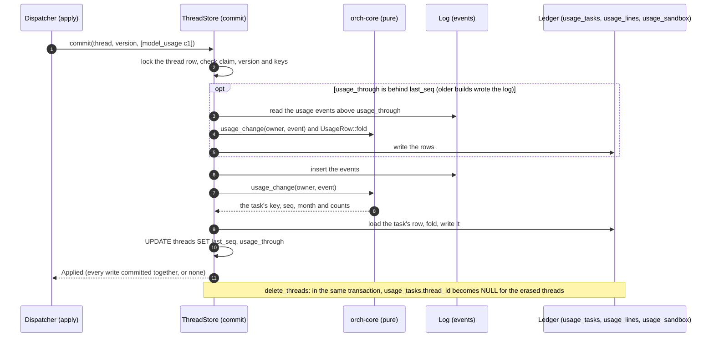
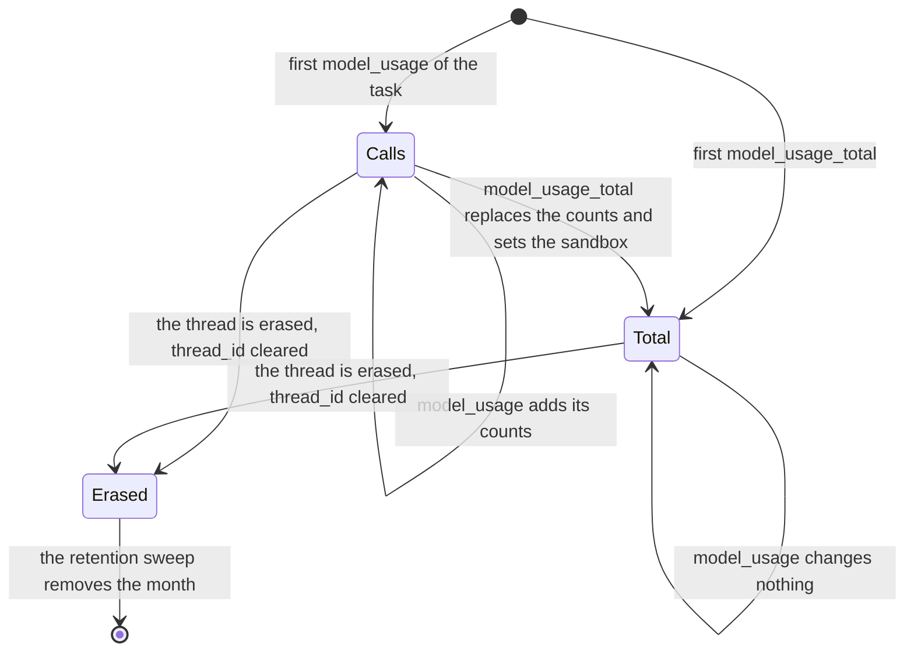

# ADR 0065 — A usage ledger per person: counted per task by month, written in the commit of the event, outliving the thread

- **Status:** **proposed (2026-10-27); PR 2 built in this change (2026-10-28), still proposed.** The design is the owner-side comment on
  [issue 281](https://github.com/vymalo/another-agentic-system/issues/281) ("A usage record per person, priced by model", the epic
  [274](https://github.com/vymalo/another-agentic-system/issues/274), M2: usage and limits per person), written the same day as "open to
  objection; the build starts from this and records it as an ADR". **Proposed**, for the owner to confirm: every name, default and shape
  below, and the [decisions the build settled](#what-the-build-settled-for-the-owner-to-confirm). The build is two pull requests:
  **PR 1 is built** (decisions 1 to 4 and 8's buckets: the pure change in `orch-core`, the port `UsageLedger` with its testkit, the in-memory
  and Postgres adapters, migration `0023`, the write in the event's transaction, the erase that clears the thread id, the catch-up and the
  backfill command); **PR 2 is built in this change** (decisions 5 to 7 and 9, and the retention of 8: the price table in the configuration,
  the pure pricing in `orch-core`, `GET /api/me/usage`, the sweep and its worker). The scenario on mocks is built (`dev/usage-ledger-e2e.sh`, run on the host against the stack's mocks on 2026-10-28; in compose by CI only). What PR 2 does not carry, and a later change of the same
  PR does, is the chart. Builds on [ADR 0056](0056-token-usage-per-model-call.md) (the events it
  counts), [ADR 0043](0043-deleting-a-thread-erases-it.md) (what an erase leaves) and [ADR 0009](0009-swappable-implementations-at-build-time.md)
  (a port has a testkit). **It amends invariant 3** of `CLAUDE.md` and [ADR 0001](0001-rust-state-machine-on-postgres.md) (decision 1) with a
  dated note, as [ADR 0042](0042-the-thread-list-is-the-owners.md) and [ADR 0046](0046-people-add-their-own-mcp-servers-secrets-in-a-credential-broker.md)
  did before it (decision 3).

## Context

Every limit, credit and receipt of M2 and M3 asks the same question, *how much has this person used?*, and the system cannot answer it.
*Verified 2026-10-27 by reading the code at `cd8576b`:*

| What | Where |
|---|---|
| A model call is a `model_usage` event of the thread's log, a task's totals a `model_usage_total`. Both carry labels and counts; the second carries the task's `sandbox` time since 2026-10-27. The `agent` of each is the thread's agent or an asked agent. | `orchestrator/crates/core/src/usage.rs` (`ModelUsageData`, `ModelUsageTotalData`, `record_usage`) |
| "The totals are the record": a task resumed after `input-required` reports the totals of all its calls so far, and a client keeps the latest, not a sum. The totals may be lower than the sum of the calls. | [`usage-v1.md`](../api/usage-v1.md) section 4 |
| A repeated call report is one event: the commit carries the report's idempotency key and a key already in the log is `CommitOutcome::Duplicate`, nothing written. | `ThreadStore::commit`, `orchestrator/crates/store-postgres/src/store.rs` (`events_idempotency`) |
| There is no price, no sum per person and no endpoint. The only way to see what a person used is to add up their threads by hand. | [issue 281](https://github.com/vymalo/another-agentic-system/issues/281) |
| **Deleting a thread erases its events.** One transaction deletes the thread row, which cascades the log. A record of a person's usage therefore cannot be a view of the log. | `delete` in `store.rs` (ADR 0043), `ThreadStore::delete_threads` |
| A thread has one owner, fixed at creation, and nobody reads another person's thread. A reader of a shared link cannot write, so cannot spend. | `ThreadRecord.owner`, [ADR 0039](0039-nobody-reads-another-persons-thread.md), [ADR 0040](0040-thread-sharing-by-revocable-link.md) |
| A fork **copies** its parent's events up to the cut, as they are (same `seq`, time, actor and data), in the transaction that creates it. | `PgStore::create`, `write_commit` in `orchestrator/crates/ports/src/memory/store.rs` |
| An asked agent's task can be **continued** by a later ask: the second ask has another number and the same A2A task. Its usage events say the asked agent in `agent` and `["ask-<n>"]` in `path`. | `OutboxPayload::Ask { continue_task }`, `Input::AskUsage`, `crates/app/src/dispatcher/ask.rs` |
| The projection folds the same events for the live gauge: a task's latest totals **plus the calls reported after them**, which the next total replaces. | `orchestrator/crates/agui-projection/src/usage.rs` (`TaskUsage::known`) |

Invariants (`CLAUDE.md`), checked first. **1, protocols only:** nothing new on the wire; the ledger reads events the orchestrator already logs.
**2, optional extension:** unchanged; an agent that reports no usage adds no row. **3, stateless processes, one event log:** the ledger is state
that is not the log (decision 3: the amendment). **5, the core is pure:** what an event changes and what a row becomes are functions of values
(`usage_change`, `UsageRow::fold`), in `orch-core`, which stays free of async and I/O. **6, swappable implementations:** a port with a testkit, an
in-memory and a Postgres adapter, no implementation type in a signature.

## Decision

The nine decisions of the design comment, in its order, each with what PR 1 builds; the details the build settled are in
[the last list](#what-the-build-settled-for-the-owner-to-confirm).

1. **What is counted: a task's totals, and its calls only while it has no total.** One **row per task** (the thread, the agent and the A2A task).
   - A `model_usage_total` **replaces** the row's counts and sandbox whole. A later total replaces an earlier one, even a lower one: the totals are
     the record and cover every call of the task so far, so they are never added to each other, nor to the calls.
   - A `model_usage` **adds** to the row's counts while the task has no total, so a task that is running, never ended or belongs to an agent that
     writes no totals is counted as the sum of its logged calls, and replaced when its total arrives.
   - **Once a task has a total, a call changes nothing.** The total covers every call of the task so far, so a call logged after it is either in the total
     already (a report logged later than the poll that read the total; an asked agent's reports travel as inputs of their own, `Input::AskUsage`, so the
     order of the stream and the poll is not guaranteed: *unverified* that it happens, and the rule is safe if it does) or a call of the task's next turn,
     which the next total covers. Counted on top, the first would be money counted twice; the second is counted anyway by the total that follows.
     *Rejected:* adding the calls after a total on top of it, as the projection does for the live gauge, which a screen can afford to get briefly wrong
     and a bill cannot. The price of the rule is item 8 of [the build's list](#what-the-build-settled-for-the-owner-to-confirm).
   - **A call reported twice is counted once**, twice over: the log drops the repeat (the idempotency key), and the row remembers the `seq` of the last
     event it folded in, so an event applied again, by a replay or the backfill, changes nothing.
2. **Whose usage it is: the thread's owner.** That includes the calls of sub-agents and of asked agents in the thread. Nobody who reads a shared
   link can write, so nobody else spends in a thread.
3. **The ledger outlives the thread.**
   - **No content.** A row holds the owner, the agent and task ids, the month, the provider and model and counts, and the sandbox time. No message, no
     thread content, no title.
   - **The thread id** is kept for the person's own breakdown (`UsageLedger::thread_rows`) and **cleared when the thread is erased**, in the same
     transaction that deletes it. The usage stays; the link to the erased thread goes. There is no foreign key from the ledger to `threads`.
   - **Amendment to invariant 3** (*stateless processes, one event log*): the usage ledger is durable state beside the log, as the thread row's
     organisation of the owner's list is (ADR 0042) and a person's tool servers are (ADR 0046). It is written **in the commit of the event** that carries
     the usage (decision 4), so it is never a second truth that can drift from the log, and it outlives the thread because a limit, a credit and a receipt
     are about the person, not the conversation. `CLAUDE.md` gets the parenthetical in the same change.
   - **Deleting a person** ([issue 294](https://github.com/vymalo/another-agentic-system/issues/294)) decides later how much of the ledger the law
     requires to keep. This ADR keeps the person's rows under their e-mail until then.
4. **It is written in the same commit as the event that carries the usage.**
   - The core computes, purely, what a `model_usage` or `model_usage_total` changes (`usage_change`) and what a row becomes (`UsageRow::fold`). The
     store applies it **inside the transaction that appends the event**, in `commit`, `create_thread` and `fork_thread`, in Postgres and in memory. A commit
     that is refused (a version conflict, a lost claim, a repeated key) writes neither; one that fails in the ledger fails whole, with no event in the log.
   - **The read side** is the port `UsageLedger` with a conformance testkit (`usage_ledger_conformance!`, ADR 0009), implemented by the same store the log
     is in: `month(owner, month)`, `thread_rows(owner, thread)` and `backfill(after, limit)`. There is no method to write a row: a store that is a
     `ThreadStore` writes it, and a `ThreadStore` that did not would fail the testkit.
   - **Migration `0023`:** `usage_tasks`, `usage_lines`, `usage_sandbox` and the column `threads.usage_through`.
   - **The catch-up and the backfill.** Usage logged before the ledger existed, or by a build without it while a rollout is under way, is folded in by a
     **watermark**: `threads.usage_through` is the `seq` up to which the ledger has been through the thread's log, and every commit that finds it behind
     `last_seq` folds the events in between before its own. `orchestrator usage backfill` does the same for every thread that is behind, page by page, so it
     reaches the threads that no one writes to any more. Both are idempotent and safe beside the service: one transaction per thread, under the thread's lock.
     **A catch-up costs by the tasks it touches, not by its events:** it reads the log in pages of 500, folds each event into its task's row in memory with
     `UsageRow::fold`, and loads and writes each row once (build item 11). The backfill waits at most 5 s for a thread's lock, skips and counts a thread it cannot
     lock (the command then exits 75 and the next run takes it), and its first page makes the rows of threads an older build erased name no thread (build item 12).
5. **Prices are configuration, in integers.** `usage.prices` holds one currency per deployment and, per `provider`/`model`, a price per
   million tokens for `input`, `cachedInput` and `output`; for the sandbox, a price per CPU-core hour and per GiB-hour of the requests. No `f64`:
   prices are decimal strings, parsed exactly into millionths of the currency unit and computed in checked integers, rounded half up once per
   line. Cached tokens are a part of the input (the cached part at `cachedInput`, the rest at `input`); reasoning tokens a part of the output,
   priced as output. The ledger already keeps the counts this needs: the parts of the totals, and the sandbox entries per shape. *Built in PR 2:*
   `orch_core::price_month` (pure, [`pricing.rs`](../../orchestrator/crates/core/src/pricing.rs)), `usage.prices` in
   [`config.md`](../api/config.md#usage) and `orch-config` (every price a decimal string, refused as a YAML number), and the mapping in the
   binary. The shape of the file is
   `usage: { retentionMonths: 24, prices: { currency: EUR, models: [{ provider?, model, input, cachedInput, output }], sandbox: { cpuCoreHour, gibHour } } }`.
6. **A model with no price is said so, never counted as free.** Its line carries the counts and `"price": null`; the total says
   `"complete": false` and lists what is unpriced. The same for a sandbox entry that lacks a CPU or memory request, and for a sandbox that was not
   measured (`local`, `devcontainer`). PR 1 keeps what this needs: the month's read returns the sandbox time per shape (with `None` for a request
   the pod did not have) and, apart, the tasks whose sandbox was not measured per environment (`UsageMonthTotals.unmeasured`), so "not measured" is
   never a zero. PR 2 puts the words on it: `LinePrice::Unpriced(Unpriced)` with a closed reason (`NoTable`, `NoModelPrice`, `NoSandboxPrice`,
   `NoRequests`, `Overflow`), and the total is the sum of the lines that are priced.
7. **The ledger keeps counts, not money.** The answer is priced with the **current** table and says which table it used (`prices`, the id of the
   table: [build item 16](#what-the-build-settled-for-the-owner-to-confirm)). Prices frozen at the time of use are for receipts (M3,
   [issue 288](https://github.com/vymalo/another-agentic-system/issues/288)), not this ticket.
8. **Periods and how far back.** Rows go in the **UTC calendar month** of the event (`UsageMonth`, `YYYY-MM`); `usage.retentionMonths`, default
   **24** (1 to 1200), and a sweep removes older months: the current month is one of the months kept, so 24 keeps this month and the 23 before it
   (`UsageMonth::first_kept`; [build item 19](#what-the-build-settled-for-the-owner-to-confirm)). The real number is the owner's and the law's
   (M5). A task's row is in the month of **the latest event that changed it** (settled in the build, list item 2).
9. **The API: `GET /api/me/usage?month=YYYY-MM`**, the current month by default. The route has no owner parameter, as threads have none
   (ADR 0039), so another person's usage is never in an answer. It answers per provider and model with the counts and the price, the sandbox per
   shape, and the priced total with `complete` and its currency (the contract is `getMyUsage` in [`chat-api.yaml`](../api/chat-api.yaml)).

The month of a row moves with every change that is not ignored; the diagram shows the counts, not the month.

## What the build settled (for the owner to confirm)

The design comment left these open or did not see them. Each is the smallest thing that is correct; each can be reversed by a later migration.

1. **A task is keyed by thread, agent and task, not by the ask path.** The design says "each task (and each asked agent's task)". The `agent` of a usage
   event already tells the thread's agent from an asked one, and from another asked agent that numbers its tasks alike. The ask number is **not** in the
   key, because a later ask may *continue* an asked agent's task (`continue_task`): the same task then appears under two ask numbers, and its total
   (cumulative) must replace the first one's, not be added to it. *Rejected:* the ask path in the key (double counts a continued task), and the task id
   alone (two agents that number their tasks `1` would share a row). *Unverified:* a real agent that reuses a task id for two tasks in one thread; its
   second task would replace the first. A2A task ids are the agent's to make unique, and nothing in the log suggests otherwise.
2. **A row is in the month of the latest event that changed it, whole.** A task that crosses midnight at a month's end is counted entirely in the later
   month. **A month that has ended is therefore not stable:** a task open across the month end moves the usage it made in the earlier month into the later one when
   its next event arrives, so the earlier month's figure falls after the month closed, and the later one holds usage made before it began. That matters for what is
   built on the figure (a limit that resets monthly, a receipt for a closed month, M2 and M3) and is **an owner decision**: the alternatives are a row per task and
   month (which needs the usage *made* in each month, not the totals, and a total can be lower than the one before it), or a task that is closed at the month end. *Rejected:* the month of the first event (the task's tokens would sit in a month that may be mostly over, and the retention sweep would remove
   them before the task's last month), and a row per task and month with the *difference* of the totals (a total can be **lower** than the earlier one, so
   a difference can be negative). Time zones are UTC, as the design says; a person's local month is not used.
3. **A watermark, not a per-row guard alone.** Each row keeps the `seq` of the last event it folded in, which makes applying an event twice harmless. That is
   not enough for the backfill: a build with the ledger that writes to a thread whose earlier events a build without it wrote would create a row from the
   new event alone and take the earlier ones, whose `seq` is lower, for replays. `threads.usage_through` is **contiguous** (every usage event up to it is in
   the ledger), so the catch-up is sound whichever builds wrote and in whatever order. It is updated by the `UPDATE` that every commit already makes, at no
   statement of its own. *Rejected:* a backfill that must complete before the first new build runs (a rollout cannot promise it), and a SQL backfill in the
   migration (older builds append after it, and a SQL copy of the fold would be a second implementation of the rule).
4. **A fork's copied events are not counted.** The events a fork copies from its parent were counted in the parent; the fork's `usage_through` starts at its
   cut and the backfill never reads below it. The consequence: **usage of a parent that was erased before the backfill ran is not recovered** from the fork's
   copies (it would be counted a second time if the parent still existed, and the backfill cannot tell). Run the backfill soon after the migration.
5. **The ledger never fails a commit over a count.** A row's counts stop at `i64::MAX` (an agent that lies about its counts fills a counter, it does not
   fail the thread's commit; the real bound of a report is 2^53 - 1 and a job logs at most 10 000 calls), a total that names a model twice (the door refuses
   it, so the log has none) is summed, and a usage event that does not decode during a catch-up is left out and logged (thread and `seq`, no content). The
   read side sums in SQL as `numeric` and stops at `u64::MAX`; no real deployment is within nine orders of magnitude of it.
6. **`UsageLedger` is the port's name, as the design says**, and `orch_core::UsageLedger` is the older counter of the call reports of a job (`Job.usage`). They
   are in different crates and never meet in one file today; the ports' documentation says which is which. Renaming the core's counter (`Job.usage`) is a
   change of a public type in several files for a name; it can be done later if the two ever meet.
7. **The backfill is a command, not a flag at start.** `orchestrator usage backfill [--page N]`, modelled on `secrets rewrap`: it reads the database of the
   configuration file and nothing else, applies the migrations, goes through the threads in pages and prints one JSON line. A Job or `kubectl exec` runs it;
   the service needs no new configuration key and its start is not made longer by a pass over every thread.
8. **The calls reported after a total are not in the ledger until the next total.** A resumed task (after `input-required`) logs calls, then a second total
   that covers them. If the agent dies before it, those calls are not counted: the contract writes totals whenever a task ends or pauses, so only a crash
   loses them. The projection's gauge counts them on top, which is right for a gauge and wrong for money (decision 1).
9. **Task ids are assumed unique for each turn that is not a continuation.** The key of a row is the thread, the agent and the A2A task (item 1). An agent that
   gives two different tasks of one thread the same id would have the second's total replace the first's, and the first's usage would be lost. A2A task ids are the
   agent's to make unique, and nothing in the log suggests otherwise; there is no way to tell a continuation from a reuse. *Unverified* for any agent but the coder.
10. **A later total with no `sandbox` clears an earlier measured one.** A total replaces the row whole, the sandbox included (decision 1), as the contract says the
    totals are the record. A task whose first total carried a measured sandbox and whose next total says none ends with none, and so does one whose later `sandbox`
    the door rejected (ADR 0056: the member is left out, the token totals beside it are taken): the ledger cannot tell the two from a task that ran no commands. The
    sandbox time of a task is lost in that case, not zero; an owner who prefers the latest *measured* sandbox to the latest total's says so.
11. **A catch-up is not bounded per commit.** A catch-up could stop after some events and move `usage_through` only that far. It cannot do so and keep decision 4:
    the commit's own events sit above the gap, and `usage_through` is contiguous, so they would stay out of the ledger until a later commit (or the backfill) closed
    the gap. A catch-up is instead cheap enough not to need it (a function of the tasks it touches, see Consequences), and it logs one line when it folds anything
    (thread, events, tasks, elapsed milliseconds; no content).
12. **The backfill does not wait long, and cleans up after older builds.** Each thread's transaction sets `lock_timeout` to 5 s; a thread that times out is skipped
    and counted (`skipped`, `complete: false`, exit `75` as `secrets rewrap` uses it), and a later run takes it, as would the commit that holds the lock. The first page
    also sets `thread_id` to `NULL` on the rows whose thread no longer exists (`detached`): a build without the ledger erases a thread and knows nothing of the column.
13. **Migration `0023` was edited before it was released.** No `CHECK` on `threads.usage_through` (a check on `ADD COLUMN ... DEFAULT` makes Postgres scan `threads`
    under `ACCESS EXCLUSIVE`: 52 ms per million rows against 0.6 ms, measured 2026-10-27), and `usage_tasks.sandbox_environment` is checked for its shape only
    (`^[a-z][a-z0-9_-]{0,31}$`), because the three words of today's `SandboxEnvironment` would have failed every commit that carries a new variant, and a commit that
    fails is retried. `0023` is not on `main`; a database that applied the earlier text is recreated.
14. **Cache-write tokens are priced at `input`; cached tokens are capped at the input.** `cacheWriteInputTokens` is a part of `inputTokens` (usage-v1.md) and is
    **not** subtracted from it, so it is charged at `input` with the rest of the uncached input; only `cachedInputTokens` (read from a cache) moves to
    `cachedInput`. Reasoning tokens are a part of `outputTokens` and are priced as output. A line is `(input - cached) * input_price + cached *
    cached_price + output * output_price`, per million tokens; `cached` is taken as at most `input` (an agent that says more cached than input cannot make
    a count negative or charge a token twice), and an unknown cached part (`None`) is zero. *Rejected:* a fourth price for cache writes (the design has
    three, and the providers that charge more for a write are a case for a later key, not a guess now).
15. **A line matches the entry of the same provider and model, exactly.** An absent `provider` matches an absent one and nothing else; the model is
    compared byte for byte (no case folding, no prefix). A table cannot hold two entries for one provider and model (refused at load, naming the first), and
    a `provider` that is empty is refused (the ledger stores an absent provider as `''` and reads it back as absent, so an entry with `Some("")` could never
    match: leave the key out). `cachedInput` is **required** even for a model with no cache discount (it says its `input` again): defaulting it would be a
    price nobody wrote.
16. **The id of a table is the first 16 hex digits of the SHA-256 of its canonical form.** The canonical form is text written from the parsed table: the
    currency, the model entries ordered by provider (none first) and model, each as JSON strings and integer millionths, and the sandbox prices or `none`. The
    same table has one id whatever the order of its entries or how a price was written (`0.40` and `0.4`); any price, the currency, a provider and the sandbox
    change it. It is `null` with no table. It is 64 bits of a hash used as a name for a person to compare two answers, not a defence against anything.
17. **Rounding is once per line, half up; the total is the sum of the rounded lines.** A token line divides by 1 000 000 once, a sandbox line is one exact
    fraction `ms * (cpu * pc * 2^30 + memory * pg * 1000) / (3 600 000 * 1000 * 2^30)`, and `remainder >= denominator - remainder` rounds up. The total adds
    the priced lines **as rounded**, so it equals what a reader gets by adding the column, and may differ from the rounding of the exact sum by up to half a
    millionth a line. *Rejected:* rounding the total once (a column that does not add up).
18. **Money is `u128` millionths and every step is checked.** A price is bounded to 1 000 000 currency units (10^12 millionths), which keeps products of a
    price, a count and the sandbox factors far inside `u128`; a line whose arithmetic still overflows (absurd counts, a shape of 2^53 millicores for 2^53 ms) is
    **unpriced with `Overflow`**, never a panic and never a wrong number, and a total that would overflow saturates and is not `complete`. The design said
    `i128` "or a newtype": the amount is never negative, so the newtype holds a `u128` (`Micros`).
19. **The retention counts the current month, and the sweep is hourly, in batches.** `usage.retentionMonths` months are kept **including** the current UTC
    month: 24 from 2026-10 keeps 2024-11 on, and `first_kept` is the month the sweep is given as `before` (strictly before goes). A pass runs once when a
    process starts and then every hour, in every process that runs workers (`all` and `worker`, with the purge sweep), removing 1000 tasks per statement, the
    oldest months first, with a pause of 100 ms between full batches, at most 1000 batches a pass, and stopping on shutdown. Several replicas may sweep at
    once: a batch takes `FOR UPDATE SKIP LOCKED`, so it never waits behind a commit or another sweep. One info line per pass that removed anything says the
    first month kept, the retention and the number of tasks (no person, no content), and `usage_tasks_swept_total` counts them. The numbers are not keys.
20. **What the sweep does not undo or guard.** It touches neither the log nor a thread's watermark (`usage_through`), so usage that was swept is not folded in
    again by a catch-up or the backfill. A task that continues after its row was swept starts a row of its own from the events that come after: a total is
    whole and a later call adds to nothing. *Known edge, unverified under load:* a commit that has read the row of a task whose month is older than the
    retention and writes it after a sweep removed it fails on the foreign key of its lines and is retried (a commit that fails is retried, item 13); that is a
    task more than the retention old that has just received an event, and the retry starts it afresh. The sweep is not per person: the retention is the
    deployment's.
21. **`UsageLedger` is a supertrait of `ThreadStore`.** The application reaches the ledger through the store of its ports, and a `ThreadStore` that writes no
    ledger would not compile, which makes the rule of "Consequences" a fact of the type system. It is a breaking change for an implementation of
    `ThreadStore` outside this workspace (it must implement `month`, `thread_rows`, `backfill` and the new `sweep`); the only one here besides the two
    adapters is a test double that delegates. `sweep(before, limit)` is a required method; nothing but the worker calls it.
22. **The route asks for an identity and nothing more, as `GET /api/me` does.** `GET /api/me/usage` sits beside `/api/me`, outside the guard that refuses a
    person whose roles grant nothing, because it is the person's own data and changes nothing. There is **no permission to read it**: a deployment that wants
    "only people who may use an agent see a bill" needs a permission (`usage.read`), which is a change of `auth.roles` and of the built-in roles and an owner
    decision. The query accepts the key `month` and nothing else, so an `owner` or `user` parameter is a 400 and can never be added by forgetting; a month given
    twice, empty or not `YYYY-MM` is a 400; **nothing else is a 4xx**.
23. **The answer's shape.** Amounts (`price`, `amount`) are strings with exactly six fraction digits, never JSON numbers; a line that cannot be priced has
    `"price": null` (present, null); `currency` and `prices` are `null` with no table (the total repeats the currency). A model line is the counts as
    `ModelTokens` writes them (the provider and the parts `reasoningTokens`, `cachedInputTokens`, `cacheWriteInputTokens` omitted when unknown), a sandbox line
    omits `cpuMillis` or `memoryBytes` it does not have, and `total.unpriced` counts **tasks** for `unmeasured` and **shapes** for `sandbox`. Counts are JSON
    integers: a count past 2^53 would lose precision in a browser, which the ledger's own cap (`i64::MAX`) allows only to an agent that lies on purpose.
24. **A month with nothing is an empty, complete answer.** The default month is the current UTC month by the clock of the ports (`FixedClock` in the tests).
    A month in the future, one older than the retention and `0001-01` or `9999-12` answer 200 with no lines, `0.000000` and `complete: true`: the route does
    not say what the ledger keeps. An answer is priced with the table as it is **now**, even for a past month (decision 7).
25. **Prices are configuration of the process and are read at start.** Changing a price is a restart, as every key of the file is; the table cannot be
    changed per person. Zero is a price (`"0"`: a model that is free says so); an entry that is absent is unpriced, which is not the same.

## Consequences

- Easier: the number every limit, credit and receipt needs exists in one place, for any month, with the sandbox time and the parts of the counts (cached,
  reasoning) PR 2 prices. It survives the deletion of a thread, and it cannot disagree with the log.
- Required elsewhere: **every `ThreadStore` implementation writes the ledger in its append transaction** and passes `usage_ledger_conformance!`; a new
  `ThreadStore` method that appends events must do the same. A new variant of a usage event is a change of `usage_change`.
- The cost: the commit loads each task its usage events name **once** (the task's row, its lines, and its sandbox entries when they were measured: two or three
  statements) and writes what changed **once** (the row, the lines whose counts changed, the sandbox entries when they changed), however many events the commit
  carries, so a call is about four statements and a total a few more; a commit without usage costs nothing more (the watermark rides on the `UPDATE` the commit
  makes). A catch-up costs the same by task, plus one read for each 500 events of the log. *Measured 2026-10-27*, Postgres 16 on the same machine, a debug build
  (`crates/store-postgres/tests/usage_ledger.rs` counts the statements): a catch-up of 3000 events on 20 tasks took 4.8 s with a load, a fold and a store for each
  event and 0.10 s folded per task; 10 000 events on 3 tasks took 44.6 s and 0.25 s. *Unverified* under load from many threads at once.
- A rollout is safe in either order: migration `0023` is additive, an older build ignores the new tables and column, and the next commit of a build with
  the ledger folds in what the older one wrote. Run `orchestrator usage backfill` once after the rollout for the threads no one writes to.
- Harder: the ledger is a second place that holds usage, so a future change to what a total means must change `UsageRow::fold` and re-fold; the backfill
  can do it for threads whose log still exists, and cannot for erased ones.
- **Not done here:** the chart's `usage` values (the next change of PR 2); a screen; limits and credits (M2's next tickets);
  receipts (M3); the person's deletion ([issue 294](https://github.com/vymalo/another-agentic-system/issues/294)).

## Alternatives rejected

- **Sum the log at read time** (`model_usage` of the owner's threads). It is the simplest and it is wrong: an erased thread takes its usage with it
  (decision 3), and a read would scan every thread of a person.
- **A row per call, or per event.** The table would grow with every model call (a job may log 10 000), and "the latest total, else the sum of the calls" would
  be a window query at every read. A row per task keeps the table at tasks times models.
- **A second write after the commit** (an outbox row, a worker, or best effort). It can lose usage or double it when the two disagree, and a ledger that
  prices people must not guess. The one transaction is the point of decision 4.
- **A materialised view or a trigger in the database.** The fold is a rule of the product (a total replaces, a call adds, the month moves), proven in `orch-core`
  by tests and shared by the in-memory store; a trigger would be a third copy that only Postgres has.
- **Money in the ledger.** Decision 7: prices change, and a ledger of counts re-prices; receipts freeze a price when they are made.

## Facts: verified and unverified

- *Verified 2026-10-27*, by reading the code at `cd8576b` and by the tests of this change: the events and their fields, the commit paths
  (`commit`, `create`, `write_commit`, `delete`), the copy a fork makes, the idempotency key, the continuation of an asked agent's task, the projection's rule.
- *Verified 2026-10-27*, by running them against a Postgres 16: `usage_ledger_conformance!` on the in-memory and the Postgres store (the same 17 cases, among them
  a commit to a fork an older build wrote to, which counts the fork's own events and not the parent's it copied, and a catch-up of 1100 usage events on four tasks
  across a month end whose rows are the rows the pure `UsageRow::fold` gives event by event), and `crates/store-postgres/tests/usage_ledger.rs` (the tables, the
  one transaction, the catch-up of events written by hand as an older build would write them, an event that does not decode, the SQL sums against the pure sums, a
  counter that fills, the backfill beside commits, the statements a catch-up and `thread_rows` send, a thread whose lock is held skipped and taken by a later run,
  the rows of an erased thread detached, and the migration's shape checks).
- *Verified 2026-10-28*, by running them (Postgres 16 for the Postgres cases): `price_month` and its table in `crates/core/tests/pricing.rs` (26 cases: rounding half
  up once, the cached split and its cap, no price, provider matching, overflow, the sandbox fraction, unmeasured, no table, five properties; two mutations of the
  code, truncating and not capping the cached part, each fail them); the configuration in `crates/config/tests/usage.rs` (17 cases: exact decimal parsing, every
  refusal naming its key, no value quoted); the five `sweep` cases of `usage_ledger_conformance!` on the in-memory and the Postgres store, and two Postgres-only
  cases (the cascade of the lines and the sandbox, and that a held row is skipped without waiting); the worker and the priced month in
  `crates/app/tests/usage_ledger.rs`; and the route in `crates/api/tests/usage.rs` (11 cases, answers validated against `MyUsage`) and in `contract.rs`. The web's
  generator (`openapi-typescript` 7.13.0) accepts the contract with `getMyUsage`.
- *Unverified:* the sweep's cost and its plan on a ledger of millions of rows (the statement is one `DELETE` over `usage_tasks_month`, ordered by month and
  limited), the sweep beside many commits at once, and the edge of item 20; the scenario on mocks in compose (it ran on the host against the stack's mocks; CI runs it in compose); a price table written by a person and read
  by a real finance review.
- *Unverified:* the cost of the added statements under load; the backfill on a database with millions of threads (it is paged and resumable, and its pages
  are one transaction per thread); the law's view of what a ledger of usage per e-mail may keep, which M5 decides.
