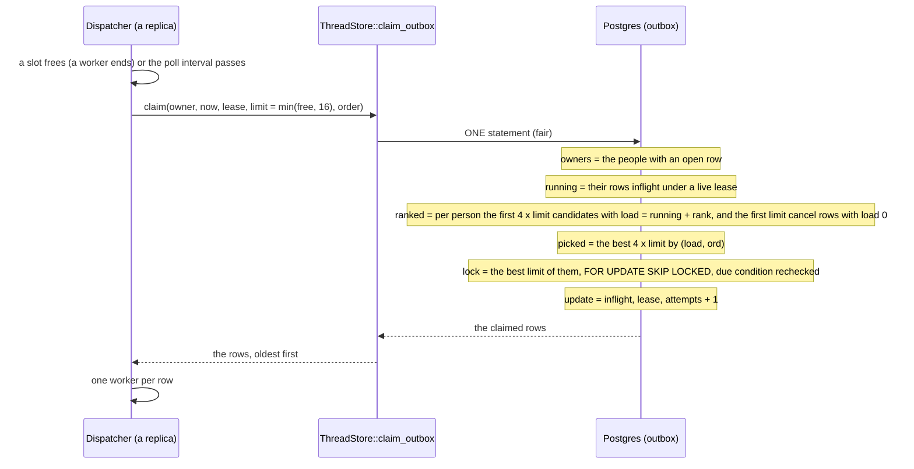

# ADR 0066 — A fair share of the dispatcher: a claim orders the due rows by each person's load

- **Status:** **proposed (2026-10-28).** The design is the comment on
  [issue 283](https://github.com/vymalo/another-agentic-system/issues/283) ("A fair share of the dispatcher for each person",
  [comment 6464266447](https://github.com/vymalo/another-agentic-system/issues/283#issuecomment-6464266447), "open to objection; the build
  starts from this and records it as an ADR"). It is **built in this change**, in one pull request: the claim in Postgres and in memory, the
  conformance cases, a test of the dispatcher, `dispatcher.order` in the configuration, this record and the READMEs. **Proposed**, for the
  owner to confirm: every name, default and shape below, and [the decisions the build settled](#what-the-build-settled-for-the-owner-to-confirm).
  Builds on [ADR 0001](0001-rust-state-machine-on-postgres.md) (the outbox is the work queue),
  [ADR 0036](0036-sending-while-an-agent-works.md) (the lanes of the per-thread order) and
  [ADR 0039](0039-nobody-reads-another-persons-thread.md) (a row's person is its thread's owner). Weighted shares by plan are left to
  issues [282](https://github.com/vymalo/another-agentic-system/issues/282) and
  [287](https://github.com/vymalo/another-agentic-system/issues/287).

## Context

A worker has a fixed number of slots (`dispatcher.concurrency`, 32) and every replica claims from one outbox. When more rows are due than there
are free slots, which rows are taken is a choice, and today the choice is the age of the row. One person who queues many long jobs holds every
slot, and a second person's first message waits until the first person's queue is gone. *Verified 2026-10-28 by reading the code at `b97de39`:*

| What | Where |
|---|---|
| The claim takes the due rows oldest first, `ORDER BY o.ord LIMIT n FOR UPDATE OF o SKIP LOCKED`, under the per-thread rule. It never looks at whose row it is. | `claim_outbox` in `orchestrator/crates/store-postgres/src/store.rs`, `orchestrator/crates/ports/src/memory/store.rs` |
| The per-thread rule: a `delegate` row waits for an older open `delegate` of its thread, a `steer` row for an older open `steer`, the other kinds for nothing. | the same, [ADR 0036](0036-sending-while-an-agent-works.md) |
| A row's person is the owner of its thread, fixed at creation. | `threads.owner`, [ADR 0039](0039-nobody-reads-another-persons-thread.md) |
| What runs is visible to every replica: a row `inflight` under a lease that has not expired (`lease_until > now`) is in Postgres. | `outbox.status`, `outbox.lease_until` |
| The dispatcher claims `min(free slots, 16)` rows each time a slot frees, on a wakeup or every `poll_interval`. | `Dispatcher::run`, `orchestrator/crates/app/src/dispatcher.rs` |
| Postgres refuses `FOR UPDATE` together with a window function at the same query level, and accepts it when the window is in a CTE the locking select joins. | *verified 2026-10-28* on Postgres 16 with `psql`: `select id, row_number() over (order by o) from t for update` is `ERROR: FOR UPDATE is not allowed with window functions`; the CTE form runs |

Invariants (`CLAUDE.md`), checked first. **1, protocols only:** nothing new on the wire. **3, stateless processes, one event log:**
the order is computed from the outbox by each claim; a process remembers nothing, and the denormalised `outbox.owner` is a column of the job
ledger, a function of the thread's owner. **5, the core is pure:** `transition` is untouched; the claim is a port method. **6, swappable
implementations:** the order is an argument of `ThreadStore::claim_outbox`, a closed enum `ClaimOrder` of `orch-ports`; both stores implement it
and the conformance cases of `thread_store_conformance!` hold them to the same order.

## Decision

1. **A claim orders the candidates by load, then by age.** A *candidate* is a row that may be claimed (due, and allowed by the per-thread rule).
   Each candidate gets `load = running(person) + rank`:
   - `running(person)` is the number of the person's rows that are `inflight` under a lease that has not expired at the time of the claim,
     counted across every replica and whatever the kind of row;
   - `rank` is the row's position (1, 2, ...) among that person's candidates of this claim, oldest first.

   The claim takes the rows with the lowest `(load, ord)`, `ord` being the insertion order of the outbox (the age). This is max-min fairness
   and it never idles a slot: the person with the fewest jobs running gets the next free slot, the people are interleaved within a claim, and
   when only one person has work every slot is theirs, in the order of the rows. The rows come back oldest first, whatever order they were chosen in.
2. **It holds across replicas** because `running` is read from the shared table. Two replicas claiming at the same instant may see the same
   counts, and `SKIP LOCKED` still gives them disjoint rows. The worst case is one claim's worth of imbalance, corrected by the next claim.
3. **No pre-emption.** A slot that is held stays held until its job ends. The person with nothing running starts at the next free slot, ahead
   of the other's queue, and not before.
4. **`cancel` rows go first, whatever the load.** They are short and they free capacity. A `cancel` row takes no place in the ranks of its
   person's other rows. Every other kind (`delegate`, `steer`, `ask`, `verify`, `title`, `description`) is ordered by load.
5. **The per-thread ordering rule is unchanged.** It decides which rows are candidates; the order only chooses among them.
6. **The query.** Postgres refuses `FOR UPDATE` with a window function at one level, so the ranking is in CTEs that lock nothing and the
   locking `SELECT ... ORDER BY load, ord LIMIT n FOR UPDATE OF o SKIP LOCKED` joins them by id. It repeats the due condition, so that a row
   another claimer took after the ranking is rechecked by Postgres, no longer qualifies and is skipped.
   - **The person is `outbox.owner`**, a column added by migration `0024`, and not a join on `threads`: [the measurement](#the-measurement)
     says why.
   - The ranking reads, for each person, their first `4 x limit` candidates (a row whose rank passes `limit` cannot be among the `limit`
     first) and the first `limit` cancel rows; the best `4 x limit` of those are locked in order, `limit` are taken. The factor leaves room for
     the rows other claimers hold at the same moment, which the locking select skips.
7. **The in-memory store implements the same order**, and the conformance cases of `claim_outbox` pin it on both stores
   (`orchestrator/crates/ports/src/testkit/thread_store.rs`): a person with many rows and one with a few; only one person has work; people
   interleaved; two claimers at once; a `cancel` row first and outside the ranks; the per-thread rule; running counted by live leases and by every kind;
   ties to the older row; ranks by age and not by id; a long queue that hides nobody; and `fifo` as it was.
8. **Configuration: `dispatcher.order: fair | fifo`, default `fair`.** `fifo` is the claim as it was before this ADR, unchanged, kept as a
   switch to roll back to. The order reaches the store as an argument of `claim_outbox`, a closed enum `ClaimOrder::{Fair, Fifo}` of
   `orch-ports` (no implementation type), which the dispatcher passes from its `DispatcherConfig.order`.
9. **Rejected: a fixed cap of slots per person while others wait.** It either idles slots (the cap holds back a person's work while a slot
   is free) or needs a number to tune for every size of fleet and every number of people. The ordering above needs no number and gives the same
   result when people compete.

```mermaid
stateDiagram-v2
  [*] --> Pending: written in the commit of the state change (outbox.owner = the thread's owner)
  Pending --> Waiting: due, but an older open row of its thread and kind comes first (the per-thread rule)
  Waiting --> Candidate: the older row ends
  Pending --> Candidate: due and first of its lane
  Candidate --> Candidate: not among the lowest (load, ord) of this claim; its person's running count falls or others' rise
  Candidate --> Inflight: chosen, lease taken, attempts + 1 (a cancel row is chosen first)
  Inflight --> Candidate: the lease expired (the worker died): the row is a candidate again and no longer counts as running
  Inflight --> Delivered: the turn ended
  Delivered --> [*]
```

## The measurement

*Verified 2026-10-28, on a throwaway Postgres 16 on the same machine, with the test crate built in debug (the client side is a debug build; the
server is the packaged release; a wall-clock time per `claim_outbox` call including the round trip), 60 claims of 16 rows each, the claimed
rows put back between claims so that every claim saw the same data.* The data: **10 000 open rows** (`pending`, due) over **50 owners**, 40% of
them one person's and the rest spread evenly, 32 further rows `inflight` under a live lease, 90 000 `delivered` rows of other threads (100 000
threads), `VACUUM ANALYZE` run.

| Claim | Median | p90 | Note |
|---|---|---|---|
| `fifo` (the claim as it was) | 3.1 ms | 4 ms | |
| `fair`, the person read by a join on `threads` (no new column), every candidate ranked | **168 ms** | 206 ms | all 10 000 candidates ranked, each with its `NOT EXISTS` probe, and a scan of `threads` to find their owners: **bad (over 50 ms)** |
| `fair`, with `outbox.owner` and its indexes (this ADR) | **19 to 22 ms** | 25 to 31 ms | steady state, a generic plan |
| the same, the first five executions of a connection | 70 to 100 ms | | Postgres plans each of the first five executions of a prepared statement with its parameters, and picks a bitmap scan for the small owners; from the sixth on it reuses a generic plan that stops each owner's scan early. *Unverified:* that nothing in the pool's behaviour makes this worse than five slower claims per connection. |
| the same over 1 000 open rows | 6.8 ms | | |

So the join was measured, found bad, and the denormalised column added **because of the number**, as the design said it should be. What the
column buys is that a claim reads the first rows of each person through `outbox_open_owner (owner, ord)` and not the whole queue; what it
costs is a column, a trigger and three partial indexes, and a cost that still grows with the open rows (about 3 microseconds of index probing
for each row of the first `4 x limit` of each person, plus an index-only scan of the owners: *measured* 6.8 ms at 1 000 open rows, 20 ms at
10 000). A deployment whose backlog is far beyond 10 000 open rows would want a skip scan for the list of owners; none is built. A run at
50 000 open rows (500 000 threads) gave a median of 25 ms and a long tail that this measurement did not explain (*unverified*).

## What the build settled, for the owner to confirm

1. **Cancel rows go first for one person too.** The comment says that with one person the order is exactly today's. A `cancel` row that is
   younger than other candidates and a claim whose limit binds now takes the `cancel` first; that is decision 4, and it differs from the oldest
   first order for one person in that case only. `fifo` keeps the old order.
2. **`rank` counts candidates only.** A row held back by the per-thread rule has no rank and costs its person nothing, so a person who queued
   ten messages in one thread is not penalised for the nine that cannot start. A `cancel` row takes no rank either.
3. **`running` counts every kind**, as the comment said: a person's `title`, `description`, `verify` and `ask` rows that are running count as
   much as a `delegate`. (An alternative is to count `delegate` and `steer` only; it is one predicate in each store.)
4. **A lease that expired counts for nothing, and its row is a candidate again.** The same rows are in both groups' definitions at different
   times: `running` is `inflight` with `lease_until > now`, a candidate is `inflight` with `lease_until <= now`.
5. **`outbox.owner` is nullable, filled by a trigger, and checked.** It is `NULL` on a row that is over (delivered, dead, skipped), which nothing
   reads by person and which migration `0024` does not rewrite (the migration fills the open rows only, so it does not rewrite a large table).
   A `BEFORE INSERT` trigger fills it from the thread when the insert gives none, so **a replica of the build before this one, still rolling out,
   writes rows that the new claim finds**, and no statement of the store has to remember it; `outbox_open_has_owner` refuses an open row without
   one (added `NOT VALID`, so the migration does not read the whole outbox, which keeps every row it ever had, under its lock). The trigger is the part to confirm: the alternative is to set the column in `insert_outbox` and to leave a rolling update unsafe.
6. **A shortfall under simultaneous claims is possible and bounded.** With `4 x limit` rows to choose among, one other claimer's claim of up
   to `3 x limit` rows (the dispatcher's `limit` is at most 16) is skipped without the claim coming short; more claimers at the same instant
   may take fewer rows than the free slots, and the next wakeup or poll takes the rest. The oldest-first claim does not have this edge. *Unverified*
   in production; the test `rows_another_claimer_holds_are_skipped_and_the_claim_takes_the_next` pins the first case.
7. **The returned rows are oldest first**, as before, and not in the order they were chosen in; the order only decides which are taken.
8. **A weight by plan is not built.** `load / weight` in integers is the shape the comment gave it; it needs the plans of issues 282 and 287.

## Consequences

- A person with nothing running starts at the next free slot, whatever another's queue is; one person alone is not slowed (a claim of 16 rows
  of one person costs 20 ms at 10 000 open rows and 7 ms at 1 000, against 3 ms).
- The outbox has a column, a trigger and three partial indexes more, written on every insert and every change of status. **Roll-out:** the
  migration runs at boot of each replica; the build before this one ignores the column and the trigger fills it.
- `ThreadStore::claim_outbox` has a new parameter: **a required change for every implementation of the trait** (the two in this repository and
  the test doubles that delegate to them).
- `dispatcher.order: fifo` is the way back, with no migration to undo.
- Not solved: a person who is slow is not slowed for it, nor is a job that has run long pre-empted (decision 3); a person who has several
  accounts has several shares; a weight by plan (item 8).

## Alternatives rejected

- **A fixed cap of slots per person** (decision 9).
- **The person by a join on `threads` at claim time**, no new column: measured above, 168 ms.
- **Claiming by age and giving back the surplus** (claim more than there are slots, keep the fair ones, release the rest): every release is a
  write and an attempt number gone, for a result the ordering gives in one statement.
- **A scheduler in the process** (a queue per person in the dispatcher): a process would hold state, against invariant 3, and replicas would
  each be fair to themselves only.
