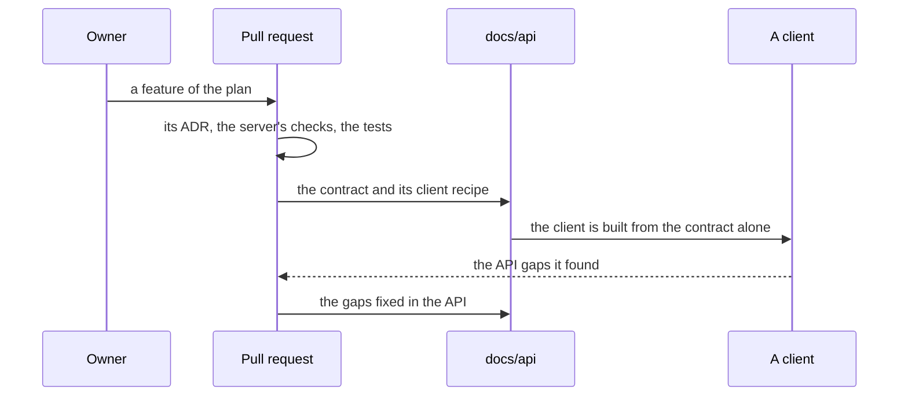
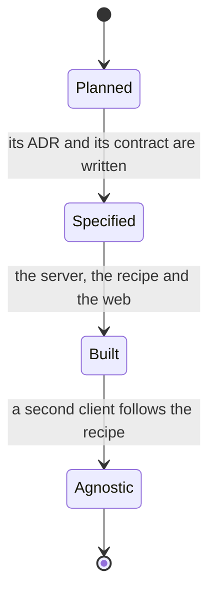

# ADR 0067 — The plan to LibreChat-grade, and the client-agnostic rule

- **Status:** **proposed (2026-11-14)**, on the owner's words of that day: "When I say LibreChat grade, I mean it. Plus, with
  our A2UI it'll be sick!" and "As always, make the ui agnostic. Same for the APIs. I'll use it for a flutter app very soon".
  It records **a rule and an order**. Each feature is decided by its own ADR when it is built, and each invariant amendment named
  below is made by that ADR, never by this one. It takes the number the earlier plan had reserved for search; the ADR of search, and
  of every feature below, takes the next free number when its pull request merges.
  Builds on [ADR 0011](0011-web-shadcn-tailwind-feature-layout.md) (the web's layout),
  [ADR 0047](0047-one-ui-for-web-desktop-and-mobile-each-signs-in-as-a-public-oauth-client.md) (one UI for web, desktop and mobile) and
  [ADR 0065](0065-a-usage-ledger-per-person.md) (the usage ledger).

## Context

The owner asked for the feature set of LibreChat in full, including what an earlier plan had kept out (importing a conversation,
a prompt library, memory, live artifacts, speech), and said a Flutter app will follow soon. What LibreChat has is taken from memory
of its screens: every statement about it in this ADR is *unverified*. Nobody read its source or its documentation for this
record.

**Built so far, at `origin/main` on 2026-11-14:**

- The **usage page** over `GET /api/me/usage` (pull request 312; [ADR 0065](0065-a-usage-ledger-per-person.md), amended 2026-11-14).
- **Highlighted code and display math** in answers, with the contract any client follows, [`message-text-v1.md`](../api/message-text-v1.md) (pull request 314).
- **Regenerate the last answer**, as a client recipe in `forkThread` and not as a route of its own
  ([ADR 0029](0029-forking-a-thread-copies-its-log.md), amended 2026-11-14; pull request 313).

**In review on 2026-11-14, not merged:** the **"My tool servers" screen** at `/tools` (ADR 0046's web half) and **UI catalog version 7**
with the question kinds `confirm`, `number`, `scale`, `date` and `rank`. Neither is built until it merges. Slices that depend on the second
(prompt variables as a catalog form, questions that show, the live plan) wait for it.

**Progress on 2026-11-15: 11 of the 35 slices are merged, 31 % by count (P1, the page "My prompts", is counted), and the server half of two more, P2 and P4** (the three above, the two that were in review, four of the waves
below, **search, now complete, and P1**; the rest of the prompt library has its API and no web yet, and a slice is counted when a person can use it in the web, as search was counted only with its box). Merged since 2026-11-14: "My tool servers" (pull request 316), UI catalog
version 7 (317), the theme (318), quote, copy and export as Markdown (319), UI catalog version 8 with questions that show what they
ask about and the agent's plan (320; adam-rs sends a plan since its pull request 149 and sends no `show` yet), and the fix that keeps a
long-lived plan projected (321). Search has its API, its index and its contract (slice 7a, [ADR 0068](0068-a-person-searches-their-own-threads.md)) and its box in
the web (slice 7b, built on 2026-11-15: the box under "New chat", the results, the highlighting and the shortcut Ctrl or ⌘ with K; proven on the mock in Chromium only).
The prompt library has its API, its store and its contract (the server half of slices P1, P2 and P4, [ADR 0070](0070-a-persons-prompt-library.md): saved prompts whose
variables are questions of the UI catalog, a render done by the server, a share with roles under `prompts.share`; `docs/api/prompts-v1.md` with vectors that the Rust core and the
web's mock server both pass; and, since the web half of P1, the page `/prompts` (list, create, edit, delete, copy; `web/README.md`); P2's form and `/` menu, P3 and P4's control are next, against the mock). Nothing else of the waves is started.

The recipe of regenerate was the first thing written for a client that is not the web, and it found API gaps at once ([below](#the-rule)).
That is the evidence for the rule.

## Decision

### The rule

1. **Every feature is implementable from `docs/api/` alone.** The orchestrator enforces every rule, and a client only offers. A rule that
   only a client keeps is a courtesy, and the contract says so in those words (as `forkThread` does for regenerate).
2. **Each feature's pull request adds a client recipe** to the operation it uses, and lists the API gaps it found. A gap is fixed in the
   API, never worked around in `web/`.
3. **Capabilities are announced, never guessed.** A deployment's are members of `GET /api/config` whose presence is the capability (as
   `ui.history`); a person's are the permissions of `GET /api/me`; an agent's are its capabilities document.
4. **The same holds for the UI components**: a component is a catalog entry with a schema and an answer shape in
   [`ui-catalog-v1.md`](../api/ui-catalog-v1.md), not a rendering that exists only in React. A second client draws the same catalog.

**The API gaps found so far** (each checked against the contract or the code at `origin/main` on 2026-11-14; each is the first
evidence for the rule and is **to be fixed in the API**, not here):

| Gap | Where it shows |
|---|---|
| A message's `seq` is not a field of the API. A client replaces or forks by `seq`, and the web derives it from the SSE `id:` of the message's last frame (the AG-UI message id is `evt-<seq>` only when the log has no id of its own) | `forkThread` in [`chat-api.yaml`](../api/chat-api.yaml); the id table of [`agui.md`](../api/agui.md) |
| "Regenerate while a question waits" and "regenerate on a steered message" are refused only by the client; the server accepts both and the edit loses the question or keeps the agent's earlier work | the end of the recipe in `forkThread` |
| Whether a person's own tool servers are on is in neither `GET /api/me` nor `GET /api/config`. `tools.user.add` is a permission, but the deployment's `userToolServers.enabled` is not announced: every route is a 404 when it is off | `Me`, `PublicConfig` and the preamble of `chat-api.yaml` |
| `ToolServer` (the list a picker draws) carries no authentication kind: a client learns that a server wants a key or an OAuth grant only from `UserToolServer` (`auth.kind`), a second call | `ToolServer` and `UserToolServer` |
| `deleteUserToolServer` takes no `revision`, so a client cannot say "delete this one, as I read it" | the operation in `chat-api.yaml` |
| Nothing signals that an OAuth connect flow ended: the callback page has fixed text, and the app learns the new status only by reading `listToolServers` again | `finishUserToolAuthorization` |
| The desktop app cannot open a third-party authorization URL: it opens only an address of the identity provider's origin, yet `authorizeUserToolServer` says the desktop opens `authorizeUrl` in the system browser | `openable` in `apps/tauri/src-tauri/src/loopback.rs`; `authorizeUserToolServer` |
| A form answer is checked for its surface and its size and not for its content, so an answer an agent refuses comes back as words. Whether the agent side gives a code a client can read is *unverified* (adam-rs was not read for this record) | "A Choices answer" in [`agui.md`](../api/agui.md) |

### The order

Each wave runs in parallel except for the slices that share files (migrations, `composer.tsx`, the sidebar, `catalog.json`), which merge in
the order written. **Wave 0** is what is in review: "My tool servers" and UI catalog version 7. The slice numbers are those of the earlier
plan (1 to 16); the letters are the features below.

**Wave 1**

| Slice | The person gets |
|---|---|
| 5 Theme | System, light or dark (amends ADR 0011, which has no toggle) |
| 6 Quote and copy | Quote a message into the composer, copy as Markdown, export as Markdown |
| S1 (= 15) Read aloud | Read an answer aloud with the device's own voice, and global shortcuts |
| 7 Search | Search their threads: titles and descriptions, then the words |
| A1 Artifact versions | The versions of a file an agent keeps revising, and a route that lists them |
| P1 Prompts | Saved prompts: create, list, edit, delete |
| M1 Memory | Notes they write about themselves, and settings |
| S2 Speech on the server | Dictation and a deployment's voice through a configured endpoint, counted in the usage ledger |
| I1 Import | Import our own Export JSON as a thread an agent continues |

Migrations merge in this order: search, then P1, M1, S2, I1.

**Wave 2**

| Slice | The person gets |
|---|---|
| 9 Questions that show | A question shows what it asks about: an image, a chart, cards |
| 10 The live plan | The agent's plan, pinned in the panel and updated as it works |
| 11 `/` commands | A menu of the agent's own commands |
| P2 Variables | A prompt's variables drawn as the catalog's question form, and its server-side render |
| M2 Memory by agents | An agent reads and saves notes, each a visible step |
| A2 The panel | A side panel with versions, source, copy and download |
| S3 Speech in the web | A microphone and the server's voice in the composer and on each answer |
| I2 Foreign formats | ChatGPT, Claude and LibreChat files |
| 12 Attachments | Attach files and images to a message (after 11: both change `composer.tsx`) |

**Wave 3**

| Slice | The person gets |
|---|---|
| P3 One menu | The agent's commands and the person's prompts in one `/` menu |
| P4 Sharing prompts | Share a prompt with a role |
| I3 The import page | Preview a file and pick the conversations to import |
| A3p Live HTML preview | An HTML artifact runs on a separate origin (needs the owner's answer to question 4 below) |
| 14 Tags | Tags in the thread list (after search) |
| 13 Temporary chats | A chat that is erased after a day and never feeds memory (with M3, memory off in them) |

**Wave 4**

| Slice | The person gets |
|---|---|
| A4 React previews | A React artifact runs in the same sandbox |
| A5 Continue in a new thread | Start a thread from an artifact (after 12) |
| I4 Zip and files | Import a ChatGPT archive and the files of a thread |
| P5 Prompts over MCP | Their prompts offered to Claude Code or opencode through the orchestrator's MCP server |
| M4 adam reads `memory_*` well | The other repository's tool descriptions (adam-rs) |
| 16 French | The UI in French, last |

### The five features that need a decision of their own

Each below is its own ADR, written when it is built. The shape is the plan; routes are named, not specified. **Every statement about
what LibreChat does is *unverified*, and so is every statement about a file format that a foreign product writes.**

#### Import conversations

*The person.* I drop my ChatGPT export (or a Claude, LibreChat or our own Export JSON file) and pick the conversations I want. Each
becomes a thread marked "Imported from ChatGPT, 3 March 2025", and any agent I choose can continue it. LibreChat imports ChatGPT, LibreChat
and a few other formats the same way (*unverified*).

*The shape.* Two additive event kinds: `imported_turn` (an index, a role of `person` or `assistant`, an author label such as
`chatgpt:gpt-4o`, the text cut at 64 KiB, and counts of what was dropped) and one `thread_imported` that, like `thread_forked`, makes the
thread a finished job so that the next message starts job 2. An imported turn is **never** a `user_message` or an `agent_message`: no
rule, ledger or gate reads it as something said here ([ADR 0021](0021-context-across-a2a-tasks.md) and
[ADR 0055](0055-the-agent-assigns-the-a2a-context.md) are why). Text only, on the branch the source shows; attachments, tool calls,
reasoning and system prompts are dropped and counted. A preview route and an import route read the same file, so nothing is staged;
`thread.import` (*new*) is held by `user` and `admin`, with limits (32 MiB, 200 conversations, 2,000 turns, 10 imports an hour) that the
server enforces, and a unique key on the owner and the file's digest makes an import idempotent. Parsing is a pure crate, one module per
format. The agent gets the imported turns in its first transcript, labelled as another system's and fenced as a record, never as
instructions. Zip archives wait for slice I4, with a decompression cap.

*Invariant amendment:* **none.** The turns are events of the log (invariant 3), the parsers are pure (invariant 5), and a file format is
not a protocol dependency (invariant 1). Open question 76 (importing a thread bundle) is answered by the import ADR, not by this one.
*Unverified:* all three foreign formats were written from memory and each needs a real export to check against.

#### Prompt library

*The person.* I save "Review this PR for {{focus}} at {{depth}}", where focus is a choice and depth a scale, and later type `/review`. The
same question form the agents use pops up, I answer it, and the filled text is my message. My team sees the prompts I shared with our
role. LibreChat keeps prompts with variables and a `/` menu (*unverified*).

*The shape.* A table `user_prompts`, modelled on `user_tool_servers` (at most 100 per person, a revision on each row); routes
`listPrompts`, `createPrompt`, `getPrompt`, `updatePrompt`, `deletePrompt` and `renderPrompt`. Variables are questions of the catalog's
version 7 schema, so one component and one answer shape serve an agent's question and a person's prompt: a `{{id}}` must be declared and
every declared variable used. `renderPrompt` takes the Choices answer and returns the text, substituted on the server so that every client
gets the same words; it writes nothing, and the person sends the result as an ordinary message. Own prompts need no permission; setting an
`audience` needs `prompts.share` (*new*, held by no role by default); a shared prompt is listed to a person whose roles intersect its
audience, by the rule of [ADR 0045](0045-admin-dashboard-in-the-web-and-agent-access-from-the-registry.md), and its author is never named.
Agents never see the library.

*Invariant amendment, proposed text for invariant 3, made by the prompt library's ADR when it is built and not by this one* (with a dated
note on [ADR 0001](0001-rust-state-machine-on-postgres.md) in the same words):

> *Amended by ADR NNNN (proposed): a person's prompt library (their saved prompts, and the roles they share each with) is durable state
> beside the log, the person's own, read and changed only through the API, never folded by the core and never copied into a thread, a fork
> or an export.*

#### Memory

*The person.* I tell the coder "remember I deploy with Helm" and it saves that note, visibly, and next week in a new thread it reads the
note when it matters. I see every note, edit or delete it, and choose which agents may read or write. LibreChat keeps notes about a person
across conversations (*unverified*).

*The shape.* Tables `user_memories` (a note of at most 1 KiB, `active` or `pending`, who wrote it) and `user_memory_settings` (off by
default, a grant per agent: read, and write as `off`, `ask` or `auto`); routes under `/api/me/memories` and `/api/me/memory-settings`,
needing no permission because they are the person's own data ([ADR 0039](0039-nobody-reads-another-persons-thread.md)); a per-thread
switch, the additive event `memory_switched`. **Tools, not context:** an agent gets a note only through three built-in tools of
`thread-tools/v1` (`memory_read`, `memory_save`, `memory_forget`), listed only to the main caller of a thread whose switch is on and for an
agent the person allowed. Each call is a step the person can read, with its input and output. The reasons: a note pushed into every
message would break the prompt cache, only what an agent asks for reaches its model provider, and every use is visible. With `ask`, a
saved note waits for the person's approval, which is the answer to a persistent injection by a web page. An adam agent's own journal and
workspace memory stay the agent's business.

*Invariant amendment, proposed text for invariant 3, made by memory's ADR when it is built and not by this one:*

> *Amended by ADR NNNN (proposed): a person's memory (short notes they or an agent they allowed wrote, and which agents may read or write
> them) is durable state beside the log; the orchestrator never reads it to reason or puts it into a prompt: an agent gets it only through
> a thread-tool call the person allowed, reported as a step of the thread.*

*Unverified:* whether a live model calls `memory_read` when it should. That is the price of tools over context.

#### Artifacts panel

*The person.* The agent writes `report.md`, revises it twice and makes `chart.html`. A side panel lists both, with versions (1 of 3), a
live preview, the source, copy, download and "Continue in a new thread". LibreChat opens code, HTML, React and Mermaid output in a side
panel with versions (*unverified*).

*The shape.* Two ADRs. The first adds to the `artifact` event an optional `key`, `title`, `renderer` and `language` (amending
[ADR 0032](0032-files-from-agents-live-in-an-artifact-store.md)): the versions of an artifact are the events with the same key, the key
being named by a small `artifacts/v1` extension (the pattern of [ADR 0008](0008-platform-integration-via-a2a-extension.md)) or else the
file name, and the server decides the renderer from the sniffed type. A route `listThreadArtifacts` returns the groups, because a windowed
history ([ADR 0059](0059-a-thread-opens-at-its-end-and-older-turns-load-on-scroll-up.md)) does not hold old artifacts. The second decides
**live previews on a sandboxed origin**: a static runner page on its own host that holds no token and fetches nothing from the API, a frame
with `sandbox="allow-scripts"` and none of the other allowances, the bytes posted in by the client, a CSP of `default-src 'none'` with
`connect-src 'none'`, and `ui.preview` in `GET /api/config` as the capability. That ADR closes the frame half of open question 38 and
needs the owner's answer to question 4 below. A preview can still navigate its own frame and so send out the artifact's own content: a
CSP `navigate-to` was not checked (*unverified*), and the panel labels the frame "agent-made content".

*Invariant amendment:* **none.** The files stay in the artifact store (invariant 3, as amended by ADR 0032). *Unverified:* the sandbox's
behaviour in Safari and in a Flutter WebView (`webview_flutter` was not tried), and whether a real agent reuses keys.

#### Speech

*The person.* I hold the mic, speak, and the words land in the composer for me to check. I press "Read aloud" on an answer and hear it in
the deployment's voice, or in my device's voice when the deployment has none. LibreChat dictates and reads aloud with the browser's
engines or a configured service (*unverified*).

*The shape.* A port `SpeechModel` (invariant 6, with a testkit) over OpenAI-compatible endpoints named in the configuration
([ADR 0035](0035-utility-model-tasks.md)'s pattern), a `speech` section for transcription and synthesis, and two routes, `transcribe` and
`synthesize`, under a permission `speech.use` (*new*, held by `user` and `admin`). The server bounds the bytes as a stream, sniffs the
format by its magic bytes, limits the rate per person and keeps no audio and no transcript in a log, an event or storage. The capability
is `ui.speech` in `GET /api/config`, present only when configured; a client without it reads aloud with the device's voice and shows no
microphone, and **never sends a dictation automatically**. Agents get text: there is no A2A or MCP side. Speech costs money and has no
event, so it needs a ledger line of its own, `usage_speech`, priced like a model and making a missing price `complete: false`
([ADR 0065](0065-a-usage-ledger-per-person.md), decision 6).

*Invariant amendment, proposed text for invariant 3 and for ADR 0065, made by speech's ADR when it is built and not by this one:*

> *Amended by ADR NNNN (proposed): a speech call, which has no event, adds its seconds or characters to the person's usage ledger in a
> transaction of its own; no audio and no text of it is kept.*

*Unverified:* a real Whisper-compatible server was not run, nor was streamed `audio/speech` from a gateway.

### What stays out, and under which invariant

| Stays out | Why |
|---|---|
| A model picker, presets, per-person model settings | Models are the agents' business: "Agents this system calls over A2A choose their own model access" ([ADR 0005](0005-openai-compatible-model-endpoint.md)); the orchestrator's own model calls are the named utility tasks of ADR 0035. Invariant 1, [ADR 0007](0007-protocol-only-dependencies.md) |
| Local passwords, social login, two-factor | The identity provider signs people in; the orchestrator is a resource server ([ADR 0033](0033-the-orchestrator-is-an-oauth2-resource-server.md)) |
| An agent builder or marketplace for people | The platform provisions agents and the system discovers them ([ADR 0022](0022-platform-provisions-agents-system-discovers-them.md)); the dashboard is for administrators and goes through the platform's API (ADR 0045) |
| Admins reading people's threads | [ADR 0039](0039-nobody-reads-another-persons-thread.md) |
| Runtime plugins | Invariant 6, [ADR 0009](0009-swappable-implementations-at-build-time.md) |
| RAG, a code interpreter or reasoning over memory inside the orchestrator | Invariants 1 and 3: agents do the work over A2A and MCP ([ADR 0024](0024-mcp-tools-attached-per-conversation.md)); the orchestrator keeps only what a person can see and edit, and hands it over by a tool call they allowed |
| Imported words logged as said here | They are marked imported and never count as a message of a person or an agent (ADR 0021, ADR 0055) |
| Balance and credit screens, content moderation | Limits and payments are milestones M2 and M3 of the roadmap, not this plan |

### Where invariant 3 changes

Only the ADR of the feature that needs it amends invariant 3, each with a dated note in `CLAUDE.md` and in ADR 0001: the prompt library,
memory, and speech's ledger line. This ADR amends nothing.

## Questions for the owner

**The work proceeds on the recommendations below until the owner says otherwise.** Each is also a row of open question 90.

1. **Who may import?** Recommended: `thread.import` for the built-in `user` and `admin`, with the limits above.
2. **Memory writes by agents.** Should a note an agent saves wait for approval by default? Recommended: `ask` by default, memory off until the
   person turns it on, and a switch per agent.
3. **Memory delivery.** Tools only, or also a small pinned context at the start of a thread? Recommended: tools only, for the cache, privacy
   and visibility.
4. **The preview host.** It needs its own registrable domain and not `*.servers.segning.pro` (open question 77). Recommended: yes, a separate
   domain; live previews (A3p) wait for it.
5. **Speech provider.** Server transcription and synthesis through a configured endpoint, with the browser's dictation off by default?
   Recommended: yes, a self-hosted Whisper-compatible server first.
6. **Speech in the usage ledger.** It has no event behind it. May ADR 0065 be amended to allow a direct write? Recommended: yes, so budgets
   count speech.
7. **Sharing prompts.** Should `prompts.share` start with no role holding it? Recommended: yes, granted by the deployment.
8. **Imported history depth.** Is the newest 24 KiB of the transcript enough, or should agents get a tool to page older imported turns?
   Recommended: the tail now, the tool later.
9. **Files from a person's browser** (slice 12). May a browser send files to the orchestrator, which ADR 0058 did not assume? Recommended:
   yes, same origin, at most 10 MiB, kept in the artifact store by hash, no presigned upload from the browser.
10. **How long a temporary chat lives** (slice 13). Recommended: erased 24 hours after its last activity, its usage kept.
11. **Which languages** (slice 16). Recommended: English and French.

The earlier plan's question whether LibreChat-grade lifts the owner's stop of 2026-10-13 on web work is taken as answered by the owner's
words of 2026-11-14 above; the files host of ADR 0058 (A3) stays stopped unless the owner says otherwise.

## Consequences

- A Flutter client can be written against the contract. Until it exists, "agnostic" is proven only by the contract tests of the web's mock
  server (`web/mock`), and this ADR does not claim more.
- Every feature costs a contract page or section and an ADR of its own. Some invariants gain dated notes; none is reversed.
- The eight gaps above become tickets of the features that touch them; none is fixed here.
- **Nothing here is built, and nothing here is proven.** The plan is on mocks like the rest of the system, and every claim about LibreChat is
  *unverified*.

## Alternatives rejected

- **Features built in the web first, the API after.** The second client would inherit rules that live only in TypeScript.
- **One ADR for the whole set.** Each feature has decisions the owner may reverse separately, and the invariant amendments must each stand
  on their own.
