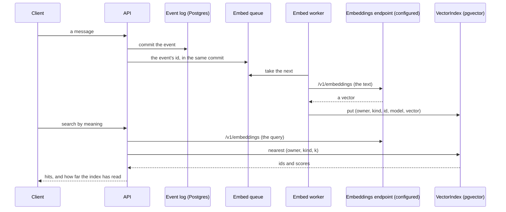
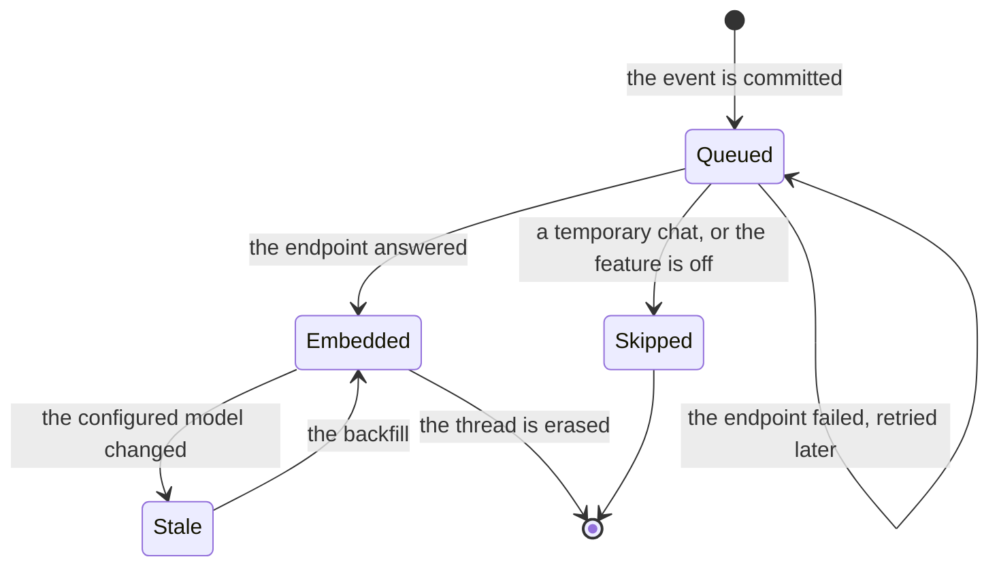

# ADR 0071 — Embeddings and vector search use pgvector, behind a port

- **Status:** **accepted (2026-11-16)** for the choice of the store, an owner decision (*"I propose to use pgvector for embedding and
  vector search"*, and on 2026-11-16: the decision is recorded now and built when the track resumes). **Amended (2026-11-17):
  relations are kept beside the vectors, in two plain tables (decision 11), an owner decision** (*"RAG today makes no sense with text
  only. We need relations too"*; *"Two tables simplifies also my job"*). **Nothing is built.** The shape
  below is **proposed**, for the owner to confirm slice by slice. Builds on [ADR 0001](0001-rust-state-machine-on-postgres.md) (one
  Postgres), [ADR 0009](0009-swappable-implementations-at-build-time.md) (a port and a testkit per boundary),
  [ADR 0005](0005-openai-compatible-model-endpoint.md) and [ADR 0035](0035-utility-model-tasks.md) (a model is an OpenAI-compatible
  endpoint, and the orchestrator's own model tasks name theirs in the configuration),
  [ADR 0068](0068-a-person-searches-their-own-threads.md) (the word search this stands beside) and
  [ADR 0067](0067-the-plan-to-librechat-grade-and-the-client-agnostic-rule.md) (the plan and the client-agnostic rule).

## Context

A person can search their own threads by word (ADR 0068). That search is exact by design: whole words by their start, the same hits on
every server, no extension. It cannot find a thread by what it is about when the words differ. Three things on the plan need a search by
meaning: finding a thread by its subject, a person's memory notes once there are many of them (ADR 0067, slices M1 and M2), and the files
a person hands an agent.

A search by meaning needs two things the system does not have: a model that turns text into a vector, and a store that finds the nearest
vectors. The invariants say where each may live. Only Postgres persists (invariant 3). A model is an endpoint named in the configuration,
never a library in the orchestrator (invariant 1). Every infrastructure boundary is a port with a testkit (invariant 6). And the
orchestrator will also be embedded in a desktop application with no Postgres at all, so nothing here may be required to run.

## Decision

1. **The vector store of the default deployment is pgvector**, the `vector` extension of the Postgres the orchestrator already uses. No
   second database.
2. **It sits behind a port, `VectorIndex`** (`orch-ports`), with a conformance testkit: put a vector for an owner, a kind and an id;
   delete; the `k` nearest for an owner and a kind. No pgvector type is in a signature. There are two implementations: the pgvector
   adapter in a crate of its own, and an in-memory one (an exact scan) for tests and for a build without Postgres.
3. **Embeddings come from an endpoint the configuration names**, speaking the OpenAI-compatible `/v1/embeddings`: `embeddings: { endpoint,
   model, dimensions }`. **With none configured the feature is off**: nothing is embedded, a search by meaning answers that it is not
   available, and the word search is unchanged. There is no fallback to another model and no model inside the orchestrator.
4. **The extension is needed only when the feature is on.** The pgvector adapter owns its migration and runs it only when embeddings are
   configured. Embeddings configured against a database without the extension is a startup refusal (exit 78) that names it. A deployment
   that does not want this installs nothing new.
5. **Vectors are derived state beside the log, under the rules ADR 0068 set for the word index.** They are a function of the log, rebuilt
   by a backfill command. They are the owner's alone: every row has its owner and every query filters by it. They are erased with the
   thread (`ON DELETE CASCADE`), and they are never copied into a fork or an export. Invariant 3 is amended with a dated note **when the
   first slice is built**, not now.
6. **Unlike the word index, a vector is not written in the commit of its event.** An embedding is a network call to a model, and a commit
   never waits for one. Events to embed go on a queue with a watermark, as the usage ledger's backfill has one; a worker embeds them. A
   search by meaning can therefore lag behind the log, and its answer says how far it has read.
7. **A vector knows its model.** Each row stores the model's name and the dimensions. A query compares only vectors of the configured
   model. Changing the model needs a backfill, and vectors of two models are never compared.
8. **What is sent out is said plainly.** A person's text goes to the embeddings endpoint, which is the deployment's choice of where text
   goes, like its choice of chat model. A temporary chat is never embedded. The text of a query is not logged, as in ADR 0068.
9. **The index is approximate, and the contract says what that means.** The index is HNSW with cosine distance, and its parameters are
   settings. The API contract guarantees isolation by owner, the order (score, then id) and the limit. It does not guarantee which hits a
   given model returns: unlike ADR 0068, two servers with two models answer differently, and the contract says so.
10. **Each use is its own slice with its own contract page, written first** (ADR 0067's rule, so a second client builds against the page):
    a search of threads by meaning, as a mode of `POST /api/search/threads`; then a person's memory notes; then files. This decision fixes
    only the store, the port and the rules above.
11. **Relations are kept beside the vectors, in two plain tables** *(added 2026-11-17)*. pgvector stores vectors and nothing else, and
    a search by nearest text alone misses what is connected to a hit. So the same Postgres holds `entities` (an owner, a kind, an id, a
    label, where it came from) and `relations` (an owner, a source entity, a kind, a target entity, where it came from). No graph
    extension and no graph database: a walk is an ordinary recursive query with a bounded depth.
    - **The same rules as the vectors** (decisions 5 to 8): derived state beside the log, rebuilt by the backfill, the owner's alone
      with the owner on every row and in every query, erased with what they came from, never in a fork or an export.
    - **The port covers both.** Retrieval is two steps behind one port: the nearest items by meaning, then their neighbours along
      relations, to a depth and a count the caller bounds. The in-memory implementation does the same walk.
    - **The relations the log already has come first, and need no model:** a thread and the thread it was forked from; a message and its
      thread; a file and the thread it was handed to; a run, the repository it worked in and the pull request it opened; a message and
      the agent it mentions; a memory note and the agent that wrote it. They are exact, and they cost nothing to make.
    - **Relations a model reads out of text are a later slice of their own**, off by default like embeddings: a call per piece of text
      to a model the configuration names, a kind taken from a closed list, each relation kept with the text it was read from so a
      person can see why it is there and remove it. A model's reading can be wrong, so such a relation is never shown as a fact
      without its source.

Nothing in these diagrams exists in code yet: they are the design to build against.

## Consequences

- One more thing a deployment may turn on: an embeddings endpoint, and the `vector` extension in its Postgres image. Off, nothing changes.
- The embedded orchestrator (no Postgres) keeps working: the in-memory implementation serves small sets, and a store for one machine is
  a later decision of its own.
- A search by meaning is not reproducible across models, so its tests assert the rules (isolation, order, limits, lag) on a scripted
  embeddings endpoint, never the quality of a real model.
- A person's text reaches one more endpoint. The deployment guide has to say it, and a deployment bound to keep text in one place points
  the endpoint at a model it runs.
- A change of model costs a backfill of everything embedded. The queue and the watermark are what make that an ordinary operation.

## Alternatives rejected

- **A separate vector database:** a second stateful system to deploy, back up and erase from, against invariant 3, for a scale this
  system does not have.
- **A model inside the orchestrator** (an embedding library in the process): against invariant 1, a large dependency, and a different
  answer on every build.
- **Word search only:** it stays, and it is the default. It does not find by meaning.
- **Embedding in the commit of the event**, as the word index is written: a commit would wait on a network call to a model.
- **A graph extension or a graph database for the relations** *(2026-11-17)*: a second extension to find in every database image and
  to keep current, or a second stateful system, for walks of two or three steps that a recursive query does. Graph queries in SQL itself
  (SQL/PGQ) are not in a released PostgreSQL (below).

## Facts, and how far each is proven

- *Unverified* (from memory, to check against pgvector's documentation at the version pinned when the first slice is built): that an
  HNSW index on the `vector` type takes at most 2,000 dimensions, with a half-precision type for more; that a filtered approximate search
  can return fewer than `k` rows, and that recent versions scan on to fill them.
- *Unverified*: which CloudNativePG operand images carry the `vector` extension. `deploy/chart` pins its database image, and the first
  slice checks it there.
- *Unverified*: the request and response shape of `/v1/embeddings` on the gateway a deployment will use.
- *Verified 2026-11-17* (secondary sources that agree, not the release notes: depesz.com, "Waiting for PostgreSQL 19 – SQL Property
  Graph Queries", with its later update; neon.com, "SQL/PGQ graph queries in PostgreSQL 19"): property graph queries (SQL/PGQ,
  `GRAPH_TABLE`) were committed for PostgreSQL 19 on 2026-03-16 and reverted on 2026-09-07, before the release. To check again against
  the release notes when the first slice is built.

## Not done here

No port, no crate, no migration, no route, no setting. The first slice (threads by meaning) writes its contract page, amends invariant 3
and adds the port with its testkit.
