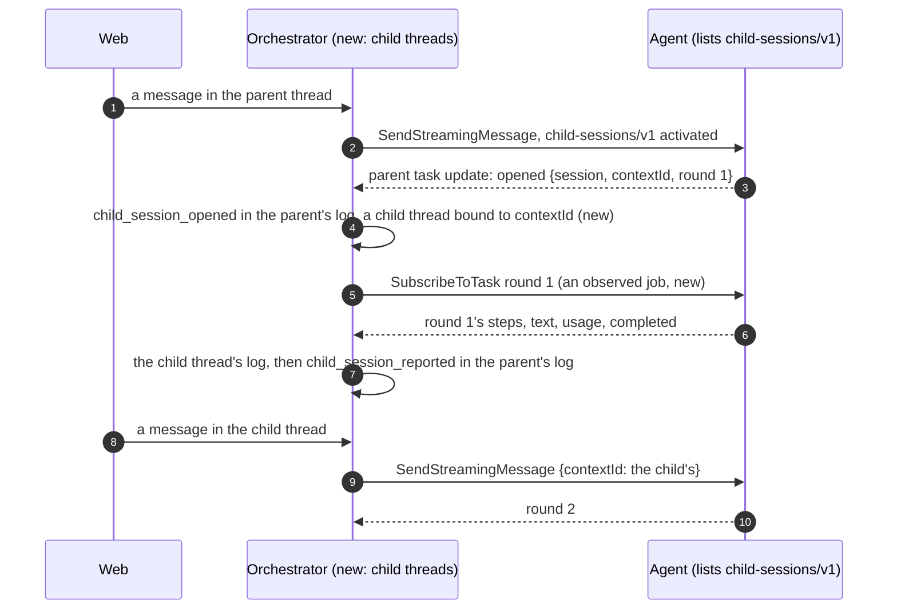
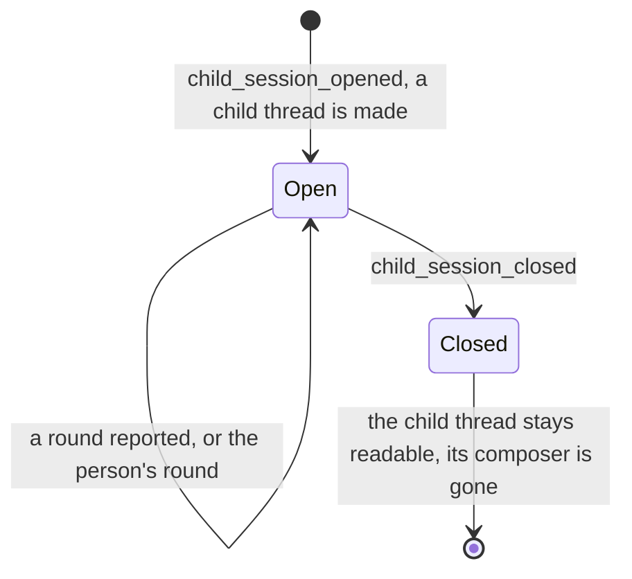

# ADR 0072 — Child sessions are nested threads, followed through `child-sessions/v1`

- **Status:** **proposed (2026-11-18).** The feature is the owner's decision of 2026-11-14, recorded in adam-rs
  [ADR 0045](https://github.com/vymalo/another-adam-rs/blob/main/docs/decisions/0045-a-subagent-can-run-in-the-background-as-a-session.md)
  (*"we need to add the capability that opencode has to create child session, and exchange messages with it. At creation, there
  should be a button to auto-close after work is done, so that the child session can further be reused."*), whose decision 11 puts
  the contract of the extension in this repository. The shape below is proposed, slice by slice. **Built: S1, S2a–S2d** (the contract
  [`child-sessions-v1.md`](../api/child-sessions-v1.md) and the orchestrator's reading of the card; the pure core; the store; the A2A
  client's activation and strict reading of what an agent says; the application and the dispatcher that make the child threads and follow
  their rounds, and the API that says them). Epic:
  [#332](https://github.com/vymalo/another-agentic-system/issues/332). Amends [ADR 0042](0042-the-thread-list-is-the-owners.md),
  [ADR 0055](0055-the-agent-assigns-the-a2a-context.md), [ADR 0029](0029-forking-a-thread-copies-its-log.md),
  [ADR 0036](0036-sending-while-an-agent-works.md), [ADR 0050](0050-the-chat-has-sub-agents.md) and
  [ADR 0026](0026-agent-mentions-as-structured-references.md) (dated notes in each).

## Context

adam-rs runs a helper as a **session** (its ADR 0045, slices 1 and 2 built): a chain of child runs in a conversation of its own,
started by the tool `subagent_start`, kept open between messages when asked, reported to the parent when a round ends. The parent's
model can start, read, send to, list and close sessions. The person cannot: the orchestrator sees the helper only as a step of the
parent's task ([`steps-v1.md`](../api/steps-v1.md)), and its rounds' work is folded into the parent's.

What this system has to build on, *verified 2026-11-18* at `470e156`:

| Fact | Where |
|---|---|
| A thread has one binding to an agent context, and the agent assigns the context: the binding adopts what the first answer names. | [ADR 0055](0055-the-agent-assigns-the-a2a-context.md) |
| The rail nests a thread under another by `rail_parent`, today set only for a fork. | `orchestrator/crates/core/src/thread.rs` (`rail_parent`), `fork.rs` (`rail_parent_of_fork`), [ADR 0042](0042-the-thread-list-is-the-owners.md) |
| One log per thread; usage is attributed from the log to the person (the ledger is written in the commit of the event that carries it). | [ADR 0056](0056-token-usage-per-model-call.md), [ADR 0065](0065-a-usage-ledger-per-person.md) |
| A job is a message the orchestrator sent and follows to its end. | `orchestrator/crates/core/src/transition.rs`, `docs/orchestrator.md` |
| An extension that carries params is read into a typed offer, never cached, and a card that lists it badly offers nothing. | `access-tier/v1`: `orchestrator/crates/core/src/access_tier.rs`, `crates/agent-a2a/src/access_tier.rs` |
| AG-UI already has `SUBAGENT_STARTED` and `SUBAGENT_FINISHED` frames for a sub-agent's work under a run. | `orchestrator/crates/agui-proto/src/event.rs`, `crates/agui-projection/src/projector.rs` |

## Decision

1. **The contract is [`child-sessions-v1.md`](../api/child-sessions-v1.md)**, an optional extension (ADR 0008): params `{agents,
   maxOpen}` on the card; events `opened`, `round`, `reported`, `closed` on the parent task's status updates; a sessions object on every
   task of the parent context, which is the truth the events only point at; a person's `start` on a message to the parent; plain
   messages to the child context, delivered into a working round as adam-rs delivers to a busy context; each round saying its
   session's state; a close as `{close: {cancel}}` in the message metadata (adam-rs ADR 0045 said a data part: metadata cannot be
   mistaken for another extension's data part, such as an A2UI action); `InvalidParams` for a child context that did not activate it.
   The orchestrator reads the card like `access-tier/v1`: an offer only when the URI is listed exactly and the params are well formed,
   read on every send, never kept. The capabilities document carries `custom[<URI>] = {agents, maxOpen}`.
2. **A session is a child thread.** On `opened`, or on a session it finds in the sessions object and does not know, the core decides a
   new thread with `child_of` (new: the parent thread and the session id) and `rail_parent` set to the parent, owned by the parent's
   owner, bound to the child context the agent named (ADR 0055: the context is adopted, never made up). A session the orchestrator
   already knows is matched by its session id; an event seen twice changes nothing.
3. **A round is an observed job** (new): a job of the child thread that the orchestrator did not send but follows, by
   `SubscribeToTask` of the round's task, to its end. Its steps, text and usage go to **the child thread's log only**, so a round's
   usage is counted once, against the person who owns the parent thread (see the *Amended (2026-11-18)* note for which thread
   counts which round). A round the person starts in the child thread is an ordinary job of it.
4. **The parent's log** records `child_session_opened`, `child_session_reported` and `child_session_closed` (new events, decided by the
   pure core from the parent task's events and from the session state each round it follows carries, whichever comes first, once
   each: a session the person started while no parent task runs is known only from its rounds); the helper's work is not copied
   into it. The parent thread's view shows the session as a
   step card that links to the child thread.
5. **The person and a session.** In a child thread the person sends a message (the next round when the session is idle, a steer through
   `steer/v1` when it works, ADR 0036), stops the round (`CancelTask`), and closes the session. From the parent thread they start one:
   an agent of the card's `agents`, a description, a prompt and **"Close when done"**, on by default (adam-rs ADR 0045 default 1). The
   thread permissions are the parent's: the owner writes, nobody else sees it ([ADR 0039](0039-nobody-reads-another-persons-thread.md)).
6. **A fork does not take sessions.** A fork of a parent thread copies its log (ADR 0029) and has no child threads; the parent's
   sessions stay the parent's.
7. **Without the extension nothing changes:** a helper is a step, as today. A client of the orchestrator's API that does not know child
   threads sees them as ordinary threads with a `childOf` member it may ignore.
8. **AG-UI.** A child thread streams as any thread. In the parent's stream an opened session is the `SUBAGENT_STARTED` and
   `SUBAGENT_FINISHED` pair the projection already has, with a new member that names the child thread (`agui.md` gains it with S2).

## Alternatives considered

- **Fold the helper's rounds into the parent's log.** It is what happens today; the person cannot talk to the helper, and a kept-open
  helper's later rounds would land in whatever turn of the parent is open, or nowhere.
- **A thread of its own with no link to the parent.** The rail would fill with threads the person did not start and could not place.
- **The orchestrator makes the child's context.** ADR 0055 forbids it, and adam-rs derives the child context from the parent's.

## Consequences

- New: the core's `child_of` on a thread, the three parent events, the observed job; a migration for `child_of` (S2). A store adapter
  gains what S2 adds to the store port, with its conformance cases.
- Invariant 3 holds: a child thread is a thread, with its own log.
- The usage ledger (ADR 0065) counts a round once: in the parent for a round the parent's model started, in the child for a
  round a person started (*Amended (2026-11-18)*).
- **Until adam-rs moves it**, the live usage of a round the parent's model starts is reported on the parent's task (as it is today),
  and the round's own task carries its totals when it ends. S2 must count such a round once: from the parent's reports or from the
  round's totals, never both.
- Slices, in [#332](https://github.com/vymalo/another-agentic-system/issues/332):

| Slice | What | Depends on |
|---|---|---|
| S1 | The contract, this ADR, the card read into a typed offer, the capabilities key, the fake agent's word `child-sessions` | nothing |
| S2 | Child threads, observed jobs, the parent's events, a WireMock agent that serves the extension (built as S2a to S2d, then S2e and S2f below) | S1 |
| S2e | The AG-UI projection of a session: the parent's card and the child's log in the stream | S2 |
| S2f | The scenario on mocks: a WireMock agent that serves the extension and `dev/child-sessions-e2e.sh` | S2 |
| S3 | The person sends, steers, stops, closes and starts a session | S2 |
| S4 | The web: the nested thread, the step card with "Open", the strip of sessions, "New subagent" with "Close when done" | S3 |
| S5 | The adam pin with adam-rs ADR 0045 slice 6, the chat's `planner` kept open in `dev/agents-e2e.sh` | S4, adam-rs slice 6 |

## Amended (2026-11-18)

**Which thread counts a round's usage.** A round the parent's model started is counted **once, in the parent**: adam already
adds it to the parent's totals and reports it live on the parent's task. The child thread logs that round's `model_usage` and
`model_usage_total` with `counted: false`, so the ledger skips them. A round a **person** started is counted in the child. A round
whose `by` the agent did not say is taken for the agent's and is not counted in the child. A child that is blocked and answered
within the same job keeps the `by` of its round; what counts that answer is decided with S3. If adam moves a round's usage onto
the round itself, the rule flips: the flag is per event, so the history already written stays right. This replaces the wording of
decision 3 and of the consequences that left the choice open.

## Amended (2026-11-18, S2d review)

- **A background round that outlives its parent's task** (a helper the model started and the parent's task did not wait for) is counted in
  the parent **only if adam adds it to the parent task's totals** once it ends. *Unverified*: adam-rs was read for the case of a round
  the parent waits for, not for one that ends after the parent's task did. If adam does not, **the round is counted nowhere** (the
  child's totals are `counted: false` and the parent's task is over). To be checked when S5 pins adam, with the flag per event
  (decision above) as the lever if the answer is no.
- **Decision 2: where a child nests.** A child of a thread that is itself a nested fork is nested under that fork's **root row** of the
  person's list, as a fork of it would be (`rail_parent_of_fork`, one level deep), not under the fork; and under its parent's row
  even when that row is archived (the child is archived with the block).
- **A child is read-only until S3.** A message, a steer, a Stop & send, an action and an AG-UI run on a child thread are `422
  child_thread` like a fork and a share; a cancel is allowed. S3 opens them deliberately.
- **Fail closed against an agent that lies about a round.** An envelope whose `contextId` is not the context the child adopted is
  refused and counted (`child_sessions_dropped_total{reason="foreign_context"}`) and the follow fails, so a task id naming the
  parent's task or another conversation's is never copied into the child. A dispatcher follows at most
  `MAX_OBSERVED_PER_PARENT` (8) rounds of one parent at once; the rest wait with backoff and are never dropped.
