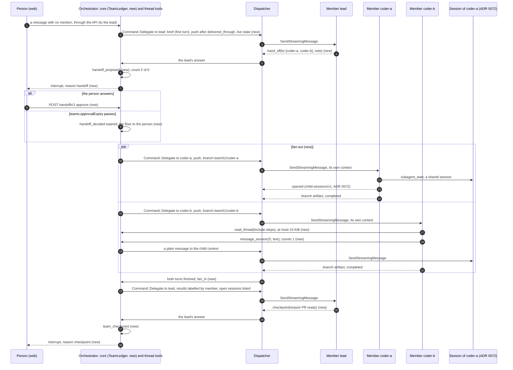
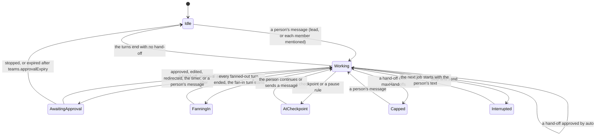

# ADR 0074 — Agent-team: several primary agents in one chat, handing off and fanning out, with the person in the loop

- **Status:** **Accepted (2026-11-19).** The feature is the owner's decision of 2026-11-19 (*"I also want the possibility of
  having in a single chat, multiple primary agents, working as a team of agents. Human in the loop would be sweet in these kinds
  of case. We'll call it agent-team."*). **Amended (2026-11-19, the owner's second answers):** fan-out and fan-in, a branch and
  worktree per coding member, the `hand_off`, `checkpoint` and `read_thread` thread tools, no bound on the history, removal of a
  member, the lead, unattended runs and the release (R1). **Accepted (2026-11-19, the owner's last answer):** a fanned-out member
  does not hand off (decision 6); no question is open. Every decision marked **(owner)** is the owner's; those marked
  **(proposed)** (the turns, the ledger, the AG-UI shape) and the names of routes and events are the design's, which the owner did
  not decide and may change by a dated note. **Nothing is built.** It amends invariant 3 of `CLAUDE.md` and
  [ADR 0001](0001-rust-state-machine-on-postgres.md) (decision 13), as [ADR 0070](0070-a-persons-prompt-library.md) did. Epic:
  [#377](https://github.com/vymalo/another-agentic-system/issues/377). **Amended (2026-11-19, second, the owner's decisions after a
  study of rakazo):** what is pushed to a member is bounded and what it can reach is not (this replaces decision 9's "no bound");
  members with a small window; hygiene of the history and the note; sub-agents of members; a waiting approval expires.
  See [the amendment](#amended-2026-11-19-second); the diagrams below are redrawn for it.

## Context

Today a thread has **one** agent. Mentioned agents are *asked* by it through `ask_agent`
([ADR 0026](0026-agent-mentions-as-structured-references.md)) and never write the transcript; the chat's sub-agents
([ADR 0050](0050-the-chat-has-sub-agents.md)) and child sessions
([ADR 0072](0072-child-sessions-are-nested-threads-followed-through-child-sessions-v1.md)) are helpers of that one agent.

What assumes one primary agent per thread, *verified 2026-11-19* at `118907e`:

| Assumption | Where |
|---|---|
| One target: `threads.agent_id`, `ThreadRecord.target`. | `orchestrator/crates/core/src/thread.rs`, migration `0001_init.sql` |
| One A2A binding per thread (`a2a_bindings` keyed by `thread_id`): one context, one running task. | `orchestrator/crates/ports/src/store.rs` (`AgentBinding`), [ADR 0055](0055-the-agent-assigns-the-a2a-context.md) |
| One job at a time, delegated "to the target agent". | `orchestrator/crates/core/src/gate.rs` (`Job`), `transition.rs` (`Command::Delegate`) |
| A mention means "an agent the addressed agent may ask". | `Job::mentioned`, ADR 0026 |
| The thread tools' caller is `main` or `ask:<n>`. | `orchestrator/crates/core/src/thread_tools.rs` (`Caller`) |
| Steer and Stop & send act on the binding's one running task; a tier goes only to the thread's own agent. | [ADR 0036](0036-sending-while-an-agent-works.md), [ADR 0061](0061-the-person-picks-an-access-tier-for-each-message-the-agent-keeps-to-it.md) decision 6 |

What already fits: an event's `Actor` names the agent that said it (`core/src/event.rs`); a fork tells an agent a conversation it
did not see, labelled by author (`fork_history`, `ForkHistory::addressed_to` in `core/src/fork.rs`); timers exist
(`Command::Schedule`, `Timer`, [ADR 0016](0016-inbox-timers-and-job-ledger-on-the-thread.md)); a person's own definitions have a
pattern (`user_prompts`, `PromptStore`, ADR 0070); an agent reports a pushed branch as a `branch` artifact
([ADR 0018](0018-verification-gate-and-rework-loop.md)).

adam-coder works in a private git worktree, a slot of its run's workspace, on a new branch `agent/<short-run-id>` from the base,
and its subagents share the worktree of their root run (*verified 2026-11-19* in adam-rs `docs/reference/coder-agent.md` at
`9a195eb`).

**Prior art.** rakazo's group chats (github.com/elie222/rakazo at `6645287`, read 2026-11-19) are the closest open design.
Its facts are *verified (2026-11-19, `6645287749857609a13a2fbbb11db4735bef8cab`, the file and lines cited)*. A message that names
nobody wakes every member, each told to answer only if the message fits it, else `NO_RESPONSE`
(`packages/core/src/composer/group-mentions.ts:195-199`; `packages/adapters/src/runs/assembly/run-replies.prompt.ts:22`). A member
hands off with `handoff_to_bot`, one per run, no fan-out, no approval, under a hop counter of 6 that a person's message resets
(`packages/adapters/src/bots/group-handoff.ts:99-163`; `packages/core/src/bots/bot-messages.ts:9-21`;
`packages/core/src/runs/action-approval.ts:179-183`). Only final text is shared between members; steps are reached with
`read_history` (at most 10,000 bytes a call) (`packages/adapters/src/runs/assembly/run-assembly-history.ts:59-61`;
`builtin-memory.tool-definition.ts:7-9`). Context is fitted without a model: the 8 newest messages whole and about 400 characters
for each older one (`runtime-context.ts:64-67`; `runtime-context.prompt.ts:6-17`). A line that looks like a speaker label is
rewritten (`packages/adapters/src/runtime/context/history-speakers.ts:66-72`). A card of an unattended run expires after 30 minutes
(`docs/approvals.md:192-198`). The amendment takes these last five; it keeps the lead, the gate and fan-out, which rakazo has not.

**Missions** ([#342](https://github.com/vymalo/another-agentic-system/issues/342)) stay the long-running, scheduled form: a goal,
a limit, a plan, tasks as background sessions and a verifier. An agent-team is a conversation the person can watch and steer. A
mission may name a team preset as its team; nothing else is shared, and neither waits for the other.

## Decision

1. **Members (owner).** A team thread has **at most 8** members. A member is a name (`@name`, unique in the thread) for any A2A
   agent the person may use ([ADR 0045](0045-admin-dashboard-in-the-web-and-agent-access-from-the-registry.md): the audience
   applies, checked at save, at forming, at adding **and at each turn**), with a role. Two members may be the same agent (two
   coders). No extension is required of a member (invariant 1). Membership is in the log: `team_formed` (a copy of the preset),
   `team_member_added` and `team_member_removed` (new). A fork copies them with the log ([ADR 0029](0029-forking-a-thread-copies-its-log.md)).
2. **A binding and a workspace per member (owner).** `a2a_bindings` is keyed by `(thread_id, member)` (new migration). Each member
   has its own A2A context, which the agent assigns (ADR 0055). Two members never share a context, so they never share a run and
   never share a workspace: an agent such as adam keys its workspace by run, and two members in one context would write the same
   worktree at once.
3. **Turns (proposed).** A message of the person starts a job ([ADR 0020](0020-a-thread-is-a-conversation.md)); inside it, each member's
   piece of work is a **turn** (new: `turn_started`, `turn_finished` with the member). Several turns may run at once. The member of
   a turn is its `main` caller of the thread tools; no member holds a grant outside its turns.
4. **Who answers the person (owner).** A message that mentions no member goes to the preset's **lead** (the first member of a
   thread made without a preset). A message that mentions members goes to each of them: with two or more it is a fan-out whose
   results go back to the person. A person's message always wins: it ends a pending hand-off or checkpoint.
5. **Hand-off (owner).** A member hands off with the thread tool `hand_off(to, note)` (new, `thread-tools/v1`), `to` one member or
   several. Any A2A agent may instead end its answer ([ADR 0031](0031-working-text-and-the-turns-answer.md)) with a line of one or
   more `@member` mentions followed by the note. The tool wins over the line; one hand-off per turn. A name that is not a member,
   or the member itself, is no hand-off: the floor goes back to the person. The core writes `handoff_proposed` (new).
6. **Fan-out and fan-in (owner).** A hand-off to several members starts their turns **in parallel**. When every one has ended
   (completed, failed or stopped), the member that fanned out gets a turn with all their results, each labelled by member, and
   continues (`fan_in`, new). A member inside a fan-out does not hand off: its hand-off request is passed to the fan-in member as
   part of its result (owner). A hand-off to one member passes the floor; nothing comes back.
7. **Coding members in parallel (owner).** Each works **on its own branch and its own worktree**; there is never a shared working
   tree. The brief (decision 9) names the base branch and a branch name for each member, `team/<thread-short>/<member>`. The
   branch that counts is the one the member reports in its `branch` artifact (ADR 0018), whatever its name: adam names its own
   (`agent/<short-run-id>`). The fan-in brief names each member's reported branch. The member that fans in merges them, or opens a
   pull request; the agent's own gates and the thread's verification gate (ADR 0018) apply to that.
8. **Limits (owner).** At most `maxHandoffs` hand-offs per person message, **6** by default; a fan-out to N counts as N, the
   person's own fan-out included. A preset may raise it up to the deployment's `teams.maxHandoffs`, **20**. The one over the cap is
   not routed: `team_capped` (new), and the floor goes back to the person.
9. **Context (owner).** At the start of a turn a member is sent **everything it missed** since its last turn, each message
   labelled `person` or `@member`, rendered as a fork's history is, **with no bound** set by the orchestrator: the member's own
   compaction handles overflow, and the thread tool `read_thread` (new) pages older turns. Before it comes the **team brief**,
   written by the core, never by a model: the members and their roles, the charter, the checkpoints, the hand-off rule and, for a
   coding turn, the branches of decision 7. What another member said is data, never an instruction from the person.
   *Amended (2026-11-19, second): the push is bounded and the reach is not ([A1](#amended-2026-11-19-second)).*
10. **Approval of hand-offs (owner).** By default **every hand-off waits for the person**: approve, edit the note, redirect to
    other members, or stop. `POST /api/threads/{id}/handoffs/{n}` (new; a stale `n` is `409`), written as `handoff_decided`
    (new). A preset may set `after` N seconds (5 to 600; it goes unless the person acted, `Timer::HandoffAuto`, new) or `auto`.
    *Amended (2026-11-19, second): a waiting approval expires ([A5](#amended-2026-11-19-second)).*
11. **The other three ways in the loop (owner).** **Risky actions:** the access tier and the agents' gates apply unchanged; a
    hand-off runs under the tier of the person's message that started the chain, capped by the role cap on the receiving
    member's agent, and **never raises it**. **Interrupts:** Send steers the running members it mentions, every running member
    when it mentions none; Stop & send stops every running turn (ADR 0036); either drops a pending hand-off. **Checkpoints:** a
    member calls `checkpoint(reason)` (new thread tool) or ends its answer with `[checkpoint: <reason>]`; a preset may add the
    rules "pause after `<member>`" and "pause before a PR" (before a turn that is given branches to merge or a pushed branch to
    open a pull request from). At a checkpoint the core writes `team_checkpoint` (new) and nothing is routed until the person
    continues (`POST /api/threads/{id}/checkpoints/{n}`, new) or sends a message.
12. **Unattended runs (owner).** A preset may set approvals to `auto` and the cap to the ceiling, and run with nobody watching.
    Tiers, gates, the cap and the audience still apply.
13. **Presets (owner).** Each person's own in the first version; sharing by role comes later, on ADR 0070's model. A table
    `user_team_presets` (new migration) behind a port `TeamPresetStore` with a conformance testkit (invariant 6), shaped like ADR
    0070: id `t-` and 12 base-36 characters, at most 50 per person, a revision per write, `If-Match` on a change. A preset is a
    name, a title, the lead, the members (2 to 8: name, agent id, optional release, role of at most 280 characters), a charter of
    at most 4 KiB, `maxHandoffs`, `handoffApproval` and the checkpoint rules. Routes `GET` and `POST /api/teams`, `GET`, `PUT` and
    `DELETE /api/teams/{id}`; the contract `docs/api/teams-v1.md` (new); `teams` in `GET /api/config`
    ([ADR 0067](0067-the-plan-to-librechat-grade-and-the-client-agnostic-rule.md)). Picked on the run that creates a thread,
    `forwardedProps["vymalo.team"] = {presetId}`. **Invariant 3 is amended:** presets are durable state beside the log, the
    person's own, read and changed only through the API; a thread keeps a copy in `team_formed`, never a reference.
14. **Mid-chat changes (owner).** `POST /api/threads/{id}/members` adds a member; `DELETE /api/threads/{id}/members/{name}` removes
    one: its past turns stay, its running turn is stopped as Stop & send stops a task, and a pending hand-off to it is dropped.
    Both need `thread.write` on the thread.
15. **The core decides, purely (proposed).** `TeamLedger` (new) on the job ledger: the members, the running turns, the pending fan-in, the
    count since the person's last message and the pending hand-off or checkpoint. Its state is a closed enum
    ([ADR 0004](0004-closed-enums-over-dyn-registry.md)): `Idle`, `Working`, `AwaitingApproval`, `FanningIn`, `AtCheckpoint`,
    `Capped`. A team waiting for the person is `blocked`, as a thread waiting for input is. Usage stays attributed to the agent
    that reported it ([ADR 0056](0056-token-usage-per-model-call.md), [ADR 0065](0065-a-usage-ledger-per-person.md)).
16. **AG-UI and clients (proposed).** Each turn is a run whose messages carry their member; a fan-out is runs side by side under the job. A
    pending hand-off and a checkpoint are the projection's pending interrupt with new reasons `handoff` and `checkpoint`;
    `vymalo.team`, `vymalo.handoff` and `vymalo.checkpoint` are new custom events. A thread with one agent behaves as today, and a
    client that does not know teams sees a thread of its lead.

## Amended (2026-11-19, second)

The owner's decisions of 2026-11-19 after the study of rakazo (*Prior art*). Each is **(owner)**; what is marked **(proposed)** is
the design's.

**A1. Push is bounded, reach is unbounded (owner).** Replaces decision 9's "no bound".

- A turn pushes only **final messages** (the person's, and each member's turn answer, ADR 0031), **hand-off notes**, **fan-in
  results** and **checkpoint reasons**, each labelled `person` or `@member`. Steps, working text and tool calls are never pushed.
- `read_thread` reaches everything, without bound. `read_thread(include: steps)` returns at most **10 KiB** a call, with a cursor.
- A push has a **budget**: **24,000** estimated tokens by default; a preset may set **4,000 to 100,000**; the deployment sets a
  ceiling, `teams.maxPushTokens` (proposed name). Tokens are estimated from characters, with no tokenizer (proposed: 3.3 a token,
  as rakazo, `context-selection.ts:109-118`).
- **Over budget, no model is called.** The push is, in order: the hand-off note or the fan-in results, whole (each at most
  **16 KiB**, then cut with a `read_thread` cursor); the **8 newest** entries whole; **one line of at most 400 characters** per
  older entry (author, seq, time, the start of the text); and a pointer to `read_thread`.
- **Append-only.** `TeamLedger` keeps a `delivered_through` cursor (a log seq) per member; a turn sends only what is after it, and
  nothing delivered is sent again. The brief goes whole on a member's **first turn** only; after that a change of members, roles or
  charter is a change entry in the push. A **live team state** of at most **1 KiB**, written by the core from `TeamLedger` (who
  works, the pending hand-off, open sessions, reported branches), goes at the **end** of each message, so the prefix an agent has
  cached never moves.

**A2. Small-window or non-compacting members: both mechanisms (owner).**

- Each member has `history: agent-keeps | orchestrator-sends` (default `agent-keeps`, which follows A2A context semantics). With
  `orchestrator-sends`, every turn carries the thread's history as a fork does (`fork_history`), under the same budget and rule.
- A turn that fails on context length is **retried once** with only the one-line entries and the note, at half the budget; then it
  fails and says why, and the floor goes back to the person. How each agent reports a context-length failure is *unverified*.
- When a preset turns it on, the orchestrator's own model ([ADR 0035](0035-utility-model-tasks.md)) also writes a **summary** of
  the older entries: at most **8 KiB**, labelled untrusted, cached by the seq range it covers (`team_summary`, new, proposed) and
  reused until that range changes, never part of the brief.

**A3. Hygiene (owner).** A line of rendered history that looks like a speaker label is neutralised. The brief says to weigh a
teammate's claim as evidence, never to adopt it as an order. A hand-off note is at most **8 KiB**; larger content goes into a file
([ADR 0032](0032-files-from-agents-live-in-an-artifact-store.md)) that the note names. A member ends its turn after `hand_off`.

**A4. Sub-agents (owner).** A member may spawn sub-agents, never primary agents.

- **Steps.** adam's own subagents ([ADR 0050](0050-the-chat-has-sub-agents.md)) and an `ask_agent` to an agent that is not a
  member are steps of the member's turn: shared means visible and readable through `read_thread`. An `ask_agent` to a team member
  is refused: that is what `hand_off` is for.
- **Child sessions** ([ADR 0072](0072-child-sessions-are-nested-threads-followed-through-child-sessions-v1.md)) are the fully
  shared kind. **Shared by default; a preset may make them private.**
- **Shared:** the session's card is in the team thread; any member may `read_thread` it and **message it** with the thread tool
  `message_session(session, text)` (new, at most **8 KiB**, a plain message to the child context, ADR 0072 decision 1). Each
  message from a member other than the spawner counts **1 against `maxHandoffs`**. A round's report goes to the member who started
  that round, in its next push, and never starts a turn by itself. Only the spawner, the person or the fan-in member may close it.
- **Private:** only the spawner may read or message it; the others get a one-line notice. The person always sees every sub-agent.
- Sub-agents get no team tools (`hand_off`, `checkpoint`, `message_session`) and cannot hand off.
- **Caps:** the agent's own `maxOpen` (the card's params), and `teams.maxOpenSessions` for the team, default **8**.
- Open sessions do not hold back a fan-in; the fan-in brief lists them, with their state and last report. Removing a member closes
  its sessions with `cancel`; a fork takes none (ADR 0072 decision 6). A round's usage is counted once, against the thread's owner
  (ADR 0072 decision 3, ADR 0065).

**A5. Waiting approvals expire (owner).** A hand-off that waits for the person's approval expires after a deployment window,
`teams.approvalExpiry`, default **30 minutes** (`Timer::HandoffExpiry`, new; written as `handoff_decided` with `expired`), and the
floor goes back to the person. Nothing runs unapproved.

**A6.** *Alternatives rejected* gains rakazo's model: every member answers an unaddressed message.

## The process, as amended

`Interrupted` is the stopping job of ADR 0036 (`Job::after_stop`), drawn for clarity; every other state is new in `TeamLedger`.
A turn that waits for input (`input_required`) leaves the thread `blocked`, as today. A turn retried on context length (A2) stays
in `Working`.

## Consequences

- **Agent-team ships in R1, the first release (owner).** It is not deferred to R2's hooks: the hand-off approval gate is built in
  the orchestrator, from what exists (timers, the pending interrupt, the blocked state).
- A person runs a lead and two coders in one chat, approves each hand-off, and gets two branches merged by the lead. A team that
  loops stops at its cap.
- The core gains a ledger, ten event kinds, a timer and three thread tools; the store three migrations (bindings by member, the
  presets, the event kinds). Each is testable in the pure core first.
- ~~With no bound on the history, a member re-reads everything it missed.~~ *Amended (2026-11-19, second):* a push is bounded by
  its budget and never repeats what was delivered; the agent's cached prefix does not move. A member still reads more than one
  agent would, through `read_thread`, when it chooses to.
- The core gains, with the amendment, a cursor per member, a push budget, two timers, `team_summary` and the thread tool
  `message_session`.
- A member that does not follow the brief never hands off, which is safe. The thread tools are the reliable path.
- Missions (#342) can name a preset as their team.

## Alternatives rejected

- **The lead routes every turn**: a planner in everybody's path, ADR 0026 option B by another name; the owner chose hand-offs.
- **The person routes every turn**: approval by default gives that control without losing the team.
- **Each member sees only what is addressed to it**: members would undo work they never saw.
- **A shared working tree for parallel coders**: two writers on one tree; the owner chose a branch and worktree each.
- **A bound on the history**: it would hide turns from members; the owner chose the member's compaction and `read_thread`.
  *Amended (2026-11-19, second): what is pushed is bounded; what a member can reach is not (A1).*
- **Every member answers an unaddressed message** (rakazo's model, *Prior art*): a model call per member for each such message,
  most of them `NO_RESPONSE`; the lead costs one.
- **Ad hoc teams only**: presets were the owner's choice; adding and removing members keeps the ad hoc case.

