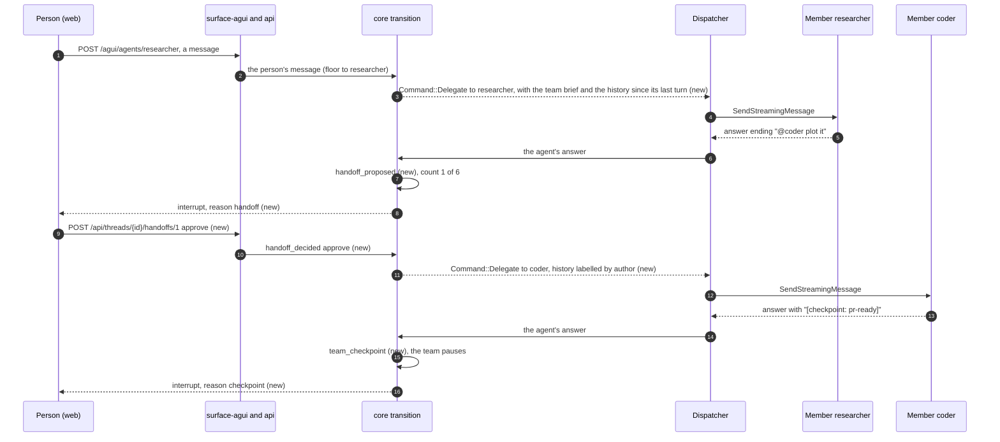
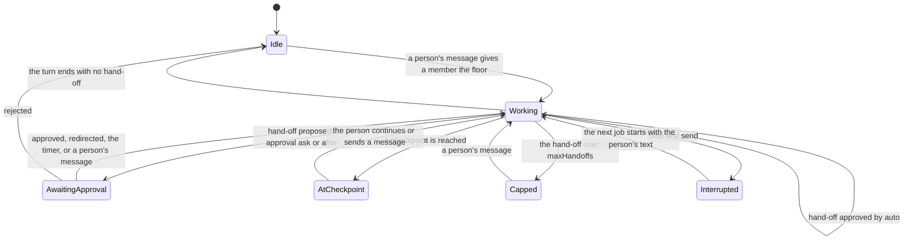

# ADR 0074 — Agent-team: several primary agents in one chat, handing off to each other, with the person in the loop

- **Status:** **proposed (2026-11-19).** The feature and its four answers are the owner's decisions of 2026-11-19 (*"I also want
  the possibility of having in a single chat, multiple primary agents, working as a team of agents. Human in the loop would be
  sweet in these kinds of case. We'll call it agent-team."*): the hand-off, the shared conversation, the four ways the person is in
  the loop and saved presets are **decided**. Everything else below (names, limits, the events, the routes) is **proposed**, for the
  owner to confirm. **Nothing is built.** It amends invariant 3 of `CLAUDE.md` and [ADR 0001](0001-rust-state-machine-on-postgres.md)
  with a dated note (decision 11), as [ADR 0070](0070-a-persons-prompt-library.md) did. Epic:
  [#377](https://github.com/vymalo/another-agentic-system/issues/377).

## Context

Today a thread has **one** agent. The person can mention others ([ADR 0026](0026-agent-mentions-as-structured-references.md)),
but they are *asked* by the addressed agent through `ask_agent`, in a context of their own, and never write the thread's
transcript. The chat's sub-agents ([ADR 0050](0050-the-chat-has-sub-agents.md)) and child sessions
([ADR 0072](0072-child-sessions-are-nested-threads-followed-through-child-sessions-v1.md)) are helpers of one agent too. Nothing
lets two primary agents take turns in one conversation, each seeing what the other said, with the person approving the turns.

What assumes one primary agent per thread, *verified 2026-11-19* at `118907e`:

| Assumption | Where |
|---|---|
| A thread has one target: `threads.agent_id` and `release`, `ThreadRecord.target: AgentTarget`. | `orchestrator/crates/core/src/thread.rs`, migration `0001_init.sql` |
| One A2A binding per thread: `a2a_bindings` is keyed by `thread_id` alone, so one context and one running task. | `orchestrator/crates/ports/src/store.rs` (`AgentBinding`), [ADR 0055](0055-the-agent-assigns-the-a2a-context.md) |
| The core delegates "to the target agent". | `orchestrator/crates/core/src/transition.rs` (`Command::Delegate`) |
| A mention means "an agent the addressed agent may ask", never "who answers". | `Job::mentioned` in `orchestrator/crates/core/src/gate.rs`, ADR 0026 |
| The thread tools' caller is `main` (the addressed agent) or `ask:<n>`. | `orchestrator/crates/core/src/thread_tools.rs` (`Caller`) |
| Steer and Stop & send act on the binding's running task. | [ADR 0036](0036-sending-while-an-agent-works.md) |
| A tier is sent only to the thread's own agent. | [ADR 0061](0061-the-person-picks-an-access-tier-for-each-message-the-agent-keeps-to-it.md) decision 6 |
| A run is posted to one agent: `POST /agui/agents/{agent_id}`. | `orchestrator/crates/surface-agui/src/lib.rs` |

What already fits: an event's `Actor` names the agent that said it (`orchestrator/crates/core/src/event.rs`), so the log already
labels every message by its author; a fork already tells an agent a conversation it did not see, labelled by author and bounded
(`fork_history`, `ForkHistory::addressed_to` in `orchestrator/crates/core/src/fork.rs`, [ADR 0029](0029-forking-a-thread-copies-its-log.md));
a thread is a sequence of jobs ([ADR 0020](0020-a-thread-is-a-conversation.md)); timers exist (`Command::Schedule`, `Timer`,
[ADR 0016](0016-inbox-timers-and-job-ledger-on-the-thread.md)); a person's own durable definitions have a pattern
(`user_prompts`, `PromptStore`, ADR 0070).

**Missions** (epic [#342](https://github.com/vymalo/another-agentic-system/issues/342)) are a different thing: a goal, a limit, a
plan and a definition of done, with tasks run **in parallel** as background sessions on their own branches and accepted by a
verifier. An agent-team is **one conversation with one floor**, where the person watches and steers each turn. They are distinct.
The one thing they share is the preset: a mission's team (#342 slice 3) may name a team preset. Nothing else of a mission depends on
this ADR, and nothing here waits for a mission. [ADR 0073](0073-app-factory-board-and-model-selection.md)'s use of mentions and
folder sub-agents is unchanged.

## Decision

1. **A team thread has members.** A thread is created as a team from a preset (decision 9) or gains members later (decision 10).
   The members are plain A2A agents, listed as today (invariant 1; no extension is required of them). At most **8** members. The
   thread's `target` stays: it is the **first member**, who has the floor on the first message, and it is what the list, search and
   export show as the thread's agent. Membership is in the log: `team_formed` (new: the preset's content copied, so a later edit of
   the preset changes no thread) and `team_member_added` (new). A fork copies them with the log (ADR 0029).
2. **One binding per member.** `a2a_bindings` is keyed by `(thread_id, agent_id)` (new migration). Each member keeps its own A2A
   context, which it assigns itself (ADR 0055). A thread with one agent has one row, as today.
3. **One floor.** One member works at a time. **A turn is a job** (ADR 0020): `job_started` gains `member` and `by` (`person` or
   `handoff`). The member with the floor is the job's `main` caller of the thread tools; no member holds a grant outside its turn.
4. **Who gets the floor from the person.** The person's message goes to the **first member it mentions**; with none, to the member
   the run's path names (`POST /agui/agents/{agent_id}`; the web sends the member who spoke last). A path that names an agent that
   is not a member is `422`. A mention of an agent that is not a member keeps ADR 0026's meaning: the member with the floor may ask
   it. A person's message **always** wins: it ends a pending hand-off or checkpoint and redirects the floor (decided: the person can
   @mention anyone at any time).
5. **A member hands off by addressing another member (decided).** Its turn's answer ([ADR 0031](0031-working-text-and-the-turns-answer.md))
   ends with a line whose first word is `@<member>`; the rest of the line is the note. An agent that lists `thread-tools/v1` may
   call the thread tool `hand_off {to, note}` instead (new), which wins over the text. One hand-off per turn, the last. A line that
   names itself or an agent that is not a member is no hand-off: the turn ends and the floor goes back to the person. The core
   writes `handoff_proposed` (new: from, to, note, the count).
6. **A cap per person message (decided).** At most `maxHandoffs` hand-offs are routed after one message of the person: the
   preset's value, default **6**, never above the deployment's `teams.maxHandoffs` (default **20**). The next one is not routed:
   the core writes `team_capped` (new) and the floor goes back to the person. A message of the person starts the count again.
7. **Every member reads the whole thread, labelled by author (decided).** At the start of its turn a member is sent what was said
   in the thread since its own last turn (its own context holds the rest): the person's messages and the other members' answers,
   each labelled `person` or `@<member>`, rendered as a fork's history is (`fork_history`, `addressed_to`), with the same bound
   (24 KiB per turn, 4 KiB per entry; what is left out is counted and said). Before it, the **team brief** (new, written by the
   core, never by a model): the members and their roles, the charter, the checkpoints and the hand-off rule. Everything another
   member said is data to the next one, never an instruction from the person.
8. **The person is in the loop four ways (decided):**
   - **a. Approve hand-offs.** The preset's `handoffApproval` is `ask` (default: the hand-off waits until the person approves,
     rejects or redirects it), `after` with `seconds` (5 to 600: it waits, then goes unless the person acted; a new
     `Timer::HandoffAuto` through `Command::Schedule`) or `auto` (no wait). The answer is `POST
     /api/threads/{id}/handoffs/{n}` with `approve`, `reject` or `redirect` to a member (new), written as `handoff_decided` (new:
     the decision and whether a person or the timer made it). A stale `n` is `409`.
   - **b. Approve risky actions.** Unchanged: the access tier (ADR 0061) and the agents' own gates. A hand-off runs under the tier
     of the person's message that started the chain, capped by the person's role cap on the receiving member (ADR 0061 decision 8),
     never raised by a member. A tier is still sent only on the person's behalf, which a hand-off the person approved, or allowed by
     their preset, is.
   - **c. Interrupt any time.** Unchanged: Send steers and Stop & send stops (ADR 0036), on the member with the floor. A pending
     hand-off is dropped by either.
   - **d. Checkpoints the team declares.** A preset names up to 8 checkpoints (`plan-ready`, `pr-ready`, …), each `declared` (the
     member says it: the thread tool `checkpoint {name, summary}`, new, or a line `[checkpoint: <name>]` in its answer) or
     `verified` (reached when the verification gate passes the turn's work, [ADR 0018](0018-verification-gate-and-rework-loop.md)).
     At a checkpoint the core writes `team_checkpoint` (new) and the team pauses: a hand-off of that turn is held until the person
     continues (`POST /api/threads/{id}/checkpoints/{n}`, new, which counts as approving it) or sends a message.
9. **Saved team presets (decided).** A person's own, in a table of their own, `user_team_presets` (new migration), behind a port
   `TeamPresetStore` with a conformance testkit beside `PromptStore` (invariant 6), shaped like ADR 0070: an id `t-` and 12
   lowercase base-36 characters, at most **50** per person, a revision per write, `If-Match` on a change. A preset is a `name`, a
   `title`, the members (2 to 8, each an agent id and an optional release, a `role` of at most 280 characters), a `charter` of at
   most 4 KiB, `maxHandoffs`, `handoffApproval` and the checkpoints. Routes `GET` and `POST /api/teams`, `GET`, `PUT` and `DELETE
   /api/teams/{id}` (new); the contract is `docs/api/teams-v1.md` (new), and `GET /api/config` gains `teams` as the capability
   ([ADR 0067](0067-the-plan-to-librechat-grade-and-the-client-agnostic-rule.md) decisions 1 and 3). A preset is picked on the run
   that creates the thread, `forwardedProps["vymalo.team"] = {presetId}` (new).
10. **Members can be added mid-chat (decided).** `POST /api/threads/{id}/members` (new) with an agent id and a role, by the owner
    with `thread.write`, written as `team_member_added`. A thread with one agent becomes a team this way.
11. **Who may.** A member must be one the person may invoke ([ADR 0045](0045-admin-dashboard-in-the-web-and-agent-access-from-the-registry.md)),
    checked when a preset is saved, when a thread is formed, when a member is added **and at each turn**: a hand-off to a member
    the person may no longer use is not routed, says so, and the floor goes back to the person. Nobody reads another person's
    presets or team threads ([ADR 0039](0039-nobody-reads-another-persons-thread.md)). **Invariant 3 is amended:** a person's team
    presets are durable state beside the log, their own, read and changed only through the API, never folded by the core; a thread
    holds a copy in `team_formed`, not a reference.
12. **The core decides, purely.** The team ledger is part of the job ledger on the thread (`TeamLedger`, new): the members, who has
    the floor, the hand-off count since the person's last message and the pending hand-off or checkpoint. Its turn state is a
    closed enum (ADR 0004): `Idle`, `Working`, `AwaitingApproval`, `AtCheckpoint`, `Capped`. The thread's own `ThreadState` does not
    change; a team waiting for the person is `blocked`, as a thread waiting for input is today. Usage stays attributed to the agent
    that reported it (ADR 0056, ADR 0065).
13. **AG-UI.** Each turn is a run whose messages carry their member. A pending hand-off and a checkpoint are the projection's
    existing pending interrupt with new reasons `handoff` and `checkpoint`; `vymalo.team`, `vymalo.handoff` and
    `vymalo.checkpoint` are new custom events (`docs/api/agui.md` gains them).
14. **Without a team nothing changes.** A thread with one agent behaves as today, and a client that does not know teams sees a
    team thread as a thread of its first member with extra events it may ignore.

`Interrupted` is not a state of the ledger: it is the stopping job of ADR 0036 (`Job::after_stop`), drawn for clarity. Every other
state is new in `TeamLedger`. A turn that blocks for input (`input_required`) stays in `Working` with the thread `blocked`, as
today.

## Consequences

- The person can run a researcher, a coder and a reviewer in one chat, watch each turn and decide each hand-off. A team that loops
  stops at its cap, never after it.
- The core gains a ledger, six event kinds, two members of `job_started` and a timer; the store a migration for bindings by member, one for the presets and one for
  the event kinds. Each change is small, and each is testable in the pure core first.
- Every member re-reads what it missed at every turn: more tokens than a single agent. The bound of decision 7 keeps a turn's
  preamble at most 24 KiB.
- The hand-off line is text: a member that does not follow the brief never hands off, which is safe (the floor goes to the
  person). The thread tool is the reliable way where an agent has it.
- Missions (#342) can name a preset as their team without a second definition.

## Alternatives rejected

- **The lead routes** (one member decides every turn): the lead becomes a planner in everybody's path, ADR 0026 option B by another
  name; the owner chose hand-offs.
- **The person routes every turn**: no team, only a person switching agents; the approval of decision 8a gives the same control
  when wanted.
- **Each member sees only what is addressed to it**: members would contradict work they never saw; the owner chose the whole thread.
- **Ad hoc teams only, no presets**: the person rebuilds the same team each time; presets were the owner's choice, and mid-chat
  additions keep the ad hoc case.

## Questions for the owner

1. **Several members mentioned in one message.** Recommended: the first gets the floor and the message says the others, who get it
   by hand-off. Or should they speak in the order mentioned, counted against the cap?
2. **The whole thread, bounded.** Recommended: 24 KiB of history per turn, as a fork. Or should members get a thread tool to page
   older turns, as question 8 of ADR 0067 asks for imported history?
3. **Removing a member.** Recommended: allowed, as `team_member_removed`; its past turns stay in the thread. Or add-only, as asked?
4. **Sharing presets by role**, as prompts are (ADR 0070)? Recommended: not in the first version.
